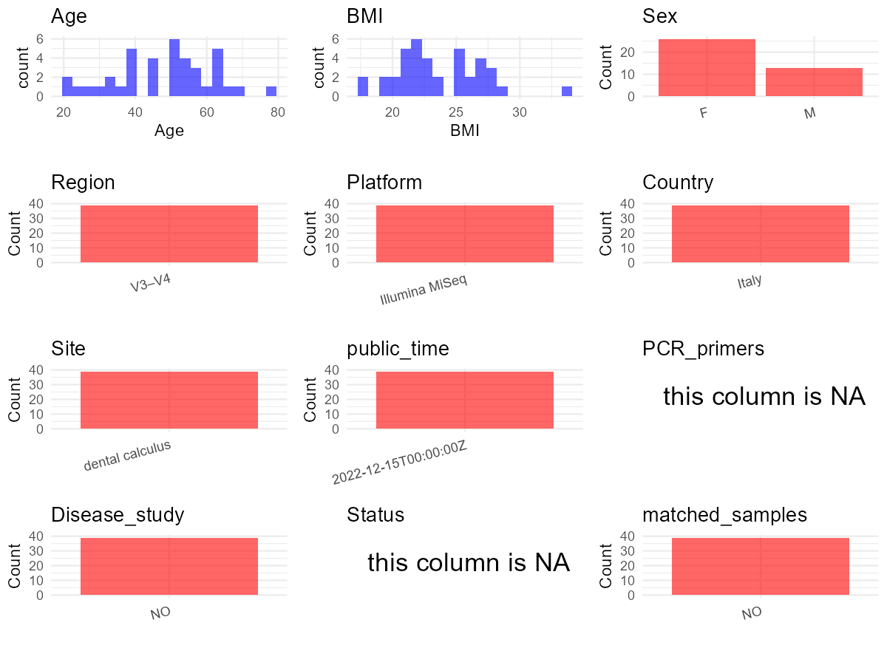

R Notebook: Metadata Processing Workflow
================

# Step 1: Obtain Initial Metadata from Each Project

To obtain the initial metadata: 1. Search for the BioProject ID (e.g.,
“PRJEBXXXX”) on the [NCBI SRA
website](https://www.ncbi.nlm.nih.gov/Traces/study/). 2. In the “Select”
table, click on “Metadata” and download the file. 3. The downloaded file
is typically named “SraRunTable.csv” and contains metadata for the
project.

``` r
# Load necessary libraries
library(dplyr)
library(ggplot2)
library(cowplot)

# Set working directory (update this path to your local directory)
setwd("D:/studylearning/董彪师兄项目/任务3_20251004/PRJNA828039")

# Read the initial metadata files
initial_meta<-read.csv("SraRunTable.csv",header = T)

# Display the first few rows of the metadata
head(initial_meta)
```

    ##           Run Assay.Type AvgSpotLen    Bases  BioProject    BioSample
    ## 1 SRR18810761   AMPLICON        600 37266884 PRJNA828039 SAMN27629781
    ## 2 SRR18810762   AMPLICON        600 18923648 PRJNA828039 SAMN27629780
    ## 3 SRR18810763   AMPLICON        600 45547409 PRJNA828039 SAMN27629779
    ## 4 SRR18810766   AMPLICON        600 27050010 PRJNA828039 SAMN27629811
    ## 5 SRR18810767   AMPLICON        600 44763896 PRJNA828039 SAMN27629810
    ## 6 SRR18810769   AMPLICON        600 71738897 PRJNA828039 SAMN27629808
    ##                                BioSampleModel    Bytes         Center.Name
    ## 1 MIMARKS.survey,MIGS/MIMS/MIMARKS.human-oral 19495808 UNIVERSITY OF PADUA
    ## 2 MIMARKS.survey,MIGS/MIMS/MIMARKS.human-oral 10151959 UNIVERSITY OF PADUA
    ## 3 MIMARKS.survey,MIGS/MIMS/MIMARKS.human-oral 23556720 UNIVERSITY OF PADUA
    ## 4 MIMARKS.survey,MIGS/MIMS/MIMARKS.human-oral 14208478 UNIVERSITY OF PADUA
    ## 5 MIMARKS.survey,MIGS/MIMS/MIMARKS.human-oral 23077576 UNIVERSITY OF PADUA
    ## 6 MIMARKS.survey,MIGS/MIMS/MIMARKS.human-oral 36296639 UNIVERSITY OF PADUA
    ##   Collection_Date Consent DATASTORE.filetype DATASTORE.provider
    ## 1       2022/4/11  public   fastq,run.zq,sra         gs,ncbi,s3
    ## 2       2022/4/11  public   fastq,run.zq,sra         gs,ncbi,s3
    ## 3       2022/4/11  public   fastq,run.zq,sra         gs,ncbi,s3
    ## 4       2022/4/18  public   fastq,run.zq,sra         gs,ncbi,s3
    ## 5       2022/4/18  public   fastq,run.zq,sra         gs,ncbi,s3
    ## 6       2022/4/16  public   fastq,run.zq,sra         gs,ncbi,s3
    ##                       DATASTORE.region            env_broad_scale
    ## 1 gs.us-east1,ncbi.public,s3.us-east-1 dental calculus microbiome
    ## 2 gs.us-east1,ncbi.public,s3.us-east-1 dental calculus microbiome
    ## 3 gs.us-east1,ncbi.public,s3.us-east-1 dental calculus microbiome
    ## 4 gs.us-east1,ncbi.public,s3.us-east-1 dental calculus microbiome
    ## 5 gs.us-east1,ncbi.public,s3.us-east-1 dental calculus microbiome
    ## 6 gs.us-east1,ncbi.public,s3.us-east-1 dental calculus microbiome
    ##   env_local_scale  env_medium  Experiment geo_loc_name_country
    ## 1          FDI-13 human mouth SRX14909226                Italy
    ## 2          FDI-34 human mouth SRX14909225                Italy
    ## 3          FDI-15 human mouth SRX14909224                Italy
    ## 4          FDI-34 human mouth SRX14909221                Italy
    ## 5          FDI-48 human mouth SRX14909220                Italy
    ## 6          FDI-25 human mouth SRX14909218                Italy
    ##   geo_loc_name_country_continent geo_loc_name         HOST     Instrument
    ## 1                         Europe Italy:Padova Homo sapiens Illumina MiSeq
    ## 2                         Europe Italy:Padova Homo sapiens Illumina MiSeq
    ## 3                         Europe Italy:Padova Homo sapiens Illumina MiSeq
    ## 4                         Europe Italy:Padova Homo sapiens Illumina MiSeq
    ## 5                         Europe Italy:Padova Homo sapiens Illumina MiSeq
    ## 6                         Europe Italy:Padova Homo sapiens Illumina MiSeq
    ##           lat_lon Library.Name LibraryLayout LibrarySelection LibrarySource
    ## 1 45.24 N 11.52 E         ID21        PAIRED              PCR   METAGENOMIC
    ## 2 45.24 N 11.52 E         ID20        PAIRED              PCR   METAGENOMIC
    ## 3 45.24 N 11.52 E          ID2        PAIRED              PCR   METAGENOMIC
    ## 4 45.24 N 11.52 E         ID52        PAIRED              PCR   METAGENOMIC
    ## 5 45.24 N 11.52 E         ID51        PAIRED              PCR   METAGENOMIC
    ## 6 45.24 N 11.52 E         ID49        PAIRED              PCR   METAGENOMIC
    ##          Organism Platform          ReleaseDate          create_date version
    ## 1 oral metagenome ILLUMINA 2022-12-15T00:00:00Z 2022-04-19T11:52:00Z       1
    ## 2 oral metagenome ILLUMINA 2022-12-15T00:00:00Z 2022-04-19T11:52:00Z       1
    ## 3 oral metagenome ILLUMINA 2022-12-15T00:00:00Z 2022-04-19T11:52:00Z       1
    ## 4 oral metagenome ILLUMINA 2022-12-15T00:00:00Z 2022-04-19T11:52:00Z       1
    ## 5 oral metagenome ILLUMINA 2022-12-15T00:00:00Z 2022-04-19T11:52:00Z       1
    ## 6 oral metagenome ILLUMINA 2022-12-15T00:00:00Z 2022-04-19T11:52:00Z       1
    ##   Sample.Name SRA.Study Age Sex BMI
    ## 1        ID21 SRP371050  44   F  20
    ## 2        ID20 SRP371050  34   F  19
    ## 3         ID2 SRP371050  67   M  27
    ## 4        ID52 SRP371050  52   F  24
    ## 5        ID51 SRP371050  37   M  22
    ## 6        ID49 SRP371050  28   F  20

# Step 2: Create a Uniform Metadata Template

The uniform metadata should include the following columns:

1.  **BioProject**: Project ID (e.g., “PRJNA339212”)
2.  **Run**: Sample ID (e.g., “ERRXXXXXX” or “SRRXXXXXX”)
3.  **sample_name**: Original sample name submitted by the authors (not
    the database-assigned ID)
4.  **Age**: Age of the subject (if available)
5.  **BMI**: Body Mass Index (if available)
6.  **Sex**: Sex of the subject (“F” or “M”)
7.  **Region**: Targeted 16S rRNA region (e.g., “V3-V4”)
8.  **Platform**: Sequencing platform (e.g., “Illumina MiSeq”)
9.  **Country**: Country of sample origin (e.g., “China”)
10. **Site**: Sample site (e.g., “saliva”, “dental plaque”)
11. **public_time**: Data release date (format: “YYYY-MM-DD”)
12. **PCR_primers**: PCR primers used (e.g., “515F-806R”)
13. **title**: Title of the associated publication
14. **Disease_study**: Whether the study involves a disease (“YES” or
    “NO”)
15. **Status**: Disease status (e.g., “T2DM”, “HC”). Note: If the study
    includes both disease and healthy samples, this must be specified
    per sample.

``` r
# Create a uniform metadata dataframe
metadata <- data.frame(
  BioProject = initial_meta$BioProject,
  Run = initial_meta$Run,
  sample_name = initial_meta$Sample.Name,
  Age = initial_meta$Age,
  BMI = initial_meta$BMI,
  Sex= initial_meta$Sex,
  Region = "V3–V4",
  Platform = initial_meta$Instrument,
  Country = initial_meta$geo_loc_name_country,
  Site = "dental calculus",
  public_time = initial_meta$ReleaseDate,
  stringsAsFactors = FALSE
)
```

# Step 3: Manually Add Information from the Publication

Some information (e.g. PCR primers, study title, disease status) must be
manually extracted from the publication and added to the metadata.

``` r
# Add information obtained from the publication
metadata$PCR_primers <- NA_character_  # Update based on the publication
metadata$title <- "Dental calculus microbiome correlates with dietary intake"
metadata$Disease_study <- "NO"
metadata$Status <- NA_character_

#extract subject id by remove prefix of sample_name
#metadata$sample_name <- gsub("_st|_sal", "", metadata$sample_name)

# Check initial data distribution
cat("Initial sample distribution:\n")
```

    ## Initial sample distribution:

``` r
table(metadata$sample_name)
```

    ## 
    ##  ID1 ID15 ID16 ID17 ID18 ID19  ID2 ID20 ID21 ID22 ID23 ID24 ID25 ID26 ID27 ID28 
    ##    1    1    1    1    1    1    1    1    1    1    1    1    1    1    1    1 
    ## ID29 ID30 ID31 ID32 ID33 ID34 ID35 ID36 ID37 ID38 ID39 ID41 ID42 ID43 ID44 ID45 
    ##    1    1    1    1    1    1    1    1    1    1    1    1    1    1    1    1 
    ## ID46 ID47 ID48 ID49 ID50 ID51 ID52 
    ##    1    1    1    1    1    1    1

``` r
table(metadata$Site)
```

    ## 
    ## dental calculus 
    ##              39

``` r
# Calculate sampling frequency per subject
sample_counts <- table(metadata$sample_name)
cat("\nNumber of samples per subject:\n")
```

    ## 
    ## Number of samples per subject:

``` r
print(sample_counts)
```

    ## 
    ##  ID1 ID15 ID16 ID17 ID18 ID19  ID2 ID20 ID21 ID22 ID23 ID24 ID25 ID26 ID27 ID28 
    ##    1    1    1    1    1    1    1    1    1    1    1    1    1    1    1    1 
    ## ID29 ID30 ID31 ID32 ID33 ID34 ID35 ID36 ID37 ID38 ID39 ID41 ID42 ID43 ID44 ID45 
    ##    1    1    1    1    1    1    1    1    1    1    1    1    1    1    1    1 
    ## ID46 ID47 ID48 ID49 ID50 ID51 ID52 
    ##    1    1    1    1    1    1    1

``` r
# Create matched_samples column
metadata$matched_samples <- ifelse(metadata$sample_name %in% names(sample_counts[sample_counts >= 2]), "YES", "NO")

cat("\nMatched samples distribution:\n")
```

    ## 
    ## Matched samples distribution:

``` r
table(metadata$matched_samples)
```

    ## 
    ## NO 
    ## 39

``` r
# Identify samples for removal: single samples excluding dental calculus 
single_samples <- names(sample_counts[sample_counts == 1])
samples_to_remove <- metadata$sample_name %in% single_samples & !(metadata$Site %in% c("dental calculus"))

cat("\nNumber of samples to be removed:", sum(samples_to_remove), "\n")
```

    ## 
    ## Number of samples to be removed: 0

``` r
# Remove identified samples
metadata_clean <- metadata[!samples_to_remove, ]

cat("\nFinal sample distribution after cleaning:\n")
```

    ## 
    ## Final sample distribution after cleaning:

``` r
table(metadata_clean$sample_name)
```

    ## 
    ##  ID1 ID15 ID16 ID17 ID18 ID19  ID2 ID20 ID21 ID22 ID23 ID24 ID25 ID26 ID27 ID28 
    ##    1    1    1    1    1    1    1    1    1    1    1    1    1    1    1    1 
    ## ID29 ID30 ID31 ID32 ID33 ID34 ID35 ID36 ID37 ID38 ID39 ID41 ID42 ID43 ID44 ID45 
    ##    1    1    1    1    1    1    1    1    1    1    1    1    1    1    1    1 
    ## ID46 ID47 ID48 ID49 ID50 ID51 ID52 
    ##    1    1    1    1    1    1    1

``` r
table(metadata_clean$Site)
```

    ## 
    ## dental calculus 
    ##              39

``` r
table(metadata_clean$matched_samples)
```

    ## 
    ## NO 
    ## 39

``` r
# Use cleaned dataset for subsequent analysis
metadata <- metadata_clean
```

# Step 4: Summarize and Validate the Metadata

``` r
# Check the number of unique runs and sample names
print(paste("Number of unique runs:", length(unique(metadata$Run))))
```

    ## [1] "Number of unique runs: 39"

``` r
print(paste("Number of unique sample names:", length(unique(metadata$sample_name))))
```

    ## [1] "Number of unique sample names: 39"

# Step 5: Visualize the Metadata

``` r

```


# Step 6: Finalize and Export the Metadata

``` r
# Reorder columns to match the desired format
metadata <- metadata[, c(
  "BioProject", "Run", "sample_name", "Age", "BMI", "Sex", 
  "Region", "Platform", "Country", "Site", "public_time", 
  "PCR_primers", "title", "Disease_study", "Status","matched_samples"
)]

# Export the uniform metadata to a CSV file
write.csv(metadata, file = "metadata.csv", quote = FALSE)
head(metadata)
```

    ##    BioProject         Run sample_name Age BMI Sex Region       Platform Country
    ## 1 PRJNA828039 SRR18810761        ID21  44  20   F  V3–V4 Illumina MiSeq   Italy
    ## 2 PRJNA828039 SRR18810762        ID20  34  19   F  V3–V4 Illumina MiSeq   Italy
    ## 3 PRJNA828039 SRR18810763         ID2  67  27   M  V3–V4 Illumina MiSeq   Italy
    ## 4 PRJNA828039 SRR18810766        ID52  52  24   F  V3–V4 Illumina MiSeq   Italy
    ## 5 PRJNA828039 SRR18810767        ID51  37  22   M  V3–V4 Illumina MiSeq   Italy
    ## 6 PRJNA828039 SRR18810769        ID49  28  20   F  V3–V4 Illumina MiSeq   Italy
    ##              Site          public_time PCR_primers
    ## 1 dental calculus 2022-12-15T00:00:00Z        <NA>
    ## 2 dental calculus 2022-12-15T00:00:00Z        <NA>
    ## 3 dental calculus 2022-12-15T00:00:00Z        <NA>
    ## 4 dental calculus 2022-12-15T00:00:00Z        <NA>
    ## 5 dental calculus 2022-12-15T00:00:00Z        <NA>
    ## 6 dental calculus 2022-12-15T00:00:00Z        <NA>
    ##                                                       title Disease_study
    ## 1 Dental calculus microbiome correlates with dietary intake            NO
    ## 2 Dental calculus microbiome correlates with dietary intake            NO
    ## 3 Dental calculus microbiome correlates with dietary intake            NO
    ## 4 Dental calculus microbiome correlates with dietary intake            NO
    ## 5 Dental calculus microbiome correlates with dietary intake            NO
    ## 6 Dental calculus microbiome correlates with dietary intake            NO
    ##   Status matched_samples
    ## 1   <NA>              NO
    ## 2   <NA>              NO
    ## 3   <NA>              NO
    ## 4   <NA>              NO
    ## 5   <NA>              NO
    ## 6   <NA>              NO

## Notes for Students:

1.  **Metadata Accuracy**: Always cross-check the metadata with the
    original publication to ensure accuracy.
2.  **Manual Entries**: Columns like `PCR_primers`, and `Status` often
    require manual entry based on the publication.
3.  **Disease Status**: Be careful when assigning `Status`—some studies
    include both disease and healthy samples.
4.  **Visualization**: The plots help quickly identify the distribution
    of values in each column, which is useful for quality control.
5.  **Reproducibility**: Update the working directory and file paths to
    match your local environment.
