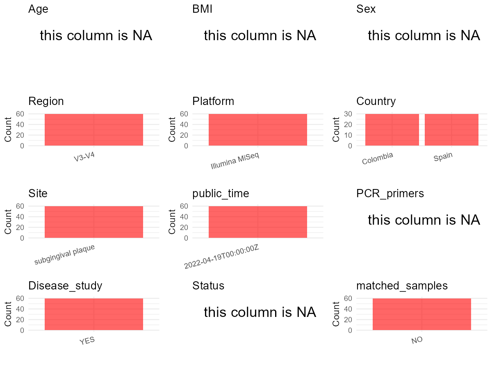

R Notebook: Metadata Processing Workflow
================

# Step 1: Obtain Initial Metadata from Each Project

To obtain the initial metadata: 1. Search for the BioProject ID (e.g.,
“PRJEBXXXX”) on the [NCBI SRA
website](https://www.ncbi.nlm.nih.gov/Traces/study/). 2. In the “Select”
table, click on “Metadata” and download the file. 3. The downloaded file
is typically named “SraRunTable.csv” and contains metadata for the
project.

``` r
# Load necessary libraries
library(dplyr)
library(ggplot2)
library(cowplot)

# Set working directory (update this path to your local directory)
setwd("D:/studylearning/董彪师兄项目/任务3_20251004/PRJNA828047")

# Read the initial metadata files
initial_meta<-read.csv("SraRunTable.csv",header = T)

# Display the first few rows of the metadata
head(initial_meta)
```

    ##           Run Assay.Type AvgSpotLen    Bases  BioProject    BioSample
    ## 1 SRR18809648   AMPLICON        499  8806002 PRJNA828047 SAMN27629901
    ## 2 SRR18809649   AMPLICON        499  8261612 PRJNA828047 SAMN27629900
    ## 3 SRR18809650   AMPLICON        499 12975369 PRJNA828047 SAMN27629899
    ## 4 SRR18809651   AMPLICON        499  5050741 PRJNA828047 SAMN27629898
    ## 5 SRR18809653   AMPLICON        501 21652703 PRJNA828047 SAMN27629950
    ## 6 SRR18809654   AMPLICON        500 10625811 PRJNA828047 SAMN27629949
    ##                                BioSampleModel    Bytes
    ## 1 MIMARKS.survey,MIGS/MIMS/MIMARKS.human-oral  4580087
    ## 2 MIMARKS.survey,MIGS/MIMS/MIMARKS.human-oral  4591283
    ## 3 MIMARKS.survey,MIGS/MIMS/MIMARKS.human-oral  7222205
    ## 4 MIMARKS.survey,MIGS/MIMS/MIMARKS.human-oral  2754439
    ## 5 MIMARKS.survey,MIGS/MIMS/MIMARKS.human-oral 10461879
    ## 6 MIMARKS.survey,MIGS/MIMS/MIMARKS.human-oral  5189069
    ##                                            Center.Name Consent
    ## 1 MOLECULAR GENETICS AND ANTIMICROBIAL RESISTANCE UNIT  public
    ## 2 MOLECULAR GENETICS AND ANTIMICROBIAL RESISTANCE UNIT  public
    ## 3 MOLECULAR GENETICS AND ANTIMICROBIAL RESISTANCE UNIT  public
    ## 4 MOLECULAR GENETICS AND ANTIMICROBIAL RESISTANCE UNIT  public
    ## 5 MOLECULAR GENETICS AND ANTIMICROBIAL RESISTANCE UNIT  public
    ## 6 MOLECULAR GENETICS AND ANTIMICROBIAL RESISTANCE UNIT  public
    ##   DATASTORE.filetype DATASTORE.provider                     DATASTORE.region
    ## 1   fastq,run.zq,sra         gs,ncbi,s3 gs.us-east1,ncbi.public,s3.us-east-1
    ## 2   fastq,run.zq,sra         gs,ncbi,s3 gs.us-east1,ncbi.public,s3.us-east-1
    ## 3   fastq,run.zq,sra         gs,ncbi,s3 gs.us-east1,ncbi.public,s3.us-east-1
    ## 4   fastq,run.zq,sra         gs,ncbi,s3 gs.us-east1,ncbi.public,s3.us-east-1
    ## 5   fastq,run.zq,sra         gs,ncbi,s3 gs.us-east1,ncbi.public,s3.us-east-1
    ## 6   fastq,run.zq,sra         gs,ncbi,s3 gs.us-east1,ncbi.public,s3.us-east-1
    ##      env_broad_scale   env_local_scale     env_medium  Experiment
    ## 1 subgingival plaque human oral cavity not applicable SRX14908140
    ## 2 subgingival plaque human oral cavity not applicable SRX14908139
    ## 3 subgingival plaque human oral cavity not applicable SRX14908138
    ## 4 subgingival plaque human oral cavity not applicable SRX14908137
    ## 5 subgingival plaque human oral cavity not applicable SRX14908135
    ## 6 subgingival plaque human oral cavity not applicable SRX14908134
    ##   geo_loc_name_country geo_loc_name_country_continent geo_loc_name         HOST
    ## 1             Colombia                  South America     Colombia Homo sapiens
    ## 2             Colombia                  South America     Colombia Homo sapiens
    ## 3             Colombia                  South America     Colombia Homo sapiens
    ## 4             Colombia                  South America     Colombia Homo sapiens
    ## 5                Spain                         Europe        Spain Homo sapiens
    ## 6                Spain                         Europe        Spain Homo sapiens
    ##       Instrument                lat_lon Library_ID Library.Name LibraryLayout
    ## 1 Illumina MiSeq 4.711750 N 74.032472 W         10           10        PAIRED
    ## 2 Illumina MiSeq 4.711750 N 74.032472 W          9            9        PAIRED
    ## 3 Illumina MiSeq 4.711750 N 74.032472 W          8            8        PAIRED
    ## 4 Illumina MiSeq 4.711750 N 74.032472 W          7            7        PAIRED
    ## 5 Illumina MiSeq 40.421040 N 3.710350 W         59           59        PAIRED
    ## 6 Illumina MiSeq 40.421040 N 3.710350 W         58           58        PAIRED
    ##   LibrarySelection LibrarySource              Organism Platform
    ## 1              PCR   METAGENOMIC human oral metagenome ILLUMINA
    ## 2              PCR   METAGENOMIC human oral metagenome ILLUMINA
    ## 3              PCR   METAGENOMIC human oral metagenome ILLUMINA
    ## 4              PCR   METAGENOMIC human oral metagenome ILLUMINA
    ## 5              PCR   METAGENOMIC human oral metagenome ILLUMINA
    ## 6              PCR   METAGENOMIC human oral metagenome ILLUMINA
    ##            ReleaseDate          create_date version Sample.Name SRA.Study
    ## 1 2022-04-19T00:00:00Z 2022-04-19T10:14:00Z       1       COL10 SRP371024
    ## 2 2022-04-19T00:00:00Z 2022-04-19T10:14:00Z       1        COL9 SRP371024
    ## 3 2022-04-19T00:00:00Z 2022-04-19T10:14:00Z       1        COL8 SRP371024
    ## 4 2022-04-19T00:00:00Z 2022-04-19T10:14:00Z       1        COL7 SRP371024
    ## 5 2022-04-19T00:00:00Z 2022-04-19T10:14:00Z       1       ESP29 SRP371024
    ## 6 2022-04-19T00:00:00Z 2022-04-19T10:14:00Z       1       ESP28 SRP371024

# Step 2: Create a Uniform Metadata Template

The uniform metadata should include the following columns:

1.  **BioProject**: Project ID (e.g., “PRJNA339212”)
2.  **Run**: Sample ID (e.g., “ERRXXXXXX” or “SRRXXXXXX”)
3.  **sample_name**: Original sample name submitted by the authors (not
    the database-assigned ID)
4.  **Age**: Age of the subject (if available)
5.  **BMI**: Body Mass Index (if available)
6.  **Sex**: Sex of the subject (“F” or “M”)
7.  **Region**: Targeted 16S rRNA region (e.g., “V3-V4”)
8.  **Platform**: Sequencing platform (e.g., “Illumina MiSeq”)
9.  **Country**: Country of sample origin (e.g., “China”)
10. **Site**: Sample site (e.g., “saliva”, “dental plaque”)
11. **public_time**: Data release date (format: “YYYY-MM-DD”)
12. **PCR_primers**: PCR primers used (e.g., “515F-806R”)
13. **title**: Title of the associated publication
14. **Disease_study**: Whether the study involves a disease (“YES” or
    “NO”)
15. **Status**: Disease status (e.g., “T2DM”, “HC”). Note: If the study
    includes both disease and healthy samples, this must be specified
    per sample.

``` r
# Create a uniform metadata dataframe
metadata <- data.frame(
  BioProject = initial_meta$BioProject,
  Run = initial_meta$Run,
  sample_name = initial_meta$Sample.Name,
  Age = NA,
  BMI = NA,
  Sex= NA,
  Region = "V3-V4",
  Platform = initial_meta$Instrument,
  Country = initial_meta$geo_loc_name_country,
  Site = initial_meta$env_broad_scale,
  public_time = initial_meta$ReleaseDate,
  stringsAsFactors = FALSE
)
```

# Step 3: Manually Add Information from the Publication

Some information (e.g. PCR primers, study title, disease status) must be
manually extracted from the publication and added to the metadata.

``` r
# Add information obtained from the publication
metadata$PCR_primers <- NA_character_  # Update based on the publication
metadata$title <- "Differences in the subgingival microbiome according to stage of periodontitis: A comparison of two geographic regions"
metadata$Disease_study <- "YES"
metadata$Status <- NA_character_

#extract subject id by remove prefix of sample_name
#metadata$sample_name <- gsub("_st|_sal", "", metadata$sample_name)

# Check initial data distribution
cat("Initial sample distribution:\n")
```

    ## Initial sample distribution:

``` r
table(metadata$sample_name)
```

    ## 
    ##  COL1 COL10 COL11 COL12 COL13 COL14 COL15 COL16 COL17 COL18 COL19  COL2 COL20 
    ##     1     1     1     1     1     1     1     1     1     1     1     1     1 
    ## COL21 COL22 COL23 COL24 COL25 COL26 COL27 COL28 COL29  COL3 COL30  COL4  COL5 
    ##     1     1     1     1     1     1     1     1     1     1     1     1     1 
    ##  COL6  COL7  COL8  COL9  ESP1 ESP10 ESP11 ESP12 ESP13 ESP14 ESP15 ESP16 ESP17 
    ##     1     1     1     1     1     1     1     1     1     1     1     1     1 
    ## ESP18 ESP19  ESP2 ESP20 ESP21 ESP22 ESP23 ESP24 ESP25 ESP26 ESP27 ESP28 ESP29 
    ##     1     1     1     1     1     1     1     1     1     1     1     1     1 
    ##  ESP3 ESP30  ESP4  ESP5  ESP6  ESP7  ESP8  ESP9 
    ##     1     1     1     1     1     1     1     1

``` r
table(metadata$Site)
```

    ## 
    ## subgingival plaque 
    ##                 60

``` r
# Calculate sampling frequency per subject
sample_counts <- table(metadata$sample_name)
cat("\nNumber of samples per subject:\n")
```

    ## 
    ## Number of samples per subject:

``` r
print(sample_counts)
```

    ## 
    ##  COL1 COL10 COL11 COL12 COL13 COL14 COL15 COL16 COL17 COL18 COL19  COL2 COL20 
    ##     1     1     1     1     1     1     1     1     1     1     1     1     1 
    ## COL21 COL22 COL23 COL24 COL25 COL26 COL27 COL28 COL29  COL3 COL30  COL4  COL5 
    ##     1     1     1     1     1     1     1     1     1     1     1     1     1 
    ##  COL6  COL7  COL8  COL9  ESP1 ESP10 ESP11 ESP12 ESP13 ESP14 ESP15 ESP16 ESP17 
    ##     1     1     1     1     1     1     1     1     1     1     1     1     1 
    ## ESP18 ESP19  ESP2 ESP20 ESP21 ESP22 ESP23 ESP24 ESP25 ESP26 ESP27 ESP28 ESP29 
    ##     1     1     1     1     1     1     1     1     1     1     1     1     1 
    ##  ESP3 ESP30  ESP4  ESP5  ESP6  ESP7  ESP8  ESP9 
    ##     1     1     1     1     1     1     1     1

``` r
# Create matched_samples column
metadata$matched_samples <- ifelse(metadata$sample_name %in% names(sample_counts[sample_counts >= 2]), "YES", "NO")

cat("\nMatched samples distribution:\n")
```

    ## 
    ## Matched samples distribution:

``` r
table(metadata$matched_samples)
```

    ## 
    ## NO 
    ## 60

``` r
# Identify samples for removal: single samples excluding subgingival plaque
single_samples <- names(sample_counts[sample_counts == 1])
samples_to_remove <- metadata$sample_name %in% single_samples & !(metadata$Site %in% c("subgingival plaque"))

cat("\nNumber of samples to be removed:", sum(samples_to_remove), "\n")
```

    ## 
    ## Number of samples to be removed: 0

``` r
# Remove identified samples
metadata_clean <- metadata[!samples_to_remove, ]

cat("\nFinal sample distribution after cleaning:\n")
```

    ## 
    ## Final sample distribution after cleaning:

``` r
table(metadata_clean$sample_name)
```

    ## 
    ##  COL1 COL10 COL11 COL12 COL13 COL14 COL15 COL16 COL17 COL18 COL19  COL2 COL20 
    ##     1     1     1     1     1     1     1     1     1     1     1     1     1 
    ## COL21 COL22 COL23 COL24 COL25 COL26 COL27 COL28 COL29  COL3 COL30  COL4  COL5 
    ##     1     1     1     1     1     1     1     1     1     1     1     1     1 
    ##  COL6  COL7  COL8  COL9  ESP1 ESP10 ESP11 ESP12 ESP13 ESP14 ESP15 ESP16 ESP17 
    ##     1     1     1     1     1     1     1     1     1     1     1     1     1 
    ## ESP18 ESP19  ESP2 ESP20 ESP21 ESP22 ESP23 ESP24 ESP25 ESP26 ESP27 ESP28 ESP29 
    ##     1     1     1     1     1     1     1     1     1     1     1     1     1 
    ##  ESP3 ESP30  ESP4  ESP5  ESP6  ESP7  ESP8  ESP9 
    ##     1     1     1     1     1     1     1     1

``` r
table(metadata_clean$Site)
```

    ## 
    ## subgingival plaque 
    ##                 60

``` r
table(metadata_clean$matched_samples)
```

    ## 
    ## NO 
    ## 60

``` r
# Use cleaned dataset for subsequent analysis
metadata <- metadata_clean
```

# Step 4: Summarize and Validate the Metadata

``` r
# Check the number of unique runs and sample names
print(paste("Number of unique runs:", length(unique(metadata$Run))))
```

    ## [1] "Number of unique runs: 60"

``` r
print(paste("Number of unique sample names:", length(unique(metadata$sample_name))))
```

    ## [1] "Number of unique sample names: 60"

# Step 5: Visualize the Metadata

``` r

```


# Step 6: Finalize and Export the Metadata

``` r
# Reorder columns to match the desired format
metadata <- metadata[, c(
  "BioProject", "Run", "sample_name", "Age", "BMI", "Sex", 
  "Region", "Platform", "Country", "Site", "public_time", 
  "PCR_primers", "title", "Disease_study", "Status","matched_samples"
)]

# Export the uniform metadata to a CSV file
write.csv(metadata, file = "metadata.csv", quote = FALSE)
head(metadata)
```

    ##    BioProject         Run sample_name Age BMI Sex Region       Platform
    ## 1 PRJNA828047 SRR18809648       COL10  NA  NA  NA  V3-V4 Illumina MiSeq
    ## 2 PRJNA828047 SRR18809649        COL9  NA  NA  NA  V3-V4 Illumina MiSeq
    ## 3 PRJNA828047 SRR18809650        COL8  NA  NA  NA  V3-V4 Illumina MiSeq
    ## 4 PRJNA828047 SRR18809651        COL7  NA  NA  NA  V3-V4 Illumina MiSeq
    ## 5 PRJNA828047 SRR18809653       ESP29  NA  NA  NA  V3-V4 Illumina MiSeq
    ## 6 PRJNA828047 SRR18809654       ESP28  NA  NA  NA  V3-V4 Illumina MiSeq
    ##    Country               Site          public_time PCR_primers
    ## 1 Colombia subgingival plaque 2022-04-19T00:00:00Z        <NA>
    ## 2 Colombia subgingival plaque 2022-04-19T00:00:00Z        <NA>
    ## 3 Colombia subgingival plaque 2022-04-19T00:00:00Z        <NA>
    ## 4 Colombia subgingival plaque 2022-04-19T00:00:00Z        <NA>
    ## 5    Spain subgingival plaque 2022-04-19T00:00:00Z        <NA>
    ## 6    Spain subgingival plaque 2022-04-19T00:00:00Z        <NA>
    ##                                                                                                                   title
    ## 1 Differences in the subgingival microbiome according to stage of periodontitis: A comparison of two geographic regions
    ## 2 Differences in the subgingival microbiome according to stage of periodontitis: A comparison of two geographic regions
    ## 3 Differences in the subgingival microbiome according to stage of periodontitis: A comparison of two geographic regions
    ## 4 Differences in the subgingival microbiome according to stage of periodontitis: A comparison of two geographic regions
    ## 5 Differences in the subgingival microbiome according to stage of periodontitis: A comparison of two geographic regions
    ## 6 Differences in the subgingival microbiome according to stage of periodontitis: A comparison of two geographic regions
    ##   Disease_study Status matched_samples
    ## 1           YES   <NA>              NO
    ## 2           YES   <NA>              NO
    ## 3           YES   <NA>              NO
    ## 4           YES   <NA>              NO
    ## 5           YES   <NA>              NO
    ## 6           YES   <NA>              NO

## Notes for Students:

1.  **Metadata Accuracy**: Always cross-check the metadata with the
    original publication to ensure accuracy.
2.  **Manual Entries**: Columns like `PCR_primers`, and `Status` often
    require manual entry based on the publication.
3.  **Disease Status**: Be careful when assigning `Status`—some studies
    include both disease and healthy samples.
4.  **Visualization**: The plots help quickly identify the distribution
    of values in each column, which is useful for quality control.
5.  **Reproducibility**: Update the working directory and file paths to
    match your local environment.
