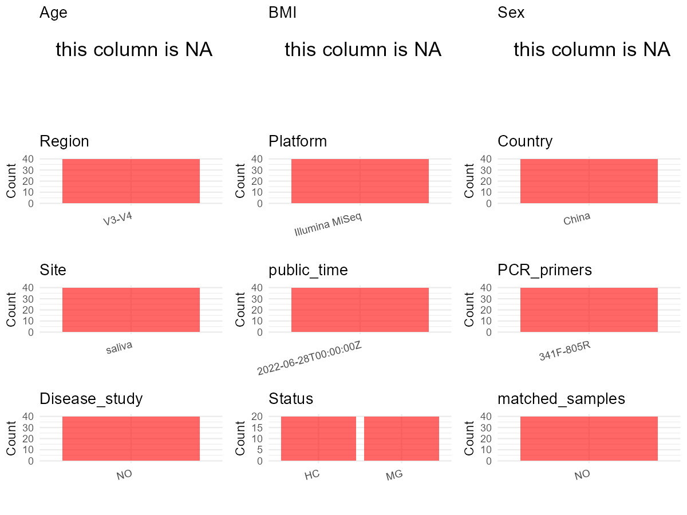

R Notebook: Metadata Processing Workflow
================

# Step 1: Obtain Initial Metadata from Each Project

To obtain the initial metadata: 1. Search for the BioProject ID (e.g.,
“PRJEBXXXX”) on the [NCBI SRA
website](https://www.ncbi.nlm.nih.gov/Traces/study/). 2. In the “Select”
table, click on “Metadata” and download the file. 3. The downloaded file
is typically named “SraRunTable.csv” and contains metadata for the
project.

``` r
# Load necessary libraries
library(dplyr)
library(ggplot2)
library(cowplot)

# Set working directory (update this path to your local directory)
setwd("D:/studylearning/董彪师兄项目/任务4_20251009/PRJNA837028")

# Read the initial metadata files
initial_meta<-read.csv("SraRunTable.csv",header = T)

# Display the first few rows of the metadata
head(initial_meta)
```

    ##           Run Assay.Type AvgSpotLen    Bases  BioProject    BioSample
    ## 1 SRR19164838   AMPLICON        602 57855210 PRJNA837028 SAMN28186984
    ## 2 SRR19164839   AMPLICON        602 52679214 PRJNA837028 SAMN28186983
    ## 3 SRR19164840   AMPLICON        602 50159242 PRJNA837028 SAMN28186982
    ## 4 SRR19164841   AMPLICON        602 65613786 PRJNA837028 SAMN28186981
    ## 5 SRR19164842   AMPLICON        602 50602916 PRJNA837028 SAMN28186980
    ## 6 SRR19164843   AMPLICON        602 32200980 PRJNA837028 SAMN28186979
    ##                BioSampleModel    Bytes
    ## 1 Metagenome or environmental 31925390
    ## 2 Metagenome or environmental 29132365
    ## 3 Metagenome or environmental 27616824
    ## 4 Metagenome or environmental 35658763
    ## 5 Metagenome or environmental 27624632
    ## 6 Metagenome or environmental 17703788
    ##                                                   Center.Name Collection_Date
    ## 1 LUOYANG CENTRAL HOSPITAL AFFILIATED TO ZHENGZHOU UNIVERSITY         2019-12
    ## 2 LUOYANG CENTRAL HOSPITAL AFFILIATED TO ZHENGZHOU UNIVERSITY         2019-09
    ## 3 LUOYANG CENTRAL HOSPITAL AFFILIATED TO ZHENGZHOU UNIVERSITY         2019-08
    ## 4 LUOYANG CENTRAL HOSPITAL AFFILIATED TO ZHENGZHOU UNIVERSITY         2019-07
    ## 5 LUOYANG CENTRAL HOSPITAL AFFILIATED TO ZHENGZHOU UNIVERSITY         2019-04
    ## 6 LUOYANG CENTRAL HOSPITAL AFFILIATED TO ZHENGZHOU UNIVERSITY         2018-12
    ##   Consent DATASTORE.filetype DATASTORE.provider
    ## 1  public   fastq,run.zq,sra         gs,ncbi,s3
    ## 2  public   fastq,run.zq,sra         gs,ncbi,s3
    ## 3  public   fastq,run.zq,sra         gs,ncbi,s3
    ## 4  public   fastq,run.zq,sra         gs,ncbi,s3
    ## 5  public   fastq,run.zq,sra         gs,ncbi,s3
    ## 6  public   fastq,run.zq,sra         gs,ncbi,s3
    ##                       DATASTORE.region  Experiment geo_loc_name_country
    ## 1 gs.us-east1,ncbi.public,s3.us-east-1 SRX15231234                China
    ## 2 gs.us-east1,ncbi.public,s3.us-east-1 SRX15231233                China
    ## 3 gs.us-east1,ncbi.public,s3.us-east-1 SRX15231232                China
    ## 4 gs.us-east1,ncbi.public,s3.us-east-1 SRX15231231                China
    ## 5 gs.us-east1,ncbi.public,s3.us-east-1 SRX15231230                China
    ## 6 gs.us-east1,ncbi.public,s3.us-east-1 SRX15231229                China
    ##   geo_loc_name_country_continent  geo_loc_name  HOST     Instrument
    ## 1                           Asia China:Luoyang MG-10 Illumina MiSeq
    ## 2                           Asia China:Luoyang  MG-9 Illumina MiSeq
    ## 3                           Asia China:Luoyang  MG-8 Illumina MiSeq
    ## 4                           Asia China:Luoyang  MG-7 Illumina MiSeq
    ## 5                           Asia China:Luoyang  MG-6 Illumina MiSeq
    ## 6                           Asia China:Luoyang  MG-5 Illumina MiSeq
    ##   isolation_source          lat_lon Library.Name LibraryLayout LibrarySelection
    ## 1           saliva 34.62 N 112.45 E          A10        PAIRED              PCR
    ## 2           saliva 34.62 N 112.45 E           A9        PAIRED              PCR
    ## 3           saliva 34.62 N 112.45 E           A8        PAIRED              PCR
    ## 4           saliva 34.62 N 112.45 E           A7        PAIRED              PCR
    ## 5           saliva 34.62 N 112.45 E           A6        PAIRED              PCR
    ## 6           saliva 34.62 N 112.45 E           A5        PAIRED              PCR
    ##   LibrarySource              Organism Platform          ReleaseDate
    ## 1         OTHER human oral metagenome ILLUMINA 2022-06-28T00:00:00Z
    ## 2         OTHER human oral metagenome ILLUMINA 2022-06-28T00:00:00Z
    ## 3         OTHER human oral metagenome ILLUMINA 2022-06-28T00:00:00Z
    ## 4         OTHER human oral metagenome ILLUMINA 2022-06-28T00:00:00Z
    ## 5         OTHER human oral metagenome ILLUMINA 2022-06-28T00:00:00Z
    ## 6         OTHER human oral metagenome ILLUMINA 2022-06-28T00:00:00Z
    ##            create_date version Sample.Name SRA.Study
    ## 1 2022-05-11T06:35:00Z       1      HC_A10 SRP374642
    ## 2 2022-05-11T06:35:00Z       1       HC_A9 SRP374642
    ## 3 2022-05-11T06:35:00Z       1       HC_A8 SRP374642
    ## 4 2022-05-11T06:35:00Z       1       HC_A7 SRP374642
    ## 5 2022-05-11T06:35:00Z       1       HC_A6 SRP374642
    ## 6 2022-05-11T06:35:00Z       1       HC_A5 SRP374642

# Step 2: Create a Uniform Metadata Template

The uniform metadata should include the following columns:

1.  **BioProject**: Project ID (e.g., “PRJNA339212”)
2.  **Run**: Sample ID (e.g., “ERRXXXXXX” or “SRRXXXXXX”)
3.  **sample_name**: Original sample name submitted by the authors (not
    the database-assigned ID)
4.  **Age**: Age of the subject (if available)
5.  **BMI**: Body Mass Index (if available)
6.  **Sex**: Sex of the subject (“F” or “M”)
7.  **Region**: Targeted 16S rRNA region (e.g., “V3-V4”)
8.  **Platform**: Sequencing platform (e.g., “Illumina MiSeq”)
9.  **Country**: Country of sample origin (e.g., “China”)
10. **Site**: Sample site (e.g., “saliva”, “dental plaque”)
11. **public_time**: Data release date (format: “YYYY-MM-DD”)
12. **PCR_primers**: PCR primers used (e.g., “515F-806R”)
13. **title**: Title of the associated publication
14. **Disease_study**: Whether the study involves a disease (“YES” or
    “NO”)
15. **Status**: Disease status (e.g., “T2DM”, “HC”). Note: If the study
    includes both disease and healthy samples, this must be specified
    per sample.

``` r
# Create a uniform metadata dataframe
metadata <- data.frame(
  BioProject = initial_meta$BioProject,
  Run = initial_meta$Run,
  sample_name = initial_meta$Sample.Name,
  Age = NA,
  BMI = NA,
  Sex= NA,
  Region = "V3-V4",
  Platform = initial_meta$Instrument,
  Country = initial_meta$geo_loc_name_country,
  Site = initial_meta$isolation_source,
  public_time = initial_meta$ReleaseDate,
  stringsAsFactors = FALSE
)
```

# Step 3: Manually Add Information from the Publication

Some information (e.g. PCR primers, study title, disease status) must be
manually extracted from the publication and added to the metadata.

``` r
# Add information obtained from the publication
metadata$PCR_primers <- "341F-805R"  # Update based on the publication
metadata$title <- "Oral Microbiota Profile in a Group of Anti-AChR Antibody-Positive Myasthenia Gravis Patients"
metadata$Disease_study <- "NO"
metadata <- metadata %>% 
  mutate(Status=case_when(
    grepl("B",sample_name)~"HC",
    grepl("A",sample_name)~"MG"
  ))

#extract subject id by remove prefix of sample_name
#metadata$sample_name <- gsub("_st|_sal", "", metadata$sample_name)

# Check initial data distribution
cat("Initial sample distribution:\n")
```

    ## Initial sample distribution:

``` r
table(metadata$sample_name)
```

    ## 
    ##  HC_A1 HC_A10 HC_A11 HC_A12 HC_A13 HC_A14 HC_A15 HC_A16 HC_A17 HC_A18 HC_A19 
    ##      1      1      1      1      1      1      1      1      1      1      1 
    ##  HC_A2 HC_A20  HC_A3  HC_A4  HC_A5  HC_A6  HC_A7  HC_A8  HC_A9  HC_B1 HC_B10 
    ##      1      1      1      1      1      1      1      1      1      1      1 
    ## HC_B11 HC_B12 HC_B13 HC_B14 HC_B15 HC_B16 HC_B17 HC_B18 HC_B19  HC_B2 HC_B20 
    ##      1      1      1      1      1      1      1      1      1      1      1 
    ##  HC_B3  HC_B4  HC_B5  HC_B6  HC_B7  HC_B8  HC_B9 
    ##      1      1      1      1      1      1      1

``` r
table(metadata$Site)
```

    ## 
    ## saliva 
    ##     40

``` r
# Calculate sampling frequency per subject
sample_counts <- table(metadata$sample_name)
cat("\nNumber of samples per subject:\n")
```

    ## 
    ## Number of samples per subject:

``` r
print(sample_counts)
```

    ## 
    ##  HC_A1 HC_A10 HC_A11 HC_A12 HC_A13 HC_A14 HC_A15 HC_A16 HC_A17 HC_A18 HC_A19 
    ##      1      1      1      1      1      1      1      1      1      1      1 
    ##  HC_A2 HC_A20  HC_A3  HC_A4  HC_A5  HC_A6  HC_A7  HC_A8  HC_A9  HC_B1 HC_B10 
    ##      1      1      1      1      1      1      1      1      1      1      1 
    ## HC_B11 HC_B12 HC_B13 HC_B14 HC_B15 HC_B16 HC_B17 HC_B18 HC_B19  HC_B2 HC_B20 
    ##      1      1      1      1      1      1      1      1      1      1      1 
    ##  HC_B3  HC_B4  HC_B5  HC_B6  HC_B7  HC_B8  HC_B9 
    ##      1      1      1      1      1      1      1

``` r
# Create matched_samples column
metadata$matched_samples <- ifelse(metadata$sample_name %in% names(sample_counts[sample_counts >= 2]), "YES", "NO")

cat("\nMatched samples distribution:\n")
```

    ## 
    ## Matched samples distribution:

``` r
table(metadata$matched_samples)
```

    ## 
    ## NO 
    ## 40

``` r
# Identify samples for removal: single samples excluding saliva 
single_samples <- names(sample_counts[sample_counts == 1])
samples_to_remove <- metadata$sample_name %in% single_samples & !(metadata$Site %in% c("saliva"))

cat("\nNumber of samples to be removed:", sum(samples_to_remove), "\n")
```

    ## 
    ## Number of samples to be removed: 0

``` r
# Remove identified samples
metadata_clean <- metadata[!samples_to_remove, ]

cat("\nFinal sample distribution after cleaning:\n")
```

    ## 
    ## Final sample distribution after cleaning:

``` r
table(metadata_clean$sample_name)
```

    ## 
    ##  HC_A1 HC_A10 HC_A11 HC_A12 HC_A13 HC_A14 HC_A15 HC_A16 HC_A17 HC_A18 HC_A19 
    ##      1      1      1      1      1      1      1      1      1      1      1 
    ##  HC_A2 HC_A20  HC_A3  HC_A4  HC_A5  HC_A6  HC_A7  HC_A8  HC_A9  HC_B1 HC_B10 
    ##      1      1      1      1      1      1      1      1      1      1      1 
    ## HC_B11 HC_B12 HC_B13 HC_B14 HC_B15 HC_B16 HC_B17 HC_B18 HC_B19  HC_B2 HC_B20 
    ##      1      1      1      1      1      1      1      1      1      1      1 
    ##  HC_B3  HC_B4  HC_B5  HC_B6  HC_B7  HC_B8  HC_B9 
    ##      1      1      1      1      1      1      1

``` r
table(metadata_clean$Site)
```

    ## 
    ## saliva 
    ##     40

``` r
table(metadata_clean$matched_samples)
```

    ## 
    ## NO 
    ## 40

``` r
# Use cleaned dataset for subsequent analysis
metadata <- metadata_clean
```

# Step 4: Summarize and Validate the Metadata

``` r
# Check the number of unique runs and sample names
print(paste("Number of unique runs:", length(unique(metadata$Run))))
```

    ## [1] "Number of unique runs: 40"

``` r
print(paste("Number of unique sample names:", length(unique(metadata$sample_name))))
```

    ## [1] "Number of unique sample names: 40"

# Step 5: Visualize the Metadata

``` r

```


# Step 6: Finalize and Export the Metadata

``` r
# Reorder columns to match the desired format
metadata <- metadata[, c(
  "BioProject", "Run", "sample_name", "Age", "BMI", "Sex", 
  "Region", "Platform", "Country", "Site", "public_time", 
  "PCR_primers", "title", "Disease_study", "Status","matched_samples"
)]

# Export the uniform metadata to a CSV file
write.csv(metadata, file = "metadata.csv", quote = FALSE)
head(metadata)
```

    ##    BioProject         Run sample_name Age BMI Sex Region       Platform Country
    ## 1 PRJNA837028 SRR19164838      HC_A10  NA  NA  NA  V3-V4 Illumina MiSeq   China
    ## 2 PRJNA837028 SRR19164839       HC_A9  NA  NA  NA  V3-V4 Illumina MiSeq   China
    ## 3 PRJNA837028 SRR19164840       HC_A8  NA  NA  NA  V3-V4 Illumina MiSeq   China
    ## 4 PRJNA837028 SRR19164841       HC_A7  NA  NA  NA  V3-V4 Illumina MiSeq   China
    ## 5 PRJNA837028 SRR19164842       HC_A6  NA  NA  NA  V3-V4 Illumina MiSeq   China
    ## 6 PRJNA837028 SRR19164843       HC_A5  NA  NA  NA  V3-V4 Illumina MiSeq   China
    ##     Site          public_time PCR_primers
    ## 1 saliva 2022-06-28T00:00:00Z   341F-805R
    ## 2 saliva 2022-06-28T00:00:00Z   341F-805R
    ## 3 saliva 2022-06-28T00:00:00Z   341F-805R
    ## 4 saliva 2022-06-28T00:00:00Z   341F-805R
    ## 5 saliva 2022-06-28T00:00:00Z   341F-805R
    ## 6 saliva 2022-06-28T00:00:00Z   341F-805R
    ##                                                                                          title
    ## 1 Oral Microbiota Profile in a Group of Anti-AChR Antibody-Positive Myasthenia Gravis Patients
    ## 2 Oral Microbiota Profile in a Group of Anti-AChR Antibody-Positive Myasthenia Gravis Patients
    ## 3 Oral Microbiota Profile in a Group of Anti-AChR Antibody-Positive Myasthenia Gravis Patients
    ## 4 Oral Microbiota Profile in a Group of Anti-AChR Antibody-Positive Myasthenia Gravis Patients
    ## 5 Oral Microbiota Profile in a Group of Anti-AChR Antibody-Positive Myasthenia Gravis Patients
    ## 6 Oral Microbiota Profile in a Group of Anti-AChR Antibody-Positive Myasthenia Gravis Patients
    ##   Disease_study Status matched_samples
    ## 1            NO     MG              NO
    ## 2            NO     MG              NO
    ## 3            NO     MG              NO
    ## 4            NO     MG              NO
    ## 5            NO     MG              NO
    ## 6            NO     MG              NO

## Notes for Students:

1.  **Metadata Accuracy**: Always cross-check the metadata with the
    original publication to ensure accuracy.
2.  **Manual Entries**: Columns like `PCR_primers`, and `Status` often
    require manual entry based on the publication.
3.  **Disease Status**: Be careful when assigning `Status`—some studies
    include both disease and healthy samples.
4.  **Visualization**: The plots help quickly identify the distribution
    of values in each column, which is useful for quality control.
5.  **Reproducibility**: Update the working directory and file paths to
    match your local environment.
