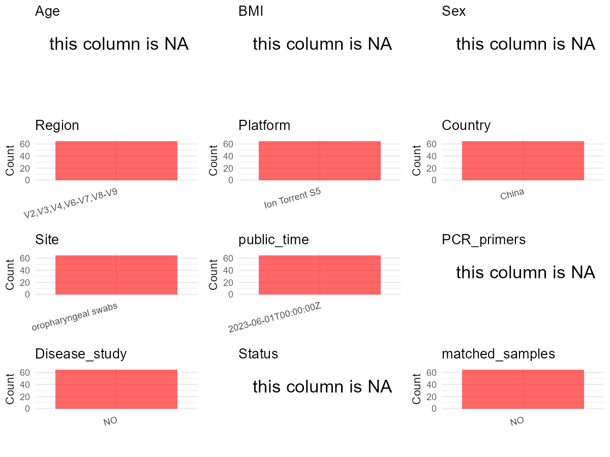

R Notebook: Metadata Processing Workflow
================

# Step 1: Obtain Initial Metadata from Each Project

To obtain the initial metadata: 1. Search for the BioProject ID (e.g.,
“PRJEBXXXX”) on the [NCBI SRA
website](https://www.ncbi.nlm.nih.gov/Traces/study/). 2. In the “Select”
table, click on “Metadata” and download the file. 3. The downloaded file
is typically named “SraRunTable.csv” and contains metadata for the
project.

``` r
# Load necessary libraries
library(dplyr)
library(ggplot2)
library(cowplot)

# Set working directory (update this path to your local directory)
setwd("D:/studylearning/董彪师兄项目/任务3_20251004/PRJNA841067")

# Read the initial metadata files
initial_meta<-read.csv("SraRunTable.csv",header = T)

# Display the first few rows of the metadata
head(initial_meta)
```

    ##           Run Assay.Type AvgSpotLen     Bases  BioProject    BioSample
    ## 1 SRR19346463   AMPLICON        249 350685753 PRJNA841067 SAMN28574908
    ## 2 SRR19346464   AMPLICON        241 163088832 PRJNA841067 SAMN28574907
    ## 3 SRR19346465   AMPLICON        242 113658439 PRJNA841067 SAMN28574906
    ## 4 SRR19346466   AMPLICON        240 116054524 PRJNA841067 SAMN28574898
    ## 5 SRR19346467   AMPLICON        249 283071400 PRJNA841067 SAMN28574897
    ## 6 SRR19346468   AMPLICON        248 137686271 PRJNA841067 SAMN28574896
    ##                BioSampleModel     Bytes                         Center.Name
    ## 1 Metagenome or environmental 264651856 PEKING UNIVERSITY PEOPLE'S HOSPITAL
    ## 2 Metagenome or environmental 124490688 PEKING UNIVERSITY PEOPLE'S HOSPITAL
    ## 3 Metagenome or environmental  86977536 PEKING UNIVERSITY PEOPLE'S HOSPITAL
    ## 4 Metagenome or environmental  88444329 PEKING UNIVERSITY PEOPLE'S HOSPITAL
    ## 5 Metagenome or environmental 213408195 PEKING UNIVERSITY PEOPLE'S HOSPITAL
    ## 6 Metagenome or environmental 103211507 PEKING UNIVERSITY PEOPLE'S HOSPITAL
    ##   Collection_Date Consent DATASTORE.filetype DATASTORE.provider
    ## 1         2022-04  public   fastq,run.zq,sra         gs,ncbi,s3
    ## 2         2022-04  public   fastq,run.zq,sra         gs,ncbi,s3
    ## 3         2022-04  public   fastq,run.zq,sra         gs,ncbi,s3
    ## 4         2022-04  public   fastq,run.zq,sra         gs,ncbi,s3
    ## 5         2022-04  public   fastq,run.zq,sra         gs,ncbi,s3
    ## 6         2022-04  public   fastq,run.zq,sra         gs,ncbi,s3
    ##                       DATASTORE.region  Experiment geo_loc_name_country
    ## 1 gs.us-east1,ncbi.public,s3.us-east-1 SRX15405672                China
    ## 2 gs.us-east1,ncbi.public,s3.us-east-1 SRX15405671                China
    ## 3 gs.us-east1,ncbi.public,s3.us-east-1 SRX15405670                China
    ## 4 gs.us-east1,ncbi.public,s3.us-east-1 SRX15405669                China
    ## 5 gs.us-east1,ncbi.public,s3.us-east-1 SRX15405668                China
    ## 6 gs.us-east1,ncbi.public,s3.us-east-1 SRX15405667                China
    ##   geo_loc_name_country_continent geo_loc_name         HOST     Instrument
    ## 1                           Asia China:Shanxi Homo sapiens Ion Torrent S5
    ## 2                           Asia China:Shanxi Homo sapiens Ion Torrent S5
    ## 3                           Asia China:Shanxi Homo sapiens Ion Torrent S5
    ## 4                           Asia China:Shanxi Homo sapiens Ion Torrent S5
    ## 5                           Asia China:Shanxi Homo sapiens Ion Torrent S5
    ## 6                           Asia China:Shanxi Homo sapiens Ion Torrent S5
    ##      isolation_source                 lat_lon Library.Name LibraryLayout
    ## 1 oropharyngeal swabs 36.05436 N 111.313415 E        CCU10        SINGLE
    ## 2 oropharyngeal swabs 36.05436 N 111.313414 E        CCU09        SINGLE
    ## 3 oropharyngeal swabs 36.05436 N 111.313413 E        CCU08        SINGLE
    ## 4 oropharyngeal swabs 36.05436 N 111.313405 E        RES21        SINGLE
    ## 5 oropharyngeal swabs 36.05436 N 111.313404 E        RES20        SINGLE
    ## 6 oropharyngeal swabs 36.05436 N 111.313403 E        RES19        SINGLE
    ##   LibrarySelection LibrarySource         Organism    Platform
    ## 1              PCR   METAGENOMIC human metagenome ION_TORRENT
    ## 2              PCR   METAGENOMIC human metagenome ION_TORRENT
    ## 3              PCR   METAGENOMIC human metagenome ION_TORRENT
    ## 4              PCR   METAGENOMIC human metagenome ION_TORRENT
    ## 5              PCR   METAGENOMIC human metagenome ION_TORRENT
    ## 6              PCR   METAGENOMIC human metagenome ION_TORRENT
    ##            ReleaseDate          create_date version Sample.Name SRA.Study
    ## 1 2023-06-01T00:00:00Z 2022-05-21T08:23:00Z       1       CCU10 SRP376391
    ## 2 2023-06-01T00:00:00Z 2022-05-21T08:22:00Z       1       CCU09 SRP376391
    ## 3 2023-06-01T00:00:00Z 2022-05-21T08:22:00Z       1       CCU08 SRP376391
    ## 4 2023-06-01T00:00:00Z 2022-05-21T08:22:00Z       1       RES21 SRP376391
    ## 5 2023-06-01T00:00:00Z 2022-05-21T08:23:00Z       1       RES20 SRP376391
    ## 6 2023-06-01T00:00:00Z 2022-05-21T08:22:00Z       1       RES19 SRP376391

# Step 2: Create a Uniform Metadata Template

The uniform metadata should include the following columns:

1.  **BioProject**: Project ID (e.g., “PRJNA339212”)
2.  **Run**: Sample ID (e.g., “ERRXXXXXX” or “SRRXXXXXX”)
3.  **sample_name**: Original sample name submitted by the authors (not
    the database-assigned ID)
4.  **Age**: Age of the subject (if available)
5.  **BMI**: Body Mass Index (if available)
6.  **Sex**: Sex of the subject (“F” or “M”)
7.  **Region**: Targeted 16S rRNA region (e.g., “V3-V4”)
8.  **Platform**: Sequencing platform (e.g., “Illumina MiSeq”)
9.  **Country**: Country of sample origin (e.g., “China”)
10. **Site**: Sample site (e.g., “saliva”, “dental plaque”)
11. **public_time**: Data release date (format: “YYYY-MM-DD”)
12. **PCR_primers**: PCR primers used (e.g., “515F-806R”)
13. **title**: Title of the associated publication
14. **Disease_study**: Whether the study involves a disease (“YES” or
    “NO”)
15. **Status**: Disease status (e.g., “T2DM”, “HC”). Note: If the study
    includes both disease and healthy samples, this must be specified
    per sample.

``` r
# Create a uniform metadata dataframe
metadata <- data.frame(
  BioProject = initial_meta$BioProject,
  Run = initial_meta$Run,
  sample_name = initial_meta$Sample.Name,
  Age = NA,
  BMI = NA,
  Sex= NA,
  Region = "V2,V3,V4,V6-V7,V8-V9",
  Platform = initial_meta$Instrument,
  Country = initial_meta$geo_loc_name_country,
  Site = initial_meta$isolation_source,
  public_time = initial_meta$ReleaseDate,
  stringsAsFactors = FALSE
)
```

# Step 3: Manually Add Information from the Publication

Some information (e.g. PCR primers, study title, disease status) must be
manually extracted from the publication and added to the metadata.

``` r
# Add information obtained from the publication
metadata$PCR_primers <- NA_character_  # Update based on the publication
metadata$title <- "Characteristics of oral microbiome of healthcare workers in different clinical scenarios: a cross-sectional analysis"
metadata$Disease_study <- "NO"
metadata$Status <- NA_character_

#extract subject id by remove prefix of sample_name
#metadata$sample_name <- gsub("_st|_sal", "", metadata$sample_name)

# Check initial data distribution
cat("Initial sample distribution:\n")
```

    ## Initial sample distribution:

``` r
table(metadata$sample_name)
```

    ## 
    ## CCU01 CCU02 CCU03 CCU04 CCU05 CCU06 CCU07 CCU08 CCU09 CCU10 CCU11 CCU12 ICU01 
    ##     1     1     1     1     1     1     1     1     1     1     1     1     1 
    ## ICU02 ICU03 ICU04 ICU05 ICU06 ICU07 ICU08 ICU09 ICU10 ICU11 ICU12 ICU13 ICU14 
    ##     1     1     1     1     1     1     1     1     1     1     1     1     1 
    ## ICU15 ICU16  OR01  OR02  OR03  OR04  OR05  OR06  OR07  OR08  OR09  OR10  OR11 
    ##     1     1     1     1     1     1     1     1     1     1     1     1     1 
    ##  OR12  OR13  OR14  OR15  OR16 RES01 RES02 RES03 RES04 RES05 RES06 RES07 RES08 
    ##     1     1     1     1     1     1     1     1     1     1     1     1     1 
    ## RES09 RES10 RES11 RES12 RES13 RES14 RES15 RES16 RES17 RES18 RES19 RES20 RES21 
    ##     1     1     1     1     1     1     1     1     1     1     1     1     1

``` r
table(metadata$Site)
```

    ## 
    ## oropharyngeal swabs 
    ##                  65

``` r
# Calculate sampling frequency per subject
sample_counts <- table(metadata$sample_name)
cat("\nNumber of samples per subject:\n")
```

    ## 
    ## Number of samples per subject:

``` r
print(sample_counts)
```

    ## 
    ## CCU01 CCU02 CCU03 CCU04 CCU05 CCU06 CCU07 CCU08 CCU09 CCU10 CCU11 CCU12 ICU01 
    ##     1     1     1     1     1     1     1     1     1     1     1     1     1 
    ## ICU02 ICU03 ICU04 ICU05 ICU06 ICU07 ICU08 ICU09 ICU10 ICU11 ICU12 ICU13 ICU14 
    ##     1     1     1     1     1     1     1     1     1     1     1     1     1 
    ## ICU15 ICU16  OR01  OR02  OR03  OR04  OR05  OR06  OR07  OR08  OR09  OR10  OR11 
    ##     1     1     1     1     1     1     1     1     1     1     1     1     1 
    ##  OR12  OR13  OR14  OR15  OR16 RES01 RES02 RES03 RES04 RES05 RES06 RES07 RES08 
    ##     1     1     1     1     1     1     1     1     1     1     1     1     1 
    ## RES09 RES10 RES11 RES12 RES13 RES14 RES15 RES16 RES17 RES18 RES19 RES20 RES21 
    ##     1     1     1     1     1     1     1     1     1     1     1     1     1

``` r
# Create matched_samples column
metadata$matched_samples <- ifelse(metadata$sample_name %in% names(sample_counts[sample_counts >= 2]), "YES", "NO")

cat("\nMatched samples distribution:\n")
```

    ## 
    ## Matched samples distribution:

``` r
table(metadata$matched_samples)
```

    ## 
    ## NO 
    ## 65

``` r
# Identify samples for removal: single samples excluding oropharyngeal swabs 
single_samples <- names(sample_counts[sample_counts == 1])
samples_to_remove <- metadata$sample_name %in% single_samples & !(metadata$Site %in% c("oropharyngeal swabs"))

cat("\nNumber of samples to be removed:", sum(samples_to_remove), "\n")
```

    ## 
    ## Number of samples to be removed: 0

``` r
# Remove identified samples
metadata_clean <- metadata[!samples_to_remove, ]

cat("\nFinal sample distribution after cleaning:\n")
```

    ## 
    ## Final sample distribution after cleaning:

``` r
table(metadata_clean$sample_name)
```

    ## 
    ## CCU01 CCU02 CCU03 CCU04 CCU05 CCU06 CCU07 CCU08 CCU09 CCU10 CCU11 CCU12 ICU01 
    ##     1     1     1     1     1     1     1     1     1     1     1     1     1 
    ## ICU02 ICU03 ICU04 ICU05 ICU06 ICU07 ICU08 ICU09 ICU10 ICU11 ICU12 ICU13 ICU14 
    ##     1     1     1     1     1     1     1     1     1     1     1     1     1 
    ## ICU15 ICU16  OR01  OR02  OR03  OR04  OR05  OR06  OR07  OR08  OR09  OR10  OR11 
    ##     1     1     1     1     1     1     1     1     1     1     1     1     1 
    ##  OR12  OR13  OR14  OR15  OR16 RES01 RES02 RES03 RES04 RES05 RES06 RES07 RES08 
    ##     1     1     1     1     1     1     1     1     1     1     1     1     1 
    ## RES09 RES10 RES11 RES12 RES13 RES14 RES15 RES16 RES17 RES18 RES19 RES20 RES21 
    ##     1     1     1     1     1     1     1     1     1     1     1     1     1

``` r
table(metadata_clean$Site)
```

    ## 
    ## oropharyngeal swabs 
    ##                  65

``` r
table(metadata_clean$matched_samples)
```

    ## 
    ## NO 
    ## 65

``` r
# Use cleaned dataset for subsequent analysis
metadata <- metadata_clean
```

# Step 4: Summarize and Validate the Metadata

``` r
# Check the number of unique runs and sample names
print(paste("Number of unique runs:", length(unique(metadata$Run))))
```

    ## [1] "Number of unique runs: 65"

``` r
print(paste("Number of unique sample names:", length(unique(metadata$sample_name))))
```

    ## [1] "Number of unique sample names: 65"

# Step 5: Visualize the Metadata

``` r

```


# Step 6: Finalize and Export the Metadata

``` r
# Reorder columns to match the desired format
metadata <- metadata[, c(
  "BioProject", "Run", "sample_name", "Age", "BMI", "Sex", 
  "Region", "Platform", "Country", "Site", "public_time", 
  "PCR_primers", "title", "Disease_study", "Status","matched_samples"
)]

# Export the uniform metadata to a CSV file
write.csv(metadata, file = "metadata.csv", quote = T)
head(metadata)
```

    ##    BioProject         Run sample_name Age BMI Sex               Region
    ## 1 PRJNA841067 SRR19346463       CCU10  NA  NA  NA V2,V3,V4,V6-V7,V8-V9
    ## 2 PRJNA841067 SRR19346464       CCU09  NA  NA  NA V2,V3,V4,V6-V7,V8-V9
    ## 3 PRJNA841067 SRR19346465       CCU08  NA  NA  NA V2,V3,V4,V6-V7,V8-V9
    ## 4 PRJNA841067 SRR19346466       RES21  NA  NA  NA V2,V3,V4,V6-V7,V8-V9
    ## 5 PRJNA841067 SRR19346467       RES20  NA  NA  NA V2,V3,V4,V6-V7,V8-V9
    ## 6 PRJNA841067 SRR19346468       RES19  NA  NA  NA V2,V3,V4,V6-V7,V8-V9
    ##         Platform Country                Site          public_time PCR_primers
    ## 1 Ion Torrent S5   China oropharyngeal swabs 2023-06-01T00:00:00Z        <NA>
    ## 2 Ion Torrent S5   China oropharyngeal swabs 2023-06-01T00:00:00Z        <NA>
    ## 3 Ion Torrent S5   China oropharyngeal swabs 2023-06-01T00:00:00Z        <NA>
    ## 4 Ion Torrent S5   China oropharyngeal swabs 2023-06-01T00:00:00Z        <NA>
    ## 5 Ion Torrent S5   China oropharyngeal swabs 2023-06-01T00:00:00Z        <NA>
    ## 6 Ion Torrent S5   China oropharyngeal swabs 2023-06-01T00:00:00Z        <NA>
    ##                                                                                                                  title
    ## 1 Characteristics of oral microbiome of healthcare workers in different clinical scenarios: a cross-sectional analysis
    ## 2 Characteristics of oral microbiome of healthcare workers in different clinical scenarios: a cross-sectional analysis
    ## 3 Characteristics of oral microbiome of healthcare workers in different clinical scenarios: a cross-sectional analysis
    ## 4 Characteristics of oral microbiome of healthcare workers in different clinical scenarios: a cross-sectional analysis
    ## 5 Characteristics of oral microbiome of healthcare workers in different clinical scenarios: a cross-sectional analysis
    ## 6 Characteristics of oral microbiome of healthcare workers in different clinical scenarios: a cross-sectional analysis
    ##   Disease_study Status matched_samples
    ## 1            NO   <NA>              NO
    ## 2            NO   <NA>              NO
    ## 3            NO   <NA>              NO
    ## 4            NO   <NA>              NO
    ## 5            NO   <NA>              NO
    ## 6            NO   <NA>              NO

## Notes for Students:

1.  **Metadata Accuracy**: Always cross-check the metadata with the
    original publication to ensure accuracy.
2.  **Manual Entries**: Columns like `PCR_primers`, and `Status` often
    require manual entry based on the publication.
3.  **Disease Status**: Be careful when assigning `Status`—some studies
    include both disease and healthy samples.
4.  **Visualization**: The plots help quickly identify the distribution
    of values in each column, which is useful for quality control.
5.  **Reproducibility**: Update the working directory and file paths to
    match your local environment.
