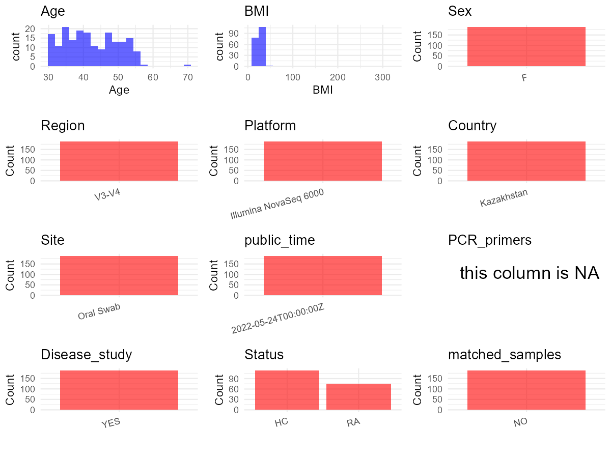

R Notebook: Metadata Processing Workflow
================

# Step 1: Obtain Initial Metadata from Each Project

To obtain the initial metadata: 1. Search for the BioProject ID (e.g.,
“PRJEBXXXX”) on the [NCBI SRA
website](https://www.ncbi.nlm.nih.gov/Traces/study/). 2. In the “Select”
table, click on “Metadata” and download the file. 3. The downloaded file
is typically named “SraRunTable.csv” and contains metadata for the
project.

``` r
# Load necessary libraries
library(dplyr)
library(ggplot2)
library(cowplot)

# Set working directory (update this path to your local directory)
setwd("D:/oral_project/PRJNA841771")

# Read the initial metadata files
initial_meta<-read.csv("SraRunTable.csv",header = T)

# Combine the two metadata files
#meta <- rbind(initial_meta, initial_meta1)

#Remove entries where Organism is "gut metagenome" (non-oral samples)
#initial_meta <- subset(initial_meta,host_body_product=="oral cavity")

# Check the number of samples containing "HT" in Sample.Name (e.g., healthy controls)
#nrow(subset(meta, grepl("HT", Sample.Name)))

# Display the first few rows of the metadata
head(initial_meta)
```

    ##           Run Assay.Type AvgSpotLen    Bases  BioProject    BioSample
    ## 1 SRR19370359   AMPLICON        426 42826040 PRJNA841771 SAMN28614607
    ## 2 SRR19370361   AMPLICON        425 39071076 PRJNA841771 SAMN28614605
    ## 3 SRR19370362   AMPLICON        425 33200097 PRJNA841771 SAMN28614604
    ## 4 SRR19370363   AMPLICON        423 37374803 PRJNA841771 SAMN28614603
    ## 5 SRR19370365   AMPLICON        427 35248253 PRJNA841771 SAMN28614602
    ## 6 SRR19370366   AMPLICON        426 34796910 PRJNA841771 SAMN28614601
    ##                                BioSampleModel    Bytes
    ## 1 MIMARKS.survey,MIGS/MIMS/MIMARKS.human-oral 13795394
    ## 2 MIMARKS.survey,MIGS/MIMS/MIMARKS.human-oral 12646566
    ## 3 MIMARKS.survey,MIGS/MIMS/MIMARKS.human-oral 10674463
    ## 4 MIMARKS.survey,MIGS/MIMS/MIMARKS.human-oral 12395752
    ## 5 MIMARKS.survey,MIGS/MIMS/MIMARKS.human-oral 11412076
    ## 6 MIMARKS.survey,MIGS/MIMS/MIMARKS.human-oral 11821928
    ##                                            Center.Name Collection_Date Consent
    ## 1 CENTER FOR LIFE SCIENCES, NATIONAL LABORATORY ASTANA      2020-08-27  public
    ## 2 CENTER FOR LIFE SCIENCES, NATIONAL LABORATORY ASTANA      2020-08-26  public
    ## 3 CENTER FOR LIFE SCIENCES, NATIONAL LABORATORY ASTANA      2020-08-26  public
    ## 4 CENTER FOR LIFE SCIENCES, NATIONAL LABORATORY ASTANA      2020-08-26  public
    ## 5 CENTER FOR LIFE SCIENCES, NATIONAL LABORATORY ASTANA      2020-08-26  public
    ## 6 CENTER FOR LIFE SCIENCES, NATIONAL LABORATORY ASTANA      2020-08-25  public
    ##   DATASTORE.filetype DATASTORE.provider                     DATASTORE.region
    ## 1   fastq,run.zq,sra         gs,ncbi,s3 gs.us-east1,ncbi.public,s3.us-east-1
    ## 2   fastq,run.zq,sra         gs,ncbi,s3 gs.us-east1,ncbi.public,s3.us-east-1
    ## 3   fastq,run.zq,sra         gs,ncbi,s3 gs.us-east1,ncbi.public,s3.us-east-1
    ## 4   fastq,run.zq,sra         gs,ncbi,s3 gs.us-east1,ncbi.public,s3.us-east-1
    ## 5   fastq,run.zq,sra         gs,ncbi,s3 gs.us-east1,ncbi.public,s3.us-east-1
    ## 6   fastq,run.zq,sra         gs,ncbi,s3 gs.us-east1,ncbi.public,s3.us-east-1
    ##   env_broad_scale env_local_scale    env_medium ETHNICITY  Experiment
    ## 1   ENVO:00000428   ENVO:00000364 ENVO:00010483    kazakh SRX15428860
    ## 2   ENVO:00000428   ENVO:00000362 ENVO:00010483    kazakh SRX15428858
    ## 3   ENVO:00000428   ENVO:00000361 ENVO:00010483    kazakh SRX15428857
    ## 4   ENVO:00000428   ENVO:00000360 ENVO:00010483    kazakh SRX15428856
    ## 5   ENVO:00000428   ENVO:00000359 ENVO:00010483    kazakh SRX15428854
    ## 6   ENVO:00000428   ENVO:00000358 ENVO:00010483    kazakh SRX15428853
    ##   geo_loc_name_country geo_loc_name_country_continent           geo_loc_name
    ## 1           Kazakhstan                           Asia Kazakhstan: Nur-Sultan
    ## 2           Kazakhstan                           Asia Kazakhstan: Nur-Sultan
    ## 3           Kazakhstan                           Asia Kazakhstan: Nur-Sultan
    ## 4           Kazakhstan                           Asia Kazakhstan: Nur-Sultan
    ## 5           Kazakhstan                           Asia Kazakhstan: Nur-Sultan
    ## 6           Kazakhstan                           Asia Kazakhstan: Nur-Sultan
    ##   Host_age host_body_mass_index host_body_product         Host
    ## 1       33             20.44914       oral cavity Homo sapiens
    ## 2       39             21.64412       oral cavity Homo sapiens
    ## 3       54             21.35991       oral cavity Homo sapiens
    ## 4       51             23.03005       oral cavity Homo sapiens
    ## 5       55             29.51594       oral cavity Homo sapiens
    ## 6       48             27.00513       oral cavity Homo sapiens
    ##              Instrument         lat_lon Library.Name LibraryLayout
    ## 1 Illumina NovaSeq 6000 51.10 N 71.26 E       RA116C        SINGLE
    ## 2 Illumina NovaSeq 6000 51.10 N 71.26 E       RA114C        SINGLE
    ## 3 Illumina NovaSeq 6000 51.10 N 71.26 E       RA113C        SINGLE
    ## 4 Illumina NovaSeq 6000 51.10 N 71.26 E       RA112C        SINGLE
    ## 5 Illumina NovaSeq 6000 51.10 N 71.26 E       RA111C        SINGLE
    ## 6 Illumina NovaSeq 6000 51.10 N 71.26 E       RA110C        SINGLE
    ##   LibrarySelection LibrarySource   Organism Platform          ReleaseDate
    ## 1              PCR   METAGENOMIC metagenome ILLUMINA 2022-05-24T00:00:00Z
    ## 2              PCR   METAGENOMIC metagenome ILLUMINA 2022-05-24T00:00:00Z
    ## 3              PCR   METAGENOMIC metagenome ILLUMINA 2022-05-24T00:00:00Z
    ## 4              PCR   METAGENOMIC metagenome ILLUMINA 2022-05-24T00:00:00Z
    ## 5              PCR   METAGENOMIC metagenome ILLUMINA 2022-05-24T00:00:00Z
    ## 6              PCR   METAGENOMIC metagenome ILLUMINA 2022-05-24T00:00:00Z
    ##            create_date version Sample.Name SRA.Study
    ## 1 2022-05-24T03:18:00Z       1      RA116C SRP376757
    ## 2 2022-05-24T03:19:00Z       1      RA114C SRP376757
    ## 3 2022-05-24T03:18:00Z       1      RA113C SRP376757
    ## 4 2022-05-24T03:18:00Z       1      RA112C SRP376757
    ## 5 2022-05-24T03:18:00Z       1      RA111C SRP376757
    ## 6 2022-05-24T03:18:00Z       1      RA110C SRP376757

# Step 2: Create a Uniform Metadata Template

The uniform metadata should include the following columns:

1.  **BioProject**: Project ID (e.g., “PRJNA339212”)
2.  **Run**: Sample ID (e.g., “ERRXXXXXX” or “SRRXXXXXX”)
3.  **sample_name**: Original sample name (if subject id is available,
    use subject id) submitted by the authors (not the database-assigned
    ID)
4.  **Age**: Age of the subject (if available)
5.  **BMI**: Body Mass Index (if available)
6.  **Sex**: Sex of the subject (“F” or “M”)
7.  **Region**: Targeted 16S rRNA region (e.g., “V3-V4”)
8.  **Platform**: Sequencing platform (e.g., “Illumina MiSeq”)
9.  **Country**: Country of sample origin (e.g., “China”)
10. **Site**: Sample site (e.g., “saliva”, “dental plaque”)
11. **public_time**: Data release date (format: “YYYY-MM-DD”)
12. **PCR_primers**: PCR primers used (e.g., “515F-806R”)
13. **title**: Title of the associated publication
14. **Disease_study**: Whether the study involves a disease (“YES” or
    “NO”)
15. **Status**: Disease status (e.g., “T2DM”, “HC”). Note: If the study
    includes both disease and healthy samples, this must be specified
    per sample.
16. **matched_samples**: whether the study have matched samples from
    oral and other sites (“YES”,“NO”)

``` r
# Create a uniform metadata dataframe
metadata <- data.frame(
  BioProject = initial_meta$BioProject,
  Run = initial_meta$Run,
  sample_name = initial_meta$Sample.Name,
  Age = initial_meta$Host_age,
  BMI = initial_meta$host_body_mass_index,
  Sex="F",
  Region = "V3-V4",
  Platform = initial_meta$Instrument,
  Country = initial_meta$geo_loc_name_country,
  Site = "Oral Swab",
  public_time = initial_meta$ReleaseDate,
  stringsAsFactors = FALSE
)
```

# Step 3: Manually Add Information from the Publication

Some information (e.g. PCR primers, study title, disease status) must be
manually extracted from the publication and added to the metadata.

# Step 4: Summarize and Validate the Metadata

``` r
# Check the number of unique runs and sample names
print(paste("Number of unique runs:", length(unique(metadata$Run))))
```

    ## [1] "Number of unique runs: 189"

``` r
print(paste("Number of unique sample names:", length(unique(metadata$sample_name))))
```

    ## [1] "Number of unique sample names: 189"

# Step 5: Visualize the Metadata

``` r
# Select columns for visualization
plot_data <- metadata %>%
  select(-BioProject, -Run, -sample_name, -title)

# Function to create simple plots for each column
create_simple_plots <- function(data) {
  plots <- list()
  
  for (col in colnames(data)) {
    # Check if the column is all NA
    if (all(is.na(data[[col]]))) {
      # Create an empty plot with text indicating all NA
      p <- ggplot() +
        annotate("text", x = 0.5, y = 0.5, label = "this column is NA", size = 6) +
        labs(title = col) +
        theme_void()
    } else if (is.numeric(data[[col]])) {
      # Numeric variable: histogram
      p <- ggplot(data, aes(x = .data[[col]])) +
        geom_histogram(fill = "blue", alpha = 0.6, bins = 20, na.rm = TRUE) +
        labs(title = col) +
        theme_minimal()
    } else {
      # Categorical variable: bar plot (remove NA values)
      count_data <- as.data.frame(table(data[[col]], useNA = "ifany"))
      p <- ggplot(count_data, aes(x = reorder(Var1, -Freq), y = Freq)) +
        geom_col(fill = "red", alpha = 0.6) +
        labs(title = col, x = NULL, y = "Count") +
        theme_minimal() +
        theme(axis.text.x = element_text(angle = 15, hjust = 1))
    }
    plots[[col]] <- p
  }
  
  return(plots)
}

# Generate and arrange plots
plots <- create_simple_plots(plot_data)
p<-plot_grid(plots$Age, 
          plots$BMI, 
          plots$Sex, 
          plots$Region, 
          plots$Platform, 
          plots$Country, 
          plots$Site,
          plots$public_time, 
          plots$PCR_primers,
          plots$Disease_study,
          plots$Status,
          plots$matched_samples,
          ncol = 3, align = "hv", axis = "lb")
ggsave("Metadata_Summary.png", plot = p, width = 8, height = 6, dpi = 150)
```

``` r

```


# Step 6: Finalize and Export the Metadata

``` r
# Reorder columns to match the desired format
metadata <- metadata[, c(
  "BioProject", "Run", "sample_name", "Age", "BMI", "Sex", 
  "Region", "Platform", "Country", "Site", "public_time", 
  "PCR_primers", "title", "Disease_study", "Status","matched_samples"
)]

# Export the uniform metadata to a CSV file
write.csv(metadata, file = "metadata.csv", quote = FALSE)
head(metadata)
```

    ##    BioProject         Run sample_name Age      BMI Sex Region
    ## 1 PRJNA841771 SRR19370359      RA116C  33 20.44914   F  V3-V4
    ## 2 PRJNA841771 SRR19370361      RA114C  39 21.64412   F  V3-V4
    ## 3 PRJNA841771 SRR19370362      RA113C  54 21.35991   F  V3-V4
    ## 4 PRJNA841771 SRR19370363      RA112C  51 23.03005   F  V3-V4
    ## 5 PRJNA841771 SRR19370365      RA111C  55 29.51594   F  V3-V4
    ## 6 PRJNA841771 SRR19370366      RA110C  48 27.00513   F  V3-V4
    ##                Platform    Country      Site          public_time PCR_primers
    ## 1 Illumina NovaSeq 6000 Kazakhstan Oral Swab 2022-05-24T00:00:00Z          NA
    ## 2 Illumina NovaSeq 6000 Kazakhstan Oral Swab 2022-05-24T00:00:00Z          NA
    ## 3 Illumina NovaSeq 6000 Kazakhstan Oral Swab 2022-05-24T00:00:00Z          NA
    ## 4 Illumina NovaSeq 6000 Kazakhstan Oral Swab 2022-05-24T00:00:00Z          NA
    ## 5 Illumina NovaSeq 6000 Kazakhstan Oral Swab 2022-05-24T00:00:00Z          NA
    ## 6 Illumina NovaSeq 6000 Kazakhstan Oral Swab 2022-05-24T00:00:00Z          NA
    ##                                                                  title
    ## 1 Oral Microbial Signature of Rheumatoid Arthritis in\nFemale Patients
    ## 2 Oral Microbial Signature of Rheumatoid Arthritis in\nFemale Patients
    ## 3 Oral Microbial Signature of Rheumatoid Arthritis in\nFemale Patients
    ## 4 Oral Microbial Signature of Rheumatoid Arthritis in\nFemale Patients
    ## 5 Oral Microbial Signature of Rheumatoid Arthritis in\nFemale Patients
    ## 6 Oral Microbial Signature of Rheumatoid Arthritis in\nFemale Patients
    ##   Disease_study Status matched_samples
    ## 1           YES     HC              NO
    ## 2           YES     HC              NO
    ## 3           YES     HC              NO
    ## 4           YES     HC              NO
    ## 5           YES     HC              NO
    ## 6           YES     HC              NO

## Notes for Students:

1.  **Metadata Accuracy**: Always cross-check the metadata with the
    original publication to ensure accuracy.
2.  **Manual Entries**: Columns like `PCR_primers`, and `Status` often
    require manual entry based on the publication.
3.  **Disease Status**: Be careful when assigning `Status`—some studies
    include both disease and healthy samples.
4.  **Visualization**: The plots help quickly identify the distribution
    of values in each column, which is useful for quality control.
5.  **Reproducibility**: Update the working directory and file paths to
    match your local environment.
