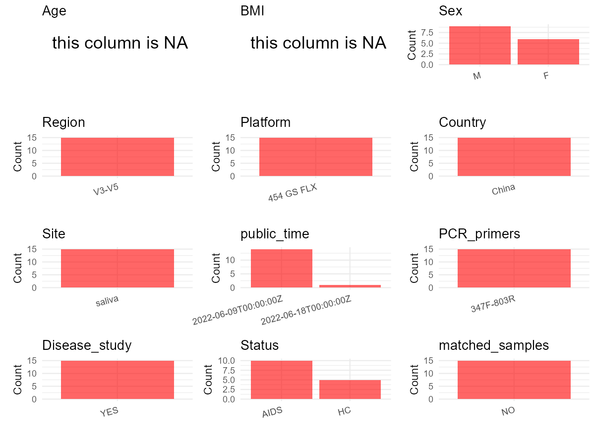

R Notebook: Metadata Processing Workflow
================

# Step 1: Obtain Initial Metadata from Each Project

To obtain the initial metadata: 1. Search for the BioProject ID (e.g.,
“PRJEBXXXX”) on the [NCBI SRA
website](https://www.ncbi.nlm.nih.gov/Traces/study/). 2. In the “Select”
table, click on “Metadata” and download the file. 3. The downloaded file
is typically named “SraRunTable.csv” and contains metadata for the
project.

``` r
# Load necessary libraries
library(dplyr)
library(ggplot2)
library(cowplot)
library(stringr)

# Set working directory (update this path to your local directory)
setwd("E:/bioproject_YL/PRJNA844037")

# Read the initial metadata files
initial_meta <- read.csv("SraRunTable.csv", header = T)

# Display the first few rows of the metadata
head(initial_meta)
```

    ##           Run Assay.Type AvgSpotLen   Bases
    ## 1 SRR19452892   AMPLICON        444 2514875
    ## 2 SRR19452893   AMPLICON        429 5286602
    ## 3 SRR19452894   AMPLICON        474 2854542
    ## 4 SRR19452895   AMPLICON        417 1355401
    ## 5 SRR19452896   AMPLICON        389 2189113
    ## 6 SRR19452897   AMPLICON        395 1623989
    ##                                                                                                                                       BIOMATERIAL_PROVIDER
    ## 1 State Key Laboratory of Oral Diseases\\, National Clinical Research Center for Oral Diseases\\, West China Hospital of Stomatology\\, Sichuan University
    ## 2 State Key Laboratory of Oral Diseases\\, National Clinical Research Center for Oral Diseases\\, West China Hospital of Stomatology\\, Sichuan University
    ## 3 State Key Laboratory of Oral Diseases\\, National Clinical Research Center for Oral Diseases\\, West China Hospital of Stomatology\\, Sichuan University
    ## 4 State Key Laboratory of Oral Diseases\\, National Clinical Research Center for Oral Diseases\\, West China Hospital of Stomatology\\, Sichuan University
    ## 5 State Key Laboratory of Oral Diseases\\, National Clinical Research Center for Oral Diseases\\, West China Hospital of Stomatology\\, Sichuan University
    ## 6 State Key Laboratory of Oral Diseases\\, National Clinical Research Center for Oral Diseases\\, West China Hospital of Stomatology\\, Sichuan University
    ##    BioProject    BioSample              BioSampleModel   Bytes
    ## 1 PRJNA844037 SAMN28772351 Metagenome or environmental  746291
    ## 2 PRJNA844037 SAMN28772352 Metagenome or environmental 1483780
    ## 3 PRJNA844037 SAMN28772353 Metagenome or environmental  831663
    ## 4 PRJNA844037 SAMN28772354 Metagenome or environmental  440426
    ## 5 PRJNA844037 SAMN28772355 Metagenome or environmental  665184
    ## 6 PRJNA844037 SAMN28772356 Metagenome or environmental  512670
    ##                          Center.Name Collection_Date Consent DATASTORE.filetype
    ## 1 SICHUAN PROVINCIAL PEOPLE HOSPITAL         missing  public   fastq,run.zq,sra
    ## 2 SICHUAN PROVINCIAL PEOPLE HOSPITAL         missing  public   fastq,run.zq,sra
    ## 3 SICHUAN PROVINCIAL PEOPLE HOSPITAL         missing  public   fastq,run.zq,sra
    ## 4 SICHUAN PROVINCIAL PEOPLE HOSPITAL         missing  public   fastq,run.zq,sra
    ## 5 SICHUAN PROVINCIAL PEOPLE HOSPITAL         missing  public   fastq,run.zq,sra
    ## 6 SICHUAN PROVINCIAL PEOPLE HOSPITAL         missing  public   fastq,run.zq,sra
    ##   DATASTORE.provider                     DATASTORE.region  Experiment
    ## 1         gs,ncbi,s3 gs.us-east1,ncbi.public,s3.us-east-1 SRX15505882
    ## 2         gs,ncbi,s3 gs.us-east1,ncbi.public,s3.us-east-1 SRX15505881
    ## 3         gs,ncbi,s3 gs.us-east1,ncbi.public,s3.us-east-1 SRX15505880
    ## 4         gs,ncbi,s3 gs.us-east1,ncbi.public,s3.us-east-1 SRX15505879
    ## 5         gs,ncbi,s3 gs.us-east1,ncbi.public,s3.us-east-1 SRX15505878
    ## 6         gs,ncbi,s3 gs.us-east1,ncbi.public,s3.us-east-1 SRX15505877
    ##   geo_loc_name_country geo_loc_name_country_continent geo_loc_name Host_Age
    ## 1         uncalculated                   uncalculated      missing       35
    ## 2         uncalculated                   uncalculated      missing       34
    ## 3         uncalculated                   uncalculated      missing       32
    ## 4         uncalculated                   uncalculated      missing       30
    ## 5         uncalculated                   uncalculated      missing       29
    ## 6         uncalculated                   uncalculated      missing       36
    ##           HOST host_sex Instrument
    ## 1 Homo sapiens   female 454 GS FLX
    ## 2 Homo sapiens   female 454 GS FLX
    ## 3 Homo sapiens     male 454 GS FLX
    ## 4 Homo sapiens     male 454 GS FLX
    ## 5 Homo sapiens   female 454 GS FLX
    ## 6 Homo sapiens     male 454 GS FLX
    ##                                                                                                                                                                                                                                                                   isolate
    ## 1 Healthy controls were age-sex matched healthy people\\, which were chosen at random. And inclusion criteria for healthy controls included 23 years of age or older\\, HIV antibody test was negative\\, having the ability to express themselves\\, informed consent...
    ## 2 Healthy controls were age-sex matched healthy people\\, which were chosen at random. And inclusion criteria for healthy controls included 24 years of age or older\\, HIV antibody test was negative\\, having the ability to express themselves\\, informed consent...
    ## 3 Healthy controls were age-sex matched healthy people\\, which were chosen at random. And inclusion criteria for healthy controls included 25 years of age or older\\, HIV antibody test was negative\\, having the ability to express themselves\\, informed consent...
    ## 4 Healthy controls were age-sex matched healthy people\\, which were chosen at random. And inclusion criteria for healthy controls included 26 years of age or older\\, HIV antibody test was negative\\, having the ability to express themselves\\, informed consent...
    ## 5 Healthy controls were age-sex matched healthy people\\, which were chosen at random. And inclusion criteria for healthy controls included 27 years of age or older\\, HIV antibody test was negative\\, having the ability to express themselves\\, informed consent...
    ## 6 Healthy controls were age-sex matched healthy people\\, which were chosen at random. And inclusion criteria for healthy controls included 28 years of age or older\\, HIV antibody test was negative\\, having the ability to express themselves\\, informed consent...
    ##   isolation_source lat_lon Library.Name LibraryLayout LibrarySelection
    ## 1           saliva missing           T1        SINGLE              PCR
    ## 2           saliva missing           T2        SINGLE              PCR
    ## 3           saliva missing           T3        SINGLE              PCR
    ## 4           saliva missing           T4        SINGLE              PCR
    ## 5           saliva missing           T5        SINGLE              PCR
    ## 6           saliva missing          UT1        SINGLE              PCR
    ##   LibrarySource                Organism Platform          ReleaseDate
    ## 1       GENOMIC human saliva metagenome    LS454 2022-06-09T00:00:00Z
    ## 2       GENOMIC human saliva metagenome    LS454 2022-06-09T00:00:00Z
    ## 3       GENOMIC human saliva metagenome    LS454 2022-06-09T00:00:00Z
    ## 4       GENOMIC human saliva metagenome    LS454 2022-06-09T00:00:00Z
    ## 5       GENOMIC human saliva metagenome    LS454 2022-06-09T00:00:00Z
    ## 6       GENOMIC human saliva metagenome    LS454 2022-06-09T00:00:00Z
    ##            create_date version Sample.Name SRA.Study
    ## 1 2022-05-31T16:26:00Z       1          T1 SRP377791
    ## 2 2022-05-31T16:26:00Z       1          T2 SRP377791
    ## 3 2022-05-31T16:26:00Z       1          T3 SRP377791
    ## 4 2022-05-31T16:26:00Z       1          T4 SRP377791
    ## 5 2022-05-31T16:26:00Z       1          T5 SRP377791
    ## 6 2022-05-31T16:26:00Z       1         UT1 SRP377791

# Step 2: Create a Uniform Metadata Template

The uniform metadata should include the following columns:

1.  **BioProject**: Project ID (e.g., “PRJNA339212”)
2.  **Run**: Sample ID (e.g., “ERRXXXXXX” or “SRRXXXXXX”)
3.  **sample_name**: Original sample name submitted by the authors (not
    the database-assigned ID)
4.  **Age**: Age of the subject (if available)
5.  **BMI**: Body Mass Index (if available)
6.  **Sex**: Sex of the subject (“F” or “M”)
7.  **Region**: Targeted 16S rRNA region (e.g., “V3-V4”)
8.  **Platform**: Sequencing platform (e.g., “Illumina MiSeq”)
9.  **Country**: Country of sample origin (e.g., “China”)
10. **Site**: Sample site (e.g., “saliva”, “dental plaque”)
11. **public_time**: Data release date (format: “YYYY-MM-DD”)
12. **PCR_primers**: PCR primers used (e.g., “515F-806R”)
13. **title**: Title of the associated publication
14. **Disease_study**: Whether the study involves a disease (“YES” or
    “NO”)
15. **Status**: Disease status (e.g., “T2DM”, “HC”). Note: If the study
    includes both disease and healthy samples, this must be specified
    per sample.
16. **matched_samples**: matched samples (“YES” or “NO”)

``` r
# Create a uniform metadata dataframe
metadata <- data.frame(
  BioProject = initial_meta$BioProject,
  Run = initial_meta$Run,
  sample_name = initial_meta$Sample.Name,
  Age = NA,
  BMI = NA,  
  Sex = initial_meta$host_sex,
  Region = "V3-V5",
  Platform = initial_meta$Instrument,
  Country = "China",
  Site = initial_meta$isolation_source,
  public_time = initial_meta$ReleaseDate,
  stringsAsFactors=FALSE
)

# Use abbreviations to indicate gender
metadata <- metadata %>%
  mutate(Sex = recode(Sex, "female" = "F", "male" = "M"))
```

# Step 3: Manually Add Information from the Publication

Some information (e.g. PCR primers, study title, disease status) must be
manually extracted from the publication and added to the metadata.

``` r
# Add information obtained from the publication
metadata$PCR_primers <- "347F-803R"
metadata$title <- "Clinical oral condition analysis and the influence of highly active antiretroviral therapy on human salivary microbial community diversity in HIV-infected/AIDS patients"
metadata$Disease_study <- "YES"
# Assign disease status based on sample_name patterns
metadata <- metadata %>%
  mutate(Status = case_when(
    str_detect(sample_name, "^T") ~ "AIDS",
    str_detect(sample_name, "^UT") ~ "AIDS",
    TRUE ~ "HC"))

# Check initial data distribution
cat("Initial sample distribution:\n")
```

    ## Initial sample distribution:

``` r
table(metadata$sample_name)
```

    ## 
    ##  H1  H2  H3  H4  H5  T1  T2  T3  T4  T5 UT1 UT2 UT3 UT4 UT5 
    ##   1   1   1   1   1   1   1   1   1   1   1   1   1   1   1

``` r
table(metadata$Site)
```

    ## 
    ## saliva 
    ##     15

``` r
# Calculate sampling frequency per subject
sample_counts <- table(metadata$sample_name)
cat("\nNumber of samples per subject:\n")
```

    ## 
    ## Number of samples per subject:

``` r
print(sample_counts)
```

    ## 
    ##  H1  H2  H3  H4  H5  T1  T2  T3  T4  T5 UT1 UT2 UT3 UT4 UT5 
    ##   1   1   1   1   1   1   1   1   1   1   1   1   1   1   1

``` r
# Create matched_samples column
metadata$matched_samples <- ifelse(metadata$sample_name %in% names(sample_counts[sample_counts >= 2]), "YES", "NO")

cat("\nMatched samples distribution:\n")
```

    ## 
    ## Matched samples distribution:

``` r
table(metadata$matched_samples)
```

    ## 
    ## NO 
    ## 15

``` r
# Identify samples for removal: single samples excluding saliva
single_samples <- names(sample_counts[sample_counts == 1])
samples_to_remove <- metadata$sample_name %in% single_samples & 
                     !(metadata$Site %in% c("saliva"))

cat("\nNumber of samples to be removed:", sum(samples_to_remove), "\n")
```

    ## 
    ## Number of samples to be removed: 0

``` r
# Remove identified samples
metadata_clean <- metadata[!samples_to_remove, ]

cat("\nFinal sample distribution after cleaning:\n")
```

    ## 
    ## Final sample distribution after cleaning:

``` r
table(metadata_clean$sample_name)
```

    ## 
    ##  H1  H2  H3  H4  H5  T1  T2  T3  T4  T5 UT1 UT2 UT3 UT4 UT5 
    ##   1   1   1   1   1   1   1   1   1   1   1   1   1   1   1

``` r
table(metadata_clean$Site)
```

    ## 
    ## saliva 
    ##     15

``` r
table(metadata_clean$matched_samples)
```

    ## 
    ## NO 
    ## 15

``` r
# Use cleaned dataset for subsequent analysis
metadata <- metadata_clean
```

# Step 4: Summarize and Validate the Metadata

``` r
# Check the number of unique runs and sample names
print(paste("Number of unique runs:", length(unique(metadata$Run))))
```

    ## [1] "Number of unique runs: 15"

``` r
print(paste("Number of unique sample names:", length(unique(metadata$sample_name))))
```

    ## [1] "Number of unique sample names: 15"

# Step 5: Visualize the Metadata

``` r

```


# Step 6: Finalize and Export the Metadata

``` r
# Reorder columns to match the desired format
metadata <- metadata[, c(
  "BioProject", "Run", "sample_name", "Age", "BMI", "Sex", 
  "Region", "Platform", "Country", "Site", "public_time", 
  "PCR_primers", "title", "Disease_study", "Status", "matched_samples"
)]

# Export the uniform metadata to a CSV file
write.csv(metadata, file = "metadata.csv", quote = FALSE)
head(metadata)
```

    ##    BioProject         Run sample_name Age BMI Sex Region   Platform Country
    ## 1 PRJNA844037 SRR19452892          T1  NA  NA   F  V3-V5 454 GS FLX   China
    ## 2 PRJNA844037 SRR19452893          T2  NA  NA   F  V3-V5 454 GS FLX   China
    ## 3 PRJNA844037 SRR19452894          T3  NA  NA   M  V3-V5 454 GS FLX   China
    ## 4 PRJNA844037 SRR19452895          T4  NA  NA   M  V3-V5 454 GS FLX   China
    ## 5 PRJNA844037 SRR19452896          T5  NA  NA   F  V3-V5 454 GS FLX   China
    ## 6 PRJNA844037 SRR19452897         UT1  NA  NA   M  V3-V5 454 GS FLX   China
    ##     Site          public_time PCR_primers
    ## 1 saliva 2022-06-09T00:00:00Z   347F-803R
    ## 2 saliva 2022-06-09T00:00:00Z   347F-803R
    ## 3 saliva 2022-06-09T00:00:00Z   347F-803R
    ## 4 saliva 2022-06-09T00:00:00Z   347F-803R
    ## 5 saliva 2022-06-09T00:00:00Z   347F-803R
    ## 6 saliva 2022-06-09T00:00:00Z   347F-803R
    ##                                                                                                                                                                      title
    ## 1 Clinical oral condition analysis and the influence of highly active antiretroviral therapy on human salivary microbial community diversity in HIV-infected/AIDS patients
    ## 2 Clinical oral condition analysis and the influence of highly active antiretroviral therapy on human salivary microbial community diversity in HIV-infected/AIDS patients
    ## 3 Clinical oral condition analysis and the influence of highly active antiretroviral therapy on human salivary microbial community diversity in HIV-infected/AIDS patients
    ## 4 Clinical oral condition analysis and the influence of highly active antiretroviral therapy on human salivary microbial community diversity in HIV-infected/AIDS patients
    ## 5 Clinical oral condition analysis and the influence of highly active antiretroviral therapy on human salivary microbial community diversity in HIV-infected/AIDS patients
    ## 6 Clinical oral condition analysis and the influence of highly active antiretroviral therapy on human salivary microbial community diversity in HIV-infected/AIDS patients
    ##   Disease_study Status matched_samples
    ## 1           YES   AIDS              NO
    ## 2           YES   AIDS              NO
    ## 3           YES   AIDS              NO
    ## 4           YES   AIDS              NO
    ## 5           YES   AIDS              NO
    ## 6           YES   AIDS              NO

## Notes for Students:

1.  **Metadata Accuracy**: Always cross-check the metadata with the
    original publication to ensure accuracy.
2.  **Manual Entries**: Columns like `PCR_primers`, and `Status` often
    require manual entry based on the publication.
3.  **Disease Status**: Be careful when assigning `Status`—some studies
    include both disease and healthy samples.
4.  **Visualization**: The plots help quickly identify the distribution
    of values in each column, which is useful for quality control.
5.  **Reproducibility**: Update the working directory and file paths to
    match your local environment.
