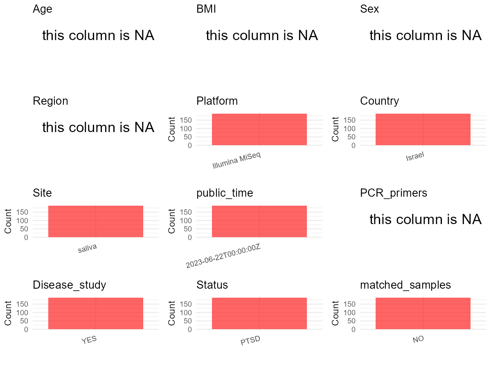

R Notebook: Metadata Processing Workflow
================

# Step 1: Obtain Initial Metadata from Each Project

To obtain the initial metadata: 1. Search for the BioProject ID (e.g.,
“PRJEBXXXX”) on the [NCBI SRA
website](https://www.ncbi.nlm.nih.gov/Traces/study/). 2. In the “Select”
table, click on “Metadata” and download the file. 3. The downloaded file
is typically named “SraRunTable.csv” and contains metadata for the
project.

``` r
# Load necessary libraries
library(dplyr)
library(ggplot2)
library(cowplot)

# Set working directory (update this path to your local directory)
setwd("D:/oral_project/PRJNA844909")

# Read the initial metadata files
initial_meta<-read.csv("SraRunTable.csv",header = T)

# Combine the two metadata files
#meta <- rbind(initial_meta, initial_meta1)

#Remove entries where Organism is "gut metagenome" (non-oral samples)
#initial_meta <- subset(initial_meta,isolation_source!= "feces")

# Check the number of samples containing "HT" in Sample.Name (e.g., healthy controls)
#nrow(subset(meta, grepl("HT", Sample.Name)))

# Display the first few rows of the metadata
head(initial_meta)
```

    ##           Run Assay.Type AvgSpotLen    Bases  BioProject    BioSample
    ## 1 SRR19523482   AMPLICON        602 33787852 PRJNA844909 SAMN28841056
    ## 2 SRR19523483   AMPLICON        602 38452750 PRJNA844909 SAMN28841055
    ## 3 SRR19523484   AMPLICON        602 36068830 PRJNA844909 SAMN28841054
    ## 4 SRR19523485   AMPLICON        602 41894986 PRJNA844909 SAMN28840982
    ## 5 SRR19523486   AMPLICON        602 35732914 PRJNA844909 SAMN28841053
    ## 6 SRR19523487   AMPLICON        602 31883124 PRJNA844909 SAMN28841052
    ##                BioSampleModel    Bytes                              Center.Name
    ## 1 Metagenome or environmental 20149581 FACULTY OF MEDICINE, TEL AVIV UNIVERSITY
    ## 2 Metagenome or environmental 22892427 FACULTY OF MEDICINE, TEL AVIV UNIVERSITY
    ## 3 Metagenome or environmental 21477196 FACULTY OF MEDICINE, TEL AVIV UNIVERSITY
    ## 4 Metagenome or environmental 24842554 FACULTY OF MEDICINE, TEL AVIV UNIVERSITY
    ## 5 Metagenome or environmental 21002873 FACULTY OF MEDICINE, TEL AVIV UNIVERSITY
    ## 6 Metagenome or environmental 18946376 FACULTY OF MEDICINE, TEL AVIV UNIVERSITY
    ##   Collection_Date Consent DATASTORE.filetype DATASTORE.provider
    ## 1  not applicable  public   fastq,run.zq,sra         gs,ncbi,s3
    ## 2  not applicable  public   fastq,run.zq,sra         gs,ncbi,s3
    ## 3  not applicable  public   fastq,run.zq,sra         gs,ncbi,s3
    ## 4  not applicable  public   fastq,run.zq,sra         gs,ncbi,s3
    ## 5  not applicable  public   fastq,run.zq,sra         gs,ncbi,s3
    ## 6  not applicable  public   fastq,run.zq,sra         gs,ncbi,s3
    ##                       DATASTORE.region  Experiment geo_loc_name_country
    ## 1 gs.us-east1,ncbi.public,s3.us-east-1 SRX15576013               Israel
    ## 2 gs.us-east1,ncbi.public,s3.us-east-1 SRX15576012               Israel
    ## 3 gs.us-east1,ncbi.public,s3.us-east-1 SRX15576011               Israel
    ## 4 gs.us-east1,ncbi.public,s3.us-east-1 SRX15576010               Israel
    ## 5 gs.us-east1,ncbi.public,s3.us-east-1 SRX15576009               Israel
    ## 6 gs.us-east1,ncbi.public,s3.us-east-1 SRX15576008               Israel
    ##   geo_loc_name_country_continent geo_loc_name health_state         HOST
    ## 1                           Asia       Israel         PTSD Homo sapiens
    ## 2                           Asia       Israel      Healthy Homo sapiens
    ## 3                           Asia       Israel         PTSD Homo sapiens
    ## 4                           Asia       Israel         PTSD Homo sapiens
    ## 5                           Asia       Israel      Healthy Homo sapiens
    ## 6                           Asia       Israel      Healthy Homo sapiens
    ##   host_subject_id     Instrument isolation_source        lat_lon Library.Name
    ## 1            2350 Illumina MiSeq           saliva not applicable      2350lib
    ## 2            2311 Illumina MiSeq           saliva not applicable      2311lib
    ## 3            2290 Illumina MiSeq           saliva not applicable      2290lib
    ## 4             240 Illumina MiSeq           saliva not applicable       240lib
    ## 5            2271 Illumina MiSeq           saliva not applicable      2271lib
    ## 6            2221 Illumina MiSeq           saliva not applicable      2221lib
    ##   LibraryLayout LibrarySelection LibrarySource         Organism Platform
    ## 1        PAIRED              PCR   METAGENOMIC human metagenome ILLUMINA
    ## 2        PAIRED              PCR   METAGENOMIC human metagenome ILLUMINA
    ## 3        PAIRED              PCR   METAGENOMIC human metagenome ILLUMINA
    ## 4        PAIRED              PCR   METAGENOMIC human metagenome ILLUMINA
    ## 5        PAIRED              PCR   METAGENOMIC human metagenome ILLUMINA
    ## 6        PAIRED              PCR   METAGENOMIC human metagenome ILLUMINA
    ##            ReleaseDate          create_date version Sample.Name SRA.Study
    ## 1 2023-06-22T00:00:00Z 2022-06-02T13:13:00Z       1        2350 SRP378203
    ## 2 2023-06-22T00:00:00Z 2022-06-02T13:14:00Z       1        2311 SRP378203
    ## 3 2023-06-22T00:00:00Z 2022-06-02T13:14:00Z       1        2290 SRP378203
    ## 4 2023-06-22T00:00:00Z 2022-06-02T13:14:00Z       1         240 SRP378203
    ## 5 2023-06-22T00:00:00Z 2022-06-02T13:14:00Z       1        2271 SRP378203
    ## 6 2023-06-22T00:00:00Z 2022-06-02T13:14:00Z       1        2221 SRP378203

# Step 2: Create a Uniform Metadata Template

The uniform metadata should include the following columns:

1.  **BioProject**: Project ID (e.g., “PRJNA339212”)
2.  **Run**: Sample ID (e.g., “ERRXXXXXX” or “SRRXXXXXX”)
3.  **sample_name**: Original sample name submitted by the authors (not
    the database-assigned ID)
4.  **Age**: Age of the subject (if available)
5.  **BMI**: Body Mass Index (if available)
6.  **Sex**: Sex of the subject (“F” or “M”)
7.  **Region**: Targeted 16S rRNA region (e.g., “V3-V4”)
8.  **Platform**: Sequencing platform (e.g., “Illumina MiSeq”)
9.  **Country**: Country of sample origin (e.g., “China”)
10. **Site**: Sample site (e.g., “saliva”, “dental plaque”)
11. **public_time**: Data release date (format: “YYYY-MM-DD”)
12. **PCR_primers**: PCR primers used (e.g., “515F-806R”)
13. **title**: Title of the associated publication
14. **Disease_study**: Whether the study involves a disease (“YES” or
    “NO”)
15. **Status**: Disease status (e.g., “T2DM”, “HC”). Note: If the study
    includes both disease and healthy samples, this must be specified
    per sample.

``` r
# Create a uniform metadata dataframe
metadata <- data.frame(
  BioProject = initial_meta$BioProject,
  Run = initial_meta$Run,
  sample_name = initial_meta$Sample.Name,
  Age = NA,
  BMI = NA,
  Sex=NA,
  Region = NA,
  Platform = initial_meta$Instrument,
  Country = initial_meta$geo_loc_name_country,
  Site = initial_meta$isolation_source,
  public_time = initial_meta$ReleaseDate,
  stringsAsFactors = FALSE
)
#%>%mutate(Site=case_when(Site=="Human stool"~"Feces",Site=="Human swab"~"oral swab"))
```

# Step 3: Manually Add Information from the Publication

Some information (e.g. PCR primers, study title, disease status) must be
manually extracted from the publication and added to the metadata.

``` r
# Add information obtained from the publication
metadata$PCR_primers <- NA
metadata$title <- "Oral microbiota signatures in post-traumatic stress disorder (PTSD) veterans"
#metadata<-subset(uniform_meta,Site!="feces")
metadata$Disease_study <- "YES"
# Assign disease status based on sample_name patterns
metadata$Status <-"PTSD"
#extract subject id by remove prefix of sample_name
#metadata$sample_name <- gsub("S-Saliva-.*|F", "", metadata$sample_name)
#get subjects id with Saliva available
#keep_subjects<-subset(metadata,Site=="oral swab")
#remove subjects without Saliva samples
#metadata<-subset(metadata,sample_name %in% keep_subjects$sample_name)
#get subjects sampling counts
#sample_counts <- table(metadata$sample_name)
# Create matched_samples column, any subjects have >=2 samples will be label "YES", otherwise "NO"
#metadata$matched_samples <- ifelse(metadata$sample_name %in% names(sample_counts[sample_counts >= 2]), "YES", "NO")
metadata$matched_samples<-"NO"
```

# Step 4: Summarize and Validate the Metadata

``` r
# Check the number of unique runs and sample names
print(paste("Number of unique runs:", length(unique(metadata$Run))))
```

    ## [1] "Number of unique runs: 189"

``` r
print(paste("Number of unique sample names:", length(unique(metadata$sample_name))))
```

    ## [1] "Number of unique sample names: 189"

# Step 5: Visualize the Metadata

``` r

```


# Step 6: Finalize and Export the Metadata

``` r
# Reorder columns to match the desired format
metadata <- metadata[, c(
  "BioProject", "Run", "sample_name", "Age", "BMI", "Sex", 
  "Region", "Platform", "Country", "Site", "public_time", 
  "PCR_primers", "title", "Disease_study", "Status","matched_samples"
)]

# Export the uniform metadata to a CSV file
write.csv(metadata, file = "metadata.csv", quote = FALSE)
head(metadata)
```

    ##    BioProject         Run sample_name Age BMI Sex Region       Platform Country
    ## 1 PRJNA844909 SRR19523482        2350  NA  NA  NA     NA Illumina MiSeq  Israel
    ## 2 PRJNA844909 SRR19523483        2311  NA  NA  NA     NA Illumina MiSeq  Israel
    ## 3 PRJNA844909 SRR19523484        2290  NA  NA  NA     NA Illumina MiSeq  Israel
    ## 4 PRJNA844909 SRR19523485         240  NA  NA  NA     NA Illumina MiSeq  Israel
    ## 5 PRJNA844909 SRR19523486        2271  NA  NA  NA     NA Illumina MiSeq  Israel
    ## 6 PRJNA844909 SRR19523487        2221  NA  NA  NA     NA Illumina MiSeq  Israel
    ##     Site          public_time PCR_primers
    ## 1 saliva 2023-06-22T00:00:00Z          NA
    ## 2 saliva 2023-06-22T00:00:00Z          NA
    ## 3 saliva 2023-06-22T00:00:00Z          NA
    ## 4 saliva 2023-06-22T00:00:00Z          NA
    ## 5 saliva 2023-06-22T00:00:00Z          NA
    ## 6 saliva 2023-06-22T00:00:00Z          NA
    ##                                                                          title
    ## 1 Oral microbiota signatures in post-traumatic stress disorder (PTSD) veterans
    ## 2 Oral microbiota signatures in post-traumatic stress disorder (PTSD) veterans
    ## 3 Oral microbiota signatures in post-traumatic stress disorder (PTSD) veterans
    ## 4 Oral microbiota signatures in post-traumatic stress disorder (PTSD) veterans
    ## 5 Oral microbiota signatures in post-traumatic stress disorder (PTSD) veterans
    ## 6 Oral microbiota signatures in post-traumatic stress disorder (PTSD) veterans
    ##   Disease_study Status matched_samples
    ## 1           YES   PTSD              NO
    ## 2           YES   PTSD              NO
    ## 3           YES   PTSD              NO
    ## 4           YES   PTSD              NO
    ## 5           YES   PTSD              NO
    ## 6           YES   PTSD              NO

## Notes for Students:

1.  **Metadata Accuracy**: Always cross-check the metadata with the
    original publication to ensure accuracy.
2.  **Manual Entries**: Columns like `PCR_primers`, and `Status` often
    require manual entry based on the publication.
3.  **Disease Status**: Be careful when assigning `Status`—some studies
    include both disease and healthy samples.
4.  **Visualization**: The plots help quickly identify the distribution
    of values in each column, which is useful for quality control.
5.  **Reproducibility**: Update the working directory and file paths to
    match your local environment.
