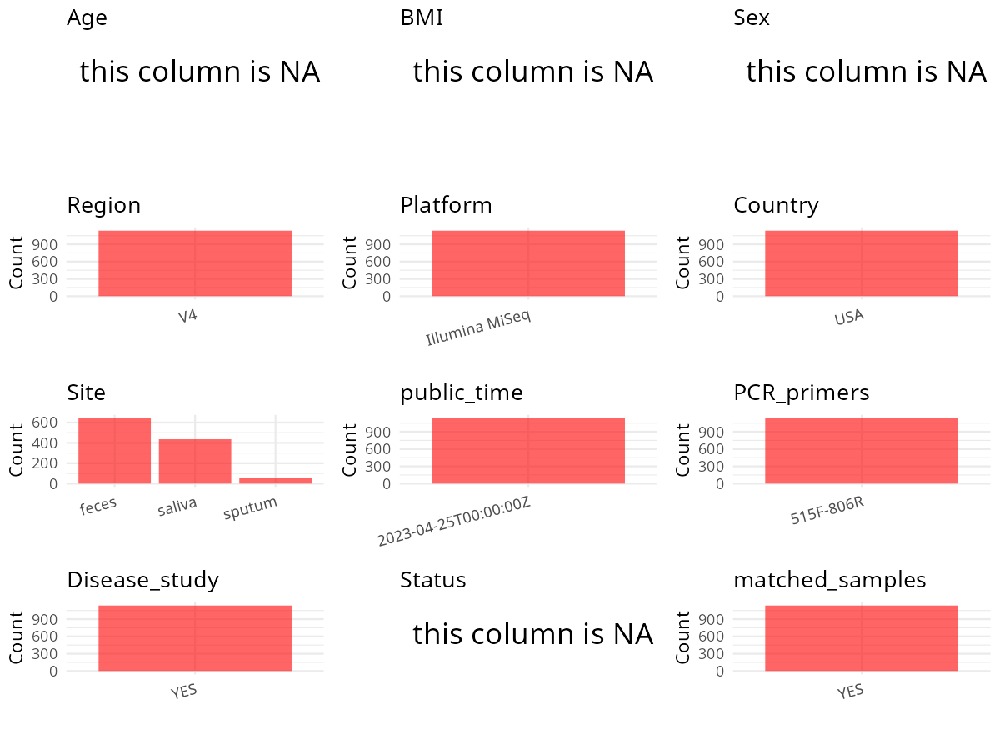

R Notebook: Metadata Processing Workflow
================

# Step 1: Obtain Initial Metadata from Each Project

To obtain the initial metadata: 1. Search for the BioProject ID (e.g.,
“PRJEBXXXX”) on the [NCBI SRA
website](https://www.ncbi.nlm.nih.gov/Traces/study/). 2. In the “Select”
table, click on “Metadata” and download the file. 3. The downloaded file
is typically named “SraRunTable.csv” and contains metadata for the
project.

``` r
# Load necessary libraries
library(dplyr)
library(ggplot2)
library(cowplot)
library(stringr)

# Set working directory (update this path to your local directory)
setwd("/home/hby/oral_project/PRJNA847970")

# Read the initial metadata files
initial_meta <- read.csv("SraRunTable.csv", header = T)

# Combine the two metadata files
# meta <- rbind(initial_meta, initial_meta1)

# Remove entries non-oral samples
# initial_meta <- subset(initial_meta,isolate %in% c("saliva","tongue coat"))

# Check the number of samples containing "HT" in Sample.Name (e.g., healthy controls)
# nrow(subset(meta, grepl("HT", Sample.Name)))

# Display the first few rows of the metadata
head(initial_meta)
```

    ##           Run Assay.Type AvgSpotLen    Bases  BioProject    BioSample                                    BioSampleModel    Bytes              Center.Name Collection_Date Consent
    ## 1 SRR19637645   AMPLICON        502 10891392 PRJNA847970 SAMN29010065 MIMARKS.survey,MIGS/MIMS/MIMARKS.human-associated  6463237 UNIVERSITY OF PITTSBURGH        2020/8/7  public
    ## 2 SRR19637646   AMPLICON        502 46399358 PRJNA847970 SAMN29010118 MIMARKS.survey,MIGS/MIMS/MIMARKS.human-associated 28793737 UNIVERSITY OF PITTSBURGH      2019/11/26  public
    ## 3 SRR19637647   AMPLICON        502 14376778 PRJNA847970 SAMN29010117 MIMARKS.survey,MIGS/MIMS/MIMARKS.human-associated  8400918 UNIVERSITY OF PITTSBURGH       2020/7/19  public
    ## 4 SRR19637648   AMPLICON        502 13599180 PRJNA847970 SAMN29010116 MIMARKS.survey,MIGS/MIMS/MIMARKS.human-associated  7928054 UNIVERSITY OF PITTSBURGH      2019/11/11  public
    ## 5 SRR19637649   AMPLICON        502   670170 PRJNA847970 SAMN29010116 MIMARKS.survey,MIGS/MIMS/MIMARKS.human-associated   475623 UNIVERSITY OF PITTSBURGH      2019/11/11  public
    ## 6 SRR19637650   AMPLICON        502 13118264 PRJNA847970 SAMN29010115 MIMARKS.survey,MIGS/MIMS/MIMARKS.human-associated  7957358 UNIVERSITY OF PITTSBURGH       2020/9/22  public
    ##   DATASTORE.filetype DATASTORE.provider                     DATASTORE.region                         env_broad_scale        env_local_scale env_medium  Experiment geo_loc_name_country
    ## 1   fastq,run.zq,sra         gs,ncbi,s3 gs.us-east1,ncbi.public,s3.us-east-1 multicellular organism [UBERON:0000468] colon [UBERON:0001155]      feces SRX15688167                  USA
    ## 2   fastq,run.zq,sra         gs,ncbi,s3 gs.us-east1,ncbi.public,s3.us-east-1 multicellular organism [UBERON:0000468] colon [UBERON:0001155]      feces SRX15688166                  USA
    ## 3   fastq,run.zq,sra         gs,ncbi,s3 gs.us-east1,ncbi.public,s3.us-east-1 multicellular organism [UBERON:0000468] colon [UBERON:0001155]      feces SRX15688165                  USA
    ## 4   fastq,run.zq,sra         gs,ncbi,s3 gs.us-east1,ncbi.public,s3.us-east-1 multicellular organism [UBERON:0000468] colon [UBERON:0001155]      feces SRX15688164                  USA
    ## 5   fastq,run.zq,sra         gs,ncbi,s3 gs.us-east1,ncbi.public,s3.us-east-1 multicellular organism [UBERON:0000468] colon [UBERON:0001155]      feces SRX15688163                  USA
    ## 6   fastq,run.zq,sra         gs,ncbi,s3 gs.us-east1,ncbi.public,s3.us-east-1 multicellular organism [UBERON:0000468] colon [UBERON:0001155]      feces SRX15688162                  USA
    ##   geo_loc_name_country_continent   geo_loc_name         HOST     Instrument             lat_lon   Library.Name LibraryLayout LibrarySelection LibrarySource               Organism
    ## 1                  North America USA:Pittsburgh Homo sapiens Illumina MiSeq 40.4406 N 79.9959 W 20201007_A_208        PAIRED              PCR   METAGENOMIC human feces metagenome
    ## 2                  North America USA:Pittsburgh Homo sapiens Illumina MiSeq 40.4406 N 79.9959 W  20200306_B_33        PAIRED              PCR   METAGENOMIC human feces metagenome
    ## 3                  North America USA:Pittsburgh Homo sapiens Illumina MiSeq 40.4406 N 79.9959 W 20201007_A_223        PAIRED              PCR   METAGENOMIC human feces metagenome
    ## 4                  North America USA:Pittsburgh Homo sapiens Illumina MiSeq 40.4406 N 79.9959 W  20200813_A_28        PAIRED              PCR   METAGENOMIC human feces metagenome
    ## 5                  North America USA:Pittsburgh Homo sapiens Illumina MiSeq 40.4406 N 79.9959 W  20200306_B_32        PAIRED              PCR   METAGENOMIC human feces metagenome
    ## 6                  North America USA:Pittsburgh Homo sapiens Illumina MiSeq 40.4406 N 79.9959 W 20210302_B_134        PAIRED              PCR   METAGENOMIC human feces metagenome
    ##   Platform          ReleaseDate          create_date version                                      run_id..run.                 Sample_Name SRA.Study host_subject_id replicate Status
    ## 1 ILLUMINA 2023-04-25T00:00:00Z 2022-06-13T16:08:00Z       1 20201007_A_0159_COVID_PMED1155__RN_0142_202104903 0159-AY44-33175-20200807-ST SRP379893           33175         1   <NA>
    ## 2 ILLUMINA 2023-04-25T00:00:00Z 2022-06-13T16:09:00Z       1 20200306_B_0159_0199_0205_0211__RN_0021_156936780 0159-AY44-33274-20191126-ST SRP379893           33274         1   <NA>
    ## 3 ILLUMINA 2023-04-25T00:00:00Z 2022-06-13T16:08:00Z       1 20201007_A_0159_COVID_PMED1155__RN_0142_202104903 0159-AY44-33273-20200719-ST SRP379893           33273         1   <NA>
    ## 4 ILLUMINA 2023-04-25T00:00:00Z 2022-06-13T16:09:00Z       1               20200813_A_0159_ST_0216_OW__RN_0138 0159-AY44-33273-20191111-ST SRP379893           33273         1   <NA>
    ## 5 ILLUMINA 2023-04-25T00:00:00Z 2022-06-13T16:08:00Z       1 20200306_B_0159_0199_0205_0211__RN_0021_156936780 0159-AY44-33273-20191111-ST SRP379893           33273         1   <NA>
    ## 6 ILLUMINA 2023-04-25T00:00:00Z 2022-06-13T16:08:00Z       1       20210302_B_0159_MB_COVID__RN_0039_234079847 0159-AY44-33270-20200922-ST SRP379893           33270         1   <NA>

# Step 2: Create a Uniform Metadata Template

The uniform metadata should include the following columns:

1.  **BioProject**: Project ID (e.g., “PRJNA339212”)
2.  **Run**: Sample ID (e.g., “ERRXXXXXX” or “SRRXXXXXX”)
3.  **sample_name**: Original sample name submitted by the authors (not
    the database-assigned ID)
4.  **Age**: Age of the subject (if available)
5.  **BMI**: Body Mass Index (if available)
6.  **Sex**: Sex of the subject (“F” or “M”)
7.  **Region**: Targeted 16S rRNA region (e.g., “V3-V4”)
8.  **Platform**: Sequencing platform (e.g., “Illumina MiSeq”)
9.  **Country**: Country of sample origin (e.g., “China”)
10. **Site**: Sample site (e.g., “saliva”, “dental plaque”)
11. **public_time**: Data release date (format: “YYYY-MM-DD”)
12. **PCR_primers**: PCR primers used (e.g., “515F-806R”)
13. **title**: Title of the associated publication
14. **Disease_study**: Whether the study involves a disease (“YES” or
    “NO”)
15. **Status**: Disease status (e.g., “T2DM”, “HC”). Note: If the study
    includes both disease and healthy samples, this must be specified
    per sample.
16. **matched_samples**: matched samples (“YES” or “NO”)

``` r
# Create a uniform metadata dataframe
metadata <- data.frame(
  BioProject = initial_meta$BioProject,
  Run = initial_meta$Run,
  sample_name = initial_meta$host_subject_id,
  Platform = initial_meta$Instrument,
  Country = initial_meta$geo_loc_name_country,
  Site = initial_meta$env_medium,
  public_time = initial_meta$ReleaseDate,
  BMI = NA,
  Age = NA,
  Sex = NA,
  Status = NA,
  stringsAsFactors = FALSE
)
```

# Step 3: Manually Add Information from the Publication

Some information (e.g. PCR primers, study title, disease status) must be
manually extracted from the publication and added to the metadata.

``` r
# Add information obtained from the publication
metadata$Region <- "V4"
metadata$PCR_primers <- "515F-806R"
metadata$title <- "Gut and oral microbiota associations with viral mitigation behaviors during the COVID-19 pandemic"
metadata$Disease_study <- "YES"

# extract subject id by remove prefix of sample_name
metadata$subject_id <- metadata$sample_name
all_oral_sites <- c("saliva", "tongue coat", "buccal mucosa", "lower jaw mucosa", "lower labial mucosa", "upper jaw mucosa", "tongue", "buccal", "sputum")
# Check initial data distribution
cat("Initial sample distribution:\n")
```

    ## Initial sample distribution:

``` r
table(metadata$subject_id)
```

    ## 
    ##  10002  10003  10011  10012  10013  10017  10018  10020  10021  10022  10025  10030  10033  10036  10039  10041  10047  10052  10058  10060  10066  10067  10073  10077  10080  10081 
    ##      3      3      4      5      4      5      2      6      5      4      5      6      5      5      4      5      6      3      3      4      4      3      4      3      3      5 
    ##  10082  10083  10092  10093  10104  10105  10106  10110  10111  10112  10114  10122  10123  10128  10130  10137  10142  10143  10146  10148  10149  10151  10152  10154  10431  10436 
    ##      4      4      4      4      4      4      3      5      4      4      6      4      2      4      3      6      4      5      3      4      4      4      3      3      6      5 
    ##  10455  10468  10469  26016  26064  26083  26129  26204  26207  26221  26232  26242  26254  26269  26306  26323  26354  26375  26382  26458  26466  26468  26473  26497  26504  26506 
    ##      3      5      5      2      2      2      2      2      2      3      2      2      2      3      2      2      2      2      1      2      2      1      2      2      2      2 
    ##  26508  26515  26517  26530  26541  26547  26560  26573  26577  26578  26590  26591  26592  26596  26598  26599  26605  26607  26614  26617  26619  26631  26632  26656  26659  26662 
    ##      2      2      2      2      2      4      2      2      2      2      3      2      2      2      2      2      3      2      2      2      2      2      2      3      2      2 
    ##  26667  26669  26675  26718  26768  30200  30379  32000  32001  32003  32005  32007  32008  32009  32013  32016  32019  32020  32021  32022  32023  32024  32025  32026  32027  32028 
    ##      3      2      1      2      2      3      3      5      4      7      4      4      6      2      5      6      6      7      7      5      8      6      5      6      7      6 
    ##  32032  32033  32035  32037  32039  32044  32046  32047  32049  32050  32051  32052  32055  32059  32060  32061  32062  32064  32065  32067  32068  32069  32070  32071  32072  32073 
    ##      7      5      6      5      6      5      5      4      5      5      5      3      4      4      5      3      5      5      5      4      5      4      8      5      6      4 
    ##  32077  32080  32081  32082  32084  32085  32086  32089  32090  32091  32092  32093  32095  32096  32098  32099  33000  33003  33005  33007  33011  33021  33022  33026  33028  33030 
    ##      5      5      5      3      4      5      4      7      3      4      4      5      6      5      5      5      4      4      4      4      3      3      3      4      4      4 
    ##  33032  33034  33038  33039  33041  33042  33043  33044  33046  33051  33052  33055  33056  33057  33058  33066  33071  33072  33073  33081  33083  33088  33103  33109  33111  33118 
    ##      4      5      4      3      5      4      4      3      5      6      3      6      4      5      4      4      4      5      4      5      5      5      7      4      2      3 
    ##  33121  33122  33129  33137  33138  33142  33145  33149  33153  33156  33157  33159  33163  33165  33168  33170  33171  33175  33184  33198  33200  33201  33207  33211  33215  33242 
    ##      6      6      2      2      4      4      2      5      6      3      3      3      4      7      6      3      3      5      4      6      4      4      3      4      4      3 
    ##  33244  33246  33254  33255  33257  33259  33261  33264  33270  33273  33274  33277  33282  33283  33288  33289  33293  33295  33297  33303  33307  33308  33314  33315  33319  33323 
    ##      3      3      3      2      3      4      3      3      2      3      3      3      3      3      3      4      3      4      3      3      3      3      3      2      3      3 
    ##  33325  33326  33330  33332  40003  40006  40011  40019  40020  40030  40031  40032  40037  40038  40041  40042  40043  40045  40048  40049  40050  40055  40058  40071  40072  40075 
    ##      3      3      3      3      4      5      3      4      4      4      4      6      4      4      5      3      4      4      4      4      5      3      5      5      4      4 
    ##  40082  40089  40097  40099  40100  40101  40102  40103  42301  42306  42311  42328  42329  42349  42362  42365  42366  42369  42372  42375  42378  42384  42394  42398  42400  42401 
    ##      6      4      4      4      3      4      5      4      3      2      3      3      3      3      3      2      2      3      5      3      3      4      3      3      3      3 
    ##  42402  42407  42409  42417  42422  42425  42430  42433  42435  42436  42437  42439  42444  42447  42451  42453  42454  42456  42459  42470  42471  42473  42475  42477  42478  42481 
    ##      4      2      3      2      2      3      2      4      4      3      3      3      3      4      3      6      3      2      2      4      5      4      4      2      5      2 
    ##  42485  42487  42489  42490  42496  42497  42502  42506  42507  42513  42520  42521  42523  42524  42526  71010  71011  71022  71023  71037  71040  71041  71048  71062  71073  76002 
    ##      3      3      3      5      4      3      2      4      2      3      3      3      3      3      3      3      3      3      4      3      3      3      3      4      3      3 
    ##  76041  76049 100015 100460 100570 100610 100623 100634 100802 100814 100819 100825 100835 100861 100873 100983 100989 101080 101632 101695 101736 103126 105120 
    ##      3      3      2      3      2      2      2      2      2      3      4      2      2      2      2      2      2      2      2      4      2      2      4

``` r
table(metadata$Site)
```

    ## 
    ##  control_DNA        feces kit_reagents pcr_reagents       saliva       sputum 
    ##           96          911           91          101          436           57

``` r
subjects_with_oral_samples <- metadata %>%
  filter(Site %in% all_oral_sites) %>%
  distinct(subject_id) %>%
  pull(subject_id)

metadata_clean <- metadata %>%
  filter(subject_id %in% subjects_with_oral_samples)


sample_counts <- metadata_clean %>%
  group_by(subject_id) %>%
  summarise(n_samples = n(), .groups = "drop")

metadata_clean <- merge(metadata_clean, sample_counts, by = "subject_id")

# Create matched_samples column
metadata_clean$matched_samples <- ifelse(metadata_clean$n_samples >= 2, "YES", "NO")

cat("\nFinal sample distribution after cleaning:\n")
```

    ## 
    ## Final sample distribution after cleaning:

``` r
print(table(metadata_clean$Site))
```

    ## 
    ##  feces saliva sputum 
    ##    643    436     57

``` r
cat("\nFinal sample distribution after cleaning:\n")
```

    ## 
    ## Final sample distribution after cleaning:

``` r
print(table(metadata_clean$matched_samples))
```

    ## 
    ##  YES 
    ## 1136

``` r
metadata_clean$subject_id <- NULL
metadata_clean$n_samples <- NULL

# Use cleaned dataset for subsequent analysis
metadata <- metadata_clean
```

# Step 4: Summarize and Validate the Metadata

``` r
# Check the number of unique runs and sample names
print(paste("Number of unique runs:", length(unique(metadata$Run))))
```

    ## [1] "Number of unique runs: 1136"

``` r
print(paste("Number of unique sample names:", length(unique(metadata$sample_name))))
```

    ## [1] "Number of unique sample names: 273"

# Step 5: Visualize the Metadata

``` r

```


# Step 6: Finalize and Export the Metadata

``` r
# Reorder columns to match the desired format
metadata <- metadata[, c(
  "BioProject", "Run", "sample_name", "Age", "BMI", "Sex",
  "Region", "Platform", "Country", "Site", "public_time",
  "PCR_primers", "title", "Disease_study", "Status", "matched_samples"
)]

# Export the uniform metadata to a CSV file
write.csv(metadata, file = "metadata.csv", quote = FALSE)
head(metadata)
```

    ##    BioProject         Run sample_name Age BMI Sex Region       Platform Country   Site          public_time PCR_primers
    ## 1 PRJNA847970 SRR19795445       10002  NA  NA  NA     V4 Illumina MiSeq     USA  feces 2023-04-25T00:00:00Z   515F-806R
    ## 2 PRJNA847970 SRR19795446       10002  NA  NA  NA     V4 Illumina MiSeq     USA saliva 2023-04-25T00:00:00Z   515F-806R
    ## 3 PRJNA847970 SRR19795447       10002  NA  NA  NA     V4 Illumina MiSeq     USA  feces 2023-04-25T00:00:00Z   515F-806R
    ## 4 PRJNA847970 SRR19794909       10003  NA  NA  NA     V4 Illumina MiSeq     USA  feces 2023-04-25T00:00:00Z   515F-806R
    ## 5 PRJNA847970 SRR19795443       10003  NA  NA  NA     V4 Illumina MiSeq     USA saliva 2023-04-25T00:00:00Z   515F-806R
    ## 6 PRJNA847970 SRR19795444       10003  NA  NA  NA     V4 Illumina MiSeq     USA  feces 2023-04-25T00:00:00Z   515F-806R
    ##                                                                                               title Disease_study Status matched_samples
    ## 1 Gut and oral microbiota associations with viral mitigation behaviors during the COVID-19 pandemic           YES     NA             YES
    ## 2 Gut and oral microbiota associations with viral mitigation behaviors during the COVID-19 pandemic           YES     NA             YES
    ## 3 Gut and oral microbiota associations with viral mitigation behaviors during the COVID-19 pandemic           YES     NA             YES
    ## 4 Gut and oral microbiota associations with viral mitigation behaviors during the COVID-19 pandemic           YES     NA             YES
    ## 5 Gut and oral microbiota associations with viral mitigation behaviors during the COVID-19 pandemic           YES     NA             YES
    ## 6 Gut and oral microbiota associations with viral mitigation behaviors during the COVID-19 pandemic           YES     NA             YES

## Notes for Students:

1.  **Metadata Accuracy**: Always cross-check the metadata with the
    original publication to ensure accuracy.
2.  **Manual Entries**: Columns like `PCR_primers`, and `Status` often
    require manual entry based on the publication.
3.  **Disease Status**: Be careful when assigning `Status`—some studies
    include both disease and healthy samples.
4.  **Visualization**: The plots help quickly identify the distribution
    of values in each column, which is useful for quality control.
5.  **Reproducibility**: Update the working directory and file paths to
    match your local environment.
