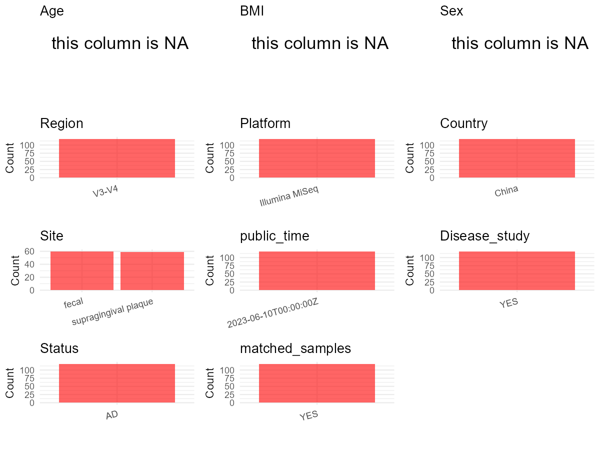

# Step 1: Obtain Initial Metadata from Each Project

To obtain the initial metadata: 1. Search for the BioProject ID (e.g.,
“PRJEBXXXX”) on the [NCBI SRA
website](https://www.ncbi.nlm.nih.gov/Traces/study/). 2. In the “Select”
table, click on “Metadata” and download the file. 3. The downloaded file
is typically named “SraRunTable.csv” and contains metadata for the
project.

    library(tidyverse)
    library(ggplot2)
    library(cowplot)

    setwd("C:/Users/zyc/Desktop/oral_project/data/projects/PRJNA851957")
    initial_meta <- read.csv("SraRunTable.csv", header = TRUE) 
    head(initial_meta)

    ##           Run Assay.Type AvgSpotLen BARCODE    Bases  BioProject    BioSample                                      BioSampleModel    Bytes
    ## 1 SRR19970819    RNA-Seq        450  TGGACG 35523518 PRJNA851957 SAMN29259442 MIMARKS.specimen,MIGS/MIMS/MIMARKS.human-associated 18367484
    ## 2 SRR19970820    RNA-Seq        452  CGGCAC 49552075 PRJNA851957 SAMN29259441 MIMARKS.specimen,MIGS/MIMS/MIMARKS.human-associated 25424762
    ## 3 SRR19970821    RNA-Seq        464  ACATAG 34491053 PRJNA851957 SAMN29259440 MIMARKS.specimen,MIGS/MIMS/MIMARKS.human-associated 16711495
    ## 4 SRR19970822    RNA-Seq        460  GCTGGT 40979714 PRJNA851957 SAMN29259439 MIMARKS.specimen,MIGS/MIMS/MIMARKS.human-associated 19917135
    ## 5 SRR19970823    RNA-Seq        455  ACTGCG 39792994 PRJNA851957 SAMN29259438 MIMARKS.specimen,MIGS/MIMS/MIMARKS.human-associated 18574395
    ## 6 SRR19970824    RNA-Seq        452  CGGACC 37367040 PRJNA851957 SAMN29259437 MIMARKS.specimen,MIGS/MIMS/MIMARKS.human-associated 17252870
    ##                 Center.Name Collection_Date Consent DATASTORE.filetype DATASTORE.provider                     DATASTORE.region
    ## 1 FUJIAN MEDICAL UNIVERSITY      2021-07-26  public   fastq,run.zq,sra         gs,ncbi,s3 gs.us-east1,ncbi.public,s3.us-east-1
    ## 2 FUJIAN MEDICAL UNIVERSITY      2021-07-17  public   fastq,run.zq,sra         gs,ncbi,s3 gs.us-east1,ncbi.public,s3.us-east-1
    ## 3 FUJIAN MEDICAL UNIVERSITY      2021-08-26  public   fastq,run.zq,sra         gs,ncbi,s3 gs.us-east1,ncbi.public,s3.us-east-1
    ## 4 FUJIAN MEDICAL UNIVERSITY      2021-07-26  public   fastq,run.zq,sra         gs,ncbi,s3 gs.us-east1,ncbi.public,s3.us-east-1
    ## 5 FUJIAN MEDICAL UNIVERSITY      2021-07-26  public   fastq,run.zq,sra         gs,ncbi,s3 gs.us-east1,ncbi.public,s3.us-east-1
    ## 6 FUJIAN MEDICAL UNIVERSITY      2021-07-23  public   fastq,run.zq,sra         gs,ncbi,s3 gs.us-east1,ncbi.public,s3.us-east-1
    ##                            env_broad_scale                 env_local_scale env_medium  Experiment geo_loc_name_country
    ## 1 microbiome\\,16S barcoded pyrosequencing irritable bowel syndrome/health      fecal SRX16013239                China
    ## 2 microbiome\\,16S barcoded pyrosequencing irritable bowel syndrome/health      fecal SRX16013238                China
    ## 3 microbiome\\,16S barcoded pyrosequencing irritable bowel syndrome/health      fecal SRX16013237                China
    ## 4 microbiome\\,16S barcoded pyrosequencing irritable bowel syndrome/health      fecal SRX16013236                China
    ## 5 microbiome\\,16S barcoded pyrosequencing irritable bowel syndrome/health      fecal SRX16013235                China
    ## 6 microbiome\\,16S barcoded pyrosequencing irritable bowel syndrome/health      fecal SRX16013234                China
    ##   geo_loc_name_country_continent geo_loc_name         HOST     Instrument isol_growth_condt
    ## 1                           Asia China:Fuzhou Homo sapiens Illumina MiSeq     not collected
    ## 2                           Asia China:Fuzhou Homo sapiens Illumina MiSeq     not collected
    ## 3                           Asia China:Fuzhou Homo sapiens Illumina MiSeq     not collected
    ## 4                           Asia China:Fuzhou Homo sapiens Illumina MiSeq     not collected
    ## 5                           Asia China:Fuzhou Homo sapiens Illumina MiSeq     not collected
    ## 6                           Asia China:Fuzhou Homo sapiens Illumina MiSeq     not collected
    ##                                                                                 isolate          lat_lon Library.Name LibraryLayout
    ## 1                      Patients with Alzheimer's disease\\, pro-inflammatory diet group 26.08 N 119.28 E          100        PAIRED
    ## 2 Patients with Alzheimer's disease\\, no anti-inflammatory/pro-inflammatory diet group 26.08 N 119.28 E           99        PAIRED
    ## 3 Patients with Alzheimer's disease\\, no anti-inflammatory/pro-inflammatory diet group 26.08 N 119.28 E           98        PAIRED
    ## 4 Patients with Alzheimer's disease\\, no anti-inflammatory/pro-inflammatory diet group 26.08 N 119.28 E           97        PAIRED
    ## 5 Patients with Alzheimer's disease\\, no anti-inflammatory/pro-inflammatory diet group 26.08 N 119.28 E           96        PAIRED
    ## 6 Patients with Alzheimer's disease\\, no anti-inflammatory/pro-inflammatory diet group 26.08 N 119.28 E           95        PAIRED
    ##   LibrarySelection LibrarySource             Organism Platform          ReleaseDate          create_date version Sample.Name SRA.Study
    ## 1              PCR   METAGENOMIC human gut metagenome ILLUMINA 2023-06-10T00:00:00Z 2022-07-04T08:51:00Z       1        A1F1 SRP383211
    ## 2              PCR   METAGENOMIC human gut metagenome ILLUMINA 2023-06-10T00:00:00Z 2022-07-04T08:51:00Z       1        A2F8 SRP383211
    ## 3              PCR   METAGENOMIC human gut metagenome ILLUMINA 2023-06-10T00:00:00Z 2022-07-04T08:51:00Z       1        F155 SRP383211
    ## 4              PCR   METAGENOMIC human gut metagenome ILLUMINA 2023-06-10T00:00:00Z 2022-07-04T08:51:00Z       1        F154 SRP383211
    ## 5              PCR   METAGENOMIC human gut metagenome ILLUMINA 2023-06-10T00:00:00Z 2022-07-04T08:51:00Z       1         F38 SRP383211
    ## 6              PCR   METAGENOMIC human gut metagenome ILLUMINA 2023-06-10T00:00:00Z 2022-07-04T08:51:00Z       1        F128 SRP383211

# Step 2: Create a Uniform Metadata Template

The uniform metadata should include the following columns:

1.  **BioProject**: Project ID (e.g., “PRJNA339212”)
2.  **Run**: Sample ID (e.g., “ERRXXXXXX” or “SRRXXXXXX”)
3.  **sample\_name**: Original sample name submitted by the authors (not
    the database-assigned ID)
4.  **Age**: Age of the subject (if available)
5.  **BMI**: Body Mass Index (if available)
6.  **Sex**: Sex of the subject (“F” or “M”)
7.  **Region**: Targeted 16S rRNA region (e.g., “V3-V4”)
8.  **Platform**: Sequencing platform (e.g., “Illumina MiSeq”)
9.  **Country**: Country of sample origin (e.g., “China”)
10. **Site**: Sample site (e.g., “saliva”, “dental plaque”)
11. **public\_time**: Data release date (format: “YYYY-MM-DD”)
12. **PCR\_primers**: PCR primers used (e.g., “515F-806R”)
13. **title**: Title of the associated publication
14. **Disease\_study**: Whether the study involves a disease (“YES” or
    “NO”)
15. **Status**: Disease status (e.g., “T2DM”, “HC”). Note: If the study
    includes both disease and healthy samples, this must be specified
    per sample.
16. **matched\_samples**: matched samples (“YES” or “NO”)

<!-- -->

    metadata <- data.frame(
      BioProject = initial_meta$BioProject,
      Run = initial_meta$Run,
      sample_name = initial_meta$Sample.Name,
      Age = NA, 
      BMI = NA,  
      Sex = NA,
      Platform = initial_meta$Instrument,
      Country = initial_meta$geo_loc_name_country,
      Site = initial_meta$env_medium,
      public_time = initial_meta$ReleaseDate,
      Status = "AD",
      stringsAsFactors = FALSE
    )

# Step 3: Manually Add Information from the Publication

Some information (e.g. PCR primers, study title, disease status) must be
manually extracted from the publication and added to the metadata.

    # metadata <- metadata %>%mutate(Status = case_when(
    #   Status == "Oral Neoplasm (Healthy Control)" ~ "HC",
    #   Status == "Oral Neoplasm (OSCC)" ~ "OSCC",
    #   TRUE ~ "Precancer"
    # ))
    # metadata <- metadata %>%
    #   mutate(Sex = recode(Sex, "female" = "F", "male" = "M"))
    # metadata <-metadata%>%
    #   mutate(Country = case_when(Country == "Taiwan" ~ "China"))

    metadata$matched_samples <- "YES"
    metadata$Region <- "V3-V4"
    metadata$title <- "Different oral and gut microbial profiles in those with Alzheimer's disease consuming anti-inflammatory diets"
    metadata$Disease_study <- "YES"
    metadata$PCR_primers <- " F(5'-CCTACGGGNGGCWGCAG-3')R(5'-GACTACHVGGGTATCTAATCC-3')"

    head(metadata)

    ##    BioProject         Run sample_name Age BMI Sex       Platform Country  Site          public_time Status matched_samples Region
    ## 1 PRJNA851957 SRR19970819        A1F1  NA  NA  NA Illumina MiSeq   China fecal 2023-06-10T00:00:00Z     AD             YES  V3-V4
    ## 2 PRJNA851957 SRR19970820        A2F8  NA  NA  NA Illumina MiSeq   China fecal 2023-06-10T00:00:00Z     AD             YES  V3-V4
    ## 3 PRJNA851957 SRR19970821        F155  NA  NA  NA Illumina MiSeq   China fecal 2023-06-10T00:00:00Z     AD             YES  V3-V4
    ## 4 PRJNA851957 SRR19970822        F154  NA  NA  NA Illumina MiSeq   China fecal 2023-06-10T00:00:00Z     AD             YES  V3-V4
    ## 5 PRJNA851957 SRR19970823         F38  NA  NA  NA Illumina MiSeq   China fecal 2023-06-10T00:00:00Z     AD             YES  V3-V4
    ## 6 PRJNA851957 SRR19970824        F128  NA  NA  NA Illumina MiSeq   China fecal 2023-06-10T00:00:00Z     AD             YES  V3-V4
    ##                                                                                                           title Disease_study
    ## 1 Different oral and gut microbial profiles in those with Alzheimer's disease consuming anti-inflammatory diets           YES
    ## 2 Different oral and gut microbial profiles in those with Alzheimer's disease consuming anti-inflammatory diets           YES
    ## 3 Different oral and gut microbial profiles in those with Alzheimer's disease consuming anti-inflammatory diets           YES
    ## 4 Different oral and gut microbial profiles in those with Alzheimer's disease consuming anti-inflammatory diets           YES
    ## 5 Different oral and gut microbial profiles in those with Alzheimer's disease consuming anti-inflammatory diets           YES
    ## 6 Different oral and gut microbial profiles in those with Alzheimer's disease consuming anti-inflammatory diets           YES
    ##                                                 PCR_primers
    ## 1  F(5'-CCTACGGGNGGCWGCAG-3')R(5'-GACTACHVGGGTATCTAATCC-3')
    ## 2  F(5'-CCTACGGGNGGCWGCAG-3')R(5'-GACTACHVGGGTATCTAATCC-3')
    ## 3  F(5'-CCTACGGGNGGCWGCAG-3')R(5'-GACTACHVGGGTATCTAATCC-3')
    ## 4  F(5'-CCTACGGGNGGCWGCAG-3')R(5'-GACTACHVGGGTATCTAATCC-3')
    ## 5  F(5'-CCTACGGGNGGCWGCAG-3')R(5'-GACTACHVGGGTATCTAATCC-3')
    ## 6  F(5'-CCTACGGGNGGCWGCAG-3')R(5'-GACTACHVGGGTATCTAATCC-3')

# Step 4: Summarize and Validate the Metadata

    print(paste("Number of unique runs:", length(unique(metadata$Run))))

    ## [1] "Number of unique runs: 119"

    print(paste("Number of unique sample names:", length(unique(metadata$sample_name))))

    ## [1] "Number of unique sample names: 119"

# Step 5: Visualize the Metadata

    plot_data <- metadata %>%
      select(-BioProject, -Run, -sample_name, -title)

    # Function to create simple plots for each column
    create_simple_plots <- function(data) {
      plots <- list()
      
      for (col in colnames(data)) {
        # Check if the column is all NA
        if (all(is.na(data[[col]]))) {
          # Create an empty plot with text indicating all NA
          p <- ggplot() +
            annotate("text", x = 0.5, y = 0.5, label = "this column is NA", size = 6) +
            labs(title = col) +
            theme_void()
        } else if (is.numeric(data[[col]])) {
          # Numeric variable: histogram
          p <- ggplot(data, aes(x = .data[[col]])) +
            geom_histogram(fill = "blue", alpha = 0.6, bins = 20, na.rm = TRUE) +
            labs(title = col) +
            theme_minimal()
        } else {
          # Categorical variable: bar plot (remove NA values)
          count_data <- as.data.frame(table(data[[col]], useNA = "ifany"))
          p <- ggplot(count_data, aes(x = reorder(Var1, -Freq), y = Freq)) +
            geom_col(fill = "red", alpha = 0.6) +
            labs(title = col, x = NULL, y = "Count") +
            theme_minimal() +
            theme(axis.text.x = element_text(angle = 15, hjust = 1))
        }
        plots[[col]] <- p
      }
      
      return(plots)
    }

    plots <- create_simple_plots(plot_data)
    p<-plot_grid(plots$Age, 
              plots$BMI, 
              plots$Sex, 
              plots$Region, 
              plots$Platform, 
              plots$Country, 
              plots$Site,
              plots$public_time, 
              # plots$PCR_primers,
              plots$Disease_study,
              plots$Status,
              plots$matched_samples,# add 
              ncol = 3, align = "hv", axis = "lb")
    ggsave("Metadata_Summary.png", plot = p, width = 8, height = 6, dpi = 150)

    

 \# Step 6: Finalize and Export the Metadata

    metadata <- metadata[, c(
      "BioProject", "Run", "sample_name", "Age", "BMI", "Sex", 
      "Region", "Platform", "Country", "Site", "public_time", 
      "PCR_primers", "title", "Disease_study", "Status","matched_samples"
    )]

    write.csv(metadata, file = "metadata.csv", quote = FALSE)
