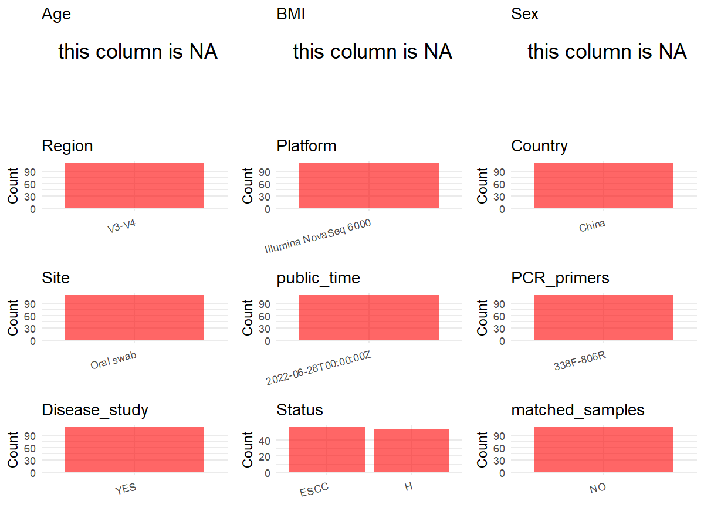

R Notebook: Metadata Processing Workflow
================

# Step 1: Obtain Initial Metadata from Each Project

To obtain the initial metadata: 1. Search for the BioProject ID (e.g.,
“PRJEBXXXX”) on the [NCBI SRA
website](https://www.ncbi.nlm.nih.gov/Traces/study/). 2. In the “Select”
table, click on “Metadata” and download the file. 3. The downloaded file
is typically named “SraRunTable.csv” and contains metadata for the
project.

``` r
# Load necessary libraries
library(dplyr)
library(ggplot2)
library(cowplot)

# Set working directory (update this path to your local directory)
setwd("D:/metadata/2/PRJNA853196")

# Read the initial metadata files
initial_meta<-read.csv("SraRunTable.csv",header = T)

# Combine the two metadata files
#meta <- rbind(initial_meta, initial_meta1)

#Remove entries non-oral samples
#initial_meta <- subset(initial_meta,BioSampleModel != "Metagenome or environmental")

# Check the number of samples containing "HT" in Sample.Name (e.g., healthy controls)
#nrow(subset(meta, grepl("HT", Sample.Name)))

# Display the first few rows of the metadata
head(initial_meta)
```

    ##           Run Assay.Type AvgSpotLen    Bases  BioProject    BioSample
    ## 1 SRR19881754   AMPLICON        439 35831671 PRJNA853196 SAMN29363892
    ## 2 SRR19881755   AMPLICON        432 39191346 PRJNA853196 SAMN29363891
    ## 3 SRR19881756   AMPLICON        439 36911571 PRJNA853196 SAMN29363890
    ## 4 SRR19881757   AMPLICON        439 38728605 PRJNA853196 SAMN29363889
    ## 5 SRR19881758   AMPLICON        438 37826719 PRJNA853196 SAMN29363888
    ## 6 SRR19881759   AMPLICON        436 37142062 PRJNA853196 SAMN29363887
    ##                BioSampleModel    Bytes
    ## 1 Metagenome or environmental 11320739
    ## 2 Metagenome or environmental 12960640
    ## 3 Metagenome or environmental 11906268
    ## 4 Metagenome or environmental 12430994
    ## 5 Metagenome or environmental 12184964
    ## 6 Metagenome or environmental 12026197
    ##                                          Center.Name Collection_Date Consent
    ## 1 NANJING FIRST HOSPITAL, NANJING MEDICAL UNIVERSITY      2021-09-10  public
    ## 2 NANJING FIRST HOSPITAL, NANJING MEDICAL UNIVERSITY      2021-09-10  public
    ## 3 NANJING FIRST HOSPITAL, NANJING MEDICAL UNIVERSITY      2021-09-10  public
    ## 4 NANJING FIRST HOSPITAL, NANJING MEDICAL UNIVERSITY      2021-09-10  public
    ## 5 NANJING FIRST HOSPITAL, NANJING MEDICAL UNIVERSITY      2021-09-10  public
    ## 6 NANJING FIRST HOSPITAL, NANJING MEDICAL UNIVERSITY      2021-09-10  public
    ##   DATASTORE.filetype DATASTORE.provider                     DATASTORE.region
    ## 1   fastq,run.zq,sra         gs,ncbi,s3 gs.us-east1,ncbi.public,s3.us-east-1
    ## 2   fastq,run.zq,sra         gs,ncbi,s3 gs.us-east1,ncbi.public,s3.us-east-1
    ## 3   fastq,run.zq,sra         gs,ncbi,s3 gs.us-east1,ncbi.public,s3.us-east-1
    ## 4   fastq,run.zq,sra         gs,ncbi,s3 gs.us-east1,ncbi.public,s3.us-east-1
    ## 5   fastq,run.zq,sra         gs,ncbi,s3 gs.us-east1,ncbi.public,s3.us-east-1
    ## 6   fastq,run.zq,sra         gs,ncbi,s3 gs.us-east1,ncbi.public,s3.us-east-1
    ##    Experiment geo_loc_name_country geo_loc_name_country_continent
    ## 1 SRX15925236                China                           Asia
    ## 2 SRX15925235                China                           Asia
    ## 3 SRX15925234                China                           Asia
    ## 4 SRX15925233                China                           Asia
    ## 5 SRX15925232                China                           Asia
    ## 6 SRX15925231                China                           Asia
    ##             geo_loc_name         HOST            Instrument
    ## 1 China:Jiangsu Province Homo sapiens Illumina NovaSeq 6000
    ## 2 China:Jiangsu Province Homo sapiens Illumina NovaSeq 6000
    ## 3 China:Jiangsu Province Homo sapiens Illumina NovaSeq 6000
    ## 4 China:Jiangsu Province Homo sapiens Illumina NovaSeq 6000
    ## 5 China:Jiangsu Province Homo sapiens Illumina NovaSeq 6000
    ## 6 China:Jiangsu Province Homo sapiens Illumina NovaSeq 6000
    ##                        isolate isolation_source lat_lon Library.Name
    ## 1 Oral swabs of ESCC patient47        Oral swab missing      ESCCT47
    ## 2 Oral swabs of ESCC patient46        Oral swab missing      ESCCT46
    ## 3 Oral swabs of ESCC patient45        Oral swab missing      ESCCT45
    ## 4 Oral swabs of ESCC patient44        Oral swab missing      ESCCT44
    ## 5 Oral swabs of ESCC patient43        Oral swab missing      ESCCT43
    ## 6 Oral swabs of ESCC patient42        Oral swab missing      ESCCT42
    ##   LibraryLayout LibrarySelection LibrarySource              Organism Platform
    ## 1        PAIRED              PCR   METAGENOMIC human oral metagenome ILLUMINA
    ## 2        PAIRED              PCR   METAGENOMIC human oral metagenome ILLUMINA
    ## 3        PAIRED              PCR   METAGENOMIC human oral metagenome ILLUMINA
    ## 4        PAIRED              PCR   METAGENOMIC human oral metagenome ILLUMINA
    ## 5        PAIRED              PCR   METAGENOMIC human oral metagenome ILLUMINA
    ## 6        PAIRED              PCR   METAGENOMIC human oral metagenome ILLUMINA
    ##            ReleaseDate          create_date version Sample.Name SRA.Study
    ## 1 2022-06-28T00:00:00Z 2022-06-28T09:00:00Z       1     ESCCT47 SRP383934
    ## 2 2022-06-28T00:00:00Z 2022-06-28T09:00:00Z       1     ESCCT46 SRP383934
    ## 3 2022-06-28T00:00:00Z 2022-06-28T08:59:00Z       1     ESCCT45 SRP383934
    ## 4 2022-06-28T00:00:00Z 2022-06-28T08:59:00Z       1     ESCCT44 SRP383934
    ## 5 2022-06-28T00:00:00Z 2022-06-28T09:00:00Z       1     ESCCT43 SRP383934
    ## 6 2022-06-28T00:00:00Z 2022-06-28T09:00:00Z       1     ESCCT42 SRP383934

# Step 2: Create a Uniform Metadata Template

The uniform metadata should include the following columns:

1.  **BioProject**: Project ID (e.g., “PRJNA339212”)
2.  **Run**: Sample ID (e.g., “ERRXXXXXX” or “SRRXXXXXX”)
3.  **sample_name**: Original sample name submitted by the authors (not
    the database-assigned ID)
4.  **Age**: Age of the subject (if available)
5.  **BMI**: Body Mass Index (if available)
6.  **Sex**: Sex of the subject (“F” or “M”)
7.  **Region**: Targeted 16S rRNA region (e.g., “V3-V4”)
8.  **Platform**: Sequencing platform (e.g., “Illumina MiSeq”)
9.  **Country**: Country of sample origin (e.g., “China”)
10. **Site**: Sample site (e.g., “saliva”, “dental plaque”)
11. **public_time**: Data release date (format: “YYYY-MM-DD”)
12. **PCR_primers**: PCR primers used (e.g., “515F-806R”)
13. **title**: Title of the associated publication
14. **Disease_study**: Whether the study involves a disease (“YES” or
    “NO”)
15. **Status**: Disease status (e.g., “T2DM”, “HC”). Note: If the study
    includes both disease and healthy samples, this must be specified
    per sample.
16. **matched_samples**: matched samples (“YES” or “NO”)

``` r
# Create a uniform metadata dataframe
metadata <- data.frame(
  BioProject = initial_meta$BioProject,
  Run = initial_meta$Run,
  sample_name = initial_meta$Sample.Name,
  Age = NA,
  BMI = NA,
  Sex=NA,
  Region = "V3-V4",
  Platform = initial_meta$Instrument,
  Country = initial_meta$geo_loc_name_country,
  Site = initial_meta$isolation_source,
  public_time = initial_meta$ReleaseDate,
  stringsAsFactors = FALSE
)
```

# Step 3: Manually Add Information from the Publication

Some information (e.g. PCR primers, study title, disease status) must be
manually extracted from the publication and added to the metadata.

``` r
# Add information obtained from the publication
metadata$PCR_primers <- "338F-806R"
metadata$title <- "Oral microbiota may predict the presence of esophageal squamous cell carcinoma"
metadata$Disease_study <- "YES"
# Assign disease status based on sample_name patterns
metadata <- metadata %>%
  mutate(Status = case_when(
    grepl("^ConT",  initial_meta$Sample.Name) ~ "H",
    grepl("^ESCCT", initial_meta$Sample.Name) ~ "ESCC"
  ))

metadata$matched_samples <- "NO"
```

# Step 4: Summarize and Validate the Metadata

``` r
# Check the number of unique runs and sample names
print(paste("Number of unique runs:", length(unique(metadata$Run))))
```

    ## [1] "Number of unique runs: 109"

``` r
print(paste("Number of unique sample names:", length(unique(metadata$sample_name))))
```

    ## [1] "Number of unique sample names: 109"

# Step 5: Visualize the Metadata

``` r

```

<!-- -->

# Step 6: Finalize and Export the Metadata

``` r
# Reorder columns to match the desired format
metadata <- metadata[, c(
  "BioProject", "Run", "sample_name", "Age", "BMI", "Sex", 
  "Region", "Platform", "Country", "Site", "public_time", 
  "PCR_primers", "title", "Disease_study", "Status","matched_samples"
)]

# Export the uniform metadata to a CSV file
write.csv(metadata, file = "metadata.csv", quote = TRUE)
head(metadata)
```

    ##    BioProject         Run sample_name Age BMI Sex Region              Platform
    ## 1 PRJNA853196 SRR19881754     ESCCT47  NA  NA  NA  V3-V4 Illumina NovaSeq 6000
    ## 2 PRJNA853196 SRR19881755     ESCCT46  NA  NA  NA  V3-V4 Illumina NovaSeq 6000
    ## 3 PRJNA853196 SRR19881756     ESCCT45  NA  NA  NA  V3-V4 Illumina NovaSeq 6000
    ## 4 PRJNA853196 SRR19881757     ESCCT44  NA  NA  NA  V3-V4 Illumina NovaSeq 6000
    ## 5 PRJNA853196 SRR19881758     ESCCT43  NA  NA  NA  V3-V4 Illumina NovaSeq 6000
    ## 6 PRJNA853196 SRR19881759     ESCCT42  NA  NA  NA  V3-V4 Illumina NovaSeq 6000
    ##   Country      Site          public_time PCR_primers
    ## 1   China Oral swab 2022-06-28T00:00:00Z   338F-806R
    ## 2   China Oral swab 2022-06-28T00:00:00Z   338F-806R
    ## 3   China Oral swab 2022-06-28T00:00:00Z   338F-806R
    ## 4   China Oral swab 2022-06-28T00:00:00Z   338F-806R
    ## 5   China Oral swab 2022-06-28T00:00:00Z   338F-806R
    ## 6   China Oral swab 2022-06-28T00:00:00Z   338F-806R
    ##                                                                            title
    ## 1 Oral microbiota may predict the presence of esophageal squamous cell carcinoma
    ## 2 Oral microbiota may predict the presence of esophageal squamous cell carcinoma
    ## 3 Oral microbiota may predict the presence of esophageal squamous cell carcinoma
    ## 4 Oral microbiota may predict the presence of esophageal squamous cell carcinoma
    ## 5 Oral microbiota may predict the presence of esophageal squamous cell carcinoma
    ## 6 Oral microbiota may predict the presence of esophageal squamous cell carcinoma
    ##   Disease_study Status matched_samples
    ## 1           YES   ESCC              NO
    ## 2           YES   ESCC              NO
    ## 3           YES   ESCC              NO
    ## 4           YES   ESCC              NO
    ## 5           YES   ESCC              NO
    ## 6           YES   ESCC              NO

## Notes for Students:

1.  **Metadata Accuracy**: Always cross-check the metadata with the
    original publication to ensure accuracy.
2.  **Manual Entries**: Columns like `PCR_primers`, and `Status` often
    require manual entry based on the publication.
3.  **Disease Status**: Be careful when assigning `Status`—some studies
    include both disease and healthy samples.
4.  **Visualization**: The plots help quickly identify the distribution
    of values in each column, which is useful for quality control.
5.  **Reproducibility**: Update the working directory and file paths to
    match your local environment.
