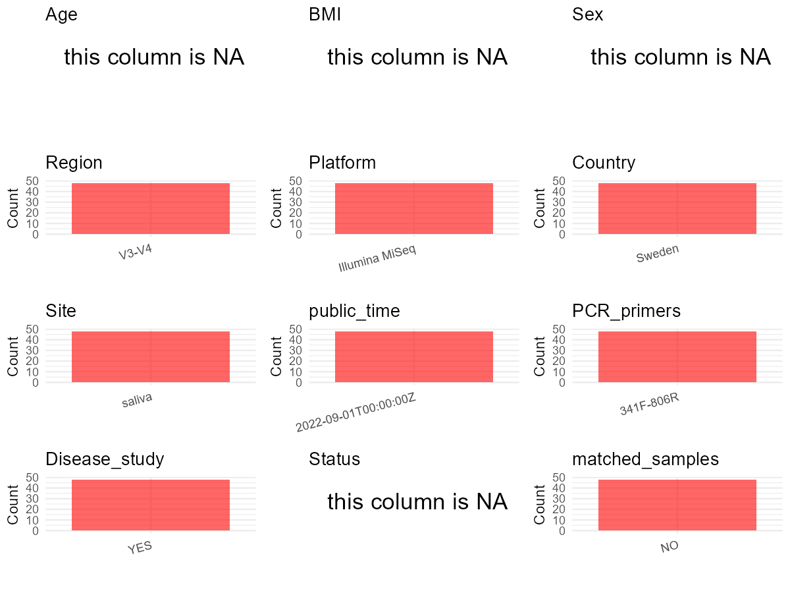

R Notebook: Metadata Processing Workflow
================

# Step 1: Obtain Initial Metadata from Each Project

To obtain the initial metadata: 1. Search for the BioProject ID (e.g.,
“PRJEBXXXX”) on the [NCBI SRA
website](https://www.ncbi.nlm.nih.gov/Traces/study/). 2. In the “Select”
table, click on “Metadata” and download the file. 3. The downloaded file
is typically named “SraRunTable.csv” and contains metadata for the
project.

``` r
# Load necessary libraries
library(dplyr)
library(ggplot2)
library(cowplot)

# Set working directory (update this path to your local directory)
setwd("E:/bioproject_YL/PRJNA862307")

# Read the initial metadata files
initial_meta <- read.csv("SraRunTable.csv", header = T) 

# Display the first few rows of the metadata
head(initial_meta)
```

    ##           Run Assay.Type AvgSpotLen     Bases  BioProject    BioSample
    ## 1 SRR20737057   AMPLICON        601 158808899 PRJNA862307 SAMN29995410
    ## 2 SRR20737058   AMPLICON        601 151680056 PRJNA862307 SAMN29995410
    ## 3 SRR20737059   AMPLICON        601 145548805 PRJNA862307 SAMN29995410
    ## 4 SRR20737060   AMPLICON        601 164254477 PRJNA862307 SAMN29995410
    ## 5 SRR20737061   AMPLICON        601 152065238 PRJNA862307 SAMN29995410
    ## 6 SRR20737062   AMPLICON        601 102411864 PRJNA862307 SAMN29995410
    ##                                BioSampleModel     Bytes Center.Name
    ## 1 MIMARKS.survey,MIGS/MIMS/MIMARKS.human-oral 122201270  ODONTOLOGY
    ## 2 MIMARKS.survey,MIGS/MIMS/MIMARKS.human-oral 117405065  ODONTOLOGY
    ## 3 MIMARKS.survey,MIGS/MIMS/MIMARKS.human-oral 112126264  ODONTOLOGY
    ## 4 MIMARKS.survey,MIGS/MIMS/MIMARKS.human-oral 126003864  ODONTOLOGY
    ## 5 MIMARKS.survey,MIGS/MIMS/MIMARKS.human-oral 116796938  ODONTOLOGY
    ## 6 MIMARKS.survey,MIGS/MIMS/MIMARKS.human-oral  79835508  ODONTOLOGY
    ##   Collection_Date Consent DATASTORE.filetype DATASTORE.provider
    ## 1            2022  public   fastq,run.zq,sra         gs,ncbi,s3
    ## 2            2022  public   fastq,run.zq,sra         gs,ncbi,s3
    ## 3            2022  public   fastq,run.zq,sra         gs,ncbi,s3
    ## 4            2022  public   fastq,run.zq,sra         gs,ncbi,s3
    ## 5            2022  public   fastq,run.zq,sra         gs,ncbi,s3
    ## 6            2022  public   fastq,run.zq,sra         gs,ncbi,s3
    ##                       DATASTORE.region env_broad_scale env_local_scale
    ## 1 gs.us-east1,ncbi.public,s3.us-east-1             428          saliva
    ## 2 gs.us-east1,ncbi.public,s3.us-east-1             428          saliva
    ## 3 gs.us-east1,ncbi.public,s3.us-east-1             428          saliva
    ## 4 gs.us-east1,ncbi.public,s3.us-east-1             428          saliva
    ## 5 gs.us-east1,ncbi.public,s3.us-east-1             428          saliva
    ## 6 gs.us-east1,ncbi.public,s3.us-east-1             428          saliva
    ##   env_medium  Experiment geo_loc_name_country geo_loc_name_country_continent
    ## 1      10483 SRX16757499               Sweden                         Europe
    ## 2      10483 SRX16757498               Sweden                         Europe
    ## 3      10483 SRX16757497               Sweden                         Europe
    ## 4      10483 SRX16757496               Sweden                         Europe
    ## 5      10483 SRX16757495               Sweden                         Europe
    ## 6      10483 SRX16757494               Sweden                         Europe
    ##   geo_loc_name         HOST     Instrument isol_growth_condt isolate
    ## 1       Sweden Homo sapiens Illumina MiSeq          28930642   Human
    ## 2       Sweden Homo sapiens Illumina MiSeq          28930642   Human
    ## 3       Sweden Homo sapiens Illumina MiSeq          28930642   Human
    ## 4       Sweden Homo sapiens Illumina MiSeq          28930642   Human
    ## 5       Sweden Homo sapiens Illumina MiSeq          28930642   Human
    ## 6       Sweden Homo sapiens Illumina MiSeq          28930642   Human
    ##           lat_lon Library.Name LibraryLayout LibrarySelection LibrarySource
    ## 1 63.49 N 20.15 E           10        PAIRED              PCR       GENOMIC
    ## 2 63.49 N 20.15 E            9        PAIRED              PCR       GENOMIC
    ## 3 63.49 N 20.15 E            8        PAIRED              PCR       GENOMIC
    ## 4 63.49 N 20.15 E            7        PAIRED              PCR       GENOMIC
    ## 5 63.49 N 20.15 E            6        PAIRED              PCR       GENOMIC
    ## 6 63.49 N 20.15 E           48        PAIRED              PCR       GENOMIC
    ##                Organism Platform          ReleaseDate          create_date
    ## 1 human oral metagenome ILLUMINA 2022-09-01T00:00:00Z 2022-08-01T17:05:00Z
    ## 2 human oral metagenome ILLUMINA 2022-09-01T00:00:00Z 2022-08-01T17:05:00Z
    ## 3 human oral metagenome ILLUMINA 2022-09-01T00:00:00Z 2022-08-01T17:05:00Z
    ## 4 human oral metagenome ILLUMINA 2022-09-01T00:00:00Z 2022-08-01T17:05:00Z
    ## 5 human oral metagenome ILLUMINA 2022-09-01T00:00:00Z 2022-08-01T17:05:00Z
    ## 6 human oral metagenome ILLUMINA 2022-09-01T00:00:00Z 2022-08-01T17:05:00Z
    ##   version       Sample.Name SRA.Study    strain
    ## 1       1 Saliva_microbiota SRP389171 microbial
    ## 2       1 Saliva_microbiota SRP389171 microbial
    ## 3       1 Saliva_microbiota SRP389171 microbial
    ## 4       1 Saliva_microbiota SRP389171 microbial
    ## 5       1 Saliva_microbiota SRP389171 microbial
    ## 6       1 Saliva_microbiota SRP389171 microbial

# Step 2: Create a Uniform Metadata Template

The uniform metadata should include the following columns:

1.  **BioProject**: Project ID (e.g., “PRJNA339212”)
2.  **Run**: Sample ID (e.g., “ERRXXXXXX” or “SRRXXXXXX”)
3.  **sample_name**: Original sample name submitted by the authors (not
    the database-assigned ID)
4.  **Age**: Age of the subject (if available)
5.  **BMI**: Body Mass Index (if available)
6.  **Sex**: Sex of the subject (“F” or “M”)
7.  **Region**: Targeted 16S rRNA region (e.g., “V3-V4”)
8.  **Platform**: Sequencing platform (e.g., “Illumina MiSeq”)
9.  **Country**: Country of sample origin (e.g., “China”)
10. **Site**: Sample site (e.g., “saliva”, “dental plaque”)
11. **public_time**: Data release date (format: “YYYY-MM-DD”)
12. **PCR_primers**: PCR primers used (e.g., “515F-806R”)
13. **title**: Title of the associated publication
14. **Disease_study**: Whether the study involves a disease (“YES” or
    “NO”)
15. **Status**: Disease status (e.g., “T2DM”, “HC”). Note: If the study
    includes both disease and healthy samples, this must be specified
    per sample.
16. **matched_samples**: matched samples (“YES” or “NO”)

``` r
# Create a uniform metadata dataframe
metadata <- data.frame(
  BioProject = initial_meta$BioProject,
  Run = initial_meta$Run,
  sample_name = initial_meta$Library.Name,
  Age = NA,
  BMI = NA,
  Sex = NA,
  Region = "V3-V4",
  Platform = initial_meta$Instrument,
  Site = initial_meta$env_local_scale,
  public_time = initial_meta$ReleaseDate,
  Country = initial_meta$geo_loc_name_country,
  stringsAsFactors = FALSE
)
```

# Step 3: Manually Add Information from the Publication

Some information (e.g. PCR primers, study title, disease status) must be
manually extracted from the publication and added to the metadata.

``` r
# Add information obtained from the publication
metadata$PCR_primers <- "341F-806R"
metadata$title <- "Oral microbiota profile in patients with anti-neutrophil cytoplasmic antibody-associated vasculitis"
metadata$Disease_study <- "YES"
# Assign disease status based on sample_name patterns
metadata$Status <- NA

# Check initial data distribution
cat("Initial sample distribution:\n")
```

    ## Initial sample distribution:

``` r
table(metadata$sample_name)
```

    ## 
    ##  1  2  3  4  5  6  7  8  9 10 11 12 13 14 15 16 17 18 19 20 21 22 23 24 25 26 
    ##  1  1  1  1  1  1  1  1  1  1  1  1  1  1  1  1  1  1  1  1  1  1  1  1  1  1 
    ## 27 28 29 30 31 32 33 34 35 36 37 38 39 40 41 42 43 44 45 46 47 48 
    ##  1  1  1  1  1  1  1  1  1  1  1  1  1  1  1  1  1  1  1  1  1  1

``` r
table(metadata$Site)
```

    ## 
    ## saliva 
    ##     48

``` r
# Calculate sampling frequency per subject
sample_counts <- table(metadata$sample_name)
cat("\nNumber of samples per subject:\n")
```

    ## 
    ## Number of samples per subject:

``` r
print(sample_counts)
```

    ## 
    ##  1  2  3  4  5  6  7  8  9 10 11 12 13 14 15 16 17 18 19 20 21 22 23 24 25 26 
    ##  1  1  1  1  1  1  1  1  1  1  1  1  1  1  1  1  1  1  1  1  1  1  1  1  1  1 
    ## 27 28 29 30 31 32 33 34 35 36 37 38 39 40 41 42 43 44 45 46 47 48 
    ##  1  1  1  1  1  1  1  1  1  1  1  1  1  1  1  1  1  1  1  1  1  1

``` r
# Create matched_samples column
metadata$matched_samples <- ifelse(metadata$sample_name %in% names(sample_counts[sample_counts >= 2]), "YES", "NO")

cat("\nMatched samples distribution:\n")
```

    ## 
    ## Matched samples distribution:

``` r
table(metadata$matched_samples)
```

    ## 
    ## NO 
    ## 48

``` r
# Identify samples for removal: single samples excluding saliva
single_samples <- names(sample_counts[sample_counts == 1])
samples_to_remove <- metadata$sample_name %in% single_samples & 
                     !(metadata$Site %in% c("saliva"))

cat("\nNumber of samples to be removed:", sum(samples_to_remove), "\n")
```

    ## 
    ## Number of samples to be removed: 0

``` r
# Remove identified samples
metadata_clean <- metadata[!samples_to_remove, ]

cat("\nFinal sample distribution after cleaning:\n")
```

    ## 
    ## Final sample distribution after cleaning:

``` r
table(metadata_clean$sample_name)
```

    ## 
    ##  1  2  3  4  5  6  7  8  9 10 11 12 13 14 15 16 17 18 19 20 21 22 23 24 25 26 
    ##  1  1  1  1  1  1  1  1  1  1  1  1  1  1  1  1  1  1  1  1  1  1  1  1  1  1 
    ## 27 28 29 30 31 32 33 34 35 36 37 38 39 40 41 42 43 44 45 46 47 48 
    ##  1  1  1  1  1  1  1  1  1  1  1  1  1  1  1  1  1  1  1  1  1  1

``` r
table(metadata_clean$Site)
```

    ## 
    ## saliva 
    ##     48

``` r
table(metadata_clean$matched_samples)
```

    ## 
    ## NO 
    ## 48

``` r
# Use cleaned dataset for subsequent analysis
metadata <- metadata_clean
```

# Step 4: Summarize and Validate the Metadata

``` r
# Check the number of unique runs and sample names
print(paste("Number of unique runs:", length(unique(metadata$Run))))
```

    ## [1] "Number of unique runs: 48"

``` r
print(paste("Number of unique sample names:", length(unique(metadata$sample_name))))
```

    ## [1] "Number of unique sample names: 48"

# Step 5: Visualize the Metadata

``` r

```


# Step 6: Finalize and Export the Metadata

``` r
# Reorder columns to match the desired format
metadata <- metadata[, c(
  "BioProject", "Run", "sample_name", "Age", "BMI", "Sex", 
  "Region", "Platform", "Country", "Site", "public_time", 
  "PCR_primers", "title", "Disease_study", "Status", "matched_samples"
)]

# Export the uniform metadata to a CSV file
write.csv(metadata, file = "metadata.csv", quote = FALSE)
head(metadata)
```

    ##    BioProject         Run sample_name Age BMI Sex Region       Platform Country
    ## 1 PRJNA862307 SRR20737057          10  NA  NA  NA  V3-V4 Illumina MiSeq  Sweden
    ## 2 PRJNA862307 SRR20737058           9  NA  NA  NA  V3-V4 Illumina MiSeq  Sweden
    ## 3 PRJNA862307 SRR20737059           8  NA  NA  NA  V3-V4 Illumina MiSeq  Sweden
    ## 4 PRJNA862307 SRR20737060           7  NA  NA  NA  V3-V4 Illumina MiSeq  Sweden
    ## 5 PRJNA862307 SRR20737061           6  NA  NA  NA  V3-V4 Illumina MiSeq  Sweden
    ## 6 PRJNA862307 SRR20737062          48  NA  NA  NA  V3-V4 Illumina MiSeq  Sweden
    ##     Site          public_time PCR_primers
    ## 1 saliva 2022-09-01T00:00:00Z   341F-806R
    ## 2 saliva 2022-09-01T00:00:00Z   341F-806R
    ## 3 saliva 2022-09-01T00:00:00Z   341F-806R
    ## 4 saliva 2022-09-01T00:00:00Z   341F-806R
    ## 5 saliva 2022-09-01T00:00:00Z   341F-806R
    ## 6 saliva 2022-09-01T00:00:00Z   341F-806R
    ##                                                                                                 title
    ## 1 Oral microbiota profile in patients with anti-neutrophil cytoplasmic antibody-associated vasculitis
    ## 2 Oral microbiota profile in patients with anti-neutrophil cytoplasmic antibody-associated vasculitis
    ## 3 Oral microbiota profile in patients with anti-neutrophil cytoplasmic antibody-associated vasculitis
    ## 4 Oral microbiota profile in patients with anti-neutrophil cytoplasmic antibody-associated vasculitis
    ## 5 Oral microbiota profile in patients with anti-neutrophil cytoplasmic antibody-associated vasculitis
    ## 6 Oral microbiota profile in patients with anti-neutrophil cytoplasmic antibody-associated vasculitis
    ##   Disease_study Status matched_samples
    ## 1           YES     NA              NO
    ## 2           YES     NA              NO
    ## 3           YES     NA              NO
    ## 4           YES     NA              NO
    ## 5           YES     NA              NO
    ## 6           YES     NA              NO

## Notes for Students:

1.  **Metadata Accuracy**: Always cross-check the metadata with the
    original publication to ensure accuracy.
2.  **Manual Entries**: Columns like `PCR_primers`, and `Status` often
    require manual entry based on the publication.
3.  **Disease Status**: Be careful when assigning `Status`—some studies
    include both disease and healthy samples.
4.  **Visualization**: The plots help quickly identify the distribution
    of values in each column, which is useful for quality control.
5.  **Reproducibility**: Update the working directory and file paths to
    match your local environment.
