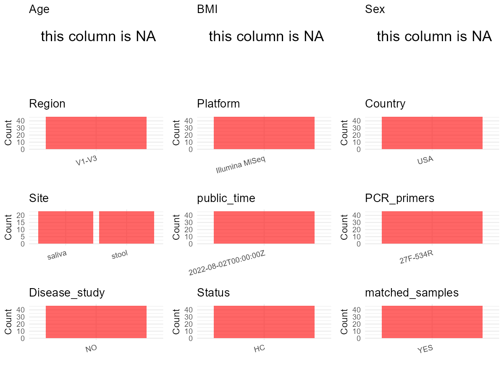

R Notebook: Metadata Processing Workflow
================

# Step 1: Obtain Initial Metadata from Each Project

To obtain the initial metadata: 1. Search for the BioProject ID (e.g.,
“PRJEBXXXX”) on the [NCBI SRA
website](https://www.ncbi.nlm.nih.gov/Traces/study/). 2. In the “Select”
table, click on “Metadata” and download the file. 3. The downloaded file
is typically named “SraRunTable.csv” and contains metadata for the
project.

``` r
# Load necessary libraries
library(dplyr)
library(ggplot2)
library(cowplot)

# Set working directory (update this path to your local directory)
setwd("D:/studylearning/董彪师兄项目/任务4_20251009/PRJNA865362")

# Read the initial metadata files
initial_meta<-read.csv("SraRunTable.csv",header = T)

# Display the first few rows of the metadata
head(initial_meta)
```

    ##           Run       Assay.Type AvgSpotLen     Bases  BioProject    BioSample
    ## 1 SRR20754199 Targeted-Capture        586 160821601 PRJNA865362 SAMN30108610
    ## 2 SRR20754200 Targeted-Capture        586 105640149 PRJNA865362 SAMN30108609
    ## 3 SRR20754201 Targeted-Capture        579 102606687 PRJNA865362 SAMN30108608
    ## 4 SRR20754202 Targeted-Capture        584  27595312 PRJNA865362 SAMN30108607
    ## 5 SRR20754203 Targeted-Capture        586  40463155 PRJNA865362 SAMN30108606
    ## 6 SRR20754204 Targeted-Capture        586 115184510 PRJNA865362 SAMN30108646
    ##                               BioSampleModel     Bytes            Center.Name
    ## 1 MIMS.me,MIGS/MIMS/MIMARKS.human-associated 114016375 THE JACKSON LABORATORY
    ## 2 MIMS.me,MIGS/MIMS/MIMARKS.human-associated  74487481 THE JACKSON LABORATORY
    ## 3 MIMS.me,MIGS/MIMS/MIMARKS.human-associated  72759140 THE JACKSON LABORATORY
    ## 4 MIMS.me,MIGS/MIMS/MIMARKS.human-associated  19634879 THE JACKSON LABORATORY
    ## 5 MIMS.me,MIGS/MIMS/MIMARKS.human-associated  28642242 THE JACKSON LABORATORY
    ## 6 MIMS.me,MIGS/MIMS/MIMARKS.human-associated  81277259 THE JACKSON LABORATORY
    ##   Collection_Date Consent DATASTORE.filetype DATASTORE.provider
    ## 1      2014-08-14  public   fastq,run.zq,sra         gs,ncbi,s3
    ## 2      2014-08-14  public   fastq,run.zq,sra         gs,ncbi,s3
    ## 3      2014-08-14  public   fastq,run.zq,sra         gs,ncbi,s3
    ## 4      2014-08-14  public   fastq,run.zq,sra         gs,ncbi,s3
    ## 5      2014-08-14  public   fastq,run.zq,sra         gs,ncbi,s3
    ## 6      2014-08-14  public   fastq,run.zq,sra         gs,ncbi,s3
    ##                       DATASTORE.region env_broad_scale    env_local_scale
    ## 1 gs.us-east1,ncbi.public,s3.us-east-1    human saliva bacteria in saliva
    ## 2 gs.us-east1,ncbi.public,s3.us-east-1    human saliva bacteria in saliva
    ## 3 gs.us-east1,ncbi.public,s3.us-east-1    human saliva bacteria in saliva
    ## 4 gs.us-east1,ncbi.public,s3.us-east-1    human saliva bacteria in saliva
    ## 5 gs.us-east1,ncbi.public,s3.us-east-1    human saliva bacteria in saliva
    ## 6 gs.us-east1,ncbi.public,s3.us-east-1     human stool  bacteria in stool
    ##   env_medium  Experiment geo_loc_name_country geo_loc_name_country_continent
    ## 1     saliva SRX16774483                  USA                  North America
    ## 2     saliva SRX16774482                  USA                  North America
    ## 3     saliva SRX16774481                  USA                  North America
    ## 4     saliva SRX16774480                  USA                  North America
    ## 5     saliva SRX16774479                  USA                  North America
    ## 6      stool SRX16774478                  USA                  North America
    ##          geo_loc_name         HOST     Instrument        lat_lon Library.Name
    ## 1 USA: Hartford\\, CT Homo sapiens Illumina MiSeq not applicable     J14892_2
    ## 2 USA: Hartford\\, CT Homo sapiens Illumina MiSeq not applicable     J14891_2
    ## 3 USA: Hartford\\, CT Homo sapiens Illumina MiSeq not applicable     J14890_2
    ## 4 USA: Hartford\\, CT Homo sapiens Illumina MiSeq not applicable     J14888_2
    ## 5 USA: Hartford\\, CT Homo sapiens Illumina MiSeq not applicable     J14887_2
    ## 6 USA: Hartford\\, CT Homo sapiens Illumina MiSeq not applicable     J14886_1
    ##   LibraryLayout LibrarySelection LibrarySource              Organism Platform
    ## 1        PAIRED              PCR   METAGENOMIC human oral metagenome ILLUMINA
    ## 2        PAIRED              PCR   METAGENOMIC human oral metagenome ILLUMINA
    ## 3        PAIRED              PCR   METAGENOMIC human oral metagenome ILLUMINA
    ## 4        PAIRED              PCR   METAGENOMIC human oral metagenome ILLUMINA
    ## 5        PAIRED              PCR   METAGENOMIC human oral metagenome ILLUMINA
    ## 6        PAIRED              PCR   METAGENOMIC  human gut metagenome ILLUMINA
    ##            ReleaseDate          create_date version
    ## 1 2022-08-02T00:00:00Z 2022-08-02T18:18:00Z       1
    ## 2 2022-08-02T00:00:00Z 2022-08-02T18:18:00Z       1
    ## 3 2022-08-02T00:00:00Z 2022-08-02T18:18:00Z       1
    ## 4 2022-08-02T00:00:00Z 2022-08-02T18:18:00Z       1
    ## 5 2022-08-02T00:00:00Z 2022-08-02T18:18:00Z       1
    ## 6 2022-08-02T00:00:00Z 2022-08-02T18:18:00Z       1
    ##                         Sample.Name SRA.Study
    ## 1 Aging_16S_saliva_rep2_14_194J_109 SRP389466
    ## 2 Aging_16S_saliva_rep2_14_194J_108 SRP389466
    ## 3 Aging_16S_saliva_rep2_14_194J_107 SRP389466
    ## 4 Aging_16S_saliva_rep2_14_194J_106 SRP389466
    ## 5 Aging_16S_saliva_rep2_14_194J_105 SRP389466
    ## 6      Aging_16S_stool2_14_194J_302 SRP389466
    ##                              Unique_sample
    ## 1 Aging_16S_saliva_rep2_14_194J_109_080222
    ## 2 Aging_16S_saliva_rep2_14_194J_108_080222
    ## 3 Aging_16S_saliva_rep2_14_194J_107_080222
    ## 4 Aging_16S_saliva_rep2_14_194J_106_080222
    ## 5 Aging_16S_saliva_rep2_14_194J_105_080222
    ## 6      Aging_16S_stool2_14_194J_302_080222

# Step 2: Create a Uniform Metadata Template

The uniform metadata should include the following columns:

1.  **BioProject**: Project ID (e.g., “PRJNA339212”)
2.  **Run**: Sample ID (e.g., “ERRXXXXXX” or “SRRXXXXXX”)
3.  **sample_name**: Original sample name submitted by the authors (not
    the database-assigned ID)
4.  **Age**: Age of the subject (if available)
5.  **BMI**: Body Mass Index (if available)
6.  **Sex**: Sex of the subject (“F” or “M”)
7.  **Region**: Targeted 16S rRNA region (e.g., “V3-V4”)
8.  **Platform**: Sequencing platform (e.g., “Illumina MiSeq”)
9.  **Country**: Country of sample origin (e.g., “China”)
10. **Site**: Sample site (e.g., “saliva”, “dental plaque”)
11. **public_time**: Data release date (format: “YYYY-MM-DD”)
12. **PCR_primers**: PCR primers used (e.g., “515F-806R”)
13. **title**: Title of the associated publication
14. **Disease_study**: Whether the study involves a disease (“YES” or
    “NO”)
15. **Status**: Disease status (e.g., “T2DM”, “HC”). Note: If the study
    includes both disease and healthy samples, this must be specified
    per sample.

``` r
# Create a uniform metadata dataframe
metadata <- data.frame(
  BioProject = initial_meta$BioProject,
  Run = initial_meta$Run,
  sample_name = initial_meta$Library.Name,
  Age = NA,
  BMI = NA,
  Sex= NA,
  Region = "V1-V3",
  Platform = initial_meta$Instrument,
  Country = initial_meta$geo_loc_name_country,
  Site = initial_meta$env_medium,
  public_time = initial_meta$ReleaseDate,
  stringsAsFactors = FALSE
)
```

# Step 3: Manually Add Information from the Publication

Some information (e.g. PCR primers, study title, disease status) must be
manually extracted from the publication and added to the metadata.

``` r
# Add information obtained from the publication
metadata$PCR_primers <- "27F-534R"  # Update based on the publication
metadata$title <- "Exploratory studies of oral and fecal microbiome in healthy human aging"
metadata$Disease_study <- "NO"
metadata$Status <- "HC"

#extract subject id by remove prefix of sample_name
metadata$sample_name <- sub(".{2}$", "", metadata$sample_name)

# Check initial data distribution
cat("Initial sample distribution:\n")
```

    ## Initial sample distribution:

``` r
table(metadata$sample_name)
```

    ## 
    ## J14870 J14871 J14872 J14873 J14874 J14875 J14876 J14877 J14878 J14879 J14880 
    ##      2      2      2      2      2      2      2      2      2      2      2 
    ## J14881 J14882 J14883 J14884 J14885 J14886 J14887 J14888 J14889 J14890 J14891 
    ##      2      2      2      2      2      2      2      2      2      2      2 
    ## J14892 
    ##      2

``` r
table(metadata$Site)
```

    ## 
    ## saliva  stool 
    ##     23     23

``` r
# Calculate sampling frequency per subject
sample_counts <- table(metadata$sample_name)
cat("\nNumber of samples per subject:\n")
```

    ## 
    ## Number of samples per subject:

``` r
print(sample_counts)
```

    ## 
    ## J14870 J14871 J14872 J14873 J14874 J14875 J14876 J14877 J14878 J14879 J14880 
    ##      2      2      2      2      2      2      2      2      2      2      2 
    ## J14881 J14882 J14883 J14884 J14885 J14886 J14887 J14888 J14889 J14890 J14891 
    ##      2      2      2      2      2      2      2      2      2      2      2 
    ## J14892 
    ##      2

``` r
# Create matched_samples column
metadata$matched_samples <- ifelse(metadata$sample_name %in% names(sample_counts[sample_counts >= 2]), "YES", "NO")

cat("\nMatched samples distribution:\n")
```

    ## 
    ## Matched samples distribution:

``` r
table(metadata$matched_samples)
```

    ## 
    ## YES 
    ##  46

``` r
# Identify samples for removal: single samples excluding saliva
single_samples <- names(sample_counts[sample_counts == 1])
samples_to_remove <- metadata$sample_name %in% single_samples & !(metadata$Site %in% c("saliva"))

cat("\nNumber of samples to be removed:", sum(samples_to_remove), "\n")
```

    ## 
    ## Number of samples to be removed: 0

``` r
# Remove identified samples
metadata_clean <- metadata[!samples_to_remove, ]

cat("\nFinal sample distribution after cleaning:\n")
```

    ## 
    ## Final sample distribution after cleaning:

``` r
table(metadata_clean$sample_name)
```

    ## 
    ## J14870 J14871 J14872 J14873 J14874 J14875 J14876 J14877 J14878 J14879 J14880 
    ##      2      2      2      2      2      2      2      2      2      2      2 
    ## J14881 J14882 J14883 J14884 J14885 J14886 J14887 J14888 J14889 J14890 J14891 
    ##      2      2      2      2      2      2      2      2      2      2      2 
    ## J14892 
    ##      2

``` r
table(metadata_clean$Site)
```

    ## 
    ## saliva  stool 
    ##     23     23

``` r
table(metadata_clean$matched_samples)
```

    ## 
    ## YES 
    ##  46

``` r
# Use cleaned dataset for subsequent analysis
metadata <- metadata_clean
```

# Step 4: Summarize and Validate the Metadata

``` r
# Check the number of unique runs and sample names
print(paste("Number of unique runs:", length(unique(metadata$Run))))
```

    ## [1] "Number of unique runs: 46"

``` r
print(paste("Number of unique sample names:", length(unique(metadata$sample_name))))
```

    ## [1] "Number of unique sample names: 23"

# Step 5: Visualize the Metadata

``` r

```


# Step 6: Finalize and Export the Metadata

``` r
# Reorder columns to match the desired format
metadata <- metadata[, c(
  "BioProject", "Run", "sample_name", "Age", "BMI", "Sex", 
  "Region", "Platform", "Country", "Site", "public_time", 
  "PCR_primers", "title", "Disease_study", "Status","matched_samples"
)]

# Export the uniform metadata to a CSV file
write.csv(metadata, file = "metadata.csv", quote = FALSE)
head(metadata)
```

    ##    BioProject         Run sample_name Age BMI Sex Region       Platform Country
    ## 1 PRJNA865362 SRR20754199      J14892  NA  NA  NA  V1-V3 Illumina MiSeq     USA
    ## 2 PRJNA865362 SRR20754200      J14891  NA  NA  NA  V1-V3 Illumina MiSeq     USA
    ## 3 PRJNA865362 SRR20754201      J14890  NA  NA  NA  V1-V3 Illumina MiSeq     USA
    ## 4 PRJNA865362 SRR20754202      J14888  NA  NA  NA  V1-V3 Illumina MiSeq     USA
    ## 5 PRJNA865362 SRR20754203      J14887  NA  NA  NA  V1-V3 Illumina MiSeq     USA
    ## 6 PRJNA865362 SRR20754204      J14886  NA  NA  NA  V1-V3 Illumina MiSeq     USA
    ##     Site          public_time PCR_primers
    ## 1 saliva 2022-08-02T00:00:00Z    27F-534R
    ## 2 saliva 2022-08-02T00:00:00Z    27F-534R
    ## 3 saliva 2022-08-02T00:00:00Z    27F-534R
    ## 4 saliva 2022-08-02T00:00:00Z    27F-534R
    ## 5 saliva 2022-08-02T00:00:00Z    27F-534R
    ## 6  stool 2022-08-02T00:00:00Z    27F-534R
    ##                                                                     title
    ## 1 Exploratory studies of oral and fecal microbiome in healthy human aging
    ## 2 Exploratory studies of oral and fecal microbiome in healthy human aging
    ## 3 Exploratory studies of oral and fecal microbiome in healthy human aging
    ## 4 Exploratory studies of oral and fecal microbiome in healthy human aging
    ## 5 Exploratory studies of oral and fecal microbiome in healthy human aging
    ## 6 Exploratory studies of oral and fecal microbiome in healthy human aging
    ##   Disease_study Status matched_samples
    ## 1            NO     HC             YES
    ## 2            NO     HC             YES
    ## 3            NO     HC             YES
    ## 4            NO     HC             YES
    ## 5            NO     HC             YES
    ## 6            NO     HC             YES

## Notes for Students:

1.  **Metadata Accuracy**: Always cross-check the metadata with the
    original publication to ensure accuracy.
2.  **Manual Entries**: Columns like `PCR_primers`, and `Status` often
    require manual entry based on the publication.
3.  **Disease Status**: Be careful when assigning `Status`—some studies
    include both disease and healthy samples.
4.  **Visualization**: The plots help quickly identify the distribution
    of values in each column, which is useful for quality control.
5.  **Reproducibility**: Update the working directory and file paths to
    match your local environment.
