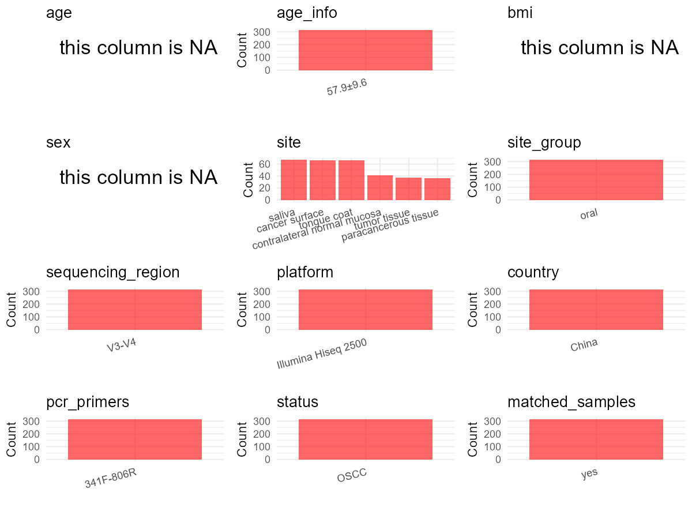

R Notebook: Metadata Processing Workflow
================

# Step 1: Obtain Initial Metadata from Each Project

This step sets the project directory, loads the raw SRA metadata, and
optionally merges supplement tables.

``` r
# Load libraries
library(dplyr)
library(ggplot2)
library(cowplot)

# (1) Setting working directory
# EDIT HERE: change project_id for each study
project_id <- "PRJNA866676" 

base_dir <- "E:/oral/26/metadata-2604/Oral-Metadata-YL-02"
setwd(file.path(base_dir, project_id))

# (2) Loading raw SRA metadata file
sra_file <- "SraRunTable.csv"
initial_meta <- read.csv(sra_file, header = TRUE)

# (3) OPTIONAL: If extra metadata (e.g., Table.x or supplemental materials) are available from the article, you may need to merge the file with initial_meta manually. Below is example code for merging. Depending on the specific case of each study, you can customize the code as needed.
#supp_table <- read.csv("supplemental_table_v2.csv", header = TRUE)
#initial_meta <- left_join(initial_meta, supp_table, by = "Sample.Name") 
```

# Step 2: Data Overview

First, you need to get an overview of the data, which includes two
steps: reading the article and reading the initial metadata. This step
is very IMPORTANT!

``` r
# (1) Read the article in the following order: abstract, the beginning of the results section, and the methods. Understand the sample size, experimental design, and disease group overview. Clarify the sampling sites; for oral and gut samples, specify the exact sites like supragingival plaque, tongue, etc.

# (2) IMPORTANT: MUST go through each column of initial_meta
head(initial_meta, 10)
```

    ##            Run Assay.Type AvgSpotLen    Bases  BioProject    BioSample
    ## 1  SRR20888871   AMPLICON        411 42243572 PRJNA866676 SAMN30170762
    ## 2  SRR20888872   AMPLICON        416 45077663 PRJNA866676 SAMN30170761
    ## 3  SRR20888873   AMPLICON        412 42087917 PRJNA866676 SAMN30170760
    ## 4  SRR20888874   AMPLICON        413 37886669 PRJNA866676 SAMN30170759
    ## 5  SRR20888875   AMPLICON        417 46423989 PRJNA866676 SAMN30170758
    ## 6  SRR20888876   AMPLICON        417 46180323 PRJNA866676 SAMN30170757
    ## 7  SRR20888877   AMPLICON        413 44283084 PRJNA866676 SAMN30170756
    ## 8  SRR20888878   AMPLICON        411 28127242 PRJNA866676 SAMN30170603
    ## 9  SRR20888879   AMPLICON        417 43770012 PRJNA866676 SAMN30170755
    ## 10 SRR20888880   AMPLICON        411 44995929 PRJNA866676 SAMN30170754
    ##                                   BioSampleModel    Bytes
    ## 1  MIMARKS.specimen,MIGS/MIMS/MIMARKS.human-oral 34114909
    ## 2  MIMARKS.specimen,MIGS/MIMS/MIMARKS.human-oral 36652557
    ## 3  MIMARKS.specimen,MIGS/MIMS/MIMARKS.human-oral 33828766
    ## 4  MIMARKS.specimen,MIGS/MIMS/MIMARKS.human-oral 30801457
    ## 5  MIMARKS.specimen,MIGS/MIMS/MIMARKS.human-oral 37815434
    ## 6  MIMARKS.specimen,MIGS/MIMS/MIMARKS.human-oral 36865956
    ## 7  MIMARKS.specimen,MIGS/MIMS/MIMARKS.human-oral 35871070
    ## 8  MIMARKS.specimen,MIGS/MIMS/MIMARKS.human-oral 22384732
    ## 9  MIMARKS.specimen,MIGS/MIMS/MIMARKS.human-oral 34935573
    ## 10 MIMARKS.specimen,MIGS/MIMS/MIMARKS.human-oral 36357310
    ##                                                                              Center.Name
    ## 1  SCHOOL AND HOSPITAL OF STOMATOLOGY, CHEELOO COLLEGE OF  MEDICINE, SHANDONG UNIVERSITY
    ## 2  SCHOOL AND HOSPITAL OF STOMATOLOGY, CHEELOO COLLEGE OF  MEDICINE, SHANDONG UNIVERSITY
    ## 3  SCHOOL AND HOSPITAL OF STOMATOLOGY, CHEELOO COLLEGE OF  MEDICINE, SHANDONG UNIVERSITY
    ## 4  SCHOOL AND HOSPITAL OF STOMATOLOGY, CHEELOO COLLEGE OF  MEDICINE, SHANDONG UNIVERSITY
    ## 5  SCHOOL AND HOSPITAL OF STOMATOLOGY, CHEELOO COLLEGE OF  MEDICINE, SHANDONG UNIVERSITY
    ## 6  SCHOOL AND HOSPITAL OF STOMATOLOGY, CHEELOO COLLEGE OF  MEDICINE, SHANDONG UNIVERSITY
    ## 7  SCHOOL AND HOSPITAL OF STOMATOLOGY, CHEELOO COLLEGE OF  MEDICINE, SHANDONG UNIVERSITY
    ## 8  SCHOOL AND HOSPITAL OF STOMATOLOGY, CHEELOO COLLEGE OF  MEDICINE, SHANDONG UNIVERSITY
    ## 9  SCHOOL AND HOSPITAL OF STOMATOLOGY, CHEELOO COLLEGE OF  MEDICINE, SHANDONG UNIVERSITY
    ## 10 SCHOOL AND HOSPITAL OF STOMATOLOGY, CHEELOO COLLEGE OF  MEDICINE, SHANDONG UNIVERSITY
    ##         Collection_Date Consent DATASTORE.filetype DATASTORE.provider
    ## 1  2018-10-10T08:37:00Z  public   fastq,run.zq,sra         gs,ncbi,s3
    ## 2  2018-10-10T08:24:00Z  public   fastq,run.zq,sra         gs,ncbi,s3
    ## 3  2018-10-10T08:13:00Z  public   fastq,run.zq,sra         gs,ncbi,s3
    ## 4  2018-10-10T05:20:00Z  public   fastq,run.zq,sra         gs,ncbi,s3
    ## 5  2018-09-20T07:29:00Z  public   fastq,run.zq,sra         gs,ncbi,s3
    ## 6  2018-09-09T03:23:00Z  public   fastq,run.zq,sra         gs,ncbi,s3
    ## 7  2018-08-25T05:21:00Z  public   fastq,run.zq,sra         gs,ncbi,s3
    ## 8  2018-03-27T04:30:00Z  public   fastq,run.zq,sra         gs,ncbi,s3
    ## 9  2018-08-20T02:38:00Z  public   fastq,run.zq,sra         gs,ncbi,s3
    ## 10 2018-07-15T05:28:00Z  public   fastq,run.zq,sra         gs,ncbi,s3
    ##                        DATASTORE.region                        env_broad_scale
    ## 1  gs.us-east1,ncbi.public,s3.us-east-1 mucosa of oral region [UBERON:0003446]
    ## 2  gs.us-east1,ncbi.public,s3.us-east-1 mucosa of oral region [UBERON:0003445]
    ## 3  gs.us-east1,ncbi.public,s3.us-east-1 mucosa of oral region [UBERON:0003444]
    ## 4  gs.us-east1,ncbi.public,s3.us-east-1 mucosa of oral region [UBERON:0003443]
    ## 5  gs.us-east1,ncbi.public,s3.us-east-1 mucosa of oral region [UBERON:0003442]
    ## 6  gs.us-east1,ncbi.public,s3.us-east-1 mucosa of oral region [UBERON:0003441]
    ## 7  gs.us-east1,ncbi.public,s3.us-east-1 mucosa of oral region [UBERON:0003440]
    ## 8  gs.us-east1,ncbi.public,s3.us-east-1                tissue [UBERON:0000496]
    ## 9  gs.us-east1,ncbi.public,s3.us-east-1 mucosa of oral region [UBERON:0003439]
    ## 10 gs.us-east1,ncbi.public,s3.us-east-1 mucosa of oral region [UBERON:0003438]
    ##                           env_local_scale
    ## 1  mucosa of oral region [UBERON:0003446]
    ## 2  mucosa of oral region [UBERON:0003445]
    ## 3  mucosa of oral region [UBERON:0003444]
    ## 4  mucosa of oral region [UBERON:0003443]
    ## 5  mucosa of oral region [UBERON:0003442]
    ## 6  mucosa of oral region [UBERON:0003441]
    ## 7  mucosa of oral region [UBERON:0003440]
    ## 8                 tissue [UBERON:0000496]
    ## 9  mucosa of oral region [UBERON:0003439]
    ## 10 mucosa of oral region [UBERON:0003438]
    ##                                env_medium  Experiment geo_loc_name_country
    ## 1  mucosa of oral region [UBERON:0003446] SRX16907766                China
    ## 2  mucosa of oral region [UBERON:0003445] SRX16907765                China
    ## 3  mucosa of oral region [UBERON:0003444] SRX16907764                China
    ## 4  mucosa of oral region [UBERON:0003443] SRX16907763                China
    ## 5  mucosa of oral region [UBERON:0003442] SRX16907762                China
    ## 6  mucosa of oral region [UBERON:0003441] SRX16907761                China
    ## 7  mucosa of oral region [UBERON:0003440] SRX16907760                China
    ## 8                 tissue [UBERON:0000496] SRX16907759                China
    ## 9  mucosa of oral region [UBERON:0003439] SRX16907758                China
    ## 10 mucosa of oral region [UBERON:0003438] SRX16907757                China
    ##    geo_loc_name_country_continent geo_loc_name         Host        Instrument
    ## 1                            Asia China: Jinan Homo sapiens Ion Torrent S5 XL
    ## 2                            Asia China: Jinan Homo sapiens Ion Torrent S5 XL
    ## 3                            Asia China: Jinan Homo sapiens Ion Torrent S5 XL
    ## 4                            Asia China: Jinan Homo sapiens Ion Torrent S5 XL
    ## 5                            Asia China: Jinan Homo sapiens Ion Torrent S5 XL
    ## 6                            Asia China: Jinan Homo sapiens Ion Torrent S5 XL
    ## 7                            Asia China: Jinan Homo sapiens Ion Torrent S5 XL
    ## 8                            Asia China: Jinan Homo sapiens Ion Torrent S5 XL
    ## 9                            Asia China: Jinan Homo sapiens Ion Torrent S5 XL
    ## 10                           Asia China: Jinan Homo sapiens Ion Torrent S5 XL
    ##                             isol_growth_condt      isolate      lat_lon
    ## 1  https://doi.org/10.1016/j.sjbs.2021.08.272  tongue coat 36.4 N 117 E
    ## 2  https://doi.org/10.1016/j.sjbs.2021.08.271  tongue coat 36.4 N 117 E
    ## 3  https://doi.org/10.1016/j.sjbs.2021.08.270  tongue coat 36.4 N 117 E
    ## 4  https://doi.org/10.1016/j.sjbs.2021.08.269  tongue coat 36.4 N 117 E
    ## 5  https://doi.org/10.1016/j.sjbs.2021.08.268  tongue coat 36.4 N 117 E
    ## 6  https://doi.org/10.1016/j.sjbs.2021.08.267  tongue coat 36.4 N 117 E
    ## 7  https://doi.org/10.1016/j.sjbs.2021.08.266  tongue coat 36.4 N 117 E
    ## 8  https://doi.org/10.1016/j.sjbs.2021.08.113 tumor tissue 36.4 N 117 E
    ## 9  https://doi.org/10.1016/j.sjbs.2021.08.265  tongue coat 36.4 N 117 E
    ## 10 https://doi.org/10.1016/j.sjbs.2021.08.264  tongue coat 36.4 N 117 E
    ##    Library.Name LibraryLayout LibrarySelection LibrarySource
    ## 1           177        SINGLE              PCR       GENOMIC
    ## 2           176        SINGLE              PCR       GENOMIC
    ## 3           175        SINGLE              PCR       GENOMIC
    ## 4           174        SINGLE              PCR       GENOMIC
    ## 5           173        SINGLE              PCR       GENOMIC
    ## 6           172        SINGLE              PCR       GENOMIC
    ## 7           171        SINGLE              PCR       GENOMIC
    ## 8            18        SINGLE              PCR       GENOMIC
    ## 9           170        SINGLE              PCR       GENOMIC
    ## 10          169        SINGLE              PCR       GENOMIC
    ##                 Organism    Platform          ReleaseDate          create_date
    ## 1  human oral metagenome ION_TORRENT 2022-08-06T00:00:00Z 2022-08-06T06:06:00Z
    ## 2  human oral metagenome ION_TORRENT 2022-08-06T00:00:00Z 2022-08-06T06:06:00Z
    ## 3  human oral metagenome ION_TORRENT 2022-08-06T00:00:00Z 2022-08-06T06:06:00Z
    ## 4  human oral metagenome ION_TORRENT 2022-08-06T00:00:00Z 2022-08-06T06:06:00Z
    ## 5  human oral metagenome ION_TORRENT 2022-08-06T00:00:00Z 2022-08-06T06:06:00Z
    ## 6  human oral metagenome ION_TORRENT 2022-08-06T00:00:00Z 2022-08-06T06:06:00Z
    ## 7  human oral metagenome ION_TORRENT 2022-08-06T00:00:00Z 2022-08-06T06:06:00Z
    ## 8  human oral metagenome ION_TORRENT 2022-08-06T00:00:00Z 2022-08-06T06:06:00Z
    ## 9  human oral metagenome ION_TORRENT 2022-08-06T00:00:00Z 2022-08-06T06:06:00Z
    ## 10 human oral metagenome ION_TORRENT 2022-08-06T00:00:00Z 2022-08-06T06:06:00Z
    ##    version Sample.Name SRA.Study
    ## 1        1         T64 SRP390217
    ## 2        1         T63 SRP390217
    ## 3        1         T62 SRP390217
    ## 4        1         T61 SRP390217
    ## 5        1         T60 SRP390217
    ## 6        1         T59 SRP390217
    ## 7        1         T58 SRP390217
    ## 8        1         C36 SRP390217
    ## 9        1         T57 SRP390217
    ## 10       1         T56 SRP390217

``` r
# IMPORTANT: Check the unique values in the column of interest or query column.
lapply(initial_meta[c('isolate')], table) # site
```

    ## $isolate
    ## 
    ##              cancer surface contralateral normal mucosa 
    ##                          66                          41 
    ##        paracancerous tissue                      saliva 
    ##                          36                          67 
    ##                 tongue coat                tumor tissue 
    ##                          66                          37

``` r
lapply(initial_meta[c('Organism', 'Host')], table) # organism
```

    ## $Organism
    ## 
    ## human oral metagenome 
    ##                   313 
    ## 
    ## $Host
    ## 
    ## Homo sapiens 
    ##          313

``` r
table(initial_meta$Sample.Name) # subject id
```

    ## 
    ##  C10  C12  C13  C17  C18  C19  C20  C21  C24  C25  C27  C29  C31  C32  C34  C35 
    ##    1    1    1    1    1    1    1    1    1    1    1    1    1    1    1    1 
    ##  C36  C37  C38  C39  C40  C41  C44  C45  C46  C49  C52  C53  C54  C56  C57  C58 
    ##    1    1    1    1    1    1    1    1    1    1    1    1    1    1    1    1 
    ##  C59  C61  C65  C67   C8 CR10 CR12 CR13 CR17 CR18 CR19 CR20 CR21 CR24 CR25 CR27 
    ##    1    1    1    1    1    1    1    1    1    1    1    1    1    1    1    1 
    ## CR29 CR31 CR32 CR34 CR35 CR37 CR38 CR39 CR40 CR41 CR44 CR45 CR46 CR49 CR52 CR53 
    ##    1    1    1    1    1    1    1    1    1    1    1    1    1    1    1    1 
    ## CR54 CR56 CR57 CR58 CR59 CR61 CR65 CR67  CR8  CS1 CS10 CS11 CS12 CS13 CS14 CS15 
    ##    1    1    1    1    1    1    1    1    1    1    1    1    1    1    1    1 
    ## CS16 CS17 CS18 CS19  CS2 CS20 CS21 CS22 CS23 CS24 CS25 CS26 CS27 CS28 CS29  CS3 
    ##    1    1    1    1    1    1    1    1    1    1    1    1    1    1    1    1 
    ## CS30 CS31 CS32 CS33 CS34 CS35 CS37 CS38 CS39  CS4 CS40 CS41 CS42 CS43 CS44 CS45 
    ##    1    1    1    1    1    1    1    1    1    1    1    1    1    1    1    1 
    ## CS46 CS47 CS48 CS49  CS5 CS50 CS51 CS52 CS53 CS54 CS55 CS56 CS57 CS58 CS59  CS6 
    ##    1    1    1    1    1    1    1    1    1    1    1    1    1    1    1    1 
    ## CS60 CS61 CS62 CS63 CS64 CS65 CS66 CS67  CS7  CS8  CS9  N24  N25  N29  N30  N31 
    ##    1    1    1    1    1    1    1    1    1    1    1    1    1    1    1    1 
    ##  N32  N33  N34  N35  N36  N37  N38  N39  N40  N41  N42  N43  N44  N45  N46  N47 
    ##    1    1    1    1    1    1    1    1    1    1    1    1    1    1    1    1 
    ##  N48  N49  N50  N51  N52  N53  N54  N55  N56  N57  N58  N59  N60  N61  N62  N63 
    ##    1    1    1    1    1    1    1    1    1    1    1    1    1    1    1    1 
    ##  N64  N65  N66  N67   S1  S10  S11  S12  S13  S14  S15  S16  S17  S18  S19   S2 
    ##    1    1    1    1    1    1    1    1    1    1    1    1    1    1    1    1 
    ##  S20  S21  S22  S23  S24  S25  S26  S27  S28  S29   S3  S30  S31  S32  S33  S34 
    ##    1    1    1    1    1    1    1    1    1    1    1    1    1    1    1    1 
    ##  S35  S36  S37  S38  S39   S4  S40  S41  S42  S43  S44  S45  S46  S47  S48  S49 
    ##    1    1    1    1    1    1    1    1    1    1    1    1    1    1    1    1 
    ##   S5  S50  S51  S52  S53  S54  S55  S56  S57  S58  S59   S6  S60  S61  S62  S63 
    ##    1    1    1    1    1    1    1    1    1    1    1    1    1    1    1    1 
    ##  S64  S65  S66  S67   S7   S8   S9   T1  T10  T11  T12  T13  T14  T15  T16  T17 
    ##    1    1    1    1    1    1    1    1    1    1    1    1    1    1    1    1 
    ##  T18  T19   T2  T20  T21  T22  T23  T24  T25  T26  T27  T28  T29   T3  T30  T31 
    ##    1    1    1    1    1    1    1    1    1    1    1    1    1    1    1    1 
    ##  T32  T33  T34  T35  T37  T38  T39   T4  T40  T41  T42  T43  T44  T45  T46  T47 
    ##    1    1    1    1    1    1    1    1    1    1    1    1    1    1    1    1 
    ##  T48  T49   T5  T50  T51  T52  T53  T54  T55  T56  T57  T58  T59   T6  T60  T61 
    ##    1    1    1    1    1    1    1    1    1    1    1    1    1    1    1    1 
    ##  T62  T63  T64  T65  T66  T67   T7   T8   T9 
    ##    1    1    1    1    1    1    1    1    1

``` r
#table(initial_meta$sequencing_meth..exp.) # output is pyrosequencing
table(initial_meta$Platform) # output is ION_TORRENT. according to the methods, ION_TORRENT is incorrect.
```

    ## 
    ## ION_TORRENT 
    ##         313

``` r
# table(initial_meta$target_subfragment..exp.)
```

# Step 3: Removing Control and Non-human Samples

First, we need to remove control samples(including both negative
controls and positive controls) and non-human samples.

``` r
# (1) EDIT HERE: Parameter setup
control_column <- "" # column name in initial_meta
# unique(initial_meta[[control_column]])
control_keywords <- c() # Enter exact keywords

species_column <- "" # column name in initial_meta
unique(initial_meta[[species_column]])
```

    ## NULL

``` r
non_human_keywords <- c() # Enter exact keywords

# (2) Remove controls and non-human samples. DO NOT need to modify code in this part, just run it.
n_samples <- nrow(initial_meta)
# Control evaluation
if (length(control_keywords) > 0) {
  if (is.null(control_column) || control_column == "") {
    stop("Error: control_keywords provided but control_column is missing.")
  }
  
  if (!(control_column %in% colnames(initial_meta))) {
    stop(sprintf("Error: Column '%s' not found in initial_meta.", control_column))
  }
  
  control_pattern <- paste(control_keywords, collapse = "|")
  control_text <- initial_meta[[control_column]]
  is_control <- grepl(control_pattern, control_text)
  
} else {
  is_control <- rep(FALSE, n_samples)
}

# Non-human evaluation
if (length(non_human_keywords) > 0) {
  if (is.null(species_column) || species_column == "") {
    stop("Error: non_human_keywords provided but species_column is missing.")
  }
  
  if (!(species_column %in% colnames(initial_meta))) {
    stop(sprintf("Error: Column '%s' not found in initial_meta.", species_column))
  }
  
  non_human_pattern <- paste(non_human_keywords, collapse = "|")
  species_text <- initial_meta[[species_column]]
  is_non_human <- grepl(non_human_pattern, species_text)
} else {
  is_non_human <- rep(FALSE, n_samples)
}

# Execute removal
samples_to_remove <- is_control | is_non_human
initial_meta <- initial_meta[!samples_to_remove, ]

cat("Initial samples counts:",n_samples,"\n")
```

    ## Initial samples counts: 313

``` r
cat("Removed control samples:", sum(is_control), "\n")
```

    ## Removed control samples: 0

``` r
cat("Removed non-human samples:", sum(is_non_human), "\n")
```

    ## Removed non-human samples: 0

``` r
cat("Total samples removed ", sum(samples_to_remove), "\n")
```

    ## Total samples removed  0

``` r
cat("Remaining samples after Step 2:", nrow(initial_meta), "\n")
```

    ## Remaining samples after Step 2: 313

# Step 4: Creating a Uniform Metadata Template

This step converts the raw SRA table into the standard metadata format
used in our meta-analysis. The uniform metadata should include the
following columns: 1. **bioproject**: Project ID from SRA or other
database e.g. `PRJNA1234`, `CNP1234`, ‘OEP1234’, ‘qiita_1234’ 2.
**sample_id**: SRA sample/run ID. Unique id for each sample!
e.g. `DRR1234567`, `ERR1234567` and `SRR1234567`. If no such column
exists, can use column like sample_name. 3. **subject_id**: subject id
for each person if available. e.g. `patient_01`, `Host_03_before`,
`subject12` 4. **age**: Age of the subject if available. e.g. `35`, `42`
\| not `adult`, `chilren` 5. **age_info**: If the age is not explicitly
stated but approximate age range information is available, mark it in
this column. e.g., `18-55`, `children`, `infant`, `elder` 6. **bmi**:
Body Mass Index if available. e.g. `22.5`, `18.9` \| not `normal`,
`overweight` 7. **sex**: Sex of the subject. Mandatory to write as M/F
\| not `female`, `woman` 8. **sequencing_region**: Targeted 16S rRNA
region. e.g. `V3-V4`, `V4` 9. **platform**: Sequencing platform.
e.g. `Illumina MiSeq`, `454 GS FLX Titanium`, `Ion Torrent` 10.
**country**: Country of sample origin. e.g. `China`, `Japan` \| not city
name like `Beijing` 11. **site**: Sampling site. For oral and gut sites,
specify the exact sites as detailed as possible. For example, if it is
known to be supragingival plaque, do not record it as ‘dental plaque’,
unless the original text provides only a vague description.
e.g. `saliva`, `tongue coating` \| not broad term like `oral` 12.
**site_group**: only accepts one of following three values: ‘oral’,
‘gut’, or ‘other’. 13. **public_time**: Data release date.
e.g. `2021-06-22` \| not `June 2021` 14. **pcr_primers**: PCR primers
used. e.g. `515F-806R`, `27F-338R` \| not primer sequences 15.
**title**: Title of the associated publication. 16. **disease_study**:
Whether the study involves disease samples. If it’s not clear, can
record as NA. Only three values accepted: ‘yes’, ‘no’ or NA 17.
**status**: Disease status for each sample if available, else record as
NA. Only accept following abbreviations, Write full names for all other
diseases. HC: healthy control CD: Crohn’s disease CRC: colorectal cancer
COPD: chronic obstructive pulmonary disease HIV: human immunodeficiency
virus ICU: intensive care unit OSCC: oral squamous cell carcinoma RA:
rheumatoid arthritis UC: ulcerative colitis 18. **matched_samples**:
Whether the subject has matched samples. Only accept ‘yes’ or ‘no’. 19.
**is_time_series**: Whether the study is a time series study. Only
accept ‘yes’ or ‘no’.

``` r
# Extract columns from initial_meta as follows: (1) No modification needed → extract directly. (2) Modification needed → create a new column with the prefix raw_ and mark the original column as “pending”. (3) Need to find or determine based on the article.
metadata <- data.frame(
  bioproject = initial_meta$BioProject,
  sample_id = initial_meta$Run,
  raw_subject_id = initial_meta$Sample.Name,
  subject_id = "pending", # modify later
  age = NA,
  age_info = "57.9±9.6", # determine according to TABLE 1: C (n=37)
  bmi = NA,
  sex = NA,
  sequencing_region = "V3-V4", # extract from methods section
  platform = "Illumina Hiseq 2500", # extract from methods section, NOT initial_meta
  country = initial_meta$geo_loc_name_country,
  site = initial_meta$isolate,
  site_group = "pending", # modify later
  public_time = initial_meta$ReleaseDate,
  pcr_primers = "341F-806R", # Format: xxF-xxR
  title = "Characteristics of microbial distribution in different oral niches of oral squamous cell carcinoma", # extract from article
  disease_study = "yes", # determine according to the article
  status = "OSCC",
  matched_samples = "pending", # modify later
  is_time_series = "no", # determine according to the article
  stringsAsFactors = FALSE
)
metadata$public_time <- as.Date(metadata$public_time)
```

# Step 5: Manually solving pending issues

This step involves two parts: (1) handle the columns with the `raw_`
prefix, and next (2) handle the `site_group` and `matched_samples`
columns.

``` r
# (1) Handle the columns with the `raw_` prefix.
# In this part, you need to customize the code based on the situation of the raw_ columns to obtain the content of the target columns. IMPORTANT: Add comments if the modification is not straightforward!!
metadata$subject_id <- gsub("C|CR|N|T|CS|S", "", metadata$raw_subject_id) # according to the 'Sample.Name' column of initial_meta
```

``` r
# (2) Filling the 'site_group' and 'matched_samples' columns
# editing site_group
unique(metadata$site)
```

    ## [1] "tongue coat"                 "tumor tissue"               
    ## [3] "contralateral normal mucosa" "paracancerous tissue"       
    ## [5] "saliva"                      "cancer surface"

``` r
# EDIT HERE: add oral sites
Oral_site = unique(metadata$site)
# EDIT HERE: add gut sites
Gut_site = c()
# just run
metadata <- metadata %>%
  mutate(site_group = case_when(
    site %in% Oral_site ~ "oral",
    site %in% Gut_site ~ "gut",
    TRUE ~ "other" 
  ))

# editing matched_samples, just run.
metadata$matched_samples <- ifelse(
  ave(metadata$subject_id, metadata$subject_id, FUN = length) > 1, 
  "yes", 
  "no"
)
```

``` r
# (3) check if there is pending value in metadata. If there is pending value, go on modify the metadata.
# Function to check if a column contains "pending"
has_pending <- function(col) {
  if (is.character(col) || is.factor(col)) {
    any(col == "pending", na.rm = TRUE)
  } else {
    FALSE
  }
}

# Check for any pending value
any_pending_value <- any(sapply(metadata, has_pending))

if (!any_pending_value) {
  message("Good! No cell contains the value 'pending'.")
} else {
  pending_cols <- names(metadata)[sapply(metadata, has_pending)]
  message("Columns containing 'pending': ", paste(pending_cols, collapse = ", "))
  message("Please continue to resolve these pending columns!")
}
```

    ## Good! No cell contains the value 'pending'.

# Step 6: Visualize the Metadata

This step makes a quick set of plots for checking the distribution of
key metadata fields.

``` r
# Select columns for visualization, just run
plot_data <- metadata %>%
  select(-bioproject, -sample_id, -subject_id, -title)

create_simple_plots <- function(data) {
  plots <- list()
  continuous_vars <- c("age", "bmi")

  for (col in colnames(data)) {
    if (all(is.na(data[[col]]))) {
      p <- ggplot() +
        annotate("text", x = 0.5, y = 0.5, label = "this column is NA", size = 6) +
        labs(title = col) +
        theme_void()
    } else if (col %in% continuous_vars && is.numeric(data[[col]])) {
      p <- ggplot(data, aes(x = .data[[col]])) +
        geom_histogram(fill = "blue", alpha = 0.6, bins = 20, na.rm = TRUE) +
        labs(title = col, x = col, y = "Count") +
        theme_minimal()
    } else {
      count_data <- as.data.frame(table(data[[col]], useNA = "ifany"))
      p <- ggplot(count_data, aes(x = reorder(Var1, -Freq), y = Freq)) +
        geom_col(fill = "red", alpha = 0.6) +
        labs(title = col, x = NULL, y = "Count") +
        theme_minimal() +
        theme(axis.text.x = element_text(angle = 15, hjust = 1))
    }
    plots[[col]] <- p
  }

  return(plots)
}

# Generate and arrange plots
plots <- create_simple_plots(plot_data)
p <- plot_grid(plots$age,
               plots$age_info,
               plots$bmi,
               plots$sex,
               plots$site,
               plots$site_group,
               plots$sequencing_region,
               plots$platform,
               plots$country,
               plots$pcr_primers,
               plots$status,
               plots$matched_samples,
               ncol = 3, align = "hv", axis = "lb")
ggsave("Metadata_Summary_v2.png", plot = p, width = 8, height = 6, dpi = 150)
```

``` r
# Insert Metadata_Summary.png into the current Rmd output

```


# Step 7: Sort and export the metadata

This step saves the cleaned metadata table as the final `metadata.csv`
file.

``` r
# Reorder the data frame
fixed_cols <- c("bioproject", "sample_id", "subject_id", "age", "age_info",
                "bmi", "sex", "platform", "sequencing_region", "pcr_primers", 
                "country", "site", "site_group", "disease_study", "status", 
                "title", "public_time", "matched_samples", "is_time_series")  
metadata <- metadata %>%
  select(all_of(fixed_cols), everything())

# save metadata 
# head(metadata)
write.csv(metadata, file = "metadata_v2.csv", quote = TRUE)
```
