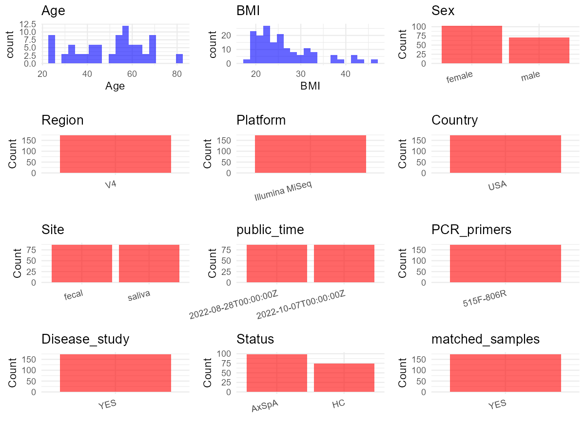

R Notebook: Metadata Processing Workflow
================

# Step 1: Obtain Initial Metadata from Each Project

To obtain the initial metadata: 1. Search for the BioProject ID (e.g.,
“PRJEBXXXX”) on the [NCBI SRA
website](https://www.ncbi.nlm.nih.gov/Traces/study/). 2. In the “Select”
table, click on “Metadata” and download the file. 3. The downloaded file
is typically named “SraRunTable.csv” and contains metadata for the
project.

``` r
# Load necessary libraries
library(dplyr)
library(ggplot2)
library(cowplot)

# Set working directory (update this path to your local directory)
setwd("D:/studylearning/董彪师兄项目/任务4_20251009/PRJNA873789")

# Read the initial metadata files
initial_meta<-read.csv("SraRunTable.csv",header = T)

# Display the first few rows of the metadata
head(initial_meta)
```

    ##           Run Assay.Type AvgSpotLen    Bases  BioProject    BioSample
    ## 1 SRR21841062   AMPLICON        502 32874976 PRJNA873789 SAMN31210032
    ## 2 SRR21841063   AMPLICON        502 23364084 PRJNA873789 SAMN31210031
    ## 3 SRR21841064   AMPLICON        502 57471972 PRJNA873789 SAMN31209977
    ## 4 SRR21841065   AMPLICON        502 12448094 PRJNA873789 SAMN31210030
    ## 5 SRR21841066   AMPLICON        502 10849224 PRJNA873789 SAMN31210029
    ## 6 SRR21841067   AMPLICON        502 33784098 PRJNA873789 SAMN31210028
    ##                                  BioSampleModel    Bytes
    ## 1 MIMARKS.specimen,MIGS/MIMS/MIMARKS.human-oral 23577898
    ## 2 MIMARKS.specimen,MIGS/MIMS/MIMARKS.human-oral 16822173
    ## 3 MIMARKS.specimen,MIGS/MIMS/MIMARKS.human-oral 40321920
    ## 4 MIMARKS.specimen,MIGS/MIMS/MIMARKS.human-oral  8913760
    ## 5 MIMARKS.specimen,MIGS/MIMS/MIMARKS.human-oral  7769758
    ## 6 MIMARKS.specimen,MIGS/MIMS/MIMARKS.human-oral 24019907
    ##                          Center.Name Collection_Date Consent DATASTORE.filetype
    ## 1 OREGON HEALTH & SCIENCE UNIVERSITY       2016/2018  public   fastq,run.zq,sra
    ## 2 OREGON HEALTH & SCIENCE UNIVERSITY       2016/2018  public   fastq,run.zq,sra
    ## 3 OREGON HEALTH & SCIENCE UNIVERSITY       2016/2018  public   fastq,run.zq,sra
    ## 4 OREGON HEALTH & SCIENCE UNIVERSITY       2016/2018  public   fastq,run.zq,sra
    ## 5 OREGON HEALTH & SCIENCE UNIVERSITY       2016/2018  public   fastq,run.zq,sra
    ## 6 OREGON HEALTH & SCIENCE UNIVERSITY       2016/2018  public   fastq,run.zq,sra
    ##   DATASTORE.provider                     DATASTORE.region
    ## 1         gs,ncbi,s3 gs.us-east1,ncbi.public,s3.us-east-1
    ## 2         gs,ncbi,s3 gs.us-east1,ncbi.public,s3.us-east-1
    ## 3         gs,ncbi,s3 gs.us-east1,ncbi.public,s3.us-east-1
    ## 4         gs,ncbi,s3 gs.us-east1,ncbi.public,s3.us-east-1
    ## 5         gs,ncbi,s3 gs.us-east1,ncbi.public,s3.us-east-1
    ## 6         gs,ncbi,s3 gs.us-east1,ncbi.public,s3.us-east-1
    ##                     dna_extraction        Ecotype
    ## 1 Qiagen DNeasy Blood & Tissue Kit not applicable
    ## 2 Qiagen DNeasy Blood & Tissue Kit not applicable
    ## 3 Qiagen DNeasy Blood & Tissue Kit not applicable
    ## 4 Qiagen DNeasy Blood & Tissue Kit not applicable
    ## 5 Qiagen DNeasy Blood & Tissue Kit not applicable
    ## 6 Qiagen DNeasy Blood & Tissue Kit not applicable
    ##                    env_broad_scale                        env_local_scale
    ## 1 Urban Biome ENVO:01000249; Human human-associated habitat ENVO:00009064
    ## 2 Urban Biome ENVO:01000249; Human human-associated habitat ENVO:00009063
    ## 3 Urban Biome ENVO:01000249; Human human-associated habitat ENVO:00009009
    ## 4 Urban Biome ENVO:01000249; Human human-associated habitat ENVO:00009062
    ## 5 Urban Biome ENVO:01000249; Human human-associated habitat ENVO:00009061
    ## 6 Urban Biome ENVO:01000249; Human human-associated habitat ENVO:00009060
    ##                      env_medium              ETHNICITY  Experiment
    ## 1 saliva material ENVO:02000097 not hispanic or latino SRX17829923
    ## 2 saliva material ENVO:02000096 not hispanic or latino SRX17829922
    ## 3 saliva material ENVO:02000042 not hispanic or latino SRX17829921
    ## 4 saliva material ENVO:02000095 not hispanic or latino SRX17829920
    ## 5 saliva material ENVO:02000094 not hispanic or latino SRX17829919
    ## 6 saliva material ENVO:02000093 not hispanic or latino SRX17829918
    ##   geo_loc_name_country geo_loc_name_country_continent
    ## 1                  USA                  North America
    ## 2                  USA                  North America
    ## 3                  USA                  North America
    ## 4                  USA                  North America
    ## 5                  USA                  North America
    ## 6                  USA                  North America
    ##                  geo_loc_name Host_Age host_body_mass_index
    ## 1        USA: Oregon\\, Salem       66             20.08150
    ## 2    USA: Washington\\, Brier       58             24.12663
    ## 3 USA: California\\, Carlsbad       68             26.03704
    ## 4     USA: Oregon\\, Portland       70             31.79316
    ## 5     USA: Oregon\\, Portland       41             22.04477
    ## 6  USA: Maryland\\, Churchton       54             19.96686
    ##              Host_disease         HOST host_sex host_subject_id     Instrument
    ## 1 axial spondyloarthritis Homo sapiens   female            M031 Illumina MiSeq
    ## 2 axial spondyloarthritis Homo sapiens   female            M030 Illumina MiSeq
    ## 3         healthy control Homo sapiens   female            M071 Illumina MiSeq
    ## 4 axial spondyloarthritis Homo sapiens   female            M013 Illumina MiSeq
    ## 5 axial spondyloarthritis Homo sapiens   female            M006 Illumina MiSeq
    ## 6 axial spondyloarthritis Homo sapiens   female            M338 Illumina MiSeq
    ##                lat_lon Library.Name LibraryLayout LibrarySelection
    ## 1 44.9429 N 123.0351 W   ms551_s066        PAIRED              PCR
    ## 2 47.7845 N 122.2743 W   ms551_s065        PAIRED              PCR
    ## 3 33.1581 N 117.3506 W   ms551_s135        PAIRED              PCR
    ## 4 45.5152 N 122.6784 W   ms551_s062        PAIRED              PCR
    ## 5 45.5152 N 122.6784 W   ms551_s061        PAIRED              PCR
    ## 6  38.8027 N 76.5365 W   ms551_s056        PAIRED              PCR
    ##   LibrarySource misc_param_b27_positivity misc_param_basdai_score
    ## 1   METAGENOMIC                      True                    1.75
    ## 2   METAGENOMIC                     False                    6.47
    ## 3   METAGENOMIC                      <NA>                    1.26
    ## 4   METAGENOMIC                      True                    2.23
    ## 5   METAGENOMIC                      True                    0.58
    ## 6   METAGENOMIC                      True                    2.09
    ##   misc_param_biologic_use misc_param_iga_fraction misc_param_nsaids_use
    ## 1                   naive                   IgA -                    no
    ## 2             experienced                   IgA -                    no
    ## 3                   naive                  Allbac                    no
    ## 4             experienced                   IgA -                    no
    ## 5                   naive                   IgA -                    no
    ## 6             experienced                   IgA +                  <NA>
    ##   misc_param_uveitis_activity              Organism Platform
    ## 1                    inactive human oral metagenome ILLUMINA
    ## 2                  no uveitis human oral metagenome ILLUMINA
    ## 3                  no uveitis human oral metagenome ILLUMINA
    ## 4                      active human oral metagenome ILLUMINA
    ## 5                    inactive human oral metagenome ILLUMINA
    ## 6                  no uveitis human oral metagenome ILLUMINA
    ##                        Race          ReleaseDate          create_date version
    ## 1                     white 2022-10-07T00:00:00Z 2022-10-07T17:47:00Z       1
    ## 2                     white 2022-10-07T00:00:00Z 2022-10-07T17:46:00Z       1
    ## 3                     white 2022-10-07T00:00:00Z 2022-10-07T17:47:00Z       1
    ## 4                     white 2022-10-07T00:00:00Z 2022-10-07T17:46:00Z       1
    ## 5 black or african american 2022-10-07T00:00:00Z 2022-10-07T17:46:00Z       1
    ## 6                     white 2022-10-07T00:00:00Z 2022-10-07T17:47:00Z       1
    ##   samp_dna_conc        Sample.Name SRA.Study isolation_and_growth_condition
    ## 1          18.9  M031_saliva_IgA - SRP394536                 not applicable
    ## 2          15.8  M030_saliva_IgA - SRP394536                 not applicable
    ## 3          85.1 M071_saliva_Allbac SRP394536                 not applicable
    ## 4          12.4  M013_saliva_IgA - SRP394536                 not applicable
    ## 5          10.9  M006_saliva_IgA - SRP394536                 not applicable
    ## 6          33.3  M338_saliva_IgA + SRP394536                 not applicable
    ##   library_id
    ## 1 ms551_s066
    ## 2 ms551_s065
    ## 3 ms551_s135
    ## 4 ms551_s062
    ## 5 ms551_s061
    ## 6 ms551_s056

# Step 2: Create a Uniform Metadata Template

The uniform metadata should include the following columns:

1.  **BioProject**: Project ID (e.g., “PRJNA339212”)
2.  **Run**: Sample ID (e.g., “ERRXXXXXX” or “SRRXXXXXX”)
3.  **sample_name**: Original sample name submitted by the authors (not
    the database-assigned ID)
4.  **Age**: Age of the subject (if available)
5.  **BMI**: Body Mass Index (if available)
6.  **Sex**: Sex of the subject (“F” or “M”)
7.  **Region**: Targeted 16S rRNA region (e.g., “V3-V4”)
8.  **Platform**: Sequencing platform (e.g., “Illumina MiSeq”)
9.  **Country**: Country of sample origin (e.g., “China”)
10. **Site**: Sample site (e.g., “saliva”, “dental plaque”)
11. **public_time**: Data release date (format: “YYYY-MM-DD”)
12. **PCR_primers**: PCR primers used (e.g., “515F-806R”)
13. **title**: Title of the associated publication
14. **Disease_study**: Whether the study involves a disease (“YES” or
    “NO”)
15. **Status**: Disease status (e.g., “T2DM”, “HC”). Note: If the study
    includes both disease and healthy samples, this must be specified
    per sample.

``` r
# Create a uniform metadata dataframe
metadata <- data.frame(
  BioProject = initial_meta$BioProject,
  Run = initial_meta$Run,
  sample_name = initial_meta$Sample.Name,
  Age = initial_meta$Host_Age,
  BMI = initial_meta$host_body_mass_index,
  Sex= initial_meta$host_sex,
  Region = "V4",
  Platform = initial_meta$Instrument,
  Country = initial_meta$geo_loc_name_country,
  Site = initial_meta$env_medium,
  public_time = initial_meta$ReleaseDate,
  stringsAsFactors = FALSE
)
```

# Step 3: Manually Add Information from the Publication

Some information (e.g. PCR primers, study title, disease status) must be
manually extracted from the publication and added to the metadata.

``` r
# Add information obtained from the publication
metadata$PCR_primers <- "515F-806R"  # Update based on the publication
metadata$title <- "Axial spondyloarthritis patients have altered mucosal IgA response to oral and fecal microbiota"
metadata$Disease_study <- "YES"
metadata$Status <- initial_meta$Host_disease
metadata <- metadata %>% 
  mutate(Status=case_when(
    grepl("axial",Status)~"AxSpA",
    grepl("healthy control",Status)~"HC"
  ))
metadata <- metadata %>% 
  mutate(Site=case_when(
    grepl("saliva",Site)~"saliva",
    grepl("Fecal",Site)~"fecal"
  ))
#extract subject id by remove prefix of sample_name
metadata$sample_name <- sub("_[^_]*$","",metadata$sample_name)
metadata$Age <- as.numeric(metadata$Age)
```

    ## Warning: 强制改变过程中产生了NA

``` r
# Check initial data distribution
cat("Initial sample distribution:\n")
```

    ## Initial sample distribution:

``` r
table(metadata$sample_name)
```

    ## 
    ##  M006_feces M006_saliva M013_saliva  M026_feces  M027_feces M030_saliva 
    ##           3           3           3           3           3           3 
    ## M031_saliva M038_saliva M044_saliva  M062_feces  M065_feces  M070_feces 
    ##           3           3           3           3           3           3 
    ##  M071_feces M071_saliva  M077_feces  M086_feces M086_saliva M088_saliva 
    ##           3           3           3           3           3           3 
    ## M089_saliva  M094_feces  M100_feces  M103_feces  M119_feces  M122_feces 
    ##           3           3           3           2           3           3 
    ##  M126_feces  M129_feces M129_saliva  M151_feces  M152_feces M152_saliva 
    ##           3           3           3           3           3           3 
    ##  M153_feces M156_saliva M157_saliva  M161_feces  M162_feces  M163_feces 
    ##           3           3           3           3           3           3 
    ## M163_saliva  M165_feces M165_saliva  M168_feces M168_saliva M178_saliva 
    ##           3           2           3           2           3           3 
    ## M182_saliva M188_saliva  M189_feces  M193_feces M198_saliva  M264_feces 
    ##           3           3           3           3           3           3 
    ## M281_saliva  M291_feces M310_saliva M312_saliva M313_saliva M314_saliva 
    ##           3           3           3           3           3           3 
    ## M315_saliva  M333_feces M333_saliva M338_saliva  M340_feces  M342_feces 
    ##           3           2           3           3           2           2

``` r
table(metadata$Site)
```

    ## 
    ##  fecal saliva 
    ##     87     87

``` r
# Calculate sampling frequency per subject
sample_counts <- table(metadata$sample_name)
cat("\nNumber of samples per subject:\n")
```

    ## 
    ## Number of samples per subject:

``` r
print(sample_counts)
```

    ## 
    ##  M006_feces M006_saliva M013_saliva  M026_feces  M027_feces M030_saliva 
    ##           3           3           3           3           3           3 
    ## M031_saliva M038_saliva M044_saliva  M062_feces  M065_feces  M070_feces 
    ##           3           3           3           3           3           3 
    ##  M071_feces M071_saliva  M077_feces  M086_feces M086_saliva M088_saliva 
    ##           3           3           3           3           3           3 
    ## M089_saliva  M094_feces  M100_feces  M103_feces  M119_feces  M122_feces 
    ##           3           3           3           2           3           3 
    ##  M126_feces  M129_feces M129_saliva  M151_feces  M152_feces M152_saliva 
    ##           3           3           3           3           3           3 
    ##  M153_feces M156_saliva M157_saliva  M161_feces  M162_feces  M163_feces 
    ##           3           3           3           3           3           3 
    ## M163_saliva  M165_feces M165_saliva  M168_feces M168_saliva M178_saliva 
    ##           3           2           3           2           3           3 
    ## M182_saliva M188_saliva  M189_feces  M193_feces M198_saliva  M264_feces 
    ##           3           3           3           3           3           3 
    ## M281_saliva  M291_feces M310_saliva M312_saliva M313_saliva M314_saliva 
    ##           3           3           3           3           3           3 
    ## M315_saliva  M333_feces M333_saliva M338_saliva  M340_feces  M342_feces 
    ##           3           2           3           3           2           2

``` r
# Create matched_samples column
metadata$matched_samples <- ifelse(metadata$sample_name %in% names(sample_counts[sample_counts >= 2]), "YES", "NO")

cat("\nMatched samples distribution:\n")
```

    ## 
    ## Matched samples distribution:

``` r
table(metadata$matched_samples)
```

    ## 
    ## YES 
    ## 174

``` r
# Identify samples for removal: single samples excluding saliva
single_samples <- names(sample_counts[sample_counts == 1])
samples_to_remove <- metadata$sample_name %in% single_samples & !(metadata$Site %in% c("saliva"))

cat("\nNumber of samples to be removed:", sum(samples_to_remove), "\n")
```

    ## 
    ## Number of samples to be removed: 0

``` r
# Remove identified samples
metadata_clean <- metadata[!samples_to_remove, ]

cat("\nFinal sample distribution after cleaning:\n")
```

    ## 
    ## Final sample distribution after cleaning:

``` r
table(metadata_clean$sample_name)
```

    ## 
    ##  M006_feces M006_saliva M013_saliva  M026_feces  M027_feces M030_saliva 
    ##           3           3           3           3           3           3 
    ## M031_saliva M038_saliva M044_saliva  M062_feces  M065_feces  M070_feces 
    ##           3           3           3           3           3           3 
    ##  M071_feces M071_saliva  M077_feces  M086_feces M086_saliva M088_saliva 
    ##           3           3           3           3           3           3 
    ## M089_saliva  M094_feces  M100_feces  M103_feces  M119_feces  M122_feces 
    ##           3           3           3           2           3           3 
    ##  M126_feces  M129_feces M129_saliva  M151_feces  M152_feces M152_saliva 
    ##           3           3           3           3           3           3 
    ##  M153_feces M156_saliva M157_saliva  M161_feces  M162_feces  M163_feces 
    ##           3           3           3           3           3           3 
    ## M163_saliva  M165_feces M165_saliva  M168_feces M168_saliva M178_saliva 
    ##           3           2           3           2           3           3 
    ## M182_saliva M188_saliva  M189_feces  M193_feces M198_saliva  M264_feces 
    ##           3           3           3           3           3           3 
    ## M281_saliva  M291_feces M310_saliva M312_saliva M313_saliva M314_saliva 
    ##           3           3           3           3           3           3 
    ## M315_saliva  M333_feces M333_saliva M338_saliva  M340_feces  M342_feces 
    ##           3           2           3           3           2           2

``` r
table(metadata_clean$Site)
```

    ## 
    ##  fecal saliva 
    ##     87     87

``` r
table(metadata_clean$matched_samples)
```

    ## 
    ## YES 
    ## 174

``` r
# Use cleaned dataset for subsequent analysis
metadata <- metadata_clean
```

# Step 4: Summarize and Validate the Metadata

``` r
# Check the number of unique runs and sample names
print(paste("Number of unique runs:", length(unique(metadata$Run))))
```

    ## [1] "Number of unique runs: 174"

``` r
print(paste("Number of unique sample names:", length(unique(metadata$sample_name))))
```

    ## [1] "Number of unique sample names: 60"

# Step 5: Visualize the Metadata

``` r

```


# Step 6: Finalize and Export the Metadata

``` r
# Reorder columns to match the desired format
metadata <- metadata[, c(
  "BioProject", "Run", "sample_name", "Age", "BMI", "Sex", 
  "Region", "Platform", "Country", "Site", "public_time", 
  "PCR_primers", "title", "Disease_study", "Status","matched_samples"
)]

# Export the uniform metadata to a CSV file
write.csv(metadata, file = "metadata.csv", quote = FALSE)
head(metadata)
```

    ##    BioProject         Run sample_name Age      BMI    Sex Region       Platform
    ## 1 PRJNA873789 SRR21841062 M031_saliva  66 20.08150 female     V4 Illumina MiSeq
    ## 2 PRJNA873789 SRR21841063 M030_saliva  58 24.12663 female     V4 Illumina MiSeq
    ## 3 PRJNA873789 SRR21841064 M071_saliva  68 26.03704 female     V4 Illumina MiSeq
    ## 4 PRJNA873789 SRR21841065 M013_saliva  70 31.79316 female     V4 Illumina MiSeq
    ## 5 PRJNA873789 SRR21841066 M006_saliva  41 22.04477 female     V4 Illumina MiSeq
    ## 6 PRJNA873789 SRR21841067 M338_saliva  54 19.96686 female     V4 Illumina MiSeq
    ##   Country   Site          public_time PCR_primers
    ## 1     USA saliva 2022-10-07T00:00:00Z   515F-806R
    ## 2     USA saliva 2022-10-07T00:00:00Z   515F-806R
    ## 3     USA saliva 2022-10-07T00:00:00Z   515F-806R
    ## 4     USA saliva 2022-10-07T00:00:00Z   515F-806R
    ## 5     USA saliva 2022-10-07T00:00:00Z   515F-806R
    ## 6     USA saliva 2022-10-07T00:00:00Z   515F-806R
    ##                                                                                             title
    ## 1 Axial spondyloarthritis patients have altered mucosal IgA response to oral and fecal microbiota
    ## 2 Axial spondyloarthritis patients have altered mucosal IgA response to oral and fecal microbiota
    ## 3 Axial spondyloarthritis patients have altered mucosal IgA response to oral and fecal microbiota
    ## 4 Axial spondyloarthritis patients have altered mucosal IgA response to oral and fecal microbiota
    ## 5 Axial spondyloarthritis patients have altered mucosal IgA response to oral and fecal microbiota
    ## 6 Axial spondyloarthritis patients have altered mucosal IgA response to oral and fecal microbiota
    ##   Disease_study Status matched_samples
    ## 1           YES  AxSpA             YES
    ## 2           YES  AxSpA             YES
    ## 3           YES     HC             YES
    ## 4           YES  AxSpA             YES
    ## 5           YES  AxSpA             YES
    ## 6           YES  AxSpA             YES

## Notes for Students:

1.  **Metadata Accuracy**: Always cross-check the metadata with the
    original publication to ensure accuracy.
2.  **Manual Entries**: Columns like `PCR_primers`, and `Status` often
    require manual entry based on the publication.
3.  **Disease Status**: Be careful when assigning `Status`—some studies
    include both disease and healthy samples.
4.  **Visualization**: The plots help quickly identify the distribution
    of values in each column, which is useful for quality control.
5.  **Reproducibility**: Update the working directory and file paths to
    match your local environment.
