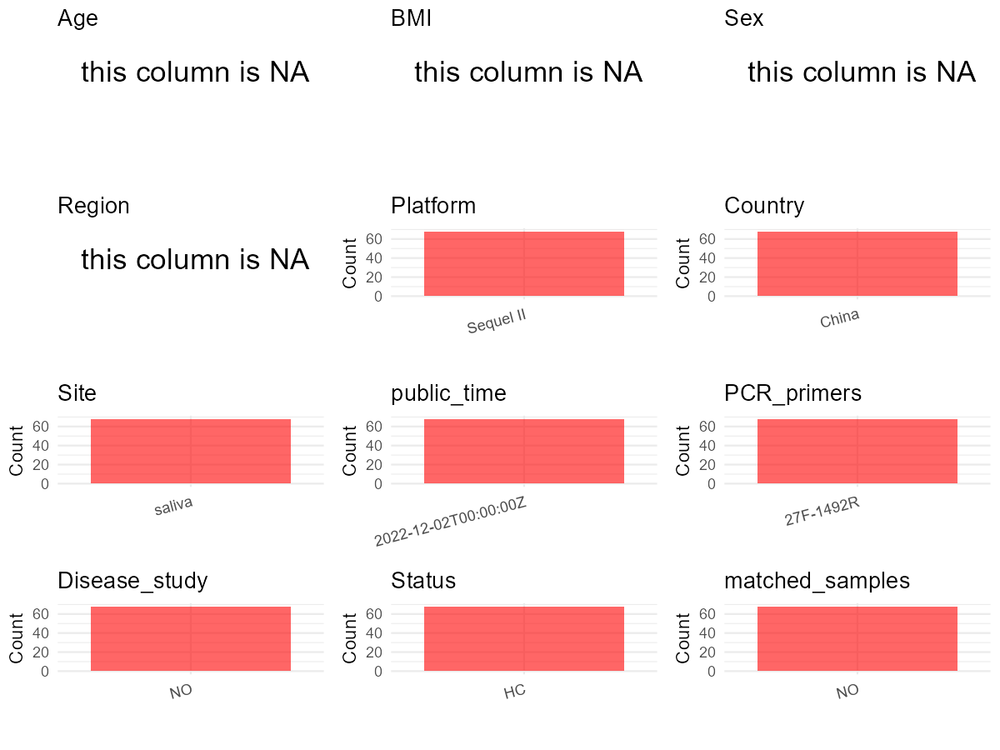

R Notebook: Metadata Processing Workflow
================

# Step 1: Obtain Initial Metadata from Each Project

To obtain the initial metadata: 1. Search for the BioProject ID (e.g.,
“PRJEBXXXX”) on the [NCBI SRA
website](https://www.ncbi.nlm.nih.gov/Traces/study/). 2. In the “Select”
table, click on “Metadata” and download the file. 3. The downloaded file
is typically named “SraRunTable.csv” and contains metadata for the
project.

``` r
# Load necessary libraries
library(dplyr)
library(ggplot2)
library(cowplot)

# Set working directory (update this path to your local directory)
setwd("E:/bioproject_YSD/PRJNA892775")

# Read the initial metadata files
initial_meta <- read.csv("SraRunTable.csv", header = T)

# Remove entries non-oral samples
initial_meta <- subset(initial_meta,
                       !grepl("^V|^D", Sample.Name))

# Display the first few rows of the metadata
head(initial_meta)
```

    ##           Run Assay.Type AvgSpotLen    Bases  BioProject    BioSample
    ## 1 SRR22120577   AMPLICON       1511 11565759 PRJNA892775 SAMN31409401
    ## 2 SRR22120578   AMPLICON       1410 14155861 PRJNA892775 SAMN31409463
    ## 3 SRR22120579   AMPLICON       1507 13734360 PRJNA892775 SAMN31409462
    ## 4 SRR22120580   AMPLICON       1517 16027741 PRJNA892775 SAMN31409461
    ## 5 SRR22120581   AMPLICON       1509 15667974 PRJNA892775 SAMN31409460
    ## 6 SRR22120582   AMPLICON       1513 15815758 PRJNA892775 SAMN31409459
    ##                               BioSampleModel   Bytes      Center.Name
    ## 1 MIMS.me,MIGS/MIMS/MIMARKS.human-associated 5268731 WUHAN UNIVERSITY
    ## 2 MIMS.me,MIGS/MIMS/MIMARKS.human-associated 6568062 WUHAN UNIVERSITY
    ## 3 MIMS.me,MIGS/MIMS/MIMARKS.human-associated 6195029 WUHAN UNIVERSITY
    ## 4 MIMS.me,MIGS/MIMS/MIMARKS.human-associated 7218834 WUHAN UNIVERSITY
    ## 5 MIMS.me,MIGS/MIMS/MIMARKS.human-associated 7027822 WUHAN UNIVERSITY
    ## 6 MIMS.me,MIGS/MIMS/MIMARKS.human-associated 7146978 WUHAN UNIVERSITY
    ##        Collection_Date Consent DATASTORE.filetype DATASTORE.provider
    ## 1 2019-10-10T09:15:15Z  public            bam,sra         gs,ncbi,s3
    ## 2 2019-10-12T11:37:15Z  public            bam,sra         gs,ncbi,s3
    ## 3 2019-10-12T13:58:00Z  public            bam,sra         gs,ncbi,s3
    ## 4 2019-10-12T08:49:09Z  public            bam,sra         gs,ncbi,s3
    ## 5 2019-10-12T13:24:15Z  public            bam,sra         gs,ncbi,s3
    ## 6 2019-10-11T19:00:00Z  public            bam,sra         gs,ncbi,s3
    ##                       DATASTORE.region      env_broad_scale env_local_scale
    ## 1 gs.us-east1,ncbi.public,s3.us-east-1 maternal oral cavity  not applicable
    ## 2 gs.us-east1,ncbi.public,s3.us-east-1 naternal oral cavity  not applicable
    ## 3 gs.us-east1,ncbi.public,s3.us-east-1 naternal oral cavity  not applicable
    ## 4 gs.us-east1,ncbi.public,s3.us-east-1 naternal oral cavity  not applicable
    ## 5 gs.us-east1,ncbi.public,s3.us-east-1 naternal oral cavity  not applicable
    ## 6 gs.us-east1,ncbi.public,s3.us-east-1 naternal oral cavity  not applicable
    ##       env_medium  Experiment geo_loc_name_country
    ## 1 not applicable SRX18100387                China
    ## 2 not applicable SRX18100386                China
    ## 3 not applicable SRX18100385                China
    ## 4 not applicable SRX18100384                China
    ## 5 not applicable SRX18100383                China
    ## 6 not applicable SRX18100382                China
    ##   geo_loc_name_country_continent geo_loc_name         HOST Instrument
    ## 1                           Asia  China:Wuhan Homo sapiens  Sequel II
    ## 2                           Asia  China:Wuhan Homo sapiens  Sequel II
    ## 3                           Asia  China:Wuhan Homo sapiens  Sequel II
    ## 4                           Asia  China:Wuhan Homo sapiens  Sequel II
    ## 5                           Asia  China:Wuhan Homo sapiens  Sequel II
    ## 6                           Asia  China:Wuhan Homo sapiens  Sequel II
    ##            lat_lon Library.Name LibraryLayout LibrarySelection LibrarySource
    ## 1 30.59 N 114.29 E          M13        SINGLE           RANDOM       GENOMIC
    ## 2 30.59 N 114.29 E        N1d19        SINGLE           RANDOM       GENOMIC
    ## 3 30.59 N 114.29 E        N1d18        SINGLE           RANDOM       GENOMIC
    ## 4 30.59 N 114.29 E        N1d17        SINGLE           RANDOM       GENOMIC
    ## 5 30.59 N 114.29 E        N1d14        SINGLE           RANDOM       GENOMIC
    ## 6 30.59 N 114.29 E        N1d13        SINGLE           RANDOM       GENOMIC
    ##                Organism    Platform          ReleaseDate          create_date
    ## 1 human oral metagenome PACBIO_SMRT 2022-12-02T00:00:00Z 2022-11-01T03:28:00Z
    ## 2 human oral metagenome PACBIO_SMRT 2022-12-02T00:00:00Z 2022-11-01T03:28:00Z
    ## 3 human oral metagenome PACBIO_SMRT 2022-12-02T00:00:00Z 2022-11-01T03:28:00Z
    ## 4 human oral metagenome PACBIO_SMRT 2022-12-02T00:00:00Z 2022-11-01T03:28:00Z
    ## 5 human oral metagenome PACBIO_SMRT 2022-12-02T00:00:00Z 2022-11-01T03:28:00Z
    ## 6 human oral metagenome PACBIO_SMRT 2022-12-02T00:00:00Z 2022-11-01T03:28:00Z
    ##   version Sample.Name SRA.Study
    ## 1       1         M13 SRP405570
    ## 2       1       N1d19 SRP405570
    ## 3       1       N1d18 SRP405570
    ## 4       1       N1d17 SRP405570
    ## 5       1       N1d14 SRP405570
    ## 6       1       N1d13 SRP405570

# Step 2: Create a Uniform Metadata Template

The uniform metadata should include the following columns:

1.  **BioProject**: Project ID (e.g., “PRJNA339212”)
2.  **Run**: Sample ID (e.g., “ERRXXXXXX” or “SRRXXXXXX”)
3.  **sample_name**: Original sample name submitted by the authors (not
    the database-assigned ID)
4.  **Age**: Age of the subject (if available)
5.  **BMI**: Body Mass Index (if available)
6.  **Sex**: Sex of the subject (“F” or “M”)
7.  **Region**: Targeted 16S rRNA region (e.g., “V3-V4”)
8.  **Platform**: Sequencing platform (e.g., “Illumina MiSeq”)
9.  **Country**: Country of sample origin (e.g., “China”)
10. **Site**: Sample site (e.g., “saliva”, “dental plaque”)
11. **public_time**: Data release date (format: “YYYY-MM-DD”)
12. **PCR_primers**: PCR primers used (e.g., “515F-806R”)
13. **title**: Title of the associated publication
14. **Disease_study**: Whether the study involves a disease (“YES” or
    “NO”)
15. **Status**: Disease status (e.g., “T2DM”, “HC”). Note: If the study
    includes both disease and healthy samples, this must be specified
    per sample.
16. **matched_samples**: matched samples (“YES” or “NO”)

``` r
# Create a uniform metadata dataframe
metadata <- data.frame(
  BioProject = initial_meta$BioProject,
  Run = initial_meta$Run,
  sample_name = initial_meta$Sample.Name,
  Age = NA,
  BMI = NA, 
  Sex = NA,
  Region = NA,
  Platform = initial_meta$Instrument,
  Country = initial_meta$geo_loc_name_country,
  Site = "saliva",
  public_time = initial_meta$ReleaseDate,
  stringsAsFactors = FALSE
)
```

# Step 3: Manually Add Information from the Publication

Some information (e.g. PCR primers, study title, disease status) must be
manually extracted from the publication and added to the metadata.

``` r
# Add information obtained from the publication
metadata$PCR_primers <- "27F-1492R"
metadata$title <- "The dynamic communities of oral microbiome in neonates"
metadata$Disease_study <- "NO"
# Assign disease status based on sample_name patterns
metadata$Status <- "HC"

# Check initial data distribution
cat("Initial sample distribution:\n")
```

    ## Initial sample distribution:

``` r
table(metadata$sample_name)
```

    ## 
    ##   M01   M02   M03   M04   M06   M10   M11   M13   M14   M17   M18   M19   M20 
    ##     1     1     1     1     1     1     1     1     1     1     1     1     1 
    ##   M23   M24  Mi01  Mi03  Mi04  Mi10  Mi11  Mi13  Mi14  Mi17  Mi18  Mi19  Mi20 
    ##     1     1     1     1     1     1     1     1     1     1     1     1     1 
    ##  Mi23  Mi24 N1d01 N1d03 N1d04 N1d06 N1d10 N1d11 N1d13 N1d14 N1d17 N1d18 N1d19 
    ##     1     1     1     1     1     1     1     1     1     1     1     1     1 
    ## N1d20 N1d23 N1d24 N1h01 N1h04 N1h06 N1h10 N1h11 N1h13 N1h14 N1h17 N1h18 N1h19 
    ##     1     1     1     1     1     1     1     1     1     1     1     1     1 
    ## N1h23 N1h24 N4d01 N4d02 N4d03 N4d04 N4d06 N4d10 N4d11 N4d13 N4d14 N4d17 N4d18 
    ##     1     1     1     1     1     1     1     1     1     1     1     1     1 
    ## N4d19 N4d20 N4d24 
    ##     1     1     1

``` r
table(metadata$Site)
```

    ## 
    ## saliva 
    ##     68

``` r
# Calculate sampling frequency per subject
sample_counts <- table(metadata$sample_name)
cat("\nNumber of samples per subject:\n")
```

    ## 
    ## Number of samples per subject:

``` r
print(sample_counts)
```

    ## 
    ##   M01   M02   M03   M04   M06   M10   M11   M13   M14   M17   M18   M19   M20 
    ##     1     1     1     1     1     1     1     1     1     1     1     1     1 
    ##   M23   M24  Mi01  Mi03  Mi04  Mi10  Mi11  Mi13  Mi14  Mi17  Mi18  Mi19  Mi20 
    ##     1     1     1     1     1     1     1     1     1     1     1     1     1 
    ##  Mi23  Mi24 N1d01 N1d03 N1d04 N1d06 N1d10 N1d11 N1d13 N1d14 N1d17 N1d18 N1d19 
    ##     1     1     1     1     1     1     1     1     1     1     1     1     1 
    ## N1d20 N1d23 N1d24 N1h01 N1h04 N1h06 N1h10 N1h11 N1h13 N1h14 N1h17 N1h18 N1h19 
    ##     1     1     1     1     1     1     1     1     1     1     1     1     1 
    ## N1h23 N1h24 N4d01 N4d02 N4d03 N4d04 N4d06 N4d10 N4d11 N4d13 N4d14 N4d17 N4d18 
    ##     1     1     1     1     1     1     1     1     1     1     1     1     1 
    ## N4d19 N4d20 N4d24 
    ##     1     1     1

``` r
# Create matched_samples column
metadata$matched_samples <- ifelse(metadata$sample_name %in% names(sample_counts[sample_counts >= 2]), "YES", "NO")

cat("\nMatched samples distribution:\n")
```

    ## 
    ## Matched samples distribution:

``` r
table(metadata$matched_samples)
```

    ## 
    ## NO 
    ## 68

``` r
# Identify samples for removal: single samples excluding saliva
single_samples <- names(sample_counts[sample_counts == 1])
samples_to_remove <- metadata$sample_name %in% single_samples & 
                     !(metadata$Site %in% c("saliva"))

cat("\nNumber of samples to be removed:", sum(samples_to_remove), "\n")
```

    ## 
    ## Number of samples to be removed: 0

``` r
# Remove identified samples
metadata_clean <- metadata[!samples_to_remove, ]

cat("\nFinal sample distribution after cleaning:\n")
```

    ## 
    ## Final sample distribution after cleaning:

``` r
table(metadata_clean$sample_name)
```

    ## 
    ##   M01   M02   M03   M04   M06   M10   M11   M13   M14   M17   M18   M19   M20 
    ##     1     1     1     1     1     1     1     1     1     1     1     1     1 
    ##   M23   M24  Mi01  Mi03  Mi04  Mi10  Mi11  Mi13  Mi14  Mi17  Mi18  Mi19  Mi20 
    ##     1     1     1     1     1     1     1     1     1     1     1     1     1 
    ##  Mi23  Mi24 N1d01 N1d03 N1d04 N1d06 N1d10 N1d11 N1d13 N1d14 N1d17 N1d18 N1d19 
    ##     1     1     1     1     1     1     1     1     1     1     1     1     1 
    ## N1d20 N1d23 N1d24 N1h01 N1h04 N1h06 N1h10 N1h11 N1h13 N1h14 N1h17 N1h18 N1h19 
    ##     1     1     1     1     1     1     1     1     1     1     1     1     1 
    ## N1h23 N1h24 N4d01 N4d02 N4d03 N4d04 N4d06 N4d10 N4d11 N4d13 N4d14 N4d17 N4d18 
    ##     1     1     1     1     1     1     1     1     1     1     1     1     1 
    ## N4d19 N4d20 N4d24 
    ##     1     1     1

``` r
table(metadata_clean$Site)
```

    ## 
    ## saliva 
    ##     68

``` r
table(metadata_clean$matched_samples)
```

    ## 
    ## NO 
    ## 68

``` r
# Use cleaned dataset for subsequent analysis
metadata <- metadata_clean
```

# Step 4: Summarize and Validate the Metadata

``` r
# Check the number of unique runs and sample names
print(paste("Number of unique runs:", length(unique(metadata$Run))))
```

    ## [1] "Number of unique runs: 68"

``` r
print(paste("Number of unique sample names:", length(unique(metadata$sample_name))))
```

    ## [1] "Number of unique sample names: 68"

# Step 5: Visualize the Metadata

``` r

```


# Step 6: Finalize and Export the Metadata

``` r
# Reorder columns to match the desired format
metadata <- metadata[, c(
  "BioProject", "Run", "sample_name", "Age", "BMI", "Sex", 
  "Region", "Platform", "Country", "Site", "public_time", 
  "PCR_primers", "title", "Disease_study", "Status", "matched_samples"
)]

# Export the uniform metadata to a CSV file
write.csv(metadata, file = "metadata.csv", quote = TRUE)
head(metadata)
```

    ##    BioProject         Run sample_name Age BMI Sex Region  Platform Country
    ## 1 PRJNA892775 SRR22120577         M13  NA  NA  NA     NA Sequel II   China
    ## 2 PRJNA892775 SRR22120578       N1d19  NA  NA  NA     NA Sequel II   China
    ## 3 PRJNA892775 SRR22120579       N1d18  NA  NA  NA     NA Sequel II   China
    ## 4 PRJNA892775 SRR22120580       N1d17  NA  NA  NA     NA Sequel II   China
    ## 5 PRJNA892775 SRR22120581       N1d14  NA  NA  NA     NA Sequel II   China
    ## 6 PRJNA892775 SRR22120582       N1d13  NA  NA  NA     NA Sequel II   China
    ##     Site          public_time PCR_primers
    ## 1 saliva 2022-12-02T00:00:00Z   27F-1492R
    ## 2 saliva 2022-12-02T00:00:00Z   27F-1492R
    ## 3 saliva 2022-12-02T00:00:00Z   27F-1492R
    ## 4 saliva 2022-12-02T00:00:00Z   27F-1492R
    ## 5 saliva 2022-12-02T00:00:00Z   27F-1492R
    ## 6 saliva 2022-12-02T00:00:00Z   27F-1492R
    ##                                                    title Disease_study Status
    ## 1 The dynamic communities of oral microbiome in neonates            NO     HC
    ## 2 The dynamic communities of oral microbiome in neonates            NO     HC
    ## 3 The dynamic communities of oral microbiome in neonates            NO     HC
    ## 4 The dynamic communities of oral microbiome in neonates            NO     HC
    ## 5 The dynamic communities of oral microbiome in neonates            NO     HC
    ## 6 The dynamic communities of oral microbiome in neonates            NO     HC
    ##   matched_samples
    ## 1              NO
    ## 2              NO
    ## 3              NO
    ## 4              NO
    ## 5              NO
    ## 6              NO

## Notes for Students:

1.  **Metadata Accuracy**: Always cross-check the metadata with the
    original publication to ensure accuracy.
2.  **Manual Entries**: Columns like `PCR_primers`, and `Status` often
    require manual entry based on the publication.
3.  **Disease Status**: Be careful when assigning `Status`—some studies
    include both disease and healthy samples.
4.  **Visualization**: The plots help quickly identify the distribution
    of values in each column, which is useful for quality control.
5.  **Reproducibility**: Update the working directory and file paths to
    match your local environment.
