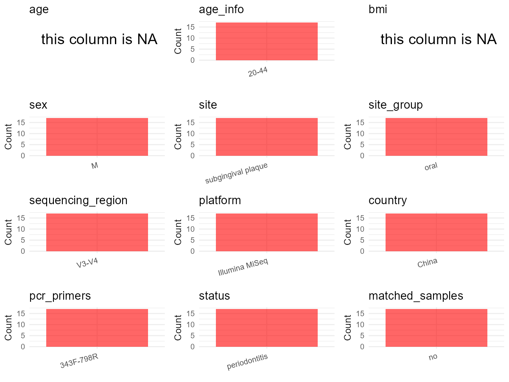

R Notebook: Metadata Processing Workflow
================

# Step 1: Obtain Initial Metadata from Each Project

This step sets the project directory, loads the raw SRA metadata, and
optionally merges supplement tables.

``` r
# Load libraries
library(dplyr)
library(ggplot2)
library(cowplot)

# (1) Setting working directory
# EDIT HERE: change project_id for each study
project_id <- "PRJNA893253" 

base_dir <- "E:/oral/26/metadata-2604/Oral-Metadata-YL-02"
setwd(file.path(base_dir, project_id))

# (2) Loading raw SRA metadata file
sra_file <- "SraRunTable.csv"
initial_meta <- read.csv(sra_file, header = TRUE)

# (3) OPTIONAL: If extra metadata (e.g., Table.x or supplemental materials) are available from the article, you may need to merge the file with initial_meta manually. Below is example code for merging. Depending on the specific case of each study, you can customize the code as needed.
#supp_table <- read.csv("supplemental_table_v2.csv", header = TRUE)
#initial_meta <- left_join(initial_meta, supp_table, by = "Sample.Name") 
```

# Step 2: Data Overview

First, you need to get an overview of the data, which includes two
steps: reading the article and reading the initial metadata. This step
is very IMPORTANT!

``` r
# (1) Read the article in the following order: abstract, the beginning of the results section, and the methods. Understand the sample size, experimental design, and disease group overview. Clarify the sampling sites; for oral and gut samples, specify the exact sites like supragingival plaque, tongue, etc.

# (2) IMPORTANT: MUST go through each column of initial_meta
head(initial_meta, 10)
```

    ##            Run Assay.Type AvgSpotLen    Bases  BioProject    BioSample
    ## 1  SRR22052817   AMPLICON        500 40816500 PRJNA893253 SAMN31416460
    ## 2  SRR22052818   AMPLICON        500 40078000 PRJNA893253 SAMN31416459
    ## 3  SRR22052819   AMPLICON        500 40733500 PRJNA893253 SAMN31416458
    ## 4  SRR22052820   AMPLICON        500 40407000 PRJNA893253 SAMN31416457
    ## 5  SRR22052821   AMPLICON        500 40434500 PRJNA893253 SAMN31416456
    ## 6  SRR22052825   AMPLICON        500 40860500 PRJNA893253 SAMN31416467
    ## 7  SRR22052828   AMPLICON        500 29037000 PRJNA893253 SAMN31416464
    ## 8  SRR22052814   AMPLICON        500 40118500 PRJNA893253 SAMN31416463
    ## 9  SRR22052815   AMPLICON        500 40328500 PRJNA893253 SAMN31416462
    ## 10 SRR22052816   AMPLICON        500 39346000 PRJNA893253 SAMN31416461
    ##                 BioSampleModel    Bytes                 Center.Name
    ## 1  Metagenome or environmental 14781482 THE SECOND XIANGYA HOSPITAL
    ## 2  Metagenome or environmental 14021600 THE SECOND XIANGYA HOSPITAL
    ## 3  Metagenome or environmental 14905985 THE SECOND XIANGYA HOSPITAL
    ## 4  Metagenome or environmental 14025573 THE SECOND XIANGYA HOSPITAL
    ## 5  Metagenome or environmental 13406938 THE SECOND XIANGYA HOSPITAL
    ## 6  Metagenome or environmental 14577835 THE SECOND XIANGYA HOSPITAL
    ## 7  Metagenome or environmental  9678974 THE SECOND XIANGYA HOSPITAL
    ## 8  Metagenome or environmental 13322990 THE SECOND XIANGYA HOSPITAL
    ## 9  Metagenome or environmental 13328125 THE SECOND XIANGYA HOSPITAL
    ## 10 Metagenome or environmental 13132456 THE SECOND XIANGYA HOSPITAL
    ##    Collection_Date Consent DATASTORE.filetype DATASTORE.provider
    ## 1       2021-03-01  public   fastq,run.zq,sra         gs,ncbi,s3
    ## 2       2021-03-01  public   sra,fastq,run.zq         gs,ncbi,s3
    ## 3       2021-03-01  public   fastq,run.zq,sra         gs,ncbi,s3
    ## 4       2021-03-01  public   fastq,run.zq,sra         gs,ncbi,s3
    ## 5       2021-03-01  public   fastq,run.zq,sra         gs,ncbi,s3
    ## 6       2021-03-01  public   fastq,run.zq,sra         gs,ncbi,s3
    ## 7       2021-03-01  public   fastq,run.zq,sra         gs,ncbi,s3
    ## 8       2021-03-01  public   fastq,run.zq,sra         gs,ncbi,s3
    ## 9       2021-03-01  public   fastq,run.zq,sra         gs,ncbi,s3
    ## 10      2021-03-01  public   fastq,run.zq,sra         gs,ncbi,s3
    ##                        DATASTORE.region  Experiment geo_loc_name_country
    ## 1  gs.us-east1,ncbi.public,s3.us-east-1 SRX18033894                China
    ## 2  gs.us-east1,ncbi.public,s3.us-east-1 SRX18033893                China
    ## 3  gs.us-east1,ncbi.public,s3.us-east-1 SRX18033892                China
    ## 4  gs.us-east1,ncbi.public,s3.us-east-1 SRX18033891                China
    ## 5  gs.us-east1,ncbi.public,s3.us-east-1 SRX18033890                China
    ## 6  gs.us-east1,ncbi.public,s3.us-east-1 SRX18033886                China
    ## 7  gs.us-east1,ncbi.public,s3.us-east-1 SRX18033883                China
    ## 8  gs.us-east1,ncbi.public,s3.us-east-1 SRX18033897                China
    ## 9  gs.us-east1,ncbi.public,s3.us-east-1 SRX18033896                China
    ## 10 gs.us-east1,ncbi.public,s3.us-east-1 SRX18033895                China
    ##    geo_loc_name_country_continent   geo_loc_name          HOST
    ## 1                            Asia China:Changsha not collected
    ## 2                            Asia China:Changsha not collected
    ## 3                            Asia China:Changsha not collected
    ## 4                            Asia China:Changsha not collected
    ## 5                            Asia China:Changsha not collected
    ## 6                            Asia China:Changsha not collected
    ## 7                            Asia China:Changsha not collected
    ## 8                            Asia China:Changsha not collected
    ## 9                            Asia China:Changsha not collected
    ## 10                           Asia China:Changsha not collected
    ##               Instrument   isolation_source           lat_lon Library.Name
    ## 1  Illumina NovaSeq 6000 subgingival plaque 28.19 N 112.104 E            7
    ## 2  Illumina NovaSeq 6000 subgingival plaque 28.19 N 112.103 E            6
    ## 3  Illumina NovaSeq 6000 subgingival plaque 28.19 N 112.102 E            5
    ## 4  Illumina NovaSeq 6000 subgingival plaque 28.19 N 112.101 E            4
    ## 5  Illumina NovaSeq 6000 subgingival plaque 28.19 N 112.100 E            3
    ## 6  Illumina NovaSeq 6000 subgingival plaque 28.19 N 112.111 E           14
    ## 7  Illumina NovaSeq 6000 subgingival plaque 28.19 N 112.108 E           11
    ## 8  Illumina NovaSeq 6000 subgingival plaque 28.19 N 112.107 E           10
    ## 9  Illumina NovaSeq 6000 subgingival plaque 28.19 N 112.106 E            9
    ## 10 Illumina NovaSeq 6000 subgingival plaque 28.19 N 112.105 E            8
    ##    LibraryLayout LibrarySelection LibrarySource        Organism Platform
    ## 1         PAIRED              PCR   METAGENOMIC oral metagenome ILLUMINA
    ## 2         PAIRED              PCR   METAGENOMIC oral metagenome ILLUMINA
    ## 3         PAIRED              PCR   METAGENOMIC oral metagenome ILLUMINA
    ## 4         PAIRED              PCR   METAGENOMIC oral metagenome ILLUMINA
    ## 5         PAIRED              PCR   METAGENOMIC oral metagenome ILLUMINA
    ## 6         PAIRED              PCR   METAGENOMIC oral metagenome ILLUMINA
    ## 7         PAIRED              PCR   METAGENOMIC oral metagenome ILLUMINA
    ## 8         PAIRED              PCR   METAGENOMIC oral metagenome ILLUMINA
    ## 9         PAIRED              PCR   METAGENOMIC oral metagenome ILLUMINA
    ## 10        PAIRED              PCR   METAGENOMIC oral metagenome ILLUMINA
    ##             ReleaseDate          create_date version Sample.Name SRA.Study
    ## 1  2022-10-26T00:00:00Z 2022-10-26T15:52:00Z       1       G1.09 SRP404688
    ## 2  2022-10-26T00:00:00Z 2022-10-26T15:52:00Z       1       G1.08 SRP404688
    ## 3  2022-10-26T00:00:00Z 2022-10-26T15:52:00Z       1       G1.07 SRP404688
    ## 4  2022-10-26T00:00:00Z 2022-10-26T15:52:00Z       1       G1.05 SRP404688
    ## 5  2022-10-26T00:00:00Z 2022-10-26T15:53:00Z       1       G1.04 SRP404688
    ## 6  2022-10-26T00:00:00Z 2022-10-26T15:53:00Z       1       G1.17 SRP404688
    ## 7  2022-10-26T00:00:00Z 2022-10-26T15:53:00Z       1       G1.14 SRP404688
    ## 8  2022-10-26T00:00:00Z 2022-10-26T15:52:00Z       1       G1.13 SRP404688
    ## 9  2022-10-26T00:00:00Z 2022-10-26T15:52:00Z       1       G1.12 SRP404688
    ## 10 2022-10-26T00:00:00Z 2022-10-26T15:52:00Z       1       G1.11 SRP404688

``` r
# IMPORTANT: Check the unique values in the column of interest or query column.
lapply(initial_meta[c('isolation_source')], table) # site
```

    ## $isolation_source
    ## 
    ## subgingival plaque 
    ##                 17

``` r
lapply(initial_meta[c('Organism', 'HOST')], table) # organism
```

    ## $Organism
    ## 
    ## oral metagenome 
    ##              17 
    ## 
    ## $HOST
    ## 
    ## not collected 
    ##            17

``` r
table(initial_meta$Sample.Name) # subject id
```

    ## 
    ## G1.01 G1.03 G1.04 G1.05 G1.07 G1.08 G1.09 G1.11 G1.12 G1.13 G1.14 G1.15 G1.16 
    ##     1     1     1     1     1     1     1     1     1     1     1     1     1 
    ## G1.17 G1.18 G1.19 G1.20 
    ##     1     1     1     1

``` r
#table(initial_meta$sequencing_meth..exp.) # output is pyrosequencing
table(initial_meta$Platform) # output is Illumina. according to the methods, Illumina is correct.
```

    ## 
    ## ILLUMINA 
    ##       17

``` r
# table(initial_meta$target_subfragment..exp.)
```

# Step 3: Removing Control and Non-human Samples

First, we need to remove control samples(including both negative
controls and positive controls) and non-human samples.

``` r
# (1) EDIT HERE: Parameter setup
control_column <- "" # column name in initial_meta
# unique(initial_meta[[control_column]])
control_keywords <- c() # Enter exact keywords

species_column <- "" # column name in initial_meta
unique(initial_meta[[species_column]])
```

    ## NULL

``` r
non_human_keywords <- c() # Enter exact keywords

# (2) Remove controls and non-human samples. DO NOT need to modify code in this part, just run it.
n_samples <- nrow(initial_meta)
# Control evaluation
if (length(control_keywords) > 0) {
  if (is.null(control_column) || control_column == "") {
    stop("Error: control_keywords provided but control_column is missing.")
  }
  
  if (!(control_column %in% colnames(initial_meta))) {
    stop(sprintf("Error: Column '%s' not found in initial_meta.", control_column))
  }
  
  control_pattern <- paste(control_keywords, collapse = "|")
  control_text <- initial_meta[[control_column]]
  is_control <- grepl(control_pattern, control_text)
  
} else {
  is_control <- rep(FALSE, n_samples)
}

# Non-human evaluation
if (length(non_human_keywords) > 0) {
  if (is.null(species_column) || species_column == "") {
    stop("Error: non_human_keywords provided but species_column is missing.")
  }
  
  if (!(species_column %in% colnames(initial_meta))) {
    stop(sprintf("Error: Column '%s' not found in initial_meta.", species_column))
  }
  
  non_human_pattern <- paste(non_human_keywords, collapse = "|")
  species_text <- initial_meta[[species_column]]
  is_non_human <- grepl(non_human_pattern, species_text)
} else {
  is_non_human <- rep(FALSE, n_samples)
}

# Execute removal
samples_to_remove <- is_control | is_non_human
initial_meta <- initial_meta[!samples_to_remove, ]

cat("Initial samples counts:",n_samples,"\n")
```

    ## Initial samples counts: 17

``` r
cat("Removed control samples:", sum(is_control), "\n")
```

    ## Removed control samples: 0

``` r
cat("Removed non-human samples:", sum(is_non_human), "\n")
```

    ## Removed non-human samples: 0

``` r
cat("Total samples removed ", sum(samples_to_remove), "\n")
```

    ## Total samples removed  0

``` r
cat("Remaining samples after Step 2:", nrow(initial_meta), "\n")
```

    ## Remaining samples after Step 2: 17

# Step 4: Creating a Uniform Metadata Template

This step converts the raw SRA table into the standard metadata format
used in our meta-analysis. The uniform metadata should include the
following columns: 1. **bioproject**: Project ID from SRA or other
database e.g. `PRJNA1234`, `CNP1234`, ‘OEP1234’, ‘qiita_1234’ 2.
**sample_id**: SRA sample/run ID. Unique id for each sample!
e.g. `DRR1234567`, `ERR1234567` and `SRR1234567`. If no such column
exists, can use column like sample_name. 3. **subject_id**: subject id
for each person if available. e.g. `patient_01`, `Host_03_before`,
`subject12` 4. **age**: Age of the subject if available. e.g. `35`, `42`
\| not `adult`, `chilren` 5. **age_info**: If the age is not explicitly
stated but approximate age range information is available, mark it in
this column. e.g., `18-55`, `children`, `infant`, `elder` 6. **bmi**:
Body Mass Index if available. e.g. `22.5`, `18.9` \| not `normal`,
`overweight` 7. **sex**: Sex of the subject. Mandatory to write as M/F
\| not `female`, `woman` 8. **sequencing_region**: Targeted 16S rRNA
region. e.g. `V3-V4`, `V4` 9. **platform**: Sequencing platform.
e.g. `Illumina MiSeq`, `454 GS FLX Titanium`, `Ion Torrent` 10.
**country**: Country of sample origin. e.g. `China`, `Japan` \| not city
name like `Beijing` 11. **site**: Sampling site. For oral and gut sites,
specify the exact sites as detailed as possible. For example, if it is
known to be supragingival plaque, do not record it as ‘dental plaque’,
unless the original text provides only a vague description.
e.g. `saliva`, `tongue coating` \| not broad term like `oral` 12.
**site_group**: only accepts one of following three values: ‘oral’,
‘gut’, or ‘other’. 13. **public_time**: Data release date.
e.g. `2021-06-22` \| not `June 2021` 14. **pcr_primers**: PCR primers
used. e.g. `515F-806R`, `27F-338R` \| not primer sequences 15.
**title**: Title of the associated publication. 16. **disease_study**:
Whether the study involves disease samples. If it’s not clear, can
record as NA. Only three values accepted: ‘yes’, ‘no’ or NA 17.
**status**: Disease status for each sample if available, else record as
NA. Only accept following abbreviations, Write full names for all other
diseases. HC: healthy control CD: Crohn’s disease CRC: colorectal cancer
COPD: chronic obstructive pulmonary disease HIV: human immunodeficiency
virus ICU: intensive care unit OSCC: oral squamous cell carcinoma RA:
rheumatoid arthritis UC: ulcerative colitis 18. **matched_samples**:
Whether the subject has matched samples. Only accept ‘yes’ or ‘no’. 19.
**is_time_series**: Whether the study is a time series study. Only
accept ‘yes’ or ‘no’.

``` r
# Extract columns from initial_meta as follows: (1) No modification needed → extract directly. (2) Modification needed → create a new column with the prefix raw_ and mark the original column as “pending”. (3) Need to find or determine based on the article.
metadata <- data.frame(
  bioproject = initial_meta$BioProject,
  sample_id = initial_meta$Run,
  subject_id = initial_meta$Sample.Name,
  age = NA,
  age_info = "20-44",
  bmi = NA,
  sex = "M", # Article: 16S rRNA sequencing was performed to evaluate variations in the composition of oral bacteria between males with stage I and III periodontitis and identify the dominant bacteria of each group.
  sequencing_region = "V3-V4", # extract from methods section (The sequencing procedures were carried out as previously reported (Zhao et al.,2021a.)
  platform = "Illumina MiSeq", # extract from methods section, NOT initial_meta
  country = initial_meta$geo_loc_name_country,
  site = initial_meta$isolation_source,
  site_group = "pending", # modify later
  public_time = initial_meta$ReleaseDate,
  pcr_primers = "343F-798R", # Format: xxF-xxR
  title = "Prevotella genus and its related NOD-like receptor signaling pathway in young males with stage III periodontitis", # extract from article
  disease_study = "yes", # determine according to the article
  status = "periodontitis",
  matched_samples = "pending", # modify later
  is_time_series = "no", # determine according to the article
  stringsAsFactors = FALSE
)
metadata$public_time <- as.Date(metadata$public_time)
```

# Step 5: Manually solving pending issues

This step involves two parts: (1) handle the columns with the `raw_`
prefix, and next (2) handle the `site_group` and `matched_samples`
columns.

``` r
# (1) Handle the columns with the `raw_` prefix.
# In this part, you need to customize the code based on the situation of the raw_ columns to obtain the content of the target columns. IMPORTANT: Add comments if the modification is not straightforward!!
```

``` r
# (2) Filling the 'site_group' and 'matched_samples' columns
# editing site_group
unique(metadata$site)
```

    ## [1] "subgingival plaque"

``` r
# EDIT HERE: add oral sites
Oral_site = unique(metadata$site)
# EDIT HERE: add gut sites
Gut_site = c()
# just run
metadata <- metadata %>%
  mutate(site_group = case_when(
    site %in% Oral_site ~ "oral",
    site %in% Gut_site ~ "gut",
    TRUE ~ "other" 
  ))

# editing matched_samples, just run.
metadata$matched_samples <- ifelse(
  ave(metadata$subject_id, metadata$subject_id, FUN = length) > 1, 
  "yes", 
  "no"
)
```

``` r
# (3) check if there is pending value in metadata. If there is pending value, go on modify the metadata.
# Function to check if a column contains "pending"
has_pending <- function(col) {
  if (is.character(col) || is.factor(col)) {
    any(col == "pending", na.rm = TRUE)
  } else {
    FALSE
  }
}

# Check for any pending value
any_pending_value <- any(sapply(metadata, has_pending))

if (!any_pending_value) {
  message("Good! No cell contains the value 'pending'.")
} else {
  pending_cols <- names(metadata)[sapply(metadata, has_pending)]
  message("Columns containing 'pending': ", paste(pending_cols, collapse = ", "))
  message("Please continue to resolve these pending columns!")
}
```

    ## Good! No cell contains the value 'pending'.

# Step 6: Visualize the Metadata

This step makes a quick set of plots for checking the distribution of
key metadata fields.

``` r
# Select columns for visualization, just run
plot_data <- metadata %>%
  select(-bioproject, -sample_id, -subject_id, -title)

create_simple_plots <- function(data) {
  plots <- list()
  continuous_vars <- c("age", "bmi")

  for (col in colnames(data)) {
    if (all(is.na(data[[col]]))) {
      p <- ggplot() +
        annotate("text", x = 0.5, y = 0.5, label = "this column is NA", size = 6) +
        labs(title = col) +
        theme_void()
    } else if (col %in% continuous_vars && is.numeric(data[[col]])) {
      p <- ggplot(data, aes(x = .data[[col]])) +
        geom_histogram(fill = "blue", alpha = 0.6, bins = 20, na.rm = TRUE) +
        labs(title = col, x = col, y = "Count") +
        theme_minimal()
    } else {
      count_data <- as.data.frame(table(data[[col]], useNA = "ifany"))
      p <- ggplot(count_data, aes(x = reorder(Var1, -Freq), y = Freq)) +
        geom_col(fill = "red", alpha = 0.6) +
        labs(title = col, x = NULL, y = "Count") +
        theme_minimal() +
        theme(axis.text.x = element_text(angle = 15, hjust = 1))
    }
    plots[[col]] <- p
  }

  return(plots)
}

# Generate and arrange plots
plots <- create_simple_plots(plot_data)
p <- plot_grid(plots$age,
               plots$age_info,
               plots$bmi,
               plots$sex,
               plots$site,
               plots$site_group,
               plots$sequencing_region,
               plots$platform,
               plots$country,
               plots$pcr_primers,
               plots$status,
               plots$matched_samples,
               ncol = 3, align = "hv", axis = "lb")
ggsave("Metadata_Summary_v2.png", plot = p, width = 8, height = 6, dpi = 150)
```

``` r
# Insert Metadata_Summary.png into the current Rmd output

```


# Step 7: Sort and export the metadata

This step saves the cleaned metadata table as the final `metadata.csv`
file.

``` r
# Reorder the data frame
fixed_cols <- c("bioproject", "sample_id", "subject_id", "age", "age_info",
                "bmi", "sex", "platform", "sequencing_region", "pcr_primers", 
                "country", "site", "site_group", "disease_study", "status", 
                "title", "public_time", "matched_samples", "is_time_series")  
metadata <- metadata %>%
  select(all_of(fixed_cols), everything())

# save metadata 
# head(metadata)
write.csv(metadata, file = "metadata_v2.csv", quote = TRUE)
```
