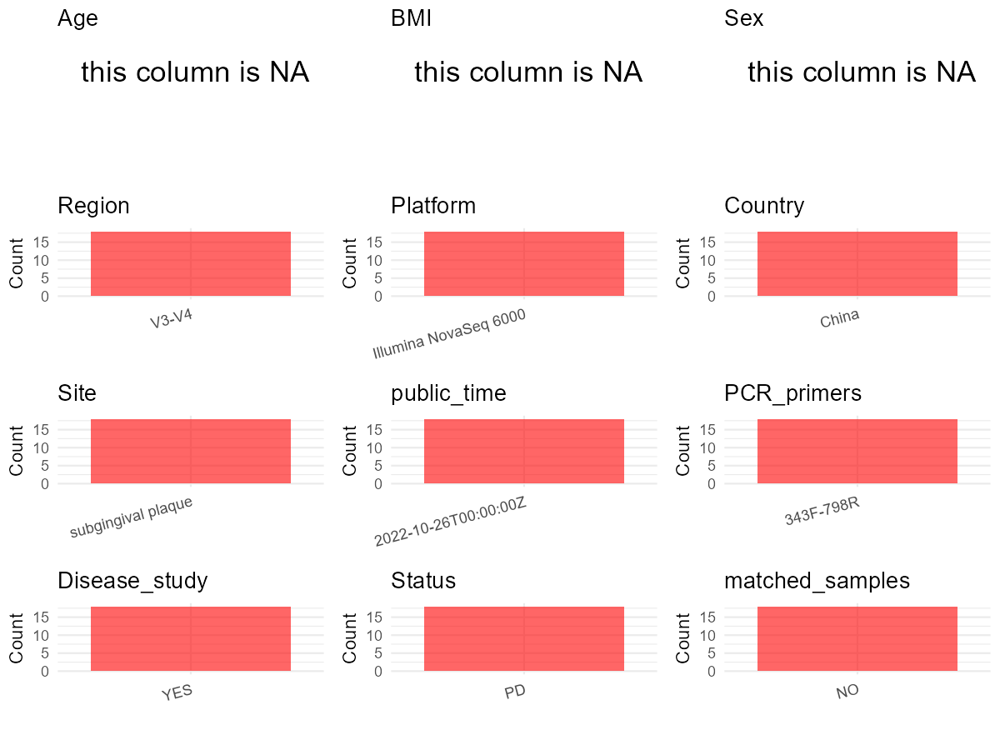

R Notebook: Metadata Processing Workflow
================

# Step 1: Obtain Initial Metadata from Each Project

To obtain the initial metadata: 1. Search for the BioProject ID (e.g.,
“PRJEBXXXX”) on the [NCBI SRA
website](https://www.ncbi.nlm.nih.gov/Traces/study/). 2. In the “Select”
table, click on “Metadata” and download the file. 3. The downloaded file
is typically named “SraRunTable.csv” and contains metadata for the
project.

``` r
# Load necessary libraries
library(dplyr)
library(ggplot2)
library(cowplot)

# Set working directory (update this path to your local directory)
setwd("D:/studylearning/董彪师兄项目/任务4_20251009/PRJNA893254")

# Read the initial metadata files
initial_meta<-read.csv("SraRunTable.csv",header = T)

# Display the first few rows of the metadata
head(initial_meta)
```

    ##           Run Assay.Type AvgSpotLen    Bases  BioProject    BioSample
    ## 1 SRR22052796   AMPLICON        500 39923500 PRJNA893254 SAMN31416480
    ## 2 SRR22052797   AMPLICON        500 39195000 PRJNA893254 SAMN31416479
    ## 3 SRR22052798   AMPLICON        500 37530000 PRJNA893254 SAMN31416478
    ## 4 SRR22052799   AMPLICON        500 40689500 PRJNA893254 SAMN31416477
    ## 5 SRR22052800   AMPLICON        500 32593500 PRJNA893254 SAMN31416476
    ## 6 SRR22052801   AMPLICON        500 39130000 PRJNA893254 SAMN31416475
    ##                BioSampleModel    Bytes                 Center.Name
    ## 1 Metagenome or environmental 13841408 THE SECOND XIANGYA HOSPITAL
    ## 2 Metagenome or environmental 13692364 THE SECOND XIANGYA HOSPITAL
    ## 3 Metagenome or environmental 12829077 THE SECOND XIANGYA HOSPITAL
    ## 4 Metagenome or environmental 13498612 THE SECOND XIANGYA HOSPITAL
    ## 5 Metagenome or environmental 11487981 THE SECOND XIANGYA HOSPITAL
    ## 6 Metagenome or environmental 13234377 THE SECOND XIANGYA HOSPITAL
    ##   Collection_Date Consent DATASTORE.filetype DATASTORE.provider
    ## 1      2021-03-01  public   fastq,run.zq,sra         gs,ncbi,s3
    ## 2      2021-03-01  public   fastq,run.zq,sra         gs,ncbi,s3
    ## 3      2021-03-01  public   fastq,run.zq,sra         gs,ncbi,s3
    ## 4      2021-03-01  public   fastq,run.zq,sra         gs,ncbi,s3
    ## 5      2021-03-01  public   fastq,run.zq,sra         gs,ncbi,s3
    ## 6      2021-03-01  public   fastq,run.zq,sra         gs,ncbi,s3
    ##                       DATASTORE.region  Experiment geo_loc_name_country
    ## 1 gs.us-east1,ncbi.public,s3.us-east-1 SRX18033880                China
    ## 2 gs.us-east1,ncbi.public,s3.us-east-1 SRX18033879                China
    ## 3 gs.us-east1,ncbi.public,s3.us-east-1 SRX18033878                China
    ## 4 gs.us-east1,ncbi.public,s3.us-east-1 SRX18033877                China
    ## 5 gs.us-east1,ncbi.public,s3.us-east-1 SRX18033876                China
    ## 6 gs.us-east1,ncbi.public,s3.us-east-1 SRX18033875                China
    ##   geo_loc_name_country_continent   geo_loc_name          HOST
    ## 1                           Asia China:Changsha not collected
    ## 2                           Asia China:Changsha not collected
    ## 3                           Asia China:Changsha not collected
    ## 4                           Asia China:Changsha not collected
    ## 5                           Asia China:Changsha not collected
    ## 6                           Asia China:Changsha not collected
    ##              Instrument   isolation_source           lat_lon Library.Name
    ## 1 Illumina NovaSeq 6000 subgingival plaque 28.19 N 112.107 E           10
    ## 2 Illumina NovaSeq 6000 subgingival plaque 28.19 N 112.106 E            9
    ## 3 Illumina NovaSeq 6000 subgingival plaque 28.19 N 112.105 E            8
    ## 4 Illumina NovaSeq 6000 subgingival plaque 28.19 N 112.104 E            7
    ## 5 Illumina NovaSeq 6000 subgingival plaque 28.19 N 112.103 E            6
    ## 6 Illumina NovaSeq 6000 subgingival plaque 28.19 N 112.102 E            5
    ##   LibraryLayout LibrarySelection LibrarySource        Organism Platform
    ## 1        PAIRED              PCR   METAGENOMIC oral metagenome ILLUMINA
    ## 2        PAIRED              PCR   METAGENOMIC oral metagenome ILLUMINA
    ## 3        PAIRED              PCR   METAGENOMIC oral metagenome ILLUMINA
    ## 4        PAIRED              PCR   METAGENOMIC oral metagenome ILLUMINA
    ## 5        PAIRED              PCR   METAGENOMIC oral metagenome ILLUMINA
    ## 6        PAIRED              PCR   METAGENOMIC oral metagenome ILLUMINA
    ##            ReleaseDate          create_date version Sample.Name SRA.Study
    ## 1 2022-10-26T00:00:00Z 2022-10-26T15:52:00Z       1       G7.10 SRP404687
    ## 2 2022-10-26T00:00:00Z 2022-10-26T15:52:00Z       1       G7.09 SRP404687
    ## 3 2022-10-26T00:00:00Z 2022-10-26T15:52:00Z       1       G7.08 SRP404687
    ## 4 2022-10-26T00:00:00Z 2022-10-26T15:52:00Z       1       G7.07 SRP404687
    ## 5 2022-10-26T00:00:00Z 2022-10-26T15:52:00Z       1       G7.06 SRP404687
    ## 6 2022-10-26T00:00:00Z 2022-10-26T15:52:00Z       1       G7.05 SRP404687

# Step 2: Create a Uniform Metadata Template

The uniform metadata should include the following columns:

1.  **BioProject**: Project ID (e.g., “PRJNA339212”)
2.  **Run**: Sample ID (e.g., “ERRXXXXXX” or “SRRXXXXXX”)
3.  **sample_name**: Original sample name submitted by the authors (not
    the database-assigned ID)
4.  **Age**: Age of the subject (if available)
5.  **BMI**: Body Mass Index (if available)
6.  **Sex**: Sex of the subject (“F” or “M”)
7.  **Region**: Targeted 16S rRNA region (e.g., “V3-V4”)
8.  **Platform**: Sequencing platform (e.g., “Illumina MiSeq”)
9.  **Country**: Country of sample origin (e.g., “China”)
10. **Site**: Sample site (e.g., “saliva”, “dental plaque”)
11. **public_time**: Data release date (format: “YYYY-MM-DD”)
12. **PCR_primers**: PCR primers used (e.g., “515F-806R”)
13. **title**: Title of the associated publication
14. **Disease_study**: Whether the study involves a disease (“YES” or
    “NO”)
15. **Status**: Disease status (e.g., “T2DM”, “HC”). Note: If the study
    includes both disease and healthy samples, this must be specified
    per sample.

``` r
# Create a uniform metadata dataframe
metadata <- data.frame(
  BioProject = initial_meta$BioProject,
  Run = initial_meta$Run,
  sample_name = initial_meta$Sample.Name,
  Age = NA,
  BMI = NA,
  Sex= NA,
  Region = "V3-V4",
  Platform = initial_meta$Instrument,
  Country = initial_meta$geo_loc_name_country,
  Site = initial_meta$isolation_source,
  public_time = initial_meta$ReleaseDate,
  stringsAsFactors = FALSE
)
```

# Step 3: Manually Add Information from the Publication

Some information (e.g. PCR primers, study title, disease status) must be
manually extracted from the publication and added to the metadata.

``` r
# Add information obtained from the publication
metadata$PCR_primers <- "343F-798R"  # Update based on the publication
metadata$title <- "The oral microbiome in young women at different stages of periodontitis: Prevotella dominant in stage III periodontitis"
metadata$Disease_study <- "YES"
metadata$Status <- "PD"

#extract subject id by remove prefix of sample_name
#metadata$sample_name <- gsub("_st|_sal", "", metadata$sample_name)

# Check initial data distribution
cat("Initial sample distribution:\n")
```

    ## Initial sample distribution:

``` r
table(metadata$sample_name)
```

    ## 
    ## G7.01 G7.02 G7.03 G7.04 G7.05 G7.06 G7.07 G7.08 G7.09 G7.10 G7.12 G7.14 G7.15 
    ##     1     1     1     1     1     1     1     1     1     1     1     1     1 
    ## G7.16 G7.17 G7.18 G7.19 G7.20 
    ##     1     1     1     1     1

``` r
table(metadata$Site)
```

    ## 
    ## subgingival plaque 
    ##                 18

``` r
# Calculate sampling frequency per subject
sample_counts <- table(metadata$sample_name)
cat("\nNumber of samples per subject:\n")
```

    ## 
    ## Number of samples per subject:

``` r
print(sample_counts)
```

    ## 
    ## G7.01 G7.02 G7.03 G7.04 G7.05 G7.06 G7.07 G7.08 G7.09 G7.10 G7.12 G7.14 G7.15 
    ##     1     1     1     1     1     1     1     1     1     1     1     1     1 
    ## G7.16 G7.17 G7.18 G7.19 G7.20 
    ##     1     1     1     1     1

``` r
# Create matched_samples column
metadata$matched_samples <- ifelse(metadata$sample_name %in% names(sample_counts[sample_counts >= 2]), "YES", "NO")

cat("\nMatched samples distribution:\n")
```

    ## 
    ## Matched samples distribution:

``` r
table(metadata$matched_samples)
```

    ## 
    ## NO 
    ## 18

``` r
# Identify samples for removal: single samples excluding subgingival plaque 
single_samples <- names(sample_counts[sample_counts == 1])
samples_to_remove <- metadata$sample_name %in% single_samples & !(metadata$Site %in% c("subgingival plaque"))

cat("\nNumber of samples to be removed:", sum(samples_to_remove), "\n")
```

    ## 
    ## Number of samples to be removed: 0

``` r
# Remove identified samples
metadata_clean <- metadata[!samples_to_remove, ]

cat("\nFinal sample distribution after cleaning:\n")
```

    ## 
    ## Final sample distribution after cleaning:

``` r
table(metadata_clean$sample_name)
```

    ## 
    ## G7.01 G7.02 G7.03 G7.04 G7.05 G7.06 G7.07 G7.08 G7.09 G7.10 G7.12 G7.14 G7.15 
    ##     1     1     1     1     1     1     1     1     1     1     1     1     1 
    ## G7.16 G7.17 G7.18 G7.19 G7.20 
    ##     1     1     1     1     1

``` r
table(metadata_clean$Site)
```

    ## 
    ## subgingival plaque 
    ##                 18

``` r
table(metadata_clean$matched_samples)
```

    ## 
    ## NO 
    ## 18

``` r
# Use cleaned dataset for subsequent analysis
metadata <- metadata_clean
```

# Step 4: Summarize and Validate the Metadata

``` r
# Check the number of unique runs and sample names
print(paste("Number of unique runs:", length(unique(metadata$Run))))
```

    ## [1] "Number of unique runs: 18"

``` r
print(paste("Number of unique sample names:", length(unique(metadata$sample_name))))
```

    ## [1] "Number of unique sample names: 18"

# Step 5: Visualize the Metadata

``` r

```


# Step 6: Finalize and Export the Metadata

``` r
# Reorder columns to match the desired format
metadata <- metadata[, c(
  "BioProject", "Run", "sample_name", "Age", "BMI", "Sex", 
  "Region", "Platform", "Country", "Site", "public_time", 
  "PCR_primers", "title", "Disease_study", "Status","matched_samples"
)]

# Export the uniform metadata to a CSV file
write.csv(metadata, file = "metadata.csv", quote = FALSE)
head(metadata)
```

    ##    BioProject         Run sample_name Age BMI Sex Region              Platform
    ## 1 PRJNA893254 SRR22052796       G7.10  NA  NA  NA  V3-V4 Illumina NovaSeq 6000
    ## 2 PRJNA893254 SRR22052797       G7.09  NA  NA  NA  V3-V4 Illumina NovaSeq 6000
    ## 3 PRJNA893254 SRR22052798       G7.08  NA  NA  NA  V3-V4 Illumina NovaSeq 6000
    ## 4 PRJNA893254 SRR22052799       G7.07  NA  NA  NA  V3-V4 Illumina NovaSeq 6000
    ## 5 PRJNA893254 SRR22052800       G7.06  NA  NA  NA  V3-V4 Illumina NovaSeq 6000
    ## 6 PRJNA893254 SRR22052801       G7.05  NA  NA  NA  V3-V4 Illumina NovaSeq 6000
    ##   Country               Site          public_time PCR_primers
    ## 1   China subgingival plaque 2022-10-26T00:00:00Z   343F-798R
    ## 2   China subgingival plaque 2022-10-26T00:00:00Z   343F-798R
    ## 3   China subgingival plaque 2022-10-26T00:00:00Z   343F-798R
    ## 4   China subgingival plaque 2022-10-26T00:00:00Z   343F-798R
    ## 5   China subgingival plaque 2022-10-26T00:00:00Z   343F-798R
    ## 6   China subgingival plaque 2022-10-26T00:00:00Z   343F-798R
    ##                                                                                                                     title
    ## 1 The oral microbiome in young women at different stages of periodontitis: Prevotella dominant in stage III periodontitis
    ## 2 The oral microbiome in young women at different stages of periodontitis: Prevotella dominant in stage III periodontitis
    ## 3 The oral microbiome in young women at different stages of periodontitis: Prevotella dominant in stage III periodontitis
    ## 4 The oral microbiome in young women at different stages of periodontitis: Prevotella dominant in stage III periodontitis
    ## 5 The oral microbiome in young women at different stages of periodontitis: Prevotella dominant in stage III periodontitis
    ## 6 The oral microbiome in young women at different stages of periodontitis: Prevotella dominant in stage III periodontitis
    ##   Disease_study Status matched_samples
    ## 1           YES     PD              NO
    ## 2           YES     PD              NO
    ## 3           YES     PD              NO
    ## 4           YES     PD              NO
    ## 5           YES     PD              NO
    ## 6           YES     PD              NO

## Notes for Students:

1.  **Metadata Accuracy**: Always cross-check the metadata with the
    original publication to ensure accuracy.
2.  **Manual Entries**: Columns like `PCR_primers`, and `Status` often
    require manual entry based on the publication.
3.  **Disease Status**: Be careful when assigning `Status`—some studies
    include both disease and healthy samples.
4.  **Visualization**: The plots help quickly identify the distribution
    of values in each column, which is useful for quality control.
5.  **Reproducibility**: Update the working directory and file paths to
    match your local environment.
