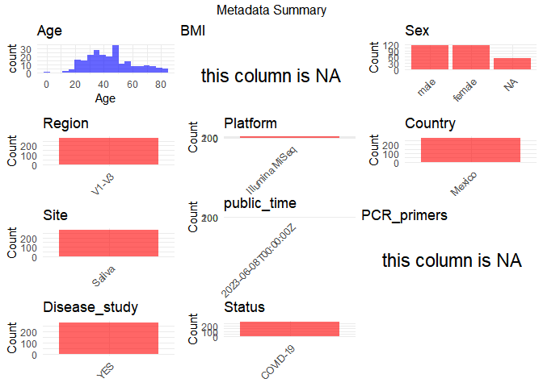

R Notebook: Metadata Processing Workflow
================

# Step 1: Obtain Initial Metadata from Each Project

To obtain the initial metadata: 1. Search for the BioProject ID (e.g.,
“PRJEBXXXX”) on the [NCBI SRA
website](https://www.ncbi.nlm.nih.gov/Traces/study/). 2. In the “Select”
table, click on “Metadata” and download the file. 3. The downloaded file
is typically named “SraRunTable.csv” and contains metadata for the
project.

``` r
# Load necessary libraries
library(dplyr)
library(ggplot2)
library(cowplot)

# Set working directory (update this path to your local directory)
setwd("D:/oral_project/PRJNA896341")

# Read the initial metadata files
initial_meta<-read.csv("SraRunTable.csv",header = T)

# Combine the two metadata files
#meta <- rbind(initial_meta, initial_meta1)

#Remove entries non-oral samples
#initial_meta <- subset(initial_meta,isolate %in% c("saliva","tongue coat"))

# Check the number of samples containing "HT" in Sample.Name (e.g., healthy controls)
#nrow(subset(meta, grepl("HT", Sample.Name)))

# Display the first few rows of the metadata
head(initial_meta)
```

    ##           Run AGE Assay.Type AvgSpotLen     Bases
    ## 1 SRR22118524  39   AMPLICON        501  32150331
    ## 2 SRR22118525  83   AMPLICON        500 102094136
    ## 3 SRR22118526  57   AMPLICON        501  82719696
    ## 4 SRR22118527  68   AMPLICON        501  24325197
    ## 5 SRR22118528  32   AMPLICON        501  23174995
    ## 6 SRR22118529  66   AMPLICON        501  18217725
    ##                                                                                         BIOMATERIAL_PROVIDER
    ## 1 Instituto Mexicano del Seguro Social\\, Unidad de Investigacion en Enfermedades Infecciosas UMAE Pediatria
    ## 2 Instituto Mexicano del Seguro Social\\, Unidad de Investigacion en Enfermedades Infecciosas UMAE Pediatria
    ## 3 Instituto Mexicano del Seguro Social\\, Unidad de Investigacion en Enfermedades Infecciosas UMAE Pediatria
    ## 4 Instituto Mexicano del Seguro Social\\, Unidad de Investigacion en Enfermedades Infecciosas UMAE Pediatria
    ## 5 Instituto Mexicano del Seguro Social\\, Unidad de Investigacion en Enfermedades Infecciosas UMAE Pediatria
    ## 6 Instituto Mexicano del Seguro Social\\, Unidad de Investigacion en Enfermedades Infecciosas UMAE Pediatria
    ##    BioProject    BioSample BioSampleModel    Bytes
    ## 1 PRJNA896341 SAMN31542666          Human 16270332
    ## 2 PRJNA896341 SAMN31542665          Human 57711526
    ## 3 PRJNA896341 SAMN31542664          Human 43843945
    ## 4 PRJNA896341 SAMN31542663          Human 13768499
    ## 5 PRJNA896341 SAMN31542662          Human 11640276
    ## 6 PRJNA896341 SAMN31542661          Human  9150029
    ##                            Center.Name Consent DATASTORE.filetype
    ## 1 INSTITUTO MEXICANO DEL SEGURO SOCIAL  public   fastq,run.zq,sra
    ## 2 INSTITUTO MEXICANO DEL SEGURO SOCIAL  public   fastq,run.zq,sra
    ## 3 INSTITUTO MEXICANO DEL SEGURO SOCIAL  public   fastq,run.zq,sra
    ## 4 INSTITUTO MEXICANO DEL SEGURO SOCIAL  public   fastq,run.zq,sra
    ## 5 INSTITUTO MEXICANO DEL SEGURO SOCIAL  public   fastq,run.zq,sra
    ## 6 INSTITUTO MEXICANO DEL SEGURO SOCIAL  public   fastq,run.zq,sra
    ##   DATASTORE.provider                     DATASTORE.region  Experiment
    ## 1         gs,ncbi,s3 gs.us-east1,ncbi.public,s3.us-east-1 SRX18098529
    ## 2         gs,ncbi,s3 gs.us-east1,ncbi.public,s3.us-east-1 SRX18098528
    ## 3         gs,ncbi,s3 gs.us-east1,ncbi.public,s3.us-east-1 SRX18098527
    ## 4         gs,ncbi,s3 gs.us-east1,ncbi.public,s3.us-east-1 SRX18098526
    ## 5         gs,ncbi,s3 gs.us-east1,ncbi.public,s3.us-east-1 SRX18098525
    ## 6         gs,ncbi,s3 gs.us-east1,ncbi.public,s3.us-east-1 SRX18098524
    ##       Instrument isolate Library.Name LibraryLayout LibrarySelection
    ## 1 Illumina MiSeq    HP80         HP80        PAIRED              PCR
    ## 2 Illumina MiSeq    HP79         HP79        PAIRED              PCR
    ## 3 Illumina MiSeq    HP78         HP78        PAIRED              PCR
    ## 4 Illumina MiSeq    HP76         HP76        PAIRED              PCR
    ## 5 Illumina MiSeq    HP75         HP75        PAIRED              PCR
    ## 6 Illumina MiSeq    HP74         HP74        PAIRED              PCR
    ##   LibrarySource     Organism Platform          ReleaseDate          create_date
    ## 1   METAGENOMIC Homo sapiens ILLUMINA 2023-06-08T00:00:00Z 2022-11-01T01:57:00Z
    ## 2   METAGENOMIC Homo sapiens ILLUMINA 2023-06-08T00:00:00Z 2022-11-01T01:57:00Z
    ## 3   METAGENOMIC Homo sapiens ILLUMINA 2023-06-08T00:00:00Z 2022-11-01T01:57:00Z
    ## 4   METAGENOMIC Homo sapiens ILLUMINA 2023-06-08T00:00:00Z 2022-11-01T01:57:00Z
    ## 5   METAGENOMIC Homo sapiens ILLUMINA 2023-06-08T00:00:00Z 2022-11-01T01:56:00Z
    ## 6   METAGENOMIC Homo sapiens ILLUMINA 2023-06-08T00:00:00Z 2022-11-01T01:57:00Z
    ##   version                                Sample.Name    sex SRA.Study tissue
    ## 1       1 Saliva microbiota hospitalized positive 80   male SRP405563 Saliva
    ## 2       1 Saliva microbiota hospitalized positive 79   male SRP405563 Saliva
    ## 3       1 Saliva microbiota hospitalized positive 78   male SRP405563 Saliva
    ## 4       1 Saliva microbiota hospitalized positive 76   male SRP405563 Saliva
    ## 5       1 Saliva microbiota hospitalized positive 75   male SRP405563 Saliva
    ## 6       1 Saliva microbiota hospitalized positive 74 female SRP405563 Saliva

# Step 2: Create a Uniform Metadata Template

The uniform metadata should include the following columns:

1.  **BioProject**: Project ID (e.g., “PRJNA339212”)
2.  **Run**: Sample ID (e.g., “ERRXXXXXX” or “SRRXXXXXX”)
3.  **sample_name**: Original sample name submitted by the authors (not
    the database-assigned ID)
4.  **Age**: Age of the subject (if available)
5.  **BMI**: Body Mass Index (if available)
6.  **Sex**: Sex of the subject (“F” or “M”)
7.  **Region**: Targeted 16S rRNA region (e.g., “V3-V4”)
8.  **Platform**: Sequencing platform (e.g., “Illumina MiSeq”)
9.  **Country**: Country of sample origin (e.g., “China”)
10. **Site**: Sample site (e.g., “saliva”, “dental plaque”)
11. **public_time**: Data release date (format: “YYYY-MM-DD”)
12. **PCR_primers**: PCR primers used (e.g., “515F-806R”)
13. **title**: Title of the associated publication
14. **Disease_study**: Whether the study involves a disease (“YES” or
    “NO”)
15. **Status**: Disease status (e.g., “T2DM”, “HC”). Note: If the study
    includes both disease and healthy samples, this must be specified
    per sample.
16. **matched_samples**: matched samples (“YES” or “NO”)

``` r
# Create a uniform metadata dataframe
metadata <- data.frame(
  BioProject = initial_meta$BioProject,
  Run = initial_meta$Run,
  sample_name = initial_meta$Sample.Name,
  Age = initial_meta$AGE,
  BMI = NA,
  Sex=initial_meta$sex,
  Region = "V1-V3",
  Platform = initial_meta$Instrument,
  Country = "Mexico",
  Site = initial_meta$tissue,
  public_time = initial_meta$ReleaseDate,
  stringsAsFactors = FALSE
)
```

# Step 3: Manually Add Information from the Publication

Some information (e.g. PCR primers, study title, disease status) must be
manually extracted from the publication and added to the metadata.

``` r
# Add information obtained from the publication
metadata$PCR_primers <- NA
metadata$title <- "Diversity composition and networking of saliva microbiota distinguish the severity of COVID-19 episodes as revealed by an analysis of 16S rRNA variable V1-V3 region sequences"
metadata$Disease_study <- "YES"
# Assign disease status based on sample_name patterns
metadata$Status<- "COVID-19"
metadata$matched_samples<-"NO"
```

# Step 4: Summarize and Validate the Metadata

``` r
# Check the number of unique runs and sample names
print(paste("Number of unique runs:", length(unique(metadata$Run))))
```

    ## [1] "Number of unique runs: 282"

``` r
print(paste("Number of unique sample names:", length(unique(metadata$sample_name))))
```

    ## [1] "Number of unique sample names: 282"

# Step 5: Visualize the Metadata

``` r
# Select columns for visualization
plot_data <- metadata %>%
  select(-BioProject, -Run, -sample_name, -title)

# Function to create simple plots for each column
create_simple_plots <- function(data) {
  plots <- list()
  
  for (col in colnames(data)) {
    # Check if the column is all NA
    if (all(is.na(data[[col]]))) {
      # Create an empty plot with text indicating all NA
      p <- ggplot() +
        annotate("text", x = 0.5, y = 0.5, label = "this column is NA", size = 6) +
        labs(title = col) +
        theme_void()
    } else if (is.numeric(data[[col]])) {
      # Numeric variable: histogram
      p <- ggplot(data, aes(x = .data[[col]])) +
        geom_histogram(fill = "blue", alpha = 0.6, bins = 20, na.rm = TRUE) +
        labs(title = col) +
        theme_minimal()
    } else {
      # Categorical variable: bar plot (remove NA values)
      count_data <- as.data.frame(table(data[[col]], useNA = "ifany"))
      p <- ggplot(count_data, aes(x = reorder(Var1, -Freq), y = Freq)) +
        geom_col(fill = "red", alpha = 0.6) +
        labs(title = col, x = NULL, y = "Count") +
        theme_minimal() +
        theme(axis.text.x = element_text(angle = 15, hjust = 1))
    }
    plots[[col]] <- p
  }
  
  return(plots)
}

# Generate and arrange plots
plots <- create_simple_plots(plot_data)
p<-plot_grid(plots$Age, 
          plots$BMI, 
          plots$Sex, 
          plots$Region, 
          plots$Platform, 
          plots$Country, 
          plots$Site,
          plots$public_time, 
          plots$PCR_primers,
          plots$Disease_study,
          plots$Status,
          plots$matched_samples,
          ncol = 3, align = "hv", axis = "lb")
ggsave("Metadata_Summary.png", plot = p, width = 8, height = 6, dpi = 150)
```

``` r

```


# Step 6: Finalize and Export the Metadata

``` r
# Reorder columns to match the desired format
metadata <- metadata[, c(
  "BioProject", "Run", "sample_name", "Age", "BMI", "Sex", 
  "Region", "Platform", "Country", "Site", "public_time", 
  "PCR_primers", "title", "Disease_study", "Status","matched_samples"
)]

# Export the uniform metadata to a CSV file
write.csv(metadata, file = "metadata.csv", quote = FALSE)
head(metadata)
```

    ##    BioProject         Run                                sample_name Age BMI
    ## 1 PRJNA896341 SRR22118524 Saliva microbiota hospitalized positive 80  39  NA
    ## 2 PRJNA896341 SRR22118525 Saliva microbiota hospitalized positive 79  83  NA
    ## 3 PRJNA896341 SRR22118526 Saliva microbiota hospitalized positive 78  57  NA
    ## 4 PRJNA896341 SRR22118527 Saliva microbiota hospitalized positive 76  68  NA
    ## 5 PRJNA896341 SRR22118528 Saliva microbiota hospitalized positive 75  32  NA
    ## 6 PRJNA896341 SRR22118529 Saliva microbiota hospitalized positive 74  66  NA
    ##      Sex Region       Platform Country   Site          public_time PCR_primers
    ## 1   male  V1-V3 Illumina MiSeq  Mexico Saliva 2023-06-08T00:00:00Z          NA
    ## 2   male  V1-V3 Illumina MiSeq  Mexico Saliva 2023-06-08T00:00:00Z          NA
    ## 3   male  V1-V3 Illumina MiSeq  Mexico Saliva 2023-06-08T00:00:00Z          NA
    ## 4   male  V1-V3 Illumina MiSeq  Mexico Saliva 2023-06-08T00:00:00Z          NA
    ## 5   male  V1-V3 Illumina MiSeq  Mexico Saliva 2023-06-08T00:00:00Z          NA
    ## 6 female  V1-V3 Illumina MiSeq  Mexico Saliva 2023-06-08T00:00:00Z          NA
    ##                                                                                                                                                                            title
    ## 1 Diversity composition and networking of saliva microbiota distinguish the severity of COVID-19 episodes as revealed by an analysis of 16S rRNA variable V1-V3 region sequences
    ## 2 Diversity composition and networking of saliva microbiota distinguish the severity of COVID-19 episodes as revealed by an analysis of 16S rRNA variable V1-V3 region sequences
    ## 3 Diversity composition and networking of saliva microbiota distinguish the severity of COVID-19 episodes as revealed by an analysis of 16S rRNA variable V1-V3 region sequences
    ## 4 Diversity composition and networking of saliva microbiota distinguish the severity of COVID-19 episodes as revealed by an analysis of 16S rRNA variable V1-V3 region sequences
    ## 5 Diversity composition and networking of saliva microbiota distinguish the severity of COVID-19 episodes as revealed by an analysis of 16S rRNA variable V1-V3 region sequences
    ## 6 Diversity composition and networking of saliva microbiota distinguish the severity of COVID-19 episodes as revealed by an analysis of 16S rRNA variable V1-V3 region sequences
    ##   Disease_study   Status matched_samples
    ## 1           YES COVID-19              NO
    ## 2           YES COVID-19              NO
    ## 3           YES COVID-19              NO
    ## 4           YES COVID-19              NO
    ## 5           YES COVID-19              NO
    ## 6           YES COVID-19              NO

## Notes for Students:

1.  **Metadata Accuracy**: Always cross-check the metadata with the
    original publication to ensure accuracy.
2.  **Manual Entries**: Columns like `PCR_primers`, and `Status` often
    require manual entry based on the publication.
3.  **Disease Status**: Be careful when assigning `Status`—some studies
    include both disease and healthy samples.
4.  **Visualization**: The plots help quickly identify the distribution
    of values in each column, which is useful for quality control.
5.  **Reproducibility**: Update the working directory and file paths to
    match your local environment.
