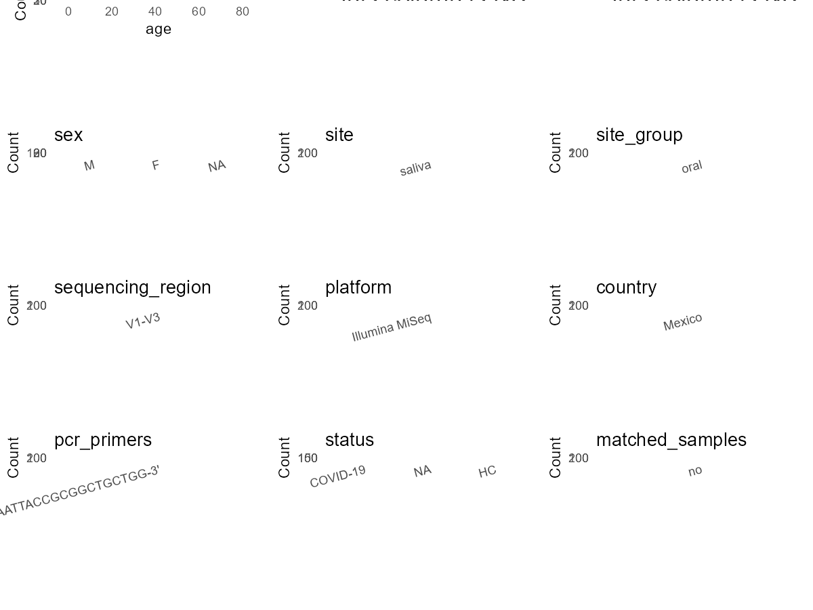

R Notebook: Metadata Processing Workflow
================

# Step 1: Obtain Initial Metadata from Each Project

This step sets the project directory, loads the raw SRA metadata, and
optionally merges supplement tables.

``` r
# Load libraries
library(dplyr)
library(ggplot2)
library(cowplot)

# (1) Setting working directory
# EDIT HERE: change project_id for each study
project_id <- "PRJNA896341" 

base_dir <- "E:/oral/26/metadata-2604/Oral-Metadata-YL-02"
setwd(file.path(base_dir, project_id))

# (2) Loading raw SRA metadata file
sra_file <- "SraRunTable.csv"
initial_meta <- read.csv(sra_file, header = TRUE)

# (3) OPTIONAL: If extra metadata (e.g., Table.x or supplemental materials) are available from the article, you may need to merge the file with initial_meta manually. Below is example code for merging. Depending on the specific case of each study, you can customize the code as needed.
#supp_table <- read.csv("supplemental_table_v2.csv", header = TRUE)
#initial_meta <- left_join(initial_meta, supp_table, by = "Sample.Name") 
```

# Step 2: Data Overview

First, you need to get an overview of the data, which includes two
steps: reading the article and reading the initial metadata. This step
is very IMPORTANT!

``` r
# (1) Read the article in the following order: abstract, the beginning of the results section, and the methods. Understand the sample size, experimental design, and disease group overview. Clarify the sampling sites; for oral and gut samples, specify the exact sites like supragingival plaque, tongue, etc.

# (2) IMPORTANT: MUST go through each column of initial_meta
head(initial_meta, 10)
```

    ##            Run AGE Assay.Type AvgSpotLen     Bases
    ## 1  SRR22118524  39   AMPLICON        501  32150331
    ## 2  SRR22118525  83   AMPLICON        500 102094136
    ## 3  SRR22118526  57   AMPLICON        501  82719696
    ## 4  SRR22118527  68   AMPLICON        501  24325197
    ## 5  SRR22118528  32   AMPLICON        501  23174995
    ## 6  SRR22118529  66   AMPLICON        501  18217725
    ## 7  SRR22118530  39   AMPLICON        501  26402300
    ## 8  SRR22118531  42   AMPLICON        501  24937375
    ## 9  SRR22118532  NA   AMPLICON        501  16343013
    ## 10 SRR22118533  59   AMPLICON        501  19403237
    ##                                                                                          BIOMATERIAL_PROVIDER
    ## 1  Instituto Mexicano del Seguro Social\\, Unidad de Investigacion en Enfermedades Infecciosas UMAE Pediatria
    ## 2  Instituto Mexicano del Seguro Social\\, Unidad de Investigacion en Enfermedades Infecciosas UMAE Pediatria
    ## 3  Instituto Mexicano del Seguro Social\\, Unidad de Investigacion en Enfermedades Infecciosas UMAE Pediatria
    ## 4  Instituto Mexicano del Seguro Social\\, Unidad de Investigacion en Enfermedades Infecciosas UMAE Pediatria
    ## 5  Instituto Mexicano del Seguro Social\\, Unidad de Investigacion en Enfermedades Infecciosas UMAE Pediatria
    ## 6  Instituto Mexicano del Seguro Social\\, Unidad de Investigacion en Enfermedades Infecciosas UMAE Pediatria
    ## 7  Instituto Mexicano del Seguro Social\\, Unidad de Investigacion en Enfermedades Infecciosas UMAE Pediatria
    ## 8  Instituto Mexicano del Seguro Social\\, Unidad de Investigacion en Enfermedades Infecciosas UMAE Pediatria
    ## 9  Instituto Mexicano del Seguro Social\\, Unidad de Investigacion en Enfermedades Infecciosas UMAE Pediatria
    ## 10 Instituto Mexicano del Seguro Social\\, Unidad de Investigacion en Enfermedades Infecciosas UMAE Pediatria
    ##     BioProject    BioSample BioSampleModel    Bytes
    ## 1  PRJNA896341 SAMN31542666          Human 16270332
    ## 2  PRJNA896341 SAMN31542665          Human 57711526
    ## 3  PRJNA896341 SAMN31542664          Human 43843945
    ## 4  PRJNA896341 SAMN31542663          Human 13768499
    ## 5  PRJNA896341 SAMN31542662          Human 11640276
    ## 6  PRJNA896341 SAMN31542661          Human  9150029
    ## 7  PRJNA896341 SAMN31542445          Human 13730637
    ## 8  PRJNA896341 SAMN31542660          Human 12672129
    ## 9  PRJNA896341 SAMN31542659          Human  8442892
    ## 10 PRJNA896341 SAMN31542658          Human  9608472
    ##                             Center.Name Consent DATASTORE.filetype
    ## 1  INSTITUTO MEXICANO DEL SEGURO SOCIAL  public   fastq,run.zq,sra
    ## 2  INSTITUTO MEXICANO DEL SEGURO SOCIAL  public   fastq,run.zq,sra
    ## 3  INSTITUTO MEXICANO DEL SEGURO SOCIAL  public   fastq,run.zq,sra
    ## 4  INSTITUTO MEXICANO DEL SEGURO SOCIAL  public   fastq,run.zq,sra
    ## 5  INSTITUTO MEXICANO DEL SEGURO SOCIAL  public   fastq,run.zq,sra
    ## 6  INSTITUTO MEXICANO DEL SEGURO SOCIAL  public   fastq,run.zq,sra
    ## 7  INSTITUTO MEXICANO DEL SEGURO SOCIAL  public   fastq,run.zq,sra
    ## 8  INSTITUTO MEXICANO DEL SEGURO SOCIAL  public   fastq,run.zq,sra
    ## 9  INSTITUTO MEXICANO DEL SEGURO SOCIAL  public   fastq,run.zq,sra
    ## 10 INSTITUTO MEXICANO DEL SEGURO SOCIAL  public   fastq,run.zq,sra
    ##    DATASTORE.provider                     DATASTORE.region  Experiment
    ## 1          gs,ncbi,s3 gs.us-east1,ncbi.public,s3.us-east-1 SRX18098529
    ## 2          gs,ncbi,s3 gs.us-east1,ncbi.public,s3.us-east-1 SRX18098528
    ## 3          gs,ncbi,s3 gs.us-east1,ncbi.public,s3.us-east-1 SRX18098527
    ## 4          gs,ncbi,s3 gs.us-east1,ncbi.public,s3.us-east-1 SRX18098526
    ## 5          gs,ncbi,s3 gs.us-east1,ncbi.public,s3.us-east-1 SRX18098525
    ## 6          gs,ncbi,s3 gs.us-east1,ncbi.public,s3.us-east-1 SRX18098524
    ## 7          gs,ncbi,s3 gs.us-east1,ncbi.public,s3.us-east-1 SRX18098523
    ## 8          gs,ncbi,s3 gs.us-east1,ncbi.public,s3.us-east-1 SRX18098522
    ## 9          gs,ncbi,s3 gs.us-east1,ncbi.public,s3.us-east-1 SRX18098521
    ## 10         gs,ncbi,s3 gs.us-east1,ncbi.public,s3.us-east-1 SRX18098520
    ##        Instrument isolate Library.Name LibraryLayout LibrarySelection
    ## 1  Illumina MiSeq    HP80         HP80        PAIRED              PCR
    ## 2  Illumina MiSeq    HP79         HP79        PAIRED              PCR
    ## 3  Illumina MiSeq    HP78         HP78        PAIRED              PCR
    ## 4  Illumina MiSeq    HP76         HP76        PAIRED              PCR
    ## 5  Illumina MiSeq    HP75         HP75        PAIRED              PCR
    ## 6  Illumina MiSeq    HP74         HP74        PAIRED              PCR
    ## 7  Illumina MiSeq    AC32         AC32        PAIRED              PCR
    ## 8  Illumina MiSeq    HP73         HP73        PAIRED              PCR
    ## 9  Illumina MiSeq    HP71         HP71        PAIRED              PCR
    ## 10 Illumina MiSeq    HP69         HP69        PAIRED              PCR
    ##    LibrarySource     Organism Platform          ReleaseDate
    ## 1    METAGENOMIC Homo sapiens ILLUMINA 2023-06-08T00:00:00Z
    ## 2    METAGENOMIC Homo sapiens ILLUMINA 2023-06-08T00:00:00Z
    ## 3    METAGENOMIC Homo sapiens ILLUMINA 2023-06-08T00:00:00Z
    ## 4    METAGENOMIC Homo sapiens ILLUMINA 2023-06-08T00:00:00Z
    ## 5    METAGENOMIC Homo sapiens ILLUMINA 2023-06-08T00:00:00Z
    ## 6    METAGENOMIC Homo sapiens ILLUMINA 2023-06-08T00:00:00Z
    ## 7    METAGENOMIC Homo sapiens ILLUMINA 2023-06-08T00:00:00Z
    ## 8    METAGENOMIC Homo sapiens ILLUMINA 2023-06-08T00:00:00Z
    ## 9    METAGENOMIC Homo sapiens ILLUMINA 2023-06-08T00:00:00Z
    ## 10   METAGENOMIC Homo sapiens ILLUMINA 2023-06-08T00:00:00Z
    ##             create_date version                                Sample.Name
    ## 1  2022-11-01T01:57:00Z       1 Saliva microbiota hospitalized positive 80
    ## 2  2022-11-01T01:57:00Z       1 Saliva microbiota hospitalized positive 79
    ## 3  2022-11-01T01:57:00Z       1 Saliva microbiota hospitalized positive 78
    ## 4  2022-11-01T01:57:00Z       1 Saliva microbiota hospitalized positive 76
    ## 5  2022-11-01T01:56:00Z       1 Saliva microbiota hospitalized positive 75
    ## 6  2022-11-01T01:57:00Z       1 Saliva microbiota hospitalized positive 74
    ## 7  2022-11-01T01:57:00Z       1        Saliva microbiota asymptomatic AC32
    ## 8  2022-11-01T01:57:00Z       1 Saliva microbiota hospitalized positive 73
    ## 9  2022-11-01T01:57:00Z       1 Saliva microbiota hospitalized positive 71
    ## 10 2022-11-01T01:56:00Z       1 Saliva microbiota hospitalized positive 69
    ##       sex SRA.Study tissue
    ## 1    male SRP405563 Saliva
    ## 2    male SRP405563 Saliva
    ## 3    male SRP405563 Saliva
    ## 4    male SRP405563 Saliva
    ## 5    male SRP405563 Saliva
    ## 6  female SRP405563 Saliva
    ## 7    male SRP405563 Saliva
    ## 8    male SRP405563 Saliva
    ## 9    <NA> SRP405563 Saliva
    ## 10 female SRP405563 Saliva

``` r
# IMPORTANT: Check the unique values in the column of interest or query column.
lapply(initial_meta[c('tissue')], table) # site
```

    ## $tissue
    ## 
    ## Saliva 
    ##    282

``` r
lapply(initial_meta[c('Organism', 'BioSampleModel')], table) # organism
```

    ## $Organism
    ## 
    ## Homo sapiens 
    ##          282 
    ## 
    ## $BioSampleModel
    ## 
    ## Human 
    ##   282

``` r
table(initial_meta$Sample.Name) # subject id
```

    ## 
    ##              Saliva microbiota ambulatory negative 1 
    ##                                                    1 
    ##             Saliva microbiota ambulatory negative 10 
    ##                                                    1 
    ##            Saliva microbiota ambulatory negative 100 
    ##                                                    1 
    ##             Saliva microbiota ambulatory negative 11 
    ##                                                    1 
    ##             Saliva microbiota ambulatory negative 12 
    ##                                                    1 
    ##             Saliva microbiota ambulatory negative 13 
    ##                                                    1 
    ##             Saliva microbiota ambulatory negative 14 
    ##                                                    1 
    ##             Saliva microbiota ambulatory negative 15 
    ##                                                    1 
    ##             Saliva microbiota ambulatory negative 16 
    ##                                                    1 
    ##             Saliva microbiota ambulatory negative 17 
    ##                                                    1 
    ##             Saliva microbiota ambulatory negative 18 
    ##                                                    1 
    ##             Saliva microbiota ambulatory negative 19 
    ##                                                    1 
    ##              Saliva microbiota ambulatory negative 2 
    ##                                                    1 
    ##             Saliva microbiota ambulatory negative 20 
    ##                                                    1 
    ##             Saliva microbiota ambulatory negative 21 
    ##                                                    1 
    ##             Saliva microbiota ambulatory negative 22 
    ##                                                    1 
    ##             Saliva microbiota ambulatory negative 23 
    ##                                                    1 
    ##             Saliva microbiota ambulatory negative 24 
    ##                                                    1 
    ##             Saliva microbiota ambulatory negative 25 
    ##                                                    1 
    ##             Saliva microbiota ambulatory negative 26 
    ##                                                    1 
    ##             Saliva microbiota ambulatory negative 27 
    ##                                                    1 
    ##             Saliva microbiota ambulatory negative 28 
    ##                                                    1 
    ##             Saliva microbiota ambulatory negative 29 
    ##                                                    1 
    ##              Saliva microbiota ambulatory negative 3 
    ##                                                    1 
    ##             Saliva microbiota ambulatory negative 30 
    ##                                                    1 
    ##             Saliva microbiota ambulatory negative 31 
    ##                                                    1 
    ##             Saliva microbiota ambulatory negative 33 
    ##                                                    1 
    ##             Saliva microbiota ambulatory negative 34 
    ##                                                    1 
    ##             Saliva microbiota ambulatory negative 35 
    ##                                                    1 
    ##             Saliva microbiota ambulatory negative 37 
    ##                                                    1 
    ##             Saliva microbiota ambulatory negative 38 
    ##                                                    1 
    ##             Saliva microbiota ambulatory negative 39 
    ##                                                    1 
    ##              Saliva microbiota ambulatory negative 4 
    ##                                                    1 
    ##             Saliva microbiota ambulatory negative 40 
    ##                                                    1 
    ##             Saliva microbiota ambulatory negative 41 
    ##                                                    1 
    ##             Saliva microbiota ambulatory negative 42 
    ##                                                    1 
    ##             Saliva microbiota ambulatory negative 43 
    ##                                                    1 
    ##             Saliva microbiota ambulatory negative 44 
    ##                                                    1 
    ##             Saliva microbiota ambulatory negative 45 
    ##                                                    1 
    ##             Saliva microbiota ambulatory negative 46 
    ##                                                    1 
    ##             Saliva microbiota ambulatory negative 47 
    ##                                                    1 
    ##             Saliva microbiota ambulatory negative 48 
    ##                                                    1 
    ##             Saliva microbiota ambulatory negative 49 
    ##                                                    1 
    ##              Saliva microbiota ambulatory negative 5 
    ##                                                    1 
    ##             Saliva microbiota ambulatory negative 50 
    ##                                                    1 
    ##             Saliva microbiota ambulatory negative 51 
    ##                                                    1 
    ##             Saliva microbiota ambulatory negative 52 
    ##                                                    1 
    ##             Saliva microbiota ambulatory negative 53 
    ##                                                    1 
    ##             Saliva microbiota ambulatory negative 54 
    ##                                                    1 
    ##             Saliva microbiota ambulatory negative 55 
    ##                                                    1 
    ##             Saliva microbiota ambulatory negative 56 
    ##                                                    1 
    ##             Saliva microbiota ambulatory negative 57 
    ##                                                    1 
    ##             Saliva microbiota ambulatory negative 58 
    ##                                                    1 
    ##             Saliva microbiota ambulatory negative 59 
    ##                                                    1 
    ##              Saliva microbiota ambulatory negative 6 
    ##                                                    1 
    ##             Saliva microbiota ambulatory negative 60 
    ##                                                    1 
    ##             Saliva microbiota ambulatory negative 61 
    ##                                                    1 
    ##             Saliva microbiota ambulatory negative 62 
    ##                                                    1 
    ##             Saliva microbiota ambulatory negative 63 
    ##                                                    1 
    ##             Saliva microbiota ambulatory negative 64 
    ##                                                    1 
    ##             Saliva microbiota ambulatory negative 65 
    ##                                                    1 
    ##             Saliva microbiota ambulatory negative 66 
    ##                                                    1 
    ##             Saliva microbiota ambulatory negative 67 
    ##                                                    1 
    ##             Saliva microbiota ambulatory negative 69 
    ##                                                    1 
    ##              Saliva microbiota ambulatory negative 7 
    ##                                                    1 
    ##             Saliva microbiota ambulatory negative 70 
    ##                                                    1 
    ##             Saliva microbiota ambulatory negative 71 
    ##                                                    1 
    ##             Saliva microbiota ambulatory negative 72 
    ##                                                    1 
    ##             Saliva microbiota ambulatory negative 74 
    ##                                                    1 
    ##             Saliva microbiota ambulatory negative 79 
    ##                                                    1 
    ##              Saliva microbiota ambulatory negative 8 
    ##                                                    1 
    ##              Saliva microbiota ambulatory negative 9 
    ##                                                    1 
    ##             Saliva microbiota ambulatory negative 93 
    ##                                                    1 
    ##             Saliva microbiota ambulatory positive 10 
    ##                                                    1 
    ##            Saliva microbiota ambulatory positive 100 
    ##                                                    1 
    ##            Saliva microbiota ambulatory positive 101 
    ##                                                    1 
    ##            Saliva microbiota ambulatory positive 102 
    ##                                                    1 
    ##            Saliva microbiota ambulatory positive 103 
    ##                                                    1 
    ##            Saliva microbiota ambulatory positive 104 
    ##                                                    1 
    ##            Saliva microbiota ambulatory positive 105 
    ##                                                    1 
    ##            Saliva microbiota ambulatory positive 106 
    ##                                                    1 
    ##            Saliva microbiota ambulatory positive 107 
    ##                                                    1 
    ##            Saliva microbiota ambulatory positive 108 
    ##                                                    1 
    ##            Saliva microbiota ambulatory positive 109 
    ##                                                    1 
    ##             Saliva microbiota ambulatory positive 11 
    ##                                                    1 
    ##            Saliva microbiota ambulatory positive 110 
    ##                                                    1 
    ##            Saliva microbiota ambulatory positive 111 
    ##                                                    1 
    ##            Saliva microbiota ambulatory positive 112 
    ##                                                    1 
    ##            Saliva microbiota ambulatory positive 113 
    ##                                                    1 
    ##            Saliva microbiota ambulatory positive 114 
    ##                                                    1 
    ##            Saliva microbiota ambulatory positive 115 
    ##                                                    1 
    ##            Saliva microbiota ambulatory positive 116 
    ##                                                    1 
    ##            Saliva microbiota ambulatory positive 117 
    ##                                                    1 
    ##            Saliva microbiota ambulatory positive 118 
    ##                                                    1 
    ##            Saliva microbiota ambulatory positive 119 
    ##                                                    1 
    ##             Saliva microbiota ambulatory positive 12 
    ##                                                    1 
    ##            Saliva microbiota ambulatory positive 120 
    ##                                                    1 
    ##            Saliva microbiota ambulatory positive 121 
    ##                                                    1 
    ##            Saliva microbiota ambulatory positive 122 
    ##                                                    1 
    ##            Saliva microbiota ambulatory positive 123 
    ##                                                    1 
    ##            Saliva microbiota ambulatory positive 124 
    ##                                                    1 
    ##            Saliva microbiota ambulatory positive 125 
    ##                                                    1 
    ##            Saliva microbiota ambulatory positive 126 
    ##                                                    1 
    ##            Saliva microbiota ambulatory positive 127 
    ##                                                    1 
    ##            Saliva microbiota ambulatory positive 128 
    ##                                                    1 
    ##            Saliva microbiota ambulatory positive 129 
    ##                                                    1 
    ##             Saliva microbiota ambulatory positive 13 
    ##                                                    1 
    ##             Saliva microbiota ambulatory positive 14 
    ##                                                    1 
    ##             Saliva microbiota ambulatory positive 15 
    ##                                                    1 
    ##             Saliva microbiota ambulatory positive 16 
    ##                                                    1 
    ##             Saliva microbiota ambulatory positive 17 
    ##                                                    1 
    ##             Saliva microbiota ambulatory positive 18 
    ##                                                    1 
    ##             Saliva microbiota ambulatory positive 19 
    ##                                                    1 
    ##             Saliva microbiota ambulatory positive 20 
    ##                                                    1 
    ##             Saliva microbiota ambulatory positive 21 
    ##                                                    1 
    ##             Saliva microbiota ambulatory positive 37 
    ##                                                    1 
    ##             Saliva microbiota ambulatory positive 39 
    ##                                                    1 
    ##              Saliva microbiota ambulatory positive 4 
    ##                                                    1 
    ##             Saliva microbiota ambulatory positive 42 
    ##                                                    1 
    ##             Saliva microbiota ambulatory positive 43 
    ##                                                    1 
    ##             Saliva microbiota ambulatory positive 44 
    ##                                                    1 
    ##             Saliva microbiota ambulatory positive 45 
    ##                                                    1 
    ##             Saliva microbiota ambulatory positive 46 
    ##                                                    1 
    ##             Saliva microbiota ambulatory positive 47 
    ##                                                    1 
    ##             Saliva microbiota ambulatory positive 48 
    ##                                                    1 
    ##              Saliva microbiota ambulatory positive 5 
    ##                                                    1 
    ##             Saliva microbiota ambulatory positive 50 
    ##                                                    1 
    ##             Saliva microbiota ambulatory positive 51 
    ##                                                    1 
    ##             Saliva microbiota ambulatory positive 52 
    ##                                                    1 
    ##             Saliva microbiota ambulatory positive 53 
    ##                                                    1 
    ##             Saliva microbiota ambulatory positive 54 
    ##                                                    1 
    ##             Saliva microbiota ambulatory positive 55 
    ##                                                    1 
    ##             Saliva microbiota ambulatory positive 56 
    ##                                                    1 
    ##             Saliva microbiota ambulatory positive 57 
    ##                                                    1 
    ##             Saliva microbiota ambulatory positive 58 
    ##                                                    1 
    ##             Saliva microbiota ambulatory positive 59 
    ##                                                    1 
    ##              Saliva microbiota ambulatory positive 6 
    ##                                                    1 
    ##             Saliva microbiota ambulatory positive 60 
    ##                                                    1 
    ##             Saliva microbiota ambulatory positive 61 
    ##                                                    1 
    ##             Saliva microbiota ambulatory positive 62 
    ##                                                    1 
    ##             Saliva microbiota ambulatory positive 63 
    ##                                                    1 
    ##             Saliva microbiota ambulatory positive 64 
    ##                                                    1 
    ##             Saliva microbiota ambulatory positive 65 
    ##                                                    1 
    ##             Saliva microbiota ambulatory positive 66 
    ##                                                    1 
    ##             Saliva microbiota ambulatory positive 67 
    ##                                                    1 
    ##             Saliva microbiota ambulatory positive 68 
    ##                                                    1 
    ##             Saliva microbiota ambulatory positive 69 
    ##                                                    1 
    ##              Saliva microbiota ambulatory positive 7 
    ##                                                    1 
    ##             Saliva microbiota ambulatory positive 70 
    ##                                                    1 
    ##             Saliva microbiota ambulatory positive 71 
    ##                                                    1 
    ##             Saliva microbiota ambulatory positive 72 
    ##                                                    1 
    ##             Saliva microbiota ambulatory positive 73 
    ##                                                    1 
    ##             Saliva microbiota ambulatory positive 74 
    ##                                                    1 
    ##             Saliva microbiota ambulatory positive 75 
    ##                                                    1 
    ##             Saliva microbiota ambulatory positive 76 
    ##                                                    1 
    ##             Saliva microbiota ambulatory positive 78 
    ##                                                    1 
    ##             Saliva microbiota ambulatory positive 79 
    ##                                                    1 
    ##              Saliva microbiota ambulatory positive 8 
    ##                                                    1 
    ##             Saliva microbiota ambulatory positive 80 
    ##                                                    1 
    ##             Saliva microbiota ambulatory positive 83 
    ##                                                    1 
    ##             Saliva microbiota ambulatory positive 84 
    ##                                                    1 
    ##             Saliva microbiota ambulatory positive 85 
    ##                                                    1 
    ##             Saliva microbiota ambulatory positive 87 
    ##                                                    1 
    ##             Saliva microbiota ambulatory positive 88 
    ##                                                    1 
    ##             Saliva microbiota ambulatory positive 89 
    ##                                                    1 
    ##              Saliva microbiota ambulatory positive 9 
    ##                                                    1 
    ##             Saliva microbiota ambulatory positive 90 
    ##                                                    1 
    ##             Saliva microbiota ambulatory positive 91 
    ##                                                    1 
    ##             Saliva microbiota ambulatory positive 92 
    ##                                                    1 
    ##             Saliva microbiota ambulatory positive 93 
    ##                                                    1 
    ##             Saliva microbiota ambulatory positive 94 
    ##                                                    1 
    ##             Saliva microbiota ambulatory positive 95 
    ##                                                    1 
    ##             Saliva microbiota ambulatory positive 96 
    ##                                                    1 
    ##             Saliva microbiota ambulatory positive 97 
    ##                                                    1 
    ##             Saliva microbiota ambulatory positive 98 
    ##                                                    1 
    ##             Saliva microbiota ambulatory positive 99 
    ##                                                    1 
    ##                  Saliva microbiota asymptomatic AC01 
    ##                                                    1 
    ##                  Saliva microbiota asymptomatic AC02 
    ##                                                    1 
    ##                  Saliva microbiota asymptomatic AC03 
    ##                                                    1 
    ##                  Saliva microbiota asymptomatic AC04 
    ##                                                    1 
    ##                  Saliva microbiota asymptomatic AC05 
    ##                                                    1 
    ##                  Saliva microbiota asymptomatic AC06 
    ##                                                    1 
    ##                  Saliva microbiota asymptomatic AC07 
    ##                                                    1 
    ##                  Saliva microbiota asymptomatic AC08 
    ##                                                    1 
    ##                  Saliva microbiota asymptomatic AC09 
    ##                                                    1 
    ##                  Saliva microbiota asymptomatic AC10 
    ##                                                    1 
    ##                  Saliva microbiota asymptomatic AC11 
    ##                                                    1 
    ##                  Saliva microbiota asymptomatic AC12 
    ##                                                    1 
    ##                  Saliva microbiota asymptomatic AC13 
    ##                                                    1 
    ##                  Saliva microbiota asymptomatic AC14 
    ##                                                    1 
    ##                  Saliva microbiota asymptomatic AC15 
    ##                                                    1 
    ##                  Saliva microbiota asymptomatic AC20 
    ##                                                    1 
    ##                  Saliva microbiota asymptomatic AC21 
    ##                                                    1 
    ##                  Saliva microbiota asymptomatic AC22 
    ##                                                    1 
    ##                  Saliva microbiota asymptomatic AC23 
    ##                                                    1 
    ##                  Saliva microbiota asymptomatic AC24 
    ##                                                    1 
    ##                  Saliva microbiota asymptomatic AC28 
    ##                                                    1 
    ##                  Saliva microbiota asymptomatic AC29 
    ##                                                    1 
    ##                  Saliva microbiota asymptomatic AC30 
    ##                                                    1 
    ##                  Saliva microbiota asymptomatic AC31 
    ##                                                    1 
    ##                  Saliva microbiota asymptomatic AC32 
    ##                                                    1 
    ##                  Saliva microbiota asymptomatic AC34 
    ##                                                    1 
    ##                  Saliva microbiota asymptomatic AC36 
    ##                                                    1 
    ##                  Saliva microbiota asymptomatic AC41 
    ##                                                    1 
    ##                  Saliva microbiota asymptomatic AC44 
    ##                                                    1 
    ##                  Saliva microbiota asymptomatic AC45 
    ##                                                    1 
    ##                  Saliva microbiota asymptomatic AC46 
    ##                                                    1 
    ## Saliva microbiota Deceased hospitalized positive 106 
    ##                                                    1 
    ##  Saliva microbiota Deceased hospitalized positive 17 
    ##                                                    1 
    ##  Saliva microbiota Deceased hospitalized positive 20 
    ##                                                    1 
    ##  Saliva microbiota Deceased hospitalized positive 28 
    ##                                                    1 
    ##  Saliva microbiota Deceased hospitalized positive 42 
    ##                                                    1 
    ##   Saliva microbiota Deceased hospitalized positive 5 
    ##                                                    1 
    ##  Saliva microbiota Deceased hospitalized positive 62 
    ##                                                    1 
    ##  Saliva microbiota Deceased hospitalized positive 63 
    ##                                                    1 
    ##  Saliva microbiota Deceased hospitalized positive 66 
    ##                                                    1 
    ##  Saliva microbiota Deceased hospitalized positive 71 
    ##                                                    1 
    ##  Saliva microbiota Deceased hospitalized positive 77 
    ##                                                    1 
    ##  Saliva microbiota Deceased hospitalized positive 83 
    ##                                                    1 
    ##  Saliva microbiota Deceased hospitalized positive 84 
    ##                                                    1 
    ##  Saliva microbiota Deceased hospitalized positive 85 
    ##                                                    1 
    ##  Saliva microbiota Deceased hospitalized positive 87 
    ##                                                    1 
    ##   Saliva microbiota Deceased hospitalized positive 9 
    ##                                                    1 
    ##  Saliva microbiota Deceased hospitalized positive 90 
    ##                                                    1 
    ##  Saliva microbiota Deceased hospitalized positive 92 
    ##                                                    1 
    ##          Saliva microbiota hospitalized positive 100 
    ##                                                    1 
    ##          Saliva microbiota hospitalized positive 101 
    ##                                                    1 
    ##          Saliva microbiota hospitalized positive 102 
    ##                                                    1 
    ##          Saliva microbiota hospitalized positive 103 
    ##                                                    1 
    ##          Saliva microbiota hospitalized positive 104 
    ##                                                    1 
    ##          Saliva microbiota hospitalized positive 105 
    ##                                                    1 
    ##           Saliva microbiota hospitalized positive 12 
    ##                                                    1 
    ##           Saliva microbiota hospitalized positive 19 
    ##                                                    1 
    ##           Saliva microbiota hospitalized positive 22 
    ##                                                    1 
    ##           Saliva microbiota hospitalized positive 25 
    ##                                                    1 
    ##           Saliva microbiota hospitalized positive 26 
    ##                                                    1 
    ##           Saliva microbiota hospitalized positive 27 
    ##                                                    1 
    ##            Saliva microbiota hospitalized positive 3 
    ##                                                    1 
    ##           Saliva microbiota hospitalized positive 30 
    ##                                                    1 
    ##           Saliva microbiota hospitalized positive 31 
    ##                                                    1 
    ##           Saliva microbiota hospitalized positive 33 
    ##                                                    1 
    ##           Saliva microbiota hospitalized positive 34 
    ##                                                    1 
    ##           Saliva microbiota hospitalized positive 38 
    ##                                                    1 
    ##           Saliva microbiota hospitalized positive 43 
    ##                                                    1 
    ##           Saliva microbiota hospitalized positive 44 
    ##                                                    1 
    ##           Saliva microbiota hospitalized positive 46 
    ##                                                    1 
    ##           Saliva microbiota hospitalized positive 47 
    ##                                                    1 
    ##           Saliva microbiota hospitalized positive 48 
    ##                                                    1 
    ##           Saliva microbiota hospitalized positive 49 
    ##                                                    1 
    ##           Saliva microbiota hospitalized positive 50 
    ##                                                    1 
    ##           Saliva microbiota hospitalized positive 51 
    ##                                                    1 
    ##           Saliva microbiota hospitalized positive 54 
    ##                                                    1 
    ##           Saliva microbiota hospitalized positive 55 
    ##                                                    1 
    ##           Saliva microbiota hospitalized positive 56 
    ##                                                    1 
    ##           Saliva microbiota hospitalized positive 57 
    ##                                                    1 
    ##           Saliva microbiota hospitalized positive 58 
    ##                                                    1 
    ##           Saliva microbiota hospitalized positive 61 
    ##                                                    1 
    ##           Saliva microbiota hospitalized positive 64 
    ##                                                    1 
    ##           Saliva microbiota hospitalized positive 65 
    ##                                                    1 
    ##           Saliva microbiota hospitalized positive 67 
    ##                                                    1 
    ##           Saliva microbiota hospitalized positive 68 
    ##                                                    1 
    ##           Saliva microbiota hospitalized positive 69 
    ##                                                    1 
    ##           Saliva microbiota hospitalized positive 71 
    ##                                                    1 
    ##           Saliva microbiota hospitalized positive 73 
    ##                                                    1 
    ##           Saliva microbiota hospitalized positive 74 
    ##                                                    1 
    ##           Saliva microbiota hospitalized positive 75 
    ##                                                    1 
    ##           Saliva microbiota hospitalized positive 76 
    ##                                                    1 
    ##           Saliva microbiota hospitalized positive 78 
    ##                                                    1 
    ##           Saliva microbiota hospitalized positive 79 
    ##                                                    1 
    ##           Saliva microbiota hospitalized positive 80 
    ##                                                    1 
    ##           Saliva microbiota hospitalized positive 81 
    ##                                                    1 
    ##           Saliva microbiota hospitalized positive 82 
    ##                                                    1 
    ##           Saliva microbiota hospitalized positive 86 
    ##                                                    1 
    ##           Saliva microbiota hospitalized positive 88 
    ##                                                    1 
    ##           Saliva microbiota hospitalized positive 89 
    ##                                                    1 
    ##           Saliva microbiota hospitalized positive 91 
    ##                                                    1 
    ##           Saliva microbiota hospitalized positive 94 
    ##                                                    1 
    ##           Saliva microbiota hospitalized positive 95 
    ##                                                    1 
    ##           Saliva microbiota hospitalized positive 96 
    ##                                                    1 
    ##           Saliva microbiota hospitalized positive 97 
    ##                                                    1 
    ##           Saliva microbiota hospitalized positive 98 
    ##                                                    1 
    ##           Saliva microbiota hospitalized positive 99 
    ##                                                    1

``` r
#table(initial_meta$sequencing_meth..exp.) # output is pyrosequencing
table(initial_meta$Platform) # output is Illumina. according to the methods, Illumina is correct.
```

    ## 
    ## ILLUMINA 
    ##      282

``` r
# table(initial_meta$target_subfragment..exp.)
```

# Step 3: Removing Control and Non-human Samples

First, we need to remove control samples(including both negative
controls and positive controls) and non-human samples.

``` r
# (1) EDIT HERE: Parameter setup
control_column <- "" # column name in initial_meta
# unique(initial_meta[[control_column]])
control_keywords <- c() # Enter exact keywords

species_column <- "" # column name in initial_meta
unique(initial_meta[[species_column]])
```

    ## NULL

``` r
non_human_keywords <- c() # Enter exact keywords

# (2) Remove controls and non-human samples. DO NOT need to modify code in this part, just run it.
n_samples <- nrow(initial_meta)
# Control evaluation
if (length(control_keywords) > 0) {
  if (is.null(control_column) || control_column == "") {
    stop("Error: control_keywords provided but control_column is missing.")
  }
  
  if (!(control_column %in% colnames(initial_meta))) {
    stop(sprintf("Error: Column '%s' not found in initial_meta.", control_column))
  }
  
  control_pattern <- paste(control_keywords, collapse = "|")
  control_text <- initial_meta[[control_column]]
  is_control <- grepl(control_pattern, control_text)
  
} else {
  is_control <- rep(FALSE, n_samples)
}

# Non-human evaluation
if (length(non_human_keywords) > 0) {
  if (is.null(species_column) || species_column == "") {
    stop("Error: non_human_keywords provided but species_column is missing.")
  }
  
  if (!(species_column %in% colnames(initial_meta))) {
    stop(sprintf("Error: Column '%s' not found in initial_meta.", species_column))
  }
  
  non_human_pattern <- paste(non_human_keywords, collapse = "|")
  species_text <- initial_meta[[species_column]]
  is_non_human <- grepl(non_human_pattern, species_text)
} else {
  is_non_human <- rep(FALSE, n_samples)
}

# Execute removal
samples_to_remove <- is_control | is_non_human
initial_meta <- initial_meta[!samples_to_remove, ]

cat("Initial samples counts:",n_samples,"\n")
```

    ## Initial samples counts: 282

``` r
cat("Removed control samples:", sum(is_control), "\n")
```

    ## Removed control samples: 0

``` r
cat("Removed non-human samples:", sum(is_non_human), "\n")
```

    ## Removed non-human samples: 0

``` r
cat("Total samples removed ", sum(samples_to_remove), "\n")
```

    ## Total samples removed  0

``` r
cat("Remaining samples after Step 2:", nrow(initial_meta), "\n")
```

    ## Remaining samples after Step 2: 282

# Step 4: Creating a Uniform Metadata Template

This step converts the raw SRA table into the standard metadata format
used in our meta-analysis. The uniform metadata should include the
following columns: 1. **bioproject**: Project ID from SRA or other
database e.g. `PRJNA1234`, `CNP1234`, ‘OEP1234’, ‘qiita_1234’ 2.
**sample_id**: SRA sample/run ID. Unique id for each sample!
e.g. `DRR1234567`, `ERR1234567` and `SRR1234567`. If no such column
exists, can use column like sample_name. 3. **subject_id**: subject id
for each person if available. e.g. `patient_01`, `Host_03_before`,
`subject12` 4. **age**: Age of the subject if available. e.g. `35`, `42`
\| not `adult`, `chilren` 5. **age_info**: If the age is not explicitly
stated but approximate age range information is available, mark it in
this column. e.g., `18-55`, `children`, `infant`, `elder` 6. **bmi**:
Body Mass Index if available. e.g. `22.5`, `18.9` \| not `normal`,
`overweight` 7. **sex**: Sex of the subject. Mandatory to write as M/F
\| not `female`, `woman` 8. **sequencing_region**: Targeted 16S rRNA
region. e.g. `V3-V4`, `V4` 9. **platform**: Sequencing platform.
e.g. `Illumina MiSeq`, `454 GS FLX Titanium`, `Ion Torrent` 10.
**country**: Country of sample origin. e.g. `China`, `Japan` \| not city
name like `Beijing` 11. **site**: Sampling site. For oral and gut sites,
specify the exact sites as detailed as possible. For example, if it is
known to be supragingival plaque, do not record it as ‘dental plaque’,
unless the original text provides only a vague description.
e.g. `saliva`, `tongue coating` \| not broad term like `oral` 12.
**site_group**: only accepts one of following three values: ‘oral’,
‘gut’, or ‘other’. 13. **public_time**: Data release date.
e.g. `2021-06-22` \| not `June 2021` 14. **pcr_primers**: PCR primers
used. e.g. `515F-806R`, `27F-338R` \| not primer sequences 15.
**title**: Title of the associated publication. 16. **disease_study**:
Whether the study involves disease samples. If it’s not clear, can
record as NA. Only three values accepted: ‘yes’, ‘no’ or NA 17.
**status**: Disease status for each sample if available, else record as
NA. Only accept following abbreviations, Write full names for all other
diseases. HC: healthy control CD: Crohn’s disease CRC: colorectal cancer
COPD: chronic obstructive pulmonary disease HIV: human immunodeficiency
virus ICU: intensive care unit OSCC: oral squamous cell carcinoma RA:
rheumatoid arthritis UC: ulcerative colitis 18. **matched_samples**:
Whether the subject has matched samples. Only accept ‘yes’ or ‘no’. 19.
**is_time_series**: Whether the study is a time series study. Only
accept ‘yes’ or ‘no’.

``` r
# Extract columns from initial_meta as follows: (1) No modification needed → extract directly. (2) Modification needed → create a new column with the prefix raw_ and mark the original column as “pending”. (3) Need to find or determine based on the article.
metadata <- data.frame(
  bioproject = initial_meta$BioProject,
  sample_id = initial_meta$Run,
  subject_id = initial_meta$Library.Name,
  age = initial_meta$AGE,
  age_info = NA,
  bmi = NA,
  raw_sex = initial_meta$sex, 
  sex = "pending", # modify later
  sequencing_region = "V1-V3", # extract from methods section
  platform = "Illumina MiSeq", # extract from methods section, NOT initial_meta
  country = "Mexico",
  raw_site = initial_meta$tissue,
  site = "pending", # modify later
  site_group = "pending", # modify later
  public_time = initial_meta$ReleaseDate,
  pcr_primers = "F:5'-AGTCAGTCAGCCGAGTTTGATCMTGGCTCAG-3';R:5'-TATGGTAATTCAATTACCGCGGCTGCTGG-3'", # Format: xxF-xxR. Article: The amplicons of the V1-V3 hypervariable regions of the 16S rRNA gene were generated using previously published primers (16) (Table S1)
  title = "Diversity composition and networking of saliva microbiota distinguish the severity of COVID-19 episodes as revealed by an analysis of 16S rRNA variable V1-V3 region sequences", # extract from article
  disease_study = "yes", # determine according to the article
  raw_status = initial_meta$Sample.Name,
  status = "pending",
  matched_samples = "pending", # modify later
  is_time_series = "no", # determine according to the article
  stringsAsFactors = FALSE
)
metadata$public_time <- as.Date(metadata$public_time)
```

# Step 5: Manually solving pending issues

This step involves two parts: (1) handle the columns with the `raw_`
prefix, and next (2) handle the `site_group` and `matched_samples`
columns.

``` r
# (1) Handle the columns with the `raw_` prefix.
# In this part, you need to customize the code based on the situation of the raw_ columns to obtain the content of the target columns. IMPORTANT: Add comments if the modification is not straightforward!!
metadata <- metadata %>%
  mutate(sex = case_when(
    raw_sex == "male" ~ "M",
    raw_sex == "female" ~ "F",
    TRUE ~ NA_character_
  )) # according to the 'sex' column of initial_meta

metadata <- metadata %>%
  mutate(site = case_when(
    grepl("Saliva", raw_site) ~ "saliva",
    TRUE ~ NA_character_
  )) # according to the 'tissue' column of initial_meta

metadata <- metadata %>%
  mutate(status = case_when(
    grepl("positive", raw_status) ~ "COVID-19", # Severe patients were cases that required hospitalization because of severe symptoms (HP), particularly with an oxygen saturation below 92% and the presence of comorbidities of risk including hypertension, diabetes, morbid obesity, immunocompromise, cardiovascular or neurological diseases, chronic renal failure, tuberculosis or neoplasia. Patients were usually hospitalized within the first 7 days after symptoms started and followed until discharged because of recovery or improvement (treated at home until recovery) or because of death. For the analyses, patients who died were included in a group of deceased cases (DHP).
    grepl("asymptomatic", raw_status) ~ "HC", # Article: Asymptomatic cases (AC) were individuals without symptoms, no previous COVID-19 infection (as referred by the patient) or SARS-CoV-2 vaccine, and no antibiotics in the last 4 weeks. Smokers and those with any chronic disease were excluded.
    grepl("negative", raw_status) ~ "NA", # Article: Mild cases were ambulatory patients with mild respiratory symptoms (fever, cough, headache, odyno phagia, myalgias) presenting for COVID-19 diagnosis. They were sampled before any treatment, including antibiotics, and followed until recovery. After testing for SARS-CoV-2 by PCR test (COBAS 6800, Merck México, Mexico City), they were classified as ambulatory (mild cases) positive (AP) or negative (AN) for the infection. Patients who during follow up required hospitalization because they developed severe symptoms were excluded from this group and included in the hospitalized group.
    TRUE ~ NA_character_ 
  )) # according to the 'Sample.Name' column of initial_meta and TABLE 1 of article, AC → HC, AP、HP、DHP → COVID-19, AN → NA.
```

``` r
# (2) Filling the 'site_group' and 'matched_samples' columns
# editing site_group
unique(metadata$site)
```

    ## [1] "saliva"

``` r
# EDIT HERE: add oral sites
Oral_site = unique(metadata$site)
# EDIT HERE: add gut sites
Gut_site = c()
# just run
metadata <- metadata %>%
  mutate(site_group = case_when(
    site %in% Oral_site ~ "oral",
    site %in% Gut_site ~ "gut",
    TRUE ~ "other" 
  ))

# editing matched_samples, just run.
metadata$matched_samples <- ifelse(
  ave(metadata$subject_id, metadata$subject_id, FUN = length) > 1, 
  "yes", 
  "no"
)
```

``` r
# (3) check if there is pending value in metadata. If there is pending value, go on modify the metadata.
# Function to check if a column contains "pending"
has_pending <- function(col) {
  if (is.character(col) || is.factor(col)) {
    any(col == "pending", na.rm = TRUE)
  } else {
    FALSE
  }
}

# Check for any pending value
any_pending_value <- any(sapply(metadata, has_pending))

if (!any_pending_value) {
  message("Good! No cell contains the value 'pending'.")
} else {
  pending_cols <- names(metadata)[sapply(metadata, has_pending)]
  message("Columns containing 'pending': ", paste(pending_cols, collapse = ", "))
  message("Please continue to resolve these pending columns!")
}
```

    ## Good! No cell contains the value 'pending'.

# Step 6: Visualize the Metadata

This step makes a quick set of plots for checking the distribution of
key metadata fields.

``` r
# Select columns for visualization, just run
plot_data <- metadata %>%
  select(-bioproject, -sample_id, -subject_id, -title)

create_simple_plots <- function(data) {
  plots <- list()
  continuous_vars <- c("age", "bmi")

  for (col in colnames(data)) {
    if (all(is.na(data[[col]]))) {
      p <- ggplot() +
        annotate("text", x = 0.5, y = 0.5, label = "this column is NA", size = 6) +
        labs(title = col) +
        theme_void()
    } else if (col %in% continuous_vars && is.numeric(data[[col]])) {
      p <- ggplot(data, aes(x = .data[[col]])) +
        geom_histogram(fill = "blue", alpha = 0.6, bins = 20, na.rm = TRUE) +
        labs(title = col, x = col, y = "Count") +
        theme_minimal()
    } else {
      count_data <- as.data.frame(table(data[[col]], useNA = "ifany"))
      p <- ggplot(count_data, aes(x = reorder(Var1, -Freq), y = Freq)) +
        geom_col(fill = "red", alpha = 0.6) +
        labs(title = col, x = NULL, y = "Count") +
        theme_minimal() +
        theme(axis.text.x = element_text(angle = 15, hjust = 1))
    }
    plots[[col]] <- p
  }

  return(plots)
}

# Generate and arrange plots
plots <- create_simple_plots(plot_data)
p <- plot_grid(plots$age,
               plots$age_info,
               plots$bmi,
               plots$sex,
               plots$site,
               plots$site_group,
               plots$sequencing_region,
               plots$platform,
               plots$country,
               plots$pcr_primers,
               plots$status,
               plots$matched_samples,
               ncol = 3, align = "hv", axis = "lb")
ggsave("Metadata_Summary_v2.png", plot = p, width = 8, height = 6, dpi = 150)
```

``` r
# Insert Metadata_Summary.png into the current Rmd output

```


# Step 7: Sort and export the metadata

This step saves the cleaned metadata table as the final `metadata.csv`
file.

``` r
# Reorder the data frame
fixed_cols <- c("bioproject", "sample_id", "subject_id", "age", "age_info",
                "bmi", "sex", "platform", "sequencing_region", "pcr_primers", 
                "country", "site", "site_group", "disease_study", "status", 
                "title", "public_time", "matched_samples", "is_time_series")  
metadata <- metadata %>%
  select(all_of(fixed_cols), everything())

# save metadata 
# head(metadata)
write.csv(metadata, file = "metadata_v2.csv", quote = TRUE)
```
