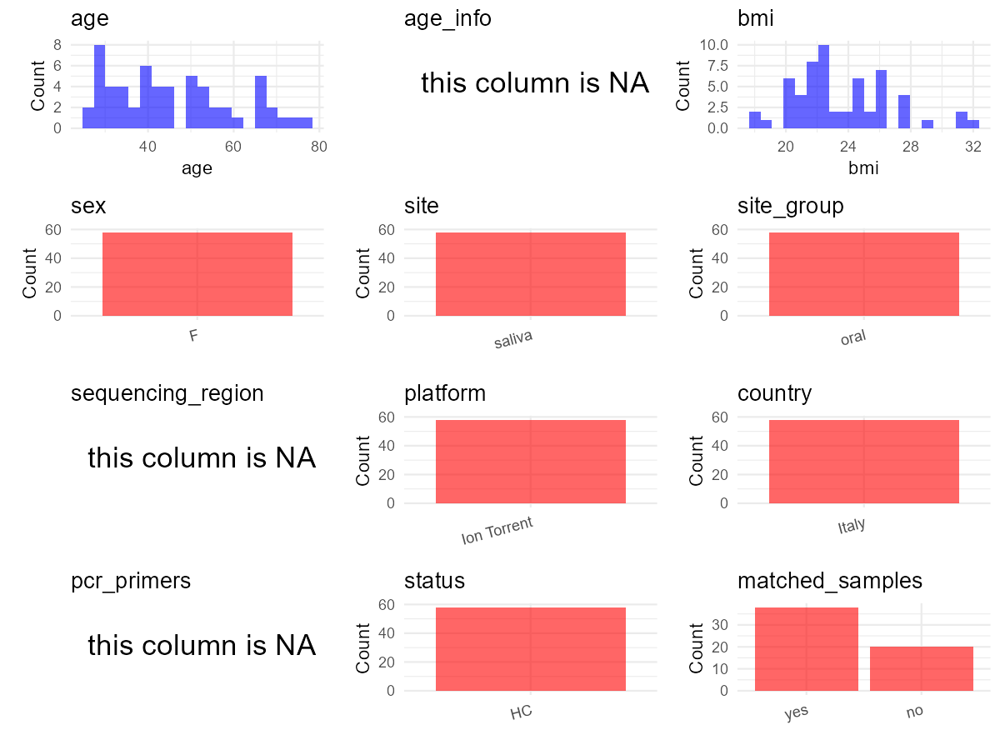

R Notebook: Metadata Processing Workflow
================

# Step 1: Obtain Initial Metadata from Each Project

This step sets the project directory, loads the raw SRA metadata, and
optionally merges supplement tables.

``` r
# Load libraries
library(dplyr)
library(ggplot2)
library(cowplot)

# (1) Setting working directory
# EDIT HERE: change project_id for each study
project_id <- "PRJNA897843" 

base_dir <- "E:/oral/26/metadata-2604/Oral-Metadata-YL-02"
setwd(file.path(base_dir, project_id))

# (2) Loading raw SRA metadata file
sra_file <- "SraRunTable.csv"
initial_meta <- read.csv(sra_file, header = TRUE)

# (3) OPTIONAL: If extra metadata (e.g., Table.x or supplemental materials) are available from the article, you may need to merge the file with initial_meta manually. Below is example code for merging. Depending on the specific case of each study, you can customize the code as needed.
supp_table <- read.csv("supplemental_table_v2.csv", header = TRUE)
initial_meta <- initial_meta %>%
  mutate(Subject_match = gsub("^(M[^_\\-]+).*", "\\1", Library.Name))
initial_meta <- left_join(initial_meta, supp_table, 
                          by = c("Subject_match" = "Subject"))
```

# Step 2: Data Overview

First, you need to get an overview of the data, which includes two
steps: reading the article and reading the initial metadata. This step
is very IMPORTANT!

``` r
# (1) Read the article in the following order: abstract, the beginning of the results section, and the methods. Understand the sample size, experimental design, and disease group overview. Clarify the sampling sites; for oral and gut samples, specify the exact sites like supragingival plaque, tongue, etc.

# (2) IMPORTANT: MUST go through each column of initial_meta
head(initial_meta, 10)
```

    ##            Run Assay.Type AvgSpotLen     Bases  BioProject    BioSample
    ## 1  SRR22175378   AMPLICON        238  22178540 PRJNA897843 SAMN31581425
    ## 2  SRR22175379   AMPLICON        236  97784047 PRJNA897843 SAMN31581424
    ## 3  SRR22175380   AMPLICON        229  17852221 PRJNA897843 SAMN31581423
    ## 4  SRR22175381   AMPLICON        236  22214218 PRJNA897843 SAMN31581422
    ## 5  SRR22175382   AMPLICON        241  50611148 PRJNA897843 SAMN31581473
    ## 6  SRR22175383   AMPLICON        236  45971766 PRJNA897843 SAMN31581472
    ## 7  SRR22175384   AMPLICON        239  47944961 PRJNA897843 SAMN31581471
    ## 8  SRR22175385   AMPLICON        239  32743103 PRJNA897843 SAMN31581470
    ## 9  SRR22175386   AMPLICON        235  93554515 PRJNA897843 SAMN31581469
    ## 10 SRR22175387   AMPLICON        239 145276809 PRJNA897843 SAMN31581468
    ##                 BioSampleModel     Bytes      Center.Name Collection_Date
    ## 1  Metagenome or environmental  16050773 LAVAL UNIVERSITY         2018-03
    ## 2  Metagenome or environmental  70287410 LAVAL UNIVERSITY         2018-03
    ## 3  Metagenome or environmental  12565535 LAVAL UNIVERSITY         2018-03
    ## 4  Metagenome or environmental  15702821 LAVAL UNIVERSITY         2018-03
    ## 5  Metagenome or environmental  35398325 LAVAL UNIVERSITY         2018-03
    ## 6  Metagenome or environmental  32189477 LAVAL UNIVERSITY         2018-03
    ## 7  Metagenome or environmental  33266897 LAVAL UNIVERSITY         2018-03
    ## 8  Metagenome or environmental  22837554 LAVAL UNIVERSITY         2018-03
    ## 9  Metagenome or environmental  65625266 LAVAL UNIVERSITY         2018-03
    ## 10 Metagenome or environmental 102172678 LAVAL UNIVERSITY         2018-03
    ##    Consent DATASTORE.filetype DATASTORE.provider
    ## 1   public   fastq,run.zq,sra         gs,ncbi,s3
    ## 2   public   fastq,run.zq,sra         gs,ncbi,s3
    ## 3   public   fastq,run.zq,sra         gs,ncbi,s3
    ## 4   public   fastq,run.zq,sra         gs,ncbi,s3
    ## 5   public   fastq,run.zq,sra         gs,ncbi,s3
    ## 6   public   fastq,run.zq,sra         gs,ncbi,s3
    ## 7   public   fastq,run.zq,sra         gs,ncbi,s3
    ## 8   public   fastq,run.zq,sra         gs,ncbi,s3
    ## 9   public   fastq,run.zq,sra         gs,ncbi,s3
    ## 10  public   fastq,run.zq,sra         gs,ncbi,s3
    ##                        DATASTORE.region description_1   description_2
    ## 1  gs.us-east1,ncbi.public,s3.us-east-1       Group 1 Post-menopausal
    ## 2  gs.us-east1,ncbi.public,s3.us-east-1       Group 1 Post-menopausal
    ## 3  gs.us-east1,ncbi.public,s3.us-east-1       Group 1 Post-menopausal
    ## 4  gs.us-east1,ncbi.public,s3.us-east-1       Group 1 Post-menopausal
    ## 5  gs.us-east1,ncbi.public,s3.us-east-1       Group 3          14 day
    ## 6  gs.us-east1,ncbi.public,s3.us-east-1       Group 3          14 day
    ## 7  gs.us-east1,ncbi.public,s3.us-east-1       Group 3          14 day
    ## 8  gs.us-east1,ncbi.public,s3.us-east-1       Group 3          14 day
    ## 9  gs.us-east1,ncbi.public,s3.us-east-1       Group 3          14 day
    ## 10 gs.us-east1,ncbi.public,s3.us-east-1       Group 3          14 day
    ##     Experiment geo_loc_name_country geo_loc_name_country_continent
    ## 1  SRX18154251                Italy                         Europe
    ## 2  SRX18154250                Italy                         Europe
    ## 3  SRX18154249                Italy                         Europe
    ## 4  SRX18154248                Italy                         Europe
    ## 5  SRX18154247                Italy                         Europe
    ## 6  SRX18154246                Italy                         Europe
    ## 7  SRX18154245                Italy                         Europe
    ## 8  SRX18154244                Italy                         Europe
    ## 9  SRX18154243                Italy                         Europe
    ## 10 SRX18154242                Italy                         Europe
    ##     geo_loc_name                              HOST      Instrument
    ## 1  Italy: Naples    "Homo sapiens"_Saliva_MP10_030 Ion Torrent PGM
    ## 2  Italy: Naples     "Homo sapiens"_Saliva_MP9_029 Ion Torrent PGM
    ## 3  Italy: Naples     "Homo sapiens"_Saliva_MP8_016 Ion Torrent PGM
    ## 4  Italy: Naples     "Homo sapiens"_Saliva_MP7_032 Ion Torrent PGM
    ## 5  Italy: Naples  "Homo sapiens"_Saliva_M21-14_005 Ion Torrent PGM
    ## 6  Italy: Naples "Homo sapiens"_Saliva_M20-14_004_ Ion Torrent PGM
    ## 7  Italy: Naples  "Homo sapiens"_Saliva_M19-14_003 Ion Torrent PGM
    ## 8  Italy: Naples  "Homo sapiens"_Saliva_M18-14_002 Ion Torrent PGM
    ## 9  Italy: Naples  "Homo sapiens"_Saliva_M17_14_044 Ion Torrent PGM
    ## 10 Italy: Naples  "Homo sapiens"_Saliva_M16_14_042 Ion Torrent PGM
    ##    isolation_source             lat_lon Library.Name LibraryLayout
    ## 1            saliva 40.8237 N 14.1216 E     MP10_030        SINGLE
    ## 2            saliva 40.8237 N 14.1216 E      MP9_029        SINGLE
    ## 3            saliva 40.8237 N 14.1216 E      MP8_016        SINGLE
    ## 4            saliva 40.8237 N 14.1216 E      MP7_032        SINGLE
    ## 5            saliva 40.8237 N 14.1216 E   M21-14_005        SINGLE
    ## 6            saliva 40.8237 N 14.1216 E   M20-14_004        SINGLE
    ## 7            saliva 40.8237 N 14.1216 E   M19-14_003        SINGLE
    ## 8            saliva 40.8237 N 14.1216 E   M18-14_002        SINGLE
    ## 9            saliva 40.8237 N 14.1216 E   M17-14_044        SINGLE
    ## 10           saliva 40.8237 N 14.1216 E   M16-14_042        SINGLE
    ##    LibrarySelection LibrarySource        Organism    Platform
    ## 1               PCR   METAGENOMIC oral metagenome ION_TORRENT
    ## 2               PCR   METAGENOMIC oral metagenome ION_TORRENT
    ## 3               PCR   METAGENOMIC oral metagenome ION_TORRENT
    ## 4               PCR   METAGENOMIC oral metagenome ION_TORRENT
    ## 5               PCR   METAGENOMIC oral metagenome ION_TORRENT
    ## 6               PCR   METAGENOMIC oral metagenome ION_TORRENT
    ## 7               PCR   METAGENOMIC oral metagenome ION_TORRENT
    ## 8               PCR   METAGENOMIC oral metagenome ION_TORRENT
    ## 9               PCR   METAGENOMIC oral metagenome ION_TORRENT
    ## 10              PCR   METAGENOMIC oral metagenome ION_TORRENT
    ##             ReleaseDate          create_date version
    ## 1  2022-11-04T00:00:00Z 2022-11-03T10:37:00Z       1
    ## 2  2022-11-04T00:00:00Z 2022-11-03T10:37:00Z       1
    ## 3  2022-11-04T00:00:00Z 2022-11-03T10:36:00Z       1
    ## 4  2022-11-04T00:00:00Z 2022-11-03T10:36:00Z       1
    ## 5  2022-11-04T00:00:00Z 2022-11-03T10:36:00Z       1
    ## 6  2022-11-04T00:00:00Z 2022-11-03T10:37:00Z       1
    ## 7  2022-11-04T00:00:00Z 2022-11-03T10:37:00Z       1
    ## 8  2022-11-04T00:00:00Z 2022-11-03T10:37:00Z       1
    ## 9  2022-11-04T00:00:00Z 2022-11-03T10:37:00Z       1
    ## 10 2022-11-04T00:00:00Z 2022-11-03T10:37:00Z       1
    ##                    Sample.Name SRA.Study Subject_match Age  BMI Lenght Duration
    ## 1  MP10_HS_030_Post-menopausal SRP406078          MP10  52 25.7     NA       NA
    ## 2   MP9_HS_029_Post-menopausal SRP406078           MP9  77 27.6     NA       NA
    ## 3   MP8_HS_016_Post-menopausal SRP406078           MP8  70 27.3     NA       NA
    ## 4   MP7_HS_032_Post-menopausal SRP406078           MP7  74 27.3     NA       NA
    ## 5         M21-14_HS_005_14 day SRP406078           M21  46 26.0     30        4
    ## 6         M20-14_HS_004_14 day SRP406078           M20  35 22.4     28        4
    ## 7         M19-14_HS_003_14 day SRP406078           M19  40 20.0     28        5
    ## 8         M18-14_HS_002_14 day SRP406078           M18  26 22.3     30        5
    ## 9         M17-14_HS_044_14 day SRP406078           M17  28 23.5     29        4
    ## 10        M16-14_HS_042_14 day SRP406078           M16  39 21.6     30        4
    ##    Oral.contraceptives.or.HRT Physical.activitya.Current current.smoker
    ## 1                          no                        Low            yes
    ## 2                          no                        Low             no
    ## 3                          no                        Low             no
    ## 4                          no                        Low             no
    ## 5                          no                   Moderate             no
    ## 6                          no                   Moderate            yes
    ## 7                          no                   Moderate            yes
    ## 8                          no                   Moderate            yes
    ## 9                          no                        Low             no
    ## 10                         no                        Low             no
    ##    Mediterranean.diet
    ## 1                 yes
    ## 2                 yes
    ## 3                 yes
    ## 4                 yes
    ## 5                 yes
    ## 6                 yes
    ## 7                 yes
    ## 8                 yes
    ## 9                 yes
    ## 10                yes

``` r
# IMPORTANT: Check the unique values in the column of interest or query column.
lapply(initial_meta[c('isolation_source')], table) # site
```

    ## $isolation_source
    ## 
    ## saliva 
    ##     58

``` r
lapply(initial_meta[c('Organism', 'BioSampleModel', 'HOST')], table) # organism
```

    ## $Organism
    ## 
    ## oral metagenome 
    ##              58 
    ## 
    ## $BioSampleModel
    ## 
    ## Metagenome or environmental 
    ##                          58 
    ## 
    ## $HOST
    ## 
    ##   "Homo sapiens"_Saliva_M1-14_003    "Homo sapiens"_Saliva_M1-3_002 
    ##                                 1                                 1 
    ##  "Homo sapiens"_Saliva_M10-14_038   "Homo sapiens"_Saliva_M10-3_037 
    ##                                 1                                 1 
    ##  "Homo sapiens"_Saliva_M11-14_022   "Homo sapiens"_Saliva_M11-3_021 
    ##                                 1                                 1 
    ##  "Homo sapiens"_Saliva_M12-14_024   "Homo sapiens"_Saliva_M12-3_023 
    ##                                 1                                 1 
    ##  "Homo sapiens"_Saliva_M13-14_026   "Homo sapiens"_Saliva_M13-3_025 
    ##                                 1                                 1 
    ##  "Homo sapiens"_Saliva_M14-14_028   "Homo sapiens"_Saliva_M14-3_027 
    ##                                 1                                 1 
    ##   "Homo sapiens"_Saliva_M15-3_039  "Homo sapiens"_Saliva_M15_14_040 
    ##                                 1                                 1 
    ##   "Homo sapiens"_Saliva_M16-3_041  "Homo sapiens"_Saliva_M16_14_042 
    ##                                 1                                 1 
    ##   "Homo sapiens"_Saliva_M17-3_043  "Homo sapiens"_Saliva_M17_14_044 
    ##                                 1                                 1 
    ##  "Homo sapiens"_Saliva_M18-14_002   "Homo sapiens"_Saliva_M18-3_046 
    ##                                 1                                 1 
    ##  "Homo sapiens"_Saliva_M19-14_003   "Homo sapiens"_Saliva_M19-3_047 
    ##                                 1                                 1 
    ##   "Homo sapiens"_Saliva_M2-14_018    "Homo sapiens"_Saliva_M2-3_017 
    ##                                 1                                 1 
    ## "Homo sapiens"_Saliva_M20-14_004_   "Homo sapiens"_Saliva_M20-3_048 
    ##                                 1                                 1 
    ##  "Homo sapiens"_Saliva_M21-14_005   "Homo sapiens"_Saliva_M21-3_001 
    ##                                 1                                 1 
    ##   "Homo sapiens"_Saliva_M3-14_019    "Homo sapiens"_Saliva_M3-3_045 
    ##                                 1                                 1 
    ##   "Homo sapiens"_Saliva_M5-14_020    "Homo sapiens"_Saliva_M5-3_036 
    ##                                 1                                 1 
    ##   "Homo sapiens"_Saliva_M6-14_022    "Homo sapiens"_Saliva_M6-3_021 
    ##                                 1                                 1 
    ##   "Homo sapiens"_Saliva_M8-14_024    "Homo sapiens"_Saliva_M8-3_023 
    ##                                 1                                 1 
    ##   "Homo sapiens"_Saliva_M9-14_026    "Homo sapiens"_Saliva_M9-3_025 
    ##                                 1                                 1 
    ##     "Homo sapiens"_Saliva_MP1_001    "Homo sapiens"_Saliva_MP10_030 
    ##                                 1                                 1 
    ##    "Homo sapiens"_Saliva_MP11_031    "Homo sapiens"_Saliva_MP12_032 
    ##                                 1                                 1 
    ##    "Homo sapiens"_Saliva_MP13_033    "Homo sapiens"_Saliva_MP14_034 
    ##                                 1                                 1 
    ##    "Homo sapiens"_Saliva_MP15_035    "Homo sapiens"_Saliva_MP16_006 
    ##                                 1                                 1 
    ##    "Homo sapiens"_Saliva_MP17_007    "Homo sapiens"_Saliva_MP18_008 
    ##                                 1                                 1 
    ##    "Homo sapiens"_Saliva_MP19_009     "Homo sapiens"_Saliva_MP2_027 
    ##                                 1                                 1 
    ##    "Homo sapiens"_Saliva_MP20_010     "Homo sapiens"_Saliva_MP3_028 
    ##                                 1                                 1 
    ##     "Homo sapiens"_Saliva_MP4_029     "Homo sapiens"_Saliva_MP5_030 
    ##                                 1                                 1 
    ##     "Homo sapiens"_Saliva_MP6_031     "Homo sapiens"_Saliva_MP7_032 
    ##                                 1                                 1 
    ##     "Homo sapiens"_Saliva_MP8_016     "Homo sapiens"_Saliva_MP9_029 
    ##                                 1                                 1

``` r
table(initial_meta$Sample.Name) # subject id
```

    ## 
    ##         M1-14_HS_003_14 day           M1-3_HS_002_3 day 
    ##                           1                           1 
    ##        M10-14_HS_038_14 day          M10-3_HS_037_3 day 
    ##                           1                           1 
    ##        M11-14_HS_022_14 day          M11-3_HS_021_3 day 
    ##                           1                           1 
    ##        M12-14_HS_024_14 day          M12-3_HS_023_3 day 
    ##                           1                           1 
    ##        M13-14_HS_026_14 day          M13-3_HS_025_3 day 
    ##                           1                           1 
    ##        M14-14_HS_028_14 day          M14-3_HS_027_3 day 
    ##                           1                           1 
    ##        M15-14_HS_040_14 day          M15-3_HS_039_3 day 
    ##                           1                           1 
    ##        M16-14_HS_042_14 day          M16-3_HS_041_3 day 
    ##                           1                           1 
    ##        M17-14_HS_044_14 day          M17-3_HS_043_3 day 
    ##                           1                           1 
    ##        M18-14_HS_002_14 day          M18-3_HS_046_3 day 
    ##                           1                           1 
    ##        M19-14_HS_003_14 day          M19-3_HS_047_3 day 
    ##                           1                           1 
    ##         M2-14_HS_018_14 day           M2-3_HS_017_3 day 
    ##                           1                           1 
    ##        M20-14_HS_004_14 day          M20-3_HS_048_3 day 
    ##                           1                           1 
    ##        M21-14_HS_005_14 day          M21-3_HS_001_3 day 
    ##                           1                           1 
    ##         M3-14_HS_019_14 day           M3-3_HS_045_3 day 
    ##                           1                           1 
    ##         M5-14_HS_020_14 day           M5-3_HS_036_3 day 
    ##                           1                           1 
    ##         M6-14_HS_022_14 day           M6-3_HS_021_3 day 
    ##                           1                           1 
    ##         M8-14_HS_024_14 day           M8-3_HS_023_3 day 
    ##                           1                           1 
    ##         M9-14_HS_026_14 day           M9-3_HS_025_3 day 
    ##                           1                           1 
    ##  MP1_HS_001_Post-menopausal MP10_HS_030_Post-menopausal 
    ##                           1                           1 
    ## MP11_HS_031_Post-menopausal MP12_HS_032_Post-menopausal 
    ##                           1                           1 
    ## MP13_HS_033_Post-menopausal MP14_HS_034_Post-menopausal 
    ##                           1                           1 
    ## MP15_HS_035_Post-menopausal MP16_HS_006_Post-menopausal 
    ##                           1                           1 
    ## MP17_HS_007_Post-menopausal MP18_HS_008_Post-menopausal 
    ##                           1                           1 
    ## MP19_HS_009_Post-menopausal  MP2_HS_027_Post-menopausal 
    ##                           1                           1 
    ## MP20_HS_010_Post-menopausal  MP3_HS_028_Post-menopausal 
    ##                           1                           1 
    ##  MP4_HS_029_Post-menopausal  MP5_HS_030_Post-menopausal 
    ##                           1                           1 
    ##  MP6_HS_031_Post-menopausal  MP7_HS_032_Post-menopausal 
    ##                           1                           1 
    ##  MP8_HS_016_Post-menopausal  MP9_HS_029_Post-menopausal 
    ##                           1                           1

``` r
#table(initial_meta$sequencing_meth..exp.) # output is pyrosequencing
table(initial_meta$Platform) # output is ION_TORRENT. according to the methods, ION_TORRENT is correct.
```

    ## 
    ## ION_TORRENT 
    ##          58

``` r
# table(initial_meta$target_subfragment..exp.)
```

# Step 3: Removing Control and Non-human Samples

First, we need to remove control samples(including both negative
controls and positive controls) and non-human samples.

``` r
# (1) EDIT HERE: Parameter setup
control_column <- "" # column name in initial_meta
# unique(initial_meta[[control_column]])
control_keywords <- c() # Enter exact keywords

species_column <- "" # column name in initial_meta
unique(initial_meta[[species_column]])
```

    ## NULL

``` r
non_human_keywords <- c() # Enter exact keywords

# (2) Remove controls and non-human samples. DO NOT need to modify code in this part, just run it.
n_samples <- nrow(initial_meta)
# Control evaluation
if (length(control_keywords) > 0) {
  if (is.null(control_column) || control_column == "") {
    stop("Error: control_keywords provided but control_column is missing.")
  }
  
  if (!(control_column %in% colnames(initial_meta))) {
    stop(sprintf("Error: Column '%s' not found in initial_meta.", control_column))
  }
  
  control_pattern <- paste(control_keywords, collapse = "|")
  control_text <- initial_meta[[control_column]]
  is_control <- grepl(control_pattern, control_text)
  
} else {
  is_control <- rep(FALSE, n_samples)
}

# Non-human evaluation
if (length(non_human_keywords) > 0) {
  if (is.null(species_column) || species_column == "") {
    stop("Error: non_human_keywords provided but species_column is missing.")
  }
  
  if (!(species_column %in% colnames(initial_meta))) {
    stop(sprintf("Error: Column '%s' not found in initial_meta.", species_column))
  }
  
  non_human_pattern <- paste(non_human_keywords, collapse = "|")
  species_text <- initial_meta[[species_column]]
  is_non_human <- grepl(non_human_pattern, species_text)
} else {
  is_non_human <- rep(FALSE, n_samples)
}

# Execute removal
samples_to_remove <- is_control | is_non_human
initial_meta <- initial_meta[!samples_to_remove, ]

cat("Initial samples counts:",n_samples,"\n")
```

    ## Initial samples counts: 58

``` r
cat("Removed control samples:", sum(is_control), "\n")
```

    ## Removed control samples: 0

``` r
cat("Removed non-human samples:", sum(is_non_human), "\n")
```

    ## Removed non-human samples: 0

``` r
cat("Total samples removed ", sum(samples_to_remove), "\n")
```

    ## Total samples removed  0

``` r
cat("Remaining samples after Step 2:", nrow(initial_meta), "\n")
```

    ## Remaining samples after Step 2: 58

# Step 4: Creating a Uniform Metadata Template

This step converts the raw SRA table into the standard metadata format
used in our meta-analysis. The uniform metadata should include the
following columns: 1. **bioproject**: Project ID from SRA or other
database e.g. `PRJNA1234`, `CNP1234`, ‘OEP1234’, ‘qiita_1234’ 2.
**sample_id**: SRA sample/run ID. Unique id for each sample!
e.g. `DRR1234567`, `ERR1234567` and `SRR1234567`. If no such column
exists, can use column like sample_name. 3. **subject_id**: subject id
for each person if available. e.g. `patient_01`, `Host_03_before`,
`subject12` 4. **age**: Age of the subject if available. e.g. `35`, `42`
\| not `adult`, `chilren` 5. **age_info**: If the age is not explicitly
stated but approximate age range information is available, mark it in
this column. e.g., `18-55`, `children`, `infant`, `elder` 6. **bmi**:
Body Mass Index if available. e.g. `22.5`, `18.9` \| not `normal`,
`overweight` 7. **sex**: Sex of the subject. Mandatory to write as M/F
\| not `female`, `woman` 8. **sequencing_region**: Targeted 16S rRNA
region. e.g. `V3-V4`, `V4` 9. **platform**: Sequencing platform.
e.g. `Illumina MiSeq`, `454 GS FLX Titanium`, `Ion Torrent` 10.
**country**: Country of sample origin. e.g. `China`, `Japan` \| not city
name like `Beijing` 11. **site**: Sampling site. For oral and gut sites,
specify the exact sites as detailed as possible. For example, if it is
known to be supragingival plaque, do not record it as ‘dental plaque’,
unless the original text provides only a vague description.
e.g. `saliva`, `tongue coating` \| not broad term like `oral` 12.
**site_group**: only accepts one of following three values: ‘oral’,
‘gut’, or ‘other’. 13. **public_time**: Data release date.
e.g. `2021-06-22` \| not `June 2021` 14. **pcr_primers**: PCR primers
used. e.g. `515F-806R`, `27F-338R` \| not primer sequences 15.
**title**: Title of the associated publication. 16. **disease_study**:
Whether the study involves disease samples. If it’s not clear, can
record as NA. Only three values accepted: ‘yes’, ‘no’ or NA 17.
**status**: Disease status for each sample if available, else record as
NA. Only accept following abbreviations, Write full names for all other
diseases. HC: healthy control CD: Crohn’s disease CRC: colorectal cancer
COPD: chronic obstructive pulmonary disease HIV: human immunodeficiency
virus ICU: intensive care unit OSCC: oral squamous cell carcinoma RA:
rheumatoid arthritis UC: ulcerative colitis 18. **matched_samples**:
Whether the subject has matched samples. Only accept ‘yes’ or ‘no’. 19.
**is_time_series**: Whether the study is a time series study. Only
accept ‘yes’ or ‘no’.

``` r
# Extract columns from initial_meta as follows: (1) No modification needed → extract directly. (2) Modification needed → create a new column with the prefix raw_ and mark the original column as “pending”. (3) Need to find or determine based on the article.
metadata <- data.frame(
  bioproject = initial_meta$BioProject,
  sample_id = initial_meta$Run,
  raw_subject_id = initial_meta$Library.Name,
  subject_id = "pending", # modify later
  age = initial_meta$Age,
  age_info = NA,
  bmi = initial_meta$BMI,
  sex = "F", # Article: thirty-nine medically healthy women aged 26–77 years (19 with menstrual cycle and 20 in menopause) were recruited
  sequencing_region = NA, 
  platform = "Ion Torrent", # extract from methods section, NOT initial_meta
  country = initial_meta$geo_loc_name_country,
  site = initial_meta$isolation_source,
  site_group = "pending", # modify later
  public_time = initial_meta$ReleaseDate,
  pcr_primers = NA, # Format: xxF-xxR
  title = "Analysis of the oral microbiome during hormonal cycle and its alterations in menopausal women the AMICA project", # extract from article
  disease_study = "no", # determine according to the article
  status = "HC",
  matched_samples = "pending", # modify later
  is_time_series = "no", # determine according to the article
  stringsAsFactors = FALSE
)
metadata$public_time <- as.Date(metadata$public_time)
```

# Step 5: Manually solving pending issues

This step involves two parts: (1) handle the columns with the `raw_`
prefix, and next (2) handle the `site_group` and `matched_samples`
columns.

``` r
# (1) Handle the columns with the `raw_` prefix.
# In this part, you need to customize the code based on the situation of the raw_ columns to obtain the content of the target columns. IMPORTANT: Add comments if the modification is not straightforward!!
metadata <- metadata %>%
  mutate(subject_id = gsub("^(M[^_\\-]+).*", "\\1", raw_subject_id)) # according to the 'Library.Name' column of initial_meta
```

``` r
# (2) Filling the 'site_group' and 'matched_samples' columns
# editing site_group
unique(metadata$site)
```

    ## [1] "saliva"

``` r
# EDIT HERE: add oral sites
Oral_site = unique(metadata$site)
# EDIT HERE: add gut sites
Gut_site = c()
# just run
metadata <- metadata %>%
  mutate(site_group = case_when(
    site %in% Oral_site ~ "oral",
    site %in% Gut_site ~ "gut",
    TRUE ~ "other" 
  ))

# editing matched_samples, just run.
metadata$matched_samples <- ifelse(
  ave(metadata$subject_id, metadata$subject_id, FUN = length) > 1, 
  "yes", 
  "no"
)
```

``` r
# (3) check if there is pending value in metadata. If there is pending value, go on modify the metadata.
# Function to check if a column contains "pending"
has_pending <- function(col) {
  if (is.character(col) || is.factor(col)) {
    any(col == "pending", na.rm = TRUE)
  } else {
    FALSE
  }
}

# Check for any pending value
any_pending_value <- any(sapply(metadata, has_pending))

if (!any_pending_value) {
  message("Good! No cell contains the value 'pending'.")
} else {
  pending_cols <- names(metadata)[sapply(metadata, has_pending)]
  message("Columns containing 'pending': ", paste(pending_cols, collapse = ", "))
  message("Please continue to resolve these pending columns!")
}
```

    ## Good! No cell contains the value 'pending'.

# Step 6: Visualize the Metadata

This step makes a quick set of plots for checking the distribution of
key metadata fields.

``` r
# Select columns for visualization, just run
plot_data <- metadata %>%
  select(-bioproject, -sample_id, -subject_id, -title)

create_simple_plots <- function(data) {
  plots <- list()
  continuous_vars <- c("age", "bmi")

  for (col in colnames(data)) {
    if (all(is.na(data[[col]]))) {
      p <- ggplot() +
        annotate("text", x = 0.5, y = 0.5, label = "this column is NA", size = 6) +
        labs(title = col) +
        theme_void()
    } else if (col %in% continuous_vars && is.numeric(data[[col]])) {
      p <- ggplot(data, aes(x = .data[[col]])) +
        geom_histogram(fill = "blue", alpha = 0.6, bins = 20, na.rm = TRUE) +
        labs(title = col, x = col, y = "Count") +
        theme_minimal()
    } else {
      count_data <- as.data.frame(table(data[[col]], useNA = "ifany"))
      p <- ggplot(count_data, aes(x = reorder(Var1, -Freq), y = Freq)) +
        geom_col(fill = "red", alpha = 0.6) +
        labs(title = col, x = NULL, y = "Count") +
        theme_minimal() +
        theme(axis.text.x = element_text(angle = 15, hjust = 1))
    }
    plots[[col]] <- p
  }

  return(plots)
}

# Generate and arrange plots
plots <- create_simple_plots(plot_data)
p <- plot_grid(plots$age,
               plots$age_info,
               plots$bmi,
               plots$sex,
               plots$site,
               plots$site_group,
               plots$sequencing_region,
               plots$platform,
               plots$country,
               plots$pcr_primers,
               plots$status,
               plots$matched_samples,
               ncol = 3, align = "hv", axis = "lb")
ggsave("Metadata_Summary_v2.png", plot = p, width = 8, height = 6, dpi = 150)
```

``` r
# Insert Metadata_Summary.png into the current Rmd output

```


# Step 7: Sort and export the metadata

This step saves the cleaned metadata table as the final `metadata.csv`
file.

``` r
# Reorder the data frame
fixed_cols <- c("bioproject", "sample_id", "subject_id", "age", "age_info",
                "bmi", "sex", "platform", "sequencing_region", "pcr_primers", 
                "country", "site", "site_group", "disease_study", "status", 
                "title", "public_time", "matched_samples", "is_time_series")  
metadata <- metadata %>%
  select(all_of(fixed_cols), everything())

# save metadata 
# head(metadata)
write.csv(metadata, file = "metadata_v2.csv", quote = TRUE)
```
