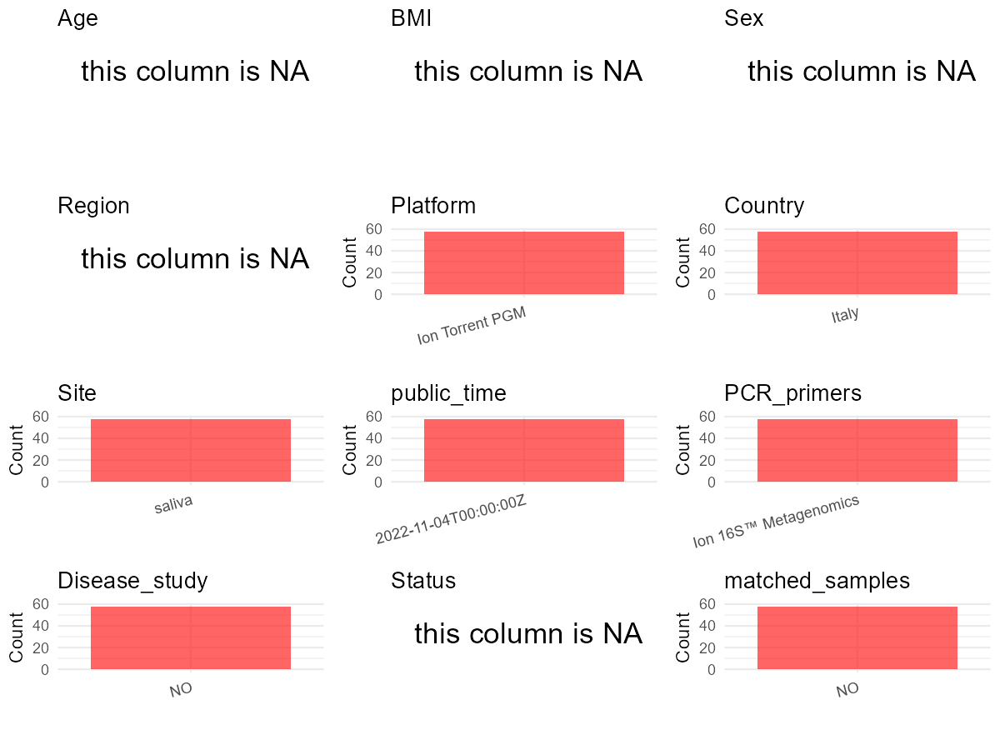

R Notebook: Metadata Processing Workflow
================

# Step 1: Obtain Initial Metadata from Each Project

To obtain the initial metadata: 1. Search for the BioProject ID (e.g.,
“PRJEBXXXX”) on the [NCBI SRA
website](https://www.ncbi.nlm.nih.gov/Traces/study/). 2. In the “Select”
table, click on “Metadata” and download the file. 3. The downloaded file
is typically named “SraRunTable.csv” and contains metadata for the
project.

``` r
# Load necessary libraries
library(dplyr)
library(ggplot2)
library(cowplot)

# Set working directory (update this path to your local directory)
setwd("D:/oral_project/PRJNA897843")

# Read the initial metadata files
initial_meta<-read.csv("SraRunTable.csv",header = T)

# Combine the two metadata files
#meta <- rbind(initial_meta, initial_meta1)

#Remove entries where Organism is "gut metagenome" (non-oral samples)
#initial_meta <- subset(initial_meta,isolation_source!= "feces")

# Check the number of samples containing "HT" in Sample.Name (e.g., healthy controls)
#nrow(subset(meta, grepl("HT", Sample.Name)))

# Display the first few rows of the metadata
head(initial_meta)
```

    ##           Run Assay.Type AvgSpotLen    Bases  BioProject    BioSample
    ## 1 SRR22175378   AMPLICON        238 22178540 PRJNA897843 SAMN31581425
    ## 2 SRR22175379   AMPLICON        236 97784047 PRJNA897843 SAMN31581424
    ## 3 SRR22175380   AMPLICON        229 17852221 PRJNA897843 SAMN31581423
    ## 4 SRR22175381   AMPLICON        236 22214218 PRJNA897843 SAMN31581422
    ## 5 SRR22175382   AMPLICON        241 50611148 PRJNA897843 SAMN31581473
    ## 6 SRR22175383   AMPLICON        236 45971766 PRJNA897843 SAMN31581472
    ##                BioSampleModel    Bytes      Center.Name Collection_Date Consent
    ## 1 Metagenome or environmental 16050773 LAVAL UNIVERSITY         2018-03  public
    ## 2 Metagenome or environmental 70287410 LAVAL UNIVERSITY         2018-03  public
    ## 3 Metagenome or environmental 12565535 LAVAL UNIVERSITY         2018-03  public
    ## 4 Metagenome or environmental 15702821 LAVAL UNIVERSITY         2018-03  public
    ## 5 Metagenome or environmental 35398325 LAVAL UNIVERSITY         2018-03  public
    ## 6 Metagenome or environmental 32189477 LAVAL UNIVERSITY         2018-03  public
    ##   DATASTORE.filetype DATASTORE.provider                     DATASTORE.region
    ## 1   fastq,run.zq,sra         gs,ncbi,s3 gs.us-east1,ncbi.public,s3.us-east-1
    ## 2   fastq,run.zq,sra         gs,ncbi,s3 gs.us-east1,ncbi.public,s3.us-east-1
    ## 3   fastq,run.zq,sra         gs,ncbi,s3 gs.us-east1,ncbi.public,s3.us-east-1
    ## 4   fastq,run.zq,sra         gs,ncbi,s3 gs.us-east1,ncbi.public,s3.us-east-1
    ## 5   fastq,run.zq,sra         gs,ncbi,s3 gs.us-east1,ncbi.public,s3.us-east-1
    ## 6   fastq,run.zq,sra         gs,ncbi,s3 gs.us-east1,ncbi.public,s3.us-east-1
    ##   description_1   description_2  Experiment geo_loc_name_country
    ## 1       Group 1 Post-menopausal SRX18154251                Italy
    ## 2       Group 1 Post-menopausal SRX18154250                Italy
    ## 3       Group 1 Post-menopausal SRX18154249                Italy
    ## 4       Group 1 Post-menopausal SRX18154248                Italy
    ## 5       Group 3          14 day SRX18154247                Italy
    ## 6       Group 3          14 day SRX18154246                Italy
    ##   geo_loc_name_country_continent  geo_loc_name
    ## 1                         Europe Italy: Naples
    ## 2                         Europe Italy: Naples
    ## 3                         Europe Italy: Naples
    ## 4                         Europe Italy: Naples
    ## 5                         Europe Italy: Naples
    ## 6                         Europe Italy: Naples
    ##                                HOST      Instrument isolation_source
    ## 1    "Homo sapiens"_Saliva_MP10_030 Ion Torrent PGM           saliva
    ## 2     "Homo sapiens"_Saliva_MP9_029 Ion Torrent PGM           saliva
    ## 3     "Homo sapiens"_Saliva_MP8_016 Ion Torrent PGM           saliva
    ## 4     "Homo sapiens"_Saliva_MP7_032 Ion Torrent PGM           saliva
    ## 5  "Homo sapiens"_Saliva_M21-14_005 Ion Torrent PGM           saliva
    ## 6 "Homo sapiens"_Saliva_M20-14_004_ Ion Torrent PGM           saliva
    ##               lat_lon Library.Name LibraryLayout LibrarySelection LibrarySource
    ## 1 40.8237 N 14.1216 E     MP10_030        SINGLE              PCR   METAGENOMIC
    ## 2 40.8237 N 14.1216 E      MP9_029        SINGLE              PCR   METAGENOMIC
    ## 3 40.8237 N 14.1216 E      MP8_016        SINGLE              PCR   METAGENOMIC
    ## 4 40.8237 N 14.1216 E      MP7_032        SINGLE              PCR   METAGENOMIC
    ## 5 40.8237 N 14.1216 E   M21-14_005        SINGLE              PCR   METAGENOMIC
    ## 6 40.8237 N 14.1216 E   M20-14_004        SINGLE              PCR   METAGENOMIC
    ##          Organism    Platform          ReleaseDate          create_date version
    ## 1 oral metagenome ION_TORRENT 2022-11-04T00:00:00Z 2022-11-03T10:37:00Z       1
    ## 2 oral metagenome ION_TORRENT 2022-11-04T00:00:00Z 2022-11-03T10:37:00Z       1
    ## 3 oral metagenome ION_TORRENT 2022-11-04T00:00:00Z 2022-11-03T10:36:00Z       1
    ## 4 oral metagenome ION_TORRENT 2022-11-04T00:00:00Z 2022-11-03T10:36:00Z       1
    ## 5 oral metagenome ION_TORRENT 2022-11-04T00:00:00Z 2022-11-03T10:36:00Z       1
    ## 6 oral metagenome ION_TORRENT 2022-11-04T00:00:00Z 2022-11-03T10:37:00Z       1
    ##                   Sample.Name SRA.Study
    ## 1 MP10_HS_030_Post-menopausal SRP406078
    ## 2  MP9_HS_029_Post-menopausal SRP406078
    ## 3  MP8_HS_016_Post-menopausal SRP406078
    ## 4  MP7_HS_032_Post-menopausal SRP406078
    ## 5        M21-14_HS_005_14 day SRP406078
    ## 6        M20-14_HS_004_14 day SRP406078

# Step 2: Create a Uniform Metadata Template

The uniform metadata should include the following columns:

1.  **BioProject**: Project ID (e.g., “PRJNA339212”)
2.  **Run**: Sample ID (e.g., “ERRXXXXXX” or “SRRXXXXXX”)
3.  **sample_name**: Original sample name submitted by the authors (not
    the database-assigned ID)
4.  **Age**: Age of the subject (if available)
5.  **BMI**: Body Mass Index (if available)
6.  **Sex**: Sex of the subject (“F” or “M”)
7.  **Region**: Targeted 16S rRNA region (e.g., “V3-V4”)
8.  **Platform**: Sequencing platform (e.g., “Illumina MiSeq”)
9.  **Country**: Country of sample origin (e.g., “China”)
10. **Site**: Sample site (e.g., “saliva”, “dental plaque”)
11. **public_time**: Data release date (format: “YYYY-MM-DD”)
12. **PCR_primers**: PCR primers used (e.g., “515F-806R”)
13. **title**: Title of the associated publication
14. **Disease_study**: Whether the study involves a disease (“YES” or
    “NO”)
15. **Status**: Disease status (e.g., “T2DM”, “HC”). Note: If the study
    includes both disease and healthy samples, this must be specified
    per sample.

``` r
# Create a uniform metadata dataframe
metadata <- data.frame(
  BioProject = initial_meta$BioProject,
  Run = initial_meta$Run,
  sample_name = initial_meta$Sample.Name,
  Age = NA,
  BMI = NA,
  Sex=NA,
  Region = NA,
  Platform = initial_meta$Instrument,
  Country = initial_meta$geo_loc_name_country,
  Site = initial_meta$isolation_source,
  public_time = initial_meta$ReleaseDate,
  stringsAsFactors = FALSE
)
#%>%mutate(Site=case_when(Site=="Human stool"~"Feces",Site=="Human swab"~"oral swab"))
```

# Step 3: Manually Add Information from the Publication

Some information (e.g. PCR primers, study title, disease status) must be
manually extracted from the publication and added to the metadata.

``` r
# Add information obtained from the publication
metadata$PCR_primers <- "Ion 16S™ Metagenomics"
metadata$title <- "Analysis of the oral microbiome during hormonal cycle and its alterations in menopausal women the “AMICA” project"
#metadata<-subset(uniform_meta,Site!="feces")
metadata$Disease_study <- "NO"
# Assign disease status based on sample_name patterns
metadata$Status <-NA
#extract subject id by remove prefix of sample_name
#metadata$sample_name <- gsub("S-Saliva-.*|F", "", metadata$sample_name)
#get subjects id with Saliva available
#keep_subjects<-subset(metadata,Site=="oral swab")
#remove subjects without Saliva samples
#metadata<-subset(metadata,sample_name %in% keep_subjects$sample_name)
#get subjects sampling counts
#sample_counts <- table(metadata$sample_name)
# Create matched_samples column, any subjects have >=2 samples will be label "YES", otherwise "NO"
#metadata$matched_samples <- ifelse(metadata$sample_name %in% names(sample_counts[sample_counts >= 2]), "YES", "NO")
metadata$matched_samples<-"NO"
```

# Step 4: Summarize and Validate the Metadata

``` r
# Check the number of unique runs and sample names
print(paste("Number of unique runs:", length(unique(metadata$Run))))
```

    ## [1] "Number of unique runs: 58"

``` r
print(paste("Number of unique sample names:", length(unique(metadata$sample_name))))
```

    ## [1] "Number of unique sample names: 58"

# Step 5: Visualize the Metadata

``` r

```


# Step 6: Finalize and Export the Metadata

``` r
# Reorder columns to match the desired format
metadata <- metadata[, c(
  "BioProject", "Run", "sample_name", "Age", "BMI", "Sex", 
  "Region", "Platform", "Country", "Site", "public_time", 
  "PCR_primers", "title", "Disease_study", "Status","matched_samples"
)]

# Export the uniform metadata to a CSV file
write.csv(metadata, file = "metadata.csv", quote = FALSE)
head(metadata)
```

    ##    BioProject         Run                 sample_name Age BMI Sex Region
    ## 1 PRJNA897843 SRR22175378 MP10_HS_030_Post-menopausal  NA  NA  NA     NA
    ## 2 PRJNA897843 SRR22175379  MP9_HS_029_Post-menopausal  NA  NA  NA     NA
    ## 3 PRJNA897843 SRR22175380  MP8_HS_016_Post-menopausal  NA  NA  NA     NA
    ## 4 PRJNA897843 SRR22175381  MP7_HS_032_Post-menopausal  NA  NA  NA     NA
    ## 5 PRJNA897843 SRR22175382        M21-14_HS_005_14 day  NA  NA  NA     NA
    ## 6 PRJNA897843 SRR22175383        M20-14_HS_004_14 day  NA  NA  NA     NA
    ##          Platform Country   Site          public_time           PCR_primers
    ## 1 Ion Torrent PGM   Italy saliva 2022-11-04T00:00:00Z Ion 16S™ Metagenomics
    ## 2 Ion Torrent PGM   Italy saliva 2022-11-04T00:00:00Z Ion 16S™ Metagenomics
    ## 3 Ion Torrent PGM   Italy saliva 2022-11-04T00:00:00Z Ion 16S™ Metagenomics
    ## 4 Ion Torrent PGM   Italy saliva 2022-11-04T00:00:00Z Ion 16S™ Metagenomics
    ## 5 Ion Torrent PGM   Italy saliva 2022-11-04T00:00:00Z Ion 16S™ Metagenomics
    ## 6 Ion Torrent PGM   Italy saliva 2022-11-04T00:00:00Z Ion 16S™ Metagenomics
    ##                                                                                                               title
    ## 1 Analysis of the oral microbiome during hormonal cycle and its alterations in menopausal women the “AMICA” project
    ## 2 Analysis of the oral microbiome during hormonal cycle and its alterations in menopausal women the “AMICA” project
    ## 3 Analysis of the oral microbiome during hormonal cycle and its alterations in menopausal women the “AMICA” project
    ## 4 Analysis of the oral microbiome during hormonal cycle and its alterations in menopausal women the “AMICA” project
    ## 5 Analysis of the oral microbiome during hormonal cycle and its alterations in menopausal women the “AMICA” project
    ## 6 Analysis of the oral microbiome during hormonal cycle and its alterations in menopausal women the “AMICA” project
    ##   Disease_study Status matched_samples
    ## 1            NO     NA              NO
    ## 2            NO     NA              NO
    ## 3            NO     NA              NO
    ## 4            NO     NA              NO
    ## 5            NO     NA              NO
    ## 6            NO     NA              NO

## Notes for Students:

1.  **Metadata Accuracy**: Always cross-check the metadata with the
    original publication to ensure accuracy.
2.  **Manual Entries**: Columns like `PCR_primers`, and `Status` often
    require manual entry based on the publication.
3.  **Disease Status**: Be careful when assigning `Status`—some studies
    include both disease and healthy samples.
4.  **Visualization**: The plots help quickly identify the distribution
    of values in each column, which is useful for quality control.
5.  **Reproducibility**: Update the working directory and file paths to
    match your local environment.
