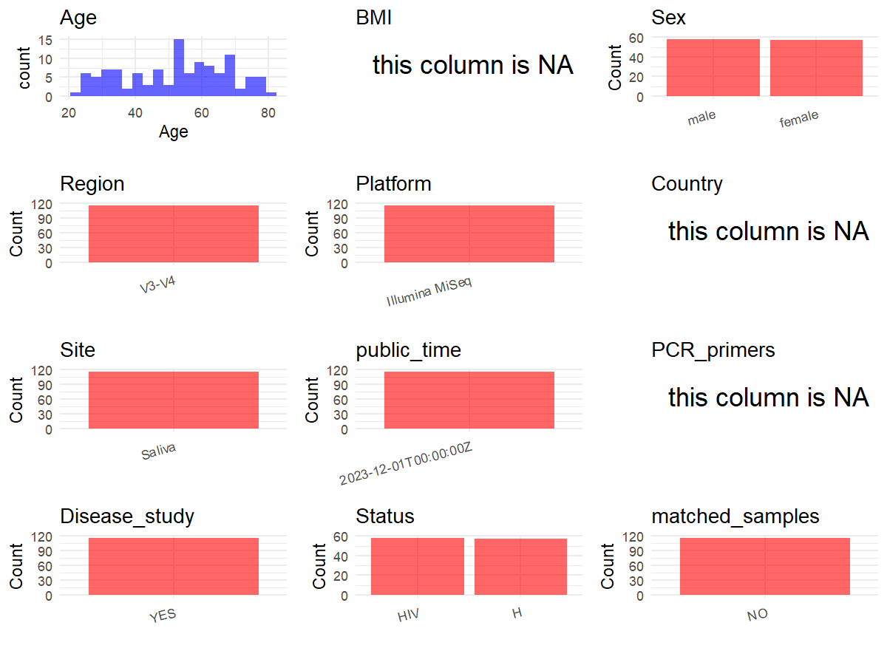

R Notebook: Metadata Processing Workflow
================

# Step 1: Obtain Initial Metadata from Each Project

To obtain the initial metadata: 1. Search for the BioProject ID (e.g.,
“PRJEBXXXX”) on the [NCBI SRA
website](https://www.ncbi.nlm.nih.gov/Traces/study/). 2. In the “Select”
table, click on “Metadata” and download the file. 3. The downloaded file
is typically named “SraRunTable.csv” and contains metadata for the
project.

``` r
# Load necessary libraries
library(dplyr)
library(ggplot2)
library(cowplot)

# Set working directory (update this path to your local directory)
setwd("D:/metadata/3/PRJNA900274")

# Read the initial metadata files
initial_meta<-read.csv("SraRunTable.csv",header = T)

# Combine the two metadata files
#meta <- rbind(initial_meta, initial_meta1)

#Remove entries non-oral samples
#initial_meta <- subset(initial_meta,BioSampleModel != "Metagenome or environmental")

# Check the number of samples containing "HT" in Sample.Name (e.g., healthy controls)
#nrow(subset(meta, grepl("HT", Sample.Name)))

# Display the first few rows of the metadata
head(initial_meta)
```

    ##           Run AGE Assay.Type AvgSpotLen     Bases        BIOMATERIAL_PROVIDER
    ## 1 SRR22281548  24   AMPLICON        602  50114092 karolinska institute sweden
    ## 2 SRR22281549  28   AMPLICON        602  49192430 karolinska institute sweden
    ## 3 SRR22281550  78   AMPLICON        602 138217394 karolinska institute sweden
    ## 4 SRR22281551  76   AMPLICON        602  51888788 karolinska institute sweden
    ## 5 SRR22281552  67   AMPLICON        602  49836570 karolinska institute sweden
    ## 6 SRR22281553  27   AMPLICON        602  36141672 karolinska institute sweden
    ##    BioProject    BioSample BioSampleModel    Bytes           Center.Name
    ## 1 PRJNA900274 SAMN31685304          Human 26258215 KAROLINSKA INSTITUTET
    ## 2 PRJNA900274 SAMN31685303          Human 28180198 KAROLINSKA INSTITUTET
    ## 3 PRJNA900274 SAMN31685302          Human 81175450 KAROLINSKA INSTITUTET
    ## 4 PRJNA900274 SAMN31685301          Human 29817843 KAROLINSKA INSTITUTET
    ## 5 PRJNA900274 SAMN31685300          Human 28424532 KAROLINSKA INSTITUTET
    ## 6 PRJNA900274 SAMN31685299          Human 20802486 KAROLINSKA INSTITUTET
    ##   Consent DATASTORE.filetype DATASTORE.provider
    ## 1  public   fastq,run.zq,sra         gs,ncbi,s3
    ## 2  public   fastq,run.zq,sra         gs,ncbi,s3
    ## 3  public   fastq,run.zq,sra         gs,ncbi,s3
    ## 4  public   fastq,run.zq,sra         gs,ncbi,s3
    ## 5  public   fastq,run.zq,sra         gs,ncbi,s3
    ## 6  public   fastq,run.zq,sra         gs,ncbi,s3
    ##                       DATASTORE.region  Experiment     Instrument isolate
    ## 1 gs.us-east1,ncbi.public,s3.us-east-1 SRX18255790 Illumina MiSeq Healthy
    ## 2 gs.us-east1,ncbi.public,s3.us-east-1 SRX18255789 Illumina MiSeq Healthy
    ## 3 gs.us-east1,ncbi.public,s3.us-east-1 SRX18255788 Illumina MiSeq Healthy
    ## 4 gs.us-east1,ncbi.public,s3.us-east-1 SRX18255787 Illumina MiSeq Healthy
    ## 5 gs.us-east1,ncbi.public,s3.us-east-1 SRX18255786 Illumina MiSeq Healthy
    ## 6 gs.us-east1,ncbi.public,s3.us-east-1 SRX18255785 Illumina MiSeq Healthy
    ##   Library.Name LibraryLayout LibrarySelection LibrarySource     Organism
    ## 1   P22452s244        PAIRED              PCR   METAGENOMIC Homo sapiens
    ## 2   P22452s243        PAIRED              PCR   METAGENOMIC Homo sapiens
    ## 3   P22452s242        PAIRED              PCR   METAGENOMIC Homo sapiens
    ## 4   P22452s241        PAIRED              PCR   METAGENOMIC Homo sapiens
    ## 5   P22452s237        PAIRED              PCR   METAGENOMIC Homo sapiens
    ## 6   P22452s235        PAIRED              PCR   METAGENOMIC Homo sapiens
    ##   Platform          ReleaseDate          create_date version Sample.Name    sex
    ## 1 ILLUMINA 2023-12-01T00:00:00Z 2022-11-14T14:01:00Z       1  P22452s244   male
    ## 2 ILLUMINA 2023-12-01T00:00:00Z 2022-11-14T14:01:00Z       1  P22452s243 female
    ## 3 ILLUMINA 2023-12-01T00:00:00Z 2022-11-14T14:02:00Z       1  P22452s242   male
    ## 4 ILLUMINA 2023-12-01T00:00:00Z 2022-11-14T14:01:00Z       1  P22452s241   male
    ## 5 ILLUMINA 2023-12-01T00:00:00Z 2022-11-14T14:01:00Z       1  P22452s237 female
    ## 6 ILLUMINA 2023-12-01T00:00:00Z 2022-11-14T14:01:00Z       1  P22452s235   male
    ##   SRA.Study tissue
    ## 1 SRP407837 Saliva
    ## 2 SRP407837 Saliva
    ## 3 SRP407837 Saliva
    ## 4 SRP407837 Saliva
    ## 5 SRP407837 Saliva
    ## 6 SRP407837 Saliva

# Step 2: Create a Uniform Metadata Template

The uniform metadata should include the following columns:

1.  **BioProject**: Project ID (e.g., “PRJNA339212”)
2.  **Run**: Sample ID (e.g., “ERRXXXXXX” or “SRRXXXXXX”)
3.  **sample_name**: Original sample name submitted by the authors (not
    the database-assigned ID)
4.  **Age**: Age of the subject (if available)
5.  **BMI**: Body Mass Index (if available)
6.  **Sex**: Sex of the subject (“F” or “M”)
7.  **Region**: Targeted 16S rRNA region (e.g., “V3-V4”)
8.  **Platform**: Sequencing platform (e.g., “Illumina MiSeq”)
9.  **Country**: Country of sample origin (e.g., “China”)
10. **Site**: Sample site (e.g., “saliva”, “dental plaque”)
11. **public_time**: Data release date (format: “YYYY-MM-DD”)
12. **PCR_primers**: PCR primers used (e.g., “515F-806R”)
13. **title**: Title of the associated publication
14. **Disease_study**: Whether the study involves a disease (“YES” or
    “NO”)
15. **Status**: Disease status (e.g., “T2DM”, “HC”). Note: If the study
    includes both disease and healthy samples, this must be specified
    per sample.
16. **matched_samples**: matched samples (“YES” or “NO”)

``` r
# Create a uniform metadata dataframe
metadata <- data.frame(
  BioProject = initial_meta$BioProject,
  Run = initial_meta$Run,
  sample_name = initial_meta$Sample.Name,
  Age = initial_meta$AGE,
  BMI = NA,
  Sex=initial_meta$sex,
  Region = "V3-V4",
  Platform = initial_meta$Instrument,
  Country = NA,
  Site = initial_meta$tissue,
  public_time = initial_meta$ReleaseDate,
  PCR_primers = NA,
  stringsAsFactors = FALSE
)
```

# Step 3: Manually Add Information from the Publication

Some information (e.g. PCR primers, study title, disease status) must be
manually extracted from the publication and added to the metadata.

``` r
# Add information obtained from the publication
#metadata$PCR_primers <- "515F-806R"
metadata$title <- "Persistence of salivary antibody responses after COVID-19 vaccination is associated with oral microbiome variation in both healthy and people living with HIV"
metadata$Disease_study <- "YES"
# Assign disease status based on sample_name patterns
metadata <- metadata %>%
  mutate(Status = case_when(
    initial_meta$isolate == "Healthy" ~ "H",
    initial_meta$isolate == "PLHIV" ~ "HIV"
  ))
keep_subjects <- unique(subset(metadata, Site == "Saliva")$sample_name)
metadata <- subset(metadata, sample_name %in% keep_subjects)


metadata$matched_samples <- "NO"
```

# Step 4: Summarize and Validate the Metadata

``` r
# Check the number of unique runs and sample names
print(paste("Number of unique runs:", length(unique(metadata$Run))))
```

    ## [1] "Number of unique runs: 115"

``` r
print(paste("Number of unique sample names:", length(unique(metadata$sample_name))))
```

    ## [1] "Number of unique sample names: 115"

# Step 5: Visualize the Metadata

``` r

```

<!-- -->

# Step 6: Finalize and Export the Metadata

``` r
# Reorder columns to match the desired format
metadata <- metadata[, c(
  "BioProject", "Run", "sample_name", "Age", "BMI", "Sex", 
  "Region", "Platform", "Country", "Site", "public_time", 
  "PCR_primers", "title", "Disease_study", "Status","matched_samples"
)]

# Export the uniform metadata to a CSV file
write.csv(metadata, file = "metadata.csv", quote = TRUE)
head(metadata)
```

    ##    BioProject         Run sample_name Age BMI    Sex Region       Platform
    ## 1 PRJNA900274 SRR22281548  P22452s244  24  NA   male  V3-V4 Illumina MiSeq
    ## 2 PRJNA900274 SRR22281549  P22452s243  28  NA female  V3-V4 Illumina MiSeq
    ## 3 PRJNA900274 SRR22281550  P22452s242  78  NA   male  V3-V4 Illumina MiSeq
    ## 4 PRJNA900274 SRR22281551  P22452s241  76  NA   male  V3-V4 Illumina MiSeq
    ## 5 PRJNA900274 SRR22281552  P22452s237  67  NA female  V3-V4 Illumina MiSeq
    ## 6 PRJNA900274 SRR22281553  P22452s235  27  NA   male  V3-V4 Illumina MiSeq
    ##   Country   Site          public_time PCR_primers
    ## 1      NA Saliva 2023-12-01T00:00:00Z          NA
    ## 2      NA Saliva 2023-12-01T00:00:00Z          NA
    ## 3      NA Saliva 2023-12-01T00:00:00Z          NA
    ## 4      NA Saliva 2023-12-01T00:00:00Z          NA
    ## 5      NA Saliva 2023-12-01T00:00:00Z          NA
    ## 6      NA Saliva 2023-12-01T00:00:00Z          NA
    ##                                                                                                                                                           title
    ## 1 Persistence of salivary antibody responses after COVID-19 vaccination is associated with oral microbiome variation in both healthy and people living with HIV
    ## 2 Persistence of salivary antibody responses after COVID-19 vaccination is associated with oral microbiome variation in both healthy and people living with HIV
    ## 3 Persistence of salivary antibody responses after COVID-19 vaccination is associated with oral microbiome variation in both healthy and people living with HIV
    ## 4 Persistence of salivary antibody responses after COVID-19 vaccination is associated with oral microbiome variation in both healthy and people living with HIV
    ## 5 Persistence of salivary antibody responses after COVID-19 vaccination is associated with oral microbiome variation in both healthy and people living with HIV
    ## 6 Persistence of salivary antibody responses after COVID-19 vaccination is associated with oral microbiome variation in both healthy and people living with HIV
    ##   Disease_study Status matched_samples
    ## 1           YES      H              NO
    ## 2           YES      H              NO
    ## 3           YES      H              NO
    ## 4           YES      H              NO
    ## 5           YES      H              NO
    ## 6           YES      H              NO

## Notes for Students:

1.  **Metadata Accuracy**: Always cross-check the metadata with the
    original publication to ensure accuracy.
2.  **Manual Entries**: Columns like `PCR_primers`, and `Status` often
    require manual entry based on the publication.
3.  **Disease Status**: Be careful when assigning `Status`—some studies
    include both disease and healthy samples.
4.  **Visualization**: The plots help quickly identify the distribution
    of values in each column, which is useful for quality control.
5.  **Reproducibility**: Update the working directory and file paths to
    match your local environment.
