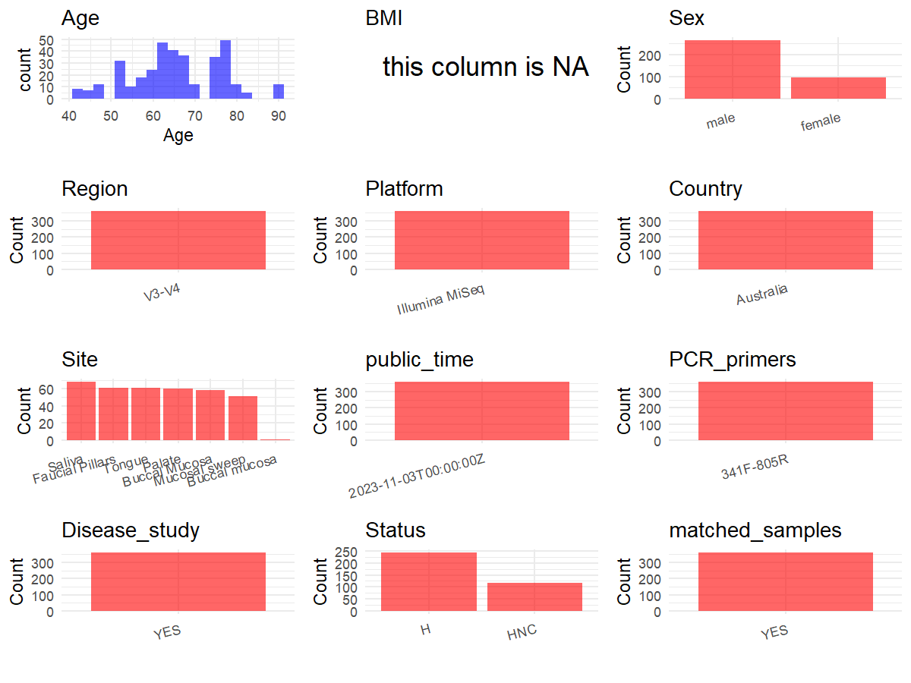

R Notebook: Metadata Processing Workflow
================

# Step 1: Obtain Initial Metadata from Each Project

To obtain the initial metadata: 1. Search for the BioProject ID (e.g.,
“PRJEBXXXX”) on the [NCBI SRA
website](https://www.ncbi.nlm.nih.gov/Traces/study/). 2. In the “Select”
table, click on “Metadata” and download the file. 3. The downloaded file
is typically named “SraRunTable.csv” and contains metadata for the
project.

``` r
# Load necessary libraries
library(dplyr)
library(ggplot2)
library(cowplot)

# Set working directory (update this path to your local directory)
setwd("D:/metadata/2/PRJNA901226")

# Read the initial metadata files
initial_meta<-read.csv("SraRunTable.csv",header = T)

# Combine the two metadata files
#meta <- rbind(initial_meta, initial_meta1)

#Remove entries non-oral samples
initial_meta <- subset(initial_meta,BioSampleModel != "Metagenome or environmental")

# Check the number of samples containing "HT" in Sample.Name (e.g., healthy controls)
#nrow(subset(meta, grepl("HT", Sample.Name)))

# Display the first few rows of the metadata
head(initial_meta)
```

    ##           Run AGE Assay.Type AvgSpotLen     Bases
    ## 1 SRR22346331  71   AMPLICON        600  94368293
    ## 2 SRR22346332  65   AMPLICON        597  51290490
    ## 3 SRR22346333  71   AMPLICON        600 140180785
    ## 4 SRR22346334  71   AMPLICON        600 169178643
    ## 5 SRR22346335  71   AMPLICON        600 156317205
    ## 6 SRR22346336  71   AMPLICON        600 100278306
    ##                                            BIOMATERIAL_PROVIDER  BioProject
    ## 1 Dheeraj Pandey\\, Sydney Swallow Centre\\, St George Hospital PRJNA901226
    ## 2 Dheeraj Pandey\\, Sydney Swallow Centre\\, St George Hospital PRJNA901226
    ## 3 Dheeraj Pandey\\, Sydney Swallow Centre\\, St George Hospital PRJNA901226
    ## 4 Dheeraj Pandey\\, Sydney Swallow Centre\\, St George Hospital PRJNA901226
    ## 5 Dheeraj Pandey\\, Sydney Swallow Centre\\, St George Hospital PRJNA901226
    ## 6 Dheeraj Pandey\\, Sydney Swallow Centre\\, St George Hospital PRJNA901226
    ##      BioSample BioSampleModel     Bytes                Center.Name Consent
    ## 1 SAMN31709210          Human  59913690 MICROBIOME RESEARCH CENTRE  public
    ## 2 SAMN31708886          Human  34041227 MICROBIOME RESEARCH CENTRE  public
    ## 3 SAMN31709209          Human  88934007 MICROBIOME RESEARCH CENTRE  public
    ## 4 SAMN31709208          Human 101880312 MICROBIOME RESEARCH CENTRE  public
    ## 5 SAMN31709207          Human  95497165 MICROBIOME RESEARCH CENTRE  public
    ## 6 SAMN31709206          Human  61606856 MICROBIOME RESEARCH CENTRE  public
    ##   DATASTORE.filetype DATASTORE.provider                     DATASTORE.region
    ## 1   fastq,run.zq,sra         gs,ncbi,s3 gs.us-east1,ncbi.public,s3.us-east-1
    ## 2   fastq,run.zq,sra         gs,ncbi,s3 gs.us-east1,ncbi.public,s3.us-east-1
    ## 3   fastq,run.zq,sra         gs,ncbi,s3 gs.us-east1,ncbi.public,s3.us-east-1
    ## 4   fastq,run.zq,sra         gs,ncbi,s3 gs.us-east1,ncbi.public,s3.us-east-1
    ## 5   fastq,run.zq,sra         gs,ncbi,s3 gs.us-east1,ncbi.public,s3.us-east-1
    ## 6   fastq,run.zq,sra         gs,ncbi,s3 gs.us-east1,ncbi.public,s3.us-east-1
    ##    Experiment     Instrument         isolate Library.Name LibraryLayout
    ## 1 SRX18317797 Illumina MiSeq Healthy control         CS96        PAIRED
    ## 2 SRX18317796 Illumina MiSeq             HNC         OS42        PAIRED
    ## 3 SRX18317795 Illumina MiSeq Healthy control         CS95        PAIRED
    ## 4 SRX18317794 Illumina MiSeq Healthy control         CS94        PAIRED
    ## 5 SRX18317793 Illumina MiSeq Healthy control         CS93        PAIRED
    ## 6 SRX18317792 Illumina MiSeq Healthy control         CS92        PAIRED
    ##   LibrarySelection LibrarySource     Organism Platform          ReleaseDate
    ## 1              PCR   METAGENOMIC Homo sapiens ILLUMINA 2023-11-03T00:00:00Z
    ## 2              PCR   METAGENOMIC Homo sapiens ILLUMINA 2023-11-03T00:00:00Z
    ## 3              PCR   METAGENOMIC Homo sapiens ILLUMINA 2023-11-03T00:00:00Z
    ## 4              PCR   METAGENOMIC Homo sapiens ILLUMINA 2023-11-03T00:00:00Z
    ## 5              PCR   METAGENOMIC Homo sapiens ILLUMINA 2023-11-03T00:00:00Z
    ## 6              PCR   METAGENOMIC Homo sapiens ILLUMINA 2023-11-03T00:00:00Z
    ##            create_date version Sample.Name sampleid  sex SRA.Study
    ## 1 2022-11-19T09:30:00Z       1        CS96     CS96 male SRP408709
    ## 2 2022-11-19T09:29:00Z       1        OS42     OS42 male SRP408709
    ## 3 2022-11-19T09:29:00Z       1        CS95     CS95 male SRP408709
    ## 4 2022-11-19T09:29:00Z       1        CS94     CS94 male SRP408709
    ## 5 2022-11-19T09:30:00Z       1        CS93     CS93 male SRP408709
    ## 6 2022-11-19T09:29:00Z       1        CS92     CS92 male SRP408709
    ##            tissue Collection_Date geo_loc_name_country
    ## 1   Mucosal sweep                                     
    ## 2   Buccal Mucosa                                     
    ## 3          Palate                                     
    ## 4 Faucial Pillars                                     
    ## 5   Buccal Mucosa                                     
    ## 6          Tongue                                     
    ##   geo_loc_name_country_continent geo_loc_name HOST isolation_source lat_lon
    ## 1                                                                          
    ## 2                                                                          
    ## 3                                                                          
    ## 4                                                                          
    ## 5                                                                          
    ## 6

# Step 2: Create a Uniform Metadata Template

The uniform metadata should include the following columns:

1.  **BioProject**: Project ID (e.g., “PRJNA339212”)
2.  **Run**: Sample ID (e.g., “ERRXXXXXX” or “SRRXXXXXX”)
3.  **sample_name**: Original sample name submitted by the authors (not
    the database-assigned ID)
4.  **Age**: Age of the subject (if available)
5.  **BMI**: Body Mass Index (if available)
6.  **Sex**: Sex of the subject (“F” or “M”)
7.  **Region**: Targeted 16S rRNA region (e.g., “V3-V4”)
8.  **Platform**: Sequencing platform (e.g., “Illumina MiSeq”)
9.  **Country**: Country of sample origin (e.g., “China”)
10. **Site**: Sample site (e.g., “saliva”, “dental plaque”)
11. **public_time**: Data release date (format: “YYYY-MM-DD”)
12. **PCR_primers**: PCR primers used (e.g., “515F-806R”)
13. **title**: Title of the associated publication
14. **Disease_study**: Whether the study involves a disease (“YES” or
    “NO”)
15. **Status**: Disease status (e.g., “T2DM”, “HC”). Note: If the study
    includes both disease and healthy samples, this must be specified
    per sample.
16. **matched_samples**: matched samples (“YES” or “NO”)

``` r
# Create a uniform metadata dataframe
metadata <- data.frame(
  BioProject = initial_meta$BioProject,
  Run = initial_meta$Run,
  sample_name = initial_meta$Sample.Name,
  Age = initial_meta$AGE,
  BMI = NA,
  Sex=initial_meta$sex,
  Region = "V3-V4",
  Platform = initial_meta$Instrument,
  Country = "Australia",
  Site = initial_meta$tissue,
  public_time = initial_meta$ReleaseDate,
  Status = ifelse(initial_meta$isolate == "Healthy control", "H",
                  initial_meta$isolate),
  stringsAsFactors = FALSE
)
```

# Step 3: Manually Add Information from the Publication

Some information (e.g. PCR primers, study title, disease status) must be
manually extracted from the publication and added to the metadata.

``` r
# Add information obtained from the publication
metadata$PCR_primers <- "341F-805R"
metadata$title <- "Dysbiosis in Head and Neck Cancer: Determining Optimal Sampling Site for Oral Microbiome Collection"
metadata$Disease_study <- "YES"
# Assign disease status based on sample_name patterns
#metadata$Status<-"H"

fields <- c("Age", "Status", "Sex")

stopifnot(all(fields %in% colnames(metadata)))


has_duplicate <- metadata %>% 
  select(all_of(fields)) %>% 
  na.omit() %>%                
  duplicated() %>%             
  any()                        

metadata <- metadata %>% 
  mutate(matched_samples = if (has_duplicate) "YES" else "NO")

output_df <- metadata %>% 
  filter(matched_samples == "YES" | 
        (matched_samples == "NO" ))

cat("Total rows in output_df :", nrow(output_df), "\n")
```

    ## Total rows in output_df : 360

``` r
cat("YES rows                :", sum(output_df$matched_samples == "YES"), "\n")
```

    ## YES rows                : 360

``` r
cat("NO          :", sum(output_df$matched_samples == "NO"), "\n")
```

    ## NO          : 0

# Step 4: Summarize and Validate the Metadata

``` r
# Check the number of unique runs and sample names
print(paste("Number of unique runs:", length(unique(metadata$Run))))
```

    ## [1] "Number of unique runs: 360"

``` r
print(paste("Number of unique sample names:", length(unique(metadata$sample_name))))
```

    ## [1] "Number of unique sample names: 360"

# Step 5: Visualize the Metadata

``` r

```

<!-- -->

# Step 6: Finalize and Export the Metadata

``` r
# Reorder columns to match the desired format
metadata <- metadata[, c(
  "BioProject", "Run", "sample_name", "Age", "BMI", "Sex", 
  "Region", "Platform", "Country", "Site", "public_time", 
  "PCR_primers", "title", "Disease_study", "Status","matched_samples"
)]

# Export the uniform metadata to a CSV file
write.csv(metadata, file = "metadata.csv", quote = TRUE)
head(metadata)
```

    ##    BioProject         Run sample_name Age BMI  Sex Region       Platform
    ## 1 PRJNA901226 SRR22346331        CS96  71  NA male  V3-V4 Illumina MiSeq
    ## 2 PRJNA901226 SRR22346332        OS42  65  NA male  V3-V4 Illumina MiSeq
    ## 3 PRJNA901226 SRR22346333        CS95  71  NA male  V3-V4 Illumina MiSeq
    ## 4 PRJNA901226 SRR22346334        CS94  71  NA male  V3-V4 Illumina MiSeq
    ## 5 PRJNA901226 SRR22346335        CS93  71  NA male  V3-V4 Illumina MiSeq
    ## 6 PRJNA901226 SRR22346336        CS92  71  NA male  V3-V4 Illumina MiSeq
    ##     Country            Site          public_time PCR_primers
    ## 1 Australia   Mucosal sweep 2023-11-03T00:00:00Z   341F-805R
    ## 2 Australia   Buccal Mucosa 2023-11-03T00:00:00Z   341F-805R
    ## 3 Australia          Palate 2023-11-03T00:00:00Z   341F-805R
    ## 4 Australia Faucial Pillars 2023-11-03T00:00:00Z   341F-805R
    ## 5 Australia   Buccal Mucosa 2023-11-03T00:00:00Z   341F-805R
    ## 6 Australia          Tongue 2023-11-03T00:00:00Z   341F-805R
    ##                                                                                                 title
    ## 1 Dysbiosis in Head and Neck Cancer: Determining Optimal Sampling Site for Oral Microbiome Collection
    ## 2 Dysbiosis in Head and Neck Cancer: Determining Optimal Sampling Site for Oral Microbiome Collection
    ## 3 Dysbiosis in Head and Neck Cancer: Determining Optimal Sampling Site for Oral Microbiome Collection
    ## 4 Dysbiosis in Head and Neck Cancer: Determining Optimal Sampling Site for Oral Microbiome Collection
    ## 5 Dysbiosis in Head and Neck Cancer: Determining Optimal Sampling Site for Oral Microbiome Collection
    ## 6 Dysbiosis in Head and Neck Cancer: Determining Optimal Sampling Site for Oral Microbiome Collection
    ##   Disease_study Status matched_samples
    ## 1           YES      H             YES
    ## 2           YES    HNC             YES
    ## 3           YES      H             YES
    ## 4           YES      H             YES
    ## 5           YES      H             YES
    ## 6           YES      H             YES

## Notes for Students:

1.  **Metadata Accuracy**: Always cross-check the metadata with the
    original publication to ensure accuracy.
2.  **Manual Entries**: Columns like `PCR_primers`, and `Status` often
    require manual entry based on the publication.
3.  **Disease Status**: Be careful when assigning `Status`—some studies
    include both disease and healthy samples.
4.  **Visualization**: The plots help quickly identify the distribution
    of values in each column, which is useful for quality control.
5.  **Reproducibility**: Update the working directory and file paths to
    match your local environment.
