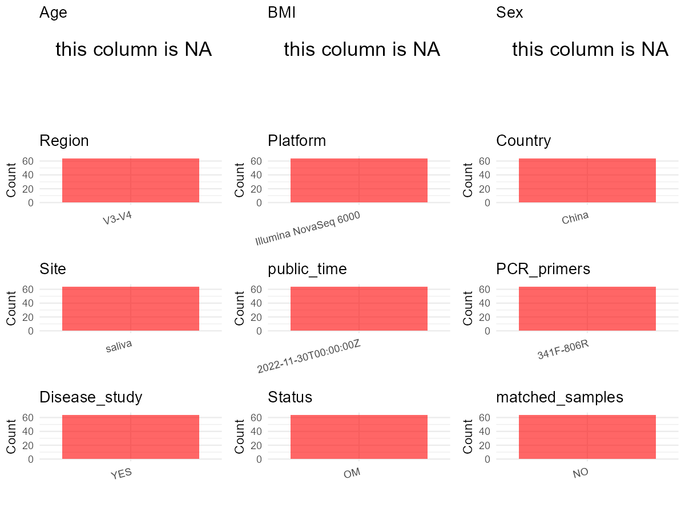

R Notebook: Metadata Processing Workflow
================

# Step 1: Obtain Initial Metadata from Each Project

To obtain the initial metadata: 1. Search for the BioProject ID (e.g.,
“PRJEBXXXX”) on the [NCBI SRA
website](https://www.ncbi.nlm.nih.gov/Traces/study/). 2. In the “Select”
table, click on “Metadata” and download the file. 3. The downloaded file
is typically named “SraRunTable.csv” and contains metadata for the
project.

``` r
# Load necessary libraries
library(dplyr)
library(ggplot2)
library(cowplot)

# Set working directory (update this path to your local directory)
setwd("E:/bioproject_YSD/PRJNA907138")

# Read the initial metadata files
initial_meta <- read.csv("SraRunTable.csv", header = T)

# Display the first few rows of the metadata
head(initial_meta)
```

    ##           Run Assay.Type AvgSpotLen    Bases  BioProject    BioSample
    ## 1 SRR22475660        WGS        488 61868640 PRJNA907138 SAMN31952798
    ## 2 SRR22475661        WGS        488 61802760 PRJNA907138 SAMN31952797
    ## 3 SRR22475662        WGS        488 61811544 PRJNA907138 SAMN31952796
    ## 4 SRR22475663        WGS        488 60384144 PRJNA907138 SAMN31952852
    ## 5 SRR22475664        WGS        488 64675128 PRJNA907138 SAMN31952851
    ## 6 SRR22475665        WGS        488 64091968 PRJNA907138 SAMN31952850
    ##                                  BioSampleModel    Bytes
    ## 1 MIMARKS.specimen,MIGS/MIMS/MIMARKS.human-oral 20647196
    ## 2 MIMARKS.specimen,MIGS/MIMS/MIMARKS.human-oral 19241781
    ## 3 MIMARKS.specimen,MIGS/MIMS/MIMARKS.human-oral 20407493
    ## 4 MIMARKS.specimen,MIGS/MIMS/MIMARKS.human-oral 20111258
    ## 5 MIMARKS.specimen,MIGS/MIMS/MIMARKS.human-oral 20431100
    ## 6 MIMARKS.specimen,MIGS/MIMS/MIMARKS.human-oral 20683005
    ##                                               Center.Name Collection_Date
    ## 1 THE FIRST AFFILIATED HOSPITAL OF SUN YAT-SEN UNIVERSITY      2021-12-30
    ## 2 THE FIRST AFFILIATED HOSPITAL OF SUN YAT-SEN UNIVERSITY      2021-12-30
    ## 3 THE FIRST AFFILIATED HOSPITAL OF SUN YAT-SEN UNIVERSITY      2021-12-30
    ## 4 THE FIRST AFFILIATED HOSPITAL OF SUN YAT-SEN UNIVERSITY      2021-12-30
    ## 5 THE FIRST AFFILIATED HOSPITAL OF SUN YAT-SEN UNIVERSITY      2021-12-30
    ## 6 THE FIRST AFFILIATED HOSPITAL OF SUN YAT-SEN UNIVERSITY      2021-12-30
    ##   Consent DATASTORE.filetype DATASTORE.provider
    ## 1  public   fastq,run.zq,sra         gs,ncbi,s3
    ## 2  public   fastq,run.zq,sra         gs,ncbi,s3
    ## 3  public   fastq,run.zq,sra         gs,ncbi,s3
    ## 4  public   fastq,run.zq,sra         gs,ncbi,s3
    ## 5  public   fastq,run.zq,sra         gs,ncbi,s3
    ## 6  public   fastq,run.zq,sra         gs,ncbi,s3
    ##                       DATASTORE.region env_broad_scale env_local_scale
    ## 1 gs.us-east1,ncbi.public,s3.us-east-1     oral mucosa          mucosa
    ## 2 gs.us-east1,ncbi.public,s3.us-east-1     oral mucosa          mucosa
    ## 3 gs.us-east1,ncbi.public,s3.us-east-1     oral mucosa          mucosa
    ## 4 gs.us-east1,ncbi.public,s3.us-east-1     oral mucosa          mucosa
    ## 5 gs.us-east1,ncbi.public,s3.us-east-1     oral mucosa          mucosa
    ## 6 gs.us-east1,ncbi.public,s3.us-east-1     oral mucosa          mucosa
    ##   env_medium  Experiment geo_loc_name_country geo_loc_name_country_continent
    ## 1     saliva SRX18441052                China                           Asia
    ## 2     saliva SRX18441051                China                           Asia
    ## 3     saliva SRX18441050                China                           Asia
    ## 4     saliva SRX18441049                China                           Asia
    ## 5     saliva SRX18441048                China                           Asia
    ## 6     saliva SRX18441047                China                           Asia
    ##      geo_loc_name         HOST            Instrument isol_growth_condt
    ## 1 China:Guangzhou Homo sapiens Illumina NovaSeq 6000     not collected
    ## 2 China:Guangzhou Homo sapiens Illumina NovaSeq 6000     not collected
    ## 3 China:Guangzhou Homo sapiens Illumina NovaSeq 6000     not collected
    ## 4 China:Guangzhou Homo sapiens Illumina NovaSeq 6000     not collected
    ## 5 China:Guangzhou Homo sapiens Illumina NovaSeq 6000     not collected
    ## 6 China:Guangzhou Homo sapiens Illumina NovaSeq 6000     not collected
    ##         lat_lon Library.Name LibraryLayout LibrarySelection LibrarySource
    ## 1 not collected patient05-PT        PAIRED      unspecified   METAGENOMIC
    ## 2 not collected patient05-BT        PAIRED      unspecified   METAGENOMIC
    ## 3 not collected patient04-PT        PAIRED      unspecified   METAGENOMIC
    ## 4 not collected patient32-PT        PAIRED      unspecified   METAGENOMIC
    ## 5 not collected patient32-BT        PAIRED      unspecified   METAGENOMIC
    ## 6 not collected patient31-PT        PAIRED      unspecified   METAGENOMIC
    ##          Organism PatientGroup patientID Platform          ReleaseDate
    ## 1 oral metagenome           PT patient05 ILLUMINA 2022-11-30T00:00:00Z
    ## 2 oral metagenome           BT patient05 ILLUMINA 2022-11-30T00:00:00Z
    ## 3 oral metagenome           PT patient04 ILLUMINA 2022-11-30T00:00:00Z
    ## 4 oral metagenome           PT patient32 ILLUMINA 2022-11-30T00:00:00Z
    ## 5 oral metagenome           BT patient32 ILLUMINA 2022-11-30T00:00:00Z
    ## 6 oral metagenome           PT patient31 ILLUMINA 2022-11-30T00:00:00Z
    ##            create_date version  Sample.Name SRA.Study        strain
    ## 1 2022-11-30T23:15:00Z       1 patient05-PT SRP410748 not collected
    ## 2 2022-11-30T23:15:00Z       1 patient05-BT SRP410748 not collected
    ## 3 2022-11-30T23:16:00Z       1 patient04-PT SRP410748 not collected
    ## 4 2022-11-30T23:16:00Z       1 patient32-PT SRP410748 not collected
    ## 5 2022-11-30T23:16:00Z       1 patient32-BT SRP410748 not collected
    ## 6 2022-11-30T23:16:00Z       1 patient31-PT SRP410748 not collected

# Step 2: Create a Uniform Metadata Template

The uniform metadata should include the following columns:

1.  **BioProject**: Project ID (e.g., “PRJNA339212”)
2.  **Run**: Sample ID (e.g., “ERRXXXXXX” or “SRRXXXXXX”)
3.  **sample_name**: Original sample name submitted by the authors (not
    the database-assigned ID)
4.  **Age**: Age of the subject (if available)
5.  **BMI**: Body Mass Index (if available)
6.  **Sex**: Sex of the subject (“F” or “M”)
7.  **Region**: Targeted 16S rRNA region (e.g., “V3-V4”)
8.  **Platform**: Sequencing platform (e.g., “Illumina MiSeq”)
9.  **Country**: Country of sample origin (e.g., “China”)
10. **Site**: Sample site (e.g., “saliva”, “dental plaque”)
11. **public_time**: Data release date (format: “YYYY-MM-DD”)
12. **PCR_primers**: PCR primers used (e.g., “515F-806R”)
13. **title**: Title of the associated publication
14. **Disease_study**: Whether the study involves a disease (“YES” or
    “NO”)
15. **Status**: Disease status (e.g., “T2DM”, “HC”). Note: If the study
    includes both disease and healthy samples, this must be specified
    per sample.
16. **matched_samples**: matched samples (“YES” or “NO”)

``` r
# Create a uniform metadata dataframe
metadata <- data.frame(
  BioProject = initial_meta$BioProject,
  Run = initial_meta$Run,
  sample_name = initial_meta$Sample.Name,
  Age = NA,
  BMI = NA,  
  Sex = NA,
  Region = "V3-V4",
  Platform = initial_meta$Instrument,
  Country = initial_meta$geo_loc_name_country,
  Site = initial_meta$env_medium,
  public_time = initial_meta$ReleaseDate,
  stringsAsFactors = FALSE
)
```

# Step 3: Manually Add Information from the Publication

Some information (e.g. PCR primers, study title, disease status) must be
manually extracted from the publication and added to the metadata.

``` r
# Add information obtained from the publication
metadata$PCR_primers <- "341F-806R"
metadata$title <- "Distinctive microbiota of delayed healing of oral mucositis after radiotherapy of nasopharyngeal carcinoma"
metadata$Disease_study <- "YES"
# Assign disease status based on status patterns
metadata$Status <- "OM"

# Check initial data distribution
cat("Initial sample distribution:\n")
```

    ## Initial sample distribution:

``` r
table(metadata$sample_name)
```

    ## 
    ## patient01-BT patient01-PT patient02-BT patient02-PT patient03-BT patient03-PT 
    ##            1            1            1            1            1            1 
    ## patient04-BT patient04-PT patient05-BT patient05-PT patient06-BT patient06-PT 
    ##            1            1            1            1            1            1 
    ## patient07-BT patient07-PT patient08-BT patient08-PT patient09-BT patient09-PT 
    ##            1            1            1            1            1            1 
    ## patient10-BT patient10-PT patient11-BT patient11-PT patient12-BT patient12-PT 
    ##            1            1            1            1            1            1 
    ## patient13-BT patient13-PT patient14-BT patient14-PT patient15-BT patient15-PT 
    ##            1            1            1            1            1            1 
    ## patient16-BT patient16-PT patient17-BT patient17-PT patient18-BT patient18-PT 
    ##            1            1            1            1            1            1 
    ## patient19-BT patient19-PT patient20-BT patient20-PT patient21-BT patient21-PT 
    ##            1            1            1            1            1            1 
    ## patient22-BT patient22-PT patient23-BT patient23-PT patient24-BT patient24-PT 
    ##            1            1            1            1            1            1 
    ## patient25-BT patient25-PT patient26-BT patient26-PT patient27-BT patient27-PT 
    ##            1            1            1            1            1            1 
    ## patient28-BT patient28-PT patient29-BT patient29-PT patient30-BT patient30-PT 
    ##            1            1            1            1            1            1 
    ## patient31-BT patient31-PT patient32-BT patient32-PT 
    ##            1            1            1            1

``` r
table(metadata$Site)
```

    ## 
    ## saliva 
    ##     64

``` r
# Calculate sampling frequency per subject
sample_counts <- table(metadata$sample_name)
cat("\nNumber of samples per subject:\n")
```

    ## 
    ## Number of samples per subject:

``` r
print(sample_counts)
```

    ## 
    ## patient01-BT patient01-PT patient02-BT patient02-PT patient03-BT patient03-PT 
    ##            1            1            1            1            1            1 
    ## patient04-BT patient04-PT patient05-BT patient05-PT patient06-BT patient06-PT 
    ##            1            1            1            1            1            1 
    ## patient07-BT patient07-PT patient08-BT patient08-PT patient09-BT patient09-PT 
    ##            1            1            1            1            1            1 
    ## patient10-BT patient10-PT patient11-BT patient11-PT patient12-BT patient12-PT 
    ##            1            1            1            1            1            1 
    ## patient13-BT patient13-PT patient14-BT patient14-PT patient15-BT patient15-PT 
    ##            1            1            1            1            1            1 
    ## patient16-BT patient16-PT patient17-BT patient17-PT patient18-BT patient18-PT 
    ##            1            1            1            1            1            1 
    ## patient19-BT patient19-PT patient20-BT patient20-PT patient21-BT patient21-PT 
    ##            1            1            1            1            1            1 
    ## patient22-BT patient22-PT patient23-BT patient23-PT patient24-BT patient24-PT 
    ##            1            1            1            1            1            1 
    ## patient25-BT patient25-PT patient26-BT patient26-PT patient27-BT patient27-PT 
    ##            1            1            1            1            1            1 
    ## patient28-BT patient28-PT patient29-BT patient29-PT patient30-BT patient30-PT 
    ##            1            1            1            1            1            1 
    ## patient31-BT patient31-PT patient32-BT patient32-PT 
    ##            1            1            1            1

``` r
# Create matched_samples column
metadata$matched_samples <- ifelse(metadata$sample_name %in% names(sample_counts[sample_counts >= 2]), "YES", "NO")

cat("\nMatched samples distribution:\n")
```

    ## 
    ## Matched samples distribution:

``` r
table(metadata$matched_samples)
```

    ## 
    ## NO 
    ## 64

``` r
# Identify samples for removal: single samples excluding saliva
single_samples <- names(sample_counts[sample_counts == 1])
samples_to_remove <- metadata$sample_name %in% single_samples & 
                     !(metadata$Site %in% c("saliva"))

cat("\nNumber of samples to be removed:", sum(samples_to_remove), "\n")
```

    ## 
    ## Number of samples to be removed: 0

``` r
# Remove identified samples
metadata_clean <- metadata[!samples_to_remove, ]

cat("\nFinal sample distribution after cleaning:\n")
```

    ## 
    ## Final sample distribution after cleaning:

``` r
table(metadata_clean$sample_name)
```

    ## 
    ## patient01-BT patient01-PT patient02-BT patient02-PT patient03-BT patient03-PT 
    ##            1            1            1            1            1            1 
    ## patient04-BT patient04-PT patient05-BT patient05-PT patient06-BT patient06-PT 
    ##            1            1            1            1            1            1 
    ## patient07-BT patient07-PT patient08-BT patient08-PT patient09-BT patient09-PT 
    ##            1            1            1            1            1            1 
    ## patient10-BT patient10-PT patient11-BT patient11-PT patient12-BT patient12-PT 
    ##            1            1            1            1            1            1 
    ## patient13-BT patient13-PT patient14-BT patient14-PT patient15-BT patient15-PT 
    ##            1            1            1            1            1            1 
    ## patient16-BT patient16-PT patient17-BT patient17-PT patient18-BT patient18-PT 
    ##            1            1            1            1            1            1 
    ## patient19-BT patient19-PT patient20-BT patient20-PT patient21-BT patient21-PT 
    ##            1            1            1            1            1            1 
    ## patient22-BT patient22-PT patient23-BT patient23-PT patient24-BT patient24-PT 
    ##            1            1            1            1            1            1 
    ## patient25-BT patient25-PT patient26-BT patient26-PT patient27-BT patient27-PT 
    ##            1            1            1            1            1            1 
    ## patient28-BT patient28-PT patient29-BT patient29-PT patient30-BT patient30-PT 
    ##            1            1            1            1            1            1 
    ## patient31-BT patient31-PT patient32-BT patient32-PT 
    ##            1            1            1            1

``` r
table(metadata_clean$Site)
```

    ## 
    ## saliva 
    ##     64

``` r
table(metadata_clean$matched_samples)
```

    ## 
    ## NO 
    ## 64

``` r
# Use cleaned dataset for subsequent analysis
metadata <- metadata_clean
```

# Step 4: Summarize and Validate the Metadata

``` r
# Check the number of unique runs and sample names
print(paste("Number of unique runs:", length(unique(metadata$Run))))
```

    ## [1] "Number of unique runs: 64"

``` r
print(paste("Number of unique sample names:", length(unique(metadata$sample_name))))
```

    ## [1] "Number of unique sample names: 64"

# Step 5: Visualize the Metadata

``` r

```


# Step 6: Finalize and Export the Metadata

``` r
# Reorder columns to match the desired format
metadata <- metadata[, c(
  "BioProject", "Run", "sample_name", "Age", "BMI", "Sex", 
  "Region", "Platform", "Country", "Site", "public_time", 
  "PCR_primers", "title", "Disease_study", "Status", "matched_samples"
)]

# Export the uniform metadata to a CSV file
write.csv(metadata, file = "metadata.csv", quote = TRUE)
head(metadata)
```

    ##    BioProject         Run  sample_name Age BMI Sex Region              Platform
    ## 1 PRJNA907138 SRR22475660 patient05-PT  NA  NA  NA  V3-V4 Illumina NovaSeq 6000
    ## 2 PRJNA907138 SRR22475661 patient05-BT  NA  NA  NA  V3-V4 Illumina NovaSeq 6000
    ## 3 PRJNA907138 SRR22475662 patient04-PT  NA  NA  NA  V3-V4 Illumina NovaSeq 6000
    ## 4 PRJNA907138 SRR22475663 patient32-PT  NA  NA  NA  V3-V4 Illumina NovaSeq 6000
    ## 5 PRJNA907138 SRR22475664 patient32-BT  NA  NA  NA  V3-V4 Illumina NovaSeq 6000
    ## 6 PRJNA907138 SRR22475665 patient31-PT  NA  NA  NA  V3-V4 Illumina NovaSeq 6000
    ##   Country   Site          public_time PCR_primers
    ## 1   China saliva 2022-11-30T00:00:00Z   341F-806R
    ## 2   China saliva 2022-11-30T00:00:00Z   341F-806R
    ## 3   China saliva 2022-11-30T00:00:00Z   341F-806R
    ## 4   China saliva 2022-11-30T00:00:00Z   341F-806R
    ## 5   China saliva 2022-11-30T00:00:00Z   341F-806R
    ## 6   China saliva 2022-11-30T00:00:00Z   341F-806R
    ##                                                                                                        title
    ## 1 Distinctive microbiota of delayed healing of oral mucositis after radiotherapy of nasopharyngeal carcinoma
    ## 2 Distinctive microbiota of delayed healing of oral mucositis after radiotherapy of nasopharyngeal carcinoma
    ## 3 Distinctive microbiota of delayed healing of oral mucositis after radiotherapy of nasopharyngeal carcinoma
    ## 4 Distinctive microbiota of delayed healing of oral mucositis after radiotherapy of nasopharyngeal carcinoma
    ## 5 Distinctive microbiota of delayed healing of oral mucositis after radiotherapy of nasopharyngeal carcinoma
    ## 6 Distinctive microbiota of delayed healing of oral mucositis after radiotherapy of nasopharyngeal carcinoma
    ##   Disease_study Status matched_samples
    ## 1           YES     OM              NO
    ## 2           YES     OM              NO
    ## 3           YES     OM              NO
    ## 4           YES     OM              NO
    ## 5           YES     OM              NO
    ## 6           YES     OM              NO

## Notes for Students:

1.  **Metadata Accuracy**: Always cross-check the metadata with the
    original publication to ensure accuracy.
2.  **Manual Entries**: Columns like `PCR_primers`, and `Status` often
    require manual entry based on the publication.
3.  **Disease Status**: Be careful when assigning `Status`—some studies
    include both disease and healthy samples.
4.  **Visualization**: The plots help quickly identify the distribution
    of values in each column, which is useful for quality control.
5.  **Reproducibility**: Update the working directory and file paths to
    match your local environment.
