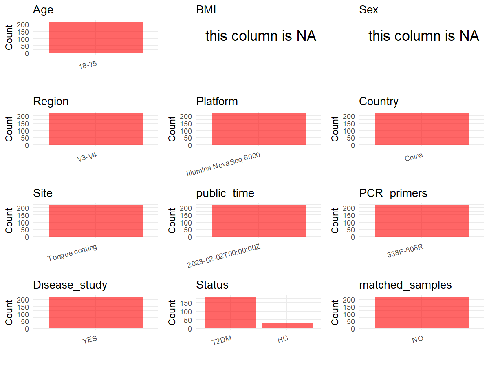

R Notebook: Metadata Processing Workflow
================

# Step 1: Obtain Initial Metadata from Each Project

To obtain the initial metadata: 1. Search for the BioProject ID (e.g.,
“PRJEBXXXX”) on the [NCBI SRA
website](https://www.ncbi.nlm.nih.gov/Traces/study/). 2. In the “Select”
table, click on “Metadata” and download the file. 3. The downloaded file
is typically named “SraRunTable.csv” and contains metadata for the
project.

``` r
# Load necessary libraries
library(dplyr)
library(ggplot2)
library(cowplot)

# Set working directory (update this path to your local directory)
setwd("E:/bioproject/PRJNA910326")

# Read the initial metadata files
initial_meta <- read.csv("SraRunTable.csv", header = T) 

# Remove entries non-oral samples
initial_meta <- initial_meta[initial_meta$Sample.Name != "DF", ]

# Display the first few rows of the metadata
head(initial_meta)
```

    ##           Run Assay.Type AvgSpotLen    Bases  BioProject    BioSample
    ## 1 SRR22711069   AMPLICON        495 39050550 PRJNA910326 SAMN32122688
    ## 2 SRR22711070   AMPLICON        492 37252272 PRJNA910326 SAMN32122687
    ## 3 SRR22711071   AMPLICON        493 42630203 PRJNA910326 SAMN32122686
    ## 4 SRR22711072   AMPLICON        494 35275058 PRJNA910326 SAMN32122685
    ## 5 SRR22711073   AMPLICON        495 40858290 PRJNA910326 SAMN32122684
    ## 6 SRR22711074   AMPLICON        492 38685960 PRJNA910326 SAMN32122683
    ##                BioSampleModel    Bytes              Center.Name Collection_Date
    ## 1 Metagenome or environmental 12313205 SCHOOL OF BASIC MEDICINE      2021-08-01
    ## 2 Metagenome or environmental 11983424 SCHOOL OF BASIC MEDICINE      2021-08-01
    ## 3 Metagenome or environmental 13591788 SCHOOL OF BASIC MEDICINE      2021-08-01
    ## 4 Metagenome or environmental 11356048 SCHOOL OF BASIC MEDICINE      2021-08-01
    ## 5 Metagenome or environmental 13184345 SCHOOL OF BASIC MEDICINE      2021-08-01
    ## 6 Metagenome or environmental 12555840 SCHOOL OF BASIC MEDICINE      2021-08-01
    ##   Consent DATASTORE.filetype DATASTORE.provider
    ## 1  public   fastq,run.zq,sra         gs,ncbi,s3
    ## 2  public   fastq,run.zq,sra         gs,ncbi,s3
    ## 3  public   fastq,run.zq,sra         gs,ncbi,s3
    ## 4  public   fastq,run.zq,sra         gs,ncbi,s3
    ## 5  public   fastq,run.zq,sra         gs,ncbi,s3
    ## 6  public   fastq,run.zq,sra         gs,ncbi,s3
    ##                       DATASTORE.region  Experiment geo_loc_name_country
    ## 1 gs.us-east1,ncbi.public,s3.us-east-1 SRX18672881                China
    ## 2 gs.us-east1,ncbi.public,s3.us-east-1 SRX18672880                China
    ## 3 gs.us-east1,ncbi.public,s3.us-east-1 SRX18672879                China
    ## 4 gs.us-east1,ncbi.public,s3.us-east-1 SRX18672878                China
    ## 5 gs.us-east1,ncbi.public,s3.us-east-1 SRX18672877                China
    ## 6 gs.us-east1,ncbi.public,s3.us-east-1 SRX18672876                China
    ##   geo_loc_name_country_continent   geo_loc_name         HOST
    ## 1                           Asia China:Shanghai Homo sapiens
    ## 2                           Asia China:Shanghai Homo sapiens
    ## 3                           Asia China:Shanghai Homo sapiens
    ## 4                           Asia China:Shanghai Homo sapiens
    ## 5                           Asia China:Shanghai Homo sapiens
    ## 6                           Asia China:Shanghai Homo sapiens
    ##              Instrument isolation_source          lat_lon Library.Name
    ## 1 Illumina NovaSeq 6000   Tongue coating 31.11 N 121.35 E        DT094
    ## 2 Illumina NovaSeq 6000   Tongue coating 31.11 N 121.35 E        DT093
    ## 3 Illumina NovaSeq 6000   Tongue coating 31.11 N 121.35 E        DT092
    ## 4 Illumina NovaSeq 6000   Tongue coating 31.11 N 121.35 E        DT091
    ## 5 Illumina NovaSeq 6000   Tongue coating 31.11 N 121.35 E        DT090
    ## 6 Illumina NovaSeq 6000   Tongue coating 31.11 N 121.35 E        DT089
    ##   LibraryLayout LibrarySelection LibrarySource              Organism Platform
    ## 1        PAIRED              PCR   METAGENOMIC human oral metagenome ILLUMINA
    ## 2        PAIRED              PCR   METAGENOMIC human oral metagenome ILLUMINA
    ## 3        PAIRED              PCR   METAGENOMIC human oral metagenome ILLUMINA
    ## 4        PAIRED              PCR   METAGENOMIC human oral metagenome ILLUMINA
    ## 5        PAIRED              PCR   METAGENOMIC human oral metagenome ILLUMINA
    ## 6        PAIRED              PCR   METAGENOMIC human oral metagenome ILLUMINA
    ##            ReleaseDate          create_date version Sample.Name SRA.Study
    ## 1 2023-02-02T00:00:00Z 2022-12-13T14:41:00Z       1       DT094 SRP412812
    ## 2 2023-02-02T00:00:00Z 2022-12-13T14:41:00Z       1       DT093 SRP412812
    ## 3 2023-02-02T00:00:00Z 2022-12-13T14:41:00Z       1       DT092 SRP412812
    ## 4 2023-02-02T00:00:00Z 2022-12-13T14:41:00Z       1       DT091 SRP412812
    ## 5 2023-02-02T00:00:00Z 2022-12-13T14:41:00Z       1       DT090 SRP412812
    ## 6 2023-02-02T00:00:00Z 2022-12-13T14:42:00Z       1       DT089 SRP412812

# Step 2: Create a Uniform Metadata Template

The uniform metadata should include the following columns:

1.  **BioProject**: Project ID (e.g., “PRJNA339212”)
2.  **Run**: Sample ID (e.g., “ERRXXXXXX” or “SRRXXXXXX”)
3.  **sample_name**: Original sample name submitted by the authors (not
    the database-assigned ID)
4.  **Age**: Age of the subject (if available)
5.  **BMI**: Body Mass Index (if available)
6.  **Sex**: Sex of the subject (“F” or “M”)
7.  **Region**: Targeted 16S rRNA region (e.g., “V3-V4”)
8.  **Platform**: Sequencing platform (e.g., “Illumina MiSeq”)
9.  **Country**: Country of sample origin (e.g., “China”)
10. **Site**: Sample site (e.g., “saliva”, “dental plaque”)
11. **public_time**: Data release date (format: “YYYY-MM-DD”)
12. **PCR_primers**: PCR primers used (e.g., “515F-806R”)
13. **title**: Title of the associated publication
14. **Disease_study**: Whether the study involves a disease (“YES” or
    “NO”)
15. **Status**: Disease status (e.g., “T2DM”, “HC”). Note: If the study
    includes both disease and healthy samples, this must be specified
    per sample.
16. **matched_samples**: matched samples (“YES” or “NO”)

``` r
# Create a uniform metadata dataframe
metadata <- data.frame(
  BioProject = initial_meta$BioProject,
  Run = initial_meta$Run,
  sample_name = initial_meta$Sample.Name,
  Age = "18-75", 
  BMI = NA,  
  Sex = NA,
  Platform = initial_meta$Instrument,
  Country = initial_meta$geo_loc_name_country,
  Site = initial_meta$isolation_source,
  public_time = initial_meta$ReleaseDate,
  stringsAsFactors = FALSE
)

# Remove entries non-oral samples
metadata <- metadata %>% 
  filter(Site != "gut" | is.na(Site))
```

# Step 3: Manually Add Information from the Publication

Some information (e.g. PCR primers, study title, disease status) must be
manually extracted from the publication and added to the metadata.

``` r
# Add information obtained from the publication
metadata$Region <- "V3-V4"
metadata$PCR_primers <- "338F-806R"
metadata$title <- "Distribution characteristics of oral microbiota and its relationship with intestinal microbiota in patients with type 2 diabetes mellitus"
metadata$Disease_study <- "YES"
# Assign disease status based on sample_name patterns
metadata <- metadata %>%
  mutate(
    Status = case_when(
      grepl("^DT", sample_name) ~ "T2DM",
      grepl("^HT", sample_name) ~ "HC",
      TRUE ~ NA)
    )

# Check initial data distribution
cat("Initial sample distribution:\n")
```

    ## Initial sample distribution:

``` r
table(metadata$sample_name)
```

    ## 
    ## DF001 DF003 DF004 DF005 DF006 DF007 DF008 DF010 DF011 DF012 DF013 DF014 DF015 
    ##     1     1     1     1     1     1     1     1     1     1     1     1     1 
    ## DF016 DF017 DF018 DF019 DF020 DF021 DF023 DF024 DF026 DF027 DF029 DF030 DF031 
    ##     1     1     1     1     1     1     1     1     1     1     1     1     1 
    ## DF032 DF035 DF036 DF037 DF038 DF039 DF041 DF042 DF043 DF045 DF046 DF048 DF050 
    ##     1     1     1     1     1     1     1     1     1     1     1     1     1 
    ## DF051 DF052 DF053 DF058 DF061 DF062 DF063 DF064 DF066 DF067 DF068 DF069 DF070 
    ##     1     1     1     1     1     1     1     1     1     1     1     1     1 
    ## DF071 DF073 DF074 DF075 DF079 DF083 DF085 DF086 DF090 DF091 DF092 DF094 DF095 
    ##     1     1     1     1     1     1     1     1     1     1     1     1     1 
    ## DF096 DF098 DF100 DF106 DF107 DF109 DF111 DF112 DF113 DF119 DF122 DF129 DF131 
    ##     1     1     1     1     1     1     1     1     1     1     1     1     1 
    ## DF132 DF133 DF134 DF135 DF136 DF137 DF138 DF140 DF145 DF147 DF148 DF150 DF152 
    ##     1     1     1     1     1     1     1     1     1     1     1     1     1 
    ## DF153 DF156 DF157 DF160 DF161 DF163 DF165 DF166 DF168 DF172 DF173 DF174 DF175 
    ##     1     1     1     1     1     1     1     1     1     1     1     1     1 
    ## DF176 DF179 DF181 DF182 DF183 DF186 DF187 DF191 DF193 DF194 DF197 DF199 DF200 
    ##     1     1     1     1     1     1     1     1     1     1     1     1     1 
    ## DF201 DF202 DF203 DF206 DF207 DF208 DF210 DF212 DF213 DF217 DF218 DF219 DT001 
    ##     1     1     1     1     1     1     1     1     1     1     1     1     1 
    ## DT003 DT004 DT005 DT006 DT007 DT008 DT010 DT011 DT012 DT013 DT014 DT015 DT016 
    ##     1     1     1     1     1     1     1     1     1     1     1     1     1 
    ## DT017 DT018 DT019 DT020 DT021 DT023 DT024 DT026 DT027 DT028 DT029 DT030 DT031 
    ##     1     1     1     1     1     1     1     1     1     1     1     1     1 
    ## DT032 DT034 DT035 DT036 DT037 DT038 DT039 DT040 DT041 DT042 DT043 DT045 DT046 
    ##     1     1     1     1     1     1     1     1     1     1     1     1     1 
    ## DT047 DT048 DT050 DT051 DT052 DT053 DT054 DT055 DT057 DT058 DT061 DT062 DT063 
    ##     1     1     1     1     1     1     1     1     1     1     1     1     1 
    ## DT064 DT065 DT066 DT067 DT068 DT069 DT070 DT071 DT073 DT074 DT075 DT076 DT077 
    ##     1     1     1     1     1     1     1     1     1     1     1     1     1 
    ## DT079 DT082 DT083 DT085 DT086 DT087 DT088 DT089 DT090 DT091 DT092 DT093 DT094 
    ##     1     1     1     1     1     1     1     1     1     1     1     1     1 
    ## DT095 DT096 DT097 DT098 DT099 DT100 DT101 DT103 DT104 DT105 DT106 DT107 DT109 
    ##     1     1     1     1     1     1     1     1     1     1     1     1     1 
    ## DT110 DT111 DT112 DT113 DT114 DT115 DT116 DT118 DT119 DT120 DT122 DT123 DT124 
    ##     1     1     1     1     1     1     1     1     1     1     1     1     1 
    ## DT125 DT126 DT127 DT128 DT129 DT131 DT132 DT133 DT134 DT135 DT136 DT137 DT138 
    ##     1     1     1     1     1     1     1     1     1     1     1     1     1 
    ## DT139 DT140 DT143 DT144 DT145 DT147 DT148 DT150 DT152 DT154 DT155 DT156 DT157 
    ##     1     1     1     1     1     1     1     1     1     1     1     1     1 
    ## DT159 DT160 DT161 DT162 DT163 DT165 DT166 DT167 DT168 DT169 DT170 DT171 DT172 
    ##     1     1     1     1     1     1     1     1     1     1     1     1     1 
    ## DT173 DT174 DT175 DT176 DT177 DT178 DT179 DT181 DT182 DT183 DT185 DT186 DT187 
    ##     1     1     1     1     1     1     1     1     1     1     1     1     1 
    ## DT188 DT191 DT192 DT193 DT194 DT195 DT197 DT198 DT199 DT200 DT201 DT202 DT203 
    ##     1     1     1     1     1     1     1     1     1     1     1     1     1 
    ## DT205 DT206 DT207 DT208 DT209 DT210 DT212 DT213 DT215 DT216 DT217 DT218 DT219 
    ##     1     1     1     1     1     1     1     1     1     1     1     1     1 
    ## DT225 HT001 HT002 HT003 HT004 HT005 HT006 HT007 HT008 HT009 HT010 HT011 HT012 
    ##     1     1     1     1     1     1     1     1     1     1     1     1     1 
    ## HT013 HT014 HT015 HT016 HT017 HT018 HT019 HT020 HT021 HT022 HT023 HT024 HT025 
    ##     1     1     1     1     1     1     1     1     1     1     1     1     1 
    ## HT026 HT027 HT028 HT029 HT030 HT031 HT032 HT033 HT034 
    ##     1     1     1     1     1     1     1     1     1

``` r
table(metadata$Site)
```

    ## 
    ##            Gut Tongue coating 
    ##            129            218

``` r
# Calculate sampling frequency per subject
sample_counts <- table(metadata$sample_name)
cat("\nNumber of samples per subject:\n")
```

    ## 
    ## Number of samples per subject:

``` r
print(sample_counts)
```

    ## 
    ## DF001 DF003 DF004 DF005 DF006 DF007 DF008 DF010 DF011 DF012 DF013 DF014 DF015 
    ##     1     1     1     1     1     1     1     1     1     1     1     1     1 
    ## DF016 DF017 DF018 DF019 DF020 DF021 DF023 DF024 DF026 DF027 DF029 DF030 DF031 
    ##     1     1     1     1     1     1     1     1     1     1     1     1     1 
    ## DF032 DF035 DF036 DF037 DF038 DF039 DF041 DF042 DF043 DF045 DF046 DF048 DF050 
    ##     1     1     1     1     1     1     1     1     1     1     1     1     1 
    ## DF051 DF052 DF053 DF058 DF061 DF062 DF063 DF064 DF066 DF067 DF068 DF069 DF070 
    ##     1     1     1     1     1     1     1     1     1     1     1     1     1 
    ## DF071 DF073 DF074 DF075 DF079 DF083 DF085 DF086 DF090 DF091 DF092 DF094 DF095 
    ##     1     1     1     1     1     1     1     1     1     1     1     1     1 
    ## DF096 DF098 DF100 DF106 DF107 DF109 DF111 DF112 DF113 DF119 DF122 DF129 DF131 
    ##     1     1     1     1     1     1     1     1     1     1     1     1     1 
    ## DF132 DF133 DF134 DF135 DF136 DF137 DF138 DF140 DF145 DF147 DF148 DF150 DF152 
    ##     1     1     1     1     1     1     1     1     1     1     1     1     1 
    ## DF153 DF156 DF157 DF160 DF161 DF163 DF165 DF166 DF168 DF172 DF173 DF174 DF175 
    ##     1     1     1     1     1     1     1     1     1     1     1     1     1 
    ## DF176 DF179 DF181 DF182 DF183 DF186 DF187 DF191 DF193 DF194 DF197 DF199 DF200 
    ##     1     1     1     1     1     1     1     1     1     1     1     1     1 
    ## DF201 DF202 DF203 DF206 DF207 DF208 DF210 DF212 DF213 DF217 DF218 DF219 DT001 
    ##     1     1     1     1     1     1     1     1     1     1     1     1     1 
    ## DT003 DT004 DT005 DT006 DT007 DT008 DT010 DT011 DT012 DT013 DT014 DT015 DT016 
    ##     1     1     1     1     1     1     1     1     1     1     1     1     1 
    ## DT017 DT018 DT019 DT020 DT021 DT023 DT024 DT026 DT027 DT028 DT029 DT030 DT031 
    ##     1     1     1     1     1     1     1     1     1     1     1     1     1 
    ## DT032 DT034 DT035 DT036 DT037 DT038 DT039 DT040 DT041 DT042 DT043 DT045 DT046 
    ##     1     1     1     1     1     1     1     1     1     1     1     1     1 
    ## DT047 DT048 DT050 DT051 DT052 DT053 DT054 DT055 DT057 DT058 DT061 DT062 DT063 
    ##     1     1     1     1     1     1     1     1     1     1     1     1     1 
    ## DT064 DT065 DT066 DT067 DT068 DT069 DT070 DT071 DT073 DT074 DT075 DT076 DT077 
    ##     1     1     1     1     1     1     1     1     1     1     1     1     1 
    ## DT079 DT082 DT083 DT085 DT086 DT087 DT088 DT089 DT090 DT091 DT092 DT093 DT094 
    ##     1     1     1     1     1     1     1     1     1     1     1     1     1 
    ## DT095 DT096 DT097 DT098 DT099 DT100 DT101 DT103 DT104 DT105 DT106 DT107 DT109 
    ##     1     1     1     1     1     1     1     1     1     1     1     1     1 
    ## DT110 DT111 DT112 DT113 DT114 DT115 DT116 DT118 DT119 DT120 DT122 DT123 DT124 
    ##     1     1     1     1     1     1     1     1     1     1     1     1     1 
    ## DT125 DT126 DT127 DT128 DT129 DT131 DT132 DT133 DT134 DT135 DT136 DT137 DT138 
    ##     1     1     1     1     1     1     1     1     1     1     1     1     1 
    ## DT139 DT140 DT143 DT144 DT145 DT147 DT148 DT150 DT152 DT154 DT155 DT156 DT157 
    ##     1     1     1     1     1     1     1     1     1     1     1     1     1 
    ## DT159 DT160 DT161 DT162 DT163 DT165 DT166 DT167 DT168 DT169 DT170 DT171 DT172 
    ##     1     1     1     1     1     1     1     1     1     1     1     1     1 
    ## DT173 DT174 DT175 DT176 DT177 DT178 DT179 DT181 DT182 DT183 DT185 DT186 DT187 
    ##     1     1     1     1     1     1     1     1     1     1     1     1     1 
    ## DT188 DT191 DT192 DT193 DT194 DT195 DT197 DT198 DT199 DT200 DT201 DT202 DT203 
    ##     1     1     1     1     1     1     1     1     1     1     1     1     1 
    ## DT205 DT206 DT207 DT208 DT209 DT210 DT212 DT213 DT215 DT216 DT217 DT218 DT219 
    ##     1     1     1     1     1     1     1     1     1     1     1     1     1 
    ## DT225 HT001 HT002 HT003 HT004 HT005 HT006 HT007 HT008 HT009 HT010 HT011 HT012 
    ##     1     1     1     1     1     1     1     1     1     1     1     1     1 
    ## HT013 HT014 HT015 HT016 HT017 HT018 HT019 HT020 HT021 HT022 HT023 HT024 HT025 
    ##     1     1     1     1     1     1     1     1     1     1     1     1     1 
    ## HT026 HT027 HT028 HT029 HT030 HT031 HT032 HT033 HT034 
    ##     1     1     1     1     1     1     1     1     1

``` r
# Create matched_samples column
metadata$matched_samples <- ifelse(metadata$sample_name %in% names(sample_counts[sample_counts >= 2]), "YES", "NO")

cat("\nMatched samples distribution:\n")
```

    ## 
    ## Matched samples distribution:

``` r
table(metadata$matched_samples)
```

    ## 
    ##  NO 
    ## 347

``` r
# Identify samples for removal: single samples excluding saliva and tongue coat
single_samples <- names(sample_counts[sample_counts == 1])
samples_to_remove <- metadata$sample_name %in% single_samples & 
                     !(metadata$Site %in% c("saliva", "tongue coat", "Tongue coating"))

cat("\nNumber of samples to be removed:", sum(samples_to_remove), "\n")
```

    ## 
    ## Number of samples to be removed: 129

``` r
# Remove identified samples
metadata_clean <- metadata[!samples_to_remove, ]

cat("\nFinal sample distribution after cleaning:\n")
```

    ## 
    ## Final sample distribution after cleaning:

``` r
table(metadata_clean$sample_name)
```

    ## 
    ## DT001 DT003 DT004 DT005 DT006 DT007 DT008 DT010 DT011 DT012 DT013 DT014 DT015 
    ##     1     1     1     1     1     1     1     1     1     1     1     1     1 
    ## DT016 DT017 DT018 DT019 DT020 DT021 DT023 DT024 DT026 DT027 DT028 DT029 DT030 
    ##     1     1     1     1     1     1     1     1     1     1     1     1     1 
    ## DT031 DT032 DT034 DT035 DT036 DT037 DT038 DT039 DT040 DT041 DT042 DT043 DT045 
    ##     1     1     1     1     1     1     1     1     1     1     1     1     1 
    ## DT046 DT047 DT048 DT050 DT051 DT052 DT053 DT054 DT055 DT057 DT058 DT061 DT062 
    ##     1     1     1     1     1     1     1     1     1     1     1     1     1 
    ## DT063 DT064 DT065 DT066 DT067 DT068 DT069 DT070 DT071 DT073 DT074 DT075 DT076 
    ##     1     1     1     1     1     1     1     1     1     1     1     1     1 
    ## DT077 DT079 DT082 DT083 DT085 DT086 DT087 DT088 DT089 DT090 DT091 DT092 DT093 
    ##     1     1     1     1     1     1     1     1     1     1     1     1     1 
    ## DT094 DT095 DT096 DT097 DT098 DT099 DT100 DT101 DT103 DT104 DT105 DT106 DT107 
    ##     1     1     1     1     1     1     1     1     1     1     1     1     1 
    ## DT109 DT110 DT111 DT112 DT113 DT114 DT115 DT116 DT118 DT119 DT120 DT122 DT123 
    ##     1     1     1     1     1     1     1     1     1     1     1     1     1 
    ## DT124 DT125 DT126 DT127 DT128 DT129 DT131 DT132 DT133 DT134 DT135 DT136 DT137 
    ##     1     1     1     1     1     1     1     1     1     1     1     1     1 
    ## DT138 DT139 DT140 DT143 DT144 DT145 DT147 DT148 DT150 DT152 DT154 DT155 DT156 
    ##     1     1     1     1     1     1     1     1     1     1     1     1     1 
    ## DT157 DT159 DT160 DT161 DT162 DT163 DT165 DT166 DT167 DT168 DT169 DT170 DT171 
    ##     1     1     1     1     1     1     1     1     1     1     1     1     1 
    ## DT172 DT173 DT174 DT175 DT176 DT177 DT178 DT179 DT181 DT182 DT183 DT185 DT186 
    ##     1     1     1     1     1     1     1     1     1     1     1     1     1 
    ## DT187 DT188 DT191 DT192 DT193 DT194 DT195 DT197 DT198 DT199 DT200 DT201 DT202 
    ##     1     1     1     1     1     1     1     1     1     1     1     1     1 
    ## DT203 DT205 DT206 DT207 DT208 DT209 DT210 DT212 DT213 DT215 DT216 DT217 DT218 
    ##     1     1     1     1     1     1     1     1     1     1     1     1     1 
    ## DT219 DT225 HT001 HT002 HT003 HT004 HT005 HT006 HT007 HT008 HT009 HT010 HT011 
    ##     1     1     1     1     1     1     1     1     1     1     1     1     1 
    ## HT012 HT013 HT014 HT015 HT016 HT017 HT018 HT019 HT020 HT021 HT022 HT023 HT024 
    ##     1     1     1     1     1     1     1     1     1     1     1     1     1 
    ## HT025 HT026 HT027 HT028 HT029 HT030 HT031 HT032 HT033 HT034 
    ##     1     1     1     1     1     1     1     1     1     1

``` r
table(metadata_clean$Site)
```

    ## 
    ## Tongue coating 
    ##            218

``` r
table(metadata_clean$matched_samples)
```

    ## 
    ##  NO 
    ## 218

``` r
# Use cleaned dataset for subsequent analysis
metadata <- metadata_clean
```

# Step 4: Summarize and Validate the Metadata

``` r
# Check the number of unique runs and sample names
print(paste("Number of unique runs:", length(unique(metadata$Run))))
```

    ## [1] "Number of unique runs: 218"

``` r
print(paste("Number of unique sample names:", length(unique(metadata$sample_name))))
```

    ## [1] "Number of unique sample names: 218"

# Step 5: Visualize the Metadata

``` r

```

<!-- -->

# Step 6: Finalize and Export the Metadata

``` r
# Reorder columns to match the desired format
metadata <- metadata[, c(
  "BioProject", "Run", "sample_name", "Age", "BMI", "Sex", 
  "Region", "Platform", "Country", "Site", "public_time", 
  "PCR_primers", "title", "Disease_study", "Status", "matched_samples"
)]

# Export the uniform metadata to a CSV file
write.csv(metadata, file = "metadata.csv", quote = FALSE)
head(metadata)
```

    ##    BioProject         Run sample_name   Age BMI Sex Region
    ## 1 PRJNA910326 SRR22711069       DT094 18-75  NA  NA  V3-V4
    ## 2 PRJNA910326 SRR22711070       DT093 18-75  NA  NA  V3-V4
    ## 3 PRJNA910326 SRR22711071       DT092 18-75  NA  NA  V3-V4
    ## 4 PRJNA910326 SRR22711072       DT091 18-75  NA  NA  V3-V4
    ## 5 PRJNA910326 SRR22711073       DT090 18-75  NA  NA  V3-V4
    ## 6 PRJNA910326 SRR22711074       DT089 18-75  NA  NA  V3-V4
    ##                Platform Country           Site          public_time PCR_primers
    ## 1 Illumina NovaSeq 6000   China Tongue coating 2023-02-02T00:00:00Z   338F-806R
    ## 2 Illumina NovaSeq 6000   China Tongue coating 2023-02-02T00:00:00Z   338F-806R
    ## 3 Illumina NovaSeq 6000   China Tongue coating 2023-02-02T00:00:00Z   338F-806R
    ## 4 Illumina NovaSeq 6000   China Tongue coating 2023-02-02T00:00:00Z   338F-806R
    ## 5 Illumina NovaSeq 6000   China Tongue coating 2023-02-02T00:00:00Z   338F-806R
    ## 6 Illumina NovaSeq 6000   China Tongue coating 2023-02-02T00:00:00Z   338F-806R
    ##                                                                                                                                       title
    ## 1 Distribution characteristics of oral microbiota and its relationship with intestinal microbiota in patients with type 2 diabetes mellitus
    ## 2 Distribution characteristics of oral microbiota and its relationship with intestinal microbiota in patients with type 2 diabetes mellitus
    ## 3 Distribution characteristics of oral microbiota and its relationship with intestinal microbiota in patients with type 2 diabetes mellitus
    ## 4 Distribution characteristics of oral microbiota and its relationship with intestinal microbiota in patients with type 2 diabetes mellitus
    ## 5 Distribution characteristics of oral microbiota and its relationship with intestinal microbiota in patients with type 2 diabetes mellitus
    ## 6 Distribution characteristics of oral microbiota and its relationship with intestinal microbiota in patients with type 2 diabetes mellitus
    ##   Disease_study Status matched_samples
    ## 1           YES   T2DM              NO
    ## 2           YES   T2DM              NO
    ## 3           YES   T2DM              NO
    ## 4           YES   T2DM              NO
    ## 5           YES   T2DM              NO
    ## 6           YES   T2DM              NO

## Notes for Students:

1.  **Metadata Accuracy**: Always cross-check the metadata with the
    original publication to ensure accuracy.
2.  **Manual Entries**: Columns like `PCR_primers`, and `Status` often
    require manual entry based on the publication.
3.  **Disease Status**: Be careful when assigning `Status`—some studies
    include both disease and healthy samples.
4.  **Visualization**: The plots help quickly identify the distribution
    of values in each column, which is useful for quality control.
5.  **Reproducibility**: Update the working directory and file paths to
    match your local environment.
