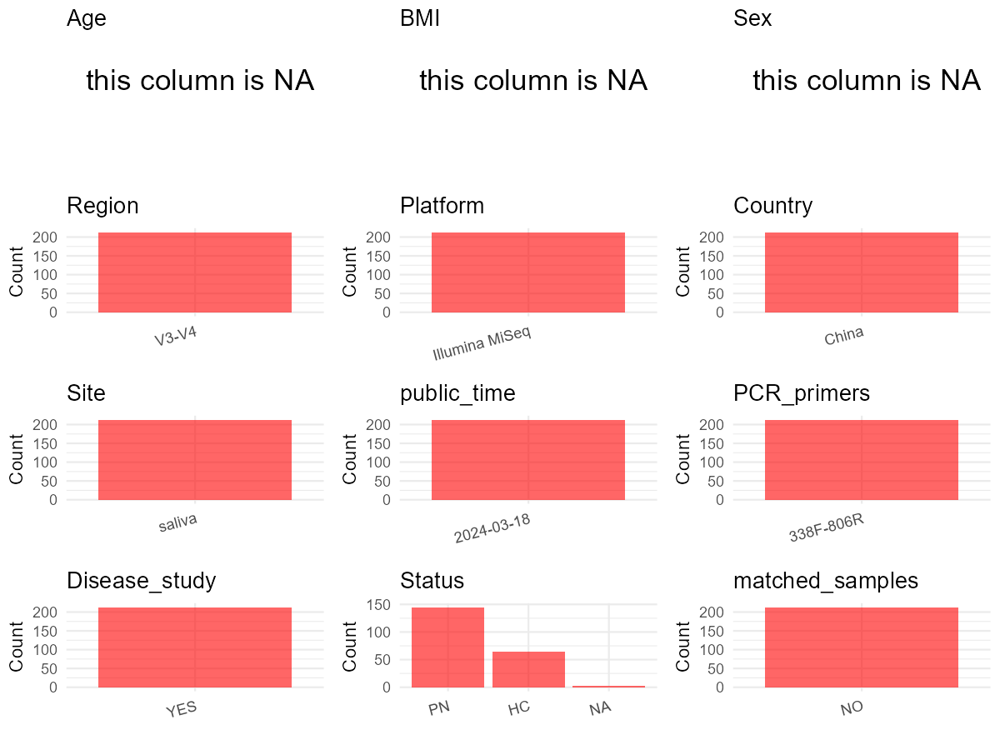

R Notebook: Metadata Processing Workflow
================

# Step 1: Obtain Initial Metadata from Each Project

To obtain the initial metadata: 1. Search for the BioProject ID (e.g.,
“PRJEBXXXX”) on the [NCBI SRA
website](https://www.ncbi.nlm.nih.gov/Traces/study/). 2. In the “Select”
table, click on “Metadata” and download the file. 3. The downloaded file
is typically named “SraRunTable.csv” and contains metadata for the
project.

``` r
# Load necessary libraries
library(dplyr)
library(ggplot2)
library(cowplot)

# Set working directory (update this path to your local directory)
setwd("D:/oral_project/PRJNA979793")

# Read the initial metadata files
initial_meta<-read.csv("SraRunTable.csv",header = T)

# Combine the two metadata files
#meta <- rbind(initial_meta, initial_meta1)

#Remove entries non-oral samples
#initial_meta <- subset(initial_meta,isolate %in% c("saliva","tongue coat"))

# Check the number of samples containing "HT" in Sample.Name (e.g., healthy controls)
#nrow(subset(meta, grepl("HT", Sample.Name)))

# Display the first few rows of the metadata
head(initial_meta)
```

    ##           Run Assay.Type AvgSpotLen    Bases  BioProject    BioSample
    ## 1 SRR24873460   AMPLICON        502 47870218 PRJNA979793 SAMN34436092
    ## 2 SRR24873461   AMPLICON        502 59993518 PRJNA979793 SAMN34436091
    ## 3 SRR24873462   AMPLICON        502 69837236 PRJNA979793 SAMN34436090
    ## 4 SRR24873463   AMPLICON        502 52921342 PRJNA979793 SAMN34436089
    ## 5 SRR24873464   AMPLICON        502 47468618 PRJNA979793 SAMN34436017
    ## 6 SRR24873465   AMPLICON        502 58353986 PRJNA979793 SAMN34436088
    ##                BioSampleModel    Bytes
    ## 1 Metagenome or environmental 16545995
    ## 2 Metagenome or environmental 20065127
    ## 3 Metagenome or environmental 24316053
    ## 4 Metagenome or environmental 17845894
    ## 5 Metagenome or environmental 17450195
    ## 6 Metagenome or environmental 19931449
    ##                                                      Center.Name
    ## 1 HOSPITAL OF CHENGDU UNIVERSITY OF TRADITIONAL CHINESE MEDICINE
    ## 2 HOSPITAL OF CHENGDU UNIVERSITY OF TRADITIONAL CHINESE MEDICINE
    ## 3 HOSPITAL OF CHENGDU UNIVERSITY OF TRADITIONAL CHINESE MEDICINE
    ## 4 HOSPITAL OF CHENGDU UNIVERSITY OF TRADITIONAL CHINESE MEDICINE
    ## 5 HOSPITAL OF CHENGDU UNIVERSITY OF TRADITIONAL CHINESE MEDICINE
    ## 6 HOSPITAL OF CHENGDU UNIVERSITY OF TRADITIONAL CHINESE MEDICINE
    ##   Collection_Date Consent DATASTORE.filetype DATASTORE.provider
    ## 1      2022-04-25  public   fastq,run.zq,sra         gs,ncbi,s3
    ## 2      2022-04-22  public   fastq,run.zq,sra         gs,ncbi,s3
    ## 3      2022-04-23  public   fastq,run.zq,sra         gs,ncbi,s3
    ## 4      2022-04-23  public   fastq,run.zq,sra         gs,ncbi,s3
    ## 5      2022-05-09  public   fastq,run.zq,sra         gs,ncbi,s3
    ## 6      2022-04-23  public   fastq,run.zq,sra         gs,ncbi,s3
    ##                       DATASTORE.region  Experiment geo_loc_name_country
    ## 1 gs.us-east1,ncbi.public,s3.us-east-1 SRX20637537                China
    ## 2 gs.us-east1,ncbi.public,s3.us-east-1 SRX20637536                China
    ## 3 gs.us-east1,ncbi.public,s3.us-east-1 SRX20637535                China
    ## 4 gs.us-east1,ncbi.public,s3.us-east-1 SRX20637534                China
    ## 5 gs.us-east1,ncbi.public,s3.us-east-1 SRX20637533                China
    ## 6 gs.us-east1,ncbi.public,s3.us-east-1 SRX20637532                China
    ##   geo_loc_name_country_continent  geo_loc_name         HOST     Instrument
    ## 1                           Asia China:Sichuan Homo sapiens Illumina MiSeq
    ## 2                           Asia China:Sichuan Homo sapiens Illumina MiSeq
    ## 3                           Asia China:Sichuan Homo sapiens Illumina MiSeq
    ## 4                           Asia China:Sichuan Homo sapiens Illumina MiSeq
    ## 5                           Asia China:Sichuan Homo sapiens Illumina MiSeq
    ## 6                           Asia China:Sichuan Homo sapiens Illumina MiSeq
    ##   isolation_source lat_lon Library.Name LibraryLayout LibrarySelection
    ## 1           saliva missing SAMN34436092        PAIRED              PCR
    ## 2           saliva missing SAMN34436091        PAIRED              PCR
    ## 3           saliva missing SAMN34436090        PAIRED              PCR
    ## 4           saliva missing SAMN34436089        PAIRED              PCR
    ## 5           saliva missing SAMN34436017        PAIRED              PCR
    ## 6           saliva missing SAMN34436088        PAIRED              PCR
    ##   LibrarySource                Organism Platform          ReleaseDate
    ## 1   METAGENOMIC human saliva metagenome ILLUMINA 2024-03-18T00:00:00Z
    ## 2   METAGENOMIC human saliva metagenome ILLUMINA 2024-03-18T00:00:00Z
    ## 3   METAGENOMIC human saliva metagenome ILLUMINA 2024-03-18T00:00:00Z
    ## 4   METAGENOMIC human saliva metagenome ILLUMINA 2024-03-18T00:00:00Z
    ## 5   METAGENOMIC human saliva metagenome ILLUMINA 2024-03-18T00:00:00Z
    ## 6   METAGENOMIC human saliva metagenome ILLUMINA 2024-03-18T00:00:00Z
    ##                replicate          create_date version Sample.Name SRA.Study
    ## 1 biological replicate 3 2023-06-08T03:50:00Z       1     K0423_8 SRP441762
    ## 2 biological replicate 2 2023-06-08T03:50:00Z       1     K0423_7 SRP441762
    ## 3 biological replicate 1 2023-06-08T03:50:00Z       1     K0423_6 SRP441762
    ## 4 biological replicate 3 2023-06-08T03:50:00Z       1     K0423_4 SRP441762
    ## 5 biological replicate 3 2023-06-08T03:50:00Z       1         CK9 SRP441762
    ## 6 biological replicate 2 2023-06-08T03:50:00Z       1     K0423_2 SRP441762

# Step 2: Create a Uniform Metadata Template

The uniform metadata should include the following columns:

1.  **BioProject**: Project ID (e.g., “PRJNA339212”)
2.  **Run**: Sample ID (e.g., “ERRXXXXXX” or “SRRXXXXXX”)
3.  **sample_name**: Original sample name submitted by the authors (not
    the database-assigned ID)
4.  **Age**: Age of the subject (if available)
5.  **BMI**: Body Mass Index (if available)
6.  **Sex**: Sex of the subject (“F” or “M”)
7.  **Region**: Targeted 16S rRNA region (e.g., “V3-V4”)
8.  **Platform**: Sequencing platform (e.g., “Illumina MiSeq”)
9.  **Country**: Country of sample origin (e.g., “China”)
10. **Site**: Sample site (e.g., “saliva”, “dental plaque”)
11. **public_time**: Data release date (format: “YYYY-MM-DD”)
12. **PCR_primers**: PCR primers used (e.g., “515F-806R”)
13. **title**: Title of the associated publication
14. **Disease_study**: Whether the study involves a disease (“YES” or
    “NO”)
15. **Status**: Disease status (e.g., “T2DM”, “HC”). Note: If the study
    includes both disease and healthy samples, this must be specified
    per sample.
16. **matched_samples**: matched samples (“YES” or “NO”)

``` r
# Create a uniform metadata dataframe
metadata <- data.frame(
  BioProject = initial_meta$BioProject,
  Run = initial_meta$Run,
  sample_name = initial_meta$Sample.Name,
  Age = NA,
  BMI = NA,
  Sex = NA,
  Platform = initial_meta$Instrument,
  Country = initial_meta$geo_loc_name_country,
  Site = initial_meta$isolation_source,
  public_time = "2024-03-18",
  stringsAsFactors = FALSE
)
```

# Step 3: Manually Add Information from the Publication

Some information (e.g. PCR primers, study title, disease status) must be
manually extracted from the publication and added to the metadata.

``` r
# Add information obtained from the publication
metadata$PCR_primers <- "338F-806R"
metadata$title <- "Saliva icrobiome erived signatures: expected to become a potential biomarker for pulmonary nodules (MCEPN-1)"
metadata$Disease_study <- "YES"
metadata$Region<- "V3-V4"
# Assign disease status based on sample_name patterns
metadata$Status <- "HC"
metadata <- metadata %>%
  mutate(Status = case_when(
    grepl("CK", sample_name) ~ "HC",
    grepl("K0", sample_name) ~ "PN"
  ))

keep_subjects<-subset(metadata,Site %in% "saliva")
#remove subjects without Saliva samples
metadata<-subset(metadata,sample_name %in% keep_subjects$sample_name)
#get subjects sampling counts
sample_counts <- table(metadata$sample_name)
# Create matched_samples column, any subjects have >=2 samples will be label "YES", otherwise "NO"
metadata$matched_samples <- ifelse(metadata$sample_name %in% names(sample_counts[sample_counts >= 2]), "YES", "NO")
```

# Step 4: Summarize and Validate the Metadata

``` r
# Check the number of unique runs and sample names
print(paste("Number of unique runs:", length(unique(metadata$Run))))
```

    ## [1] "Number of unique runs: 213"

``` r
print(paste("Number of unique sample names:", length(unique(metadata$sample_name))))
```

    ## [1] "Number of unique sample names: 213"

# Step 5: Visualize the Metadata

``` r

```

<!-- -->

# Step 6: Finalize and Export the Metadata

``` r
# Reorder columns to match the desired format
metadata <- metadata[, c(
  "BioProject", "Run", "sample_name", "Age", "BMI", "Sex", 
  "Region", "Platform", "Country", "Site", "public_time", 
  "PCR_primers", "title", "Disease_study", "Status","matched_samples"
)]

# Export the uniform metadata to a CSV file
write.csv(metadata, file = "metadata.csv", quote = FALSE)
head(metadata)
```

    ##    BioProject         Run sample_name Age BMI Sex Region       Platform Country
    ## 1 PRJNA979793 SRR24873460     K0423_8  NA  NA  NA  V3-V4 Illumina MiSeq   China
    ## 2 PRJNA979793 SRR24873461     K0423_7  NA  NA  NA  V3-V4 Illumina MiSeq   China
    ## 3 PRJNA979793 SRR24873462     K0423_6  NA  NA  NA  V3-V4 Illumina MiSeq   China
    ## 4 PRJNA979793 SRR24873463     K0423_4  NA  NA  NA  V3-V4 Illumina MiSeq   China
    ## 5 PRJNA979793 SRR24873464         CK9  NA  NA  NA  V3-V4 Illumina MiSeq   China
    ## 6 PRJNA979793 SRR24873465     K0423_2  NA  NA  NA  V3-V4 Illumina MiSeq   China
    ##     Site public_time PCR_primers
    ## 1 saliva  2024-03-18   338F-806R
    ## 2 saliva  2024-03-18   338F-806R
    ## 3 saliva  2024-03-18   338F-806R
    ## 4 saliva  2024-03-18   338F-806R
    ## 5 saliva  2024-03-18   338F-806R
    ## 6 saliva  2024-03-18   338F-806R
    ##                                                                                                          title
    ## 1 Saliva icrobiome erived signatures: expected to become a potential biomarker for pulmonary nodules (MCEPN-1)
    ## 2 Saliva icrobiome erived signatures: expected to become a potential biomarker for pulmonary nodules (MCEPN-1)
    ## 3 Saliva icrobiome erived signatures: expected to become a potential biomarker for pulmonary nodules (MCEPN-1)
    ## 4 Saliva icrobiome erived signatures: expected to become a potential biomarker for pulmonary nodules (MCEPN-1)
    ## 5 Saliva icrobiome erived signatures: expected to become a potential biomarker for pulmonary nodules (MCEPN-1)
    ## 6 Saliva icrobiome erived signatures: expected to become a potential biomarker for pulmonary nodules (MCEPN-1)
    ##   Disease_study Status matched_samples
    ## 1           YES     PN              NO
    ## 2           YES     PN              NO
    ## 3           YES     PN              NO
    ## 4           YES     PN              NO
    ## 5           YES     HC              NO
    ## 6           YES     PN              NO

## Notes for Students:

1.  **Metadata Accuracy**: Always cross-check the metadata with the
    original publication to ensure accuracy.
2.  **Manual Entries**: Columns like `PCR_primers`, and `Status` often
    require manual entry based on the publication.
3.  **Disease Status**: Be careful when assigning `Status`—some studies
    include both disease and healthy samples.
4.  **Visualization**: The plots help quickly identify the distribution
    of values in each column, which is useful for quality control.
5.  **Reproducibility**: Update the working directory and file paths to
    match your local environment.
