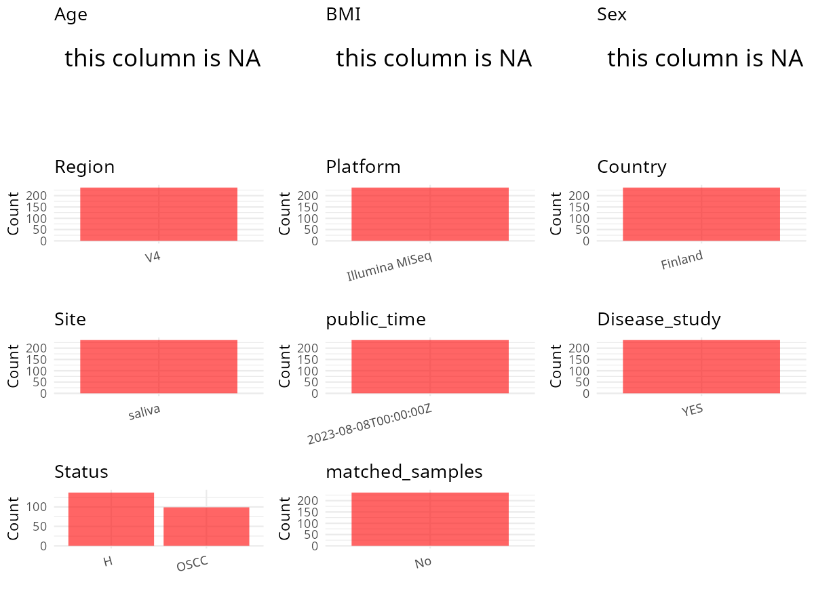

R Notebook: Metadata Processing Workflow
================

# Step 1: Obtain Initial Metadata from Each Project

To obtain the initial metadata: 1. Search for the BioProject ID (e.g.,
“PRJEBXXXX”) on the [NCBI SRA
website](https://www.ncbi.nlm.nih.gov/Traces/study/). 2. In the “Select”
table, click on “Metadata” and download the file. 3. The downloaded file
is typically named “SraRunTable.csv” and contains metadata for the
project.

``` r
# Load necessary libraries
library(dplyr)
library(ggplot2)
library(cowplot)
library(stringr)

# Set working directory (update this path to your local directory)
setwd("/home/hby/oral_project/PRJNA997108")

# Read the initial metadata files
initial_meta <- read.csv("SraRunTable.csv", header = T)

# Combine the two metadata files
# meta <- rbind(initial_meta, initial_meta1)

# Remove entries non-oral samples
# initial_meta <- subset(initial_meta,isolate %in% c("saliva","tongue coat"))

# Check the number of samples containing "HT" in Sample.Name (e.g., healthy controls)
# nrow(subset(meta, grepl("HT", Sample.Name)))

# Display the first few rows of the metadata
head(initial_meta)
```

    ##           Run alcohol_drinker Assay.Type AvgSpotLen    Bases  BioProject    BioSample                              BioSampleModel    Bytes                             Center.Name
    ## 1 SRR25380163   not collected   AMPLICON        502 12544980 PRJNA997108 SAMN36664576 MIMARKS.survey,MIGS/MIMS/MIMARKS.human-oral  7220261 ACADEMIC CENTRE FOR DENTISTRY AMSTERDAM
    ## 2 SRR25380164              no   AMPLICON        502 22362594 PRJNA997108 SAMN36664575 MIMARKS.survey,MIGS/MIMS/MIMARKS.human-oral 12466395 ACADEMIC CENTRE FOR DENTISTRY AMSTERDAM
    ## 3 SRR25380165             yes   AMPLICON        502 19947472 PRJNA997108 SAMN36664574 MIMARKS.survey,MIGS/MIMS/MIMARKS.human-oral 10637665 ACADEMIC CENTRE FOR DENTISTRY AMSTERDAM
    ## 4 SRR25380166             yes   AMPLICON        502 21468532 PRJNA997108 SAMN36664573 MIMARKS.survey,MIGS/MIMS/MIMARKS.human-oral 11980965 ACADEMIC CENTRE FOR DENTISTRY AMSTERDAM
    ## 5 SRR25380167             yes   AMPLICON        502 23809860 PRJNA997108 SAMN36664572 MIMARKS.survey,MIGS/MIMS/MIMARKS.human-oral 13122857 ACADEMIC CENTRE FOR DENTISTRY AMSTERDAM
    ## 6 SRR25380168              no   AMPLICON        502 11210162 PRJNA997108 SAMN36664571 MIMARKS.survey,MIGS/MIMS/MIMARKS.human-oral  6427126 ACADEMIC CENTRE FOR DENTISTRY AMSTERDAM
    ##   Collection_Date            collection_method Consent DATASTORE.filetype DATASTORE.provider                     DATASTORE.region env_broad_scale              env_local_scale
    ## 1  not applicable Paraffin-stimulated spitting  public   fastq,run.zq,sra         gs,ncbi,s3 gs.us-east1,ncbi.public,s3.us-east-1           human oral cavity [UBERON:0000167]
    ## 2  not applicable Paraffin-stimulated spitting  public   fastq,run.zq,sra         gs,ncbi,s3 gs.us-east1,ncbi.public,s3.us-east-1           human oral cavity [UBERON:0000167]
    ## 3  not applicable Paraffin-stimulated spitting  public   fastq,run.zq,sra         gs,ncbi,s3 gs.us-east1,ncbi.public,s3.us-east-1           human oral cavity [UBERON:0000167]
    ## 4  not applicable Paraffin-stimulated spitting  public   fastq,run.zq,sra         gs,ncbi,s3 gs.us-east1,ncbi.public,s3.us-east-1           human oral cavity [UBERON:0000167]
    ## 5  not applicable Paraffin-stimulated spitting  public   fastq,run.zq,sra         gs,ncbi,s3 gs.us-east1,ncbi.public,s3.us-east-1           human oral cavity [UBERON:0000167]
    ## 6  not applicable Paraffin-stimulated spitting  public   fastq,run.zq,sra         gs,ncbi,s3 gs.us-east1,ncbi.public,s3.us-east-1           human oral cavity [UBERON:0000167]
    ##   env_material  Experiment COUNTRY geo_loc_name_country_continent      geo_loc_name host_health_state         HOST BMI AGE sex host_subject_id     Instrument             lat_lon
    ## 1       saliva SRX21118650 Finland                         Europe Finland: Helsinki                 H Homo sapiens  NA  NA  NA             D19 Illumina MiSeq 60.1695 N 24.9355 E
    ## 2       saliva SRX21118649 Finland                         Europe Finland: Helsinki              OSCC Homo sapiens  NA  NA  NA            D109 Illumina MiSeq 60.1695 N 24.9355 E
    ## 3       saliva SRX21118648 Finland                         Europe Finland: Helsinki              OSCC Homo sapiens  NA  NA  NA            D108 Illumina MiSeq 60.1695 N 24.9355 E
    ## 4       saliva SRX21118647 Finland                         Europe Finland: Helsinki              OSCC Homo sapiens  NA  NA  NA            D106 Illumina MiSeq 60.1695 N 24.9355 E
    ## 5       saliva SRX21118646 Finland                         Europe Finland: Helsinki              OSCC Homo sapiens  NA  NA  NA            D105 Illumina MiSeq 60.1695 N 24.9355 E
    ## 6       saliva SRX21118645 Finland                         Europe Finland: Helsinki              OSCC Homo sapiens  NA  NA  NA            D104 Illumina MiSeq 60.1695 N 24.9355 E
    ##   Library.Name LibraryLayout LibrarySelection LibrarySource                                                                                                              organism_count
    ## 1       D19.t2        PAIRED              PCR   METAGENOMIC 0.0576328120876173 ng/microl (16S qPCR product); 0.0210993562317997 ng/microl (28S qPCR product); 480 Candida CFU/ml saliva
    ## 2      D109.t1        PAIRED              PCR   METAGENOMIC 1.95104721102705 ng/microl (16S qPCR product); 0.000846328543414267 ng/microl (28S qPCR product); 330 Candida CFU/ml saliva
    ## 3      D108.t1        PAIRED              PCR   METAGENOMIC 0.737417179424077 ng/microl (16S qPCR product); 0.000307757357462844 ng/microl (28S qPCR product); 90 Candida CFU/ml saliva
    ## 4      D106.t1        PAIRED              PCR   METAGENOMIC   2.47772498959292 ng/microl (16S qPCR product); 1.38454948465585E-06 ng/microl (28S qPCR product); 0 Candida CFU/ml saliva
    ## 5      D105.t1        PAIRED              PCR   METAGENOMIC     2.549226923221 ng/microl (16S qPCR product); 0.000117435229928598 ng/microl (28S qPCR product); 0 Candida CFU/ml saliva
    ## 6      D104.t1        PAIRED              PCR   METAGENOMIC   1.04934948986885 ng/microl (16S qPCR product); 1.38454948465585E-06 ng/microl (28S qPCR product); 0 Candida CFU/ml saliva
    ##                Organism Platform ENA.FIRST.PUBLIC..run.          ReleaseDate          create_date version    samp_size Sample_name smoker_categories SRA.Study
    ## 1 human oral metagenome ILLUMINA               2023/8/9 2023-08-08T00:00:00Z 2023-07-21T04:13:00Z       1  0.7 ml/5min      D19.t2     not collected SRP450691
    ## 2 human oral metagenome ILLUMINA               2023/8/9 2023-08-08T00:00:00Z 2023-07-21T04:13:00Z       1 13.6 ml/5min     D109.t1                no SRP450691
    ## 3 human oral metagenome ILLUMINA               2023/8/9 2023-08-08T00:00:00Z 2023-07-21T04:13:00Z       1 11.0 ml/5min     D108.t1                no SRP450691
    ## 4 human oral metagenome ILLUMINA               2023/8/9 2023-08-08T00:00:00Z 2023-07-21T04:13:00Z       1  5.2 ml/5min     D106.t1                no SRP450691
    ## 5 human oral metagenome ILLUMINA               2023/8/9 2023-08-08T00:00:00Z 2023-07-21T04:13:00Z       1  8.0 ml/5min     D105.t1            casual SRP450691
    ## 6 human oral metagenome ILLUMINA               2023/8/9 2023-08-08T00:00:00Z 2023-07-21T04:13:00Z       1  7.3 ml/5min     D104.t1               yes SRP450691

# Step 2: Create a Uniform Metadata Template

The uniform metadata should include the following columns:

1.  **BioProject**: Project ID (e.g., “PRJNA339212”)
2.  **Run**: Sample ID (e.g., “ERRXXXXXX” or “SRRXXXXXX”)
3.  **sample_name**: Original sample name submitted by the authors (not
    the database-assigned ID)
4.  **Age**: Age of the subject (if available)
5.  **BMI**: Body Mass Index (if available)
6.  **Sex**: Sex of the subject (“F” or “M”)
7.  **Region**: Targeted 16S rRNA region (e.g., “V3-V4”)
8.  **Platform**: Sequencing platform (e.g., “Illumina MiSeq”)
9.  **Country**: Country of sample origin (e.g., “China”)
10. **Site**: Sample site (e.g., “saliva”, “dental plaque”)
11. **public_time**: Data release date (format: “YYYY-MM-DD”)
12. **PCR_primers**: PCR primers used (e.g., “515F-806R”)
13. **title**: Title of the associated publication
14. **Disease_study**: Whether the study involves a disease (“YES” or
    “NO”)
15. **Status**: Disease status (e.g., “T2DM”, “HC”). Note: If the study
    includes both disease and healthy samples, this must be specified
    per sample.
16. **matched_samples**: matched samples (“YES” or “NO”)

``` r
# Create a uniform metadata dataframe
metadata <- data.frame(
  BioProject = initial_meta$BioProject,
  Run = initial_meta$Run,
  sample_name = initial_meta$Sample_name,
  BMI = initial_meta$BMI,
  Sex = initial_meta$sex,
  Age = initial_meta$AGE,
  Platform = initial_meta$Instrument,
  Country = initial_meta$COUNTRY,
  Site = initial_meta$env_material,
  public_time = initial_meta$ReleaseDate,
  Status = initial_meta$host_health_state,
  stringsAsFactors = FALSE
)

metadata <- metadata %>%
  filter(!if_any(everything(), ~ tolower(as.character(.x)) %in% c("uncalculated", "not applicable")))
```

# Step 3: Manually Add Information from the Publication

Some information (e.g. PCR primers, study title, disease status) must be
manually extracted from the publication and added to the metadata.

``` r
# Add information obtained from the publication
metadata$Region <- "V4"
metadata$PCR_primers <- "FWD:GTGCCAGCMGCCGCGGTAA; REV:ATTAGAWACCCBDGTAGTCC"
metadata$matched_samples <- "No"
metadata$title <- "Salivary microbiome profiles of oral cancer patients analyzed before and after treatment"
metadata$Disease_study <- "YES"
```

# Step 4: Summarize and Validate the Metadata

``` r
# Check the number of unique runs and sample names
print(paste("Number of unique runs:", length(unique(metadata$Run))))
```

    ## [1] "Number of unique runs: 236"

``` r
print(paste("Number of unique sample names:", length(unique(metadata$sample_name))))
```

    ## [1] "Number of unique sample names: 236"

# Step 5: Visualize the Metadata

``` r

```


# Step 6: Finalize and Export the Metadata

``` r
# Reorder columns to match the desired format
metadata <- metadata[, c(
  "BioProject", "Run", "sample_name", "Age", "BMI", "Sex",
  "Region", "Platform", "Country", "Site", "public_time",
  "PCR_primers", "title", "Disease_study", "Status", "matched_samples"
)]

# Export the uniform metadata to a CSV file
write.csv(metadata, file = "metadata.csv", quote = FALSE)
head(metadata)
```

    ##    BioProject         Run sample_name Age BMI Sex Region       Platform Country   Site          public_time                                       PCR_primers
    ## 1 PRJNA997108 SRR25380163      D19.t2  NA  NA  NA     V4 Illumina MiSeq Finland saliva 2023-08-08T00:00:00Z FWD:GTGCCAGCMGCCGCGGTAA; REV:ATTAGAWACCCBDGTAGTCC
    ## 2 PRJNA997108 SRR25380164     D109.t1  NA  NA  NA     V4 Illumina MiSeq Finland saliva 2023-08-08T00:00:00Z FWD:GTGCCAGCMGCCGCGGTAA; REV:ATTAGAWACCCBDGTAGTCC
    ## 3 PRJNA997108 SRR25380165     D108.t1  NA  NA  NA     V4 Illumina MiSeq Finland saliva 2023-08-08T00:00:00Z FWD:GTGCCAGCMGCCGCGGTAA; REV:ATTAGAWACCCBDGTAGTCC
    ## 4 PRJNA997108 SRR25380166     D106.t1  NA  NA  NA     V4 Illumina MiSeq Finland saliva 2023-08-08T00:00:00Z FWD:GTGCCAGCMGCCGCGGTAA; REV:ATTAGAWACCCBDGTAGTCC
    ## 5 PRJNA997108 SRR25380167     D105.t1  NA  NA  NA     V4 Illumina MiSeq Finland saliva 2023-08-08T00:00:00Z FWD:GTGCCAGCMGCCGCGGTAA; REV:ATTAGAWACCCBDGTAGTCC
    ## 6 PRJNA997108 SRR25380168     D104.t1  NA  NA  NA     V4 Illumina MiSeq Finland saliva 2023-08-08T00:00:00Z FWD:GTGCCAGCMGCCGCGGTAA; REV:ATTAGAWACCCBDGTAGTCC
    ##                                                                                      title Disease_study Status matched_samples
    ## 1 Salivary microbiome profiles of oral cancer patients analyzed before and after treatment           YES      H              No
    ## 2 Salivary microbiome profiles of oral cancer patients analyzed before and after treatment           YES   OSCC              No
    ## 3 Salivary microbiome profiles of oral cancer patients analyzed before and after treatment           YES   OSCC              No
    ## 4 Salivary microbiome profiles of oral cancer patients analyzed before and after treatment           YES   OSCC              No
    ## 5 Salivary microbiome profiles of oral cancer patients analyzed before and after treatment           YES   OSCC              No
    ## 6 Salivary microbiome profiles of oral cancer patients analyzed before and after treatment           YES   OSCC              No

## Notes for Students:

1.  **Metadata Accuracy**: Always cross-check the metadata with the
    original publication to ensure accuracy.
2.  **Manual Entries**: Columns like `PCR_primers`, and `Status` often
    require manual entry based on the publication.
3.  **Disease Status**: Be careful when assigning `Status`—some studies
    include both disease and healthy samples.
4.  **Visualization**: The plots help quickly identify the distribution
    of values in each column, which is useful for quality control.
5.  **Reproducibility**: Update the working directory and file paths to
    match your local environment.
