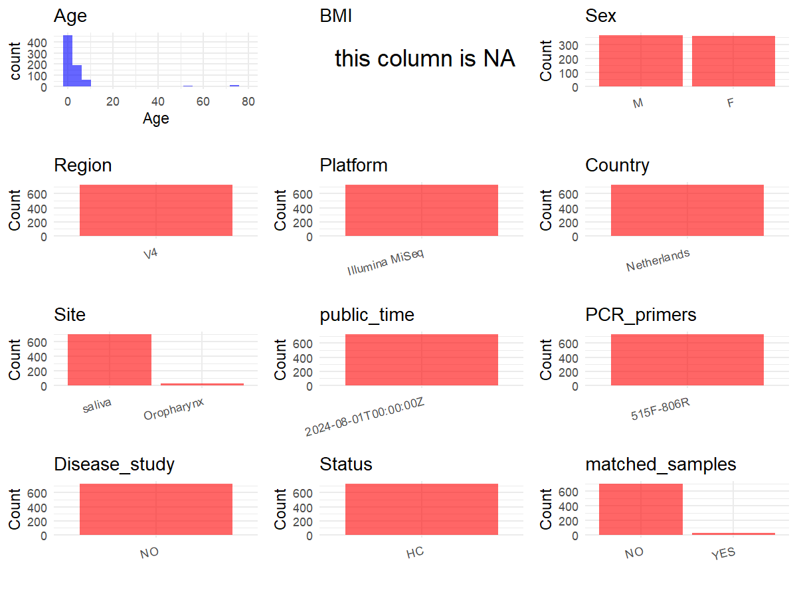

R Notebook: Metadata Processing Workflow
================

# Step 1: Obtain Initial Metadata from Each Project

To obtain the initial metadata: 1. Search for the BioProject ID (e.g.,
“PRJEBXXXX”) on the [NCBI SRA
website](https://www.ncbi.nlm.nih.gov/Traces/study/). 2. In the “Select”
table, click on “Metadata” and download the file. 3. The downloaded file
is typically named “SraRunTable.csv” and contains metadata for the
project.

``` r
# Load necessary libraries
library(dplyr)
library(ggplot2)
library(cowplot)

# Set working directory (update this path to your local directory)
setwd("E:/bioproject/PRJNA997934")

# Remove entries non-oral samples
exclude_sources <- c(
  "Zymo mock DNA (ZMCD)",
  "DNA isolation blanks (BD)",
  "Zymo mock bacteria (ZMCB)",
  "sequencing blanks (BP)",
  "nasopharynx"
)

# Read the initial metadata files
initial_meta <- read.csv("SraRunTable.csv", header = T) %>%
  filter(!isolation_source %in% exclude_sources)

# Display the first few rows of the metadata
head(initial_meta)
```

    ##           Run Assay.Type AvgSpotLen    Bases  BioProject    BioSample
    ## 1 SRR28036863   AMPLICON        501  9116848 PRJNA997934 SAMN40023842
    ## 2 SRR28036864   AMPLICON        501 10823509 PRJNA997934 SAMN40023701
    ## 3 SRR28036865   AMPLICON        501 11047142 PRJNA997934 SAMN40023841
    ## 4 SRR28036866   AMPLICON        501 11992972 PRJNA997934 SAMN40023840
    ## 5 SRR28036867   AMPLICON        501  9040437 PRJNA997934 SAMN40023839
    ## 6 SRR28036868   AMPLICON        501 11419656 PRJNA997934 SAMN40023838
    ##                BioSampleModel   Bytes
    ## 1 Metagenome or environmental 5158887
    ## 2 Metagenome or environmental 5988068
    ## 3 Metagenome or environmental 6046234
    ## 4 Metagenome or environmental 6620965
    ## 5 Metagenome or environmental 4947133
    ## 6 Metagenome or environmental 6119065
    ##                                                Center.Name Collection_Date
    ## 1 NATIONAL INSTITUTE FOR PUBLIC HEALTH AND THE ENVIRONMENT      2017-03-09
    ## 2 NATIONAL INSTITUTE FOR PUBLIC HEALTH AND THE ENVIRONMENT      2016-11-23
    ## 3 NATIONAL INSTITUTE FOR PUBLIC HEALTH AND THE ENVIRONMENT      2017-03-09
    ## 4 NATIONAL INSTITUTE FOR PUBLIC HEALTH AND THE ENVIRONMENT      2017-03-09
    ## 5 NATIONAL INSTITUTE FOR PUBLIC HEALTH AND THE ENVIRONMENT      2017-03-09
    ## 6 NATIONAL INSTITUTE FOR PUBLIC HEALTH AND THE ENVIRONMENT      2017-03-06
    ##   Consent DATASTORE.filetype DATASTORE.provider
    ## 1  public   fastq,run.zq,sra         gs,ncbi,s3
    ## 2  public   fastq,run.zq,sra         gs,ncbi,s3
    ## 3  public   fastq,run.zq,sra         gs,ncbi,s3
    ## 4  public   fastq,run.zq,sra         gs,ncbi,s3
    ## 5  public   fastq,run.zq,sra         gs,ncbi,s3
    ## 6  public   fastq,run.zq,sra         gs,ncbi,s3
    ##                       DATASTORE.region  Experiment geo_loc_name_country
    ## 1 gs.us-east1,ncbi.public,s3.us-east-1 SRX23688613          Netherlands
    ## 2 gs.us-east1,ncbi.public,s3.us-east-1 SRX23689018          Netherlands
    ## 3 gs.us-east1,ncbi.public,s3.us-east-1 SRX23688612          Netherlands
    ## 4 gs.us-east1,ncbi.public,s3.us-east-1 SRX23688611          Netherlands
    ## 5 gs.us-east1,ncbi.public,s3.us-east-1 SRX23688610          Netherlands
    ## 6 gs.us-east1,ncbi.public,s3.us-east-1 SRX23688609          Netherlands
    ##   geo_loc_name_country_continent           geo_loc_name         HOST
    ## 1                         Europe Netherlands: Bilthoven Homo sapiens
    ## 2                         Europe Netherlands: Bilthoven Homo sapiens
    ## 3                         Europe Netherlands: Bilthoven Homo sapiens
    ## 4                         Europe Netherlands: Bilthoven Homo sapiens
    ## 5                         Europe Netherlands: Bilthoven Homo sapiens
    ## 6                         Europe Netherlands: Bilthoven Homo sapiens
    ##       Instrument isolation_source                  lat_lon Library.Name
    ## 1 Illumina MiSeq           saliva 52.1187343 N 5.1890581 E          405
    ## 2 Illumina MiSeq           saliva 52.1187343 N 5.1890581 E          264
    ## 3 Illumina MiSeq           saliva 52.1187343 N 5.1890581 E          404
    ## 4 Illumina MiSeq           saliva 52.1187343 N 5.1890581 E          403
    ## 5 Illumina MiSeq           saliva 52.1187343 N 5.1890581 E          402
    ## 6 Illumina MiSeq           saliva 52.1187343 N 5.1890581 E          401
    ##   LibraryLayout LibrarySelection LibrarySource miseq_run_nr   Organism Platform
    ## 1        PAIRED              PCR   METAGENOMIC            2 metagenome ILLUMINA
    ## 2        PAIRED              PCR   METAGENOMIC            2 metagenome ILLUMINA
    ## 3        PAIRED              PCR   METAGENOMIC            2 metagenome ILLUMINA
    ## 4        PAIRED              PCR   METAGENOMIC            2 metagenome ILLUMINA
    ## 5        PAIRED              PCR   METAGENOMIC            2 metagenome ILLUMINA
    ## 6        PAIRED              PCR   METAGENOMIC            2 metagenome ILLUMINA
    ##            ReleaseDate          create_date version Sample_ID   Sample.Name
    ## 1 2024-08-01T00:00:00Z 2024-02-21T17:42:00Z       1  L002_197 L002_197_S197
    ## 2 2024-08-01T00:00:00Z 2024-02-21T17:42:00Z       1  L002_024  L002_024_S24
    ## 3 2024-08-01T00:00:00Z 2024-02-21T17:42:00Z       1  L002_196 L002_196_S196
    ## 4 2024-08-01T00:00:00Z 2024-02-21T17:42:00Z       1  L002_195 L002_195_S195
    ## 5 2024-08-01T00:00:00Z 2024-02-21T17:42:00Z       1  L002_180 L002_180_S180
    ## 6 2024-08-01T00:00:00Z 2024-02-21T17:42:00Z       1  L002_179 L002_179_S179
    ##   SRA.Study subject_id age_cat AGE removed_after_QC Season    sex
    ## 1 SRP490849        S77      0Y   0            FALSE Winter female
    ## 2 SRP490849      S2402    5-9Y   6            FALSE   Fall   male
    ## 3 SRP490849      S1945      0Y   0            FALSE Winter   male
    ## 4 SRP490849      S2782      0Y   0            FALSE Winter female
    ## 5 SRP490849      S1026    1-4Y   1            FALSE Winter   male
    ## 6 SRP490849      S1891      0Y   0            FALSE Winter female
    ##   miseq_run_nr..run. Sample_ID..run. sample_type..run.
    ## 1                 NA                                  
    ## 2                 NA                                  
    ## 3                 NA                                  
    ## 4                 NA                                  
    ## 5                 NA                                  
    ## 6                 NA

# Step 2: Create a Uniform Metadata Template

The uniform metadata should include the following columns:

1.  **BioProject**: Project ID (e.g., “PRJNA339212”)
2.  **Run**: Sample ID (e.g., “ERRXXXXXX” or “SRRXXXXXX”)
3.  **sample_name**: Original sample name submitted by the authors (not
    the database-assigned ID)
4.  **Age**: Age of the subject (if available)
5.  **BMI**: Body Mass Index (if available)
6.  **Sex**: Sex of the subject (“F” or “M”)
7.  **Region**: Targeted 16S rRNA region (e.g., “V3-V4”)
8.  **Platform**: Sequencing platform (e.g., “Illumina MiSeq”)
9.  **Country**: Country of sample origin (e.g., “China”)
10. **Site**: Sample site (e.g., “saliva”, “dental plaque”)
11. **public_time**: Data release date (format: “YYYY-MM-DD”)
12. **PCR_primers**: PCR primers used (e.g., “515F-806R”)
13. **title**: Title of the associated publication
14. **Disease_study**: Whether the study involves a disease (“YES” or
    “NO”)
15. **Status**: Disease status (e.g., “T2DM”, “HC”). Note: If the study
    includes both disease and healthy samples, this must be specified
    per sample.
16. **matched_samples**: matched samples (“YES” or “NO”)

``` r
# Create a uniform metadata dataframe
metadata <- data.frame(
  BioProject = initial_meta$BioProject,
  Run = initial_meta$Run,
  sample_name = initial_meta$subject_id,
  Age = initial_meta$AGE,
  BMI = NA, 
  Sex = initial_meta$sex,
  Platform = initial_meta$Instrument,
  Country = initial_meta$geo_loc_name_country,
  Site = initial_meta$isolation_source,
  public_time = initial_meta$ReleaseDate,
  stringsAsFactors = FALSE
)

# Use abbreviations to indicate gender
metadata <- metadata %>%
  mutate(Sex = recode(Sex, "female" = "F", "male" = "M"))
```

# Step 3: Manually Add Information from the Publication

Some information (e.g. PCR primers, study title, disease status) must be
manually extracted from the publication and added to the metadata.

``` r
# Add information obtained from the publication
metadata $Region <- "V4"
metadata $PCR_primers <- "515F-806R"
metadata $title <- "Host and environmental factors shape upper airway microbiota and respiratory health across the human lifespan"
metadata $Disease_study <- "NO"
# Assign disease status based on sample_name patterns
metadata $Status <- "HC"

#extract subject id by remove prefix of sample_name
metadata$sample_name <- gsub("BD|BP|S|ZMCB|ZMCD", "", metadata$sample_name)

# Check initial data distribution
cat("Initial sample distribution:\n")
```

    ## Initial sample distribution:

``` r
table(metadata$sample_name)
```

    ## 
    ##    1   10  100 1000 1001 1002 1003 1004 1005 1006 1007 1008 1009  101 1010 1012 
    ##    1    1    1    1    1    1    1    1    1    1    1    1    1    1    1    1 
    ## 1013 1014 1015 1016 1017 1018 1019  102 1020 1021 1022 1023 1024 1025 1026 1027 
    ##    1    1    1    1    1    1    1    1    1    1    1    1    1    1    1    1 
    ## 1028 1029  103 1030 1031 1032 1033 1034 1035 1036 1037 1038 1039  104 1040 1041 
    ##    1    1    1    1    1    1    1    1    1    1    1    1    1    1    1    1 
    ## 1042 1043 1044 1045 1046 1047 1048 1049  105 1050 1051 1052 1053 1054 1055 1056 
    ##    1    1    1    1    1    1    1    1    1    1    1    1    1    1    1    1 
    ## 1057 1058 1059  106 1060 1061 1062 1063 1064 1065 1066 1067 1068 1069  107 1070 
    ##    1    1    1    1    1    1    1    1    1    1    1    1    1    1    1    1 
    ## 1071 1072 1073 1074 1075 1076 1077 1078 1079  108 1080 1081 1082 1083 1084 1085 
    ##    1    1    1    1    1    1    1    1    1    1    1    1    1    1    1    1 
    ## 1086 1087 1088 1089  109 1090 1091 1092 1093 1094 1095 1096 1097 1098 1099   11 
    ##    1    1    1    1    1    1    1    1    1    1    1    1    1    1    1    1 
    ##  110 1100 1101 1102 1103 1104 1105 1106 1107 1108 1109  111 1110 1111 1112 1113 
    ##    1    1    1    1    1    1    1    1    1    1    1    1    1    1    1    1 
    ## 1114 1115 1116 1117 1118 1119  112 1120 1121 1122 1123 1124 1125 1126 1127 1128 
    ##    1    1    1    1    1    1    1    1    1    1    1    1    1    1    1    1 
    ## 1129  113 1131 1132 1133 1134 1135 1136 1137 1138 1139  114 1140 1141 1142 1143 
    ##    1    1    1    1    1    1    1    1    1    1    1    1    1    1    1    1 
    ## 1144 1145 1146 1147 1148 1149  115 1150 1151 1152 1153 1154 1155 1156 1157 1158 
    ##    1    1    1    1    1    1    1    1    1    1    1    1    1    1    1    1 
    ## 1159  116 1160 1161 1162 1163 1164 1165 1166 1167 1168 1169  117 1170 1171 1172 
    ##    1    1    1    1    1    1    1    1    1    1    1    1    1    1    1    1 
    ## 1173 1174 1175 1176 1177 1178 1179  118 1180 1181 1182 1184 1185 1186 1187 1188 
    ##    1    1    1    1    1    1    1    1    1    1    1    1    1    1    1    1 
    ## 1189  119 1190 1191 1192 1193 1194 1195 1196 1197 1198 1199   12  120 1200 1201 
    ##    1    1    1    1    1    1    1    1    1    1    1    2    1    1    1    1 
    ## 1202 1203 1204 1205 1206 1207 1208 1209  121 1210 1211 1212 1213 1214 1215 1216 
    ##    1    1    1    1    1    1    1    1    1    1    1    1    1    1    1    1 
    ## 1217 1218 1219 1220 1221 1222 1223 1224 1225 1226 1227 1229  123 1230 1231 1232 
    ##    1    1    1    1    1    1    1    1    1    1    1    1    1    1    1    1 
    ## 1233 1234 1235 1236 1237 1238 1239  124 1240 1241 1242 1243 1244 1245 1246 1247 
    ##    1    1    1    1    1    1    1    1    1    1    1    1    1    1    1    1 
    ## 1248 1249  125 1250 1251 1252 1253 1254 1255 1256 1257 1258  126 1260 1261 1262 
    ##    1    1    1    1    1    1    1    1    1    1    1    1    1    1    1    1 
    ## 1263 1264 1265 1266 1267 1268 1269  127 1270 1271 1272 1273 1274 1275 1276 1277 
    ##    1    1    1    1    1    1    1    1    1    1    1    1    1    1    1    1 
    ## 1278 1279  128 1280 1281 1282 1283 1284 1285 1286 1287 1288 1289  129 1290 1291 
    ##    1    1    1    1    1    1    1    1    1    1    1    1    1    1    1    1 
    ## 1292 1293 1294 1295 1296 1297 1298 1299   13  130 1300 1301 1303 1304 1305 1306 
    ##    1    1    1    1    1    1    1    1    1    1    1    1    1    1    1    1 
    ## 1307 1308 1309  131 1311 1312 1313 1314 1315 1316 1317 1318 1319  132 1320 1321 
    ##    1    1    1    1    1    1    1    1    1    1    1    1    1    1    1    1 
    ## 1322 1323 1324 1325 1326 1327 1328 1329  133 1330 1331 1332 1333 1334 1335 1336 
    ##    1    1    1    1    1    1    1    1    1    1    1    1    1    1    1    1 
    ## 1337 1338 1339  134 1340 1341 1342 1343 1344 1345 1346 1347 1348 1349  135 1350 
    ##    1    1    1    1    1    1    1    1    1    1    1    1    1    1    1    1 
    ## 1351 1352 1353 1354 1355 1356 1357 1358 1359  136 1360 1361 1362 1363 1364 1365 
    ##    1    1    1    1    1    1    1    1    1    1    1    1    1    1    1    1 
    ## 1366 1367 1368 1369  137 1370 1371 1372 1373 1374 1375 1376 1377 1378 1379  138 
    ##    1    1    1    1    1    1    1    1    1    1    1    1    1    1    1    1 
    ## 1380 1381 1382 1383 1384 1385 1386 1387 1388 1389  139 1390 1391 1392 1393 1394 
    ##    1    1    1    1    1    1    1    1    1    1    1    1    1    1    1    1 
    ## 1395 1396 1397 1398 1399   14  140 1400 1401 1402 1403 1404 1405 1406 1407 1408 
    ##    1    1    1    1    1    1    1    1    1    1    1    1    1    1    1    1 
    ## 1409  141 1410 1411 1412 1413 1414 1415 1416 1417 1418 1419  142 1420 1421 1422 
    ##    1    1    1    1    1    1    1    1    1    1    1    1    1    1    1    1 
    ## 1423 1424 1425 1426 1427 1428 1429  143 1430 1431 1432 1433 1434 1435 1436 1437 
    ##    1    1    1    1    1    1    1    1    1    1    1    1    1    1    1    1 
    ## 1438 1439  144 1440 1441 1442 1443 1444 1445 1446 1447 1448 1449  145 1450 1451 
    ##    1    1    1    1    1    1    1    1    1    1    1    1    1    1    1    1 
    ## 1452 1453 1454 1455 1456 1457 1458 1459  146 1460 1461 1462 1463 1464 1465 1466 
    ##    1    1    1    1    1    1    1    1    1    1    1    1    1    1    1    1 
    ## 1468 1469  147 1470 1471 1472 1473 1474 1475 1476 1477 1478 1479  148 1480 1482 
    ##    1    1    1    1    1    1    1    1    1    1    1    1    1    1    1    1 
    ## 1483 1484 1485 1486 1487 1488 1489  149 1490 1491 1492 1493 1494 1495 1496 1497 
    ##    1    1    1    1    1    1    1    1    1    1    1    1    1    1    1    1 
    ## 1498 1499   15  150 1500 1501 1502 1503 1504 1505 1506 1507 1508 1509  151 1510 
    ##    1    1    1    1    1    1    1    1    1    1    1    1    1    1    1    1 
    ## 1511 1512 1513 1514 1515 1516 1517 1518 1519  152 1520 1521 1522 1523 1524 1525 
    ##    1    1    1    1    1    2    1    1    1    1    1    1    1    1    1    1 
    ## 1526 1527 1528 1529  153 1530 1531 1532 1533 1534 1535 1536 1537 1538 1539 1540 
    ##    1    1    1    1    1    1    1    1    1    1    1    1    1    1    1    1 
    ## 1541 1542 1543 1544 1545 1546 1547 1548 1549  155 1550 1551 1552 1553 1554 1555 
    ##    1    1    1    1    1    1    1    1    1    1    1    1    1    1    1    1 
    ## 1556 1557 1558 1559  156 1560 1561 1562 1563 1564 1565 1566 1567 1568 1569  157 
    ##    1    1    1    1    1    1    1    1    1    1    1    1    1    1    1    1 
    ## 1570 1571 1572 1573 1574 1576 1577 1578 1579  158 1580 1581 1582 1583 1584 1585 
    ##    1    1    1    1    1    1    1    1    1    1    1    1    1    1    1    1 
    ## 1586 1587 1588 1589  159 1590 1591 1593 1594 1595 1596 1597 1598 1599   16  160 
    ##    1    1    1    1    1    1    1    1    1    1    1    1    1    1    1    2 
    ## 1600 1601 1602 1603 1604 1605 1606 1607 1608 1609  161 1610 1611 1612 1613 1614 
    ##    1    1    1    1    1    1    1    1    1    1    1    1    1    1    1    1 
    ## 1615 1616 1617 1618 1619  162 1620 1621 1622 1623 1624 1625 1626 1627 1628 1629 
    ##    1    1    1    1    1    1    1    1    1    1    1    1    1    1    1    1 
    ##  163 1630 1631 1632 1633 1634 1635 1636 1637 1638 1639  164 1640 1641 1642 1643 
    ##    1    1    1    1    1    1    1    1    1    1    1    1    1    1    1    1 
    ## 1644 1645 1646 1647 1648 1649  165 1650 1651 1652 1653 1654 1655 1656 1657 1659 
    ##    1    1    1    1    1    1    1    1    1    1    1    1    1    1    1    1 
    ##  166 1660 1661 1662 1663 1664 1666 1667 1668 1669  167 1670 1671 1672 1673 1674 
    ##    1    1    1    1    1    1    1    1    1    1    1    1    1    1    1    1 
    ## 1675 1676 1677 1678 1679  168 1680 1681 1682 1683 1684 1685 1686 1687 1688 1689 
    ##    1    1    1    1    1    1    1    1    1    1    1    1    1    1    1    1 
    ##  169 1690 1691 1692 1693 1694 1695 1696 1697 1698 1699   17  170 1700 1701 1702 
    ##    1    1    1    1    1    1    1    1    1    1    1    1    1    2    1    1 
    ## 1703 1704 1705 1706 1707 1708 1709  171 1710 1711 1712 1714 1715 1716 1717 1718 
    ##    1    1    1    1    1    2    1    1    1    1    1    1    1    1    1    1 
    ## 1719  172 1720 1721 1722 1723 1724 1725 1726 1727 1728 1729  173 1730 1731 1732 
    ##    1    1    1    1    1    1    1    1    1    1    1    1    1    1    1    1 
    ## 1733 1734 1735 1736 1737 1738 1739  174 1740 1741 1742 1743 1744 1745 1746 1747 
    ##    1    1    1    1    1    1    1    1    1    1    1    1    1    1    1    1 
    ## 1748 1749  175 1750 1751 1752 1753 1754 1755 1756 1757 1758 1759  176 1760 1761 
    ##    1    1    1    1    1    1    1    1    1    1    1    1    1    1    1    1 
    ## 1762 1763 1764 1765 1766 1767 1768 1769  177 1770 1771 1772 1773 1774 1775 1776 
    ##    1    1    1    1    1    1    1    1    1    1    1    1    1    1    1    1 
    ## 1777 1778 1779  178 1780 1781 1782 1783 1784 1785 1786 1787 1788 1789  179 1790 
    ##    1    1    1    1    1    1    1    1    1    1    1    1    1    1    1    1 
    ## 1791 1792 1793 1794 1795 1796 1797 1798 1799   18  180 1800 1801 1802 1803 1804 
    ##    1    1    1    1    1    1    1    1    1    1    1    1    1    1    1    1 
    ## 1805 1806 1807 1808 1809  181 1810 1811 1812 1813 1814 1815 1816 1817 1818 1819 
    ##    1    1    1    1    1    1    1    1    1    1    1    1    1    1    1    1 
    ##  182 1820 1821 1822 1823 1824 1825 1826 1827 1828 1829  183 1830 1831 1832 1833 
    ##    1    1    1    1    1    1    1    1    1    1    1    1    1    1    1    1 
    ## 1834 1835 1836 1837 1838 1839  184 1840 1841 1842 1843 1844 1845 1846 1847 1848 
    ##    1    1    1    1    1    1    1    1    1    1    1    1    1    1    1    1 
    ## 1849  185 1850 1851 1852 1853 1854 1856 1857 1858 1859  186 1860 1861 1862 1863 
    ##    1    1    1    1    1    1    1    1    1    1    1    1    1    1    1    1 
    ## 1864 1865 1866 1867 1868 1869  187 1870 1871 1872 1873 1874 1875 1876 1877 1878 
    ##    1    1    1    1    1    1    1    1    1    1    1    1    1    1    1    1 
    ## 1879  188 1880 1881 1882 1883 1884 1886 1887 1888 1889  189 1891 1892 1893 1894 
    ##    1    1    1    1    1    1    1    1    1    1    1    1    1    1    1    1 
    ## 1895 1896 1897 1898 1899   19  190 1900 1901 1902 1903 1904 1905 1906 1907 1908 
    ##    1    1    1    1    1    1    1    1    1    1    1    1    1    1    1    1 
    ## 1909  191 1910 1911 1912 1913 1914 1915 1916 1917 1918 1919  192 1920 1921 1922 
    ##    1    1    1    1    1    1    1    1    1    1    1    1    1    1    1    1 
    ## 1923 1924 1925 1926 1927 1928 1929  193 1930 1931 1932 1933 1934 1935 1936 1937 
    ##    1    1    1    1    1    1    1    1    1    1    1    1    1    1    1    1 
    ## 1938 1939  194 1940 1941 1942 1943 1944 1945 1946 1947 1948 1949  195 1950 1951 
    ##    1    1    1    1    1    1    1    1    1    1    1    1    1    1    1    1 
    ## 1952 1953 1954 1955 1956 1957 1958 1959  196 1960 1961 1962 1963 1964 1965 1966 
    ##    1    1    1    1    1    1    1    1    1    1    1    1    1    1    1    1 
    ## 1967 1968 1969  197 1970 1971 1972 1973 1974 1975 1976 1977 1979  198 1980 1981 
    ##    1    1    1    1    1    1    1    1    1    1    1    1    1    1    1    1 
    ## 1982 1984 1985 1986 1987 1988 1989  199 1990 1991 1992 1993 1994 1995 1996 1997 
    ##    1    1    1    1    1    1    1    1    1    1    1    1    1    1    1    1 
    ## 1998 1999    2   20  200 2000 2001 2002 2003 2004 2005 2006 2007 2008 2009  201 
    ##    1    1    1    1    1    1    1    1    1    1    1    1    1    1    1    1 
    ## 2010 2011 2012 2013 2014 2015 2016 2017 2018 2019  202 2020 2021 2022 2023 2024 
    ##    1    1    1    1    1    1    1    1    1    1    1    1    1    1    1    1 
    ## 2025 2026 2027 2028 2029  203 2030 2031 2032 2033 2034 2035 2036 2037 2038 2039 
    ##    1    1    1    1    1    1    1    1    1    1    1    1    1    1    1    1 
    ##  204 2040 2041 2042 2043 2044 2045 2046 2047 2048 2049  205 2050 2051 2053 2054 
    ##    1    1    1    1    1    1    1    1    1    1    1    1    1    1    1    1 
    ## 2055 2056 2057 2058 2059  206 2060 2061 2062 2063 2064 2065 2066 2067 2068 2069 
    ##    1    1    1    1    1    1    1    1    1    1    1    1    1    1    1    1 
    ##  207 2070 2071 2072 2073 2074 2075 2076 2077 2078 2079  208 2080 2081 2082 2083 
    ##    1    1    1    1    1    1    1    1    1    1    1    1    1    1    1    1 
    ## 2084 2085 2086 2087 2088 2089  209 2090 2091 2092 2093 2095 2096 2097 2098 2099 
    ##    1    1    1    1    1    1    1    1    1    1    1    1    1    1    1    1 
    ##   21  210 2100 2101 2102 2103 2104 2105 2106 2107 2108 2109  211 2110 2111 2112 
    ##    1    1    1    1    1    1    1    1    1    1    1    1    1    1    1    1 
    ## 2113 2114 2115 2116 2117 2118 2119  212 2120 2121 2122 2123 2124 2125 2126 2127 
    ##    1    1    1    1    1    1    1    1    1    1    1    1    1    1    1    1 
    ## 2128 2129  213 2130 2131 2132 2133 2134 2135 2136 2137 2138 2139  214 2140 2141 
    ##    1    1    1    1    1    1    1    1    1    1    1    1    1    1    1    1 
    ## 2142 2143 2144 2145 2146 2147 2148 2149  215 2151 2152 2153 2154 2155 2156 2157 
    ##    1    1    1    1    1    1    1    1    1    1    1    1    1    1    1    1 
    ## 2158 2159  216 2160 2161 2162 2163 2164 2165 2166 2167 2168 2169  217 2170 2171 
    ##    1    1    1    1    1    1    1    1    1    1    1    1    1    1    1    1 
    ## 2172 2173 2174 2175 2176 2177 2178 2179  218 2180 2181 2182 2183 2184 2185 2186 
    ##    1    1    1    1    1    1    1    1    1    1    1    1    1    1    1    1 
    ## 2187 2188 2189  219 2190 2191 2192 2193 2194 2195 2196 2197 2198 2199   22  220 
    ##    1    1    1    1    1    1    1    1    1    1    1    1    1    1    1    1 
    ## 2200 2201 2202 2203 2204 2205 2206 2207 2208 2209  221 2210 2211 2212 2213 2214 
    ##    1    1    1    1    1    1    1    1    1    1    1    1    1    1    1    1 
    ## 2215 2216 2217 2218 2219  222 2220 2221 2222 2223 2224 2225 2226 2227 2228 2229 
    ##    1    1    1    1    1    1    1    1    1    1    1    1    1    1    1    1 
    ##  223 2230 2231 2232 2233 2234 2235 2236 2237 2238 2239  224 2240 2241 2242 2243 
    ##    1    1    1    1    1    1    1    1    1    1    1    1    1    1    1    1 
    ## 2244 2245 2246 2247 2248 2249  225 2250 2251 2252 2253 2254 2255 2256 2257 2258 
    ##    1    1    1    1    1    1    1    1    1    1    1    1    1    1    1    1 
    ## 2259  226 2260 2261 2262 2263 2264 2265 2266 2267 2268 2269  227 2270 2271 2272 
    ##    1    1    1    1    1    1    1    1    1    1    1    1    1    1    1    1 
    ## 2273 2274 2275 2276 2277 2278 2279  228 2280 2281 2282 2283 2284 2285 2286 2287 
    ##    1    1    1    1    1    1    1    1    1    1    1    1    1    1    1    1 
    ## 2288 2289  229 2290 2291 2292 2293 2294 2295 2296 2297 2298 2299   23  230 2300 
    ##    1    1    1    1    1    1    1    1    1    1    1    1    1    1    1    1 
    ## 2301 2302 2303 2304 2305 2306 2307 2308 2309  231 2310 2311 2312 2313 2314 2315 
    ##    1    1    1    1    1    1    1    1    1    1    1    1    1    1    1    1 
    ## 2316 2317 2318 2319  232 2320 2321 2322 2323 2324 2325 2326 2327 2328 2329  233 
    ##    1    1    1    1    1    1    1    1    1    1    1    1    1    1    1    1 
    ## 2330 2331 2332 2333 2334 2335 2336 2337 2338 2339  234 2340 2341 2342 2343 2345 
    ##    1    1    1    1    1    1    1    1    1    1    1    1    1    1    1    1 
    ## 2346 2347 2348 2349  235 2350 2351 2352 2353 2354 2355 2356 2357 2358 2359  236 
    ##    1    1    1    1    1    1    2    1    1    1    1    1    1    1    1    1 
    ## 2360 2361 2362 2363 2364 2365 2366 2367 2368 2369  237 2370 2371 2372 2373 2374 
    ##    1    1    1    1    1    1    1    1    1    1    1    1    1    1    1    1 
    ## 2375 2376 2377 2378 2379  238 2380 2381 2382 2383 2384 2385 2386 2387 2388 2389 
    ##    1    1    1    1    1    1    1    1    1    1    1    1    1    1    1    1 
    ##  239 2390 2391 2392 2393 2394 2395 2396 2397 2398 2399   24  240 2400 2401 2402 
    ##    1    1    1    1    1    1    1    1    1    1    1    1    1    1    1    1 
    ## 2403 2404 2405 2406 2407 2409  241 2410 2411 2412 2413 2414 2415 2416 2417 2418 
    ##    1    1    1    1    1    1    1    1    1    1    1    1    1    1    1    1 
    ## 2419  242 2420 2421 2423 2424 2426 2427 2428 2429  243 2430 2431 2432 2433 2434 
    ##    1    1    1    1    1    1    1    1    1    1    1    1    1    1    1    1 
    ## 2435 2436 2437 2438 2439  244 2440 2441 2442 2443 2444 2445 2447 2448 2449  245 
    ##    1    1    1    1    1    1    1    1    1    1    1    1    1    1    1    1 
    ## 2450 2451 2452 2453 2454 2455 2456 2457 2458 2459  246 2460 2461 2462 2463 2464 
    ##    1    1    1    1    1    1    1    1    1    1    1    1    1    1    1    1 
    ## 2465 2466 2467 2468 2469  247 2470 2471 2472 2473 2474 2475 2476 2477 2478 2479 
    ##    1    1    1    1    1    1    1    1    1    1    1    1    1    1    1    1 
    ##  248 2480 2481 2482 2483 2484 2485 2486 2487 2488 2489  249 2490 2491 2492 2493 
    ##    1    1    1    1    1    1    1    1    1    1    1    1    1    1    1    1 
    ## 2494 2495 2496 2497 2498 2499   25  250 2500 2501 2502 2503 2504 2505 2506 2507 
    ##    1    1    1    1    1    1    1    1    1    1    1    1    1    1    1    1 
    ## 2508 2509  251 2510 2511 2512 2513 2514 2515 2516 2517 2518 2519  252 2520 2521 
    ##    1    1    1    1    1    1    1    1    1    1    1    1    1    1    1    1 
    ## 2522 2523 2524 2526 2527 2528 2529  253 2530 2531 2532 2533 2534 2535 2536 2537 
    ##    1    1    1    1    1    1    1    1    1    1    1    1    1    1    1    1 
    ## 2538 2539  254 2540 2541 2542 2543 2544 2545 2546 2547 2548 2549  255 2550 2551 
    ##    1    1    1    1    1    1    1    1    1    1    1    1    1    1    1    1 
    ## 2552 2553 2554 2555 2556 2557 2558 2559  256 2560 2561 2562 2563 2564 2565 2566 
    ##    1    1    1    1    1    1    1    1    1    1    1    1    1    1    1    1 
    ## 2568 2569  257 2570 2571 2573 2574 2575 2576 2577 2578 2579  258 2580 2581 2582 
    ##    1    1    1    1    1    1    1    1    1    1    1    1    1    1    1    1 
    ## 2583 2584 2585 2586 2587 2588 2589  259 2590 2591 2592 2593 2594 2595 2596 2597 
    ##    1    1    1    1    1    1    1    1    1    1    1    1    1    1    1    2 
    ## 2598 2599   26  260 2600 2601 2602 2603 2604 2605 2606 2607 2608 2609  261 2610 
    ##    1    1    1    1    1    1    1    1    1    1    1    1    1    1    1    1 
    ## 2611 2612 2613 2614 2615 2616 2617 2618 2619  262 2620 2621 2622 2624 2625 2626 
    ##    1    1    1    1    1    1    1    1    1    1    1    1    1    1    1    1 
    ## 2627 2628 2629  263 2630 2631 2632 2633 2634 2635 2636 2637 2638 2639  264 2640 
    ##    1    1    1    1    1    1    1    1    1    1    1    1    1    1    1    1 
    ## 2641 2642 2643 2644 2645 2646 2647 2648 2649  265 2650 2651 2652 2653 2654 2655 
    ##    1    1    1    1    1    1    1    1    1    1    1    1    1    1    1    1 
    ## 2656 2657 2658 2659  266 2660 2661 2662 2663 2664 2665 2666 2667 2668 2669  267 
    ##    1    1    1    1    1    1    1    1    1    1    1    1    1    1    1    1 
    ## 2670 2672 2673 2674 2675 2676 2677 2678 2679  268 2680 2681 2682 2683 2684 2685 
    ##    1    1    1    1    1    1    1    1    1    1    1    1    1    1    1    1 
    ## 2686 2687 2688 2689  269 2690 2691 2692 2693 2694 2695 2696 2697 2698 2699   27 
    ##    1    1    1    1    1    1    1    1    1    1    1    1    1    1    1    1 
    ##  270 2700 2701 2702 2703 2704 2705 2706 2707 2708 2709  271 2710 2711 2712 2713 
    ##    1    1    1    1    1    1    1    1    1    1    1    1    1    1    1    1 
    ## 2714 2715 2716 2718 2719  272 2720 2721 2722 2723 2724 2725 2726 2727 2728 2729 
    ##    1    1    1    1    1    1    1    1    1    1    1    1    1    1    1    1 
    ##  273 2730 2731 2732 2733 2734 2735 2736 2737 2738 2739  274 2740 2741 2742 2743 
    ##    1    1    1    1    1    1    1    1    1    1    1    1    1    1    1    1 
    ## 2744 2745 2746 2747 2748 2749  275 2750 2751 2752 2753 2754 2755 2756 2757 2758 
    ##    1    1    1    1    1    1    1    1    1    1    1    1    1    1    1    1 
    ## 2759  276 2760 2761 2762 2763 2764 2765 2766 2767 2768 2769  277 2770 2771 2772 
    ##    1    1    1    1    1    1    1    1    1    1    1    1    1    1    1    1 
    ## 2773 2774 2775 2776 2777 2778 2779  278 2780 2781 2782 2783 2784 2785 2786 2787 
    ##    1    1    1    1    1    1    1    1    1    1    1    1    1    1    1    1 
    ## 2788 2789  279 2790 2791 2792 2793 2794 2795 2796 2797 2798 2799   28  280 2800 
    ##    1    1    1    1    1    1    1    1    1    1    1    1    1    1    1    1 
    ## 2801 2802 2803 2804 2805 2806 2807 2808 2809  281 2810 2811 2812 2813 2814 2815 
    ##    1    1    1    1    1    1    1    1    1    1    1    1    1    1    1    1 
    ## 2816 2817 2818 2819  282 2820 2821 2822 2823 2824 2825 2827 2828 2829  283 2830 
    ##    1    1    1    1    1    1    1    1    1    1    1    1    1    1    1    1 
    ## 2831 2832 2833 2834 2835 2836 2837 2838 2839  284 2840 2841 2842 2843 2844 2845 
    ##    1    1    1    1    1    1    1    1    1    1    1    1    1    1    1    1 
    ## 2846 2847 2848 2849  285 2850 2851 2852 2854 2855 2856 2857 2858 2859  286 2860 
    ##    1    1    1    1    1    1    1    1    1    1    1    1    1    1    1    1 
    ## 2861 2862 2863 2864 2865 2867 2868 2869  287 2870 2871 2872 2873 2874 2875 2877 
    ##    1    1    1    1    1    1    1    1    1    1    1    1    1    1    1    1 
    ## 2878 2879  288 2880 2881 2882 2883 2884 2885 2886 2887 2888 2889  289 2890 2891 
    ##    1    1    1    1    1    1    1    1    1    1    1    1    1    1    1    1 
    ## 2892 2893 2894 2895 2896 2897 2898 2899  290 2900 2901 2902 2903 2904 2905 2906 
    ##    1    1    1    1    1    1    1    1    1    1    1    1    1    1    1    1 
    ## 2907 2908 2909  291 2910 2911 2912 2913 2914 2915 2916 2917 2918 2919  292 2920 
    ##    1    1    1    1    1    1    1    1    1    1    1    1    1    1    1    1 
    ## 2921 2922 2923 2924 2925 2926 2927 2928 2929  293 2930 2931 2932 2933 2934 2935 
    ##    1    1    1    1    1    1    1    1    1    1    1    1    1    1    1    1 
    ## 2936 2937 2938  294 2940 2941 2942 2943 2944 2945 2946 2947 2948 2949  295 2950 
    ##    1    1    1    1    1    1    1    1    1    1    1    1    1    1    1    1 
    ## 2951 2952 2953 2954 2955 2956 2957 2958 2959  296 2960 2961 2962 2964 2965 2966 
    ##    1    1    1    1    1    1    1    1    1    1    1    1    1    1    1    1 
    ## 2967 2968 2969  297 2970 2971 2972 2973 2974 2975 2976 2977 2978 2979  298 2980 
    ##    1    1    1    1    1    1    1    1    1    1    1    1    1    1    1    1 
    ## 2981 2982 2983 2984 2985 2986 2987 2988 2989  299 2990 2991 2992 2993 2994 2995 
    ##    1    1    1    1    1    1    1    1    1    1    1    1    1    1    1    1 
    ## 2996 2997 2998 2999    3   30  300 3000 3001 3002 3004 3005 3006 3007 3008 3009 
    ##    1    1    1    1    1    1    1    1    1    1    1    1    1    1    1    1 
    ##  301 3010 3011 3012 3013 3014 3015 3016 3017 3018 3019  302 3020 3021 3022 3023 
    ##    1    1    1    1    1    1    1    1    1    1    1    1    1    1    1    1 
    ## 3024 3025 3026 3027 3028 3029  303 3030 3031 3032 3033 3034 3035 3036 3037 3038 
    ##    1    2    1    1    1    1    1    1    1    1    1    1    1    1    1    1 
    ## 3039  304 3040 3041 3042 3043 3044 3045 3046 3047 3048 3049  305 3050 3051 3052 
    ##    1    1    1    1    1    1    1    1    1    1    1    1    1    1    1    1 
    ## 3053 3054 3055 3056 3057 3058 3059  306 3060 3061 3062 3063 3064 3065 3066 3067 
    ##    1    1    1    1    1    1    1    1    1    1    1    1    1    1    1    1 
    ## 3068 3069  307 3070 3071 3072 3073 3074 3075 3076 3077 3078 3079  308 3080 3081 
    ##    1    1    1    1    1    1    1    1    1    1    1    1    1    1    1    1 
    ## 3082 3083 3084 3085 3086 3087 3088 3089  309 3090 3091 3092 3093 3094 3095 3096 
    ##    1    1    1    1    1    1    1    1    1    1    1    1    1    1    1    1 
    ## 3097 3098 3099   31  310 3100 3101 3102 3103 3104 3106 3107 3108 3109  311 3110 
    ##    1    1    1    1    1    1    1    1    1    1    1    1    2    1    1    1 
    ## 3111 3112 3113 3114 3115 3116 3117 3118 3119  312 3120 3121 3122 3123 3124 3125 
    ##    1    1    1    1    1    1    1    1    1    1    1    1    1    1    1    1 
    ## 3126 3127 3128 3129  313 3130 3131 3132 3133 3134 3135 3136 3137 3138 3139  314 
    ##    1    1    1    1    1    1    1    1    1    1    1    1    1    1    1    1 
    ## 3140 3141 3142 3143 3144 3145 3146 3147 3148 3149  315 3150 3151 3152 3153 3154 
    ##    1    1    1    1    2    1    1    1    1    1    1    1    1    1    1    1 
    ## 3155 3156 3157 3158 3159  316 3160 3161 3162 3163 3165 3166 3167 3168 3169  317 
    ##    1    1    1    1    1    1    1    1    1    1    1    1    1    1    1    1 
    ## 3170 3171 3172 3173 3174 3175  318  319   32  320  321  322  323  324  325  326 
    ##    1    1    1    1    1    1    1    1    1    1    1    1    1    1    1    1 
    ##  327  328  329  330  331  332  333  334  335  336  337  338  339   34  340  341 
    ##    1    1    1    1    1    1    1    1    1    1    1    1    1    1    1    1 
    ##  342  343  344  345  346  347  348  349   35  350  351  352  353  354  355  356 
    ##    1    1    1    1    1    1    1    1    1    1    1    1    1    1    1    1 
    ##  357  358  359   36  360  361  362  363  364  365  366  367  368  369   37  370 
    ##    1    1    1    1    1    1    1    1    1    1    1    1    1    1    1    1 
    ##  371  372  373  374  375  376  377  378  379   38  380  381  382  383  384  385 
    ##    1    1    1    1    1    1    1    1    1    1    1    1    1    1    1    1 
    ##  386  387  388  389   39  390  391  392  393  394  395  396  397  398  399    4 
    ##    1    1    1    1    1    1    1    1    1    1    1    1    1    1    1    1 
    ##   40  400  401  402  403  404  405  406  407  408  409   41  410  411  412  413 
    ##    1    1    1    1    1    1    1    1    1    1    1    1    1    1    1    1 
    ##  414  415  416  417  418  419   42  420  421  422  423  425  426  427  428  429 
    ##    1    1    1    1    1    1    1    1    1    1    1    1    1    1    1    1 
    ##   43  430  431  432  433  434  435  436  437  438  439   44  440  441  442  443 
    ##    1    1    1    1    1    1    1    1    1    1    1    1    1    1    1    1 
    ##  444  445  446  447  448  449   45  450  451  452  453  454  455  456  457  458 
    ##    1    1    1    1    1    1    1    1    1    1    1    1    1    1    1    1 
    ##  459   46  460  461  462  464  465  466  467  468  469   47  472  473  474  475 
    ##    1    1    1    1    1    1    1    1    1    1    1    1    1    1    1    1 
    ##  476  477  478  479   48  480  481  482  483  484  485  486  487  488  489   49 
    ##    1    1    1    1    1    1    2    1    1    1    1    1    1    1    1    1 
    ##  490  491  492  493  494  495  496  497  498  499    5   50  500  501  502  503 
    ##    1    1    1    1    1    1    1    1    1    1    1    1    1    1    1    1 
    ##  504  505  507  508  509   51  510  511  512  513  514  515  516  517  518  519 
    ##    1    1    1    1    1    1    1    1    1    1    1    1    1    1    1    1 
    ##   52  520  521  522  523  524  525  526  527  528  529   53  530  531  532  533 
    ##    1    1    1    1    1    1    1    1    1    1    1    1    1    1    1    1 
    ##  534  535  536  537  539   54  540  541  542  543  544  545  546  547  548  549 
    ##    1    1    1    1    1    1    1    1    1    1    1    1    1    1    1    1 
    ##   55  550  551  552  553  554  555  556  557  558  559   56  560  561  562  563 
    ##    1    1    1    1    1    1    1    1    1    1    1    1    1    1    1    1 
    ##  564  565  566  567  568  569   57  570  571  572  573  574  575  576  577  578 
    ##    1    1    1    1    1    1    1    1    1    1    1    1    1    1    1    1 
    ##  579   58  580  581  582  583  584  585  586  587  588  589   59  590  591  592 
    ##    1    1    1    1    1    1    1    1    1    1    1    1    1    1    1    1 
    ##  593  594  595  596  597  598  599    6   60  600  601  602  603  604  605  606 
    ##    1    1    1    1    1    1    1    1    1    1    1    1    1    1    1    1 
    ##  607  608  609   61  610  611  612  613  614  615  616  617  618  619   62  620 
    ##    1    1    1    1    1    1    1    1    1    1    1    1    1    1    1    1 
    ##  621  622  623  624  625  626  627  628  629   63  630  631  632  633  634  635 
    ##    1    1    1    1    1    1    1    1    1    1    1    1    1    1    1    1 
    ##  636  637  638  639   64  640  641  642  643  644  645  646  647  648  649   65 
    ##    2    1    1    1    1    1    1    1    1    1    1    1    1    1    1    1 
    ##  650  651  652  653  654  656  657  658  659   66  660  661  662  663  664  665 
    ##    1    1    1    1    1    1    1    1    1    1    1    1    1    1    1    1 
    ##  666  667  669   67  670  671  672  673  674  675  676  677  678  679   68  680 
    ##    1    1    1    1    1    1    1    1    1    1    1    1    1    1    1    1 
    ##  681  682  683  684  685  686  687   69  690  691  692  693  694  695  696  697 
    ##    1    1    1    1    1    1    1    1    1    1    1    1    1    1    1    1 
    ##  698  699    7   70  700  701  702  703  704  705  706  707  708  709   71  710 
    ##    1    1    1    1    1    1    1    1    1    1    1    1    1    1    1    1 
    ##  711  712  713  714  715  716  717  718  719   72  720  721  722  723  724  725 
    ##    1    1    1    1    1    1    1    1    1    1    1    1    1    1    1    1 
    ##  726  727  728  729   73  730  731  732  733  734  735  736  737  738  739   74 
    ##    1    1    1    1    1    1    1    1    1    1    1    1    1    1    1    1 
    ##  740  741  742  743  744  745  746  747  748  749   75  750  751  752  753  754 
    ##    1    1    1    1    1    1    1    1    1    1    1    1    1    1    1    1 
    ##  755  756  757  758  759   76  760  761  762  763  764  765  766  767  768  769 
    ##    1    1    1    1    1    1    1    1    1    1    1    1    1    1    1    1 
    ##   77  770  771  772  773  774  775  776  777  778  779   78  780  781  782  783 
    ##    1    1    1    1    1    1    1    1    1    1    1    1    1    1    1    1 
    ##  784  785  786  787  788  789   79  790  791  792  793  794  795  796  797  798 
    ##    1    1    1    1    1    1    1    1    1    1    1    1    1    1    1    1 
    ##  799    8   80  800  801  802  803  804  805  806  807  808  809   81  810  811 
    ##    1    1    1    1    1    1    1    1    1    1    1    1    1    1    1    1 
    ##  812  813  814  815  816  817  818  819   82  820  821  822  823  824  825  826 
    ##    1    1    1    1    1    1    1    1    1    1    1    1    1    1    1    1 
    ##  827  828  829  830  831  832  833  834  835  836  837  838  839   84  840  841 
    ##    1    1    1    1    1    1    1    1    1    1    1    1    1    1    1    1 
    ##  842  843  844  845  846  847  848  849   85  850  851  852  853  854  855  856 
    ##    1    1    1    1    1    1    1    1    1    1    1    1    1    1    1    1 
    ##  857  858  859   86  860  861  862  863  864  865  866  867  868  869   87  870 
    ##    1    1    1    1    1    1    1    1    1    1    1    1    1    1    1    1 
    ##  871  872  873  874  875  876  877  878  879   88  880  881  882  883  884  885 
    ##    1    1    1    1    1    1    1    1    1    1    1    1    1    1    1    1 
    ##  886  887  888  889   89  890  891  892  893  894  895  896  897  898  899    9 
    ##    1    1    1    1    1    1    1    1    1    1    1    1    1    1    1    1 
    ##   90  900  901  902  903  904  905  906  907  908  909   91  910  911  912  913 
    ##    1    1    1    1    1    1    1    1    1    1    1    1    1    1    1    1 
    ##  914  915  916  917  918  919   92  920  921  922  923  924  925  926  927  928 
    ##    1    1    1    1    1    1    1    1    1    1    1    1    1    1    1    1 
    ##  929   93  930  931  932  933  934  935  936  937  938  939   94  940  941  942 
    ##    1    1    1    1    1    1    1    1    1    1    1    1    1    1    1    1 
    ##  943  944  945  946  947  948  949   95  950  951  952  953  954  955  956  957 
    ##    1    1    1    1    1    1    1    1    1    1    1    1    1    1    1    1 
    ##  958   96  960  961  962  963  964  965  966  967  968  969   97  970  971  972 
    ##    1    1    1    1    1    1    1    1    1    1    1    1    1    1    1    1 
    ##  973  974  975  976  977  978  979   98  980  981  982  983  984  985  986  987 
    ##    1    1    1    1    1    1    1    1    1    1    1    1    1    1    1    1 
    ##  988  989   99  990  991  992  993  994  995  996  997  998  999 
    ##    1    1    1    1    1    1    1    1    1    1    1    1    1

``` r
table(metadata$Site)
```

    ## 
    ## Oropharynx     saliva 
    ##       2427        702

``` r
# Calculate sampling frequency per subject
sample_counts <- table(metadata$sample_name)
cat("\nNumber of samples per subject:\n")
```

    ## 
    ## Number of samples per subject:

``` r
print(sample_counts)
```

    ## 
    ##    1   10  100 1000 1001 1002 1003 1004 1005 1006 1007 1008 1009  101 1010 1012 
    ##    1    1    1    1    1    1    1    1    1    1    1    1    1    1    1    1 
    ## 1013 1014 1015 1016 1017 1018 1019  102 1020 1021 1022 1023 1024 1025 1026 1027 
    ##    1    1    1    1    1    1    1    1    1    1    1    1    1    1    1    1 
    ## 1028 1029  103 1030 1031 1032 1033 1034 1035 1036 1037 1038 1039  104 1040 1041 
    ##    1    1    1    1    1    1    1    1    1    1    1    1    1    1    1    1 
    ## 1042 1043 1044 1045 1046 1047 1048 1049  105 1050 1051 1052 1053 1054 1055 1056 
    ##    1    1    1    1    1    1    1    1    1    1    1    1    1    1    1    1 
    ## 1057 1058 1059  106 1060 1061 1062 1063 1064 1065 1066 1067 1068 1069  107 1070 
    ##    1    1    1    1    1    1    1    1    1    1    1    1    1    1    1    1 
    ## 1071 1072 1073 1074 1075 1076 1077 1078 1079  108 1080 1081 1082 1083 1084 1085 
    ##    1    1    1    1    1    1    1    1    1    1    1    1    1    1    1    1 
    ## 1086 1087 1088 1089  109 1090 1091 1092 1093 1094 1095 1096 1097 1098 1099   11 
    ##    1    1    1    1    1    1    1    1    1    1    1    1    1    1    1    1 
    ##  110 1100 1101 1102 1103 1104 1105 1106 1107 1108 1109  111 1110 1111 1112 1113 
    ##    1    1    1    1    1    1    1    1    1    1    1    1    1    1    1    1 
    ## 1114 1115 1116 1117 1118 1119  112 1120 1121 1122 1123 1124 1125 1126 1127 1128 
    ##    1    1    1    1    1    1    1    1    1    1    1    1    1    1    1    1 
    ## 1129  113 1131 1132 1133 1134 1135 1136 1137 1138 1139  114 1140 1141 1142 1143 
    ##    1    1    1    1    1    1    1    1    1    1    1    1    1    1    1    1 
    ## 1144 1145 1146 1147 1148 1149  115 1150 1151 1152 1153 1154 1155 1156 1157 1158 
    ##    1    1    1    1    1    1    1    1    1    1    1    1    1    1    1    1 
    ## 1159  116 1160 1161 1162 1163 1164 1165 1166 1167 1168 1169  117 1170 1171 1172 
    ##    1    1    1    1    1    1    1    1    1    1    1    1    1    1    1    1 
    ## 1173 1174 1175 1176 1177 1178 1179  118 1180 1181 1182 1184 1185 1186 1187 1188 
    ##    1    1    1    1    1    1    1    1    1    1    1    1    1    1    1    1 
    ## 1189  119 1190 1191 1192 1193 1194 1195 1196 1197 1198 1199   12  120 1200 1201 
    ##    1    1    1    1    1    1    1    1    1    1    1    2    1    1    1    1 
    ## 1202 1203 1204 1205 1206 1207 1208 1209  121 1210 1211 1212 1213 1214 1215 1216 
    ##    1    1    1    1    1    1    1    1    1    1    1    1    1    1    1    1 
    ## 1217 1218 1219 1220 1221 1222 1223 1224 1225 1226 1227 1229  123 1230 1231 1232 
    ##    1    1    1    1    1    1    1    1    1    1    1    1    1    1    1    1 
    ## 1233 1234 1235 1236 1237 1238 1239  124 1240 1241 1242 1243 1244 1245 1246 1247 
    ##    1    1    1    1    1    1    1    1    1    1    1    1    1    1    1    1 
    ## 1248 1249  125 1250 1251 1252 1253 1254 1255 1256 1257 1258  126 1260 1261 1262 
    ##    1    1    1    1    1    1    1    1    1    1    1    1    1    1    1    1 
    ## 1263 1264 1265 1266 1267 1268 1269  127 1270 1271 1272 1273 1274 1275 1276 1277 
    ##    1    1    1    1    1    1    1    1    1    1    1    1    1    1    1    1 
    ## 1278 1279  128 1280 1281 1282 1283 1284 1285 1286 1287 1288 1289  129 1290 1291 
    ##    1    1    1    1    1    1    1    1    1    1    1    1    1    1    1    1 
    ## 1292 1293 1294 1295 1296 1297 1298 1299   13  130 1300 1301 1303 1304 1305 1306 
    ##    1    1    1    1    1    1    1    1    1    1    1    1    1    1    1    1 
    ## 1307 1308 1309  131 1311 1312 1313 1314 1315 1316 1317 1318 1319  132 1320 1321 
    ##    1    1    1    1    1    1    1    1    1    1    1    1    1    1    1    1 
    ## 1322 1323 1324 1325 1326 1327 1328 1329  133 1330 1331 1332 1333 1334 1335 1336 
    ##    1    1    1    1    1    1    1    1    1    1    1    1    1    1    1    1 
    ## 1337 1338 1339  134 1340 1341 1342 1343 1344 1345 1346 1347 1348 1349  135 1350 
    ##    1    1    1    1    1    1    1    1    1    1    1    1    1    1    1    1 
    ## 1351 1352 1353 1354 1355 1356 1357 1358 1359  136 1360 1361 1362 1363 1364 1365 
    ##    1    1    1    1    1    1    1    1    1    1    1    1    1    1    1    1 
    ## 1366 1367 1368 1369  137 1370 1371 1372 1373 1374 1375 1376 1377 1378 1379  138 
    ##    1    1    1    1    1    1    1    1    1    1    1    1    1    1    1    1 
    ## 1380 1381 1382 1383 1384 1385 1386 1387 1388 1389  139 1390 1391 1392 1393 1394 
    ##    1    1    1    1    1    1    1    1    1    1    1    1    1    1    1    1 
    ## 1395 1396 1397 1398 1399   14  140 1400 1401 1402 1403 1404 1405 1406 1407 1408 
    ##    1    1    1    1    1    1    1    1    1    1    1    1    1    1    1    1 
    ## 1409  141 1410 1411 1412 1413 1414 1415 1416 1417 1418 1419  142 1420 1421 1422 
    ##    1    1    1    1    1    1    1    1    1    1    1    1    1    1    1    1 
    ## 1423 1424 1425 1426 1427 1428 1429  143 1430 1431 1432 1433 1434 1435 1436 1437 
    ##    1    1    1    1    1    1    1    1    1    1    1    1    1    1    1    1 
    ## 1438 1439  144 1440 1441 1442 1443 1444 1445 1446 1447 1448 1449  145 1450 1451 
    ##    1    1    1    1    1    1    1    1    1    1    1    1    1    1    1    1 
    ## 1452 1453 1454 1455 1456 1457 1458 1459  146 1460 1461 1462 1463 1464 1465 1466 
    ##    1    1    1    1    1    1    1    1    1    1    1    1    1    1    1    1 
    ## 1468 1469  147 1470 1471 1472 1473 1474 1475 1476 1477 1478 1479  148 1480 1482 
    ##    1    1    1    1    1    1    1    1    1    1    1    1    1    1    1    1 
    ## 1483 1484 1485 1486 1487 1488 1489  149 1490 1491 1492 1493 1494 1495 1496 1497 
    ##    1    1    1    1    1    1    1    1    1    1    1    1    1    1    1    1 
    ## 1498 1499   15  150 1500 1501 1502 1503 1504 1505 1506 1507 1508 1509  151 1510 
    ##    1    1    1    1    1    1    1    1    1    1    1    1    1    1    1    1 
    ## 1511 1512 1513 1514 1515 1516 1517 1518 1519  152 1520 1521 1522 1523 1524 1525 
    ##    1    1    1    1    1    2    1    1    1    1    1    1    1    1    1    1 
    ## 1526 1527 1528 1529  153 1530 1531 1532 1533 1534 1535 1536 1537 1538 1539 1540 
    ##    1    1    1    1    1    1    1    1    1    1    1    1    1    1    1    1 
    ## 1541 1542 1543 1544 1545 1546 1547 1548 1549  155 1550 1551 1552 1553 1554 1555 
    ##    1    1    1    1    1    1    1    1    1    1    1    1    1    1    1    1 
    ## 1556 1557 1558 1559  156 1560 1561 1562 1563 1564 1565 1566 1567 1568 1569  157 
    ##    1    1    1    1    1    1    1    1    1    1    1    1    1    1    1    1 
    ## 1570 1571 1572 1573 1574 1576 1577 1578 1579  158 1580 1581 1582 1583 1584 1585 
    ##    1    1    1    1    1    1    1    1    1    1    1    1    1    1    1    1 
    ## 1586 1587 1588 1589  159 1590 1591 1593 1594 1595 1596 1597 1598 1599   16  160 
    ##    1    1    1    1    1    1    1    1    1    1    1    1    1    1    1    2 
    ## 1600 1601 1602 1603 1604 1605 1606 1607 1608 1609  161 1610 1611 1612 1613 1614 
    ##    1    1    1    1    1    1    1    1    1    1    1    1    1    1    1    1 
    ## 1615 1616 1617 1618 1619  162 1620 1621 1622 1623 1624 1625 1626 1627 1628 1629 
    ##    1    1    1    1    1    1    1    1    1    1    1    1    1    1    1    1 
    ##  163 1630 1631 1632 1633 1634 1635 1636 1637 1638 1639  164 1640 1641 1642 1643 
    ##    1    1    1    1    1    1    1    1    1    1    1    1    1    1    1    1 
    ## 1644 1645 1646 1647 1648 1649  165 1650 1651 1652 1653 1654 1655 1656 1657 1659 
    ##    1    1    1    1    1    1    1    1    1    1    1    1    1    1    1    1 
    ##  166 1660 1661 1662 1663 1664 1666 1667 1668 1669  167 1670 1671 1672 1673 1674 
    ##    1    1    1    1    1    1    1    1    1    1    1    1    1    1    1    1 
    ## 1675 1676 1677 1678 1679  168 1680 1681 1682 1683 1684 1685 1686 1687 1688 1689 
    ##    1    1    1    1    1    1    1    1    1    1    1    1    1    1    1    1 
    ##  169 1690 1691 1692 1693 1694 1695 1696 1697 1698 1699   17  170 1700 1701 1702 
    ##    1    1    1    1    1    1    1    1    1    1    1    1    1    2    1    1 
    ## 1703 1704 1705 1706 1707 1708 1709  171 1710 1711 1712 1714 1715 1716 1717 1718 
    ##    1    1    1    1    1    2    1    1    1    1    1    1    1    1    1    1 
    ## 1719  172 1720 1721 1722 1723 1724 1725 1726 1727 1728 1729  173 1730 1731 1732 
    ##    1    1    1    1    1    1    1    1    1    1    1    1    1    1    1    1 
    ## 1733 1734 1735 1736 1737 1738 1739  174 1740 1741 1742 1743 1744 1745 1746 1747 
    ##    1    1    1    1    1    1    1    1    1    1    1    1    1    1    1    1 
    ## 1748 1749  175 1750 1751 1752 1753 1754 1755 1756 1757 1758 1759  176 1760 1761 
    ##    1    1    1    1    1    1    1    1    1    1    1    1    1    1    1    1 
    ## 1762 1763 1764 1765 1766 1767 1768 1769  177 1770 1771 1772 1773 1774 1775 1776 
    ##    1    1    1    1    1    1    1    1    1    1    1    1    1    1    1    1 
    ## 1777 1778 1779  178 1780 1781 1782 1783 1784 1785 1786 1787 1788 1789  179 1790 
    ##    1    1    1    1    1    1    1    1    1    1    1    1    1    1    1    1 
    ## 1791 1792 1793 1794 1795 1796 1797 1798 1799   18  180 1800 1801 1802 1803 1804 
    ##    1    1    1    1    1    1    1    1    1    1    1    1    1    1    1    1 
    ## 1805 1806 1807 1808 1809  181 1810 1811 1812 1813 1814 1815 1816 1817 1818 1819 
    ##    1    1    1    1    1    1    1    1    1    1    1    1    1    1    1    1 
    ##  182 1820 1821 1822 1823 1824 1825 1826 1827 1828 1829  183 1830 1831 1832 1833 
    ##    1    1    1    1    1    1    1    1    1    1    1    1    1    1    1    1 
    ## 1834 1835 1836 1837 1838 1839  184 1840 1841 1842 1843 1844 1845 1846 1847 1848 
    ##    1    1    1    1    1    1    1    1    1    1    1    1    1    1    1    1 
    ## 1849  185 1850 1851 1852 1853 1854 1856 1857 1858 1859  186 1860 1861 1862 1863 
    ##    1    1    1    1    1    1    1    1    1    1    1    1    1    1    1    1 
    ## 1864 1865 1866 1867 1868 1869  187 1870 1871 1872 1873 1874 1875 1876 1877 1878 
    ##    1    1    1    1    1    1    1    1    1    1    1    1    1    1    1    1 
    ## 1879  188 1880 1881 1882 1883 1884 1886 1887 1888 1889  189 1891 1892 1893 1894 
    ##    1    1    1    1    1    1    1    1    1    1    1    1    1    1    1    1 
    ## 1895 1896 1897 1898 1899   19  190 1900 1901 1902 1903 1904 1905 1906 1907 1908 
    ##    1    1    1    1    1    1    1    1    1    1    1    1    1    1    1    1 
    ## 1909  191 1910 1911 1912 1913 1914 1915 1916 1917 1918 1919  192 1920 1921 1922 
    ##    1    1    1    1    1    1    1    1    1    1    1    1    1    1    1    1 
    ## 1923 1924 1925 1926 1927 1928 1929  193 1930 1931 1932 1933 1934 1935 1936 1937 
    ##    1    1    1    1    1    1    1    1    1    1    1    1    1    1    1    1 
    ## 1938 1939  194 1940 1941 1942 1943 1944 1945 1946 1947 1948 1949  195 1950 1951 
    ##    1    1    1    1    1    1    1    1    1    1    1    1    1    1    1    1 
    ## 1952 1953 1954 1955 1956 1957 1958 1959  196 1960 1961 1962 1963 1964 1965 1966 
    ##    1    1    1    1    1    1    1    1    1    1    1    1    1    1    1    1 
    ## 1967 1968 1969  197 1970 1971 1972 1973 1974 1975 1976 1977 1979  198 1980 1981 
    ##    1    1    1    1    1    1    1    1    1    1    1    1    1    1    1    1 
    ## 1982 1984 1985 1986 1987 1988 1989  199 1990 1991 1992 1993 1994 1995 1996 1997 
    ##    1    1    1    1    1    1    1    1    1    1    1    1    1    1    1    1 
    ## 1998 1999    2   20  200 2000 2001 2002 2003 2004 2005 2006 2007 2008 2009  201 
    ##    1    1    1    1    1    1    1    1    1    1    1    1    1    1    1    1 
    ## 2010 2011 2012 2013 2014 2015 2016 2017 2018 2019  202 2020 2021 2022 2023 2024 
    ##    1    1    1    1    1    1    1    1    1    1    1    1    1    1    1    1 
    ## 2025 2026 2027 2028 2029  203 2030 2031 2032 2033 2034 2035 2036 2037 2038 2039 
    ##    1    1    1    1    1    1    1    1    1    1    1    1    1    1    1    1 
    ##  204 2040 2041 2042 2043 2044 2045 2046 2047 2048 2049  205 2050 2051 2053 2054 
    ##    1    1    1    1    1    1    1    1    1    1    1    1    1    1    1    1 
    ## 2055 2056 2057 2058 2059  206 2060 2061 2062 2063 2064 2065 2066 2067 2068 2069 
    ##    1    1    1    1    1    1    1    1    1    1    1    1    1    1    1    1 
    ##  207 2070 2071 2072 2073 2074 2075 2076 2077 2078 2079  208 2080 2081 2082 2083 
    ##    1    1    1    1    1    1    1    1    1    1    1    1    1    1    1    1 
    ## 2084 2085 2086 2087 2088 2089  209 2090 2091 2092 2093 2095 2096 2097 2098 2099 
    ##    1    1    1    1    1    1    1    1    1    1    1    1    1    1    1    1 
    ##   21  210 2100 2101 2102 2103 2104 2105 2106 2107 2108 2109  211 2110 2111 2112 
    ##    1    1    1    1    1    1    1    1    1    1    1    1    1    1    1    1 
    ## 2113 2114 2115 2116 2117 2118 2119  212 2120 2121 2122 2123 2124 2125 2126 2127 
    ##    1    1    1    1    1    1    1    1    1    1    1    1    1    1    1    1 
    ## 2128 2129  213 2130 2131 2132 2133 2134 2135 2136 2137 2138 2139  214 2140 2141 
    ##    1    1    1    1    1    1    1    1    1    1    1    1    1    1    1    1 
    ## 2142 2143 2144 2145 2146 2147 2148 2149  215 2151 2152 2153 2154 2155 2156 2157 
    ##    1    1    1    1    1    1    1    1    1    1    1    1    1    1    1    1 
    ## 2158 2159  216 2160 2161 2162 2163 2164 2165 2166 2167 2168 2169  217 2170 2171 
    ##    1    1    1    1    1    1    1    1    1    1    1    1    1    1    1    1 
    ## 2172 2173 2174 2175 2176 2177 2178 2179  218 2180 2181 2182 2183 2184 2185 2186 
    ##    1    1    1    1    1    1    1    1    1    1    1    1    1    1    1    1 
    ## 2187 2188 2189  219 2190 2191 2192 2193 2194 2195 2196 2197 2198 2199   22  220 
    ##    1    1    1    1    1    1    1    1    1    1    1    1    1    1    1    1 
    ## 2200 2201 2202 2203 2204 2205 2206 2207 2208 2209  221 2210 2211 2212 2213 2214 
    ##    1    1    1    1    1    1    1    1    1    1    1    1    1    1    1    1 
    ## 2215 2216 2217 2218 2219  222 2220 2221 2222 2223 2224 2225 2226 2227 2228 2229 
    ##    1    1    1    1    1    1    1    1    1    1    1    1    1    1    1    1 
    ##  223 2230 2231 2232 2233 2234 2235 2236 2237 2238 2239  224 2240 2241 2242 2243 
    ##    1    1    1    1    1    1    1    1    1    1    1    1    1    1    1    1 
    ## 2244 2245 2246 2247 2248 2249  225 2250 2251 2252 2253 2254 2255 2256 2257 2258 
    ##    1    1    1    1    1    1    1    1    1    1    1    1    1    1    1    1 
    ## 2259  226 2260 2261 2262 2263 2264 2265 2266 2267 2268 2269  227 2270 2271 2272 
    ##    1    1    1    1    1    1    1    1    1    1    1    1    1    1    1    1 
    ## 2273 2274 2275 2276 2277 2278 2279  228 2280 2281 2282 2283 2284 2285 2286 2287 
    ##    1    1    1    1    1    1    1    1    1    1    1    1    1    1    1    1 
    ## 2288 2289  229 2290 2291 2292 2293 2294 2295 2296 2297 2298 2299   23  230 2300 
    ##    1    1    1    1    1    1    1    1    1    1    1    1    1    1    1    1 
    ## 2301 2302 2303 2304 2305 2306 2307 2308 2309  231 2310 2311 2312 2313 2314 2315 
    ##    1    1    1    1    1    1    1    1    1    1    1    1    1    1    1    1 
    ## 2316 2317 2318 2319  232 2320 2321 2322 2323 2324 2325 2326 2327 2328 2329  233 
    ##    1    1    1    1    1    1    1    1    1    1    1    1    1    1    1    1 
    ## 2330 2331 2332 2333 2334 2335 2336 2337 2338 2339  234 2340 2341 2342 2343 2345 
    ##    1    1    1    1    1    1    1    1    1    1    1    1    1    1    1    1 
    ## 2346 2347 2348 2349  235 2350 2351 2352 2353 2354 2355 2356 2357 2358 2359  236 
    ##    1    1    1    1    1    1    2    1    1    1    1    1    1    1    1    1 
    ## 2360 2361 2362 2363 2364 2365 2366 2367 2368 2369  237 2370 2371 2372 2373 2374 
    ##    1    1    1    1    1    1    1    1    1    1    1    1    1    1    1    1 
    ## 2375 2376 2377 2378 2379  238 2380 2381 2382 2383 2384 2385 2386 2387 2388 2389 
    ##    1    1    1    1    1    1    1    1    1    1    1    1    1    1    1    1 
    ##  239 2390 2391 2392 2393 2394 2395 2396 2397 2398 2399   24  240 2400 2401 2402 
    ##    1    1    1    1    1    1    1    1    1    1    1    1    1    1    1    1 
    ## 2403 2404 2405 2406 2407 2409  241 2410 2411 2412 2413 2414 2415 2416 2417 2418 
    ##    1    1    1    1    1    1    1    1    1    1    1    1    1    1    1    1 
    ## 2419  242 2420 2421 2423 2424 2426 2427 2428 2429  243 2430 2431 2432 2433 2434 
    ##    1    1    1    1    1    1    1    1    1    1    1    1    1    1    1    1 
    ## 2435 2436 2437 2438 2439  244 2440 2441 2442 2443 2444 2445 2447 2448 2449  245 
    ##    1    1    1    1    1    1    1    1    1    1    1    1    1    1    1    1 
    ## 2450 2451 2452 2453 2454 2455 2456 2457 2458 2459  246 2460 2461 2462 2463 2464 
    ##    1    1    1    1    1    1    1    1    1    1    1    1    1    1    1    1 
    ## 2465 2466 2467 2468 2469  247 2470 2471 2472 2473 2474 2475 2476 2477 2478 2479 
    ##    1    1    1    1    1    1    1    1    1    1    1    1    1    1    1    1 
    ##  248 2480 2481 2482 2483 2484 2485 2486 2487 2488 2489  249 2490 2491 2492 2493 
    ##    1    1    1    1    1    1    1    1    1    1    1    1    1    1    1    1 
    ## 2494 2495 2496 2497 2498 2499   25  250 2500 2501 2502 2503 2504 2505 2506 2507 
    ##    1    1    1    1    1    1    1    1    1    1    1    1    1    1    1    1 
    ## 2508 2509  251 2510 2511 2512 2513 2514 2515 2516 2517 2518 2519  252 2520 2521 
    ##    1    1    1    1    1    1    1    1    1    1    1    1    1    1    1    1 
    ## 2522 2523 2524 2526 2527 2528 2529  253 2530 2531 2532 2533 2534 2535 2536 2537 
    ##    1    1    1    1    1    1    1    1    1    1    1    1    1    1    1    1 
    ## 2538 2539  254 2540 2541 2542 2543 2544 2545 2546 2547 2548 2549  255 2550 2551 
    ##    1    1    1    1    1    1    1    1    1    1    1    1    1    1    1    1 
    ## 2552 2553 2554 2555 2556 2557 2558 2559  256 2560 2561 2562 2563 2564 2565 2566 
    ##    1    1    1    1    1    1    1    1    1    1    1    1    1    1    1    1 
    ## 2568 2569  257 2570 2571 2573 2574 2575 2576 2577 2578 2579  258 2580 2581 2582 
    ##    1    1    1    1    1    1    1    1    1    1    1    1    1    1    1    1 
    ## 2583 2584 2585 2586 2587 2588 2589  259 2590 2591 2592 2593 2594 2595 2596 2597 
    ##    1    1    1    1    1    1    1    1    1    1    1    1    1    1    1    2 
    ## 2598 2599   26  260 2600 2601 2602 2603 2604 2605 2606 2607 2608 2609  261 2610 
    ##    1    1    1    1    1    1    1    1    1    1    1    1    1    1    1    1 
    ## 2611 2612 2613 2614 2615 2616 2617 2618 2619  262 2620 2621 2622 2624 2625 2626 
    ##    1    1    1    1    1    1    1    1    1    1    1    1    1    1    1    1 
    ## 2627 2628 2629  263 2630 2631 2632 2633 2634 2635 2636 2637 2638 2639  264 2640 
    ##    1    1    1    1    1    1    1    1    1    1    1    1    1    1    1    1 
    ## 2641 2642 2643 2644 2645 2646 2647 2648 2649  265 2650 2651 2652 2653 2654 2655 
    ##    1    1    1    1    1    1    1    1    1    1    1    1    1    1    1    1 
    ## 2656 2657 2658 2659  266 2660 2661 2662 2663 2664 2665 2666 2667 2668 2669  267 
    ##    1    1    1    1    1    1    1    1    1    1    1    1    1    1    1    1 
    ## 2670 2672 2673 2674 2675 2676 2677 2678 2679  268 2680 2681 2682 2683 2684 2685 
    ##    1    1    1    1    1    1    1    1    1    1    1    1    1    1    1    1 
    ## 2686 2687 2688 2689  269 2690 2691 2692 2693 2694 2695 2696 2697 2698 2699   27 
    ##    1    1    1    1    1    1    1    1    1    1    1    1    1    1    1    1 
    ##  270 2700 2701 2702 2703 2704 2705 2706 2707 2708 2709  271 2710 2711 2712 2713 
    ##    1    1    1    1    1    1    1    1    1    1    1    1    1    1    1    1 
    ## 2714 2715 2716 2718 2719  272 2720 2721 2722 2723 2724 2725 2726 2727 2728 2729 
    ##    1    1    1    1    1    1    1    1    1    1    1    1    1    1    1    1 
    ##  273 2730 2731 2732 2733 2734 2735 2736 2737 2738 2739  274 2740 2741 2742 2743 
    ##    1    1    1    1    1    1    1    1    1    1    1    1    1    1    1    1 
    ## 2744 2745 2746 2747 2748 2749  275 2750 2751 2752 2753 2754 2755 2756 2757 2758 
    ##    1    1    1    1    1    1    1    1    1    1    1    1    1    1    1    1 
    ## 2759  276 2760 2761 2762 2763 2764 2765 2766 2767 2768 2769  277 2770 2771 2772 
    ##    1    1    1    1    1    1    1    1    1    1    1    1    1    1    1    1 
    ## 2773 2774 2775 2776 2777 2778 2779  278 2780 2781 2782 2783 2784 2785 2786 2787 
    ##    1    1    1    1    1    1    1    1    1    1    1    1    1    1    1    1 
    ## 2788 2789  279 2790 2791 2792 2793 2794 2795 2796 2797 2798 2799   28  280 2800 
    ##    1    1    1    1    1    1    1    1    1    1    1    1    1    1    1    1 
    ## 2801 2802 2803 2804 2805 2806 2807 2808 2809  281 2810 2811 2812 2813 2814 2815 
    ##    1    1    1    1    1    1    1    1    1    1    1    1    1    1    1    1 
    ## 2816 2817 2818 2819  282 2820 2821 2822 2823 2824 2825 2827 2828 2829  283 2830 
    ##    1    1    1    1    1    1    1    1    1    1    1    1    1    1    1    1 
    ## 2831 2832 2833 2834 2835 2836 2837 2838 2839  284 2840 2841 2842 2843 2844 2845 
    ##    1    1    1    1    1    1    1    1    1    1    1    1    1    1    1    1 
    ## 2846 2847 2848 2849  285 2850 2851 2852 2854 2855 2856 2857 2858 2859  286 2860 
    ##    1    1    1    1    1    1    1    1    1    1    1    1    1    1    1    1 
    ## 2861 2862 2863 2864 2865 2867 2868 2869  287 2870 2871 2872 2873 2874 2875 2877 
    ##    1    1    1    1    1    1    1    1    1    1    1    1    1    1    1    1 
    ## 2878 2879  288 2880 2881 2882 2883 2884 2885 2886 2887 2888 2889  289 2890 2891 
    ##    1    1    1    1    1    1    1    1    1    1    1    1    1    1    1    1 
    ## 2892 2893 2894 2895 2896 2897 2898 2899  290 2900 2901 2902 2903 2904 2905 2906 
    ##    1    1    1    1    1    1    1    1    1    1    1    1    1    1    1    1 
    ## 2907 2908 2909  291 2910 2911 2912 2913 2914 2915 2916 2917 2918 2919  292 2920 
    ##    1    1    1    1    1    1    1    1    1    1    1    1    1    1    1    1 
    ## 2921 2922 2923 2924 2925 2926 2927 2928 2929  293 2930 2931 2932 2933 2934 2935 
    ##    1    1    1    1    1    1    1    1    1    1    1    1    1    1    1    1 
    ## 2936 2937 2938  294 2940 2941 2942 2943 2944 2945 2946 2947 2948 2949  295 2950 
    ##    1    1    1    1    1    1    1    1    1    1    1    1    1    1    1    1 
    ## 2951 2952 2953 2954 2955 2956 2957 2958 2959  296 2960 2961 2962 2964 2965 2966 
    ##    1    1    1    1    1    1    1    1    1    1    1    1    1    1    1    1 
    ## 2967 2968 2969  297 2970 2971 2972 2973 2974 2975 2976 2977 2978 2979  298 2980 
    ##    1    1    1    1    1    1    1    1    1    1    1    1    1    1    1    1 
    ## 2981 2982 2983 2984 2985 2986 2987 2988 2989  299 2990 2991 2992 2993 2994 2995 
    ##    1    1    1    1    1    1    1    1    1    1    1    1    1    1    1    1 
    ## 2996 2997 2998 2999    3   30  300 3000 3001 3002 3004 3005 3006 3007 3008 3009 
    ##    1    1    1    1    1    1    1    1    1    1    1    1    1    1    1    1 
    ##  301 3010 3011 3012 3013 3014 3015 3016 3017 3018 3019  302 3020 3021 3022 3023 
    ##    1    1    1    1    1    1    1    1    1    1    1    1    1    1    1    1 
    ## 3024 3025 3026 3027 3028 3029  303 3030 3031 3032 3033 3034 3035 3036 3037 3038 
    ##    1    2    1    1    1    1    1    1    1    1    1    1    1    1    1    1 
    ## 3039  304 3040 3041 3042 3043 3044 3045 3046 3047 3048 3049  305 3050 3051 3052 
    ##    1    1    1    1    1    1    1    1    1    1    1    1    1    1    1    1 
    ## 3053 3054 3055 3056 3057 3058 3059  306 3060 3061 3062 3063 3064 3065 3066 3067 
    ##    1    1    1    1    1    1    1    1    1    1    1    1    1    1    1    1 
    ## 3068 3069  307 3070 3071 3072 3073 3074 3075 3076 3077 3078 3079  308 3080 3081 
    ##    1    1    1    1    1    1    1    1    1    1    1    1    1    1    1    1 
    ## 3082 3083 3084 3085 3086 3087 3088 3089  309 3090 3091 3092 3093 3094 3095 3096 
    ##    1    1    1    1    1    1    1    1    1    1    1    1    1    1    1    1 
    ## 3097 3098 3099   31  310 3100 3101 3102 3103 3104 3106 3107 3108 3109  311 3110 
    ##    1    1    1    1    1    1    1    1    1    1    1    1    2    1    1    1 
    ## 3111 3112 3113 3114 3115 3116 3117 3118 3119  312 3120 3121 3122 3123 3124 3125 
    ##    1    1    1    1    1    1    1    1    1    1    1    1    1    1    1    1 
    ## 3126 3127 3128 3129  313 3130 3131 3132 3133 3134 3135 3136 3137 3138 3139  314 
    ##    1    1    1    1    1    1    1    1    1    1    1    1    1    1    1    1 
    ## 3140 3141 3142 3143 3144 3145 3146 3147 3148 3149  315 3150 3151 3152 3153 3154 
    ##    1    1    1    1    2    1    1    1    1    1    1    1    1    1    1    1 
    ## 3155 3156 3157 3158 3159  316 3160 3161 3162 3163 3165 3166 3167 3168 3169  317 
    ##    1    1    1    1    1    1    1    1    1    1    1    1    1    1    1    1 
    ## 3170 3171 3172 3173 3174 3175  318  319   32  320  321  322  323  324  325  326 
    ##    1    1    1    1    1    1    1    1    1    1    1    1    1    1    1    1 
    ##  327  328  329  330  331  332  333  334  335  336  337  338  339   34  340  341 
    ##    1    1    1    1    1    1    1    1    1    1    1    1    1    1    1    1 
    ##  342  343  344  345  346  347  348  349   35  350  351  352  353  354  355  356 
    ##    1    1    1    1    1    1    1    1    1    1    1    1    1    1    1    1 
    ##  357  358  359   36  360  361  362  363  364  365  366  367  368  369   37  370 
    ##    1    1    1    1    1    1    1    1    1    1    1    1    1    1    1    1 
    ##  371  372  373  374  375  376  377  378  379   38  380  381  382  383  384  385 
    ##    1    1    1    1    1    1    1    1    1    1    1    1    1    1    1    1 
    ##  386  387  388  389   39  390  391  392  393  394  395  396  397  398  399    4 
    ##    1    1    1    1    1    1    1    1    1    1    1    1    1    1    1    1 
    ##   40  400  401  402  403  404  405  406  407  408  409   41  410  411  412  413 
    ##    1    1    1    1    1    1    1    1    1    1    1    1    1    1    1    1 
    ##  414  415  416  417  418  419   42  420  421  422  423  425  426  427  428  429 
    ##    1    1    1    1    1    1    1    1    1    1    1    1    1    1    1    1 
    ##   43  430  431  432  433  434  435  436  437  438  439   44  440  441  442  443 
    ##    1    1    1    1    1    1    1    1    1    1    1    1    1    1    1    1 
    ##  444  445  446  447  448  449   45  450  451  452  453  454  455  456  457  458 
    ##    1    1    1    1    1    1    1    1    1    1    1    1    1    1    1    1 
    ##  459   46  460  461  462  464  465  466  467  468  469   47  472  473  474  475 
    ##    1    1    1    1    1    1    1    1    1    1    1    1    1    1    1    1 
    ##  476  477  478  479   48  480  481  482  483  484  485  486  487  488  489   49 
    ##    1    1    1    1    1    1    2    1    1    1    1    1    1    1    1    1 
    ##  490  491  492  493  494  495  496  497  498  499    5   50  500  501  502  503 
    ##    1    1    1    1    1    1    1    1    1    1    1    1    1    1    1    1 
    ##  504  505  507  508  509   51  510  511  512  513  514  515  516  517  518  519 
    ##    1    1    1    1    1    1    1    1    1    1    1    1    1    1    1    1 
    ##   52  520  521  522  523  524  525  526  527  528  529   53  530  531  532  533 
    ##    1    1    1    1    1    1    1    1    1    1    1    1    1    1    1    1 
    ##  534  535  536  537  539   54  540  541  542  543  544  545  546  547  548  549 
    ##    1    1    1    1    1    1    1    1    1    1    1    1    1    1    1    1 
    ##   55  550  551  552  553  554  555  556  557  558  559   56  560  561  562  563 
    ##    1    1    1    1    1    1    1    1    1    1    1    1    1    1    1    1 
    ##  564  565  566  567  568  569   57  570  571  572  573  574  575  576  577  578 
    ##    1    1    1    1    1    1    1    1    1    1    1    1    1    1    1    1 
    ##  579   58  580  581  582  583  584  585  586  587  588  589   59  590  591  592 
    ##    1    1    1    1    1    1    1    1    1    1    1    1    1    1    1    1 
    ##  593  594  595  596  597  598  599    6   60  600  601  602  603  604  605  606 
    ##    1    1    1    1    1    1    1    1    1    1    1    1    1    1    1    1 
    ##  607  608  609   61  610  611  612  613  614  615  616  617  618  619   62  620 
    ##    1    1    1    1    1    1    1    1    1    1    1    1    1    1    1    1 
    ##  621  622  623  624  625  626  627  628  629   63  630  631  632  633  634  635 
    ##    1    1    1    1    1    1    1    1    1    1    1    1    1    1    1    1 
    ##  636  637  638  639   64  640  641  642  643  644  645  646  647  648  649   65 
    ##    2    1    1    1    1    1    1    1    1    1    1    1    1    1    1    1 
    ##  650  651  652  653  654  656  657  658  659   66  660  661  662  663  664  665 
    ##    1    1    1    1    1    1    1    1    1    1    1    1    1    1    1    1 
    ##  666  667  669   67  670  671  672  673  674  675  676  677  678  679   68  680 
    ##    1    1    1    1    1    1    1    1    1    1    1    1    1    1    1    1 
    ##  681  682  683  684  685  686  687   69  690  691  692  693  694  695  696  697 
    ##    1    1    1    1    1    1    1    1    1    1    1    1    1    1    1    1 
    ##  698  699    7   70  700  701  702  703  704  705  706  707  708  709   71  710 
    ##    1    1    1    1    1    1    1    1    1    1    1    1    1    1    1    1 
    ##  711  712  713  714  715  716  717  718  719   72  720  721  722  723  724  725 
    ##    1    1    1    1    1    1    1    1    1    1    1    1    1    1    1    1 
    ##  726  727  728  729   73  730  731  732  733  734  735  736  737  738  739   74 
    ##    1    1    1    1    1    1    1    1    1    1    1    1    1    1    1    1 
    ##  740  741  742  743  744  745  746  747  748  749   75  750  751  752  753  754 
    ##    1    1    1    1    1    1    1    1    1    1    1    1    1    1    1    1 
    ##  755  756  757  758  759   76  760  761  762  763  764  765  766  767  768  769 
    ##    1    1    1    1    1    1    1    1    1    1    1    1    1    1    1    1 
    ##   77  770  771  772  773  774  775  776  777  778  779   78  780  781  782  783 
    ##    1    1    1    1    1    1    1    1    1    1    1    1    1    1    1    1 
    ##  784  785  786  787  788  789   79  790  791  792  793  794  795  796  797  798 
    ##    1    1    1    1    1    1    1    1    1    1    1    1    1    1    1    1 
    ##  799    8   80  800  801  802  803  804  805  806  807  808  809   81  810  811 
    ##    1    1    1    1    1    1    1    1    1    1    1    1    1    1    1    1 
    ##  812  813  814  815  816  817  818  819   82  820  821  822  823  824  825  826 
    ##    1    1    1    1    1    1    1    1    1    1    1    1    1    1    1    1 
    ##  827  828  829  830  831  832  833  834  835  836  837  838  839   84  840  841 
    ##    1    1    1    1    1    1    1    1    1    1    1    1    1    1    1    1 
    ##  842  843  844  845  846  847  848  849   85  850  851  852  853  854  855  856 
    ##    1    1    1    1    1    1    1    1    1    1    1    1    1    1    1    1 
    ##  857  858  859   86  860  861  862  863  864  865  866  867  868  869   87  870 
    ##    1    1    1    1    1    1    1    1    1    1    1    1    1    1    1    1 
    ##  871  872  873  874  875  876  877  878  879   88  880  881  882  883  884  885 
    ##    1    1    1    1    1    1    1    1    1    1    1    1    1    1    1    1 
    ##  886  887  888  889   89  890  891  892  893  894  895  896  897  898  899    9 
    ##    1    1    1    1    1    1    1    1    1    1    1    1    1    1    1    1 
    ##   90  900  901  902  903  904  905  906  907  908  909   91  910  911  912  913 
    ##    1    1    1    1    1    1    1    1    1    1    1    1    1    1    1    1 
    ##  914  915  916  917  918  919   92  920  921  922  923  924  925  926  927  928 
    ##    1    1    1    1    1    1    1    1    1    1    1    1    1    1    1    1 
    ##  929   93  930  931  932  933  934  935  936  937  938  939   94  940  941  942 
    ##    1    1    1    1    1    1    1    1    1    1    1    1    1    1    1    1 
    ##  943  944  945  946  947  948  949   95  950  951  952  953  954  955  956  957 
    ##    1    1    1    1    1    1    1    1    1    1    1    1    1    1    1    1 
    ##  958   96  960  961  962  963  964  965  966  967  968  969   97  970  971  972 
    ##    1    1    1    1    1    1    1    1    1    1    1    1    1    1    1    1 
    ##  973  974  975  976  977  978  979   98  980  981  982  983  984  985  986  987 
    ##    1    1    1    1    1    1    1    1    1    1    1    1    1    1    1    1 
    ##  988  989   99  990  991  992  993  994  995  996  997  998  999 
    ##    1    1    1    1    1    1    1    1    1    1    1    1    1

``` r
# Create matched_samples column
metadata$matched_samples <- ifelse(metadata$sample_name %in% names(sample_counts[sample_counts >= 2]), "YES", "NO")

cat("\nMatched samples distribution:\n")
```

    ## 
    ## Matched samples distribution:

``` r
table(metadata$matched_samples)
```

    ## 
    ##   NO  YES 
    ## 3105   24

``` r
# Identify samples for removal: single samples excluding saliva and tongue coat
single_samples <- names(sample_counts[sample_counts == 1])
samples_to_remove <- metadata$sample_name %in% single_samples & 
                     !(metadata$Site %in% c("saliva", "tongue coat"))

cat("\nNumber of samples to be removed:", sum(samples_to_remove), "\n")
```

    ## 
    ## Number of samples to be removed: 2403

``` r
# Remove identified samples
metadata_clean <- metadata[!samples_to_remove, ]

cat("\nFinal sample distribution after cleaning:\n")
```

    ## 
    ## Final sample distribution after cleaning:

``` r
table(metadata_clean$sample_name)
```

    ## 
    ## 1000 1009 1021 1026 1028 1030 1032 1035 1041 1044 1052 1054 1057 1065 1066 1070 
    ##    1    1    1    1    1    1    1    1    1    1    1    1    1    1    1    1 
    ## 1075 1102 1105  112 1121 1122 1133 1141 1144 1146 1148  116 1160 1161 1163 1164 
    ##    1    1    1    1    1    1    1    1    1    1    1    1    1    1    1    1 
    ## 1165 1169  117 1175 1177 1179 1182 1187 1194 1198 1199   12 1205 1208  121 1211 
    ##    1    1    1    1    1    1    1    1    1    1    2    1    1    1    1    1 
    ## 1214 1219 1221 1227 1229 1238  124 1240 1245 1247 1262  127 1270 1276  128 1281 
    ##    1    1    1    1    1    1    1    1    1    1    1    1    1    1    1    1 
    ## 1285 1287 1305  131 1319 1321 1322 1327 1336 1348 1351 1359 1360 1361 1362 1365 
    ##    1    1    1    1    1    1    1    1    1    1    1    1    1    1    1    1 
    ## 1366 1368 1369  137 1371 1372  138 1386 1387  139 1392 1396 1398 1405 1407 1412 
    ##    1    1    1    1    1    1    1    1    1    1    1    1    1    1    1    1 
    ## 1416 1421 1422 1432 1433 1436 1438 1439 1441 1442 1443 1448 1461 1474 1475 1477 
    ##    1    1    1    1    1    1    1    1    1    1    1    1    1    1    1    1 
    ## 1484 1485 1489 1491 1499 1501 1506 1507 1510 1516 1521 1529  153 1531 1536 1541 
    ##    1    1    1    1    1    1    1    1    1    2    1    1    1    1    1    1 
    ## 1554 1555 1559  156 1562 1567 1577 1579 1581 1582 1588 1597  160 1601 1602 1606 
    ##    1    1    1    1    1    1    1    1    1    1    1    1    2    1    1    1 
    ## 1609 1612 1615 1618 1626 1634 1635 1642 1647 1651 1652 1653 1657 1668 1670 1672 
    ##    1    1    1    1    1    1    1    1    1    1    1    1    1    1    1    1 
    ## 1676 1694 1697 1700 1703 1705 1707 1708 1714 1718 1723 1736 1737 1741 1746 1767 
    ##    1    1    1    2    1    1    1    2    1    1    1    1    1    1    1    1 
    ##  177 1774 1776 1785 1786 1790   18  180 1801 1804 1809 1810 1813 1815 1816 1819 
    ##    1    1    1    1    1    1    1    1    1    1    1    1    1    1    1    1 
    ## 1830 1832 1833 1834 1835  184 1848 1853 1860 1866 1867 1869 1872 1874 1876 1880 
    ##    1    1    1    1    1    1    1    1    1    1    1    1    1    1    1    1 
    ## 1886 1887 1889  189 1891 1892 1894 1896   19 1900 1903 1905 1913 1915 1917 1920 
    ##    1    1    1    1    1    1    1    1    1    1    1    1    1    1    1    1 
    ## 1926 1927 1928 1933 1941 1945 1952 1957 1961  197 1972 1975 1980 1999    2 2004 
    ##    1    1    1    1    1    1    1    1    1    1    1    1    1    1    1    1 
    ## 2018 2020 2027 2032 2037  204 2044 2057 2067 2068 2071 2073 2075 2076 2081 2082 
    ##    1    1    1    1    1    1    1    1    1    1    1    1    1    1    1    1 
    ## 2084 2088 2090 2097   21 2102 2104 2107 2111 2112 2124 2130 2131 2132 2134 2140 
    ##    1    1    1    1    1    1    1    1    1    1    1    1    1    1    1    1 
    ## 2143 2154 2162 2163 2164 2166 2174 2179 2189  219 2191 2199   22  220 2200 2204 
    ##    1    1    1    1    1    1    1    1    1    1    1    1    1    1    1    1 
    ## 2211 2214 2219 2220 2222 2223 2226 2228 2229  223 2230 2238 2242 2245 2247  225 
    ##    1    1    1    1    1    1    1    1    1    1    1    1    1    1    1    1 
    ## 2253  226 2260 2263 2264 2266 2268 2270 2272 2279  228 2280 2284  229 2302 2306 
    ##    1    1    1    1    1    1    1    1    1    1    1    1    1    1    1    1 
    ## 2307 2309  231 2326 2329  233 2332 2338 2339  234 2340 2342 2343 2351 2354 2357 
    ##    1    1    1    1    1    1    1    1    1    1    1    1    1    2    1    1 
    ##  236 2360 2365 2369  237 2378 2382 2392 2395 2399 2402 2421  243 2431 2437 2441 
    ##    1    1    1    1    1    1    1    1    1    1    1    1    1    1    1    1 
    ## 2455  246 2466 2474 2476 2480 2486 2487 2493 2497 2514 2515 2517 2523 2526 2530 
    ##    1    1    1    1    1    1    1    1    1    1    1    1    1    1    1    1 
    ## 2533 2535 2541 2542 2549 2551 2552 2559 2562 2563 2565 2573 2578 2583 2588 2589 
    ##    1    1    1    1    1    1    1    1    1    1    1    1    1    1    1    1 
    ##  259 2597 2598   26 2604 2606  261 2611 2613 2616 2627 2629 2630 2648 2656  266 
    ##    1    2    1    1    1    1    1    1    1    1    1    1    1    1    1    1 
    ## 2662 2667  267 2680 2682  269   27 2700 2702 2711 2715 2718 2725 2728 2733 2736 
    ##    1    1    1    1    1    1    1    1    1    1    1    1    1    1    1    1 
    ## 2741 2743 2744 2749 2750 2751 2752 2754 2758 2759  276 2764 2773 2774 2776 2780 
    ##    1    1    1    1    1    1    1    1    1    1    1    1    1    1    1    1 
    ## 2781 2782 2784  279 2791 2794 2795 2796 2799 2801 2806 2807 2815 2817 2818 2819 
    ##    1    1    1    1    1    1    1    1    1    1    1    1    1    1    1    1 
    ## 2824 2825 2828 2829 2840 2841 2854 2856  286 2871 2875 2879 2883 2884 2891 2892 
    ##    1    1    1    1    1    1    1    1    1    1    1    1    1    1    1    1 
    ## 2895 2902 2906 2911 2913 2914 2924 2934 2936  294 2941 2942 2948 2951 2953 2956 
    ##    1    1    1    1    1    1    1    1    1    1    1    1    1    1    1    1 
    ## 2957  296 2960 2969 2970 2971 2972 2973 2981 2983 2993 2999 3005 3008  301 3011 
    ##    1    1    1    1    1    1    1    1    1    1    1    1    1    1    1    1 
    ## 3020 3022 3025 3027 3030 3033 3035  305 3050 3051 3052 3054  306 3060 3062 3065 
    ##    1    1    2    1    1    1    1    1    1    1    1    1    1    1    1    1 
    ## 3067 3070 3076 3082 3088 3089 3092 3101 3108 3109  311 3110 3123 3128 3131 3138 
    ##    1    1    1    1    1    1    1    1    2    1    1    1    1    1    1    1 
    ## 3139  314 3144 3145 3146 3152  316 3162 3163 3167 3168 3170  331  334  335  338 
    ##    1    1    2    1    1    1    1    1    1    1    1    1    1    1    1    1 
    ##  339  341  346  352  353  366  370  371  374  380  381  384  386  392  395  400 
    ##    1    1    1    1    1    1    1    1    1    1    1    1    1    1    1    1 
    ##  404  409  414  415  418  420  428   43  437  439  442  450  457  461  467  468 
    ##    1    1    1    1    1    1    1    1    1    1    1    1    1    1    1    1 
    ##  479   48  480  481  486  496  501  503  504  509  510  511  514  519  530  535 
    ##    1    1    1    2    1    1    1    1    1    1    1    1    1    1    1    1 
    ##  539   54  545  550  553  564   57  573  574  576  586  587  597  599  601  606 
    ##    1    1    1    1    1    1    1    1    1    1    1    1    1    1    1    1 
    ##  612  614  616  618  625  628  636  638  642  644  649  658  661  663  664  673 
    ##    1    1    1    1    1    1    2    1    1    1    1    1    1    1    1    1 
    ##  676  684  685  686  692  706  708  712  714  717   72  721  723  728  731  738 
    ##    1    1    1    1    1    1    1    1    1    1    1    1    1    1    1    1 
    ##  747   75  753  759  766  767  769   77  770  771  772  788  796  797  798  799 
    ##    1    1    1    1    1    1    1    1    1    1    1    1    1    1    1    1 
    ##  805  812  815  821  822  830  831  837  839  847   85  852  855   86  861  864 
    ##    1    1    1    1    1    1    1    1    1    1    1    1    1    1    1    1 
    ##  869  871  877   88  881  885   89  891  892  895  900  902  905  906   91  912 
    ##    1    1    1    1    1    1    1    1    1    1    1    1    1    1    1    1 
    ##  919  921  922  923  925  928   93  937  939  941  942  950  953  958  963  968 
    ##    1    1    1    1    1    1    1    1    1    1    1    1    1    1    1    1 
    ##  969  976  978  979   98  980  985  994  997  998 
    ##    1    1    1    1    1    1    1    1    1    1

``` r
table(metadata_clean$Site)
```

    ## 
    ## Oropharynx     saliva 
    ##         24        702

``` r
table(metadata_clean$matched_samples)
```

    ## 
    ##  NO YES 
    ## 702  24

``` r
# Use cleaned dataset for subsequent analysis
metadata <- metadata_clean
```

# Step 4: Summarize and Validate the Metadata

``` r
# Check the number of unique runs and sample names
print(paste("Number of unique runs:", length(unique(metadata$Run))))
```

    ## [1] "Number of unique runs: 726"

``` r
print(paste("Number of unique sample names:", length(unique(metadata$sample_name))))
```

    ## [1] "Number of unique sample names: 714"

# Step 5: Visualize the Metadata

``` r

```

<!-- -->

# Step 6: Finalize and Export the Metadata

``` r
# Reorder columns to match the desired format
metadata <- metadata[, c(
  "BioProject", "Run", "sample_name", "Age", "BMI", "Sex", 
  "Region", "Platform", "Country", "Site", "public_time", 
  "PCR_primers", "title", "Disease_study", "Status", "matched_samples"
)]

# Export the uniform metadata to a CSV file
write.csv(metadata, file = "metadata.csv", quote = FALSE)
head(metadata)
```

    ##    BioProject         Run sample_name Age BMI Sex Region       Platform
    ## 1 PRJNA997934 SRR28036863          77   0  NA   F     V4 Illumina MiSeq
    ## 2 PRJNA997934 SRR28036864        2402   6  NA   M     V4 Illumina MiSeq
    ## 3 PRJNA997934 SRR28036865        1945   0  NA   M     V4 Illumina MiSeq
    ## 4 PRJNA997934 SRR28036866        2782   0  NA   F     V4 Illumina MiSeq
    ## 5 PRJNA997934 SRR28036867        1026   1  NA   M     V4 Illumina MiSeq
    ## 6 PRJNA997934 SRR28036868        1891   0  NA   F     V4 Illumina MiSeq
    ##       Country   Site          public_time PCR_primers
    ## 1 Netherlands saliva 2024-08-01T00:00:00Z   515F-806R
    ## 2 Netherlands saliva 2024-08-01T00:00:00Z   515F-806R
    ## 3 Netherlands saliva 2024-08-01T00:00:00Z   515F-806R
    ## 4 Netherlands saliva 2024-08-01T00:00:00Z   515F-806R
    ## 5 Netherlands saliva 2024-08-01T00:00:00Z   515F-806R
    ## 6 Netherlands saliva 2024-08-01T00:00:00Z   515F-806R
    ##                                                                                                           title
    ## 1 Host and environmental factors shape upper airway microbiota and respiratory health across the human lifespan
    ## 2 Host and environmental factors shape upper airway microbiota and respiratory health across the human lifespan
    ## 3 Host and environmental factors shape upper airway microbiota and respiratory health across the human lifespan
    ## 4 Host and environmental factors shape upper airway microbiota and respiratory health across the human lifespan
    ## 5 Host and environmental factors shape upper airway microbiota and respiratory health across the human lifespan
    ## 6 Host and environmental factors shape upper airway microbiota and respiratory health across the human lifespan
    ##   Disease_study Status matched_samples
    ## 1            NO     HC              NO
    ## 2            NO     HC              NO
    ## 3            NO     HC              NO
    ## 4            NO     HC              NO
    ## 5            NO     HC              NO
    ## 6            NO     HC              NO

## Notes for Students:

1.  **Metadata Accuracy**: Always cross-check the metadata with the
    original publication to ensure accuracy.
2.  **Manual Entries**: Columns like `PCR_primers`, and `Status` often
    require manual entry based on the publication.
3.  **Disease Status**: Be careful when assigning `Status`—some studies
    include both disease and healthy samples.
4.  **Visualization**: The plots help quickly identify the distribution
    of values in each column, which is useful for quality control.
5.  **Reproducibility**: Update the working directory and file paths to
    match your local environment.
