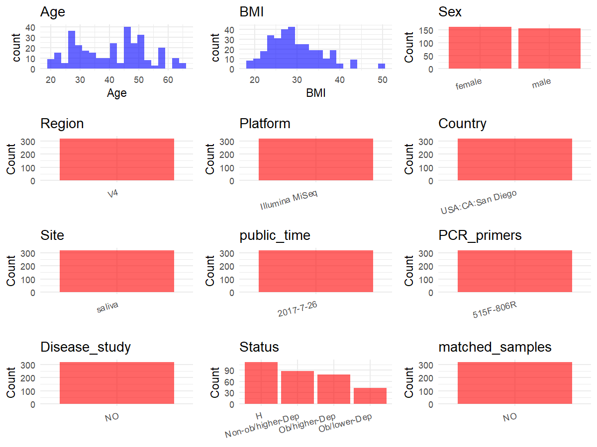

R Notebook: Metadata Processing Workflow
================

# Step 1: Obtain Initial Metadata from Each Project

To obtain the initial metadata: 1. Search for the BioProject ID (e.g.,
“PRJEBXXXX”) on the [NCBI SRA
website](https://www.ncbi.nlm.nih.gov/Traces/study/). 2. In the “Select”
table, click on “Metadata” and download the file. 3. The downloaded file
is typically named “SraRunTable.csv” and contains metadata for the
project.

``` r
# Load necessary libraries
library(dplyr)
library(ggplot2)
library(cowplot)

# Set working directory (update this path to your local directory)
setwd("D:/metadata/qiita_11259")

# Read the initial metadata files
initial_meta<-read.csv("SraRunTable.tsv", header = TRUE ,sep = "\t", stringsAsFactors = FALSE)

# Combine the two metadata files
#meta <- rbind(initial_meta, initial_meta1)

#Remove entries non-oral samples
#initial_meta <- subset(initial_meta, scientific_name == "Human Oral Metagenome")

# Check the number of samples containing "HT" in Sample.Name (e.g., healthy controls)
#nrow(subset(meta, grepl("HT", Sample.Name)))

# Display the first few rows of the metadata
head(initial_meta)
```

    ##                  sample_name age  bmi    sex del8 del9 race del10    title
    ## 1 11259.PHT.20.103.Cort.1200  23 38.5 female 17.3   11    2  -0.8 UCSD_OMB
    ## 2 11259.PHT.20.149.Cort.1600  27 22.7 female   31 28.3    0  -6.8 UCSD_OMB
    ## 3 11259.PHT.20.090.Cort.1600  NA 27.6   male <NA> <NA>    0  <NA> UCSD_OMB
    ## 4 11259.PHT.20.130.Cort.1900  51 29.7 female   37 28.8    1   5.5 UCSD_OMB
    ## 5            11259.Blank2.1H  NA   NA   <NA> <NA> <NA>   NA  <NA> UCSD_OMB
    ## 6 11259.PHT.20.071.Cort.1900  26 40.7 female 21.7 19.4    1   4.4 UCSD_OMB
    ##          dahip3 height weight lteq1a3 lteq1b3 lteq1c3   sil1pre   sil6pre
    ## 1         129.5  172.1  113.9       0       1       5 0.3152802 0.5464383
    ## 2          89.4  165.8   62.5       0       5       5 0.0000000 0.9214565
    ## 3         112.2  190.0   99.8       1       3       6 0.2796856 0.3848437
    ## 4 not collected  175.0   90.9       1       8      15 0.0000000 0.3941266
    ## 5          <NA>     NA     NA      NA      NA      NA        NA        NA
    ## 6         124.9  172.7  121.3       4       3       2 1.2147001 1.2569490
    ##     stnfpre tnf_per      dawaist3 latitude      ne_preex taxon_id age_units
    ## 1  6.769876      29         116.3   32.842          <NA>   447426     years
    ## 2  7.766520    46.4         105.4   32.842 not collected   447426     years
    ## 3 20.035315    <NA>         103.5   32.842          <NA>   447426     years
    ## 4  1.992311      67 not collected   32.842 not collected   447426     years
    ## 5        NA    <NA>          <NA>   32.842          <NA>   256318      <NA>
    ## 6  5.933086    32.8         117.2   32.842        245.54   447426     Years
    ##   elevation   env_biome     epi_preex longitude oq_total3 sf36_ewb3 bdi_total3
    ## 1       193 urban biome          <NA>  -117.258        17        88          4
    ## 2       193 urban biome not collected  -117.258        12        60          8
    ## 3       193 urban biome          <NA>  -117.258        24        88          0
    ## 4       193 urban biome not collected  -117.258        13        56          7
    ## 5       193 urban biome          <NA>  -117.258        NA        NA         NA
    ## 6       193 urban biome         56.29  -117.258        10        92          1
    ##   host_taxid life_stage sf36_pain3 subject_id   ac_nk_preex cesd_total3
    ## 1       9606      adult      100.0 PHT_20_103          <NA>           9
    ## 2       9606      adult       45.0 PHT_20_149 not collected          14
    ## 3       9606      adult       90.0 PHT_20_090          <NA>           1
    ## 4       9606      adult       45.0 PHT_20_130 not collected          14
    ## 5         NA       <NA>         NA                     <NA>        <NA>
    ## 6       9606      adult       87.5 PHT_20_071           243          12
    ##                    description              env_feature      env_package
    ## 1 Oral CavityPHT_20_103_Saliva human-associated habitat       human-oral
    ## 2 Oral CavityPHT_20_149_Saliva human-associated habitat       human-oral
    ## 3 Oral CavityPHT_20_090_Saliva human-associated habitat       human-oral
    ## 4 Oral CavityPHT_20_130_Saliva human-associated habitat       human-oral
    ## 5           processing control        research facility misc environment
    ## 6 Oral CavityPHT_20_071_Saliva human-associated habitat       human-oral
    ##   mfsi_total3 mfsi_vigor3 poms_anger3 poms_total3 poms_vigor3 sample_type
    ## 1          30          15          12          10          17      saliva
    ## 2          34           8           1          18           4      saliva
    ## 3           8           8           0         -13          17      saliva
    ## 4          19           6           2           9          14      saliva
    ## 5          NA          NA          NA          NA          NA       blank
    ## 6          18          18           2          -7          14      saliva
    ##   sf36_physf3 sf36_rldep3 sf36_rldph3 bdi_somatic3  env_material
    ## 1          95   100.00000          50            1        saliva
    ## 2          95   100.00000         100            6        saliva
    ## 3          95   100.00000         100            0        saliva
    ## 4          95    66.66667         100            4        saliva
    ## 5          NA          NA          NA           NA sterile water
    ## 6          80   100.00000          50            0        saliva
    ##       geo_loc_name grandavedbp2 grandavesbp2 mfsi_mental3  preex_14p16n
    ## 1 USA:CA:San Diego        81.00     109.8333            0          <NA>
    ## 2 USA:CA:San Diego        64.50     101.5000            4 not collected
    ## 3 USA:CA:San Diego        89.00     142.0000            0          <NA>
    ## 4 USA:CA:San Diego        87.00     139.1700            3          88.5
    ## 5 USA:CA:San Diego           NA           NA           NA          <NA>
    ## 6 USA:CA:San Diego        75.67     132.3300            0          90.6
    ##    preex_14p16p sf36_enrfat3 sf36_genhel3 sf36_socfun3 subject_name
    ## 1          <NA>           65           65        100.0   PHT_20_103
    ## 2 not collected           60           35         87.5   PHT_20_149
    ## 3          <NA>           65           75        100.0   PHT_20_090
    ## 4          3.02           70           80         75.0   PHT_20_130
    ## 5          <NA>           NA           NA           NA             
    ## 6          2.27           90           65         75.0   PHT_20_071
    ##   dna_extracted mfsi_general3 poms_fatigue3 poms_tension3 postex_14p16n
    ## 1         FALSE             8             3             5          <NA>
    ## 2         FALSE             6             4             7 not collected
    ## 3         FALSE             0             0             2          <NA>
    ## 4         FALSE             3             4             6          86.3
    ## 5          TRUE            NA            NA            NA          <NA>
    ## 6         FALSE             0             0             2          89.4
    ##   postex_14p16p bdi_cognitive3 ebhpkexervo2l3 hlcholesterol2 host_body_site
    ## 1          <NA>              3          2.084            160   uberon:mouth
    ## 2 not collected              2          1.887            165   uberon:mouth
    ## 3          <NA>              0             NA           <NA>   uberon:mouth
    ## 4          3.68              3          2.687            190   uberon:mouth
    ## 5          <NA>             NA             NA           <NA>           <NA>
    ## 6          3.06              1          3.047            194   UBERON:mouth
    ##   mc_totalscore3 mfsi_physical3 preex_14dim16p stat_anxietys3 stat_anxietyt3
    ## 1             11              2           <NA>             23             30
    ## 2             18              8  not collected             41             42
    ## 3             15              0           <NA>             30             29
    ## 4             18              3           6.26             39             37
    ## 5             NA             NA           <NA>             NA             NA
    ## 6             18              0           3.34             43             48
    ##   anonymized_name cbc_wbc_pre_ex4 collection_time ebhpkexervo2ml3
    ## 1      pht_20_103            <NA>            1200            36.6
    ## 2      pht_20_149             4.5            1600            30.2
    ## 3      pht_20_090            <NA>            1600              NA
    ## 4      pht_20_130             6.4            1900            29.3
    ## 5            <NA>            <NA>              NA              NA
    ## 6      PHT_20_071             5.8            1900            25.1
    ##   hltshsensitive2 host_subject_id mfsi_emotional3 poms_confusion3
    ## 1            <NA>      pht_20_103               5               6
    ## 2   not collected      pht_20_149               8               6
    ## 3            <NA>      pht_20_090               0               2
    ## 4   not collected      pht_20_130               4               5
    ## 5            <NA>            <NA>              NA              NA
    ## 6            1.39      PHT_20_071               0               0
    ##   postex_14dim16p       scientific_name cbc_segs_pre_ex4 cbc_wbc_post_ex4
    ## 1            <NA> Human Oral Metagenome               62              8.2
    ## 2   not collected Human Oral Metagenome               49              5.3
    ## 3            <NA> Human Oral Metagenome             <NA>             <NA>
    ## 4            7.56 Human Oral Metagenome               51              7.8
    ## 5            <NA>            metagenome             <NA>             <NA>
    ## 6            4.24 Human Oral Metagenome               62              7.4
    ##   hltriglycerides2 poms_depression3 risk_cvd_10y_bmi risk_cvd_10y_lip
    ## 1              101                1               NA             <NA>
    ## 2               79                4             0.61             0.52
    ## 3             <NA>                0               NA             <NA>
    ## 4               82                6             6.92             5.71
    ## 5             <NA>               NA               NA             <NA>
    ## 6               57                3             1.71             1.62
    ##   risk_cvd_30y_bmi risk_cvd_30y_lip cbc_lymph_pre_ex4 cbc_monos_pre_ex4
    ## 1               NA             <NA>                25                 6
    ## 2             3.06             2.49                42                 7
    ## 3               NA             <NA>              <NA>              <NA>
    ## 4            31.39            27.37                36                 7
    ## 5               NA             <NA>              <NA>              <NA>
    ## 6             7.62             5.78                27                 8
    ##   cbc_segs_post_ex4 hlldlcholesterol2  host_body_habitat host_body_product
    ## 1                61                85 uberon:oral cavity     uberon:saliva
    ## 2                48                85 uberon:oral cavity     uberon:saliva
    ## 3              <NA>              <NA> uberon:oral cavity     uberon:saliva
    ## 4                47               122 uberon:oral cavity     uberon:saliva
    ## 5              <NA>              <NA>               <NA>              <NA>
    ## 6                58               136 UBERON:oral cavity     UBERON:saliva
    ##   hthdlcholesterol2 pss10_totalscore3 risk_hcvd_30y_bmi risk_hcvd_30y_lip
    ## 1                55                 9                NA              <NA>
    ## 2                64                13              1.22              0.96
    ## 3              <NA>                 4                NA              <NA>
    ## 4                52                17             17.37             13.93
    ## 5              <NA>                NA                NA              <NA>
    ## 6                47                19              3.32              2.41
    ##   cbc_lymph_post_ex4 cbc_monos_post_ex4 datotalpercentfat3 datrunkpercentfat3
    ## 1                 24                  9               44.6               44.2
    ## 2                 40                  9                 36               35.3
    ## 3               <NA>               <NA>               20.4               20.8
    ## 4                 38                  8                 36                 37
    ## 5               <NA>               <NA>               <NA>               <NA>
    ## 6                 32                  8               35.5               37.1
    ##   dmissing_extracted qiita_bdi_quarters qiita_bmi_category qiita_del8_category
    ## 1              FALSE       3rd quartile              obese                 low
    ## 2              FALSE       4th quartile            healthy                high
    ## 3              FALSE       1st quartile         overweight                <NA>
    ## 4              FALSE       4th quartile         overweight                high
    ## 5                 NA               <NA>                                   <NA>
    ## 6              FALSE       2nd quartile     morbidly obese                 low
    ##   collection_timestamp host_scientific_name mfsi_emotiomissingl3
    ## 1                 2017         homo sapiens                    5
    ## 2                 2017         homo sapiens                    8
    ## 3                 2017         homo sapiens                    0
    ## 4                 2017         homo sapiens                    4
    ## 5           2010/11/17                 <NA>                   NA
    ## 6                 2017         Homo Sapiens                    0
    ##   risk_cvd_10y_bmi_diab risk_cvd_10y_lip_diab risk_cvd_30y_bmi_diab
    ## 1                    NA                  <NA>                    NA
    ## 2                  0.61                  0.52                  3.06
    ## 3                    NA                  <NA>                    NA
    ## 4                  6.92                  5.71                 31.39
    ## 5                    NA                  <NA>                    NA
    ## 6                  1.71                  1.62                  7.62
    ##   risk_cvd_30y_lip_diab subject_name_hongcode risk_hcvd_30y_bmi_diab
    ## 1                  <NA>            pht_20_103                     NA
    ## 2                  2.49            pht_20_149                   1.22
    ## 3                  <NA>            pht_20_090                     NA
    ## 4                 27.37            pht_20_130                  17.37
    ## 5                  <NA>                  <NA>                     NA
    ## 6                  5.78            PHT_20_071                   3.32
    ##   risk_hcvd_30y_lip_diab qiita_bdi_total_category   physical_specimen_location
    ## 1                   <NA>                     high hillcrest med ctr - hong lab
    ## 2                   0.96                     high hillcrest med ctr - hong lab
    ## 3                   <NA>                      low                         <NA>
    ## 4                  13.93                     high hillcrest med ctr - hong lab
    ## 5                   <NA>                     <NA>                       ucsdmi
    ## 6                   2.41                      low Hillcrest Med Ctr - HONG Lab
    ##   physical_specimen_remaining sample_collection_time_hongcode qiita_study_id
    ## 1                        TRUE                       cort_1200          11259
    ## 2                        TRUE                       cort_1600          11259
    ## 3                       FALSE                       cort_1600          11259
    ## 4                        TRUE                       cort_1900          11259
    ## 5                       FALSE                            <NA>          11259
    ## 6                        TRUE                       Cort_1900          11259

# Step 2: Create a Uniform Metadata Template

The uniform metadata should include the following columns:

1.  **BioProject**: Project ID (e.g., “PRJNA339212”)
2.  **Run**: Sample ID (e.g., “ERRXXXXXX” or “SRRXXXXXX”)
3.  **sample_name**: Original sample name submitted by the authors (not
    the database-assigned ID)
4.  **Age**: Age of the subject (if available)
5.  **BMI**: Body Mass Index (if available)
6.  **Sex**: Sex of the subject (“F” or “M”)
7.  **Region**: Targeted 16S rRNA region (e.g., “V3-V4”)
8.  **Platform**: Sequencing platform (e.g., “Illumina MiSeq”)
9.  **Country**: Country of sample origin (e.g., “China”)
10. **Site**: Sample site (e.g., “saliva”, “dental plaque”)
11. **public_time**: Data release date (format: “YYYY-MM-DD”)
12. **PCR_primers**: PCR primers used (e.g., “515F-806R”)
13. **title**: Title of the associated publication
14. **Disease_study**: Whether the study involves a disease (“YES” or
    “NO”)
15. **Status**: Disease status (e.g., “T2DM”, “HC”). Note: If the study
    includes both disease and healthy samples, this must be specified
    per sample.
16. **matched_samples**: matched samples (“YES” or “NO”)

``` r
# Create a uniform metadata dataframe
metadata <- data.frame(
  BioProject = "qiita_11259",
  Run = NA,
  sample_name = initial_meta$sample_name,
  Age = initial_meta$age,
  BMI = initial_meta$bmi,
  Sex=initial_meta$sex,
  Region = "V4",
  Platform = "Illumina MiSeq",
  Country = initial_meta$geo_loc_name,
  Site = initial_meta$env_material,
  public_time = "2017-7-26",
  stringsAsFactors = FALSE
)
```

# Step 3: Manually Add Information from the Publication

Some information (e.g. PCR primers, study title, disease status) must be
manually extracted from the publication and added to the metadata.

``` r
# Add information obtained from the publication
metadata$PCR_primers <- "515F-806R"
metadata$title <- "Salivary bacterial signatures in depression-obesity comorbidity are associated with neurotransmitters and neuroactive dipeptides"
metadata$Disease_study <- "NO"
metadata <- metadata %>%
  mutate(Status = case_when(
    initial_meta$qiita_bdi_total_category == "low" & initial_meta$qiita_bmi_category %in% c("healthy", "overweight")        ~ "H",
    initial_meta$qiita_bdi_total_category == "low" & initial_meta$qiita_bmi_category %in% c("obese", "morbidly obese")      ~ "Ob/lower-Dep",
    initial_meta$qiita_bdi_total_category == "high" & initial_meta$qiita_bmi_category %in% c("healthy", "overweight")     ~ "Non-ob/higher-Dep",
    initial_meta$qiita_bdi_total_category == "high" & initial_meta$qiita_bmi_category %in% c("obese", "morbidly obese")   ~ "Ob/higher-Dep",
    TRUE ~ NA_character_   # 其余情况留空
  ))

keep_subjects <- unique(subset(metadata, Site == "saliva")$sample_name)
metadata <- subset(metadata, sample_name %in% keep_subjects)

metadata$matched_samples <- "NO"
```

# Step 4: Summarize and Validate the Metadata

``` r
# Check the number of unique runs and sample names
print(paste("Number of unique runs:", length(unique(metadata$Run))))
```

    ## [1] "Number of unique runs: 1"

``` r
print(paste("Number of unique sample names:", length(unique(metadata$sample_name))))
```

    ## [1] "Number of unique sample names: 320"

# Step 5: Visualize the Metadata

``` r

```

<!-- -->

# Step 6: Finalize and Export the Metadata

``` r
# Reorder columns to match the desired format
metadata <- metadata[, c(
  "BioProject", "Run", "sample_name", "Age", "BMI", "Sex", 
  "Region", "Platform", "Country", "Site", "public_time", 
  "PCR_primers", "title", "Disease_study", "Status","matched_samples"
)]

# Export the uniform metadata to a CSV file
write.csv(metadata, file = "metadata.csv", quote = TRUE)
head(metadata)
```

    ##    BioProject Run                sample_name Age  BMI    Sex Region
    ## 1 qiita_11259  NA 11259.PHT.20.103.Cort.1200  23 38.5 female     V4
    ## 2 qiita_11259  NA 11259.PHT.20.149.Cort.1600  27 22.7 female     V4
    ## 3 qiita_11259  NA 11259.PHT.20.090.Cort.1600  NA 27.6   male     V4
    ## 4 qiita_11259  NA 11259.PHT.20.130.Cort.1900  51 29.7 female     V4
    ## 6 qiita_11259  NA 11259.PHT.20.071.Cort.1900  26 40.7 female     V4
    ## 7 qiita_11259  NA 11259.PHT.20.049.Cort.1600  62 38.7   male     V4
    ##         Platform          Country   Site public_time PCR_primers
    ## 1 Illumina MiSeq USA:CA:San Diego saliva   2017-7-26   515F-806R
    ## 2 Illumina MiSeq USA:CA:San Diego saliva   2017-7-26   515F-806R
    ## 3 Illumina MiSeq USA:CA:San Diego saliva   2017-7-26   515F-806R
    ## 4 Illumina MiSeq USA:CA:San Diego saliva   2017-7-26   515F-806R
    ## 6 Illumina MiSeq USA:CA:San Diego saliva   2017-7-26   515F-806R
    ## 7 Illumina MiSeq USA:CA:San Diego saliva   2017-7-26   515F-806R
    ##                                                                                                                              title
    ## 1 Salivary bacterial signatures in depression-obesity comorbidity are associated with neurotransmitters and neuroactive dipeptides
    ## 2 Salivary bacterial signatures in depression-obesity comorbidity are associated with neurotransmitters and neuroactive dipeptides
    ## 3 Salivary bacterial signatures in depression-obesity comorbidity are associated with neurotransmitters and neuroactive dipeptides
    ## 4 Salivary bacterial signatures in depression-obesity comorbidity are associated with neurotransmitters and neuroactive dipeptides
    ## 6 Salivary bacterial signatures in depression-obesity comorbidity are associated with neurotransmitters and neuroactive dipeptides
    ## 7 Salivary bacterial signatures in depression-obesity comorbidity are associated with neurotransmitters and neuroactive dipeptides
    ##   Disease_study            Status matched_samples
    ## 1            NO     Ob/higher-Dep              NO
    ## 2            NO Non-ob/higher-Dep              NO
    ## 3            NO                 H              NO
    ## 4            NO Non-ob/higher-Dep              NO
    ## 6            NO      Ob/lower-Dep              NO
    ## 7            NO      Ob/lower-Dep              NO

## Notes for Students:

1.  **Metadata Accuracy**: Always cross-check the metadata with the
    original publication to ensure accuracy.
2.  **Manual Entries**: Columns like `PCR_primers`, and `Status` often
    require manual entry based on the publication.
3.  **Disease Status**: Be careful when assigning `Status`—some studies
    include both disease and healthy samples.
4.  **Visualization**: The plots help quickly identify the distribution
    of values in each column, which is useful for quality control.
5.  **Reproducibility**: Update the working directory and file paths to
    match your local environment.
