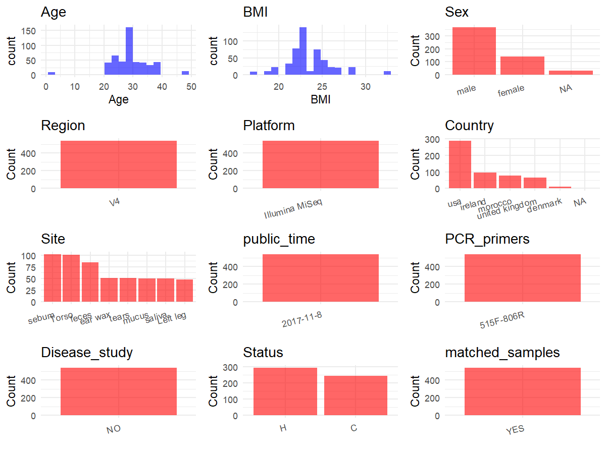

R Notebook: Metadata Processing Workflow
================

# Step 1: Obtain Initial Metadata from Each Project

To obtain the initial metadata: 1. Search for the BioProject ID (e.g.,
“PRJEBXXXX”) on the [NCBI SRA
website](https://www.ncbi.nlm.nih.gov/Traces/study/). 2. In the “Select”
table, click on “Metadata” and download the file. 3. The downloaded file
is typically named “SraRunTable.csv” and contains metadata for the
project.

``` r
# Load necessary libraries
library(dplyr)
library(ggplot2)
library(cowplot)

# Set working directory (update this path to your local directory)
setwd("D:/metadata/qiita_11404")

# Read the initial metadata files
initial_meta<-read.csv("SraRunTable.tsv", header = TRUE ,sep = "\t", stringsAsFactors = FALSE)

# Combine the two metadata files
#meta <- rbind(initial_meta, initial_meta1)

#Remove entries non-oral samples
#initial_meta <- subset(initial_meta, scientific_name == "human oral metagenome")

# Check the number of samples containing "HT" in Sample.Name (e.g., healthy controls)
#nrow(subset(meta, grepl("HT", Sample.Name)))

# Display the first few rows of the metadata
head(initial_meta)
```

    ##   sample_name                          asd   bmi cat dog
    ## 1       11404 i do not have this condition 23.09  no  no
    ## 2       11404 i do not have this condition 23.09  no  no
    ## 3       11404 i do not have this condition 23.09  no  no
    ## 4       11404 i do not have this condition 23.09  no  no
    ## 5       11404 i do not have this condition 23.09  no  no
    ## 6       11404 i do not have this condition 23.09  no  no
    ##                            ibd                          ibs
    ## 1 i do not have this condition i do not have this condition
    ## 2 i do not have this condition i do not have this condition
    ## 3 i do not have this condition i do not have this condition
    ## 4 i do not have this condition i do not have this condition
    ## 5 i do not have this condition i do not have this condition
    ## 6 i do not have this condition i do not have this condition
    ##                            pku  sex                      race
    ## 1 i do not have this condition male asian or pacific islander
    ## 2 i do not have this condition male asian or pacific islander
    ## 3 i do not have this condition male asian or pacific islander
    ## 4 i do not have this condition male asian or pacific islander
    ## 5 i do not have this condition male asian or pacific islander
    ## 6 i do not have this condition male asian or pacific islander
    ##                           sibo                        cdiff   ocean state
    ## 1 i do not have this condition i do not have this condition Pacific    ca
    ## 2 i do not have this condition i do not have this condition Pacific    ca
    ## 3 i do not have this condition i do not have this condition Pacific    ca
    ## 4 i do not have this condition i do not have this condition Pacific    ca
    ## 5 i do not have this condition i do not have this condition Pacific    ca
    ## 6 i do not have this condition i do not have this condition Pacific    ca
    ##                  title                       cancer gluten public age_cat
    ## 1 American Gut Project i do not have this condition     no    Yes     20s
    ## 2 American Gut Project i do not have this condition     no    Yes     20s
    ## 3 American Gut Project i do not have this condition     no    Yes     20s
    ## 4 American Gut Project i do not have this condition     no    Yes     20s
    ## 5 American Gut Project i do not have this condition     no    Yes     20s
    ## 6 American Gut Project i do not have this condition     no    Yes     20s
    ##   bmi_cat country lactose                      thyroid
    ## 1  normal     usa      no i do not have this condition
    ## 2  normal     usa      no i do not have this condition
    ## 3  normal     usa      no i do not have this condition
    ## 4  normal     usa      no i do not have this condition
    ## 5  normal     usa      no i do not have this condition
    ## 6  normal     usa      no i do not have this condition
    ##                       add_adhd csection                     diabetes latitude
    ## 1 i do not have this condition       no i do not have this condition     32.8
    ## 2 i do not have this condition       no i do not have this condition     32.8
    ## 3 i do not have this condition       no i do not have this condition     32.8
    ## 4 i do not have this condition       no i do not have this condition     32.8
    ## 5 i do not have this condition       no i do not have this condition     32.8
    ## 6 i do not have this condition       no i do not have this condition     32.8
    ##                       migraine pregnant softener surf_wax taxon_id age_years
    ## 1 i do not have this condition       no       no  sex wax   539655        29
    ## 2 i do not have this condition       no       no  sex wax  1774142        29
    ## 3 i do not have this condition       no       no  sex wax  1131769        29
    ## 4 i do not have this condition       no       no  sex wax   646099        29
    ## 5 i do not have this condition       no       no  sex wax   447426        29
    ## 6 i do not have this condition       no       no  sex wax   539655        29
    ##                    diet_type elevation              env_biome height_cm
    ## 1 vegetarian but eat seafood     175.9 dense settlement biome       185
    ## 2 vegetarian but eat seafood     175.9 dense settlement biome       185
    ## 3 vegetarian but eat seafood     175.9 dense settlement biome       185
    ## 4 vegetarian but eat seafood     175.9 dense settlement biome       185
    ## 5 vegetarian but eat seafood     175.9 dense settlement biome       185
    ## 6 vegetarian but eat seafood     175.9 dense settlement biome       185
    ##                                                             last_move longitude
    ## 1 i have lived in my current state of residence for more than a year.    -117.3
    ## 2 i have lived in my current state of residence for more than a year.    -117.3
    ## 3 i have lived in my current state of residence for more than a year.    -117.3
    ## 4 i have lived in my current state of residence for more than a year.    -117.3
    ## 5 i have lived in my current state of residence for more than a year.    -117.3
    ## 6 i have lived in my current state of residence for more than a year.    -117.3
    ##                    olive_oil roommates        survey_id weight_kg
    ## 1 regularly (3-5 times/week)     three fbcb92c7da8342d5        79
    ## 2 regularly (3-5 times/week)     three fbcb92c7da8342d5        79
    ## 3 regularly (3-5 times/week)     three fbcb92c7da8342d5        79
    ## 4 regularly (3-5 times/week)     three fbcb92c7da8342d5        79
    ## 5 regularly (3-5 times/week)     three fbcb92c7da8342d5        79
    ## 6 regularly (3-5 times/week)     three fbcb92c7da8342d5        79
    ##                     alzheimers                   autoimmune birth_year
    ## 1 i do not have this condition i do not have this condition       1987
    ## 2 i do not have this condition i do not have this condition       1987
    ## 3 i do not have this condition i do not have this condition       1987
    ## 4 i do not have this condition i do not have this condition       1987
    ## 5 i do not have this condition i do not have this condition       1987
    ## 6 i do not have this condition i do not have this condition       1987
    ##   chickenpox host_taxid livingwith nail_biter pets_other subset_age subset_bmi
    ## 1        yes       9606         no        yes         no       TRUE       TRUE
    ## 2        yes       9606         no        yes         no       TRUE       TRUE
    ## 3        yes       9606         no        yes         no       TRUE       TRUE
    ## 4        yes       9606         no        yes         no       TRUE       TRUE
    ## 5        yes       9606         no        yes         no       TRUE       TRUE
    ## 6        yes       9606         no        yes         no       TRUE       TRUE
    ##   subset_ibd                   whole_eggs                  acid_reflux
    ## 1       TRUE rarely (less than once/week) i do not have this condition
    ## 2       TRUE rarely (less than once/week) i do not have this condition
    ## 3       TRUE rarely (less than once/week) i do not have this condition
    ## 4       TRUE rarely (less than once/week) i do not have this condition
    ## 5       TRUE rarely (less than once/week) i do not have this condition
    ## 6       TRUE rarely (less than once/week) i do not have this condition
    ##   allergic_to                             description              env_feature
    ## 1          NA    American Gut Project Forehead sample human-associated habitat
    ## 2          NA       American Gut Project Tears sample human-associated habitat
    ## 3          NA American Gut Project Nasal mucus sample human-associated habitat
    ## 4          NA     American Gut Project Ear wax sample human-associated habitat
    ## 5          NA       American Gut Project Mouth sample human-associated habitat
    ## 6          NA       American Gut Project torso sample human-associated habitat
    ##        env_package
    ## 1       human-skin
    ## 2 human-associated
    ## 3 human-associated
    ## 4 human-associated
    ## 5       human-oral
    ## 6       human-skin
    ##                                                            last_travel
    ## 1 i have not been outside of my country of residence in the past year.
    ## 2 i have not been outside of my country of residence in the past year.
    ## 3 i have not been outside of my country of residence in the past year.
    ## 4 i have not been outside of my country of residence in the past year.
    ## 5 i have not been outside of my country of residence in the past year.
    ## 6 i have not been outside of my country of residence in the past year.
    ##   sample_type surf_stance env_material geo_loc_name height_units
    ## 1    Forehead     natural        sebum       usa:ca  centimeters
    ## 2       Tears     natural        tears       usa:ca  centimeters
    ## 3       Mucus     natural        mucus       usa:ca  centimeters
    ## 4     Ear wax     natural      ear wax       usa:ca  centimeters
    ## 5       Mouth     natural       saliva       usa:ca  centimeters
    ## 6       Torso     natural         <NA>       usa:ca  centimeters
    ##                                                        lung_disease
    ## 1 diagnosed by a medical professional (doctor, physician assistant)
    ## 2 diagnosed by a medical professional (doctor, physician assistant)
    ## 3 diagnosed by a medical professional (doctor, physician assistant)
    ## 4 diagnosed by a medical professional (doctor, physician assistant)
    ## 5 diagnosed by a medical professional (doctor, physician assistant)
    ## 6 diagnosed by a medical professional (doctor, physician assistant)
    ##   multivitamin vivid_dreams weight_units age_corrected alcohol_types
    ## 1           no        daily    kilograms            29            NA
    ## 2           no        daily    kilograms            29            NA
    ## 3           no        daily    kilograms            29            NA
    ## 4           no        daily    kilograms            29            NA
    ## 5           no        daily    kilograms            29            NA
    ## 6           no        daily    kilograms            29            NA
    ##   bmi_corrected census_region contraceptive
    ## 1         23.09          west            no
    ## 2         23.09          west            no
    ## 3         23.09          west            no
    ## 4         23.09          west            no
    ## 5         23.09          west            no
    ## 6         23.09          west            no
    ##                                 deodorant_use diabetes_type dna_extracted
    ## 1 i do not use deodorant or an antiperspirant            NA           Yes
    ## 2 i do not use deodorant or an antiperspirant            NA           Yes
    ## 3 i do not use deodorant or an antiperspirant            NA           Yes
    ## 4 i do not use deodorant or an antiperspirant            NA           Yes
    ## 5 i do not use deodorant or an antiperspirant            NA           Yes
    ## 6 i do not use deodorant or an antiperspirant            NA           Yes
    ##       dominant_hand         fed_as_infant ibd_diagnosis
    ## 1 i am right handed primarily breast milk            NA
    ## 2 i am right handed primarily breast milk            NA
    ## 3 i am right handed primarily breast milk            NA
    ## 4 i am right handed primarily breast milk            NA
    ## 5 i am right handed primarily breast milk            NA
    ## 6 i am right handed primarily breast milk            NA
    ##                  liver_disease surf_weetsuit   weight_change
    ## 1 i do not have this condition         2-3mm remained stable
    ## 2 i do not have this condition         2-3mm remained stable
    ## 3 i do not have this condition         2-3mm remained stable
    ## 4 i do not have this condition         2-3mm remained stable
    ## 5 i do not have this condition         2-3mm remained stable
    ## 6 i do not have this condition         2-3mm remained stable
    ##                    host_body_site               kidney_disease mental_illness
    ## 1             UBERON:skin of head i do not have this condition             no
    ## 2                      UBERON:eye i do not have this condition             no
    ## 3                  UBERON:nostril i do not have this condition             no
    ## 4 UBERON:external auditory meatus i do not have this condition             no
    ## 5                   UBERON:tongue i do not have this condition             no
    ## 6            UBERON:skin of trunk i do not have this condition             no
    ##               pool_frequency               skin_condition sleep_duration
    ## 1 rarely (a few times/month) i do not have this condition      5-6 hours
    ## 2 rarely (a few times/month) i do not have this condition      5-6 hours
    ## 3 rarely (a few times/month) i do not have this condition      5-6 hours
    ## 4 rarely (a few times/month) i do not have this condition      5-6 hours
    ## 5 rarely (a few times/month) i do not have this condition      5-6 hours
    ## 6 rarely (a few times/month) i do not have this condition      5-6 hours
    ##   subset_healthy surf_frequency surf_sunscreen acne_medication anonymized_name
    ## 1           TRUE     Once a day        spf 50+              no           62190
    ## 2           TRUE     Once a day        spf 50+              no           62191
    ## 3           TRUE     Once a day        spf 50+              no           62192
    ## 4           TRUE     Once a day        spf 50+              no           62193
    ## 5           TRUE     Once a day        spf 50+              no           62194
    ## 6           TRUE     Once a day        spf 50+              no           62195
    ##   collection_date collection_time economic_region fermented_other
    ## 1         9/26/16            8:00        far west                
    ## 2         9/26/16            8:00        far west                
    ## 3         9/26/16            8:00        far west                
    ## 4         9/26/16            8:00        far west                
    ## 5         9/26/16            8:00        far west                
    ## 6         9/26/16            8:00        far west                
    ##              fruit_frequency
    ## 1 regularly (3-5 times/week)
    ## 2 regularly (3-5 times/week)
    ## 3 regularly (3-5 times/week)
    ## 4 regularly (3-5 times/week)
    ## 5 regularly (3-5 times/week)
    ## 6 regularly (3-5 times/week)
    ##                                                                                                                    host_subject_id
    ## 1 03c0867966fe2299eb3b09291d5f0834310bdf5fceed9c9b7b397570bf8f2d2adaeb945c824ff0cb407abaf691b8173cfa03c4f8eb17e6dd9f6eda17502e66e4
    ## 2 03c0867966fe2299eb3b09291d5f0834310bdf5fceed9c9b7b397570bf8f2d2adaeb945c824ff0cb407abaf691b8173cfa03c4f8eb17e6dd9f6eda17502e66e4
    ## 3 03c0867966fe2299eb3b09291d5f0834310bdf5fceed9c9b7b397570bf8f2d2adaeb945c824ff0cb407abaf691b8173cfa03c4f8eb17e6dd9f6eda17502e66e4
    ## 4 03c0867966fe2299eb3b09291d5f0834310bdf5fceed9c9b7b397570bf8f2d2adaeb945c824ff0cb407abaf691b8173cfa03c4f8eb17e6dd9f6eda17502e66e4
    ## 5 03c0867966fe2299eb3b09291d5f0834310bdf5fceed9c9b7b397570bf8f2d2adaeb945c824ff0cb407abaf691b8173cfa03c4f8eb17e6dd9f6eda17502e66e4
    ## 6 03c0867966fe2299eb3b09291d5f0834310bdf5fceed9c9b7b397570bf8f2d2adaeb945c824ff0cb407abaf691b8173cfa03c4f8eb17e6dd9f6eda17502e66e4
    ##                     scientific_name subset_diabetes surf_board_type
    ## 1             human skin metagenome            TRUE   no preference
    ## 2              human eye metagenome            TRUE   no preference
    ## 3 human nasal/pharyngeal metagenome            TRUE   no preference
    ## 4                  human metagenome            TRUE   no preference
    ## 5             human oral metagenome            TRUE   no preference
    ## 6             human skin metagenome            TRUE   no preference
    ##   tonsils_removed types_of_plants appendix_removed cancer_treatment
    ## 1              no     less than 5               no               NA
    ## 2              no     less than 5               no               NA
    ## 3              no     less than 5               no               NA
    ## 4              no     less than 5               no               NA
    ## 5              no     less than 5               no               NA
    ## 6              no     less than 5               no               NA
    ##   collection_month country_of_birth
    ## 1        September    united states
    ## 2        September    united states
    ## 3        September    united states
    ## 4        September    united states
    ## 5        September    united states
    ## 6        September    united states
    ##                                      flu_vaccine_date host_common_name
    ## 1 i have not gotten the flu vaccine in the past year.            human
    ## 2 i have not gotten the flu vaccine in the past year.            human
    ## 3 i have not gotten the flu vaccine in the past year.            human
    ## 4 i have not gotten the flu vaccine in the past year.            human
    ## 5 i have not gotten the flu vaccine in the past year.            human
    ## 6 i have not gotten the flu vaccine in the past year.            human
    ##   specialized_diet                     surf_local_break
    ## 1               NA La Jolla, San Diego, California, USA
    ## 2               NA La Jolla, San Diego, California, USA
    ## 3               NA La Jolla, San Diego, California, USA
    ## 4               NA La Jolla, San Diego, California, USA
    ## 5               NA La Jolla, San Diego, California, USA
    ## 6               NA La Jolla, San Diego, California, USA
    ##               alcohol_frequency allergic_to_other assigned_from_geo
    ## 1 occasionally (1-2 times/week)                No               Yes
    ## 2 occasionally (1-2 times/week)                No               Yes
    ## 3 occasionally (1-2 times/week)                No               Yes
    ## 4 occasionally (1-2 times/week)                No               Yes
    ## 5 occasionally (1-2 times/week)                No               Yes
    ## 6 occasionally (1-2 times/week)                No               Yes
    ##   collection_season country_residence exercise_location
    ## 1              Fall     united states              both
    ## 2              Fall     united states              both
    ## 3              Fall     united states              both
    ## 4              Fall     united states              both
    ## 5              Fall     united states              both
    ## 6              Fall     united states              both
    ##              fungal_overgrowth  host_body_habitat host_body_product
    ## 1 i do not have this condition        UBERON:skin      UBERON:sebum
    ## 2 i do not have this condition         UBERON:eye      UBERON:tears
    ## 3 i do not have this condition        UBERON:nose      UBERON:mucus
    ## 4 i do not have this condition         UBERON:ear    UBERON:cerumen
    ## 5 i do not have this condition UBERON:oral cavity     UBERON:saliva
    ## 6 i do not have this condition        UBERON:skin      UBERON:sebum
    ##              poultry_frequency             seafood_frequency smoking_frequency
    ## 1 rarely (less than once/week) occasionally (1-2 times/week)             never
    ## 2 rarely (less than once/week) occasionally (1-2 times/week)             never
    ## 3 rarely (less than once/week) occasionally (1-2 times/week)             never
    ## 4 rarely (less than once/week) occasionally (1-2 times/week)             never
    ## 5 rarely (less than once/week) occasionally (1-2 times/week)             never
    ## 6 rarely (less than once/week) occasionally (1-2 times/week)             never
    ##                               antibiotic_history           clinical_condition
    ## 1 i have not taken antibiotics in the past year. i do not have this condition
    ## 2 i have not taken antibiotics in the past year. i do not have this condition
    ## 3 i have not taken antibiotics in the past year. i do not have this condition
    ## 4 i have not taken antibiotics in the past year. i do not have this condition
    ## 5 i have not taken antibiotics in the past year. i do not have this condition
    ## 6 i have not taken antibiotics in the past year. i do not have this condition
    ##   drinks_per_session         exercise_frequency fermented_consumed
    ## 1              2-Jan regularly (3-5 times/week)                 NA
    ## 2              2-Jan regularly (3-5 times/week)                 NA
    ## 3              2-Jan regularly (3-5 times/week)                 NA
    ## 4              2-Jan regularly (3-5 times/week)                 NA
    ## 5              2-Jan regularly (3-5 times/week)                 NA
    ## 6              2-Jan regularly (3-5 times/week)                 NA
    ##              flossing_frequency              level_of_education
    ## 1 occasionally (1-2 times/week) graduate or professional degree
    ## 2 occasionally (1-2 times/week) graduate or professional degree
    ## 3 occasionally (1-2 times/week) graduate or professional degree
    ## 4 occasionally (1-2 times/week) graduate or professional degree
    ## 5 occasionally (1-2 times/week) graduate or professional degree
    ## 6 occasionally (1-2 times/week) graduate or professional degree
    ##   lowgrain_diet_type non_food_allergies red_meat_frequency roommates_in_study
    ## 1                 NA                 NA              never                 no
    ## 2                 NA                 NA              never                 no
    ## 3                 NA                 NA              never                 no
    ## 4                 NA                 NA              never                 no
    ## 5                 NA                 NA              never                 no
    ## 6                 NA                 NA              never                 no
    ##   seasonal_allergies acne_medication_otc alcohol_consumption
    ## 1                 no                  no                 yes
    ## 2                 no                  no                 yes
    ## 3                 no                  no                 yes
    ## 4                 no                  no                 yes
    ## 5                 no                  no                 yes
    ## 6                 no                  no                 yes
    ##   allergic_to_peanuts           cosmetics_frequency fermented_frequency
    ## 1                  No occasionally (1-2 times/week)                    
    ## 2                  No occasionally (1-2 times/week)                    
    ## 3                  No occasionally (1-2 times/week)                    
    ## 4                  No occasionally (1-2 times/week)                    
    ## 5                  No occasionally (1-2 times/week)                    
    ## 6                  No occasionally (1-2 times/week)                    
    ##   fermented_increased          meat_eggs_frequency mental_illness_type
    ## 1                     rarely (less than once/week)                  NA
    ## 2                     rarely (less than once/week)                  NA
    ## 3                     rarely (less than once/week)                  NA
    ## 4                     rarely (less than once/week)                  NA
    ## 5                     rarely (less than once/week)                  NA
    ## 6                     rarely (less than once/week)                  NA
    ##   probiotic_frequency        vegetable_frequency collection_timestamp
    ## 1               never regularly (3-5 times/week)         9/26/16 8:00
    ## 2               never regularly (3-5 times/week)         9/26/16 8:00
    ## 3               never regularly (3-5 times/week)         9/26/16 8:00
    ## 4               never regularly (3-5 times/week)         9/26/16 8:00
    ## 5               never regularly (3-5 times/week)         9/26/16 8:00
    ## 6               never regularly (3-5 times/week)         9/26/16 8:00
    ##   surf_travel_distance allergic_to_shellfish allergic_to_tree_nuts
    ## 1               5-10km                    No                    No
    ## 2               5-10km                    No                    No
    ## 3               5-10km                    No                    No
    ## 4               5-10km                    No                    No
    ## 5               5-10km                    No                    No
    ## 6               5-10km                    No                    No
    ##   artificial_sweeteners drinking_water_source ibd_diagnosis_refined
    ## 1                 never                  city                    NA
    ## 2                 never                  city                    NA
    ## 3                 never                  city                    NA
    ## 4                 never                  city                    NA
    ## 5                 never                  city                    NA
    ## 6                 never                  city                    NA
    ##          milk_cheese_frequency surf_shower_frequency surf_travel_frequency
    ## 1 rarely (less than once/week)            frequently           once a week
    ## 2 rarely (less than once/week)            frequently           once a week
    ## 3 rarely (less than once/week)            frequently           once a week
    ## 4 rarely (less than once/week)            frequently           once a week
    ## 5 rarely (less than once/week)            frequently           once a week
    ## 6 rarely (less than once/week)            frequently           once a week
    ##        whole_grain_frequency alcohol_types_red_wine
    ## 1 regularly (3-5 times/week)                    Yes
    ## 2 regularly (3-5 times/week)                    Yes
    ## 3 regularly (3-5 times/week)                    Yes
    ## 4 regularly (3-5 times/week)                    Yes
    ## 5 regularly (3-5 times/week)                    Yes
    ## 6 regularly (3-5 times/week)                    Yes
    ##                              bowel_movement_quality
    ## 1 i tend to have normal formed stool - type 3 and 4
    ## 2 i tend to have normal formed stool - type 3 and 4
    ## 3 i tend to have normal formed stool - type 3 and 4
    ## 4 i tend to have normal formed stool - type 3 and 4
    ## 5 i tend to have normal formed stool - type 3 and 4
    ## 6 i tend to have normal formed stool - type 3 and 4
    ##         cardiovascular_disease non_food_allergies_sun alcohol_types_beercider
    ## 1 i do not have this condition                     No                     Yes
    ## 2 i do not have this condition                     No                     Yes
    ## 3 i do not have this condition                     No                     Yes
    ## 4 i do not have this condition                     No                     Yes
    ## 5 i do not have this condition                     No                     Yes
    ## 6 i do not have this condition                     No                     Yes
    ##   allergic_to_unspecified fermented_consumed_beer fermented_consumed_mead
    ## 1                      No                                                
    ## 2                      No                                                
    ## 3                      No                                                
    ## 4                      No                                                
    ## 5                      No                                                
    ## 6                      No                                                
    ##   fermented_consumed_wine      salted_snacks_frequency specialized_diet_fodmap
    ## 1                         rarely (less than once/week)                      No
    ## 2                         rarely (less than once/week)                      No
    ## 3                         rarely (less than once/week)                      No
    ## 4                         rarely (less than once/week)                      No
    ## 5                         rarely (less than once/week)                      No
    ## 6                         rarely (less than once/week)                      No
    ##   specialized_diet_halaal specialized_diet_kosher       sugary_sweets_frequency
    ## 1                      No                      No occasionally (1-2 times/week)
    ## 2                      No                      No occasionally (1-2 times/week)
    ## 3                      No                      No occasionally (1-2 times/week)
    ## 4                      No                      No occasionally (1-2 times/week)
    ## 5                      No                      No occasionally (1-2 times/week)
    ## 6                      No                      No occasionally (1-2 times/week)
    ##   teethbrushing_frequency alcohol_types_sour_beers alcohol_types_white_wine
    ## 1                   daily                       No                       No
    ## 2                   daily                       No                       No
    ## 3                   daily                       No                       No
    ## 4                   daily                       No                       No
    ## 5                   daily                       No                       No
    ## 6                   daily                       No                       No
    ##   bowel_movement_frequency fermented_consumed_cider fermented_consumed_other
    ## 1                      two                                                  
    ## 2                      two                                                  
    ## 3                      two                                                  
    ## 4                      two                                                  
    ## 5                      two                                                  
    ## 6                      two                                                  
    ##       frozen_dessert_frequency     prepared_meals_frequency
    ## 1 rarely (less than once/week) rarely (less than once/week)
    ## 2 rarely (less than once/week) rarely (less than once/week)
    ## 3 rarely (less than once/week) rarely (less than once/week)
    ## 4 rarely (less than once/week) rarely (less than once/week)
    ## 5 rarely (less than once/week) rarely (less than once/week)
    ## 6 rarely (less than once/week) rarely (less than once/week)
    ##   surf_sunscreen_frequency alcohol_types_unspecified breastmilk_formula_ensure
    ## 1                   rarely                        No                        no
    ## 2                   rarely                        No                        no
    ## 3                   rarely                        No                        no
    ## 4                   rarely                        No                        no
    ## 5                   rarely                        No                        no
    ## 6                   rarely                        No                        no
    ##   fermented_consumed_chicha fermented_consumed_kimchi fermented_consumed_tempeh
    ## 1                                                                              
    ## 2                                                                              
    ## 3                                                                              
    ## 4                                                                              
    ## 5                                                                              
    ## 6                                                                              
    ##      fermented_plant_frequency  milk_substitute_frequency
    ## 1 rarely (less than once/week) regularly (3-5 times/week)
    ## 2 rarely (less than once/week) regularly (3-5 times/week)
    ## 3 rarely (less than once/week) regularly (3-5 times/week)
    ## 4 rarely (less than once/week) regularly (3-5 times/week)
    ## 5 rarely (less than once/week) regularly (3-5 times/week)
    ## 6 rarely (less than once/week) regularly (3-5 times/week)
    ##              state_location_localbreak subset_antibiotic_history
    ## 1 la jolla, san diego, california, usa                      TRUE
    ## 2 la jolla, san diego, california, usa                      TRUE
    ## 3 la jolla, san diego, california, usa                      TRUE
    ## 4 la jolla, san diego, california, usa                      TRUE
    ## 5 la jolla, san diego, california, usa                      TRUE
    ## 6 la jolla, san diego, california, usa                      TRUE
    ##   surf_loal_break_frequency fermented_produce_personal
    ## 1                Once a day                         NA
    ## 2                Once a day                         NA
    ## 3                Once a day                         NA
    ## 4                Once a day                         NA
    ## 5                Once a day                         NA
    ## 6                Once a day                         NA
    ##   homecooked_meals_frequency other_supplement_frequency
    ## 1                      daily                         no
    ## 2                      daily                         no
    ## 3                      daily                         no
    ## 4                      daily                         no
    ## 5                      daily                         no
    ## 6                      daily                         no
    ##   physical_specimen_location consume_animal_products_abx
    ## 1                     UCSDMI                    not sure
    ## 2                     UCSDMI                    not sure
    ## 3                     UCSDMI                    not sure
    ## 4                     UCSDMI                    not sure
    ## 5                     UCSDMI                    not sure
    ## 6                     UCSDMI                    not sure
    ##   fermented_consumed_kombucha high_fat_red_meat_frequency
    ## 1                                                   never
    ## 2                                                   never
    ## 3                                                   never
    ## 4                                                   never
    ## 5                                                   never
    ## 6                                                   never
    ##   physical_specimen_remaining epilepsy_or_seizure_disorder
    ## 1                         Yes i do not have this condition
    ## 2                         Yes i do not have this condition
    ## 3                         Yes i do not have this condition
    ## 4                         Yes i do not have this condition
    ## 5                         Yes i do not have this condition
    ## 6                         Yes i do not have this condition
    ##   fermented_produce_commercial non_food_allergies_beestings
    ## 1                           NA                           No
    ## 2                           NA                           No
    ## 3                           NA                           No
    ## 4                           NA                           No
    ## 5                           NA                           No
    ## 6                           NA                           No
    ##   ready_to_eat_meals_frequency specialized_diet_unspecified
    ## 1                        never                           No
    ## 2                        never                           No
    ## 3                        never                           No
    ## 4                        never                           No
    ## 5                        never                           No
    ## 6                        never                           No
    ##   fermented_consumed_fish_sauce fermented_consumed_kefir_milk
    ## 1                                                            
    ## 2                                                            
    ## 3                                                            
    ## 4                                                            
    ## 5                                                            
    ## 6                                                            
    ##   fermented_consumed_sauerkraut non_food_allergies_pet_dander
    ## 1                                                          No
    ## 2                                                          No
    ## 3                                                          No
    ## 4                                                          No
    ## 5                                                          No
    ## 6                                                          No
    ##   fermented_consumed_kefir_water fermented_consumed_unspecified
    ## 1                                                              
    ## 2                                                              
    ## 3                                                              
    ## 4                                                              
    ## 5                                                              
    ## 6                                                              
    ##   fermented_consumed_yogurtlassi mental_illness_type_depression
    ## 1                                                            No
    ## 2                                                            No
    ## 3                                                            No
    ## 4                                                            No
    ## 5                                                            No
    ## 6                                                            No
    ##   non_food_allergies_unspecified specialized_diet_exclude_dairy
    ## 1                            Yes                             No
    ## 2                            Yes                             No
    ## 3                            Yes                             No
    ## 4                            Yes                             No
    ## 5                            Yes                             No
    ## 6                            Yes                             No
    ##   specialized_diet_raw_food_diet vitamin_b_supplement_frequency
    ## 1                             No                          never
    ## 2                             No                          never
    ## 3                             No                          never
    ## 4                             No                          never
    ## 5                             No                          never
    ## 6                             No                          never
    ##   vitamin_d_supplement_frequency fermented_produce_personal_beer
    ## 1                          never                                
    ## 2                          never                                
    ## 3                          never                                
    ## 4                          never                                
    ## 5                          never                                
    ## 6                          never                                
    ##   fermented_produce_personal_mead fermented_produce_personal_wine
    ## 1                                                                
    ## 2                                                                
    ## 3                                                                
    ## 4                                                                
    ## 5                                                                
    ## 6                                                                
    ##   mental_illness_type_unspecified sugar_sweetened_drink_frequency
    ## 1                             Yes                           never
    ## 2                             Yes                           never
    ## 3                             Yes                           never
    ## 4                             Yes                           never
    ## 5                             Yes                           never
    ## 6                             Yes                           never
    ##   depression_bipolar_schizophrenia fermented_produce_personal_cider
    ## 1                               NA                                 
    ## 2                               NA                                 
    ## 3                               NA                                 
    ## 4                               NA                                 
    ## 5                               NA                                 
    ## 6                               NA                                 
    ##   fermented_produce_personal_other non_food_allergies_poison_ivyoak
    ## 1                                                                No
    ## 2                                                                No
    ## 3                                                                No
    ## 4                                                                No
    ## 5                                                                No
    ## 6                                                                No
    ##   alcohol_types_spiritshard_alcohol fermented_consumed_cottage_cheese
    ## 1                                No                                  
    ## 2                                No                                  
    ## 3                                No                                  
    ## 4                                No                                  
    ## 5                                No                                  
    ## 6                                No                                  
    ##   fermented_consumed_fermented_fish fermented_consumed_fermented_tofu
    ## 1                                                                    
    ## 2                                                                    
    ## 3                                                                    
    ## 4                                                                    
    ## 5                                                                    
    ## 6                                                                    
    ##   fermented_produce_commercial_beer fermented_produce_commercial_mead
    ## 1                                                                    
    ## 2                                                                    
    ## 3                                                                    
    ## 4                                                                    
    ## 5                                                                    
    ## 6                                                                    
    ##   fermented_produce_commercial_wine fermented_produce_personal_chicha
    ## 1                                                                    
    ## 2                                                                    
    ## 3                                                                    
    ## 4                                                                    
    ## 5                                                                    
    ## 6                                                                    
    ##   fermented_produce_personal_kimchi fermented_produce_personal_tempeh
    ## 1                                                                    
    ## 2                                                                    
    ## 3                                                                    
    ## 4                                                                    
    ## 5                                                                    
    ## 6                                                                    
    ##   mental_illness_type_schizophrenia fermented_produce_commercial_cider
    ## 1                                No                                   
    ## 2                                No                                   
    ## 3                                No                                   
    ## 4                                No                                   
    ## 5                                No                                   
    ## 6                                No                                   
    ##   fermented_produce_commercial_other one_liter_of_water_a_day_frequency
    ## 1                                                                 daily
    ## 2                                                                 daily
    ## 3                                                                 daily
    ## 4                                                                 daily
    ## 5                                                                 daily
    ## 6                                                                 daily
    ##   fermented_produce_commercial_chicha fermented_produce_commercial_kimchi
    ## 1                                                                        
    ## 2                                                                        
    ## 3                                                                        
    ## 4                                                                        
    ## 5                                                                        
    ## 6                                                                        
    ##   fermented_produce_commercial_tempeh fermented_produce_personal_kombucha
    ## 1                                                                        
    ## 2                                                                        
    ## 3                                                                        
    ## 4                                                                        
    ## 5                                                                        
    ## 6                                                                        
    ##   mental_illness_type_bulimia_nervosa mental_illness_type_substance_abuse
    ## 1                                  No                                  No
    ## 2                                  No                                  No
    ## 3                                  No                                  No
    ## 4                                  No                                  No
    ## 5                                  No                                  No
    ## 6                                  No                                  No
    ##   mental_illness_type_anorexia_nervosa mental_illness_type_bipolar_disorder
    ## 1                                   No                                   No
    ## 2                                   No                                   No
    ## 3                                   No                                   No
    ## 4                                   No                                   No
    ## 5                                   No                                   No
    ## 6                                   No                                   No
    ##   specialized_diet_exclude_nightshades specialized_diet_modified_paleo_diet
    ## 1                                   No                                   No
    ## 2                                   No                                   No
    ## 3                                   No                                   No
    ## 4                                   No                                   No
    ## 5                                   No                                   No
    ## 6                                   No                                   No
    ##   fermented_consumed_pickled_vegetables fermented_produce_commercial_kombucha
    ## 1                                                                            
    ## 2                                                                            
    ## 3                                                                            
    ## 4                                                                            
    ## 5                                                                            
    ## 6                                                                            
    ##   fermented_produce_personal_fish_sauce fermented_produce_personal_kefir_milk
    ## 1                                                                            
    ## 2                                                                            
    ## 3                                                                            
    ## 4                                                                            
    ## 5                                                                            
    ## 6                                                                            
    ##   fermented_produce_personal_sauerkraut non_food_allergies_drug_eg_penicillin
    ## 1                                                                          No
    ## 2                                                                          No
    ## 3                                                                          No
    ## 4                                                                          No
    ## 5                                                                          No
    ## 6                                                                          No
    ##   fermented_produce_personal_kefir_water fermented_produce_personal_unspecified
    ## 1                                                                              
    ## 2                                                                              
    ## 3                                                                              
    ## 4                                                                              
    ## 5                                                                              
    ## 6                                                                              
    ##   fermented_produce_personal_yogurtlassi
    ## 1                                       
    ## 2                                       
    ## 3                                       
    ## 4                                       
    ## 5                                       
    ## 6                                       
    ##   fermented_produce_commercial_fish_sauce
    ## 1                                        
    ## 2                                        
    ## 3                                        
    ## 4                                        
    ## 5                                        
    ## 6                                        
    ##   fermented_produce_commercial_kefir_milk
    ## 1                                        
    ## 2                                        
    ## 3                                        
    ## 4                                        
    ## 5                                        
    ## 6                                        
    ##   fermented_produce_commercial_sauerkraut
    ## 1                                        
    ## 2                                        
    ## 3                                        
    ## 4                                        
    ## 5                                        
    ## 6                                        
    ##   specialized_diet_exclude_refined_sugars
    ## 1                                      No
    ## 2                                      No
    ## 3                                      No
    ## 4                                      No
    ## 5                                      No
    ## 6                                      No
    ##   fermented_produce_commercial_kefir_water
    ## 1                                         
    ## 2                                         
    ## 3                                         
    ## 4                                         
    ## 5                                         
    ## 6                                         
    ##   fermented_produce_commercial_unspecified
    ## 1                                         
    ## 2                                         
    ## 3                                         
    ## 4                                         
    ## 5                                         
    ## 6                                         
    ##   fermented_produce_commercial_yogurtlassi
    ## 1                                         
    ## 2                                         
    ## 3                                         
    ## 4                                         
    ## 5                                         
    ## 6                                         
    ##   fermented_produce_personal_cottage_cheese
    ## 1                                          
    ## 2                                          
    ## 3                                          
    ## 4                                          
    ## 5                                          
    ## 6                                          
    ##   fermented_produce_personal_fermented_fish
    ## 1                                          
    ## 2                                          
    ## 3                                          
    ## 4                                          
    ## 5                                          
    ## 6                                          
    ##   fermented_produce_personal_fermented_tofu
    ## 1                                          
    ## 2                                          
    ## 3                                          
    ## 4                                          
    ## 5                                          
    ## 6                                          
    ##   specialized_diet_paleodiet_or_primal_diet
    ## 1                                        No
    ## 2                                        No
    ## 3                                        No
    ## 4                                        No
    ## 5                                        No
    ## 6                                        No
    ##   fermented_consumed_sour_creamcreme_fraiche
    ## 1                                           
    ## 2                                           
    ## 3                                           
    ## 4                                           
    ## 5                                           
    ## 6                                           
    ##   fermented_consumed_fermented_beansmisonatto
    ## 1                                            
    ## 2                                            
    ## 3                                            
    ## 4                                            
    ## 5                                            
    ## 6                                            
    ##   fermented_produce_commercial_cottage_cheese
    ## 1                                            
    ## 2                                            
    ## 3                                            
    ## 4                                            
    ## 5                                            
    ## 6                                            
    ##   fermented_produce_commercial_fermented_fish
    ## 1                                            
    ## 2                                            
    ## 3                                            
    ## 4                                            
    ## 5                                            
    ## 6                                            
    ##   fermented_produce_commercial_fermented_tofu
    ## 1                                            
    ## 2                                            
    ## 3                                            
    ## 4                                            
    ## 5                                            
    ## 6                                            
    ##   fermented_produce_personal_pickled_vegetables
    ## 1                                              
    ## 2                                              
    ## 3                                              
    ## 4                                              
    ## 5                                              
    ## 6                                              
    ##   fermented_produce_commercial_pickled_vegetables
    ## 1                                                
    ## 2                                                
    ## 3                                                
    ## 4                                                
    ## 5                                                
    ## 6                                                
    ##   specialized_diet_i_do_not_eat_a_specialized_diet
    ## 1                                              Yes
    ## 2                                              Yes
    ## 3                                              Yes
    ## 4                                              Yes
    ## 5                                              Yes
    ## 6                                              Yes
    ##   fermented_consumed_fermented_breadsourdoughinjera
    ## 1                                                  
    ## 2                                                  
    ## 3                                                  
    ## 4                                                  
    ## 5                                                  
    ## 6                                                  
    ##   fermented_produce_personal_sour_creamcreme_fraiche
    ## 1                                                   
    ## 2                                                   
    ## 3                                                   
    ## 4                                                   
    ## 5                                                   
    ## 6                                                   
    ##   allergic_to_i_have_no_food_allergies_that_i_know_of
    ## 1                                                 Yes
    ## 2                                                 Yes
    ## 3                                                 Yes
    ## 4                                                 Yes
    ## 5                                                 Yes
    ## 6                                                 Yes
    ##   fermented_produce_personal_fermented_beansmisonatto
    ## 1                                                    
    ## 2                                                    
    ## 3                                                    
    ## 4                                                    
    ## 5                                                    
    ## 6                                                    
    ##   fermented_produce_commercial_sour_creamcreme_fraiche
    ## 1                                                     
    ## 2                                                     
    ## 3                                                     
    ## 4                                                     
    ## 5                                                     
    ## 6                                                     
    ##   fermented_produce_commercial_fermented_beansmisonatto
    ## 1                                                      
    ## 2                                                      
    ## 3                                                      
    ## 4                                                      
    ## 5                                                      
    ## 6                                                      
    ##   mental_illness_type_ptsd_posttraumatic_stress_disorder
    ## 1                                                     No
    ## 2                                                     No
    ## 3                                                     No
    ## 4                                                     No
    ## 5                                                     No
    ## 6                                                     No
    ##   specialized_diet_other_restrictions_not_described_here
    ## 1                                                     No
    ## 2                                                     No
    ## 3                                                     No
    ## 4                                                     No
    ## 5                                                     No
    ## 6                                                     No
    ##   fermented_produce_personal_fermented_breadsourdoughinjera
    ## 1                                                          
    ## 2                                                          
    ## 3                                                          
    ## 4                                                          
    ## 5                                                          
    ## 6                                                          
    ##   fermented_produce_commercial_fermented_breadsourdoughinjera
    ## 1                                                            
    ## 2                                                            
    ## 3                                                            
    ## 4                                                            
    ## 5                                                            
    ## 6                                                            
    ##   specialized_diet_westenprice_or_other_lowgrain_low_processed_fo
    ## 1                                                              No
    ## 2                                                              No
    ## 3                                                              No
    ## 4                                                              No
    ## 5                                                              No
    ## 6                                                              No
    ##   qiita_study_id
    ## 1          11404
    ## 2          11404
    ## 3          11404
    ## 4          11404
    ## 5          11404
    ## 6          11404

# Step 2: Create a Uniform Metadata Template

The uniform metadata should include the following columns:

1.  **BioProject**: Project ID (e.g., “PRJNA339212”)
2.  **Run**: Sample ID (e.g., “ERRXXXXXX” or “SRRXXXXXX”)
3.  **sample_name**: Original sample name submitted by the authors (not
    the database-assigned ID)
4.  **Age**: Age of the subject (if available)
5.  **BMI**: Body Mass Index (if available)
6.  **Sex**: Sex of the subject (“F” or “M”)
7.  **Region**: Targeted 16S rRNA region (e.g., “V3-V4”)
8.  **Platform**: Sequencing platform (e.g., “Illumina MiSeq”)
9.  **Country**: Country of sample origin (e.g., “China”)
10. **Site**: Sample site (e.g., “saliva”, “dental plaque”)
11. **public_time**: Data release date (format: “YYYY-MM-DD”)
12. **PCR_primers**: PCR primers used (e.g., “515F-806R”)
13. **title**: Title of the associated publication
14. **Disease_study**: Whether the study involves a disease (“YES” or
    “NO”)
15. **Status**: Disease status (e.g., “T2DM”, “HC”). Note: If the study
    includes both disease and healthy samples, this must be specified
    per sample.
16. **matched_samples**: matched samples (“YES” or “NO”)

``` r
# Create a uniform metadata dataframe
metadata <- data.frame(
  BioProject = "qiita_11404",
  Run = NA,
  sample_name = initial_meta$sample_name,
  Age = initial_meta$age_years,
  BMI = initial_meta$bmi,
  Sex=initial_meta$sex,
  Region = "V4",
  Platform = "Illumina MiSeq",
  Country = initial_meta$country,
  Site = initial_meta$env_material,
  public_time = "2017-11-8",
  stringsAsFactors = FALSE
)
```

# Step 3: Manually Add Information from the Publication

Some information (e.g. PCR primers, study title, disease status) must be
manually extracted from the publication and added to the metadata.

``` r
# Add information obtained from the publication
metadata$PCR_primers <- "515F-806R"
metadata$title <- "A multi-cultural characterization of human-environmental interaction through metabolomic and microbiome profiling"
metadata$Disease_study <- "NO"
# Assign disease status based on sample_name patterns
#metadata$Status<-"H"
metadata$Site <- ifelse(is.na(metadata$Site),
                        initial_meta$sample_type,
                        metadata$Site)
metadata <- metadata %>%
  mutate(Status = case_when(
    initial_meta$subset_healthy == "TRUE" ~ "H",
    initial_meta$subset_healthy == "FALSE" ~ "C"
  ))

fields <- c("Age", "BMI", "Sex")

stopifnot(all(fields %in% colnames(metadata)))


has_duplicate <- metadata %>% 
  select(all_of(fields)) %>% 
  na.omit() %>%                
  duplicated() %>%             
  any()                        

metadata <- metadata %>% 
  mutate(matched_samples = if (has_duplicate) "YES" else "NO")

output_df <- metadata %>% 
  filter(matched_samples == "YES" | 
        (matched_samples == "NO" & Site == "saliva"))

cat("Total rows in output_df :", nrow(output_df), "\n")
```

    ## Total rows in output_df : 538

``` r
cat("YES rows                :", sum(output_df$matched_samples == "YES"), "\n")
```

    ## YES rows                : 538

``` r
cat("NO          :", sum(output_df$matched_samples == "NO"), "\n")
```

    ## NO          : 0

# Step 4: Summarize and Validate the Metadata

``` r
# Check the number of unique runs and sample names
print(paste("Number of unique runs:", length(unique(metadata$Run))))
```

    ## [1] "Number of unique runs: 1"

``` r
print(paste("Number of unique sample names:", length(unique(metadata$sample_name))))
```

    ## [1] "Number of unique sample names: 538"

# Step 5: Visualize the Metadata

``` r

```

<!-- -->

# Step 6: Finalize and Export the Metadata

``` r
# Reorder columns to match the desired format
metadata <- metadata[, c(
  "BioProject", "Run", "sample_name", "Age", "BMI", "Sex", 
  "Region", "Platform", "Country", "Site", "public_time", 
  "PCR_primers", "title", "Disease_study", "Status","matched_samples"
)]

# Export the uniform metadata to a CSV file
write.csv(metadata, file = "metadata.csv", quote = TRUE)
head(metadata)
```

    ##    BioProject Run sample_name Age   BMI  Sex Region       Platform Country
    ## 1 qiita_11404  NA       11404  29 23.09 male     V4 Illumina MiSeq     usa
    ## 2 qiita_11404  NA       11404  29 23.09 male     V4 Illumina MiSeq     usa
    ## 3 qiita_11404  NA       11404  29 23.09 male     V4 Illumina MiSeq     usa
    ## 4 qiita_11404  NA       11404  29 23.09 male     V4 Illumina MiSeq     usa
    ## 5 qiita_11404  NA       11404  29 23.09 male     V4 Illumina MiSeq     usa
    ## 6 qiita_11404  NA       11404  29 23.09 male     V4 Illumina MiSeq     usa
    ##      Site public_time PCR_primers
    ## 1   sebum   2017-11-8   515F-806R
    ## 2   tears   2017-11-8   515F-806R
    ## 3   mucus   2017-11-8   515F-806R
    ## 4 ear wax   2017-11-8   515F-806R
    ## 5  saliva   2017-11-8   515F-806R
    ## 6   Torso   2017-11-8   515F-806R
    ##                                                                                                               title
    ## 1 A multi-cultural characterization of human-environmental interaction through metabolomic and microbiome profiling
    ## 2 A multi-cultural characterization of human-environmental interaction through metabolomic and microbiome profiling
    ## 3 A multi-cultural characterization of human-environmental interaction through metabolomic and microbiome profiling
    ## 4 A multi-cultural characterization of human-environmental interaction through metabolomic and microbiome profiling
    ## 5 A multi-cultural characterization of human-environmental interaction through metabolomic and microbiome profiling
    ## 6 A multi-cultural characterization of human-environmental interaction through metabolomic and microbiome profiling
    ##   Disease_study Status matched_samples
    ## 1            NO      H             YES
    ## 2            NO      H             YES
    ## 3            NO      H             YES
    ## 4            NO      H             YES
    ## 5            NO      H             YES
    ## 6            NO      H             YES

## Notes for Students:

1.  **Metadata Accuracy**: Always cross-check the metadata with the
    original publication to ensure accuracy.
2.  **Manual Entries**: Columns like `PCR_primers`, and `Status` often
    require manual entry based on the publication.
3.  **Disease Status**: Be careful when assigning `Status`—some studies
    include both disease and healthy samples.
4.  **Visualization**: The plots help quickly identify the distribution
    of values in each column, which is useful for quality control.
5.  **Reproducibility**: Update the working directory and file paths to
    match your local environment.
