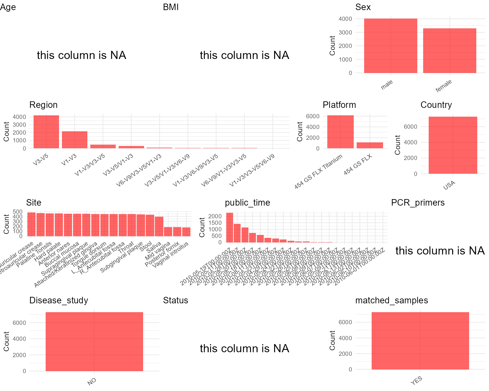

# Step 1: Obtain Initial Metadata from Each Project

To obtain the initial metadata:
1. Search for the BioProject ID (e.g., "PRJEBXXXX") on the [NCBI SRA website](https://www.ncbi.nlm.nih.gov/Traces/study/).
2. In the "Select" table, click on "Metadata" and download the file.
3. The downloaded file is typically named "SraRunTable.csv" and contains metadata for the project.

```{r message=FALSE, warning=FALSE}
# Load necessary libraries
library(dplyr)
library(ggplot2)
library(cowplot)

# Set working directory (update this path to your local directory)
setwd("D:/oral_project/qiita_id1928")

# Read the initial metadata files
initial_meta<-read.csv("SraRunTable.csv",header = T)

# Combine the two metadata files
#meta <- rbind(initial_meta, initial_meta1)

#Remove entries non-oral samples
#initial_meta <- subset(initial_meta,isolate %in% c("saliva","tongue coat"))

# Check the number of samples containing "HT" in Sample.Name (e.g., healthy controls)
#nrow(subset(meta, grepl("HT", Sample.Name)))

# Display the first few rows of the metadata
head(initial_meta)
```

# Step 2: Create a Uniform Metadata Template

The uniform metadata should include the following columns:

1. **BioProject**: Project ID (e.g., "PRJNA339212")
2. **Run**: Sample ID (e.g., "ERRXXXXXX" or "SRRXXXXXX")
3. **sample_name**: Original sample name submitted by the authors (not the database-assigned ID)
4. **Age**: Age of the subject (if available)
5. **BMI**: Body Mass Index (if available)
6. **Sex**: Sex of the subject ("F" or "M")
7. **Region**: Targeted 16S rRNA region (e.g., "V3-V4")
8. **Platform**: Sequencing platform (e.g., "Illumina MiSeq")
9. **Country**: Country of sample origin (e.g., "China")
10. **Site**: Sample site (e.g., "saliva", "dental plaque")
11. **public_time**: Data release date (format: "YYYY-MM-DD")
12. **PCR_primers**: PCR primers used (e.g., "515F-806R")
13. **title**: Title of the associated publication
14. **Disease_study**: Whether the study involves a disease ("YES" or "NO")
15. **Status**: Disease status (e.g., "T2DM", "HC"). Note: If the study includes both disease and healthy samples, this must be specified per sample.
16. **matched_samples**: matched samples ("YES" or "NO")
```{r}
# Create a uniform metadata dataframe
metadata <- data.frame(
  BioProject = initial_meta$BioProject,
  Run = initial_meta$Run,
  sample_name = initial_meta$submitted_subject_id,
  Age = NA,
  BMI = NA,
  Sex=initial_meta$host_sex,
  Region = initial_meta$gene..exp.,
  Platform = initial_meta$Instrument,
  Country = "USA",
  Site = initial_meta$isolation_source,
  public_time = initial_meta$ReleaseDate,
  stringsAsFactors = FALSE
)
```
# Step 3: Manually Add Information from the Publication

Some information (e.g. PCR primers, study title, disease status) must be manually extracted from the publication and added to the metadata.
```{r}
# Add information obtained from the publication
metadata$PCR_primers <- NA
metadata$title <- "Structure function and diversity of the
healthy human microbiome"
metadata$Disease_study <- "NO"
# Assign disease status based on sample_name patterns
metadata$Status<- NA

# Check initial data distribution
cat("Initial sample distribution:\n")
table(metadata$sample_name)
table(metadata$Site)

# Define oral sampling sites
oral_sites <- c("G_DNA_Saliva","G_DNA_Supragingival plaque","G_DNA_Hard palate",
                "G_DNA_Attached/Keratinized gingiva","G_DNA_Subgingival plaque",
                "G_DNA_Tongue dorsum")

# Identify subjects with at least one oral sample
subjects_with_oral <- unique(metadata$sample_name[metadata$Site %in% oral_sites])
cat("\nSubjects with oral sampling:", length(subjects_with_oral), "\n")

# Keep only subjects that have at least one oral sample
metadata_clean <- metadata[metadata$sample_name %in% subjects_with_oral, ]

# Recalculate sample counts after filtering
sample_counts_clean <- table(metadata_clean$sample_name)

# For each subject, check if they have both oral and non-oral samples
metadata_clean$matched_samples <- "NO"

for (subject in unique(metadata_clean$sample_name)) {
    subject_data <- metadata_clean[metadata_clean$sample_name == subject, ]
    
    has_oral <- any(subject_data$Site %in% oral_sites)
    has_non_oral <- any(!subject_data$Site %in% oral_sites)
    
    if (has_oral && has_non_oral) {
        metadata_clean$matched_samples[metadata_clean$sample_name == subject] <- "YES"
    }
}

cat("\nFinal sample distribution after cleaning:\n")
cat("Number of subjects:", length(unique(metadata_clean$sample_name)), "\n")
cat("Total samples:", nrow(metadata_clean), "\n")

cat("\nSample distribution by subject:\n")
print(table(metadata_clean$sample_name))

cat("\nSite distribution:\n")
print(table(metadata_clean$Site))

cat("\nMatched samples distribution:\n")
print(table(metadata_clean$matched_samples))

# Use cleaned dataset for subsequent analysis
metadata <- metadata_clean
# renames sequencing regions
metadata$Region<-gsub("16s rRNA | region|16S rRNA |16S ","",metadata$Region)
metadata$Region<-gsub(",","/",metadata$Region)
metadata$Site<-gsub("G_DNA_","",metadata$Site)
```
# Step 4: Summarize and Validate the Metadata
```{r}
# Check the number of unique runs and sample names
print(paste("Number of unique runs:", length(unique(metadata$Run))))
print(paste("Number of unique sample names:", length(unique(metadata$sample_name))))
```
# Step 5: Visualize the Metadata
```{r,fig.width=8, fig.height=6, fig.align='center'}
# Select columns for visualization
plot_data <- metadata %>%
  select(-BioProject, -Run, -sample_name, -title)

# Function to create simple plots for each column
create_simple_plots <- function(data) {
  plots <- list()
  
  for (col in colnames(data)) {
    # Check if the column is all NA
    if (all(is.na(data[[col]]))) {
      # Create an empty plot with text indicating all NA
      p <- ggplot() +
        annotate("text", x = 0.5, y = 0.5, label = "this column is NA", size = 6) +
        labs(title = col) +
        theme_void()
    } else if (is.numeric(data[[col]])) {
      # Numeric variable: histogram
      p <- ggplot(data, aes(x = .data[[col]])) +
        geom_histogram(fill = "blue", alpha = 0.6, bins = 20, na.rm = TRUE) +
        labs(title = col) +
        theme_minimal()
    } else {
      # Categorical variable: bar plot (remove NA values)
      count_data <- as.data.frame(table(data[[col]], useNA = "ifany"))
      p <- ggplot(count_data, aes(x = reorder(Var1, -Freq), y = Freq)) +
        geom_col(fill = "red", alpha = 0.6) +
        labs(title = col, x = NULL, y = "Count") +
        theme_minimal() +
        theme(axis.text.x = element_text(angle = 35, hjust = 1))
    }
    plots[[col]] <- p
  }
  
  return(plots)
}

# Generate and arrange plots
plots <- create_simple_plots(plot_data)
row1 <- plot_grid(plots$Age, plots$BMI, plots$Sex, nrow = 1, rel_widths = c(1, 1, 1))
row2 <- plot_grid(plots$Region, plots$Platform, plots$Country, nrow = 1, rel_widths = c(3, 1, 1))
row3 <- plot_grid(plots$Site, plots$public_time, plots$PCR_primers, nrow = 1, rel_widths = c(2, 2, 1))
row4<- plot_grid(plots$Disease_study, plots$Status, plots$matched_samples,nrow = 1, rel_widths = c(1,1,1))

p <- plot_grid(row1, row2, row3, row4,ncol = 1)
ggsave("Metadata_Summary.png", plot = p, width = 10, height = 8, dpi = 150)
```


```{r}

```

# Step 6: Finalize and Export the Metadata
```{r}
# Reorder columns to match the desired format
metadata <- metadata[, c(
  "BioProject", "Run", "sample_name", "Age", "BMI", "Sex", 
  "Region", "Platform", "Country", "Site", "public_time", 
  "PCR_primers", "title", "Disease_study", "Status","matched_samples"
)]

# Export the uniform metadata to a CSV file
write.csv(metadata, file = "metadata.csv", quote = FALSE)
head(metadata)
```
## Notes for Students:

1. **Metadata Accuracy**: Always cross-check the metadata with the original publication to ensure accuracy.
2. **Manual Entries**: Columns like `PCR_primers`, and `Status` often require manual entry based on the publication.
3. **Disease Status**: Be careful when assigning `Status`—some studies include both disease and healthy samples.
4. **Visualization**: The plots help quickly identify the distribution of values in each column, which is useful for quality control.
5. **Reproducibility**: Update the working directory and file paths to match your local environment.