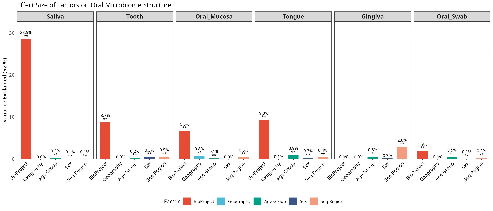
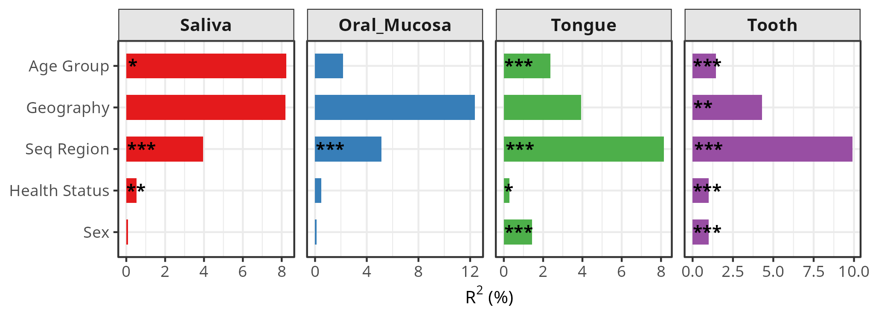
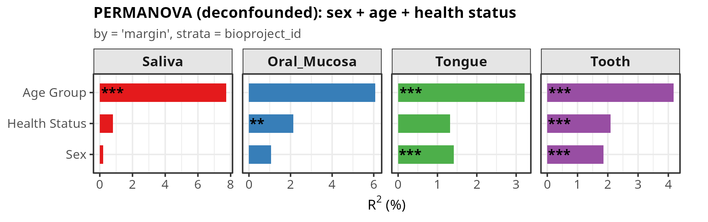

# 4. Beta Diversity — Adonis2 Model Comparison

## 4.1 Method

Beta-diversity analyses were based on the same Weighted UniFrac distance matrix and oral metadata. Adonis2 models were fitted separately for Saliva, Oral Mucosa, Tongue, and Tooth using `vegan::adonis2`, 999 permutations, and marginal tests (`by = "margin"`). Three model specifications were compared:

**Model A — Original joint model.** `dist ~ bioproject_id + sex_cleaned + age_cleaned_group + sequencing_region_cleaned + continent_group`. BioProject was included directly in the formula, and permutations were not restricted by project. Healthy status was not included. Script: `oral/run_adonis_oral.R`.

**Model B — Full model with project-stratified permutations.** `dist ~ sex_cleaned + age_cleaned_group + sequencing_region_cleaned + continent_group + Healthy_Status`. Permutations were restricted within BioProject using `strata = bioproject_id`. Script: `oral/oral_v2/run_adonis2_oral_v2.R`.

**Model C — Deconfounded model.** `dist ~ sex_cleaned + age_cleaned_group + Healthy_Status`, with `strata = bioproject_id`. `continent_group` and `sequencing_region_cleaned` were removed because site-stratified collinearity checks showed Cramér's V ≥ 0.70 and within-project variation in ≤20% of projects for all four sites. Script: `oral/oral_v2_deconfounded/run_adonis2_v2.R`.

All models used the same metadata file (`metadata_oral_qc.tsv`) and Weighted UniFrac object (`unifrac_weight.RData`). Samples were matched to the distance matrix by sample ID. Model-specific complete-case filtering produced different sample sizes, so R² values should be compared with this difference in mind. `strata = bioproject_id` restricts permutations within projects but does not fit BioProject as a model term.

## 4.2 Main Figures — Adonis2 Models

### Model A: Original joint model

**Figure 1A. Weighted UniFrac Adonis2 results from the original joint model.** BioProject was the dominant term, explaining 28.49% of variation in Saliva and 6.64%–9.28% in the other three shared sites. `continent_group` had zero degrees of freedom in Saliva and Tooth, indicating complete aliasing with other model terms.

### Model B: Full model with project-stratified permutations

**Figure 1B. Weighted UniFrac Adonis2 results with project-stratified permutations.** Geography and sequencing region showed large marginal R² values, but both variables were structurally confounded with BioProject and could not be interpreted as independent effects.

### Model C: Deconfounded model

**Figure 1C. Weighted UniFrac Adonis2 results after removing structurally confounded variables.** The final model retained sex, age group, and healthy status, with permutations restricted within BioProject. Model C was used as the primary analysis.

## 4.3 Main Results — Sex and Age Group

Results are shown as marginal R² (%) and permutation p value. Models B and C used the same project-stratified permutation design.

| Site | Sex, Model B | Sex, Model C | Age Group, Model B | Age Group, Model C |
|---|---:|---:|---:|---:|
| Saliva | 0.092%; p=0.831 | 0.212%; p=0.660 | 7.061%; p=0.008 | 7.729%; p=0.001 |
| Oral Mucosa | 0.142%; p=0.272 | 1.060%; p=0.571 | 2.443%; p=0.274 | 6.078%; p=0.235 |
| Tongue | 1.437%; p=0.001 | 1.412%; p=0.001 | 2.374%; p=0.001 | 3.213%; p=0.001 |
| Tooth | 1.002%; p=0.001 | 1.856%; p=0.001 | 1.458%; p=0.001 | 4.177%; p=0.001 |

Sex showed consistent significance across Models B and C: significant in Tongue and Tooth, but not in Saliva or Oral Mucosa. Age group was significant in Saliva, Tongue, and Tooth, but not in Oral Mucosa. Removing the confounded variables increased several marginal R² values because marginal effects depend on the other terms retained in the model.

## 4.4 Main Results — Healthy Status

| Site | Model B R² | Model B p | Model C R² | Model C p |
|---|---:|---:|---:|---:|
| Saliva | 0.554% | 0.034 | 0.811% | 0.524 |
| Oral Mucosa | 0.512% | 0.311 | 2.132% | 0.006 |
| Tongue | 0.282% | 0.038 | 1.323% | 0.101 |
| Tooth | 0.988% | 0.001 | 2.095% | 0.001 |

Healthy-status results were sensitive to model specification. Significance was lost in Saliva and Tongue after removal of the confounded variables, gained in Oral Mucosa, and retained in Tooth. Tooth was the only site with a significant healthy-status effect in both Models B and C.

In the primary deconfounded model, age group was significant in Saliva; healthy status was significant in Oral Mucosa; sex and age group were significant in Tongue; and all three variables were significant in Tooth.

## 4.5 Supplementary Results

Model-wide explained variation was calculated as `1 - Residual R²`. These values are descriptive because the three models contain different terms and, in some sites, different samples.

| Site | Model A: n / total R² | Model B: n / total R² | Model C: n / total R² |
|---|---:|---:|---:|
| Saliva | 19,704 / 45.700% | 18,400 / 20.879% | 18,458 / 8.817% |
| Oral Mucosa | 3,807 / 27.925% | 1,913 / 28.330% | 1,913 / 9.686% |
| Tongue | 2,245 / 28.370% | 2,237 / 19.407% | 2,237 / 6.479% |
| Tooth | 13,628 / 31.795% | 12,197 / 21.055% | 12,197 / 8.508% |

Site-stratified collinearity results are available in `oral/collinearity_check/collinearity_by_site.csv`. Full Adonis2 tables are available in the model-specific result CSV files listed below.

## 4.6 Reproducibility

| Item | Path |
|---|---|
| Model A script | `oral/run_adonis_oral.R` |
| Model A results | `oral/adonis_result_{site}_weighted.csv` |
| Model A figure | `oral/adonis_oral_result.png` |
| Model B script | `oral/oral_v2/run_adonis2_oral_v2.R` |
| Model B results | `oral/oral_v2/adonis2_result_{Site}_weighted.csv` |
| Model B figure | `oral/oral_v2/adonis_results_facet.png` |
| Model C script | `oral/oral_v2_deconfounded/run_adonis2_v2.R` |
| Model C results | `oral/oral_v2_deconfounded/adonis2_result_{Site}_weighted.csv` |
| Model C figure | `oral/oral_v2_deconfounded/adonis_results_facet.png` |
| Collinearity script | `oral/collinearity_check/run_collinearity_check.R` |
| Collinearity results | `oral/collinearity_check/collinearity_by_site.csv` |
