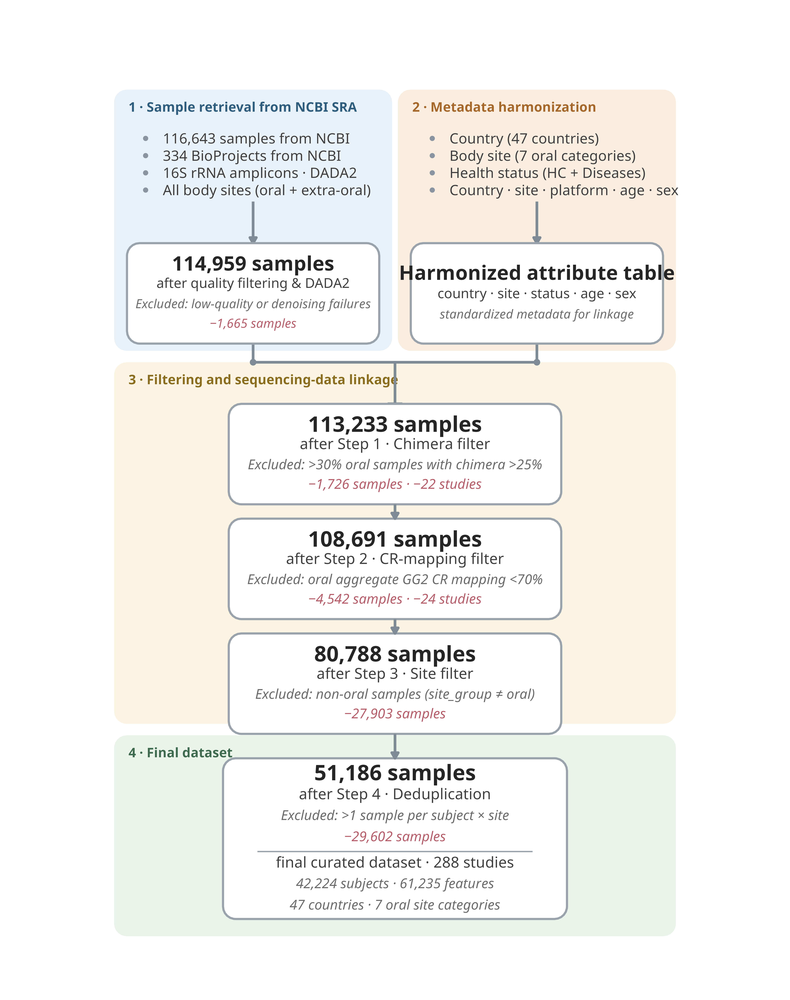
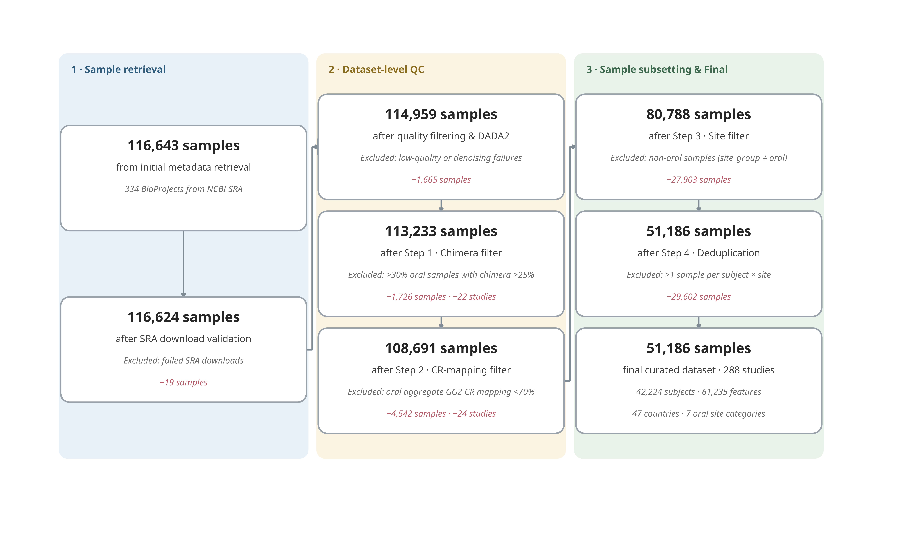

<style>
  div.sourceCode {
    max-height: 500px; 
    overflow-y: auto;
  }
</style>

# 1. Description
Dataset-level quality control and cohort retention pipeline. Central block widths are proportional to retained sample counts. In-block text denotes retained cohort metrics, while right-side annotations specify filtering criteria and exclusion counts. Each capsule gives the running sample count (bold), the step performed (regular), the filter criterion or provenance (italic gray), and — where a filter removed data — the excluded samples and studies (italic dark red)
Abbreviations: CR, Closed-reference mapping rate; GG2, Greengenes2 reference database

# 2. Script-1

```r
library(ggplot2)
library(ggforce)

# Palette (Morandi / low saturation)
zone_fill  <- c(blue = "#E9F1F8", orange = "#F9EDE0", yellow = "#FBF4E2", green = "#EAF3E9")
zone_title <- c(blue = "#2F5D7E", orange = "#A5672A", yellow = "#8A6D1F", green = "#3E6B4F")

node_fill   <- "white"
node_border <- "#9AA3AB"
arrow_col   <- "#7E8A94"
txt_main    <- "#262626"
txt_sub     <- "#3F3F3F"
txt_detail  <- "#6B6B6B"
txt_excl    <- "#B75D69"
bullet_col  <- "#8A94A0"

# Geometry helpers
rect_xy <- function(cx, cy, w, h, grp = NULL) {
  d <- data.frame(
    x = c(cx - w/2, cx + w/2, cx + w/2, cx - w/2),
    y = c(cy - h/2, cy - h/2, cy + h/2, cy + h/2)
  )
  if (!is.null(grp)) d$grp <- grp
  d
}

arrowhead_xy <- function(cx, cy, dir, a = 3.2, b = 1.9) {
  switch(dir,
    down = data.frame(x = c(cx - b, cx + b, cx), y = c(cy, cy, cy - a))
  )
}

# Canvas & zones
zones <- data.frame(
  name = c("1 · Sample retrieval from NCBI SRA", "2 · Metadata harmonization",
           "3 · Filtering and sequencing-data linkage", "4 · Final dataset"),
  xmin = c(1, 50.5, 1, 1), xmax = c(49.5, 99, 99, 99),
  ymin = c(82, 82, 17, -20), ymax = c(127.5, 127.5, 80, 15),
  key  = c("blue", "orange", "yellow", "green")
)
zones$fill <- zone_fill[zones$key]
zones$tcol <- zone_title[zones$key]

zones_poly <- do.call(rbind, lapply(seq_len(nrow(zones)), function(i)
  rect_xy((zones$xmin[i] + zones$xmax[i])/2, (zones$ymin[i] + zones$ymax[i])/2,
          zones$xmax[i] - zones$xmin[i], zones$ymax[i] - zones$ymin[i], paste0("z", i))))
zones_poly$fill <- rep(zones$fill, each = 4)

# Top modules (Parallel tasks)
bullet <- data.frame(
  x = c(rep(6.5, 4), rep(56.5, 4)),
  y = c(119, 116, 113, 110)
)
row_txt <- data.frame(
  x = c(rep(9.5, 4), rep(59.5, 4)),
  y = c(119, 116, 113, 110),
  label = c("116,643 samples from NCBI", "334 BioProjects from NCBI", 
            "16S rRNA amplicons · DADA2", "All body sites (oral + extra-oral)", 
            "Country (47 countries)", "Body site (7 oral categories)",
            "Health status (HC + Diseases)", "Country · site · platform · age · sex")
)

top_pill <- data.frame(id = c("tblue", "torange"), cx = c(25.25, 74.75), cy = c(92, 92), w = c(44, 44), h = c(17.5, 17.5))
top_poly <- do.call(rbind, lapply(seq_len(nrow(top_pill)), function(i)
  rect_xy(top_pill$cx[i], top_pill$cy[i], top_pill$w[i], top_pill$h[i], top_pill$id[i])))

top_txt <- do.call(rbind, list(
  data.frame(x = 25.25, 
             y = 92 + c(5.2, 1.8, -1.8, -5.2),
             label = c("114,959 samples", "after quality filtering & DADA2", "Excluded: low-quality or denoising failures", "−1,665 samples"),
             size = c(5.6, 3.8, 3.5, 3.5), 
             fontface = c("bold", "plain", "italic", "italic"), color = c(txt_main, txt_sub, txt_detail, txt_excl)),
  data.frame(x = 74.75, 
             y = 92 + c(3.6, 0, -3.6),
             label = c("Harmonized attribute table", "country · site · status · age · sex", "standardized metadata for linkage"),
             size = c(5.6, 3.8, 3.5), fontface = c("bold", "plain", "italic"), color = c(txt_main, txt_sub, txt_detail))
))

row_arrow <- data.frame(x = c(25.25, 74.75), y = c(108, 108), xend = c(25.25, 74.75), yend = c(100.75, 100.75))

merge_seg <- data.frame(x = c(25.25, 74.75, 25.25, 50), y = c(83.25, 83.25, 80, 80), xend = c(25.25, 74.75, 74.75, 50), yend = c(80, 80, 80, 73.0))
merge_head <- arrowhead_xy(50, 73.0, "down", a = 2.2, b = 1.3)
merge_dot  <- data.frame(x = c(25.25, 74.75), y = c(80, 80))

# Funnel Nodes
step_pill <- data.frame(
  id = paste0("s", 1:4), 
  cx = rep(50, 4), 
  cy = c(64, 44, 24, -3),
  w = c(58, 58, 58, 60),
  h = c(17.5, 17.5, 17.5, 28) 
)

step_poly <- do.call(rbind, lapply(seq_len(nrow(step_pill)), function(i)
  rect_xy(step_pill$cx[i], step_pill$cy[i], step_pill$w[i], step_pill$h[i], step_pill$id[i])))

step_line <- do.call(rbind, list(
  data.frame(x = 50, y = 64 + c(5.2, 1.8, -1.8, -5.2), label = c("113,233 samples", "after Step 1 · Chimera filter", "Excluded: >30% oral samples with chimera >25%", "−1,726 samples · −22 studies"), size = c(6.0, 4.2, 3.8, 3.8), fontface = c("bold", "plain", "italic", "italic"), color = c(txt_main, txt_sub, txt_detail, txt_excl)),
  data.frame(x = 50, y = 44 + c(5.2, 1.8, -1.8, -5.2), label = c("108,691 samples", "after Step 2 · CR-mapping filter", "Excluded: oral aggregate GG2 CR mapping <70%", "−4,542 samples · −24 studies"), size = c(6.0, 4.2, 3.8, 3.8), fontface = c("bold", "plain", "italic", "italic"), color = c(txt_main, txt_sub, txt_detail, txt_excl)),
  data.frame(x = 50, y = 24 + c(5.2, 1.8, -1.8, -5.2), label = c("80,788 samples", "after Step 3 · Site filter", "Excluded: non-oral samples (site_group ≠ oral)", "−27,903 samples"), size = c(6.0, 4.2, 3.8, 3.8), fontface = c("bold", "plain", "italic", "italic"), color = c(txt_main, txt_sub, txt_detail, txt_excl)),
  data.frame(x = 50, y = -3 + c(11.5, 7.8, 4.1, 0.4, -4.1, -7.8, -11.5), label = c("51,186 samples", "after Step 4 · Deduplication", "Excluded: >1 sample per subject × site", "−29,602 samples", "final curated dataset · 288 studies", "42,224 subjects · 61,235 features", "47 countries · 7 oral site categories"), size = c(6.0, 4.2, 3.8, 3.8, 4.2, 3.8, 3.8), fontface = c("bold", "plain", "italic", "italic", "plain", "italic", "italic"), color = c(txt_main, txt_sub, txt_detail, txt_excl, txt_sub, txt_detail, txt_detail))
))

final_div <- data.frame(x = 26, y = -5.25, xend = 74, yend = -5.25)

step_arrow <- data.frame(
  x = rep(50, 3), 
  y = c(55.25, 35.25, 15.25), 
  xend = rep(50, 3), 
  yend = c(52.75, 32.75, 11.00)
)

# Assemble plot
p2 <- ggplot() +
  geom_shape(data = zones_poly, aes(x = x, y = y, group = grp), fill = zones_poly$fill, radius = unit(0.35, "cm"), color = NA) +
  geom_text(data = zones, aes(x = xmin + 2.5, y = ymax - 2.2, label = name, color = tcol), hjust = 0, vjust = 1, fontface = "bold", size = 3.7) +
  scale_color_identity() +

  geom_point(data = bullet, aes(x = x, y = y), shape = 16, size = 1.6, color = bullet_col) +
  geom_text(data = row_txt, aes(x = x, y = y, label = label), hjust = 0, size = 4.0, color = txt_sub) +
  geom_segment(data = row_arrow, aes(x = x, y = y, xend = xend, yend = yend), color = arrow_col, linewidth = 1.0, arrow = arrow(length = unit(0.18, "cm"), type = "closed")) +

  geom_segment(data = merge_seg, aes(x = x, y = y, xend = xend, yend = yend), color = arrow_col, linewidth = 1.0) +
  geom_polygon(data = merge_head, aes(x = x, y = y), fill = arrow_col) +
  geom_point(data = merge_dot, aes(x = x, y = y), shape = 21, size = 1.8, fill = arrow_col, color = arrow_col) +

  geom_shape(data = top_poly, aes(x = x, y = y, group = grp), fill = node_fill, color = node_border, radius = unit(0.35, "cm"), linewidth = 0.8) +
  geom_text(data = top_txt, aes(x = x, y = y, label = label), size = top_txt$size, fontface = top_txt$fontface, color = top_txt$color) +

  geom_shape(data = step_poly, aes(x = x, y = y, group = grp), fill = node_fill, color = node_border, radius = unit(0.35, "cm"), linewidth = 0.8) +
  geom_text(data = step_line, aes(x = x, y = y, label = label), size = step_line$size, fontface = step_line$fontface, color = step_line$color) +
  geom_segment(data = final_div, aes(x = x, y = y, xend = xend, yend = yend), color = node_border, linewidth = 0.5) +

  geom_segment(data = step_arrow, aes(x = x, y = y, xend = xend, yend = yend), color = arrow_col, linewidth = 1.0, arrow = arrow(length = unit(0.18, "cm"), type = "closed")) +

  coord_fixed(ratio = 1, xlim = c(0, 100), ylim = c(-22, 134)) +
  theme_void() + theme(plot.margin = margin(6, 6, 6, 6, "pt"))

output_dir <- "/home/yanglun/YSD/global_oral/global_oral_v2/oral-v2-02/01-overview-sampling-distribution/02-patch-map-2/03-patch-pipeline-map/output"
if (!dir.exists(output_dir)) dir.create(output_dir, recursive = TRUE)

ggsave(file.path(output_dir, "pipeline_two_stage_funnel_HD.pdf"), plot = p2, width = 8.7, height = 11, device = "pdf")
ggsave(file.path(output_dir, "pipeline_two_stage_funnel_HD.png"), plot = p2, width = 8.7, height = 11, device = "png", dpi = 600, bg = "white")
```

# 3. Figure-1

<a href="data_qc_funnel_chart_plot_0821_figure_1.png" target="_blank">
  {#fig-global-map fig-align="center" width="100%"}
</a>

# 4. Script-2

```r
library(ggplot2)
library(ggforce)

# Palette (Morandi / low saturation)
zone_fill  <- c(blue = "#E9F1F8", yellow = "#FBF4E2", green = "#EAF3E9")
zone_title <- c(blue = "#2F5D7E", yellow = "#8A6D1F", green = "#3E6B4F")

node_fill   <- "white"
node_border <- "#9AA3AB"
arrow_col   <- "#7E8A94"
txt_main    <- "#262626"
txt_sub     <- "#3F3F3F"
txt_detail  <- "#6B6B6B"
txt_excl    <- "#B75D69"

# Geometry helpers
# Standard bounding box for geom_shape (automatically rounded via radius)
rect_xy <- function(cx, cy, w, h, grp = NULL) {
  d <- data.frame(
    x = c(cx - w/2, cx + w/2, cx + w/2, cx - w/2),
    y = c(cy - h/2, cy - h/2, cy + h/2, cy + h/2)
  )
  if (!is.null(grp)) d$grp <- grp
  d
}

arrowhead_xy <- function(cx, cy, dir, a = 3.2, b = 1.9) {
  switch(dir,
    right = data.frame(x = c(cx, cx - a, cx - a), y = c(cy, cy - b, cy + b))
  )
}

# Canvas & zones 
zones <- data.frame(
  name = c("1 · Sample retrieval", "2 · Dataset-level QC", "3 · Sample subsetting & Final"),
  xmin = c(0, 33, 66), xmax = c(32, 65, 98),
  ymin = c(8, 8, 8), ymax = c(60, 60, 60),
  key  = c("blue", "yellow", "green")
)
zones$fill <- zone_fill[zones$key]
zones$tcol <- zone_title[zones$key]

zones_poly <- do.call(rbind, lapply(seq_len(nrow(zones)), function(i) {
  rect_xy((zones$xmin[i] + zones$xmax[i])/2, (zones$ymin[i] + zones$ymax[i])/2,
          zones$xmax[i] - zones$xmin[i], zones$ymax[i] - zones$ymin[i], paste0("z", i))
}))
zones_poly$fill <- rep(zones$fill, each = 4)

# Nodes & Text (Restored to 8 uniform boxes, increased text size)
nodes <- data.frame(
  id = paste0("b", 1:8),
  cx = c(16, 16, 49, 49, 49, 82, 82, 82),
  cy = c(44, 22, 48, 33, 18, 48, 33, 18),
  w  = rep(31.5, 8),
  h  = rep(13.5, 8),
  title = c("116,643 samples", "116,624 samples", "114,959 samples", "113,233 samples", 
            "108,691 samples", "80,788 samples", "51,186 samples", "51,186 samples"),
  desc  = c("from initial metadata retrieval", "after SRA download validation", 
            "after quality filtering & DADA2", "after Step 1 · Chimera filter", 
            "after Step 2 · CR-mapping filter", "after Step 3 · Site filter", 
            "after Step 4 · Deduplication", "final curated dataset · 288 studies"),
  detail= c("334 BioProjects from NCBI SRA", "Excluded: failed SRA downloads", 
            "Excluded: low-quality or denoising failures", "Excluded: >30% oral samples with chimera >25%", 
            "Excluded: oral aggregate GG2 CR mapping <70%", "Excluded: non-oral samples (site_group \u2260 oral)", 
            "Excluded: >1 sample per subject \u00d7 site", "42,224 subjects · 61,235 features"),
  excl  = c("", "\u221219 samples", "\u22121,665 samples", "\u22121,726 samples · \u221222 studies", 
            "\u22124,542 samples · \u221224 studies", "\u221227,903 samples", 
            "\u221229,602 samples", "47 countries · 7 oral site categories"),
  is_red= c(FALSE, TRUE, TRUE, TRUE, TRUE, TRUE, TRUE, FALSE)
)

nodes_poly <- do.call(rbind, lapply(seq_len(nrow(nodes)), function(i) 
  rect_xy(nodes$cx[i], nodes$cy[i], nodes$w[i], nodes$h[i], nodes$id[i])))

lines <- do.call(rbind, lapply(1:8, function(i) {
  n <- nodes[i, ]
  d <- data.frame(
    x = rep(n$cx, 4), 
    y = n$cy + c(4.2, 1.4, -1.4, -4.2),
    label = c(n$title, n$desc, n$detail, n$excl),
    size = c(5.5, 3.8, 3.4, 3.4),
    fontface = c("bold", "plain", "italic", "italic"),
    color = c(txt_main, txt_sub, txt_detail, ifelse(n$is_red, txt_excl, txt_detail))
  )
  d[d$label != "", ]
}))

# Connectors
v_arrow <- data.frame(
  x = c(16, 49, 49, 82, 82),
  y = c(44, 48, 33, 48, 33) - 6.75,
  xend = c(16, 49, 49, 82, 82),
  yend = c(22, 33, 18, 33, 18) + 6.75
)

cross_1 <- data.frame(x = c(31.75, 32.5, 32.5, 33.25), y = c(22, 22, 48, 48))
cross_2 <- data.frame(x = c(64.75, 65.5, 65.5, 66.25), y = c(18, 18, 48, 48))
segs_from <- function(p) data.frame(x = p$x[-nrow(p)], y = p$y[-nrow(p)], xend = p$x[-1], yend = p$y[-1])

# Assemble plot
p1 <- ggplot() +
  geom_shape(data = zones_poly, aes(x = x, y = y, group = grp), 
             fill = zones_poly$fill, radius = unit(0.35, "cm"), color = NA) +
  geom_text(data = zones, aes(x = xmin + 1.6, y = ymax - 1.6, label = name, color = tcol),
            hjust = 0, vjust = 1, fontface = "bold", size = 3.9) +
  scale_color_identity() +

  geom_segment(data = v_arrow, aes(x = x, y = y, xend = xend, yend = yend),
               arrow = arrow(length = unit(0.14, "cm"), type = "closed"), color = arrow_col, linewidth = 0.7) +
  geom_path(data = cross_1, aes(x = x, y = y), color = arrow_col, linewidth = 0.7, 
            arrow = arrow(length = unit(0.14, "cm"), type = "closed")) +
  geom_path(data = cross_2, aes(x = x, y = y), color = arrow_col, linewidth = 0.7, 
            arrow = arrow(length = unit(0.14, "cm"), type = "closed")) +
  
  geom_segment(data = segs_from(cross_1), aes(x = x, y = y, xend = xend, yend = yend), color = arrow_col, linewidth = 1.0) +
  geom_polygon(data = arrowhead_xy(35, 48, "right", a = 1.9, b = 1.1), aes(x = x, y = y), fill = arrow_col) +
  
  geom_segment(data = segs_from(cross_2), aes(x = x, y = y, xend = xend, yend = yend), color = arrow_col, linewidth = 1.0) +
  geom_polygon(data = arrowhead_xy(68, 48, "right", a = 1.9, b = 1.1), aes(x = x, y = y), fill = arrow_col) +
  
  geom_shape(data = nodes_poly, aes(x = x, y = y, group = grp),
             fill = node_fill, color = node_border, radius = unit(0.35, "cm"), linewidth = 0.8) +
  geom_text(data = lines, aes(x = x, y = y, label = label),
            size = lines$size, fontface = lines$fontface, color = lines$color) +
  
  coord_fixed(ratio = 1, xlim = c(0, 100), ylim = c(0, 63)) +
  theme_void() + theme(plot.margin = margin(6, 6, 6, 6, "pt"))

output_dir <- "/home/yanglun/YSD/global_oral/global_oral_v2/oral-v2-02/01-overview-sampling-distribution/02-patch-map-2/03-patch-pipeline-map/output"
if (!dir.exists(output_dir)) dir.create(output_dir, recursive = TRUE)

ggsave(file.path(output_dir, "pipeline_three_stage_funnel_HD.pdf"), plot = p1, width = 14, height = 8.6, device = "pdf")
ggsave(file.path(output_dir, "pipeline_three_stage_funnel_HD.png"), plot = p1, width = 14, height = 8.6, device = "png", dpi = 600, bg = "white")
```

# 5. Figure-2

<a href="data_qc_funnel_chart_plot_0821_figure_2.png" target="_blank">
  {#fig-global-map fig-align="center" width="100%"}
</a>