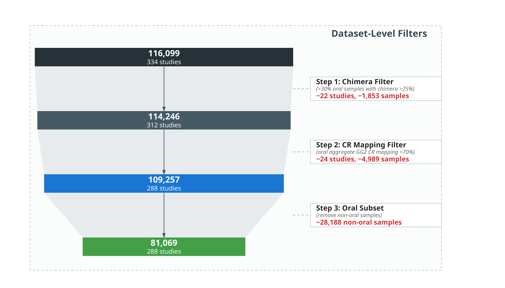

# Data QC Funnel Chart

---

## Figure Legend

**Dataset-level quality control funnel.** Four sequential steps show the progressive filtering of the merged dataset. The Raw merge step (116,099 samples, 334 studies) is followed by three dataset-level filters: Step 1 — Chimera Filter removes datasets with >30% oral samples and chimera rate >25% (−22 studies, −1,853 samples), Step 2 — CR Mapping Filter removes datasets with oral aggregate GG2 CR mapping <70% (−24 studies, −4,989 samples), and Step 3 — Oral Subset removes non-oral samples (−28,188 non-oral samples removed). Block widths are proportional to retained sample count. Each block displays the sample count (bold) and study count (plain). Right-side annotation boxes detail the step name (bold), filtering criterion (italic), and number of removed samples or studies (bold red). Closed arrowheads between blocks indicate the direction of filtering. The final curated dataset comprises 81,069 oral samples from 288 studies.

---

## Methods

### Quality Control Pipeline

The merged metadata table was sequentially filtered through three dataset-level steps. Step 1 excluded datasets with >30% oral samples and chimera rates >25% (−22 studies, −1,853 samples). Step 2 excluded datasets with oral aggregate GG2 CR mapping <70% (−24 studies, −4,989 samples). Step 3 removed non-oral samples (−28,188 non-oral samples removed). The final dataset comprised 81,069 oral samples from 288 studies.

In the funnel visualization, block widths are proportional to retained sample count (half_width = min_w + (n − n_min) / (n_max − n_min) × (max_w − min_w), where min_w = 8.5, max_w = 13.5). Inter-block connectors (trapezoids) and closed directional arrows (length = 0.28 cm, angle = 18°, color = #455A64) link consecutive steps. Right-side annotation boxes (width = 13.0, height = 1.5) detail each step name (bold), filtering criterion (italic), and removed count (bold red), connected to the inter-block arrows via dashed lines. The plot uses `coord_cartesian(xlim = c(−14.5, 33.0), ylim = c(−1.5, 14.5))`.

---

## Output

- **Script**: `data_qc_funnel_chart_plot.R`
- **Output**: `data_qc_funnel_chart.pdf`, `data_qc_funnel_chart.png` (14 × 8 inches, 600 DPI)

## Abbreviations

- **CR**: Closed-reference mapping rate
- **GG2**: Greengenes2 reference database

## Input Data

- `input/metadata_oral_qc.tsv` — Final curated metadata with `bioproject_id`, `sample_id`, `site_cleaned`, `continent_group`, `country_cleaned` columns