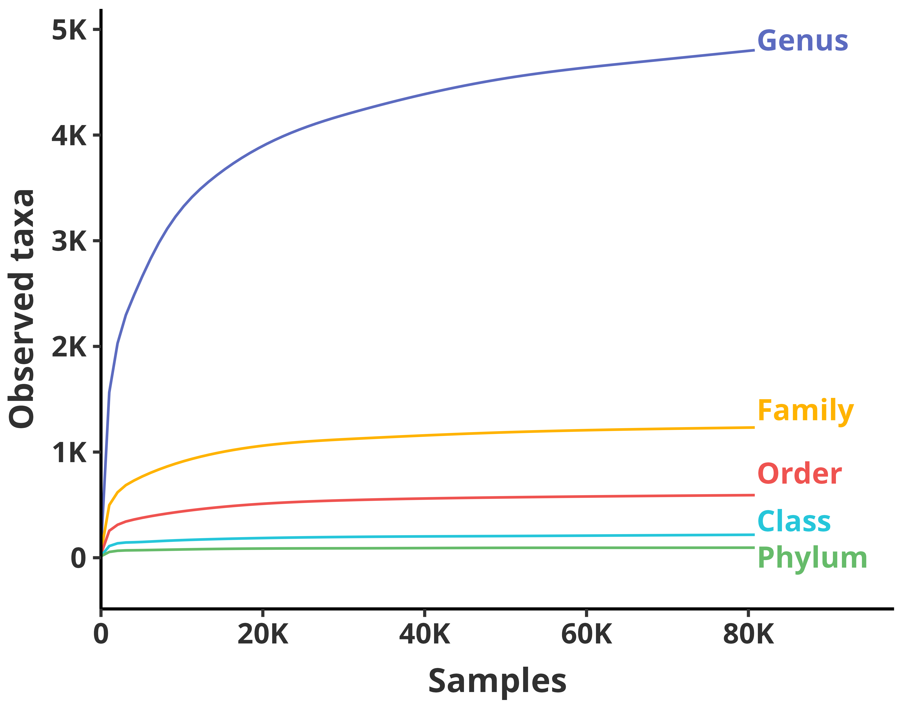

# Rarefaction Curve

---

## Figure Legend

**Taxonomic saturation curves.** Accumulation of unique taxa across five taxonomic ranks (Genus, Family, Order, Class, Phylum) is shown as a function of the number of samples (up to 81,069). Curves were GAM-smoothed (mgcv, cubic spline, y ~ s(x, bs = "cs")) and color-coded: Genus (indigo, #5C6BC0), Family (amber, #FFB300), Order (red, #EF5350), Class (cyan, #26C6DA), Phylum (green, #66BB6A). Inline text labels identify each rank at x = 81,000; y-coordinates are spread to avoid overlap. The x-axis displays sample counts (broken at 0, 20K, 40K, 60K, 80K) and the y-axis displays observed taxa counts (broken at 0, 1K, 2K, 3K, 4K, 5K). The figure uses a compact canvas (7 × 5.5 inches) with enlarged text (base_size = 22) for legibility.

---

## Methods

### Taxonomic Saturation (Rarefaction) Curves

To assess whether sampling depth was sufficient to capture microbial diversity, rarefaction curves were computed across five taxonomic ranks (Phylum, Class, Order, Family, Genus). The BIOM feature table (`input/biom_oral_qc.biom`) and taxonomy annotations (`input/taxonomy.tsv`) were loaded. For each ASV/OTU, taxonomic levels were parsed from semicolon-delimited strings using the prefixes p__, c__, o__, f__, and g__. Incompletely annotated taxa (empty strings after prefix removal) were excluded from counting. Samples were randomly shuffled (seed = 42) and accumulated at increasing checkpoints (1, 5, 10, 50, 100, 200, 500, 800, every 1K from 1K–10K, every 5K from 10K to the full 81,069). At each checkpoint, the sparse matrix was subset to the corresponding sample indices, and present features were identified via `scipy.sparse.csc_matrix.getnnz(axis=1)`. Unique taxa per rank were counted in parallel across CPU cores using Python `multiprocessing.Pool`. The resulting rarefaction table (`output/rarefaction_pcofg.tsv`) was plotted in R using GAM-smoothed curves (`mgcv::gam`, formula y ~ s(x, bs = "cs")) with `theme_classic` (base_size = base_sz − 4). Five ranks were color-coded: Genus (#5C6BC0), Family (#FFB300), Order (#EF5350), Class (#26C6DA), Phylum (#66BB6A). Inline text labels are positioned at x = 81,000 with evenly spread y-coordinates (4900, 1400, 800, 350, 5) to avoid overlap. No legend is displayed; rank identities are indicated by the inline labels. The output uses a compact canvas (7 × 5.5 inches) with enlarged text (base_size = 22, axis text = base_sz × 0.72, axis titles = base_sz × 0.85, inline labels = base_sz / 3.8) to ensure legibility.

---

## Analysis Code

The rarefaction data was pre-computed using the Python script `oral_sampling_saturation_curve_analysis.py`. The script:

1. Loads the curated BIOM feature table and taxonomy annotations
2. Matches sample IDs between metadata and the BIOM table
3. Randomly shuffles sample order (seed = 42)
4. Computes unique taxa counts at 35+ sample-depth checkpoints
5. Uses parallel processing (`multiprocessing.Pool`) for efficiency
6. Outputs a TSV table (`rarefaction_pcofg.tsv`) with columns: Samples, Phylum, Class, Order, Family, Genus

---

## Output

- **R Script**: `rarefaction_curve_plot.R`
- **Analysis Script**: `oral_sampling_saturation_curve_analysis.py`
- **Output**: `rarefaction_curve.pdf`, `rarefaction_curve.png` (7 × 5.5 inches, 600 DPI)

## Input Data

- `output/rarefaction_pcofg.tsv` — Pre-computed rarefaction/saturation table across five taxonomic ranks (generated by `oral_sampling_saturation_curve_analysis.py`)
- `input/biom_oral_qc.biom` — BIOM feature table (used by the Python analysis script)
- `input/taxonomy.tsv` — Taxonomy annotations with `p__/c__/o__/f__/g__` prefixes (used by the Python analysis script)
- `input/metadata_oral_qc.tsv` — Metadata with sample IDs (used by the Python analysis script)