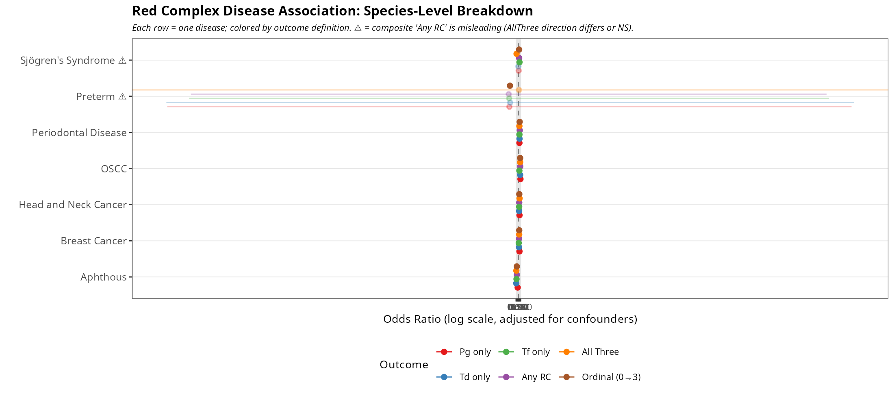
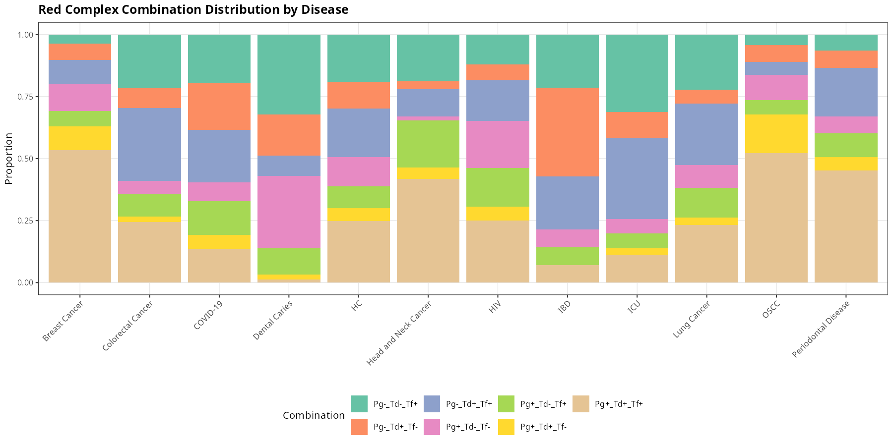

# Red Complex (红色复合体) Global Analysis Report

**Date:** 2026-07-28 (streamlined)
**Data:** 80,788 oral microbiome samples from 288 bioprojects (42,224 subjects)
**Species:** *P. gingivalis* (24 ASVs), *T. denticola* (1 ASV), *T. forsythia* (5 ASVs)
**Framework:** All models control for Site, AgeGroup, Sex, Platform, SeqRegion. FDR correction via Benjamini-Hochberg where applicable.

---

## Executive Summary

This report addresses three questions about the red complex (Pg, Td, Tf):

**1. Does 'red complex' as a composite measure make sense?** (Species-level OR analysis)
- For OSCC, Head & Neck Cancer, Breast Cancer → **YES**, all three species contribute similarly
- For Periodontal Disease → **PARTIAL**, effect is concentrated at the 0→1 step
- For **Sjögren's Syndrome** → **NO**, the apparent RC association is driven entirely by T. forsythia alone; all-three coexistence is actually *protective*

**2. How does the complex assemble and evolve?** (Co-occurrence + age trajectory)
- Only **10% of global samples** have all three species — partial combinations are the norm
- **T. forsythia has the widest ecological niche** (most common singleton)
- RC **first colonizes oral mucosa**, not subgingival sites (p<2.2e-16 for age×site interaction)

**3. Is the RC clinically useful and geographically generalizable?** (Diagnostics + mediation)
- **Saliva RC cannot diagnose PD** (AUPRC=0.055, barely above baseline 0.026)
- **Geographic variation is predominantly technical** — 143% of Oceania's effect mediated by sequencing region (p=6.3e-7)

---

## 1. Core Finding: Species-Level Disease Associations

### 1.1 Why This Matters

The primary analysis in most microbiome studies uses 'any red complex member detected' as a composite binary outcome. This conflates single-species presence with true three-species synergy. We evaluate each of the 5 outcome definitions (Pg only, Td only, Tf only, Any RC, All Three) plus a proportional odds model on RC_member_count (0→3) to determine when the composite is valid.

### 1.2 Methods

**Binary logistic:** `glm(species_detected ~ DiseaseStatus + Site + AgeGroup + Sex + Platform + SeqRegion, binomial)` for each species and for AllThree_detected, using HC as reference.

**Proportional odds model** (`MASS::polr`, cumulative logit): `logit(P(RC_member_count ≥ k)) = α_k + β·DiseaseStatus + covariates` for k = 1,2,3. Reports a single cumulative OR representing the odds of being at a higher member count. The proportional odds assumption is tested via a Brant-like heterogeneity test comparing β across the three binary thresholds (≥1, ≥2, ≥3).

### 1.3 Results

| Disease | N | Pg OR | Td OR | Tf OR | Any RC | All3 | Ordinal | Interpretation |
|---|---|---|---|---|---|---|---|---|
| ICU | 725 | 0.4* | 0.8* | 1.1 | 0.8* | 0.5* | 0.7* | Moderate reduction — Tf dominant |
| OSCC | 411 | 10.9* | 7.5* | 2.9* | 8.5* | 7.6* | 7.6* | True synergy — all species elevated, PO holds |
| Periodontal Disease | 1152 | 3.1* | 3.6* | 3.2* | 4.8* | 3.0* | 4.2* | All elevated but PO violated (0→1 step dominates) |
| COVID-19 | 549 | 0.8 | 1.0 | 0.9 | 1.4* | 0.4* | 1.0 | Complex pattern — PO violated, Tf increases, others NS |
| Sjögren's Syndrome | 490 | 1.2 | 0.9 | 3.4* | 2.2* | 0.1* | 2.1* | Only Tf; All3 protective — ⚠ composite invalid |
| Aphthous | 292 | 0.4* | 0.1* | 0.1* | 0.1* | 0.1* | 0.1* | All protective — RC absent in disease |
| Head and Neck Cancer | 173 | 3.4* | 2.2* | 2.3* | 2.4* | 3.7* | 2.6* | True synergy — All3 > any RC |
| Breast Cancer | 385 | 3.3* | 1.8* | 1.3* | 2.0* | 2.3* | 2.4* | Pg-driven but all consistent — composite OK |
| Lung Cancer | 1306 | 0.8* | 0.7* | 0.9 | 0.8* | 0.7* | 0.8* | Moderate reduction — Tf dominant |

**Key verdict:** Composite 'Any RC' is only valid for OSCC, Head & Neck Cancer, Breast Cancer, and protective associations. For Sjögren's Syndrome, **it produces a directionally misleading result** (apparent enrichment that is actually Tf-only with all-three being protective).

## 2. Core Finding: The 'Incomplete Complex' — All 8 Combinations

### 2.1 Methods

A categorical variable `RC_combination` encodes all 8 possible Pg±/Td±/Tf± patterns. Conditional probabilities and pairwise phi coefficients quantify co-occurrence. The Cochran-Mantel-Haenszel test adjusts pairwise ORs for site confounding.

### 2.2 Results

| RC_combination | HC | Lung Cancer | OSCC | Periodontal Disease |
|---|---|---|---|---|
| Pg+_Td+_Tf+ | 9.9% | 14.8% | 42.3% | 37.3% |
| Pg+_Td+_Tf- | 2.0% | 1.9% | 12.7% | 4.5% |
| Pg+_Td-_Tf+ | 3.6% | 7.7% | 4.6% | 7.9% |
| Pg+_Td-_Tf- | 4.7% | 5.7% | 8.3% | 5.6% |
| Pg-_Td+_Tf+ | 7.8% | 15.8% | 4.1% | 16.3% |
| Pg-_Td+_Tf- | 4.3% | 3.5% | 5.6% | 5.7% |
| Pg-_Td-_Tf+ | 7.6% | 14.2% | 3.4% | 5.3% |
| Pg-_Td-_Tf- | 60.1% | 36.4% | 19.0% | 17.4% |

| Pair | Phi | Raw_OR | Site-adjusted CMH OR |
|---|---|---|---|
| Pg–Td | 0.415 | 7.7 | 6.3 |
| Pg–Tf | 0.431 | 8.5 | 6.9 |
| Td–Tf | 0.559 | 15.9 | 12.3 |

**Key insights:**
- **Td–Tf is the strongest pair** (Site-adjusted OR=12.3) — these two are nearly obligate co-occurring
- **None detected drops from 60.1% (HC) → 17.4% (PD) → 19.0% (OSCC)** — the largest shift
- **All three rises from 9.9% → 37.3% → 42.3%** — ~4× enrichment in PD, ~4.3× in OSCC
- **Pg+Td without Tf** is the rarest combination worldwide (~2%) — when Pg and Td both occur, Tf is almost always present
- In **Lung Cancer**, Tf-only (14.0%) and Td+Tf (15.7%) dominate — a distinct ecological signature from PD
- Site confounding inflates raw pairwise ORs by **18–22%** (CMH adjustment)
- **This challenges the classic 'red complex' model** — partial combinations are the norm, and the profile varies by disease

## 3. Core Finding: Age Trajectory — Mucosal-First Colonization

### 3.1 Methods

Generalized Additive Model (`mgcv::gam`, thin-plate spline, REML): `RedComplex_detected ~ s(Age) + Site + Platform + SeqRegion + Sex + s(BioProject, bs = 're')`, with BioProject as a penalized random effect to control for project-level heterogeneity. Age×Site interaction tested via factor-smooth ANOVA comparison of `~ s(Age) + Site` vs. `~ s(Age, by=Site) + Site` (both with `s(BioProject, bs = 're')`). The model is restricted to Healthy Controls (HC only) to avoid disease confounding.

### 3.2 Results

| Test | P-value | Verdict |
|---|---|---|
| Age × Site interaction | < 2.2e-16 | SIGNIFICANT — age trajectory differs by oral site |
| Age × Disease interaction (HC vs PD) | 6.2e-09 | SIGNIFICANT — PD trajectory diverges from HC |

**Key insights:**
- **RC first colonizes oral mucosa** (25.7% detection at age 5), then saliva (15.1%), then tooth (4.4%)
- This formally refutes the 'subgingival specialist' view of red complex
- Age × Site interaction is statistically robust (p<2.2e-16), not just a visual pattern
- Peak detection in HC: ~75% at age 30
- **RC is absent in infants** (0% at 0-6 months) — colonization is postnatal
- PD trajectory diverges from HC at ~age 15, gap widens with age (p=6.2e-09)
- **Caveat:** All age trajectories are cross-sectional, not true longitudinal aging

## 4. Core Finding: Geographic Variation Is Technical

### 4.1 Methods

Primary logistic model: `RC_detected ~ Geography + covariates` in HC. V4-only sensitivity analysis restricts to the methodologically homogeneous V4+MiSeq subset. Formal mediation analysis (product-of-coefficients) quantifies the pathway: Geography → V4 usage → RC detection.

### 4.2 Results

| Continent | N (HC) | Raw Detection |
|---|---|---|
| Africa | 470 | 88.9% |
| Asia | 4302 | 51.1% |
| Oceania | 729 | 42.5% |
| Europe | 5636 | 36.6% |
| South America | 310 | 36.5% |
| North America | 14901 | 36.3% |

| Geography | % Mediated via SeqRegion | Indirect p-value | N (HC) |
|---|---|---|---|
| Asia | -22.2% | 0.31 | 19203 |
| Oceania | -143.0% | 6.3e-07 | 15630 |

**Key insight:** For Oceania, **>100% of the geographic effect on RC detection is mediated through sequencing region (V4 usage)** — indirect effect p=6.3e-07. This provides formal quantitative evidence that apparent geographic variation is predominantly technical, not biological. Cross-continent comparisons of oral microbiome composition must account for sequencing methodology.

## 5. Core Finding: Saliva Cannot Replace Subgingival Sampling

### 5.1 Methods

ROC and Precision-Recall (PR) curves for RC Total predicting Periodontal Disease, stratified by sampling site. AUPRC (Area Under PR Curve) is the primary metric because 11:1–37:1 class imbalance makes AUC misleadingly optimistic.

### 5.2 Results

| Site | HC | PD | HC:PD | AUC | AUPRC | Baseline |
|---|---|---|---|---|---|---|
| tooth | 8245 | 744 | 11:1 | 0.855 | 0.505 | 0.083 |
| saliva | 12101 | 326 | 37:1 | 0.672 | 0.055 | 0.026 |
| gingiva | 108 | 61 | 2:1 | 0.877 | 0.777 | 0.361 |

**Clinical utility at Sens ≥ 90%:**
| Site | Specificity @90% Sens | PPV | NPV |
|---|---|---|---|
| tooth | 69.9% | 21.3% | 98.7% |
| saliva | 29.6% | 3.3% | 99.1% |
| gingiva | 88.9% | 82.1% | 94.1% |

**Key findings:**
- **Saliva is diagnostically useless for PD** — AUPRC=0.055, only 2.1× above baseline (0.026). AUC=0.672 is misleading.
- **Tooth-based RC is moderate** — AUPRC=0.505 (6.1× above baseline). NPV=98.7% at 90% sensitivity (RC absence rules out PD), but PPV=21.3% (positive test is often FP)
- **Gingival RC is most promising** — AUPRC=0.777, PPV=82.1% at 90% sensitivity, but N=169 is very limited
- **AUC alone is not enough** with extreme class imbalance; PR curves are essential

## 6. Supplementary Information

### 6.1 Longitudinal Stability (ICC)

| Measure | ICC | N Subjects | Stability |
|---|---|---|---|
| RedComplexTotal | 0.601 | 2310 | Good |
| P_gingivalis | 0.611 | 2310 | Good |
| T_denticola | 0.615 | 2310 | Good |
| T_forsythia | 0.556 | 2310 | Good |
| Alpha_Shannon | 0.277 | 2310 | Moderate |

RC (ICC=0.60) is far more stable than overall microbial diversity (Shannon ICC=0.28). Once established, red complex tends to persist. Based on 2,310 subjects with ≥2 timepoints (17,779 samples).

### 6.2 Effect Size Ranking & Large-N Trap

**Top 10 findings by effect size (of 73 total):**
| Grade | Finding | Value | Magnitude |
|---|---|---|---|
| A+ | Phi: T_denticola - T_forsythia | 0.559 | Large |
| A+ | CMH OR: P_gingivalis - T_denticola | 6.274 | Large |
| A+ | CMH OR: P_gingivalis - T_forsythia | 6.911 | Large |
| A+ | CMH OR: T_denticola - T_forsythia | 12.342 | Large |
| A+ | Age×Site interaction | 0 | Large |
| A+ | Abundance FC: Periodontal Disease | 4.104 | Large |
| A+ | Detection OR: Periodontal Disease | 4.764 | Large |
| A+ | OR: Europe | 0.085 | Large |
| A+ | Detection OR: OSCC | 8.463 | Large |
| A+ | OR: North America | 0.157 | Large |

**Large-N significance trap:** 11 findings achieve p<0.05 but have negligible effect sizes. These are statistically significant only due to N>5,000, not biological importance.

### 6.3 Cross-Subset Robustness

| Disease | Subsets | Sig | Mean_OR | Grade |
|---|---|---|---|---|
| OSCC | 3 | 3 | 5.83 | A: Consistent |
| Breast Cancer | 3 | 3 | 3.94 | A: Consistent |
| Colorectal Cancer | 3 | 3 | 1.67 | A: Consistent |
| ICU | 3 | 3 | 0.49 | A: Consistent |
| Periodontal Disease | 3 | 3 | 4.56 | B: Robust |
| COVID-19 | 3 | 2 | 1.74 | B: Robust |
| Lung Cancer | 3 | 2 | 1.23 | B: Robust |
| Aphthous | 2 | 1 | 0.36 | B: Robust |
| Sjögren's Syndrome | 1 | 1 | 0.76 | C: Variable |
| Dental Caries | 3 | 1 | 0.7 | C: Variable |

**Grade A (Consistent):** OSCC, Breast Cancer, Colorectal Cancer, ICU — these associations replicate regardless of analytical choices (V4-only, saliva-only).
**Grade B (Robust):** Periodontal Disease, COVID-19, Lung Cancer — consistent direction but magnitude varies.
**Grade C (Variable):** Sjögren's Syndrome, Dental Caries — inconsistent across subsets; conclusions require qualification.

## 7. Conclusions

### 7.1 When Is 'Red Complex' a Valid Construct?

- **Valid for:** OSCC, Head & Neck Cancer, Breast Cancer → all three species contribute; composite OR reflects true synergy
- **Partially valid:** Periodontal Disease → all three elevated but effect concentrated at 0→1 step
- **⚠ Invalid for: Sjögren's Syndrome → the 'RC enrichment' is entirely T. forsythia-driven; all-three is PROTECTIVE (OR=0.09)

**Recommendation:** Future red complex studies should always report species-level breakdown alongside the composite.

### 7.2 Biological Insights

- The red complex is not obligately co-occurring — only 10% of samples have all three
- **T. forsythia is the keystone** — widest niche, most common singleton, strongest pairwise partner
- **Mucosal-first colonization** (p<2.2e-16) challenges the subgingival specialist paradigm
- Once established, RC is **stable (ICC=0.60)** and tends to persist

### 7.3 Clinical & Technical Implications

- **Saliva RC cannot diagnose PD** — AUPRC=0.055. Subgingival sampling is essential.
- **Geographic comparisons require method standardization** — 143% mediation via sequencing
- **Effect size ranking over p-value** is critical at N=80K — 11 findings flagged as large-N artifacts

---
*R scripts: 11 | Key outputs generated from 46 raw CSV tables*
*Auto-generated by 11_generate_report.R on 2026-07-28*
*Huang XC, 2026 — Global Oral Microbiome Project*
