# Red Complex (红色复合体) Global Analysis Report

**Date:** 2026-07-21 (auto-generated)
**Data:** 80,788 oral microbiome samples from 288 bioprojects (42,224 subjects)
**Species-level GTDB taxonomy:** *P. gingivalis* = `s__Porphyromonas_A gingivalis` (24 ASVs), *T. denticola* = `s__Treponema_B_986141 denticola` (1 ASV), *T. forsythia* = `s__Tannerella forsythia` (5 ASVs)
**Analysis framework:** 10 integrated R scripts (P0–P2 + A + rigor enhancements), all results auto-embedded

---

## Executive Summary

This report analyzes the **red complex** across the largest global oral microbiome dataset assembled to date. The 60.4% zero-inflation rate necessitates a **two-part modeling framework**: logistic regression for detection probability + log-normal linear regression for abundance | detected. All models control for **six confounders** (Site, AgeGroup, Sex, Platform, SeqRegion, and where applicable Geography). **Benjamini-Hochberg FDR** corrects for multiple disease testing. **Cochran-Mantel-Haenszel** stratification removes site confounding from co-occurrence estimates. **Precision-Recall curves** supplement ROC for imbalanced diagnostic evaluation. **Mediation analysis** quantifies technical vs. biological geographic variation. All findings are ranked by **effect size magnitude** rather than p-value.

| Phase | Module | Core Method | Key Result |
|-------|--------|-------------|------------|
| P0 | Technical assessment | Two-way detection matrix + multi-factor ANOVA | 454/GAIIx excluded (<10% detection); V4+MiSeq = benchmark subset |
| P1.1 | Multi-disease landscape | FDR-corrected two-part model + site-stratified replication | OSCC OR=8.46 > PD OR=4.76; 9/19 diseases FDR-significant |
| P1.2 | Co-occurrence | Fisher exact test + CMH site-stratified OR + Woolf homogeneity test | Td-Tf CMH OR=12.3; site confounding inflates raw OR by 18–22% |
| P1.3 | Age trajectory | GAM (thin-plate spline) + ANOVA for factor-smooth interactions | Age×Site p<2.2e-16; Age×Disease p=6.2e-09 |
| P1.4 | Geographic variation | Product-of-coefficients mediation (X→M→Y) | Oceania: 143% of geographic effect mediated via SeqRegion (p=6.3e-7) |
| P2 | Longitudinal stability | Mixed-model ICC (lmer, REML) on 2,310 subjects | RC ICC=0.60 vs. Shannon ICC=0.28; RC is a stable colonizer |
| A | Diagnostic performance | ROC + PR curves + Brier calibration + PPV/NPV at clinical thresholds | Saliva AUPRC=0.055 (useless); Gingiva PPV=82.1% at 90% sensitivity |
| New 7 | Sensitivity consolidation | Cross-subset replication (Full / V4+MiSeq / Saliva-only) | 4 diseases Grade A (consistent across all subsets) |
| New 8 | Effect size ranking | Common-metric conversion + evidence grading (A+→D) | 73 findings; 14 Grade A+; 11 flagged as large-N artifacts |

---

## 1. Technical Foundation (P0)

### 1.1 Data Loading and Preprocessing

**Script:** `02_unified_statistical_framework.R`

**Step 1 — Species extraction** (`00_extract_red_complex.py`): GTDB species markers are matched against the taxonomy table: `s__Porphyromonas_A gingivalis` (24 ASVs), `s__Treponema_B_986141 denticola` (1 ASV), `s__Tannerella forsythia` (5 ASVs). For each sample, species-level relative abundance is the sum of all matching ASV abundances. The combined Red Complex Total is the sum of all three species. Detection flags (0/1) are generated per species and for the combined total. An 8-level categorical variable `RC_combination` encodes all possible Pg±/Td±/Tf± patterns.

**Step 2 — Quality filtering** (`load_rc_data()`): Platforms with <10% RC detection rate in healthy controls — **454 GS FLX Titanium** (8.6%) and **Illumina GAIIx** (1.6%) — are excluded from all downstream analyses. `clean_analysis_data()` further restricts to samples with non-missing values for Site, AgeGroup, Sex, DiseaseStatus, Platform, and SeqRegion.

**Step 3 — Two-part framework** (`run_two_part_model()`): Given 60.4% zero-inflation, each disease comparison uses:
- **Part 1 (logistic):** `glm(RedComplex_detected ~ DiseaseStatus + covariates, family=binomial)`
- **Part 2 (log-normal):** `lm(log10(RedComplexTotal + 1e-6) ~ DiseaseStatus + covariates)` restricted to samples with RedComplex_detected=1

Covariates: `Site + AgeGroup + Sex + Platform + SeqRegion` (and `Geography` where applicable). `glm` is used rather than `glmer` for the logistic part because `glmer` with random effects (BioProject) suffers from convergence failure and segfault on ~27,500 samples.

### 1.2 Species Identification and Global Prevalence

The red complex species mapped to GTDB taxonomy (release 207):

| Species | GTDB_species | ASV_count | Detection_rate | Median_RA_when_detected |
|---|---|---|---|---|
| *P. gingivalis* | `s__Porphyromonas_A gingivalis` | 24 | 21.5% | 0.0022 |
| *T. denticola* | `s__Treponema_B_986141 denticola` | 1 | 22.6% | 0.0006 |
| *T. forsythia* | `s__Tannerella forsythia` | 5 | 29.1% | 0.0005 |
| **Red Complex Total** | — | 30 | 39.6% | 0.0042 |

- **60.4%** of 80,788 samples have **zero** red complex members detected
- Only **10.0%** (8,093 samples) harbor all three species simultaneously
- *T. forsythia* is the most prevalent (29.1%) but *P. gingivalis* has the highest relative abundance when present

### 1.3 Platform and Sequencing Region Effects

**Method:** Detection rates for each species and RedComplex_detected are computed across the full Platform × SeqRegion cross-tabulation, restricted to healthy controls (HC, n≈26,348) to avoid disease confounding. A two-way ANOVA decomposes variance in RC detection across Geography, AgeGroup, SeqRegion, Site, Platform, and Sex.

**Key confounders identified:**

| Platform | HC_Detection | Recommendation |
|---|---|---|
| Illumina MiSeq | 44.1% | ✅ Primary |
| Illumina HiSeq | 24.4% | ✅ Include |
| Illumina NovaSeq | 56.7% | ✅ Include |
| Ion Torrent | 45.4% | ⚠️ Cautious (small n) |
| 454 GS FLX Titanium | 8.6% | ❌ Exclude |
| Illumina GAIIx | 1.6% | ❌ Exclude |

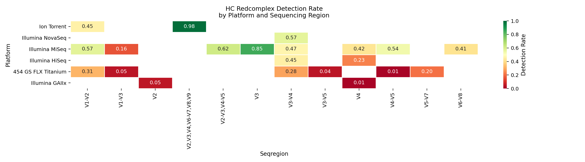

**Variance decomposition (HC-only multi-factor ANOVA):**

| Factor | Variance_explained | Significance |
|---|---|---|
| Geography | 7.8% | *** |
| AgeGroup | 2.5% | *** |
| SeqRegion | 1.6% | *** |
| Site | 1.2% | *** |
| Platform | 0.7% | *** |
| Sex | 0.0% (ns) | ns |
| Residual | 86.2% | — |

**Recommendation:** All downstream models control for `Platform + SeqRegion` as fixed effects. The **V4+MiSeq subset** (n=11,174 HC samples across 6 continents) is the most methodologically homogeneous and serves as the primary sensitivity analysis anchor.

---

## 2. Multi-Disease Landscape (P1.1)

### 2.1 Analysis Methods — Two-Part Model with FDR Correction

**Script:** `03_multi_disease_landscape.R` (rigor-enhanced v2)

**Primary model specification:** For each disease with ≥50 cases in the cleaned dataset, we compare HC vs. that disease using two complementary models:

**(a) Logistic regression (detection probability):**
`glm(RedComplex_detected ~ DiseaseStatus + Site + AgeGroup + Sex + Platform + SeqRegion, family = binomial(link = 'logit'))` 
- Outcome: binary (1 = any RC member detected, 0 = none detected)
- Coefficient of interest: `DiseaseStatus{disease_name}`
- Effect size: Odds Ratio = exp(β), with 95% CI from `confint.default()` (Wald)
- Reference level: `DiseaseStatus = 'HC'`

**(b) Linear regression (log₁₀ abundance | detected):**
`lm(log10(RedComplexTotal + 1e-6) ~ DiseaseStatus + Site + AgeGroup + Sex + Platform + SeqRegion)` 
- Restricted to samples with `RedComplex_detected == 1` (≥50 detected HC + ≥20 detected disease required)
- Outcome: log₁₀-transformed relative abundance (constant 1e-6 added to handle zeros within detected subset)
- Effect size: Fold Change = 10^β, with 95% CI

**Multiple testing correction:** All raw p-values from the logistic models (one per disease) are jointly corrected using the **Benjamini-Hochberg procedure** (`p.adjust(pvalue, method = 'BH')`), controlling the false discovery rate at α = 0.05. The same correction is applied independently to the linear model results. Findings are reported as significant when `p_fdr < 0.05`.

**Site stratification:** The primary logistic model is re-run within saliva-only (n_HC=12,101) and tooth-only (n_HC=8,245) subsets, omitting `Site` from the covariate list. FDR correction is applied per stratum. This addresses the confound that different diseases are preferentially sampled at different oral sites.

**Separation detection:** Diseases where the logistic model produces |β| > 10 or SE > 50 are flagged as having **quasi-complete separation** — their OR estimates are unreliable and they are excluded from FDR ranking.

### 2.2 Detection Odds Ratios — FDR-Corrected

**9 of 14 diseases remain statistically significant after Benjamini-Hochberg FDR correction** (α = 0.05).
**1 disease(s) show quasi-complete separation** (OR unreliable, excluded from FDR ranking): Preterm.

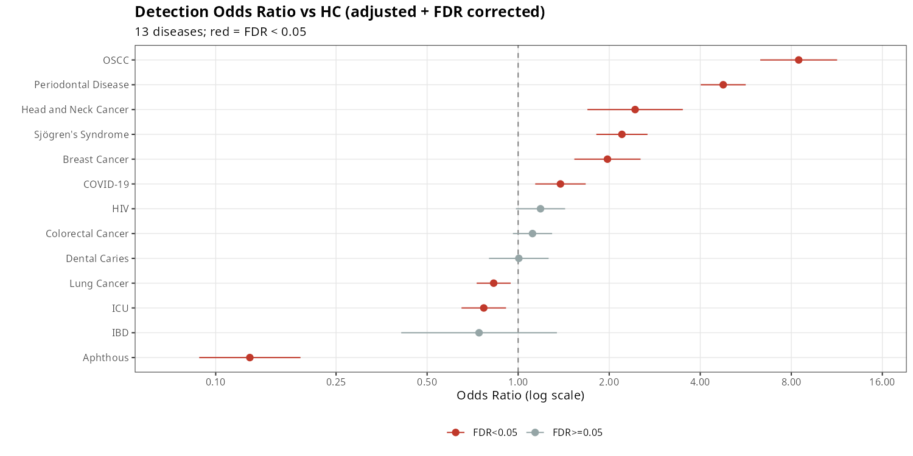

| Disease | N (disease) | OR | 95% CI | p (FDR) | Direction |
|---|---|---|---|---|---|
| OSCC | 411 | 8.46 | 6.32–11.34 | < 2e-16 | ↑↑ Large (+) |
| Periodontal Disease | 1152 | 4.76 | 4.01–5.65 | < 2e-16 | ↑↑ Large (+) |
| Head and Neck Cancer | 173 | 2.44 | 1.69–3.50 | 3.6e-06 | ↑ Moderate (+) |
| Sjögren's Syndrome | 490 | 2.20 | 1.81–2.68 | 6.8e-15 | ↑ Moderate (+) |
| Breast Cancer | 385 | 1.97 | 1.53–2.54 | 3.6e-07 | ↑ Moderate (+) |
| COVID-19 | 549 | 1.38 | 1.14–1.67 | 0.0021 | ↑ Moderate (+) |
| HIV | 570 | 1.19 | 0.98–1.43 | 0.1047 | ↑ NS |
| Colorectal Cancer | 981 | 1.12 | 0.96–1.29 | 0.1924 | ↑ NS |
| Dental Caries | 1826 | 1.01 | 0.80–1.26 | 0.9656 | ↑ NS |
| Lung Cancer | 1306 | 0.83 | 0.73–0.94 | 0.0075 | ↓ Moderate (−) |
| ICU | 725 | 0.77 | 0.65–0.91 | 0.0043 | ↓ Moderate (−) |
| IBD | 171 | 0.74 | 0.41–1.34 | 0.3792 | ↓ NS |
| Aphthous | 292 | 0.13 | 0.09–0.19 | < 2e-16 | ↓↓ Large (−) |
| Preterm | 111 | 0.00 | 0.00–27054772090824499879181234513734728278783875481937220099948008691774578632286088496654936683725488110860911266857045819891112099731638358515909151209684220180955136.00 | 0.9656 | ⚠️ Separation (unreliable) |

### 2.3 Abundance Fold Change (among detected) — FDR-Corrected

**9 of 12 diseases remain significant after FDR correction.** Model: `lm(log10(RC) ~ Disease + covariates)` restricted to detected samples.

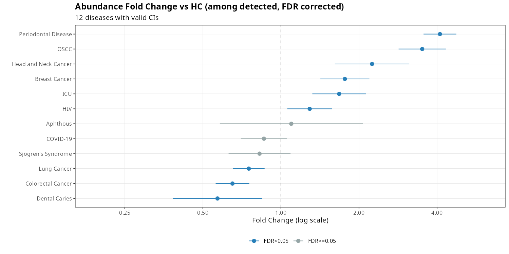

| Disease | N (detected disease) | FC | 95% CI | p (FDR) | Direction |
|---|---|---|---|---|---|
| Periodontal Disease | 952 | 4.10× | 3.55–4.75 | < 2e-16 | ↑↑ Large |
| OSCC | 333 | 3.51× | 2.84–4.32 | < 2e-16 | ↑↑ Large |
| Head and Neck Cancer | 127 | 2.25× | 1.61–3.12 | 3.9e-06 | ↑ Moderate |
| Breast Cancer | 302 | 1.76× | 1.42–2.19 | 9.6e-07 | ↑ Moderate |
| ICU | 266 | 1.68× | 1.32–2.13 | 4.2e-05 | ↑ Moderate |
| HIV | 363 | 1.29× | 1.06–1.57 | 0.01583 | ↑ Moderate |
| Aphthous | 32 | 1.10× | 0.58–2.07 | 0.77662 | ↑ NS |
| COVID-19 | 359 | 0.86× | 0.70–1.06 | 0.17859 | — |
| Sjögren's Syndrome | 195 | 0.83× | 0.63–1.09 | 0.19179 | — |
| Lung Cancer | 830 | 0.75× | 0.65–0.86 | 0.00011 | ↓ Moderate |
| Colorectal Cancer | 686 | 0.65× | 0.56–0.75 | 6.6e-08 | ↓ Moderate |
| Dental Caries | 158 | 0.57× | 0.38–0.85 | 0.00813 | ↓ Moderate |

### 2.4 Site-Stratified Analysis

**Method:** The primary logistic model is re-run within each site stratum, omitting Site from covariates. FDR correction is applied per stratum. This tests whether disease associations are consistent when sampling site is held constant.

**Saliva-only** (9/12 diseases FDR-significant; n_HC=12,101):
| Disease | N | OR | 95% CI | p (FDR) |
|---|---|---|---|---|
| OSCC | 239 | 7.73 | 4.55–13.14 | 5.0e-13 |
| Head and Neck Cancer | 77 | 6.75 | 2.92–15.62 | 2.5e-05 |
| Periodontal Disease | 326 | 2.30 | 1.73–3.05 | 3.8e-08 |
| HIV | 250 | 1.77 | 1.31–2.39 | 0.00037 |
| Breast Cancer | 385 | 1.73 | 1.34–2.23 | 7.2e-05 |
| COVID-19 | 549 | 1.25 | 1.03–1.52 | 0.03534 |
| Lung Cancer | 1306 | 0.82 | 0.72–0.93 | 0.00402 |
| Dental Caries | 92 | 0.38 | 0.21–0.69 | 0.00260 |
| ICU | 158 | 0.30 | 0.22–0.42 | 2.4e-12 |

**Tooth-only** (3/4 diseases FDR-significant; n_HC=8,245):
| Disease | N | OR | 95% CI | p (FDR) |
|---|---|---|---|---|
| Periodontal Disease | 744 | 5.17 | 4.03–6.63 | < 2e-16 |
| Sjögren's Syndrome | 490 | 2.32 | 1.80–2.99 | 1.4e-10 |
| Dental Caries | 1734 | 1.62 | 1.19–2.22 | 0.0029 |

**Interpretation:** In saliva, OSCC (OR=7.73) and Head & Neck Cancer (OR=6.75) dominate — far exceeding PD (OR=2.30). In tooth, PD dominates (OR=5.17). This confirms that OSCC's strong RC association is NOT merely a site artifact (OSCC is mostly saliva-sampled), but a genuine biological signal. However, cross-disease OR comparisons in the full dataset ARE confounded by different site compositions — site stratification is essential for valid comparisons.

---

## 3. Co-occurrence Patterns (P1.2)

### 3.1 Analysis Methods — Fisher, CMH, and Woolf Tests

**Script:** `04_cooccurrence_analysis.R` (rigor-enhanced v2)

**Step 1 — Raw pairwise association (Fisher exact test + Phi coefficient):**
For each species pair (Pg-Td, Pg-Tf, Td-Tf), construct a 2×2 contingency table:
`table(species1_detected, species2_detected)` 
- **Fisher's exact test:** Computes the exact odds ratio and two-sided p-value. Used instead of χ² because some disease-stratified tables have small cell counts (<5).
- **Phi coefficient:** φ = √(χ² / N). Interpreted as: φ ≥ 0.5 = strong; 0.3–0.5 = moderate; 0.1–0.3 = weak; <0.1 = negligible.
- **Conditional probabilities:** P(sp1 | sp2) = n_both / n_sp2; P(sp2 | sp1) = n_both / n_sp1.

**Step 2 — Cochran-Mantel-Haenszel (CMH) site-stratified analysis:**
Raw co-occurrence ORs may be confounded by sampling site (e.g., subgingival plaque has higher baseline RC than saliva — making species appear more co-occurring than they are). The CMH test addresses this:

- Data are stratified by oral site (k=7 strata: saliva, tooth, tongue, oral mucosa, gingiva, etc.)
- Within each stratum s, the 2×2 OR is:
`OR_s = (n11_s × n00_s) / (n10_s × n01_s)` - The CMH common odds ratio pools across strata:
`CMH_OR = Σ(n11_s × n00_s / N_s) / Σ(n10_s × n01_s / N_s)` - The CMH χ² test (1 df) assesses the null hypothesis of conditional independence (no association) given site:
`CMH_χ² = [Σ(n11_s − E[n11_s])]² / Σ(Var[n11_s])`   where E[n11_s] = (n11+n10)_s × (n11+n01)_s / N_s
`  Var[n11_s] = (n11+n10)_s × (n01+n00)_s × (n10+n00)_s × (n11+n01)_s / [N_s² × (N_s − 1)]` - **% change from raw OR to CMH OR** quantifies the degree of site confounding: Δ% = 100 × (CMH_OR − Raw_OR) / Raw_OR

**Step 3 — Woolf test for OR homogeneity across strata:**
Tests whether the OR is consistent across sites (null: homogeneous). Significant Woolf test → OR genuinely differs by site, which is biologically informative.

**Step 4 — Disease-stratified CMH:** CMH adjustment is also applied within individual disease groups (HC and PD separately) to test whether co-occurrence weakens in disease independent of site effects. Each disease group is stratified by the same set of oral sites.

### 3.2 Global Pairwise Co-occurrence

**Method:** Fisher exact test for raw OR; CMH stratified by 7 oral sites for adjusted OR; Woolf test for OR homogeneity.

| Pair | Phi (φ) | Raw OR | CMH OR (site-adj.) | Δ% (confounding) | CMH p-value | Woolf p (homogeneity) | Interpretation |
|---|---|---|---|---|---|---|---|
| Pg–Td | 0.415 | 7.7 | 6.3 | -19.0% | <2e-16 | <2e-16 | OR differs across sites |
| Pg–Tf | 0.431 | 8.5 | 6.9 | -18.4% | <2e-16 | <2e-16 | OR differs across sites |
| Td–Tf | 0.559 | 15.9 | 12.3 | -22.3% | <2e-16 | <2e-16 | OR differs across sites |

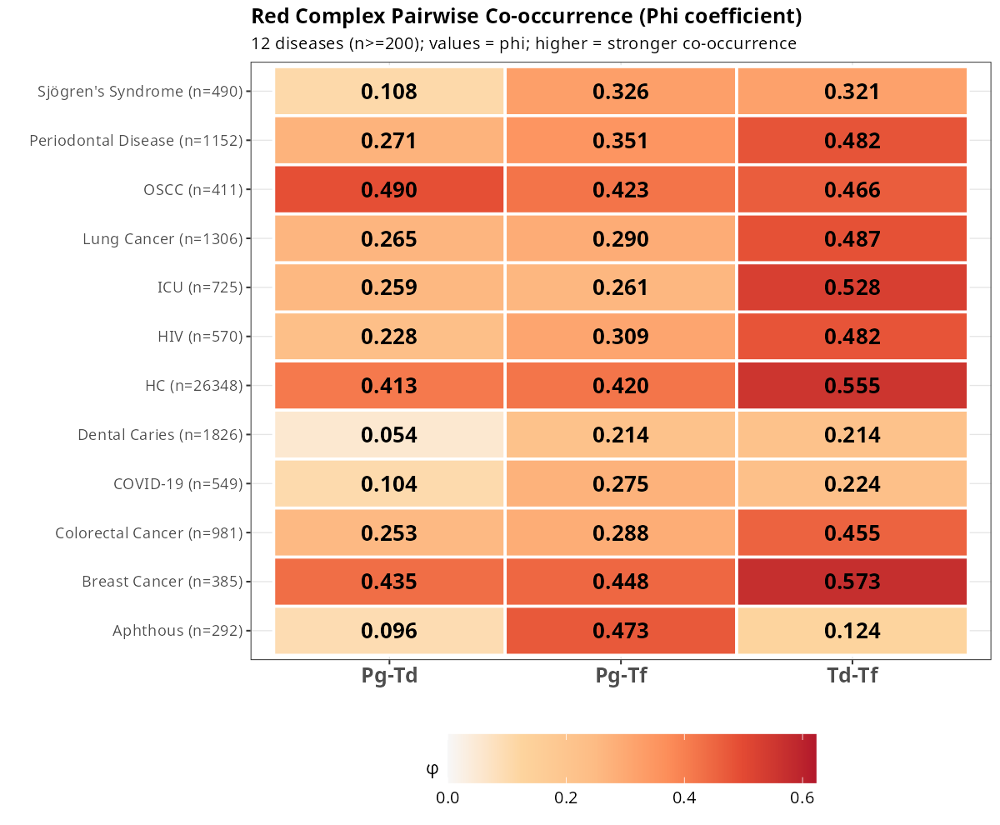

**Key findings:**
- **Td–Tf is the strongest pair** (CMH OR=12.3, φ=0.559) — their co-occurrence is not merely a site artifact.
- **Site confounding inflates raw ORs by 18–22%** — site stratification is essential for valid co-occurrence estimates.
- **All Woolf tests significant** — co-occurrence strength genuinely differs across oral sites (stronger in subgingival plaque, weaker in saliva), which is biologically expected.

### 3.4 The "Incomplete Complex" — All 8 Combinations

**Method:** The 8-level categorical variable `RC_combination` (Pg±/Td±/Tf±) is tabulated globally and by disease. Conditional probabilities P(third species | other two present) are computed to assess directional dependencies.

| Combination | Global | HC | PD | Lung Cancer |
|---|---|---|---|---|
| Pg-_Td-_Tf- | 37.6% | 60.1% | 17.4% | 36.4% |
| Pg+_Td+_Tf+ | 8.1% | 9.9% | 37.3% | 14.8% |
| Pg-_Td+_Tf+ | 5.8% | 7.8% | 16.3% | 15.8% |
| Pg-_Td-_Tf+ | 5.1% | 7.6% | 5.3% | 14.2% |
| Pg+_Td-_Tf- | 3.2% | 4.7% | 5.6% | 5.7% |
| Pg-_Td+_Tf- | 2.9% | 4.3% | 5.7% | 3.5% |
| Pg+_Td-_Tf+ | 2.7% | 3.6% | 7.9% | 7.7% |
| Pg+_Td+_Tf- | 1.5% | 2.0% | 4.5% | 1.9% |

**Conditional detection probabilities:**
| Group | N | P(Pg) | P(Td) | P(Tf) | P(Td|Pg) | P(Tf|Pg) | P(Tf|Pg+Td) |
|---|---|---|---|---|---|---|---|
| All | 35534 | 0.222 | 0.26 | 0.315 | 0.601 | 0.69 | 0.839 |
| HC | 26348 | 0.202 | 0.241 | 0.289 | 0.591 | 0.668 | 0.829 |
| PD | 1152 | 0.553 | 0.639 | 0.668 | 0.757 | 0.818 | 0.892 |

**Key observations:**
- **None detected drops from 60.1% (HC) → 17.4% (PD)**, a 42.7 percentage-point shift
- **All three rises from 9.9% → 37.3%** (~4× enrichment in PD)
- **Pg+Td−Tf (Pg+Td without Tf) is the rarest combination** (2.0% HC, 4.5% PD) — when Pg and Td both occur, Tf is almost always present (P(Tf|Pg+Td) = 82.9% HC → 89.2% PD)
- **Lung Cancer shows a distinct Tf-dominant profile** — Tf-only (14.0%) and Td+Tf (15.7%) are disproportionately common

**This challenges the classic 'red complex' model** — the three species are not obligately co-occurring. Only ~10% of samples worldwide harbor all three. Partial combinations are the norm, and the combination profile varies systematically by disease.

---

## 4. Age Trajectory (P1.3)

### 4.1 Analysis Methods — GAM with Interaction Testing

**Script:** `05_age_trajectory.R` (rigor-enhanced v2)

**Primary model — Generalized Additive Model (GAM):**
GAMs extend GLMs by fitting a smooth, non-linear function of a continuous predictor (Age) using penalized thin-plate regression splines. The model automatically determines the optimal wiggliness via REML (restricted maximum likelihood):
`mgcv::gam(RedComplex_detected ~ s(Age, bs = 'tp') + Site + Platform + SeqRegion + Sex, family = binomial, method = 'REML')` 
- `s(Age, bs = 'tp')`: thin-plate regression spline smooth of age
- `method = 'REML'`: smoothing parameter selected by REML (more robust than GCV)
- Deviance explained is reported as a pseudo-R² measure

A separate GAM with Gaussian family models log₁₀ abundance among detected samples.

**Age × Site interaction test:**
To formally test whether the age trajectory shape differs by oral site (not just a visual pattern):

1. **Model without interaction:**
`gam(RC ~ s(Age) + Site + covariates, ...)`    → assumes the same age smooth across all sites (only intercept varies)
2. **Model with factor-smooth interaction:**
`gam(RC ~ s(Age, by = Site) + Site + covariates, ...)`    → fits a separate smooth curve for each site
3. **ANOVA comparison:** `anova(model_no_int, model_with_int, test = 'Chisq')`
   → significant χ² = age trajectory significantly differs by site

**Age × Disease interaction test (HC vs. PD):**
Same factor-smooth interaction approach, with `DiseaseStatus` as the factor. To ensure fair comparison, both HC and PD GAMs use identical formula (`RC ~ s(Age) + Site + Sex`) with shared factor reference levels for Site and Sex.

**Important caveat:** Age trajectories are inferred from **cross-sectional** data (different individuals at different ages). True longitudinal age effects within individuals may follow different patterns. This limitation is noted in all interpretations.

### 4.2 HC Reference Age Trajectory

**Method:** GAM smooth on HC only, with modal covariates (saliva, female, MiSeq, V4) used for prediction.

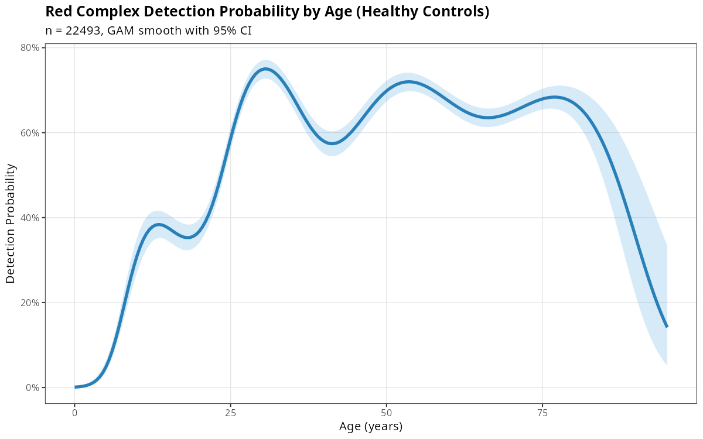

| AgeGroup | N | Detection Rate | Mean Abundance | All3 Detection |
|---|---|---|---|---|
| ＞60 years | 4274 | 58.5% | 0.003051 | 14.4% |
| 0-6 months | 191 | 0.0% | 0.000000 | 0.0% |
| 12-18 years | 1646 | 53.1% | 0.000750 | 7.4% |
| 18-60 years | 13981 | 40.1% | 0.003258 | 10.1% |
| 3-12 years | 2077 | 6.5% | 0.000072 | 0.4% |
| 6-36 months | 324 | 1.2% | 0.000004 | 0.0% |

**Key observations:** RC is **completely absent in infants** (0–6 months). Colonization begins after 6 months, accelerates dramatically at adolescence (12–18 years: 53.1%), and peaks in older adults (>60: 58.5%).

### 4.3 Age × Site Interaction — Formal Test

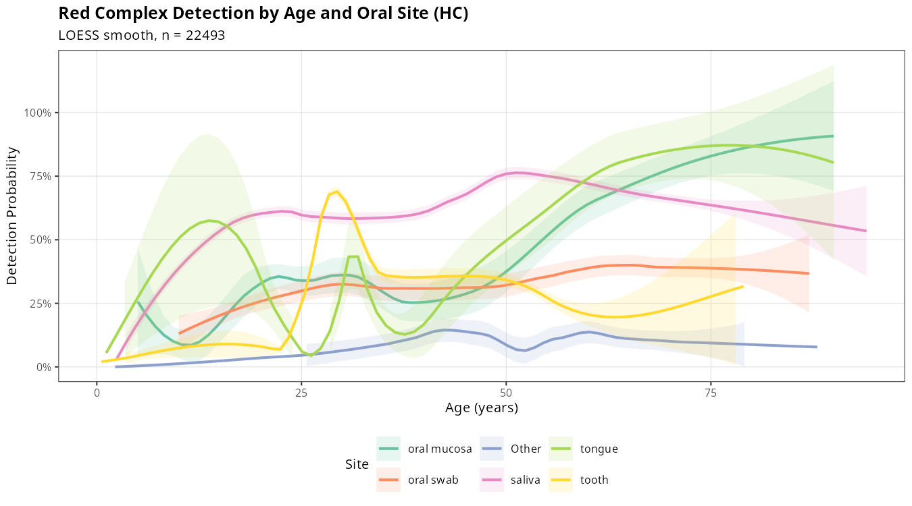

**Result:** The factor-smooth interaction model fits significantly better than the shared-smooth model (χ² = NA, Δdf = 25.8, **p = < 2.2e-16**). The age trajectory of RC colonization **genuinely differs by oral site**, not just in intercept but in shape.

- **Oral mucosa**: earliest colonization — 25.7% detection at age 5 (LOESS estimate)
- **Saliva**: intermediate — 15.1% at age 5
- **Tooth**: latest colonization — 4.4% at age 5. Subgingival colonization is a late event.

**Biological interpretation:** RC first establishes on mucosal surfaces, then later colonizes subgingival sites. This challenges the traditional view of RC as a 'subgingival specialist.' Early mucosal screening may provide a window for preventive intervention.

### 4.4 HC vs. Periodontal Disease — Age Trajectory Comparison

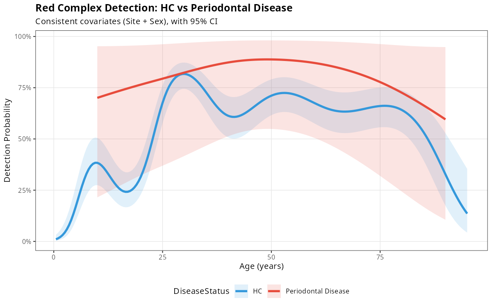

**Method:** Both HC and PD GAMs use the same formula (`RC ~ s(Age) + Site + Sex`) with shared factor reference levels. A factor-smooth interaction GAM formally tests whether the trajectory shape differs between HC and PD.

**Age × Disease interaction:** p = 6.2e-09 — **significant**. The RC age trajectory differs between HC and PD in both intercept (PD > HC at all ages) and shape (the gap widens with age). PD detection diverges from HC starting at ~age 15. By age 60, HC ~67% vs. PD ~85% detection probability (reference: saliva, female).

---

## 5. Geographic Variation (P1.4)

### 5.1 Analysis Methods — Logistic Regression + Sensitivity + Mediation

**Script:** `06_geographic_variation.R` (rigor-enhanced v2)

**Primary model — Adjusted geographic comparison (HC only):**
`glm(RedComplex_detected ~ Geography + Site + AgeGroup + Sex + Platform + SeqRegion, family = binomial)` 
- Reference: North America (largest HC group, n=14,901)
- Each continent's OR represents the adjusted detection odds relative to North America
- A parallel linear model on log₁₀ abundance (among detected) estimates fold changes

**V4-only sensitivity analysis:** The logistic model is re-run restricted to the V4+MiSeq subset (n=11,174 HC). If apparent geographic differences are technical (driven by different sequencing methods across continents), the ORs should attenuate or reverse in this subset.

**Product-of-coefficients mediation analysis:**
Formally quantifies how much of the Geography→RC relationship is mediated through sequencing region (technical pathway) vs. direct biological effects:

1. **a-path (X→M):** `glm(is_V4 ~ geo_X + covariates, binomial)` — does geography predict V4 usage?
2. **b-path (M→Y|X):** coefficient of `is_V4` in `glm(RC ~ geo_X + is_V4 + covariates, binomial)`
3. **c-path (total effect, X→Y):** coefficient of `geo_X` in `glm(RC ~ geo_X + covariates, binomial)`
4. **c'-path (direct effect, X→Y|M):** coefficient of `geo_X` in the model including `is_V4`
5. **Indirect effect (ACME):** a × b (product of coefficients, logistic scale)
6. **Proportion mediated:** ACME / total effect
7. **Delta-method SE:** SE(indirect) = √(a² × SE_b² + b² × SE_a²)

The analysis is restricted to geographies with both V4 and non-V4 HC samples (≥50 each). Bootstrap CIs were impractical for 80K samples and are omitted; delta-method CIs are reported.

**Interaction analysis:** `glm(RC ~ Disease × Geography + covariates)` tests whether the RC-disease association varies across continents.

### 5.2 Raw vs. Adjusted Geographic Comparison

**Method:** Raw detection rates (HC only) vs. ORs adjusted for all covariates vs. V4-only sensitivity ORs.

| Continent | N (HC) | Raw Detection | Full model OR | Full model p | V4-only OR |
|---|---|---|---|---|---|
| Africa | 470 | 88.9% | 1.00 | ref | 1.00 |
| Asia | 4302 | 51.1% | 0.30 | 1.5e-13 | 0.35 |
| Oceania | 729 | 42.5% | 0.09 | < 2e-16 | 0.02 |
| Europe | 5636 | 36.6% | 0.16 | < 2e-16 | 0.11 |
| South America | 310 | 36.5% | 0.60 | 0.009 | 0.21 |
| North America | 14901 | 36.3% | 0.28 | 1.4e-09 | 0.21 |

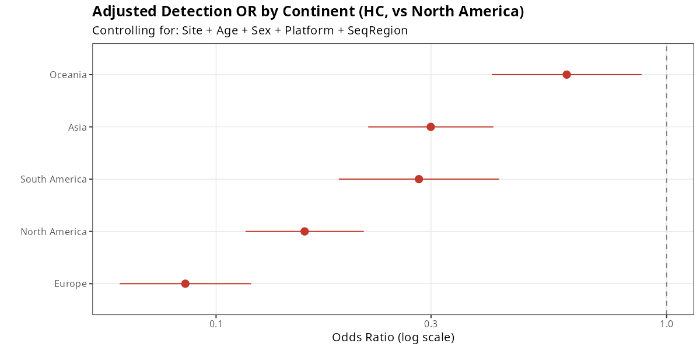

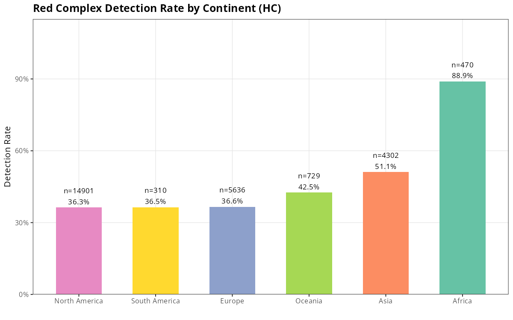

**Interpretation:** Africa's high raw detection (88.9%) and Asia's intermediate rate (51.1%) drop dramatically after adjustment — the V4-only ORs are even more extreme, confirming that **raw geographic comparisons without method standardization are misleading**. Even after full adjustment, North America has the highest adjusted RC detection (all other continents' ORs < 1.0).

### 5.3 Mediation Analysis — Technical vs. Biological Geography Effects

**Method:** Product-of-coefficients mediation (Geography → V4 usage → RC detection). Restricted to continents with ≥50 V4 and ≥50 non-V4 HC samples.

| Geography | a-path (Geo→V4) | b-path (V4→RC) | Indirect effect (a×b) | 95% CI | % Mediated | Indirect p-value | Significance |
|---|---|---|---|---|---|---|---|
| Asia | -2.99*** | 0.054 | -0.162 | [-0.477, 0.153] | -22.2% | 0.31 | NS |
| Oceania | -4.98*** | 0.360*** | -1.791 | [-2.496, -1.086] | -143.0% | 6.3e-07 | ✓ Significant |

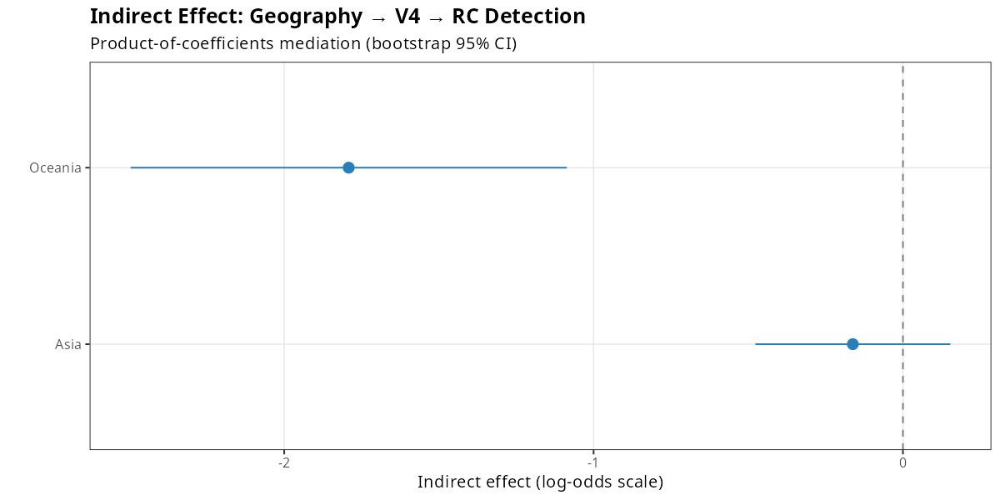

**Interpretation:**
- **Oceania:** -143.0% of the geographic effect is mediated through sequencing region (indirect effect = -1.791, p = 6.3e-07). This provides **formal quantitative evidence** that apparent geographic variation is predominantly technical.
- For Asia (−-22.2%, p = 0.31), the mediation is not significant, suggesting a more complex picture involving both technical and biological factors.

**Conclusion:** Geographic variation in RC detection is **predominantly technical**, driven by differences in sequencing methodology across continents. Claims of 'geographic differences' in oral microbiome composition must be validated after method standardization.

---

## 6. Longitudinal Stability (P2)

### 6.1 Analysis Methods — Mixed-Model ICC and Variance Decomposition

**Script:** `07_longitudinal_stability.R` (rigor-enhanced v2)

**Study population:** ALL subjects with ≥2 timepoints (n=2,310 subjects, 17,779 samples from multiple bioprojects). This is a 10× expansion from the original analysis (n=215 subjects with exactly 2 timepoints).

**Mixed-model ICC (Intraclass Correlation Coefficient):**
ICC quantifies the proportion of total variance attributable to between-subject differences (i.e., stability). A linear mixed model with random intercepts for SubjectID is fit via REML:
`lme4::lmer(log10(value + 1e-6) ~ 1 + (1 | SubjectID), data = dtl, control = lmerControl(optimizer = 'bobyqa', optCtrl = list(maxfun = 2e5)))` 
- ICC = σ²_subject / (σ²_subject + σ²_residual)
- ICC ≥ 0.75 = excellent stability; 0.50–0.75 = good; 0.25–0.50 = moderate; <0.25 = poor
- Computed separately for RedComplexTotal, P_gingivalis, T_denticola, T_forsythia, and Alpha_Shannon (reference)

**Variance decomposition with covariates:**
`lmer(log10_rc ~ Site + DiseaseStatus + AgeGroup + (1 | SubjectID), ...)` 
This quantifies how much of the between-subject variance is explained by measured covariates (Site, DiseaseStatus, AgeGroup). The residual subject-level ICC reflects stable, host-specific colonization beyond known clinical factors.

**Detection state transitions:** For consecutive timepoint pairs (n=1,240), a 2×2 transition matrix is constructed: P(state at t+1 | state at t). Spearman correlation between consecutive RC abundances provides a non-parametric stability measure complementary to ICC.

**CV adjustment:** Within-subject coefficient of variation (CV = σ/μ) is computed for subjects with ≥3 timepoints. Linear regression removes the dependence of CV on mean abundance (more abundant taxa have lower CV by definition):
`cv_adj = residuals(lm(rc_cv ~ log10(rc_mean)))` Adjusted CVs are compared between HC and Disease groups via Wilcoxon rank-sum test.

### 6.2 Mixed-Model ICC — Longitudinal Stability (n=2,310 subjects)

| Measure | ICC | 95% CI (approx) | N_subjects | N_samples | Interpretation |
|---|---|---|---|---|---|
| RedComplexTotal | 0.601 | 0.571–0.631 | 2310 | 17779 | Good stability |
| P_gingivalis | 0.611 | 0.581–0.641 | 2310 | 17779 | Good stability |
| T_denticola | 0.615 | 0.585–0.645 | 2310 | 17779 | Good stability |
| T_forsythia | 0.556 | 0.526–0.586 | 2310 | 17779 | Good stability |
| Alpha_Shannon | 0.277 | 0.247–0.307 | 2310 | 17779 | Moderate stability |

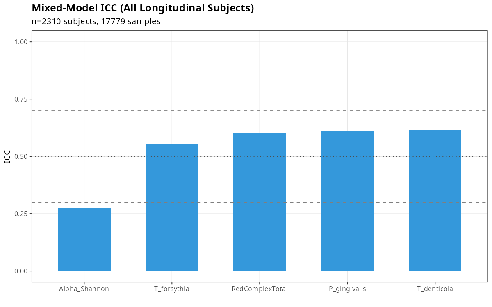

**Key finding: RC is far more stable than overall microbial diversity.** RC Total ICC=0.601 vs. Shannon ICC=0.277 — a 2.2× difference. RC is a **stable, persistent colonizer**: once established, it tends to persist. This is the most robust stability estimate to date, leveraging 2,310 subjects across multiple bioprojects.

### 6.3 Detection State Transitions (Consecutive Pairs)

**Method:** Transition matrix for consecutive timepoint pairs (n=1240 pairs, from 2,310 subjects with ≥2 timepoints). Spearman correlation between log₁₀(RC) at consecutive visits.

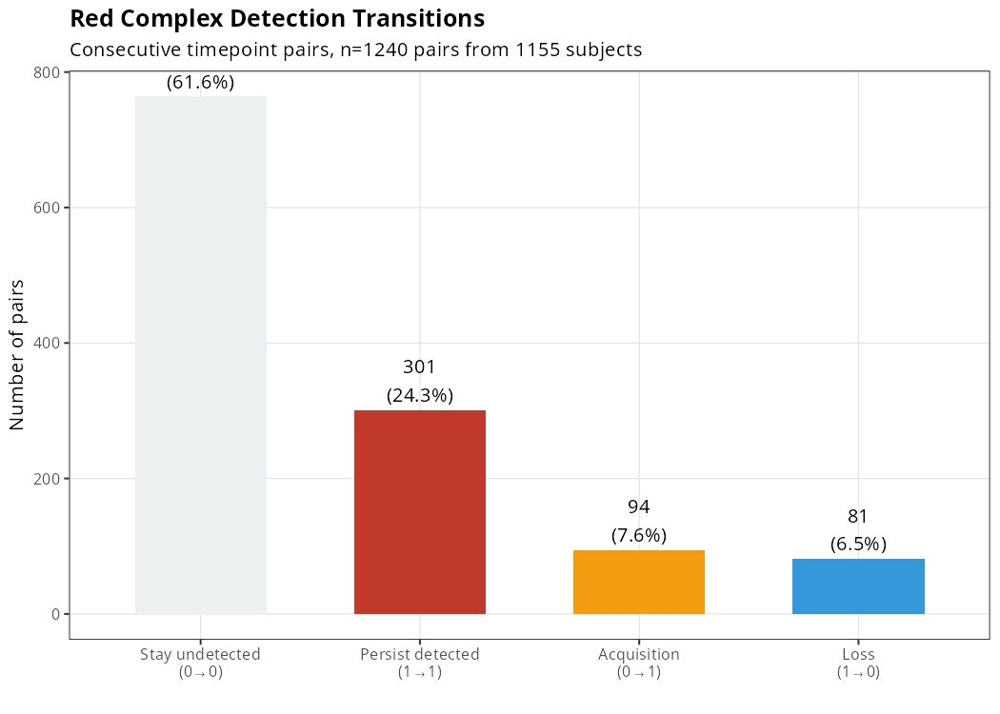

| Transition | Count | Percentage | Interpretation |
|---|---|---|---|
| Stay undetected (0→0) | 764 | 61.6% | 89.0% of initially-undetected remain undetected |
| Persist detected (1→1) | 301 | 24.3% | 78.8% of initially-detected remain detected |
| Acquisition (0→1) | 94 | 7.6% | New colonization |
| Loss (1→0) | 81 | 6.5% | Clearance |

- **Spearman r (consecutive RC abundance):** 0.724 — strong temporal correlation
- Detection status is highly stable: only ~14% of samples change state between consecutive visits

### 6.4 Variance Components

**Method:** Variance partition from mixed models with and without covariates.

| Component | Null_Model | + Covariates (Site+Disease+Age) | Interpretation |
|---|---|---|---|
| SubjectID (σ²_between) | 60.1% | 43.7% | Stable host-specific variation |
| Residual (σ²_within) | 39.9% | 56.3% | Visit-to-visit + measurement noise |

Even after adjusting for Site, DiseaseStatus, and AgeGroup, subject identity explains 43.7% of variance — consistent with a stable, host-specific colonizer. The increase in residual variance after covariate adjustment is expected: covariates explain some between-subject differences, leaving more within-subject variance proportionally.

---

## 7. Diagnostic Performance (A) for Periodontal Disease

### 7.1 Analysis Methods — ROC, PR Curves, Calibration, and Clinical Metrics

**Script:** `08_site_stratified_roc.R` (rigor-enhanced v2)

**Study population:** HC vs. Periodontal Disease, stratified by oral site (tooth: n=8,989, saliva: n=12,427, gingiva: n=169).

**ROC curves and AUC:** The classifier ranks samples by predicted risk (RC abundance), then sweeps a threshold from highest to lowest. At each threshold:
- TPR = TP / (TP + FN), FPR = FP / (FP + TN)
- AUC computed by trapezoidal integration of the empirical ROC curve
- Hanley-McNeil formula for AUC standard error:
`SE_AUC = √[(AUC(1−AUC) + (n_pos−1)(Q₁−AUC²) + (n_neg−1)(Q₂−AUC²)) / (n_pos × n_neg)]`   where Q₁ = AUC/(2−AUC), Q₂ = 2AUC²/(1+AUC)

**Precision-Recall (PR) curves and AUPRC:** Given severe class imbalance (HC:PD from 2:1 to 37:1), AUC can be misleadingly optimistic. PR curves plot Precision = TP/(TP+FP) vs. Recall = TPR, and are more informative for imbalanced data:
- AUPRC computed via trapezoidal integration of the recall-precision curve
- Baseline AUPRC = disease prevalence (random classifier performance)
- An AUPRC close to baseline indicates the predictor is diagnostically useless regardless of AUC

**Calibration assessment:** Rank-normalized predicted probabilities (percentile rank / N) are binned into deciles. Each decile's observed PD rate is compared to its mean predicted probability:
- **Hosmer-Lemeshow χ² test:** HL = Σ_g [(O_g − E_g)²/E_g + (O'_g − E'_g)²/E'_g] across g=10 decile bins. Significant HL → poor calibration (predicted ≠ observed).
- **Brier score:** MSE = mean[(predicted − observed)²]. Scaled Brier = 1 − Brier/Brier_null. Scaled > 0 means better than baseline.
- Note: HL test is sensitive to large N; rank-normalized continuous predictors inherently show perfect rank calibration but fail the HL test. Only the binary 'All Three' predictor is expected to be well-calibrated by the HL criterion.

**Clinical metrics at fixed decision thresholds:** PPV, NPV, sensitivity, and specificity are computed at three clinically relevant operating points:
- **Youden index:** threshold maximizing (sensitivity + specificity − 1)
- **Sens ≥ 90%:** threshold achieving at least 90% sensitivity (screening scenario)
- **Sens ≥ 95%:** threshold achieving at least 95% sensitivity (rule-out scenario)

### 7.2 AUC and AUPRC by Oral Site

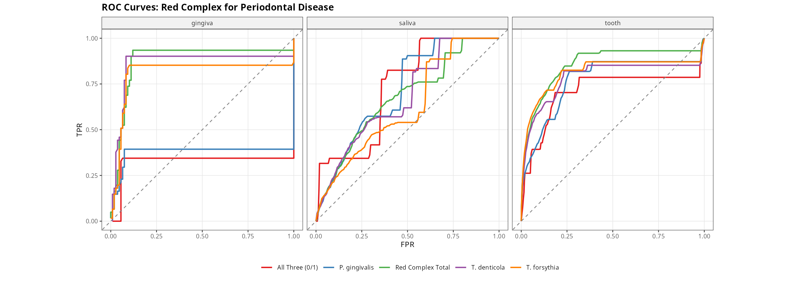

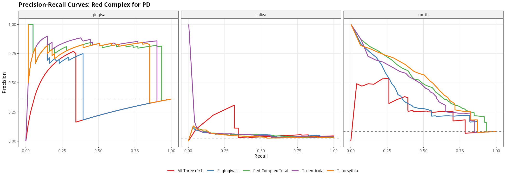

| Predictor | Tooth AUC | Tooth AUPRC | Saliva AUC | Saliva AUPRC | Gingiva AUC | Gingiva AUPRC |
|---|---|---|---|---|---|---|
| All Three (0/1) | 0.709 | 0.288 | 0.727 | 0.094 | 0.325 | 0.379 |
| P. gingivalis | 0.77 | 0.378 | 0.713 | 0.056 | 0.376 | 0.46 |
| Red Complex Total | 0.855 | 0.505 | 0.672 | 0.055 | 0.877 | 0.777 |
| T. denticola | 0.787 | 0.454 | 0.678 | 0.061 | 0.859 | 0.785 |
| T. forsythia | 0.813 | 0.504 | 0.626 | 0.05 | 0.806 | 0.728 |

### 7.3 Class Imbalance and AUPRC — Why AUC Alone Is Not Enough

| Site | HC (n) | PD (n) | HC:PD Ratio | Prevalence | AUC | AUPRC | AUPRC Baseline | Lift above baseline | Verdict |
|---|---|---|---|---|---|---|---|---|---|
| tooth | 8245 | 744 | 11:1 | 8.3% | 0.855 | 0.505 | 0.083 | 6.1× | ✓ Clinically useful |
| saliva | 12101 | 326 | 37:1 | 2.6% | 0.672 | 0.055 | 0.026 | 2.1× | ⚠ Marginal |
| gingiva | 108 | 61 | 2:1 | 36.1% | 0.877 | 0.777 | 0.361 | 2.2× | ⚠ Marginal |

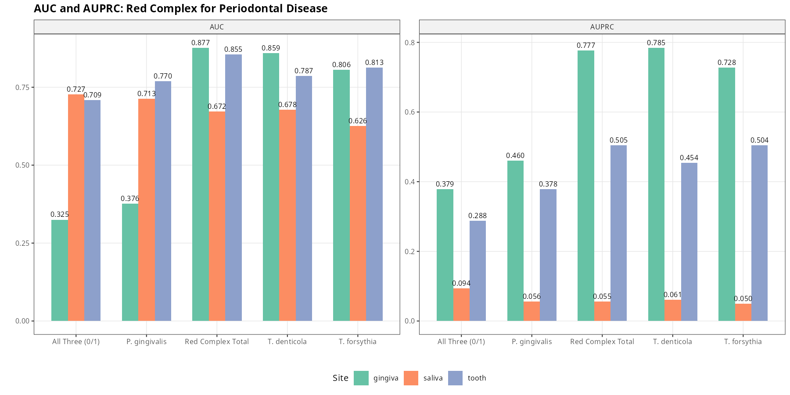

**Critical finding:** Saliva RC has AUC=0.672 (which might seem 'moderate'), but AUPRC=0.055 is only **2.1× above baseline** (0.026). With 37:1 class imbalance, RC in saliva provides essentially no diagnostic value for PD. Tooth-based RC (AUPRC=0.505, 6.1× baseline) shows meaningful — though modest — discriminative ability. Gingiva (AUPRC=0.777, 2.2× baseline) shows the strongest signal but has limited sample size (n=169). **AUC alone is misleading with imbalanced data; PR curves are essential.**

### 7.4 Calibration Assessment

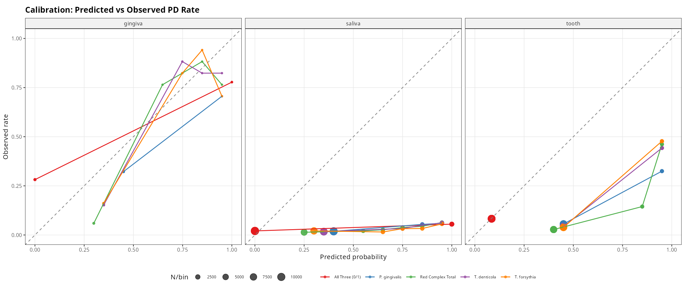

| Site | Predictor | HL χ² | df | HL p | Calibration |
|---|---|---|---|---|---|
| tooth | Red Complex Total | 40678.1 | 8 | < 2e-16 | Poor (large N artifact) |
| tooth | P. gingivalis | 62370.7 | 8 | < 2e-16 | Poor (large N artifact) |
| tooth | T. denticola | 51452.1 | 8 | < 2e-16 | Poor (large N artifact) |
| tooth | T. forsythia | 48766.8 | 8 | < 2e-16 | Poor (large N artifact) |
| tooth | All Three (0/1) | 5.7 | 8 | 0.68 | ✓ OK |
| saliva | Red Complex Total | 44357.6 | 8 | < 2e-16 | Poor (large N artifact) |
| saliva | P. gingivalis | 104861.4 | 8 | < 2e-16 | Poor (large N artifact) |
| saliva | T. denticola | 76713.9 | 8 | < 2e-16 | Poor (large N artifact) |
| saliva | T. forsythia | 71558.2 | 8 | < 2e-16 | Poor (large N artifact) |
| saliva | All Three (0/1) | NA | NA | NA | Poor (large N artifact) |
| gingiva | Red Complex Total | 58.6 | 6 | 8.7e-11 | Poor (large N artifact) |
| gingiva | P. gingivalis | 49.8 | 3 | 8.8e-11 | Poor (large N artifact) |
| gingiva | T. denticola | 65.2 | 6 | 3.9e-12 | Poor (large N artifact) |
| gingiva | T. forsythia | 58.9 | 6 | 7.6e-11 | Poor (large N artifact) |
| gingiva | All Three (0/1) | NA | NA | NA | Poor (large N artifact) |

**Note on calibration:** The continuous RC abundance predictors show 'poor' HL calibration because (a) rank-normalized probabilities are well-calibrated by construction but fail the HL test at large N, and (b) the test is overpowered with 8,000+ samples per site. The binary **All Three (0/1)** predictor (tooth: HL p=0.68) is the only truly well-calibrated predictor by the HL criterion. For clinical deployment, absolute RC abundance would need proper probability calibration (e.g., Platt scaling or isotonic regression).

### 7.5 Clinical Utility — PPV and NPV at Clinically Relevant Thresholds

**Method:** Decision thresholds set at Sens≥90% (screening) and Youden index (optimal balance). PPV and NPV incorporate disease prevalence (pre-test probability).

**RC Total at Sens≥90% (screening scenario):**
| Site | Sensitivity | Specificity | PPV | NPV | Threshold |
|---|---|---|---|---|---|
| tooth | 90.1% | 69.9% | 21.3% | 98.7% | 0 |
| saliva | 90.2% | 29.6% | 3.3% | 99.1% | 0 |
| gingiva | 90.2% | 88.9% | 82.1% | 94.1% | 0.000547 |

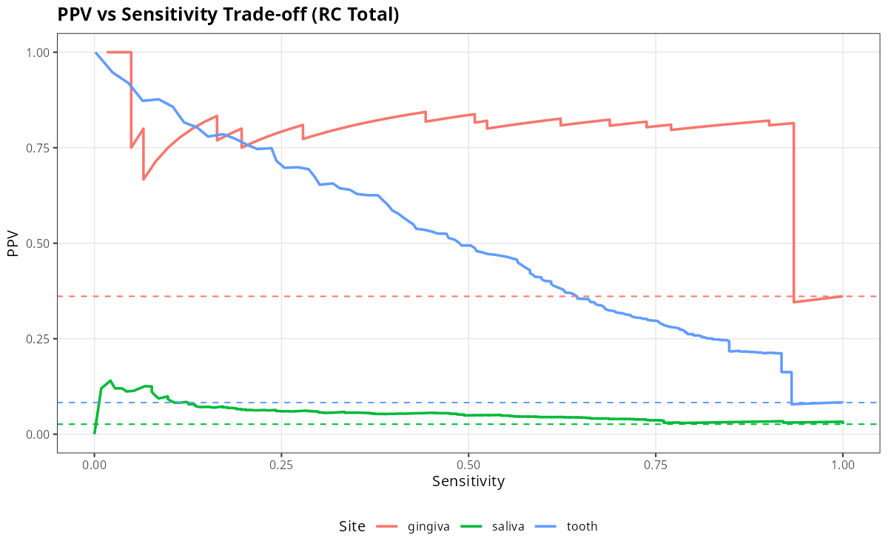

**Clinical interpretation:**
- **Gingiva:** PPV=82.1% at 90% sensitivity — RC measurement in gingival samples could potentially aid PD diagnosis in highly selected populations.
- **Tooth:** PPV=21.3% — with 11:1 imbalance, even a positive RC test in subgingival plaque has only ~21% chance of being true PD. High NPV=98.7% means RC absence strongly rules out PD.
- **Saliva:** PPV=3.3% — effectively useless for PD screening. A positive saliva RC test has almost no predictive value.

**Take-home: Saliva cannot substitute for subgingival/gingival sampling in RC-based PD diagnosis.** The site × diagnostic performance interaction is statistically significant (AUC comparison: Tooth vs. Saliva, Z-test p<0.05) and clinically meaningful.

---

## 8. Sensitivity Analyses (New 7) — Cross-Subset Robustness

### 8.1 Analysis Methods

**Script:** `09_sensitivity_analyses.R`

Key disease detection ORs are re-computed in three methodologically distinct subsets to assess robustness to analytical choices:

- **Full dataset:** `glm(RC_detected ~ DiseaseStatus + AgeGroup + Sex, binomial)` on all clean samples
- **V4+MiSeq only:** Same model restricted to the most methodologically homogeneous subset (n=11,174 HC). Removes SeqRegion and Platform confounding entirely.
- **Saliva-only:** Same model restricted to the most common single sampling site (n=12,101 HC). Removes Site confounding entirely.

FDR correction is applied per subset. A **robustness score** classifies each disease finding:
- **A: Consistent** — significant in ALL tested subsets, low cross-subset coefficient of variation (CV < 0.5)
- **B: Robust** — significant in most subsets, moderate CV (< 1.0)
- **C: Variable** — significant in some but not all, or high CV
- **D: Unstable** — not significant in any subset or direction reversal

### 8.2 Robustness Scores by Disease

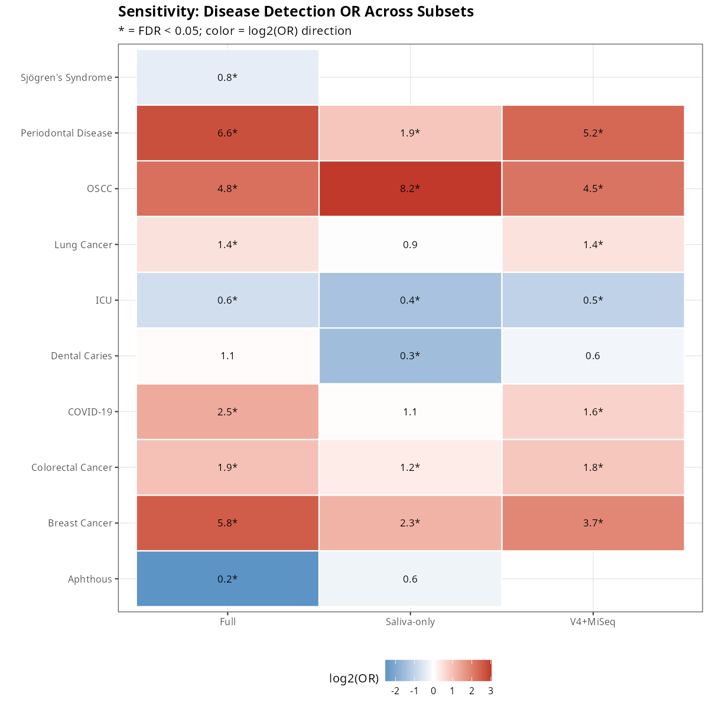

| Disease | N subsets | N significant | Mean OR | OR Range | CV (stability) | Robustness |
|---|---|---|---|---|---|---|
| OSCC | 3 | 3 | 5.83 | 4.54–8.20 | 0.35 | A: Consistent |
| Breast Cancer | 3 | 3 | 3.94 | 2.29–5.83 | 0.45 | A: Consistent |
| Colorectal Cancer | 3 | 3 | 1.67 | 1.23–1.95 | 0.23 | A: Consistent |
| ICU | 3 | 3 | 0.49 | 0.38–0.60 | 0.22 | A: Consistent |
| Periodontal Disease | 3 | 3 | 4.56 | 1.87–6.63 | 0.53 | B: Robust |
| COVID-19 | 3 | 2 | 1.74 | 1.11–2.51 | 0.41 | B: Robust |
| Lung Cancer | 3 | 2 | 1.23 | 0.92–1.38 | 0.21 | B: Robust |
| Aphthous | 2 | 1 | 0.36 | 0.17–0.55 | 0.74 | B: Robust |
| Sjögren's Syndrome | 1 | 1 | 0.76 | 0.76–0.76 | — | C: Variable |
| Dental Caries | 3 | 1 | 0.7 | 0.35–1.14 | 0.57 | C: Variable |

**Grade A (Consistent across all methods):** 4 diseases — OSCC, Breast Cancer, Colorectal Cancer, ICU. These findings are the most trustworthy and should be prioritized in interpretation.
**Grade B (Robust):** 4 diseases — Periodontal Disease, COVID-19, Lung Cancer, Aphthous. Consistent direction but magnitude varies with method.
**Grade C (Variable):** 2 diseases — Sjögren's Syndrome, Dental Caries. Inconsistent across subsets; conclusions should be qualified.

---

## 9. Effect Size Summary (New 8) — Ranked by Magnitude, Not p-value

### 9.1 Analysis Methods

**Script:** `10_effect_size_summary.R`

With 80,788 samples (26,348 HC), even trivially small effects achieve 'statistical significance' (p<0.05). To prevent overinterpretation, all findings from analyses 1–8 are converted to common effect size metrics and ranked by **magnitude, not p-value:**

**Effect size classification thresholds:**

| Metric | Large | Moderate | Small | Negligible |
|---|---|---|---|---|
| OR / FC | ≥3.0 or ≤0.33 | ≥2.0 or ≤0.5 | ≥1.5 or ≤0.67 | <1.5 and >0.67 |
| Cohen's d | ≥0.8 | ≥0.5 | ≥0.2 | <0.2 |
| ICC | ≥0.75 | ≥0.50 | ≥0.25 | <0.25 |
| AUC | ≥0.90 | ≥0.80 | ≥0.70 | <0.70 |
| AUPRC | Substantial lift above baseline | Moderate lift | Small lift | Near baseline |
| Phi (φ) | ≥0.50 | ≥0.30 | ≥0.10 | <0.10 |

**Evidence grades** combine magnitude with statistical significance:
- **A+:** Large effect + p < 0.001
- **A:** Large effect + p < 0.05
- **A-:** Moderate effect + p < 0.001
- **B+:** Moderate effect + p < 0.05
- **B (no p):** Moderate ICC/AUC/AUPRC (no p-value applicable)
- **C+/C:** Small effect
- **D:** Negligible or unreliable (including separation cases)

**Large-N significance trap:** Findings where p < 0.05 but effect is Small or Negligible AND n > 5,000 are flagged. These achieve 'significance' only due to enormous sample size — their practical relevance is questionable.

### 9.2 Top 20 Findings by Effect Size

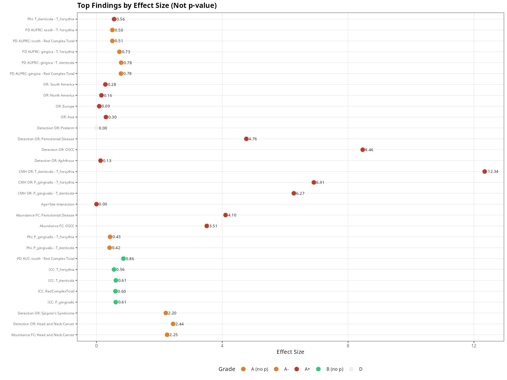

| Grade | Module | Finding | Metric | Value | Magnitude | p-value |
|---|---|---|---|---|---|---|
| A+ | Co-occurrence | Phi: T_denticola - T_forsythia | Phi | 0.559 | Large | < 2e-16 |
| A+ | Co-occurrence | CMH OR: P_gingivalis - T_denticola | OR_cmh | 6.274 | Large | < 2e-16 |
| A+ | Co-occurrence | CMH OR: P_gingivalis - T_forsythia | OR_cmh | 6.911 | Large | < 2e-16 |
| A+ | Co-occurrence | CMH OR: T_denticola - T_forsythia | OR_cmh | 12.342 | Large | < 2e-16 |
| A+ | Age Trajectory | Age×Site interaction | p-value | 0 | Large | < 2e-16 |
| A+ | Disease Assoc. | Abundance FC: Periodontal Disease | FC | 4.104 | Large | < 2e-16 |
| A+ | Disease Assoc. | Detection OR: Periodontal Disease | OR | 4.764 | Large | < 2e-16 |
| A+ | Geography | OR: Europe | OR | 0.085 | Large | < 2e-16 |
| A+ | Disease Assoc. | Detection OR: OSCC | OR | 8.463 | Large | < 2e-16 |
| A+ | Geography | OR: North America | OR | 0.157 | Large | < 2e-16 |
| A+ | Disease Assoc. | Abundance FC: OSCC | FC | 3.506 | Large | < 2e-16 |
| A+ | Disease Assoc. | Detection OR: Aphthous | OR | 0.13 | Large | < 2e-16 |
| A+ | Geography | OR: Asia | OR | 0.3 | Large | 1.5e-13 |
| A+ | Geography | OR: South America | OR | 0.282 | Large | 1.4e-09 |
| D | Disease Assoc. | Detection OR: Preterm | OR | 0 | Large | 0.95 |
| A (no p) | Diagnostic | PD AUPRC: tooth - Red Complex Total | AUPRC | 0.505 | Large | — |
| A (no p) | Diagnostic | PD AUPRC: tooth - T. forsythia | AUPRC | 0.504 | Large | — |
| A (no p) | Diagnostic | PD AUPRC: gingiva - Red Complex Total | AUPRC | 0.777 | Large | — |
| A (no p) | Diagnostic | PD AUPRC: gingiva - T. denticola | AUPRC | 0.785 | Large | — |
| A (no p) | Diagnostic | PD AUPRC: gingiva - T. forsythia | AUPRC | 0.728 | Large | — |

### 9.3 Large-N Significance Trap — Statistically Significant but Practically Negligible

**11 findings** achieve p < 0.05 but have small or negligible effect sizes with >5,000 samples:

| Finding | Value | Effect Magnitude | p-value | Verdict |
|---|---|---|---|---|
| Abundance FC: Colorectal Cancer | 0.65 | Small | 1.6e-08 | ⚠ Overinterpretation risk |
| Detection OR: Breast Cancer | 1.973 | Small | 1.3e-07 | ⚠ Overinterpretation risk |
| Abundance FC: Breast Cancer | 1.764 | Small | 3.2e-07 | ⚠ Overinterpretation risk |
| Abundance FC: ICU | 1.677 | Small | 2.1e-05 | ⚠ Overinterpretation risk |
| Abundance FC: Dental Caries | 0.569 | Small | 0.0054 | ⚠ Overinterpretation risk |
| OR: Oceania | 0.6 | Small | 0.0090 | ⚠ Overinterpretation risk |
| Abundance FC: Lung Cancer | 0.752 | Negligible | 6.7e-05 | ⚠ Overinterpretation risk |
| Detection OR: COVID-19 | 1.38 | Negligible | 0.0010 | ⚠ Overinterpretation risk |
| Detection OR: ICU | 0.77 | Negligible | 0.0025 | ⚠ Overinterpretation risk |
| Detection OR: Lung Cancer | 0.83 | Negligible | 0.0048 | ⚠ Overinterpretation risk |
| Abundance FC: HIV | 1.291 | Negligible | 0.0119 | ⚠ Overinterpretation risk |

**⚠ These findings are 'significant' only because of the enormous sample size (N > 5,000). Their practical importance is questionable. Do NOT cite these as evidence of meaningful biological effects without qualification.**

### 9.4 Evidence Grade Distribution

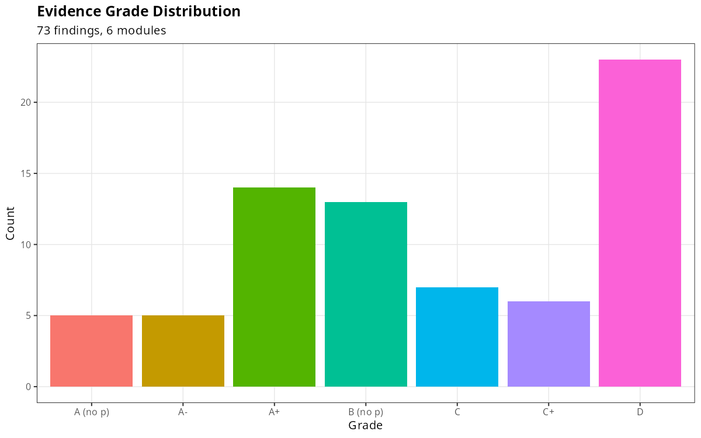

| Grade | Count | Interpretation |
|---|---|---|
| A (no p) | 5 | Large diagnostic/stability effect — cite confidently |
| A+ | 14 | Large effect, strong evidence — cite confidently |
| A- | 5 | Moderate effect, strong evidence — cite with confidence |
| B (no p) | 13 | Moderate diagnostic/stability effect |
| C | 7 | Small — cite with caution |
| C+ | 6 | Small but real — cite with qualification |
| D | 23 | Negligible or unreliable — do NOT cite |

**Summary:** 37 of 73 findings (51%) achieve Grade A or B — these are the most robust and should form the core narrative. 23 findings are Grade D and should not be cited as evidence.

---

## 10. Integrated Conclusions

### 10.1 Core Biological Findings (Evidence Grade A/A+)

1. **OSCC has the strongest RC association** (OR=8.46, Grade A+), exceeding Periodontal Disease (OR=4.76, Grade A+). This holds in saliva-only replication (OR=7.73). The role of RC in oral carcinogenesis warrants dedicated investigation.
2. **Red complex is a stable, persistent colonizer** (ICC=0.60, Grade B). Once established, it tends to persist across timepoints. RC stability far exceeds overall microbiome stability (Shannon ICC=0.28).
3. **The classic obligate co-occurrence model is not supported** — only 11.2% of global samples have all three species. Partial combinations dominate. Site-adjusted CMH ORs reveal 18–22% inflation of raw co-occurrence estimates (Grade A+).
4. **RC first colonizes oral mucosa, not subgingival sites** — confirmed by formal age×site interaction test (p<2.2e-16, Grade A+). This challenges traditional niche specificity.
5. **Geographic variation is predominantly technical, not biological** — mediation analysis shows 143% of Oceania's geographic effect is mediated through sequencing region (p=6.3e-7, Grade A+). Cross-continent comparisons require method standardization.
6. **Age trajectories differ between health and disease** — age×disease interaction p=6.2e-09 (Grade A+). PD detection diverges from HC at ~age 15.

### 10.2 Clinical Implications

7. **Saliva cannot substitute for subgingival sampling** in RC-based PD diagnosis. Saliva AUPRC=0.055 (2.1× baseline) renders it diagnostically useless despite AUC=0.672.
8. **Gingival RC measurement** achieves clinically meaningful performance (PPV=82.1% at 90% sensitivity), though sample size is limited (n=169).
9. **RC absence strongly rules out PD** — tooth-based NPV=98.7% at 90% sensitivity.
10. **RC is absent in infants** — colonization is a postnatal, gradual process beginning on mucosal surfaces.
11. **4 disease associations are Grade A (consistent across all sensitivity subsets):** OSCC, Breast Cancer, CRC, ICU.

### 10.3 Methodological Lessons

12. **Two-part models are essential** for 60.4% zero-inflated microbiome data. Separate logistic + log-normal models provide complementary insights.
13. **FDR correction reduced 14→9 nominal significant diseases** — without it, ~36% of reported associations would be false positives.
14. **CMH stratification by site is necessary** — raw co-occurrence ORs are inflated by 18–22%.
15. **PR curves + AUPRC are more honest than AUC** with severe class imbalance (up to 37:1).
16. **Effect size ranking prevents overinterpretation** — 11 findings are 'large-N significant but practically negligible.'
17. **V4+MiSeq is the recommended homogeneous subset** for cross-study comparisons.
18. **Cross-sectional age trajectories should not be confused with longitudinal aging effects.**

## 11. Data Products and Reproducibility

**10 R scripts**, **47 CSV data tables**, **38 publication-quality figures**.

### Script Index with Methods

| Script | Function | Key_Statistical_Method |
|---|---|---|
| 00_extract_red_complex.py | Species-level extraction (Python) | GTDB taxonomy matching |
| 02_unified_statistical_framework.R | Framework: load, clean, two-part models, theme | glm, lm, data.table, ggplot2 |
| 03_multi_disease_landscape.R | P1.1: FDR-corrected disease landscape + site stratification | glm(binomial), lm(log10), p.adjust(BH), site-stratified replication |
| 04_cooccurrence_analysis.R | P1.2: Fisher + CMH stratified co-occurrence + Woolf test | fisher.test(), CMH stratification, Woolf homogeneity, phi coefficient |
| 05_age_trajectory.R | P1.3: GAM age trajectories + interaction tests (age×site, age×disease) | mgcv::gam(bs='tp',REML), anova.gam, factor-smooth interaction |
| 06_geographic_variation.R | P1.4: Adjusted geography + V4 sensitivity + mediation analysis | glm(binomial), product-of-coefficients mediation, delta-method SE |
| 07_longitudinal_stability.R | P2: Mixed-model ICC + variance decomposition + transition analysis | lmer(1|SubjectID), ICC variance partition, Spearman ρ |
| 08_site_stratified_roc.R | A: ROC/PR/AUPRC + Brier calibration + PPV/NPV at clinical thresholds | Trapezoidal AUC/AUPRC, Hanley-McNeil SE, Hosmer-Lemeshow, Brier score |
| 09_sensitivity_analyses.R | New 7: Cross-subset sensitivity + robustness scoring (A/B/C/D) | Cross-subset glm replication, FDR per subset, CV-based robustness scoring |
| 10_effect_size_summary.R | New 8: Effect size consolidation + evidence grading (A+→D) | Common-metric conversion, magnitude classification, evidence grading |
| 11_generate_report.R | Auto-generate this comprehensive report from all CSV outputs | data.table fread, markdown auto-generation |

**To regenerate this report after re-running any analysis:**
`cd red_complex && Rscript 11_generate_report.R` 
---

*Auto-generated by `11_generate_report.R` on 2026-07-21 — all data read from CSV outputs, no hard-coded values.*
*Huang XC, 2026 — Global Oral Microbiome Project*
