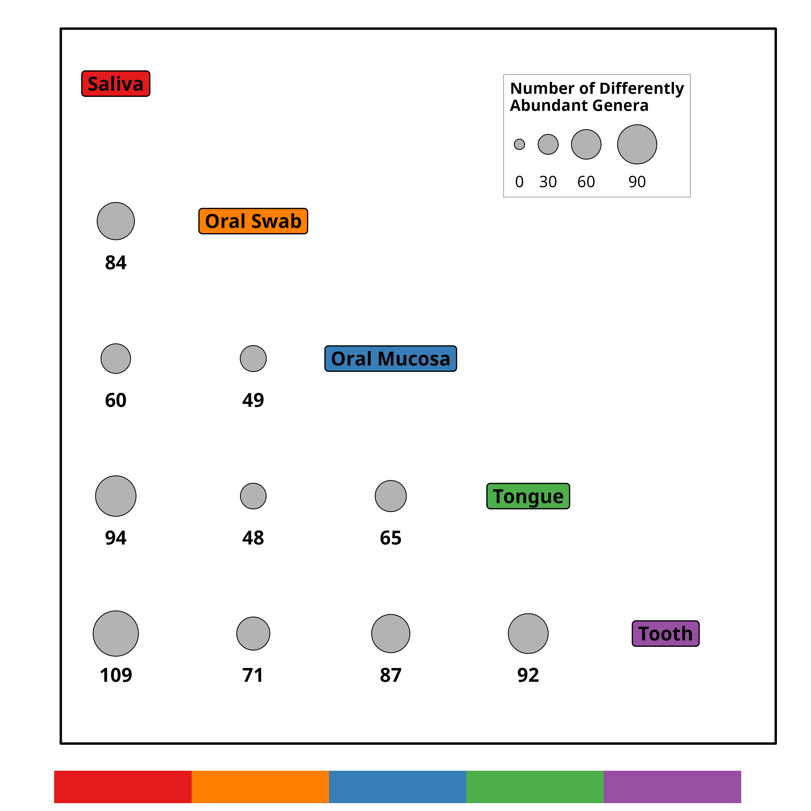
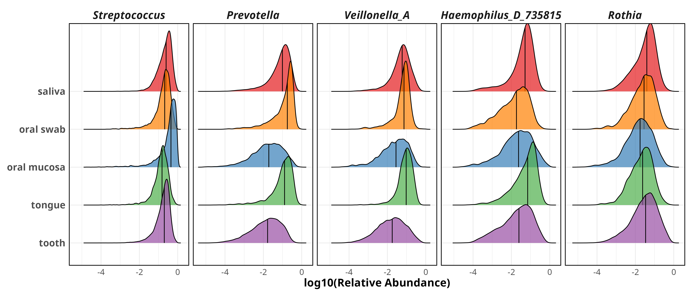

# Figure: Pairwise Differential Abundance Analysis Across Oral Sites

  

---

## Figure Legend

**Figure. Pairwise differential abundance analysis of oral microbiome across six anatomical sites reveals distinct site-specific genus signatures.**

**(a) Bubble matrix of pairwise differentially abundant genera.** The upper-triangular matrix displays the number of significantly differentially abundant genera (q < 0.05, MaAsLin3) for each pairwise comparison among five oral sites (Saliva, Oral Swab, Oral Mucosa, Tongue, Tooth). Diagonal labels are color-coded by site (Saliva = red #E41A1C, Oral Swab = orange #FF7F00, Oral Mucosa = blue #377EB8, Tongue = green #4DAF4A, Tooth = purple #984EA3). Bubble sizes are proportional to the count of differentially abundant genera; numeric values are annotated below each bubble. The comparison between Saliva and Tooth yields the largest number of differentially abundant genera (109), while Oral Mucosa vs Gingiva yields the fewest (38). A label strip beneath the matrix provides a color key for each site.

**(b) Heatmaps and barplot of the top 50 differentially abundant genera across pairwise site comparisons.** The left heatmap displays -log10(q-value) for each genus-by-comparison cell, colored from light peach (#FDDBC7, near null) to dark red (#B2182B, highly significant). Pairwise comparisons are labeled on the x-axis (e.g., saliva_vs_tooth), and genera are labeled on the y-axis (italic genus names extracted from taxonomy strings). The middle heatmap shows log10(mean relative abundance) for each genus across the five plotted oral sites, colored using the viridis "mako" palette (dark blue = low, light = high). The right barplot shows the overall mean relative abundance (sqrt-transformed x-axis) for each of the top 50 genera, ordered by descending abundance. All three panels share the same y-axis genus order, which is determined by the number of significant associations across pairwise comparisons (most frequently significant at the top).

**(c) Density ridgeline plots of the top 5 most abundant differentially abundant genera.** For each of the top 5 genera (ordered by mean relative abundance), density distributions of log10(relative abundance) are shown across the five oral sites, with ridgelines colored by site. Each facet is labeled with the genus name (italic). The distributions highlight how relative abundance shifts across oral niches for these key taxa, providing a complementary view to the heatmaps.

---

## Methods

### Data Sources and Preprocessing

The genus-level feature table was imported from `input/genus_table_all_qc.qza` (QIIME 2 artifact, converted to a sparse matrix via `qiime2R::read_qza`). The curated metadata (`input/metadata_oral_qc_update.tsv`) provided `sample_id`, `site_cleaned`, `site_group_cleaned`, `continent_group`, `age_cleaned`, `sex_cleaned`, `bmi_cleaned`, `bioproject_id`, `platform_cleaned`, `sequencing_region_cleaned`, and `pcr_primers` columns. Samples were filtered to retain only those with `site_group_cleaned == "Oral"` and `site_cleaned` belonging to one of six oral sites (saliva, tooth, oral mucosa, oral swab, tongue, gingiva). Samples with missing or empty `site_cleaned` were removed. Duplicate sample IDs were removed by keeping the first occurrence. Only sites with ≥10 samples (min_samples_per_site = 10) were retained for analysis; all six sites met this threshold. Continuous covariates were transformed before modeling: age was categorized as Minor (<18), Young_Adult (18–45), Middle_Aged (45–65), Elderly (≥65), or Unknown; BMI was categorized as Underweight (<18.5), Normal (18.5–24.0), Overweight (24.0–28.0), Obese (≥28.0), or Unknown; missing values in sex, platform, sequencing region, and PCR primers were imputed as "Unknown" to avoid sample loss.

### MaAsLin3 Pairwise Differential Abundance Analysis

Pairwise differential abundance analysis was performed using MaAsLin3 (via `maaslin3` R package) for all C(6,2) = 15 pairwise site comparisons, with random seed set to 20260615. For each comparison, samples belonging to the two compared sites were subset, and the genus abundance table was transposed to sample-by-feature format. Taxa with prevalence < 5% (min_prevalence = 0.05) were filtered. Sites with fewer than 10 samples (min_samples_per_site = 10) were excluded from analysis.

**Main effect.** The primary variable of interest was `site_cleaned` (six oral sites: saliva, tooth, oral mucosa, oral swab, tongue, gingiva). For each pairwise comparison, the reference level was set to the first site in the pair (i.e., the Site1 in the pair name, e.g., saliva_vs_tooth uses saliva as reference).

**Covariates (confounders).** The following seven covariates were included to control for potential confounding:

1. **`age_cleaned`** — Continuous age was categorized into five levels: Minor (<18 years), Young_Adult (18–45 years), Middle_Aged (45–65 years), Elderly (≥65 years), and Unknown (missing/NA values). Reference level: Young_Adult.
2. **`sex_cleaned`** — Sex category; missing or NA values were imputed as "Unknown". Treated as a categorical factor.
3. **`bmi_cleaned`** — Continuous BMI was categorized into four clinical categories plus Unknown: Underweight (<18.5), Normal (18.5–24.0), Overweight (24.0–28.0), Obese (≥28.0), and Unknown (missing/NA values). Reference level: Normal.
4. **`platform_cleaned`** — Sequencing platform; missing or NA values were imputed as "Unknown". Treated as a categorical factor.
5. **`sequencing_region_cleaned`** — Sequencing region (e.g., V1-V2, V3-V4, V3-V5, V4-V4, etc.); missing or NA values were imputed as "Unknown". Treated as a categorical factor.
6. **`pcr_primers`** — PCR primers used; missing or NA values were imputed as "Unknown". Treated as a categorical factor.
7. **`continent_group`** — Continent of origin (Africa, Asia, Europe, North America, Oceania, South America). Included as a confounder rather than a main effect to control for geographic variation.

**Dynamic covariate filtering.** For each pairwise comparison, covariates were dynamically screened to prevent singular model fits. A covariate was dropped if (1) it had only one level in the subset data, or (2) its levels were non-overlapping between the two sites being compared (i.e., some levels only appeared in one site), which would cause complete separation and model convergence failure.

**Random effect for BioProject.** If at least one BioProject (study) contained samples from both sites in a given pairwise comparison, a random intercept `(1|bioproject_id)` was included in the formula to account for within-study correlation (mixed-effects model). If no BioProjects were shared between the two sites, the model fell back to a fixed-effects-only linear model (LM) without random effects.

**Formula structure.** The full mixed-effects formula was: `~ site_cleaned + age_cleaned + sex_cleaned + platform_cleaned + sequencing_region_cleaned + bmi_cleaned + continent_group + pcr_primers + (1|bioproject_id)`, where covariates were dynamically filtered as described above. The fixed-effects-only formula omitted the random intercept term.

**MaAsLin3 parameters.** Normalization: TSS (total sum scaling); Transformation: LOG; Standardization: enabled (TRUE); Minimum prevalence: 0.05; Significance threshold: qval_individual < 0.05 (Benjamini–Hochberg FDR correction) for the `site_cleaned` main effect only; Cores: 4 (default from SLURM_CPUS_PER_TASK). Both prevalence and abundance models were fitted; results reporting used `qval_individual` (individual q-value for the main effect coefficient).

The analysis was parallelized as a Slurm array job (`01-analysis-site-maaslin3-array-pairwise.R`), with each task (task_id 1–15) processing one pairwise comparison. Each task produced an `all_results.tsv` and a `significant_results.tsv` in a subdirectory named `<Site1>_vs_<Site2>`, along with a `summary.tsv` and a `analysis.done` sentinel file for resumability.

### Result Merging and Summary

After all array tasks completed, results were merged across all 15 comparisons (`02-analysis-merge-site-maaslin3-array.R`). Significant taxa (q < 0.05, `site_cleaned` main effect) were extracted and a summary table was generated counting the number of differentially abundant genera per pairwise comparison. The summary counts were symmetrized (i.e., for each pair Site1 vs Site2, the reverse Site2 vs Site1 was also recorded with the same count) to enable bubble matrix visualization. All merged results are stored in `results/all_pairwise_results.tsv`, significant results in `results/significant_pairwise_results.tsv`, and the summary count table in `results/summary_diff_counts.tsv`.

### Panel a: Bubble Matrix

The bubble matrix was generated from the symmetrized summary count table (`results/summary_diff_counts.tsv`), filtering to the five sites displayed in plots (Saliva, Oral Swab, Oral Mucosa, Tongue, Tooth). The matrix was restricted to the upper triangle (site index of Site1 ≤ Site2). Diagonal cells display site labels as `geom_label` colored by site. Off-diagonal cells show `geom_point` (shape = 21, fill = grey70, stroke = 0.5) sized by `N_Significant` with `scale_radius(range = c(4, 20))` and numeric annotations (bold, size = 6, vjust = 3.5). A color strip of tiles (`geom_tile`) is appended below the matrix via `patchwork` (`plot_layout(heights = c(20, 1))`) to provide a site color key. The coordinate system uses `coord_fixed(ratio = 1)`.

### Panel b: Heatmaps and Barplot

From the significant results, the top 50 most frequently significant genera were selected (ranked by number of pairwise comparisons in which the genus was significant). For each of these 50 genera, the mean relative abundance across all oral samples was computed from the genus table (after TSS normalization, using non-zero values only). Genus display labels were extracted from the taxonomy string by parsing the `g__` prefix (e.g., `d__Bacteria;p__Bacillota;...;g__Streptococcus` → `Streptococcus`).

The left heatmap plots `-log10(qval_individual)` for each genus-by-pair cell, using `geom_tile` with `scale_fill_gradient(low = "#FDDBC7", high = "#B2182B", na.value = "grey90")` capped at 15. Missing combinations (genus not tested or not significant in a given pair) appear as grey. The middle heatmap displays `log10(mean_abundance)` per genus per site, colored with `viridis::scale_fill_viridis(option = "mako", direction = -1)`. The right barplot shows overall mean relative abundance (sqrt-transformed x-axis) as `geom_col` with `fill = "steelblue"`. All three panels share the y-axis order (top 50 genera, most frequently significant at the top) and are combined via `patchwork` with `plot_layout(widths = c(15, 6, 7))`. Both heatmaps use `coord_fixed(ratio = 1)`.

### Panel c: Density Ridgeline

The top 5 genera by overall mean relative abundance (among the top 50 differentially abundant) were selected for density visualization. Relative abundances were computed as TSS-normalized genus proportions. Only non-zero values were retained. Density ridgeline plots were generated using `ggridges::geom_density_ridges` with `aes(x = log10(abundance), y = site_cleaned, fill = site_cleaned)`, quantile lines at the median (`quantiles = 2`, `alpha = 0.7`), and site colors as in Panel a. Each genus occupies one facet via `facet_grid(~ taxon, labeller = as_labeller(top5_genus_labels))`. Facet strip text uses bold italic at size 16. The x-axis is labeled "log10(Relative Abundance)" and the legend is hidden.

### Composite Layout

The three panels are combined using `patchwork` with `plot_layout(heights = c(1.0, 3.0, 0.7))` and `plot_annotation(tag_levels = 'A')`. Each panel is wrapped via `wrap_elements(full = ...)` to preserve internal spacing. Output dimensions: 26 × 36 inches, 300 DPI, saved as both PDF and PNG. Individual panel outputs are also saved separately as PDF and PNG.

---

## Abbreviations

- **TSS**: Total sum scaling (normalization method)
- **LOG**: Logarithmic transformation
- **MaAsLin3**: Microbiome Multivariable Associations with Linear Models, version 3
- **q**: q-value (Benjamini–Hochberg FDR-adjusted p-value)
- **FDR**: False discovery rate
- **LM**: Linear model (fixed-effects-only, used when no shared BioProjects exist between two sites)
- **C(6,2)**: Number of combinations, i.e., 15 pairwise comparisons among 6 oral sites
- **BMI**: Body mass index
- **BioProject**: NCBI BioProject identifier, used as a random effect to account for study-level clustering

## Input Data

All input files are located in the `input/` directory, scripts in `scripts/`, and outputs in `results/`:

- `input/metadata_oral_qc_update.tsv` — Final curated metadata with `bioproject_id`, `sample_id`, `site_cleaned`, `site_group_cleaned`, `continent_group`, `age_cleaned`, `sex_cleaned`, `bmi_cleaned`, `platform_cleaned`, `sequencing_region_cleaned`, `pcr_primers` columns
- `input/genus_table_all_qc.qza` — QIIME 2 genus-level feature table (sparse format) used for differential abundance analysis
- `results/all_pairwise_results.tsv` — Full MaAsLin3 results for all 15 pairwise site comparisons (29,504 rows including header), containing coefficients, p-values, q-values, and model metadata per feature per comparison
- `results/significant_pairwise_results.tsv` — Significant results filtered to `site_cleaned` main effect with `qval_individual < 0.05` (1,520 rows including header)
- `results/summary_diff_counts.tsv` — Symmetrized summary of differentially abundant genus counts per pairwise site comparison (30 rows for 15 pairs × 2 directions)
- `results/figureA_bubble_matrix.pdf` / `.png` — Panel a: Bubble matrix of pairwise differentially abundant genera (10 × 10 inches, 300 DPI)
- `results/figureB_heatmaps.pdf` / `.png` — Panel b: Heatmaps and barplot of top 50 differentially abundant genera (22 × 30 inches, 300 DPI)
- `results/figureC_ridgeline.pdf` / `.png` — Panel c: Density ridgeline plots of top 5 genera (14 × 6 inches, 300 DPI)
- `scripts/01-analysis-site-maaslin3-array-pairwise.R` — MaAsLin3 array job script for pairwise site comparisons (task_id 1-15)
- `scripts/02-analysis-merge-site-maaslin3-array.R` — Merges all pairwise results and generates summary counts
- `scripts/03-plot-site-maaslin3-pairwise.R` — Generates all visualization panels and the composite figure