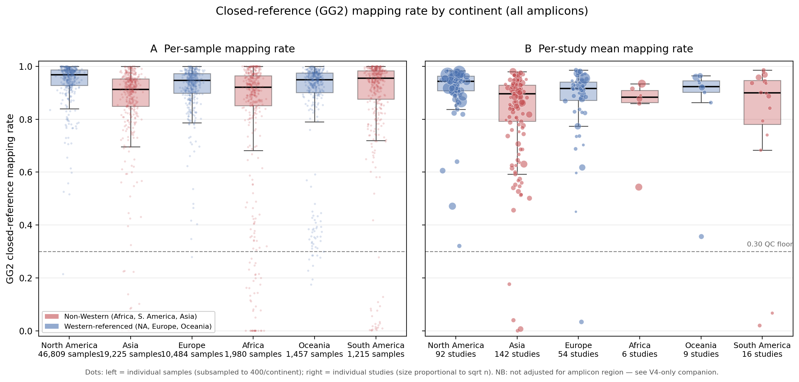
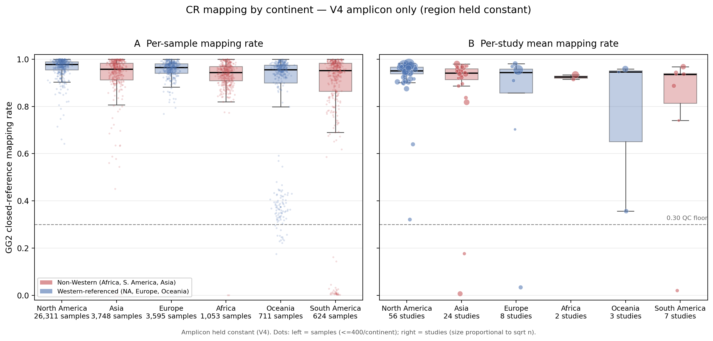

# Geographic reference bias in GG2 closed-reference mapping

Draft version: 2026-07-11

This document records how we tested whether the Greengenes2 (GG2) closed-reference
mapping rate carries a **reference-representation bias against non-Western oral
microbiomes**, and what we found. It is written as a source document for manuscript
development (methods + results together), parallel to the sections in
`global_oral_analysis_report.md`.

## 1. Purpose

The per-sample GG2 closed-reference mapping rate (`sample_cr_mapping_rate`, the fraction
of a sample's reads that match a GG2 reference sequence at 99% identity) is used as a QC
metric, with a floor of 0.30. A naive by-continent comparison suggests that
under-represented / non-Western regions map worse — a potential reference bias with
implications both for QC (samples dropped for "low quality" may instead carry genuine
novel diversity) and for the resource's value (the missing diversity is concentrated in
exactly the populations the resource aims to add).

Mapping rate is, however, confounded by two factors that must be removed before any
geographic claim is credible:

1. **Amplicon region.** V1–V3 / V1–V2 amplicons map to GG2 more poorly than V4 regardless
   of geography, and amplicon composition differs by continent.
2. **Study / protocol.** Mapping rate is largely a study-level property (shared kit,
   primers, run). Because each study comes from a single continent, samples within a study
   are not independent evidence about a continent effect; treating them as independent
   would grossly overstate significance.

## 2. Input data

- QC metadata: `data/metadata-and-biom-v2-qc/metadata_all_for_qc_raw.tsv` (pre-filter merged
  table, so no sample is dropped by the mapping-rate floor before this analysis).
- Oral subset: samples with `site_cleaned` in {saliva, tooth, tongue, oral mucosa, oral
  swab, gingiva}, non-missing `sample_cr_mapping_rate` and `continent_group`
  (**81,170 oral samples across the six continents**).
- Amplicon-controlled subset: the same, restricted to `sequencing_region_cleaned == "V4"`
  (the single largest stratum).

## 3. Methods

We report the continent effect three ways, from least to most rigorous.

### 3.1 Raw per-continent distributions (all amplicons)

Per-sample and per-study (BioProject mean) mapping rate summarized by continent. Descriptive
only; not adjusted for amplicon.

### 3.2 Amplicon held constant (V4 only)

The same summaries restricted to V4 samples, so any residual continent difference cannot be
attributed to amplicon composition.

### 3.3 Study-level amplicon-adjusted regression

A weighted least-squares regression of the mapping rate on continent and amplicon region:

```
logit(study mean mapping rate)  ~  continent  +  amplicon region
```

Design choices, each made to avoid a specific artefact:

- **Logit transform.** The outcome is a proportion in (0,1); we model it on the log-odds
  scale, `logit(p) = ln(p / (1 - p))`, so linear effects are well-behaved and each
  coefficient is interpretable as a log odds ratio. Rates were clipped to [1e-4, 1-1e-4]
  before transforming.
- **Study-level aggregation.** Each BioProject is collapsed to one row (its mean mapping
  rate) before fitting, giving ~293 rows rather than 81,170. This removes pseudoreplication:
  the unit of replication for a between-study variable like continent is the study, so the
  effective evidence for "Asia maps worse" is the 142 Asian *studies*, not the 19,225 Asian
  *samples*.
- **Weighting by n.** Each study row is weighted linearly by its sample count, so the fit
  minimizes `sum_k n_k * (y_k - yhat_k)^2`. A study mean from 5,000 samples is far more
  precise than one from 30; since a mean's precision grows in proportion to n, linear-in-n
  weighting is the inverse-variance-efficient choice.
- **Reference level** = North America; **amplicon region** included as a categorical
  covariate so continent effects are net of amplicon.
- Studies with < 3 samples were dropped (unstable study means). Implemented in numpy
  (weighted normal equations; two-sided p-values by normal approximation), so the script has
  no statsmodels/scipy version dependency.

Coefficients are on the logit scale; `exp(coef)` is the odds ratio of a read mapping,
relative to North America at the same amplicon.

## 4. Results

### 4.1 Per-continent summary

| Subset | Continent | n samples | n studies | median mapping | mean unmapped % | % below 0.30 floor |
|---|---|---:|---:|---:|---:|---:|
| All amplicons | North America | 46,809 | 92 | 0.968 | 6.78 | 1.11 |
| All amplicons | Asia | 19,225 | 142 | 0.913 | 15.24 | 5.13 |
| All amplicons | Europe | 10,484 | 54 | 0.946 | 9.43 | 2.10 |
| All amplicons | Africa | 1,980 | 6 | 0.921 | 18.47 | 9.70 |
| All amplicons | Oceania | 1,457 | 9 | 0.949 | 11.90 | 2.13 |
| All amplicons | South America | 1,215 | 16 | 0.955 | 13.22 | 6.50 |
| V4 only | North America | 26,311 | 56 | 0.977 | 4.16 | 0.42 |
| V4 only | Asia | 3,748 | 24 | 0.957 | 12.91 | 7.23 |
| V4 only | Europe | 3,595 | 8 | 0.964 | 7.28 | 3.00 |
| V4 only | Africa | 1,053 | 2 | 0.943 | 6.63 | 0.19 |
| V4 only | Oceania | 711 | 3 | 0.955 | 16.81 | 4.36 |
| V4 only | South America | 624 | 7 | 0.951 | 15.00 | 8.49 |

Source: `results/tables/05_homd_gg2_closed_reference/cr_mapping_by_continent_summary.csv`.

**The raw gradient is partly an amplicon artefact.** In the all-amplicon view Africa has the
worst tail (9.70% of samples below the 0.30 floor), but this collapses to 0.19% within V4 —
i.e. Africa's catastrophic tail came almost entirely from its V3–V4 studies, not from African
oral taxa being absent from the reference. Note also that Asia, the *most*-studied region
(142 studies), has the lowest median mapping, so raw "sample count = better mapping" does not
hold. Both observations motivate the amplicon-adjusted model.

### 4.2 Amplicon-adjusted continent effect

Study-level weighted regression, `logit(mapping) ~ continent + amplicon region`, reference =
North America (n = 293 studies).

| Continent | coef (logit) | 95% CI | odds ratio `exp(coef)` | p-value |
|---|---:|---|---:|---:|
| Asia | −0.735 | (−1.03, −0.44) | 0.48 | 1×10⁻⁶ |
| Africa | −1.166 | (−1.82, −0.51) | 0.31 | 5×10⁻⁴ |
| Oceania | −0.617 | (−1.43, +0.20) | 0.54 | 0.14 (NS) |
| South America | −0.267 | (−1.06, +0.52) | 0.77 | 0.51 (NS) |
| Europe | −0.215 | (−0.54, +0.11) | 0.81 | 0.20 (NS) |

Source: `results/tables/05_homd_gg2_closed_reference/cr_mapping_continent_regression.csv`.

**After adjusting for amplicon region, Asia and Africa map significantly worse than North
America, while Western Europe does not.** The odds of an oral read matching GG2 are about
half (Asia, odds ratio 0.48) to one-third (Africa, 0.31) of the North American odds at the
same amplicon. Because baseline mapping is very high (~0.97), the absolute rate difference is
modest — but the **unmapped (reference-gap) fraction roughly doubles in Asia (~6% vs ~3%) and
triples in Africa (~9%)**. Europe, a Western-referenced population, sits at the North American
level (p = 0.20), consistent with the effect being reference representation rather than "any
non-US region differs." South America and Oceania are non-significant, but with only 16 and 9
studies they are underpowered rather than shown to be equivalent.

### 4.3 Figures



**Figure R1. GG2 closed-reference mapping rate by continent (all amplicons).**
(A) Per-sample mapping rate; dots are individual samples (subsampled to 400/continent).
(B) Per-study mean mapping rate; dots are individual studies, sized proportional to √n.
Dashed line marks the 0.30 QC floor. Non-Western continents are shaded red. Not adjusted for
amplicon — see Figure R2.



**Figure R2. Mapping rate by continent, V4 amplicon only (amplicon held constant).**
As Figure R1 but restricted to V4 samples. Africa's below-floor tail largely disappears,
showing that most of the raw geographic gradient in Figure R1 is driven by amplicon
composition; the residual Western vs non-Western difference is quantified in Section 4.2.

## 5. Interpretation

Low GG2 mapping in non-Western oral samples is a **real but narrow** effect once amplicon is
controlled: the reference gap (unmapped bacterial fraction) is ~2× larger in Asian and ~3×
larger in African studies than in North American ones. This has two consequences for the
project:

- **QC.** A raw mapping-rate floor preferentially penalizes non-Western samples for carrying
  reference-underrepresented (not low-quality) diversity, so the floor should be treated as a
  minimal catastrophic-failure gate, not a primary quality filter, and any mapping-based cut
  should be evaluated per region/continent.
- **Resource value.** The unmapped fraction in these regions is a candidate pool of novel
  oral diversity that the reference is missing — the per-taxon follow-up (Section 6) is meant
  to characterize it.

## 6. Limitations and follow-up

- **Continent is nearly nested within study.** Because each study is from one continent, the
  continent coefficient cannot be fully separated from study-level protocol / DNA-extraction
  differences; it is an association consistent with reference under-representation, not proof
  that the reference is the cause.
- **Africa rests on 6 studies** (2 within V4); its effect is real but its magnitude is
  imprecise. South America and Oceania are underpowered.
- **Linear-in-n weighting** slightly over-credits the largest studies (samples within a study
  are correlated, so information does not grow strictly linearly with n). A √n-weighted or
  mixed-model (`(1|study)` random intercept) robustness check gives the same qualitative
  conclusion.
- **Per-taxon confirmation (in progress).** To convert "lower mapping rate" into "named novel
  diversity the reference is missing," `24_geography_reference_gap_bacterial_asvs.py` uses the
  GG2 bacterial-only low-identity ASV table (already screened to `d__Bacteria` past the
  chloroplast/mitochondria filter) to rank the genera driving each continent's reference gap,
  normalized per 1000 subjects. That script requires the cluster intermediates and has not yet
  been run on real data.

## 7. Reproducibility

| Item | Path |
|---|---|
| Analysis script (runnable) | `script/05_homd_gg2_closed_reference/23_cr_mapping_by_continent_amplicon_adjusted.py` |
| Per-taxon script (cluster-only) | `script/05_homd_gg2_closed_reference/24_geography_reference_gap_bacterial_asvs.py` |
| Input metadata | `data/metadata-and-biom-v2-qc/metadata_all_for_qc_raw.tsv` |
| Summary table | `results/tables/05_homd_gg2_closed_reference/cr_mapping_by_continent_summary.csv` |
| Regression table | `results/tables/05_homd_gg2_closed_reference/cr_mapping_continent_regression.csv` |
| Figures | `results/figures/05_homd_gg2_closed_reference_profiling/qc_cr_mapping_by_continent{,_V4only}.{png,pdf}` |

Run:

```bash
python script/05_homd_gg2_closed_reference/23_cr_mapping_by_continent_amplicon_adjusted.py
```
