# Global Oral Microbiome Meta-analysis Report

Draft version: 2026-07-10  
Project root: `/beegfs/huangxiaochang/global_oral`

## Report Scope

This report summarizes the curated global oral 16S rRNA sequencing dataset and the downstream analyses prepared for manuscript development. It is designed as a source document for SCI manuscript writing: each section records the analysis purpose, input data, statistical method, main figure(s), figure-style legend, and source code/output paths.

Authoritative decisions used in this report:

- The final metadata/QC rules are defined by `new_analysis/generate_metadata_tables.py`.
- The raw merged QC input table is generated by `new_analysis/merge_all_for_qc_raw.py`.
- Detailed QC visualization is available in `new_analysis/data_qc_pipeline.html`.
- Detailed GG2 closed-reference profiling is available in `ASV_vs_HOMD_analysis/containment_derep/closed_reference_report/GG2_closed_reference_profile_report.html`.
- When multiple similar outputs exist in the same analysis directory, the final named output generated by the latest analysis script is treated as the main version; intermediate plots are reserved for supplementary material.

## Final Analysis Sets

The final dataset was derived from the merged metadata table and filtered according to the current QC implementation in `generate_metadata_tables.py`.

| Table | Scope | Samples | Studies | Subjects | Primary use |
|---|---:|---:|---:|---:|---|
| `metadata_all_for_qc_raw.tsv` | Raw merged QC input | 116,643 | 334 | 45,880 | QC diagnostics |
| `metadata_all_qc.tsv` | QC-passed, all body sites | 93,647 | 293 | 42,643 | all-site summaries |
| `metadata_oral_qc.tsv` | QC-passed oral samples, not deduplicated | 73,340 | 293 | 41,047 | alpha diversity, overview, non-deduplicated abundance analyses |
| `metadata_oral_qc_dedup.tsv` | QC-passed oral samples, one sample per subject-site | 44,446 | 286 | 41,047 | subject-level and cross-validation analyses |

Note: These counts were recalculated directly from the current TSV files on 2026-06-29. If downstream plots were produced before the most recent metadata regeneration, the corresponding figure section should be checked against the final table used by that script.

## 1. Data Processing Workflow

### 1.1 Metadata Collection and Curation

Metadata were collected project by project from public repository run tables, associated publications, and supplementary tables when available. The project-level curation workflow is documented in per-project notebooks such as `global-oral-microbiome/data/projects/PRJDB5440/metadata_curation_v2.md`.

For each study, the curation workflow included:

- Loading raw SRA metadata, typically from `SraRunTable.csv`.
- Reviewing the article abstract, results, and methods to identify study design, sample source, disease status, oral sampling site, and sequencing protocol.
- Removing control samples and non-human samples when present.
- Harmonizing the curated metadata into a common template containing sample ID, subject ID, age, sex, BMI, 16S region, platform, country, site, site group, publication time, primers, disease study indicator, disease/control status, matched-sample flag, and time-series flag.
- Manually resolving fields marked as `pending`, especially sampling site, site group, sex, disease status, and matched-sample structure.

The final cleaned metadata table used as the base for QC merging was `metadata_v2_merge/metadata-v2-merge-cleaned.csv`.

### 1.2 Merging QC Metrics

The script `new_analysis/merge_all_for_qc_raw.py` left-joined all QC-relevant inputs onto the authoritative cleaned metadata by `(bioproject, sample_id)`, preserving the base metadata row structure.

**Input files for QC merge:**

| File | Content Used |
|---|---|
| `metadata-v2-merge-cleaned.csv` | Authoritative metadata base, including updated sequencing-region fields |
| `sample_asv_counts_new.tsv` | Sample-level DADA2 ASV counts |
| `oral_chim_perc_YL_260519.csv` | Sample-level chimera percentage estimates |
| `raw_reads_stats.tsv` | Sample-level raw sequencing read counts |
| `alpha_diversity_data.csv` | Observed, Shannon, Simpson, InvSimpson, Chao1 indices |
| `sample_closed_reference_mapping_rate_v2.tsv` | Sample-level GG2 v2 closed-reference mapping fraction |
| `study_closed_reference_mapping_rate_v2.tsv` | Study-level GG2 v2 closed-reference mapping fraction |
| `table_gg2_id99_61235_115338_v2.biom` | Source closed-reference BIOM for filtered BIOM outputs |

The merged QC input was written to `metadata_all_for_qc_raw.tsv` (116,643 samples, 334 studies, 45,880 subjects).

### 1.3 Final QC Filtering

The final QC tables were generated by `new_analysis/generate_metadata_tables.py`. Filtering proceeds in two phases: **dataset (study)-level** filtering (using oral samples only to evaluate study quality) followed by **sample-level** filtering (applied to all samples in retained studies). The detailed pipeline documentation is in `new_analysis/PIPELINE_DOCUMENTATION.html`.

#### Dataset-Level Filters (oral samples only, applied sequentially)

| Step | Criterion | Datasets Removed | Samples Removed | Oral Samples Removed | Samples After | Oral Samples After |
|---|---|---|---|---|---|---|
| Raw merged metadata | No filtering | — | — | — | 116,643 | 86,255 |
| Dataset chimera filter | Remove datasets where >30% oral samples have chimera >25% | 22 | 1,853 | 1,691 | 114,790 | 84,564 |
| Dataset ASV filter | Remove datasets where >50% oral samples have ASV ≤30 | 14 | 3,608 | 1,924 | 111,182 | 82,640 |
| Dataset close-reference filter | Remove datasets with aggregate oral GG2 CR mapping <30% | 5 | 394 | 304 | 110,788 | 82,336 |

**Studies removed at dataset level:** 22 studies by chimera (PRJDB9395, PRJEB12953, PRJNA418378, PRJNA419259, PRJNA438728, PRJNA454811, PRJNA489752, PRJNA509532, PRJNA511568, PRJNA512456, PRJNA580506, PRJNA609630, PRJNA610499, PRJNA643969, PRJNA648473, PRJNA679485, PRJNA731066, PRJNA747639, PRJNA750937, PRJNA778221, PRJNA837028, PRJNA910326); 14 studies by ASV (PRJDB8487, PRJEB6781, PRJNA269493, PRJNA292354, PRJNA308310, PRJNA316469, PRJNA391982, PRJNA448135, PRJNA706727, PRJNA728576, PRJNA753008, PRJNA760654, PRJNA762545, PRJNA798597); 5 studies by CR mapping (PRJDB3211, PRJDB5944, PRJNA255332, PRJNA712952, PRJNA807496). See `QC/removed_studies_by_step.tsv` for per-study metrics.

#### Sample-Level Filters (applied after dataset filtering, all body sites)

| Step | Criterion | Datasets Removed | Samples Removed | Oral Samples Removed | Samples After | Oral Samples After |
|---|---|---|---|---|---|---|
| After dataset filtering | — | — | — | — | 110,788 | 82,336 |
| Sample chimera filter | Keep only samples with chimera ≤25% and non-missing chimera data | 0 | 1,833 | 1,109 | 108,955 | 81,227 |
| Sample ASV filter | Keep only samples with ASV >30 and non-missing ASV count | 0 | 14,642 | 7,350 | 94,313 | 73,877 |
| Sample closed-reference filter | Keep only samples with GG2 CR mapping ≥30% and non-missing CR data | 0 | 666 | 537 | **93,647** | **73,340** |

The QC-passed all-site table is `metadata_all_qc.tsv` (93,647 samples, 293 studies, 42,643 subjects). The oral subset is `metadata_oral_qc.tsv` (73,340 samples). The deduplicated oral table (`metadata_oral_qc_dedup.tsv`, 44,446 samples) retains one sample per `(subject_id, site_cleaned)`.

#### Matched BIOM Tables

| File | Features | Samples | Matches Metadata |
|---|---|---|---|
| `biom_all_qc.biom` | 61,235 | 93,647 | `metadata_all_qc.tsv` |
| `biom_oral_qc.biom` | 61,235 | 73,340 | `metadata_oral_qc.tsv` |
| `biom_oral_qc_dedup.biom` | 61,235 | 44,446 | `metadata_oral_qc_dedup.tsv` |

#### Oral Site and Sequencing Region Distribution

**Oral site distribution (`site_cleaned`):**

| Table | Saliva | Tooth | Oral Mucosa | Oral Swab | Tongue | Gingiva | Other | NA |
|---|---|---|---|---|---|---|---|---|
| `metadata_oral_qc.tsv` | 38,943 | 17,600 | 5,457 | 3,661 | 3,438 | 495 | 3,731 | 15 |
| `metadata_oral_qc_dedup.tsv` | 28,214 | 4,584 | 3,223 | 3,321 | 1,737 | 308 | 3,057 | 2 |

**Top sequencing regions (`sequencing_region_cleaned`) in oral QC:**

| Table | V4 | V3-V4 | V1-V3 | V4-V5 | V1-V2 | V6-V8 | Other |
|---|---|---|---|---|---|---|---|
| `metadata_oral_qc.tsv` | 36,179 | 21,654 | 5,690 | 4,420 | 2,088 | 881 | 2,428 |
| `metadata_oral_qc_dedup.tsv` | 21,172 | 14,414 | 2,783 | 2,358 | 1,618 | 779 | 1,322 |

#### Key QC Statistics

- 16,255 raw samples have ASV count ≤30.
- 2,636 raw samples have chimera percentage >25%.
- 2,711 raw samples have sample-level GG2 v2 closed-reference mapping rate <30%.
- 544 raw samples are missing newly computed closed-reference mapping data.
- 22 studies have >30% high-chimera oral samples.
- 14 studies have >50% low-ASV oral samples.
- 6 studies have aggregate GG2 v2 closed-reference mapping rate <30%.

### 1.4 QC Figures

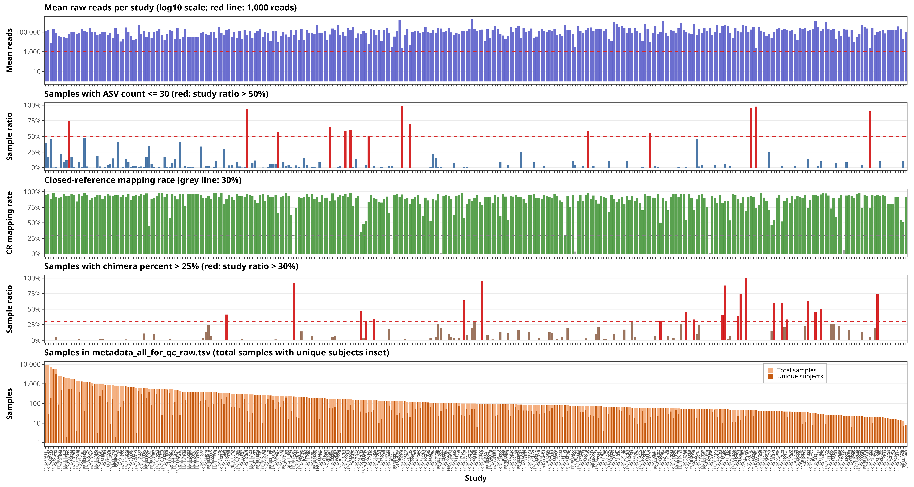

**Figure 1. Study-level quality assessment across merged cohorts.**  
Each BioProject was evaluated using oral-sample QC summaries: ASV count distribution (top-left), chimera percentage (top-right), closed-reference mapping rate (bottom-left), and per-study sample counts by site (bottom-right). Studies flagged for excessive low-ASV samples (>50% oral samples with ASV ≤30), high chimera burden (>30% oral samples with chimera >25%), or low closed-reference mapping (<30% aggregate GG2 CR rate) were excluded. See `QC/removed_studies_by_step.tsv` for per-study metrics and `QC/filter_funnel_summary.tsv` for the complete stepwise filtering funnel.

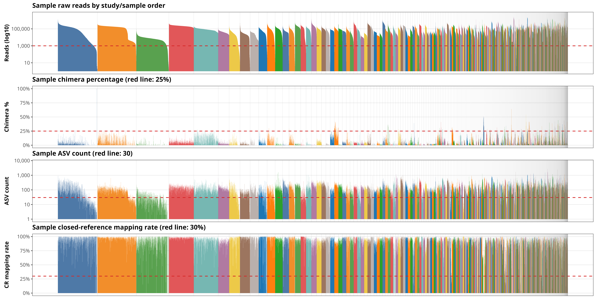

**Figure 2. Sample-level quality control after study-level filtering.**  
The panels summarize sample-level QC metrics for samples in retained studies: ASV richness by site (top-left), chimera percentage distribution (top-right), GG2 v2 closed-reference mapping rate by site (bottom-left), and observed alpha diversity by site (bottom-right). Red dashed lines indicate filtering thresholds (ASV ≤30, chimera >25%, CR mapping <30%). Detailed per-sample QC data are in `QC/sample_filtering_input_table_after_study_filtering.csv`.

## 2. Dataset Overview

### Method

Dataset overview plots were generated mainly from `new_analysis/overview/run_overview_summary.py`. This script loaded the standard oral QC metadata, summarized sample counts by geography, site, BioProject, and disease status, and produced both non-deduplicated and deduplicated disease composition figures.

Additional geographic sampling distribution plots were generated under `oral-v2-code-results-YL/05-sampling-distribution/output`, and taxonomic overview plots were generated under `oral-v2-code-results-YL/04-phylum-relative-stacked`.

### Main Figures

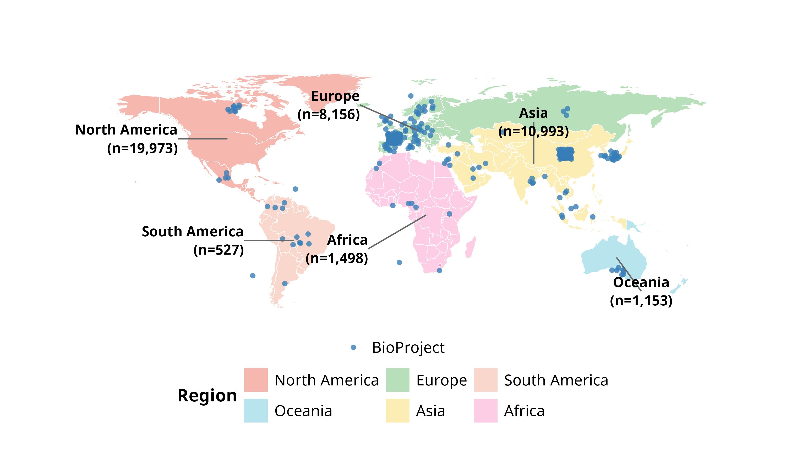

**Figure 3A. Global geographic distribution of curated oral microbiome cohorts.**  
The world map summarizes the geographic origin of samples included in the curated dataset. Countries or regions are shaded according to sample availability, providing a first-pass view of global coverage and geographic imbalance in the public oral 16S rRNA sequencing data.

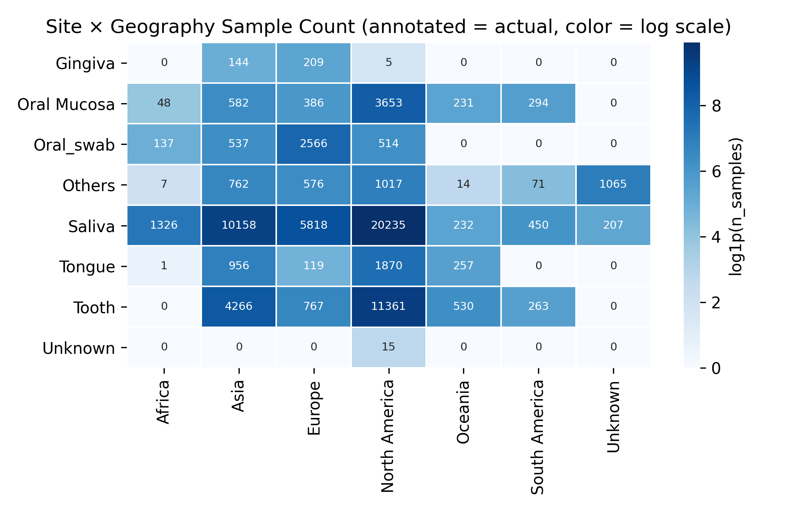

**Figure 3B. Distribution of oral samples across sampling sites and geographic regions.**  
The heatmap shows the number of QC-passed oral samples for each sampling site by geography. Cell labels show raw sample counts, while color intensity represents `log1p(n_samples)` to preserve visibility for both large and small strata.

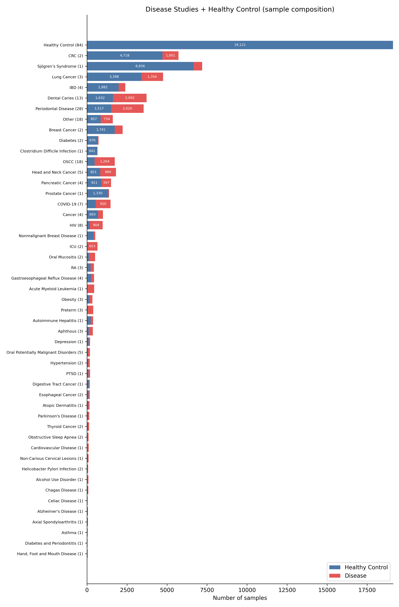

**Figure 4. Disease study composition across the curated oral microbiome dataset.**  
Horizontal stacked bars summarize disease-specific BioProjects and sample composition. Blue segments indicate healthy controls and red segments indicate disease cases within disease-associated BioProjects. Labels include the number of BioProjects represented for each disease category.

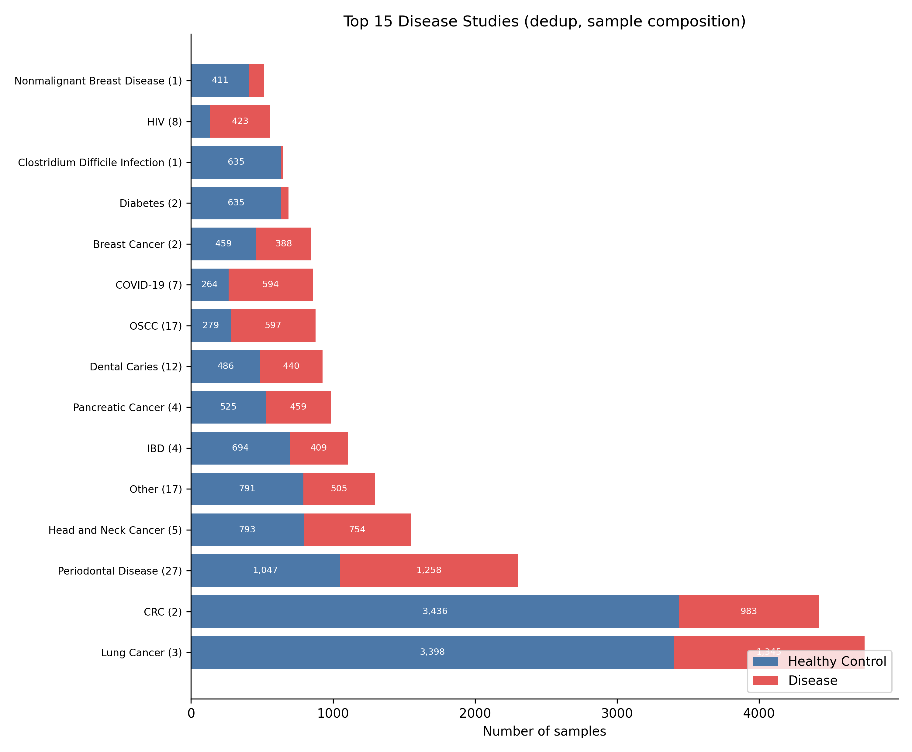

**Figure 5. Top disease categories after subject-site deduplication.**  
The plot shows the 15 largest disease categories after retaining one oral sample per subject and oral site. This version is preferred when reporting subject-level disease sample availability.

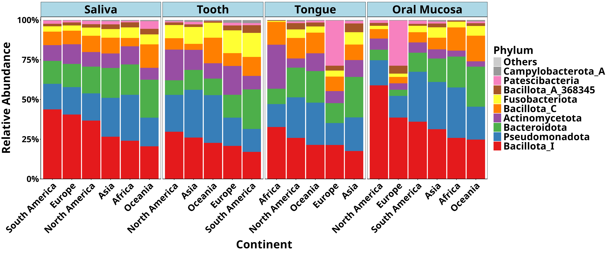

**Figure 6. Phylum-level composition across oral sites and continents.**  
Relative abundance profiles were collapsed at the phylum level and summarized by oral site and continent. The plot provides a high-level taxonomic overview before genus-level association testing.

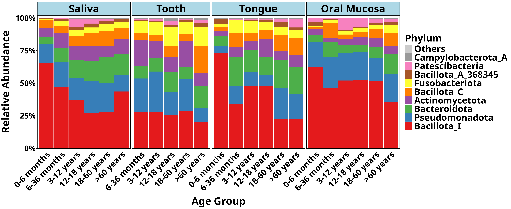

**Figure 7. Phylum-level composition across oral sites and age groups.**  
Phylum-level relative abundance was summarized across oral sampling sites and age strata, highlighting broad compositional shifts by host age and oral niche.

## 3. Alpha Diversity

### Method

Alpha diversity analysis used Shannon diversity from the deduplicated oral QC metadata (`metadata_oral_qc_dedup.tsv`). The script `new_analysis/alpha_diversity_v2/run_shannon_mixed_model.R` fitted a linear mixed-effects model using `lme4` / `lmerTest`:

```text
Shannon ~ sex_cleaned + age_cleaned_group + site_cleaned + sequencing_region_cleaned + continent_group + (1 | bioproject_id)
```

Reference levels were Female (F), 18–60 years, Saliva, V4, and Asia. Samples with missing values, ambiguous sex, or rare site categories (Others, Tonsils) were excluded. The final model was fitted on complete cases from the deduplicated oral table. Fixed-effect significance was evaluated using Satterthwaite's method via `lmerTest`, and p values were adjusted with Benjamini-Hochberg FDR. Marginal and conditional R² were computed with `MuMIn::r.squaredGLMM`. Overview boxplots were generated for age group, site, continent, and 16S region.

### Key Results

The ANOVA table confirmed significant associations for sex, age group, oral site, 16S region, and continent. The strongest global effects were observed for age group and continent, while sequencing region remained a significant technical covariate and was retained in downstream models.

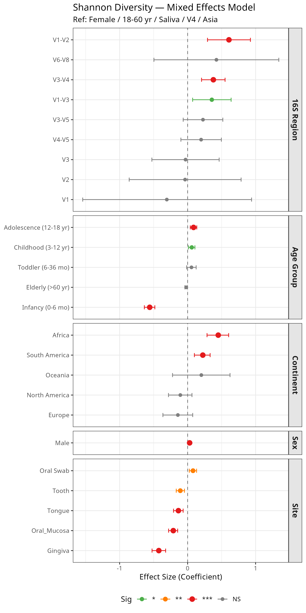

**Figure 8. Fixed effects associated with Shannon diversity in a BioProject-adjusted mixed model (v2).**  
Points show model coefficients and horizontal bars show 95% confidence intervals relative to the reference group (Female / 18–60 yr / Saliva / V4 / Asia). The model included sex, age group, oral site, 16S region, continent, and a random intercept for BioProject. Color denotes FDR-adjusted significance (*** p < 0.001, ** p < 0.01, * p < 0.05, NS = not significant).

Supplementary alpha diversity boxplots:

- `new_analysis/alpha_diversity_v2/shannon_age.pdf`
- `new_analysis/alpha_diversity_v2/shannon_site.pdf`
- `new_analysis/alpha_diversity_v2/shannon_continent.pdf`
- `new_analysis/alpha_diversity_v2/shannon_amplicon.pdf`

## 4. Beta Diversity

### Method

Beta diversity analyses were based on UniFrac ordinations. Scripts in `oral-v2-code-results-YL/01-beta-diversity-pcoa` exported weighted and unweighted UniFrac PCoA coordinates, performed pairwise PERMANOVA tests, and generated matrix-style PCoA panels for major metadata variables.

Variables visualized included:

- sampling site
- age group
- sex
- continent
- sequencing platform
- sequencing region
- BMI group

The PCoA matrix script displays pairwise group comparisons and annotates panels with PERMANOVA `R2` and p values where available. Dense scatter layers were rasterized for legibility.

### Main Figures

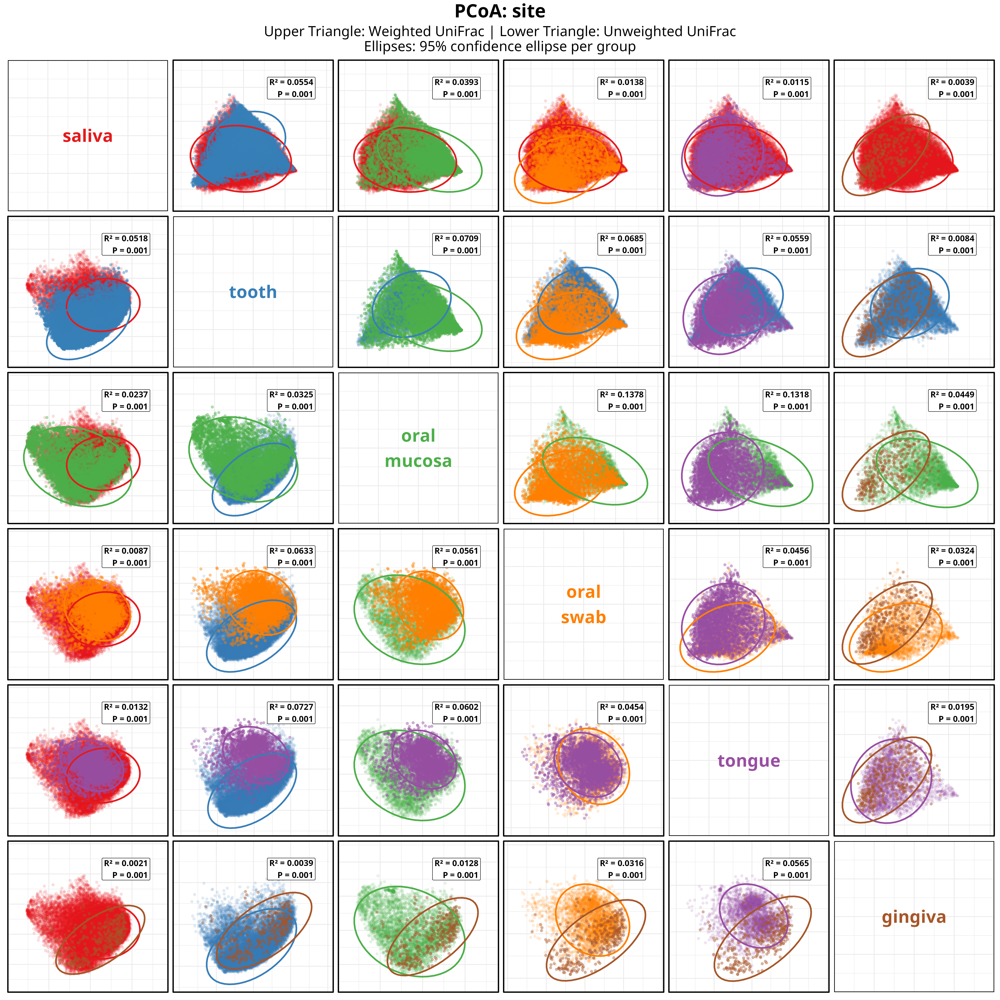

**Figure 9. Beta-diversity structure by oral sampling site.**  
Weighted and unweighted UniFrac PCoA coordinates were plotted in matrix form to compare major oral sampling sites. Pairwise panels visualize separation between site categories and annotate PERMANOVA effect sizes and p values.

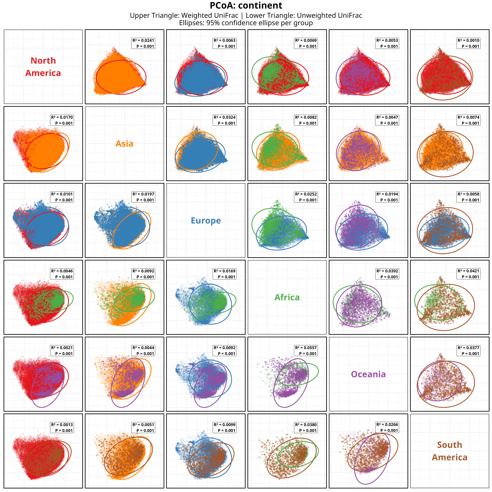

**Figure 10. Beta-diversity structure by geographic region.**  
PCoA matrix panels summarize UniFrac-based differences among continents. Geographic structure was evaluated using pairwise PERMANOVA on the corresponding distance matrices.

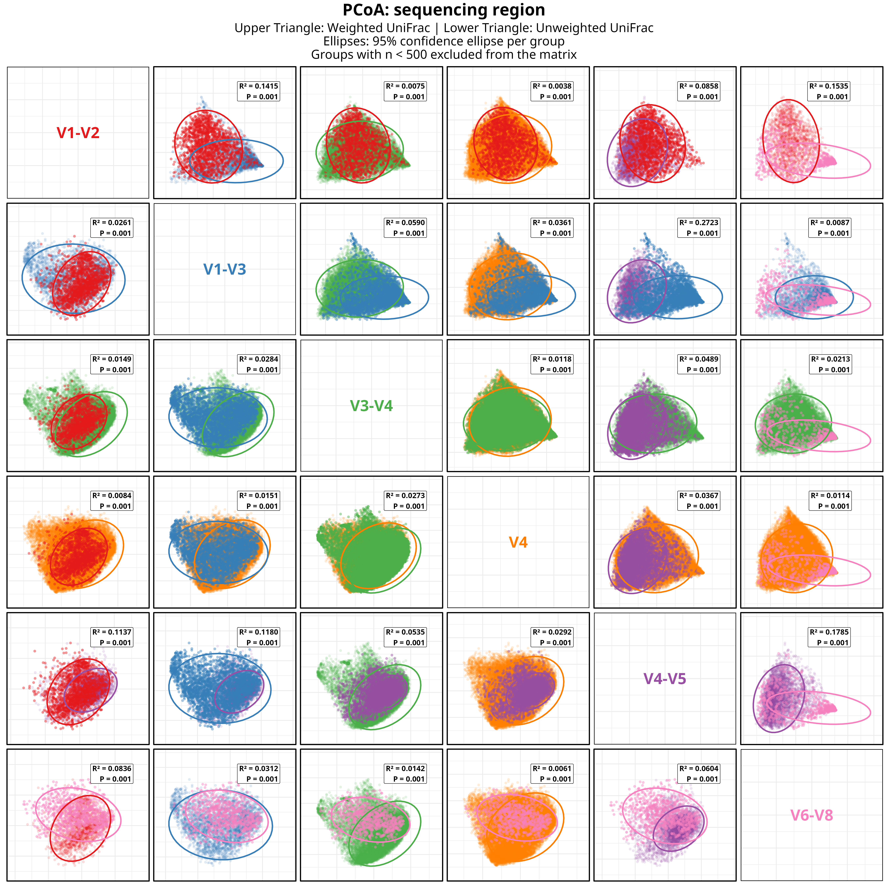

**Figure 11. Beta-diversity structure by amplified 16S rRNA region.**  
Samples were colored by cleaned 16S target region. This figure assesses the magnitude of technical structure attributable to amplicon region and motivates inclusion of sequencing region as a covariate in association models.

Supplementary beta-diversity figures:

- `PCoA-Matrix-age_cleaned_group-0610.png`
- `PCoA-Matrix-sex_cleaned-0610.png`
- `PCoA-Matrix-platform_cleaned-0610.png`
- `PCoA-Matrix-bmi_cleaned_group-0610.png`

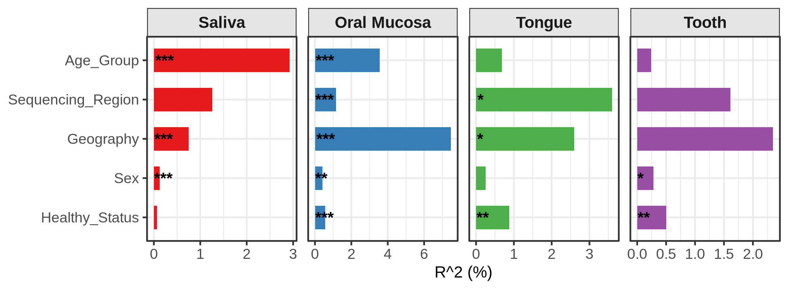

**Figure 11B. Oral-site Bray-Curtis beta-diversity variance explained by host and technical factors.**  
Faceted ADONIS summaries show the percentage of Bray-Curtis variation explained by age group, sequencing region, geography, sex, and healthy status within saliva, oral mucosa, tongue, and tooth samples. Bars show R² (%), and asterisks denote statistical significance. The figure highlights that the dominant explanatory factors differ by oral site, with geography and sequencing region contributing strongly in several site-specific analyses.

## 5. HOMD and GG2 Closed-reference Profiling

### Method

ASV-to-reference profiling was summarized in the closed-reference workflow under `ASV_vs_HOMD_analysis/containment_derep`. The detailed HTML report is:

`ASV_vs_HOMD_analysis/containment_derep/closed_reference_report/GG2_closed_reference_profile_report.html`

The suspicious-backbone filtering step under `ASV_vs_HOMD_analysis/containment_derep/gg2_backbone_suspicious_filter` compared GG2-matched query sequences against backbone entries annotated as mitochondria or chloroplast. The filtering used exact sequence identity and full query coverage in `vsearch` to avoid retaining non-target backbone assignments. Under the current reporting rule, only chloroplast and mitochondrial assignments are described as removal criteria.

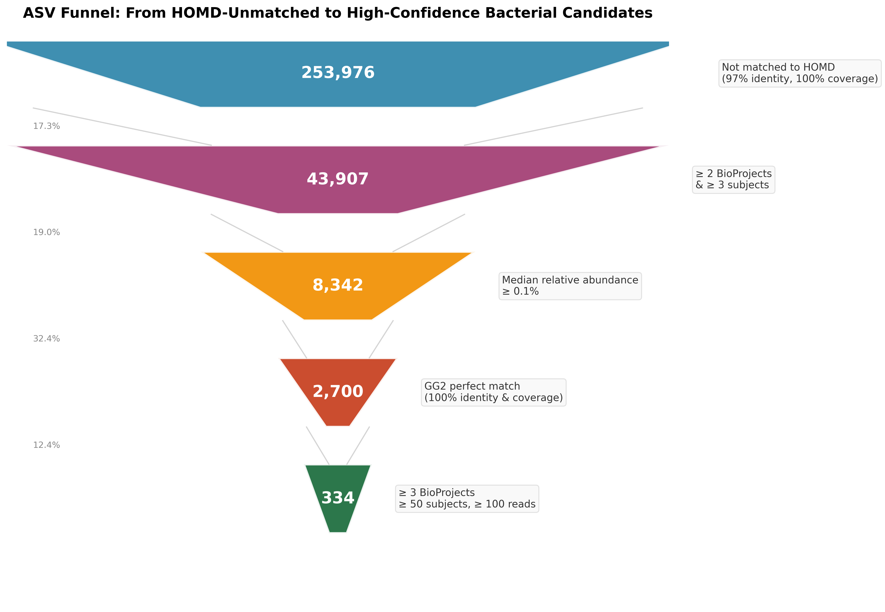

**Figure 12A. ASV filtering funnel for reference profiling.**  
The funnel summarizes how ASVs were reduced through HOMD non-match evaluation, prevalence filtering, median relative abundance filtering, GG2 perfect matching, and suspicious-backbone filtering. This procedure identifies high-confidence reference-mapped ASVs while flagging likely non-target backbone matches.

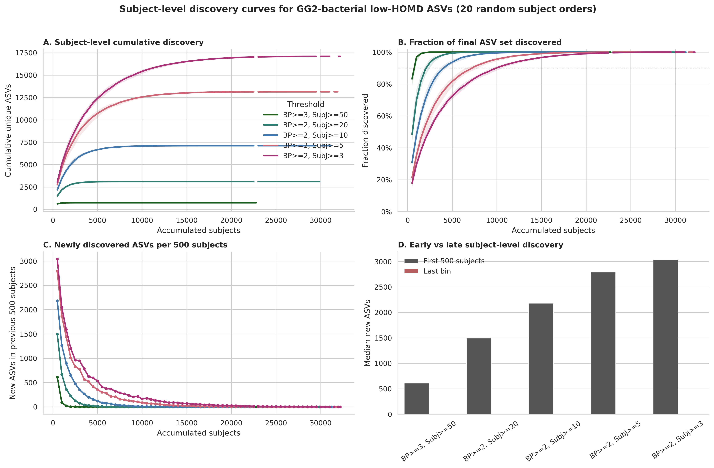

**Figure 12B. Subject-level discovery curves for GG2-bacterial low-HOMD ASVs.**  
Discovery curves were generated across 20 random subject orders to estimate how rapidly low-HOMD, GG2-bacterial ASVs accumulate with increasing subject sampling. Panels show cumulative unique ASVs, the fraction of the final ASV set discovered, newly discovered ASVs per 500 subjects, and early-versus-late discovery rates under alternative BioProject and subject-prevalence thresholds. The curves show that stricter prevalence thresholds saturate rapidly, whereas permissive thresholds continue to recover rare ASVs across larger subject sets.

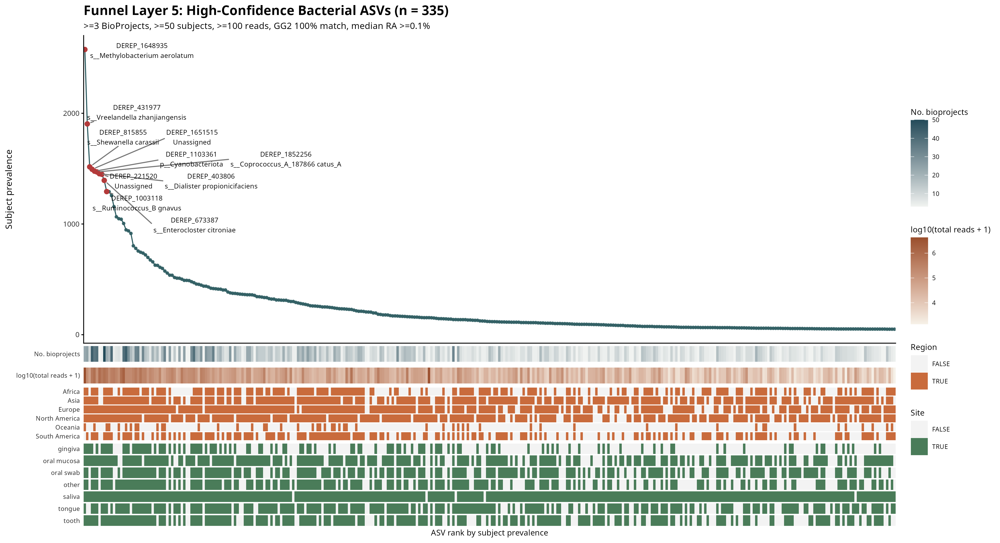

**Figure 12C. Subject-prevalence profile of layer 5 GG2-matched ASVs.**  
The prevalence profile summarizes the ASVs retained at the layer 5 step after the HOMD/GG2 funnel. The figure highlights high-prevalence candidates and supports manual interpretation of common ASVs that remain after reference matching and suspicious-backbone screening.

**Top 10 layer 5 ASVs by subject prevalence.**

| ASV | Subjects | BioProjects | Reads | Sites | Geographies | GG2 phylum | GG2 genus | GG2 species |
|---|---|---|---|---|---|---|---|---|
| DEREP_1648935 | 2,576 | 23 | 4,272,780 | gingiva; oral mucosa; oral swab; other; saliva; tongue; tooth | Africa; Asia; Europe; North America; Oceania | p__Pseudomonadota | g__Methylobacterium | s__Methylobacterium aerolatum |
| DEREP_431977 | 1,904 | 25 | 171,283 | gingiva; oral mucosa; oral swab; other; saliva; tooth | Africa; Asia; Europe; North America; South America | p__Pseudomonadota | g__Vreelandella_640984 | s__Vreelandella zhanjiangensis |
| DEREP_815855 | 1,516 | 10 | 67,509 | gingiva; oral mucosa; saliva; tooth | Asia; Europe; North America | p__Pseudomonadota | g__Shewanella | s__Shewanella carassii |
| DEREP_1651515 | 1,494 | 44 | 512,034 | gingiva; oral mucosa; oral swab; other; saliva; tongue; tooth | Africa; Asia; Europe; North America; South America | Unassigned | Unassigned | Unassigned |
| DEREP_1103361 | 1,477 | 37 | 783,102 | oral mucosa; oral swab; other; saliva; tongue; tooth | Africa; Asia; Europe; North America; Oceania; South America | p__Cyanobacteriota | Unassigned | Unassigned |
| DEREP_1852256 | 1,470 | 39 | 155,522 | gingiva; oral mucosa; oral swab; other; saliva; tongue; tooth | Africa; Asia; Europe; North America; South America | p__Bacillota_A_368345 | g__Coprococcus_A_187866 | s__Coprococcus_A_187866 catus_A |
| DEREP_403806 | 1,454 | 3 | 925,091 | oral mucosa; saliva | Europe; North America | p__Bacillota_C | g__Dialister_37762 | s__Dialister propionicifaciens |
| DEREP_221520 | 1,449 | 4 | 464,591 | gingiva; oral mucosa; oral swab; other; saliva; tongue; tooth | Europe; North America | Unassigned | Unassigned | Unassigned |
| DEREP_673387 | 1,394 | 50 | 751,745 | gingiva; oral mucosa; oral swab; other; saliva; tongue; tooth | Africa; Asia; Europe; North America; South America | p__Bacillota_A_368345 | g__Enterocloster | s__Enterocloster citroniae |
| DEREP_1003118 | 1,293 | 22 | 508,839 | gingiva; oral mucosa; oral swab; other; saliva; tongue; tooth | Africa; Asia; Europe; North America; Oceania; South America | p__Bacillota_A_368345 | g__Ruminococcus_B | s__Ruminococcus_B gnavus |

The table reports the most prevalent layer 5 ASVs, including the number of subjects and BioProjects in which each ASV was detected, total read support, body-site coverage, geographic coverage, and GG2 taxonomic assignment.

## 6. Host and Technical Factors — Saliva MaAsLin3 v2

### Method

Differential abundance analyses for host factors (age, sex) and technical covariates (16S sequencing region) in saliva were re-implemented in `new_analysis/maaslin3_v2/`. The analyses used genus-level relative abundance from `genus_table_relabund.tsv` (generated by `prepare_genus_relabund.py`) and the deduplicated oral QC metadata (`metadata_oral_qc_dedup.tsv`). All models used MaAsLin3 with TSS normalization, log transformation, BH correction, `min_prevalence = 0.1`, and `max_significance = 0.25`.

Three saliva-focused analyses were performed:

**Analysis 1 — Age-associated microbiota in saliva** (`run_age_saliva.R`): A single MaAsLin3 model was fitted using all saliva samples with complete metadata:

```text
genus abundance ~ age_cleaned_group + sex_cleaned + sequencing_region_cleaned + continent_group + (1 | bioproject_id)
```

Reference levels were 18–60 years, Female (F), and V4. The model used saliva samples only and adjusted for sex, sequencing region, and continent with a BioProject random intercept.

**Analysis 2 & 3 — Sex- and sequencing-region-associated microbiota by geography** (`run_by_geography_saliva.R`): North America saliva samples were downsampled to approximately 2,500 samples via stratified sampling by BioProject × sex × age group × sequencing region to reduce geographic imbalance. For each continent (excluding Africa, which lacked sufficient data), a geography-specific MaAsLin3 model was fitted:

```text
genus abundance ~ age_cleaned_group + sex_cleaned + sequencing_region_cleaned + (1 | bioproject_id)
```

Continents without sufficient factor-level support (≥2 levels for each covariate and ≥2 BioProjects) were skipped.

Results were visualized with `plot_saliva_results.R`, which generates heatmaps showing significant genera (q < 0.1). For the sequencing region analysis, a "consistent" heatmap was also produced, retaining only genera significantly associated with sequencing region in at least two geographies with the same direction of effect. Heatmap axis labels include family-level taxonomic annotation for biological interpretability.

### Main Figures

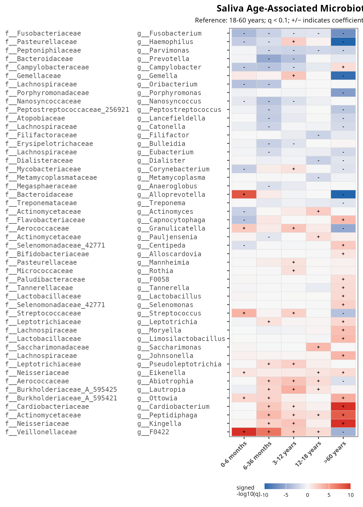

**Figure 13. Age-associated salivary genera (MaAsLin3 v2).**  
The heatmap shows genus-level associations with age group in saliva, adjusted for sex, sequencing region, and continent with BioProject random effects. Reference: 18–60 years. +/− indicates the direction of the coefficient relative to reference; only genera with q < 0.1 in at least one age contrast are shown. Color intensity reflects signed −log₁₀(q).

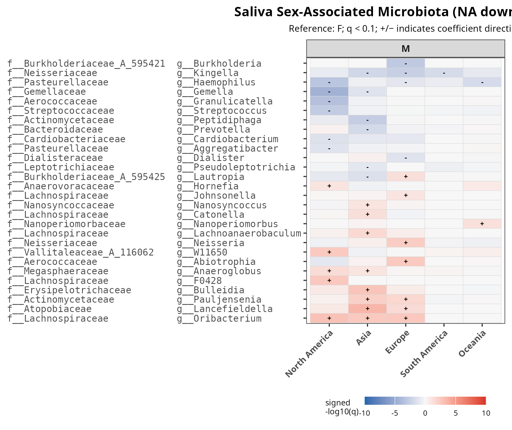

**Figure 14. Sex-associated salivary genera across geographies (NA downsampled).**  
Faceted heatmap showing sex-associated genera within each continent, after stratified downsampling of North America to ~2,500 samples. Each panel displays significant sex associations (reference: Female) from a geography-specific MaAsLin3 model adjusted for age group and sequencing region with BioProject random effects.

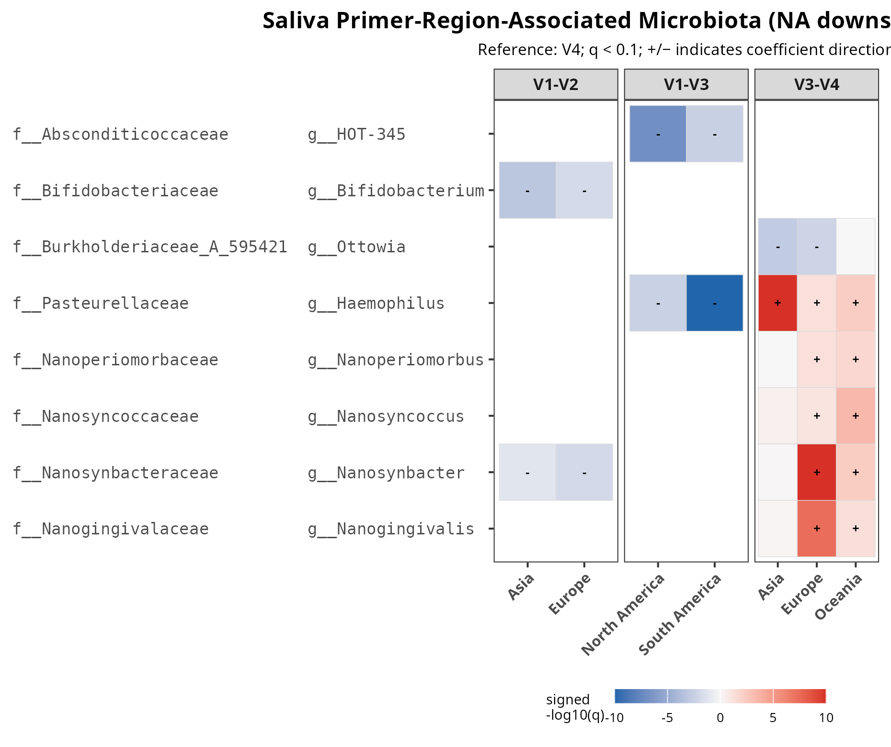

**Figure 15. Sequencing-region-associated salivary genera consistent across at least two geographies.**  
Faceted heatmap showing genera significantly associated with 16S target region (reference: V4) with the same direction of effect in ≥2 geographies. Only genera meeting this consistency criterion are shown. This figure highlights technical signal attributable to amplicon region that persists after adjustment for host covariates.

Supplementary figures:

- `new_analysis/maaslin3_v2/saliva_plots/saliva_sex-cleaned_heatmap.png` (all sex-associated, including single-geography signals)
- `new_analysis/maaslin3_v2/saliva_plots/saliva_sequencing-region-cleaned_heatmap.png` (all region-associated, per geography)
- `new_analysis/maaslin3_v2/saliva_plots/saliva_significant_summary_by_geo.csv` (summary counts by variable and geography)

## 7. Geographic Differential Abundance

### Method

Geographic differential abundance was analyzed in saliva using pairwise continent comparisons in `oral-v2-code-results-YL/02-continent-differential-analysis/01-analysisl-continent-maaslin3-array-pairwise-saliva.R`. Each Slurm array task compared one continent pair using MaAsLin3.

The model included continent as the main exposure and dynamically retained covariates with adequate factor support:

```text
genus abundance ~ continent_group + age group + sex + platform + sequencing region + BMI
```

When BioProjects were shared across the two compared continents, a BioProject random intercept was added:

```text
genus abundance ~ continent_group + covariates + (1 | BioProject)
```

MaAsLin3 settings included TSS normalization, log transformation, standardization, `min_prevalence = 0.05`, and `qval < 0.05` for significant pairwise associations.

### Main Figures

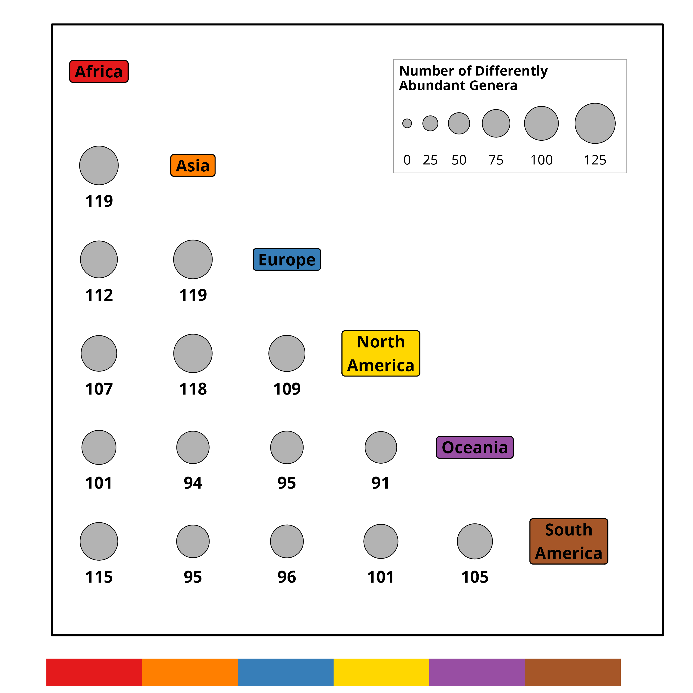

**Figure 16. Pairwise continent differential abundance summary in saliva.**  
The bubble matrix summarizes significant genus-level differences across continent pairs. Bubble size and color encode the number and direction of significant associations detected by MaAsLin3 after covariate adjustment.


**Figure 17. Heatmaps of geography-associated salivary genera.**  
Heatmaps show genera with significant continent-associated abundance differences across pairwise comparisons. Rows correspond to genera and columns correspond to continent contrasts.

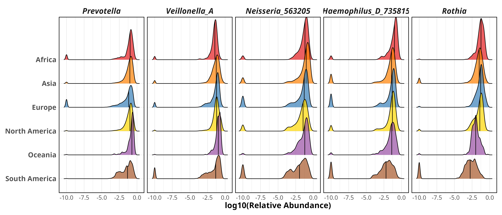

**Figure 18. Distributional patterns of geography-associated salivary genera.**  
Ridgeline plots show relative abundance distributions of selected geography-associated genera across continents, providing an abundance-scale interpretation of the MaAsLin3 associations.

## 8. Oral Site Pairwise Differential Abundance

### Method

Site-specific differential abundance was analyzed using pairwise MaAsLin3 comparisons between the five major oral sites in `new_analysis/maaslin3_v2/site_pairwise/`. The script `run_site_pairwise_maaslin3.R` performed all pairwise comparisons among Saliva, Tooth, Tongue, Oral_swab, and Oral_Mucosa (10 pairs). For each pair, MaAsLin3 was fitted on the genus-level relative abundance table:

```text
genus abundance ~ site_cleaned + age_cleaned_group + sex_cleaned + sequencing_region_cleaned + continent_group + (1 | bioproject_id)
```

Covariates with fewer than two levels in a given pair were dynamically dropped. When only one BioProject was available for a pair, the random intercept was omitted. Each site in a pair was required to have at least 50 samples. Models used TSS normalization, log transformation, BH correction, `min_prevalence = 0.1`, and `evaluate_only = "abundance"` to focus on site-differential taxa.

Results were merged across pairs with `merge_site_pairwise_results.R` and visualized with `plot_site_pairwise_results.R`, generating a bubble matrix of significant site-differential taxa counts, a top-50 heatmap, a mean abundance heatmap, and ridgeline plots for the top five most differential genera.

### Main Figures

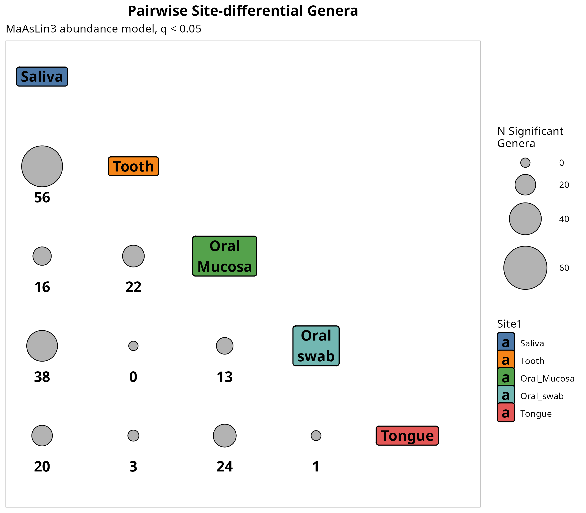

**Figure 19. Pairwise oral-site differential abundance summary.**  
The bubble matrix summarizes the number of significantly site-associated genera (q < 0.05) for each pairwise oral-site comparison. Bubble size encodes the number of significant genera; comparisons are symmetric (Site A vs Site B).

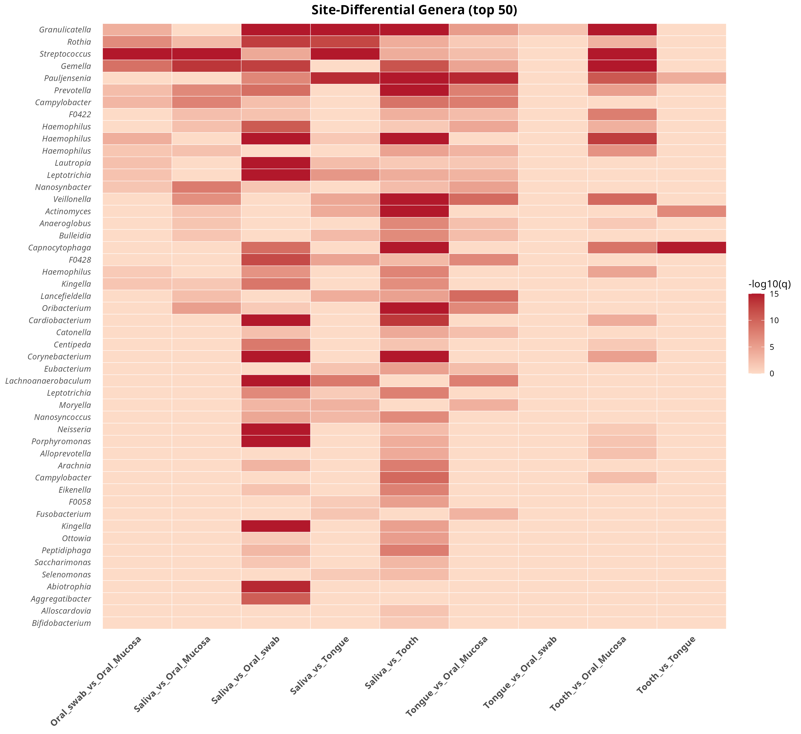

**Figure 20. Top 50 site-differential genera across oral site pairs.**  
The heatmap shows the signed −log₁₀(q) for the 50 genera most strongly associated with site differences across all pairwise comparisons. Rows are genera and columns are pairwise comparisons. Color indicates association direction and magnitude.

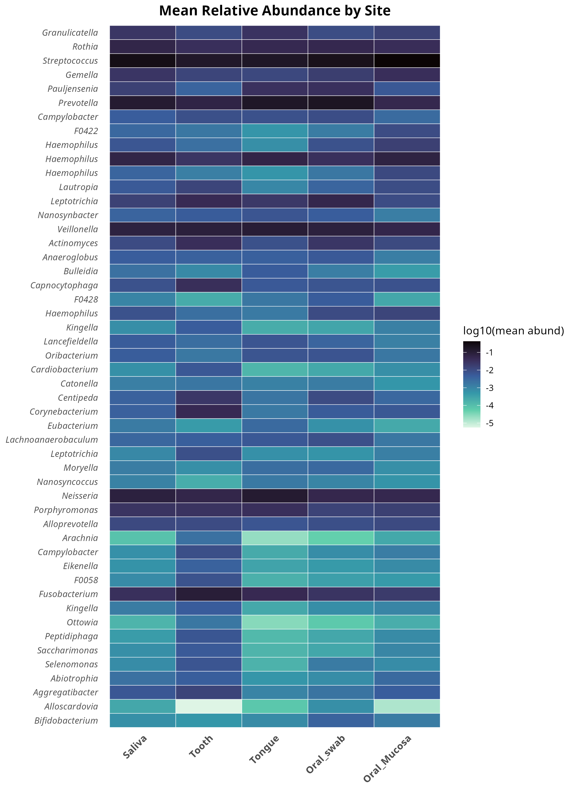

**Figure 21. Mean relative abundance of site-differential genera across oral sites.**  
The heatmap shows the mean relative abundance of site-associated genera across the five oral sites, providing biological context for the site-pairwise differential results.

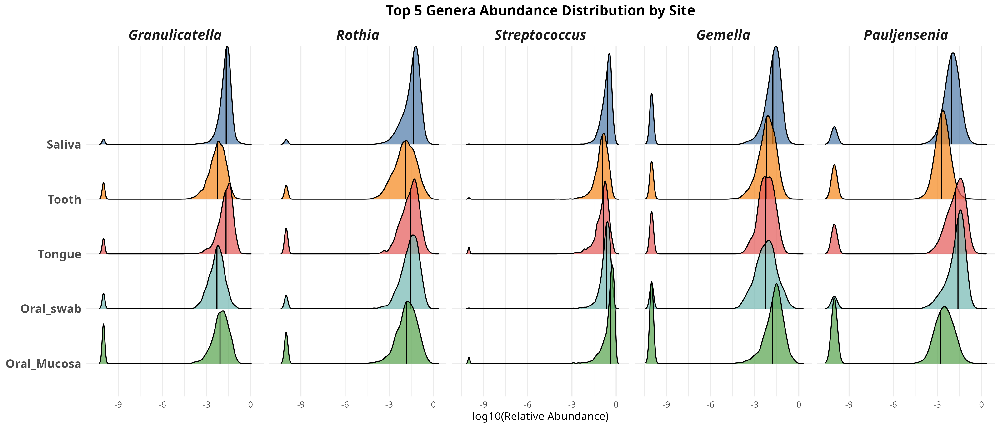

**Figure 22. Distribution of the top five most site-differential genera across oral sites.**  
Ridgeline plots show relative abundance distributions of the top five genera most strongly associated with oral site differences across the five major oral sites.

Supplementary files:

- `new_analysis/maaslin3_v2/site_pairwise/results/all_pairwise_results.tsv`
- `new_analysis/maaslin3_v2/site_pairwise/results/significant_pairwise_results.tsv`
- `new_analysis/maaslin3_v2/site_pairwise/results/summary_diff_counts.tsv`

## 9. Disease-associated Microbes

### Method

Disease differential abundance was re-implemented in `new_analysis/maaslin3_v2/run_disease_all_sites.R` and visualized with `new_analysis/maaslin3_v2/plot_disease_shared.R`. The analysis used deduplicated oral QC metadata and genus-level relative abundance (`genus_table_relabund.tsv`).

For each disease, only BioProjects containing both disease cases (≥30) and healthy controls (≥30) were retained, with at least two matched BioProjects required. The MaAsLin3 model included disease status as the primary exposure and retained available covariates across **all oral sites**:

```text
genus abundance ~ Disease_Status + age_cleaned_group + sex_cleaned + site_cleaned + sequencing_region_cleaned + continent_group + (1 | bioproject_id)
```

Covariates with fewer than two levels in a disease-specific subset were dynamically dropped. Models used TSS normalization, log transformation, BH correction, `min_prevalence = 0.1`, and `max_significance = 0.25`. For shared-disease visualization, a stricter threshold of q < 0.05 was applied to focus on high-confidence disease-associated genera. The preferred disease list included Dental Caries, Head and Neck Cancer, HIV, Oral Cancer, OSCC, Periodontal Disease, RA, Benign Tumor, Breast Cancer, CRC, IBD, and Lung Cancer.

Shared genera (≥2 diseases) were visualized as a heatmap with family-level taxonomic annotation, and set intersections were displayed as an UpSet plot. Disease labels are annotated with the number of matched BioProjects (BP) containing both cases and controls.

### Main Figures

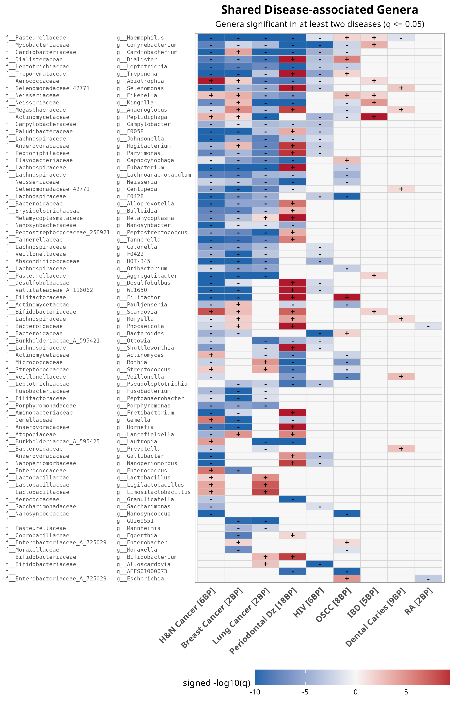

**Figure 23. Shared and disease-specific genus associations across oral diseases (v2).**  
The heatmap displays genera significantly associated (q ≤ 0.05) with at least two disease comparisons across all oral sites. Color indicates signed −log₁₀(q) with direction relative to healthy controls. Disease columns are annotated with the number of matched BioProjects [N BP]. Axis labels include family-level taxonomy. Only genera with significant associations in ≥2 diseases are shown.

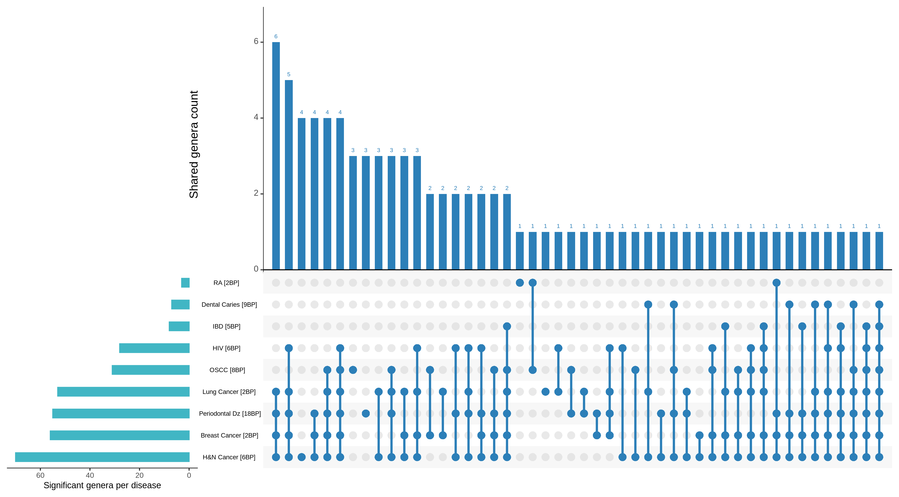

**Figure 24. Overlap of disease-associated genera across disease categories (v2).**  
The upset plot summarizes the intersection structure of significant disease-associated genera (q ≤ 0.05). Set sizes (horizontal bars) represent the total number of significant genera per disease; intersection bars (vertical) show the number of genera shared among specific disease combinations.

Supplementary files:

- `new_analysis/maaslin3_v2/disease_results_all.tsv` (combined results across all diseases)
- `new_analysis/maaslin3_v2/disease_run_summary.csv` (per-disease sample sizes and significant association counts)
- `new_analysis/maaslin3_v2/disease_shared_plots/disease_significant_genera_q0.05.tsv`

## 10. Disease Prediction and Microbial Age Prediction

### 10.1 Disease Prediction

Disease classification was evaluated using two complementary approaches implemented in `global-oral-microbiome/script/disease_classification/disease_predict.ipynb`: a phylogeny-aware deep-learning model (**DeepPhylo**) and a **Random Forest** baseline. Both models were evaluated on identical data splits, enabling direct per-study comparison.

#### Method

**Microbiome data and QC.** The deduplicated oral QC BIOM table (`biom_oral_qc_dedup.biom`) and metadata were used. OTUs detected in ≤50 samples were discarded, and samples with <1,000 total reads were removed. Relative abundance was obtained by total-sum normalization. For DeepPhylo, OTUs were ordered phylogenetically using a precomputed cophenetic distance matrix, and a phylogenetic embedding (hidden dimension 80) was shared across all experiments.

**DeepPhylo model.** DeepPhylo applies 1-D convolutional filters (kernel size 3, pooling kernel 7, ReLU activation) over the phylogenetically ordered OTUs to integrate information from evolutionarily related taxa. Models were trained with AdamW (learning rate 1×10⁻³, batch size 32, up to 100 epochs) with early stopping (patience 10 epochs, 15% internal validation split). Binary cross-entropy loss was minimized, and weights from the epoch with the lowest validation loss were retained.

**Random Forest baseline.** A Random Forest classifier (100 trees, balanced class weights, fixed random seed) was trained on the same relative abundance features and evaluated on identical data splits.

**Evaluation design 1: Leave-One-Study-Out (LOSO) cross-study generalization.** For each oral site (saliva, tooth, tongue, oral mucosa), studies and diseases were selected requiring: (i) both HC and disease cases present in a study, (ii) >10 HC samples per study, and (iii) disease present in ≥2 studies. Each study was held out in turn as the test set while the model was trained on the remaining studies (disease vs HC). This provides a strict test of generalization to unseen studies with their own batch effects.

**Evaluation design 2: Paired oral–gut within-study 5-fold CV.** Within projects sampling both oral and gut sites from the same cohorts, disease vs HC was predicted separately for each body site using stratified 5-fold cross-validation, enabling comparison of the predictive value of oral versus gut microbiomes. Per-fold AUC was recorded, and results were summarized per project × site.

#### Key Results

**Cross-study generalization (LOSO).** DeepPhylo and Random Forest were compared across saliva, tooth, and oral mucosa sites. Per-study test AUC was recorded, with paired comparisons (same study, same disease) connected to highlight model differences. Both models showed disease- and site-dependent performance, with DeepPhylo showing advantages in specific disease contexts by leveraging phylogenetic structure across taxa.

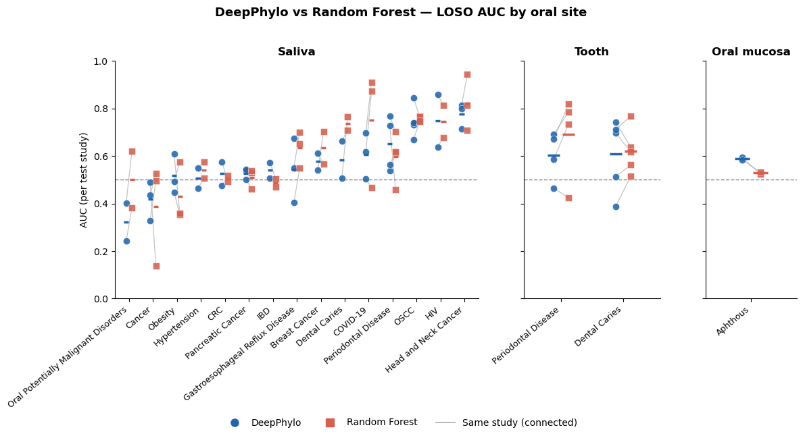

**Figure 25. DeepPhylo versus Random Forest — Leave-One-Study-Out AUC by oral site.**  
Each point represents the test AUC for one held-out study (disease vs healthy control). Blue circles = DeepPhylo, red squares = Random Forest; grey lines connect the same study across models. Short horizontal bars mark each model's mean AUC per disease. The dashed line at 0.5 denotes chance-level performance. Diseases are ordered by DeepPhylo's median AUC within each site.

**Paired oral–gut comparison.** Across six qualifying projects (covering diseases including HIV, COVID-19, Periodontal Disease, Alzheimer's Disease, ICU, and CRC), per-fold AUC was compared between DeepPhylo and Random Forest for gut and oral samples separately. Performance varied by project and site, with both oral and gut microbiomes showing predictive value depending on the disease.

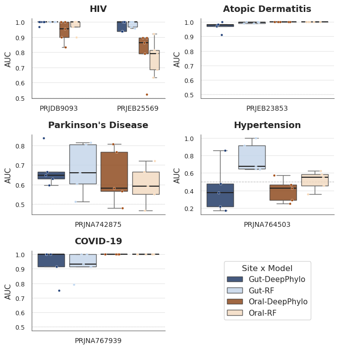

**Figure 26. Within-study 5-fold CV AUC — oral versus gut by disease.**  
Boxplots show per-fold AUC distributions for DeepPhylo (dark) and Random Forest (light), grouped by body site (Gut = blue, Oral = orange). Each panel corresponds to one disease/project. Individual fold AUCs are overlaid as jittered points.

Status: The notebook contains complete results and figures. The final manuscript-facing text should specify key disease-specific AUC values and highlight where DeepPhylo provides a meaningful advantage over Random Forest.

### 10.2 Microbial Age Prediction

Host age prediction from the oral microbiome was evaluated in `global-oral-microbiome/script/age_prediction/age_predict.ipynb` using a Random Forest regressor with study-stratified (leave-studies-out) cross-validation.

#### Method

**Data and QC.** The analysis used a genus-level feature BIOM table and the deduplicated oral QC metadata (`metadata_oral_qc_dedup.tsv`). Samples were retained if they had valid positive age (`age_cleaned > 0`), a non-missing oral site annotation, and were not labeled as "other" site (20,314 oral samples across 6 sites). Genera detected in ≤50 samples were discarded, and samples with <1,000 total reads were removed. Within each cross-validation fold, features were defined from the training set only, and counts were converted to per-sample relative abundances.

**Study selection.** Age prediction was performed for four oral sites with sufficient data: saliva (49 studies), tooth (12 studies), tongue (4 studies), and oral mucosa (5 studies). Only studies with >10 healthy-control samples were retained.

**Model and cross-validation.** A Random Forest regressor (500 trees, `random_state=42`, scikit-learn defaults otherwise) was trained on genus-level relative abundances with chronological age as the continuous target. A **leave-studies-out** design was used: studies were partitioned with K-fold CV (5 folds for saliva, tooth, oral mucosa; 4 folds for tongue, all shuffled with `random_state=42`). Each fold held out entire studies for testing; training used only healthy-control samples from the training studies. The test set was restricted to samples within the training age range (min–max) to avoid extrapolation. Feature selection, normalization, and alignment were performed independently per fold using only training data to prevent information leakage.

**Evaluation.** Performance was quantified by R² (coefficient of determination) and MAE (mean absolute error, years) on pooled out-of-fold healthy-control predictions per oral site. Two feature versions were compared: OTU-level (`biom_oral_qc_dedup.biom`) and genus-level, under the identical cross-validation scheme. Predicted-vs-actual scatter plots with linear fit and identity lines were generated for saliva and tooth sites.

#### Key Results

**Sample distribution by site.** Age distributions across the four major oral sites showed substantial variation. Saliva had the largest sample size and broadest age range (49 studies, 13,987 samples), while tooth, tongue, and oral mucosa had fewer studies and samples but still covered wide age ranges.

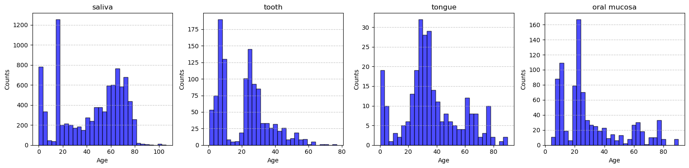

**Figure 27. Age distribution of samples across four oral sites after QC filtering.**  
Histograms show the number of samples per age bin for saliva, tooth, tongue, and oral mucosa. Saliva dominates the dataset, with samples spanning from infancy to elderly.

**Within-study vs cross-study generalization.** Within-study performance (samples from the same BioProject randomly split) was compared with cross-study performance (leave-studies-out, where test BioProjects were entirely unseen during training). Within-study Spearman correlations were high for all sites (ρ ≥ 0.70), but cross-study performance dropped substantially — revealing that a model trained on BioProjects from one set of studies generalizes poorly to unseen studies.

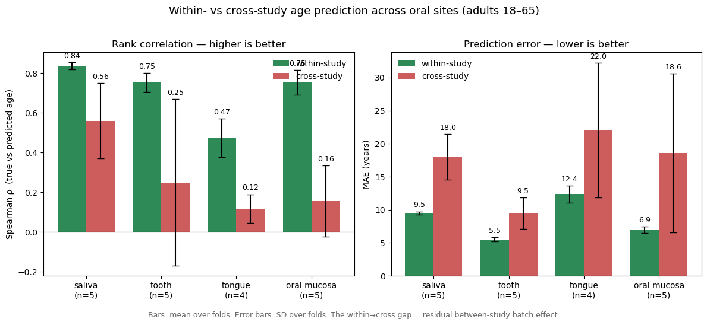

**Figure 40. Within-study vs cross-study age prediction — Spearman ρ and MAE across oral sites (adults 18–65).**  
Blue = within-study (samples randomly split within the same BioProject), orange = cross-study (leave-BioProjects-out). Left panel: Spearman rank correlation (higher is better). Right panel: Mean Absolute Error in years (lower is better). Bars show mean over folds; error bars show SD over folds. The large gap between within-study and cross-study bars demonstrates that memorizing study-specific signatures inflates apparent performance.

**Cross-study scatter plots.** Predicted vs true age for each oral site under cross-study evaluation showed varying degrees of accuracy. Saliva and tooth showed moderate correlation, while tongue and oral mucosa predictions were weaker due to limited training data.

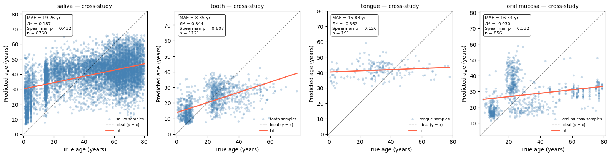

**Figure 41. Predicted versus true chronological age — cross-study (leave-BioProjects-out) evaluation by oral site.**  
Each point is a held-out healthy-control sample pooled across all CV folds. Points are colored by density (steelblue = low density, yellow = high density). The diagonal reference line indicates perfect prediction.

**Decomposing the apparent age signal.** When children (<18 years) and adults (18–65 years) were analyzed together, the apparent prediction accuracy was high (Spearman ρ ≈ 0.8 for saliva), but most of this signal came from the child/adult split — a simple BioProject lookup table (mapping each study to its mean age) outperformed the microbiome model. After removing study-level age structure (by regressing out study-mean age), the honest cross-study Spearman ρ for adults was near zero, indicating that the model primarily captures study-specific age structure rather than a universal microbial aging signature.

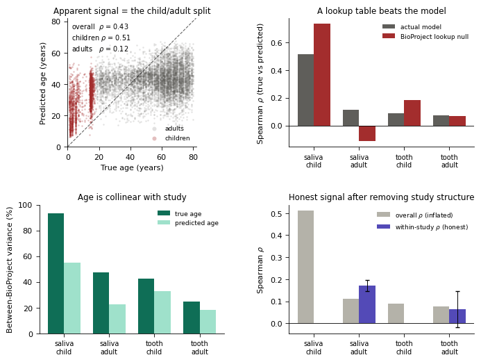

**Figure 42. Decomposing the apparent age prediction signal in saliva.**  
(a) Predicted vs true age for children (orange) and adults (blue), showing the model captures the child/adult split. (b) A simple BioProject lookup table (map study → mean age) outperforms the microbiome model. (c) Over 90% of between-BioProject variance in age is collinear with study membership. (d) After removing study structure, the honest cross-study Spearman ρ is close to zero.

**Within-study HC slope.** Within each BioProject, the microbiome age gap (predicted − true age) was regressed against chronological age in healthy controls. The median slope was negative (≈ −0.05), implying an α exponent (1 + slope) below 1 — i.e., the microbiome age gap decreases slightly with chronological age within a study.

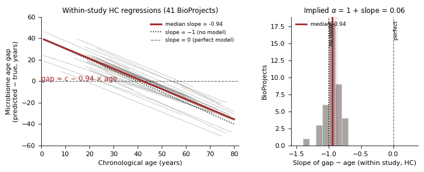

**Figure 43. Within-study healthy-control regressions of microbiome age gap on chronological age.**  
Left: Microbiome age gap vs chronological age across multiple BioProjects, each fit with an independent regression line. Right: Distribution of within-study slopes across BioProjects; most slopes are slightly negative, implying an α exponent < 1.

**Disease-associated age acceleration.** Across diseases and oral sites, the microbiome age gap (Δ age gap vs HC) was compared between disease cases and healthy controls. Several diseases showed positive age acceleration (predicted age > chronological age relative to HC), suggesting disease-associated shifts in microbial community composition that resemble aging.

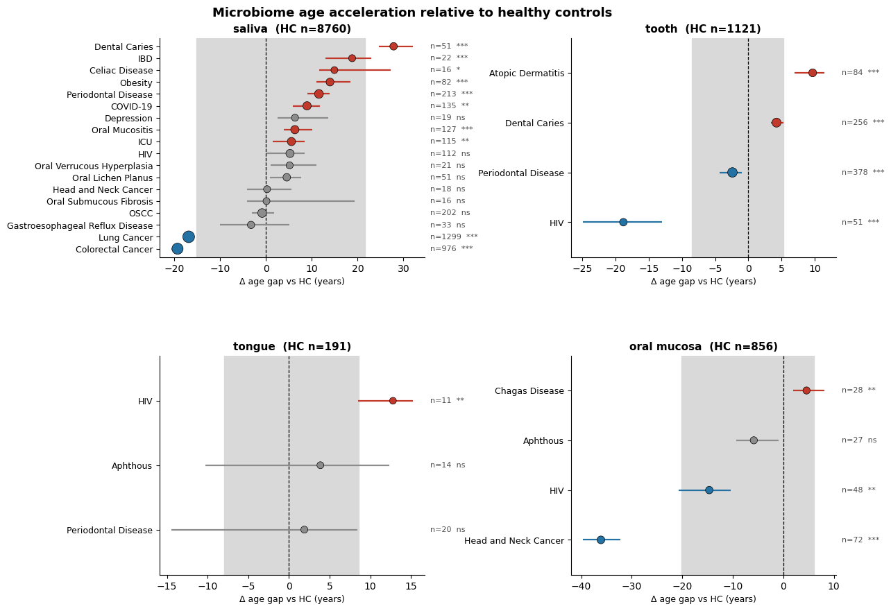

**Figure 44. Microbiome age acceleration relative to healthy controls across diseases and oral sites.**  
Positive Δ age gap indicates greater predicted microbial age in disease samples compared with same-site healthy controls. Bubble size reflects sample size.

**Disease effect as age offset.** The median age gap in disease cohorts was correlated with the cohort's mean age offset from HC (cohort mean age − HC mean age), suggesting that apparent disease effects on microbial age are confounded by age differences between disease and control groups within the same study.

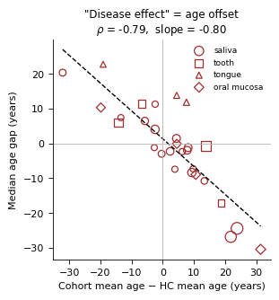

**Figure 45. Disease effect as a function of age offset between disease and control cohorts.**  
Each point represents one disease group within a BioProject. X-axis: cohort mean age minus HC mean age. Y-axis: median microbiome age gap. The correlation (ρ) indicates that much of the apparent "disease effect" on microbial age is explained by age differences between comparison groups.

Status: The notebook contains complete cross-validation predictions, evaluation metrics, and figures. The final manuscript text should report site-specific metrics and discuss the finding that most cross-study age prediction signal reflects study-level structure rather than a universal microbial clock.

## 11. Random Forest Prediction of Geographic and Host Variables

### Method

Random Forest (RF) classifiers were trained to predict geographic origin (continent), host sex, and oral sampling site from microbiome profiles. All scripts are in `new_analysis/randomforest_v2/`.

#### Data Input and Preprocessing

**Input tables.** The deduplicated oral QC BIOM table (`biom_oral_qc_dedup.biom`) and metadata (`metadata_oral_qc_dedup.tsv`) were loaded. The oral site column (`site_cleaned`) was harmonized via a site map: `saliva` → `Saliva`, `tongue` → `Tongue`, `tooth` → `Tooth`, `oral swab` → `Oral_swab`, `oral mucosa` → `Oral_Mucosa`, `gingiva` → `Gingiva`, `other` → `Others`.

**Feature table normalization.** After filtering to the relevant samples, the BIOM table was normalized to per-sample relative abundance via total-sum scaling (`table.norm(axis="sample")`). For computational efficiency, the dense matrix was converted to a CSR sparse format (`tocsr()`) with samples as rows and features (OTUs) as columns. Samples not present in the BIOM table after filtering were excluded from their respective analyses.

**Sample-to-index mapping.** A dictionary mapping each sample ID to its row index in the feature matrix was constructed once per script, enabling fast row slicing by sample ID during cross-validation.

#### Model Specification

All tasks used `sklearn.ensemble.RandomForestClassifier` with the following fixed hyperparameters:

| Parameter | Value |
|---|---|
| `n_estimators` | 200 |
| `class_weight` | `"balanced"` |
| `n_jobs` | 8 |
| `random_state` | `42 + repeat` (where `repeat ∈ {0, 1, 2, 3, 4}`) |

No hyperparameter tuning was performed; these fixed settings were used across all tasks to maintain comparability. Class imbalance was addressed by `class_weight="balanced"`, which weights each class inversely proportional to its frequency in the training set.

#### Cross-validation: BioProject-Stratified Fold Split

All train/test splits were performed at the **BioProject (study) level** — samples from the same study were never split across training and test partitions. This prevents over-optimistic evaluation due to study-specific batch effects leaking between train and test.

**Stratified fold construction.** For each binary classification task (positive BioProjects vs. negative BioProjects), folds were constructed using a custom `stratified_fold_split` function:

1. The list of positive BioProjects and the list of negative BioProjects were each shuffled independently using a per-repeat random seed (`RandomState(42 + repeat)`).
2. Shuffled BioProjects from both classes were distributed round-robin into `n_folds` buckets (one BioProject per bucket per round), ensuring each fold contains BioProjects from both classes.
3. For each fold *i*, the test set consisted of all samples from BioProjects assigned to bucket *i*; the training set consisted of samples from all other buckets.

The number of folds was set to `min(5, len(positive_BioProjects), len(negative_BioProjects))`, requiring at least 2 positive and 2 negative BioProjects for a task to be evaluable. Folds for which either training or test set lacked both classes were skipped.

**Repeated evaluation.** The fold construction and model evaluation were repeated `N_REPEATS = 5` times with different random seeds (`random_state = 42 + repeat`), producing `n_folds × 5` evaluation results per task to quantify variance from random fold composition.

#### Performance Evaluation

The area under the receiver operating characteristic curve (**AUC**) was the primary metric. For each fold, the model was trained on the training BioProjects and evaluated on the held-out test BioProjects. Predictions (class labels and class-1 probabilities) and per-sample metadata were saved to per-task CSV files (`*_predictions.csv`). Per-task summary statistics (mean, median, min, max AUC across all folds, plus BioProject counts) were saved to `*_summary.csv`.

#### Task 1: Geography One-vs-All (OVA) — `run_region_ova.py`

For each oral site (`Saliva`, `Tongue`, `Tooth`) and each of six target continents (`North America`, `Asia`, `Europe`, `Oceania`, `South America`, `Africa`), a binary classifier predicted whether a sample originated from the target continent (positive) or any other continent (negative).

**Sample selection.** Only BioProjects with ≥20 samples (`MIN_STUDY_SAMPLES = 20`) in the site–continent stratum were retained. A task was run only if both the positive and negative classes had ≥2 BioProjects.

**CV scheme.** BioProject-stratified fold split as described above: up to 5 folds × 5 repeats, yielding up to 25 evaluation points per (site, continent) pair.

#### Task 2: Geography One-vs-One (OVO) — `run_region_ovo.py`

For each oral site (`Saliva`, `Tongue`, `Tooth`) and all 15 pairwise combinations of the six continents (`itertools.combinations(REGIONS, 2)`), a binary classifier distinguished samples from continent A (positive) from samples from continent B (negative).

**Sample selection.** BioProjects with ≥20 samples in the site–continent stratum were retained. A pair was skipped if either continent had <2 BioProjects.

**CV scheme.** Same BioProject-stratified fold split (up to 5 folds × 5 repeats). Per-pair AUC was recorded. Visualization was performed with `plot_region_rf_combined.R`, which combined results across sites into a single heatmap.

#### Task 3: Sex Prediction — `run_sex_bp_loo.py`

Within each stratum defined by oral site (`Saliva`, `Tongue`, `Tooth`) × continent (six regions), a classifier predicted host sex (F = positive, M = negative).

**Sample selection.** Filters included: (i) `sex_cleaned ∈ {"F", "M"}`, (ii) BioProject has ≥10 samples (`MIN_BP_SAMPLES = 10`), and (iii) BioProject contains samples of both sexes. At least 2 valid BioProjects per (site × continent) stratum were required.

**CV scheme — Leave-One-BioProject-Out (LOO).** Unlike the fold-split approach, each BioProject within the stratum served as the test set in turn, with all other BioProjects forming the training set. This provides a direct per-study generalization estimate and avoids the randomness of fold assignment. Per-BioProject AUC was recorded.

#### Task 4: Oral Site One-vs-All (OVA) — `run_site_ova.py`

For each of the five major oral sites (`Saliva`, `Tooth`, `Tongue`, `Oral_swab`, `Oral_Mucosa`), a binary classifier predicted whether a sample was from the target site (positive) or any other site (negative).

**Sample selection.** BioProjects with ≥20 samples (`MIN_STUDY_SAMPLES = 20`) were retained. At least 3 positive BioProjects (`MIN_POS_BP = 3`) and 3 negative BioProjects were required per target site.

**CV scheme.** BioProject-stratified fold split: 5 folds × 5 repeats.

#### Task 5: Oral Site One-vs-One (OVO) — `run_site_ovo.py`

For all 10 pairwise combinations of the five oral sites (`itertools.combinations(TARGET_SITES, 2)`), a binary classifier distinguished site A from site B.

**Sample selection.** BioProjects with ≥20 samples were retained. At least 3 BioProjects (`MIN_BP = 3`) per site in the pair were required.

**CV scheme.** BioProject-stratified fold split: up to 5 folds × 5 repeats. Per-pair AUC was recorded.

#### Visualization

All results were visualized with `plot_rf_results.py` and `plot_region_rf_combined.R`, generating: barplots showing mean AUC per task × category, heatmaps of per-task AUC (combined across sites, or per-site for OVO), and boxplots of per-fold AUC distributions.

### Main Figures

#### Geography Prediction

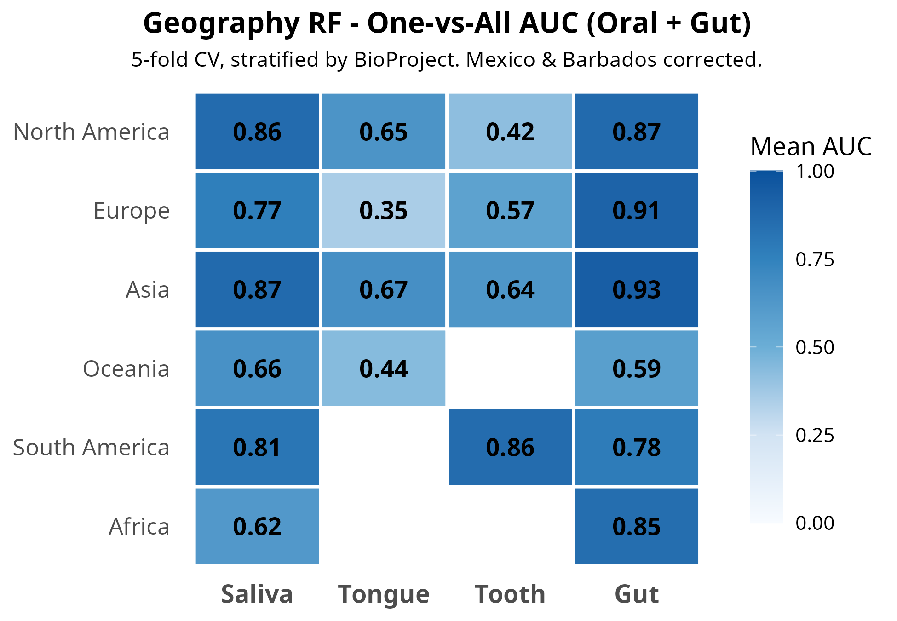

**Figure 40. Geography One-vs-All prediction — combined heatmap across sites.**  
Heatmap showing mean AUC for RF classifiers predicting each target continent (OVA) within each oral site. Higher AUC indicates that the target continent's microbiome composition is more distinguishable from all others. Results aggregated across 5-fold × 5-repeat BioProject-stratified CV.

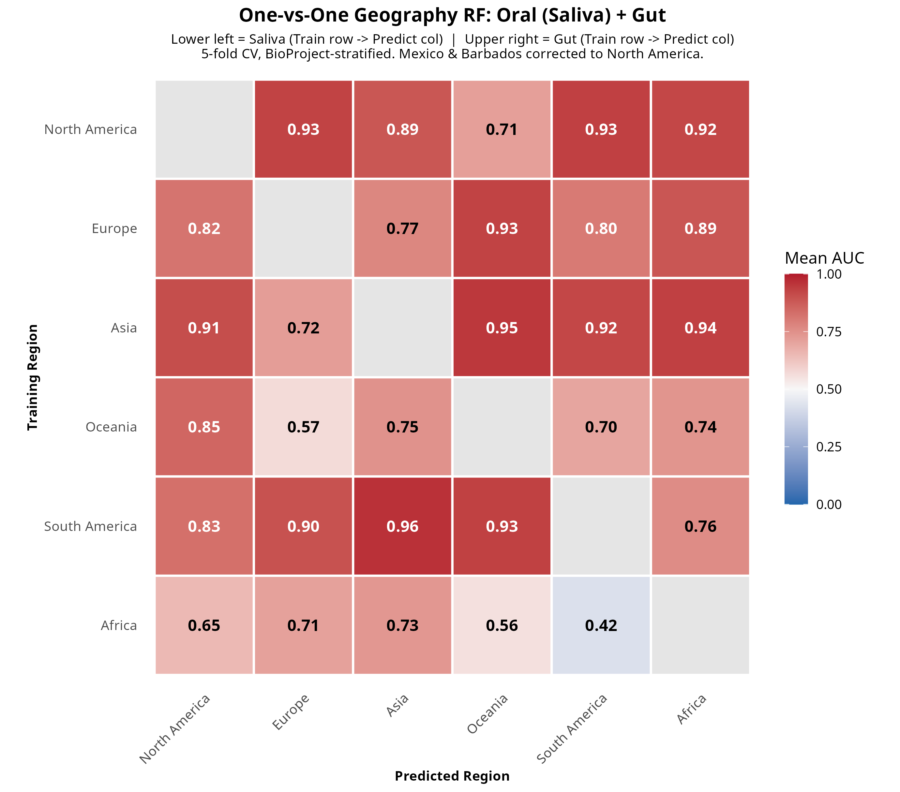

**Figure 41. Geography One-vs-One prediction — combined heatmap.**  
Pairwise continent classification AUC across oral sites (Saliva, Tongue, Tooth) and Gut. Each cell shows the mean AUC for distinguishing the row continent from the column continent using microbiome features. Stronger discrimination (higher AUC) between geographically distant populations indicates biogeographic structure in the human microbiome.

#### Sex Prediction

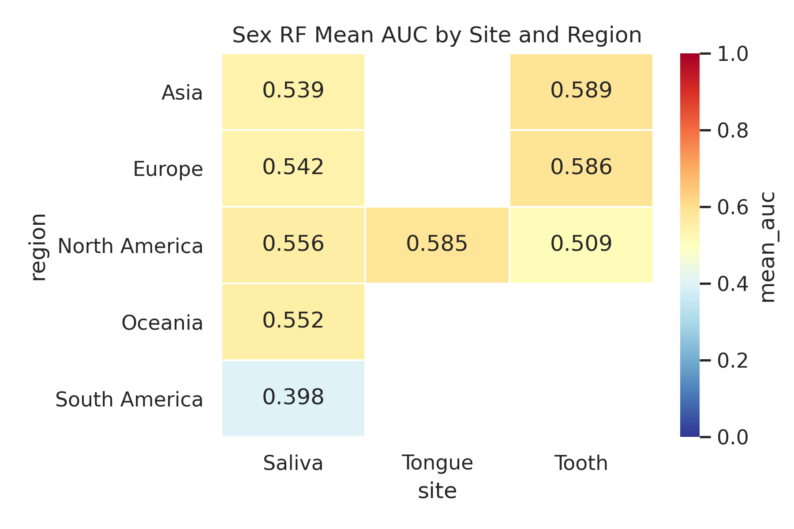

**Figure 42. Sex prediction — BioProject Leave-One-Out AUC heatmap.**  
Mean AUC for predicting host sex (F vs M) within each oral site × continent stratum. Each cell summarizes per-BioProject AUCs from a leave-one-BioProject-out evaluation. Only strata with ≥2 valid BioProjects are shown.

#### Oral Site Prediction

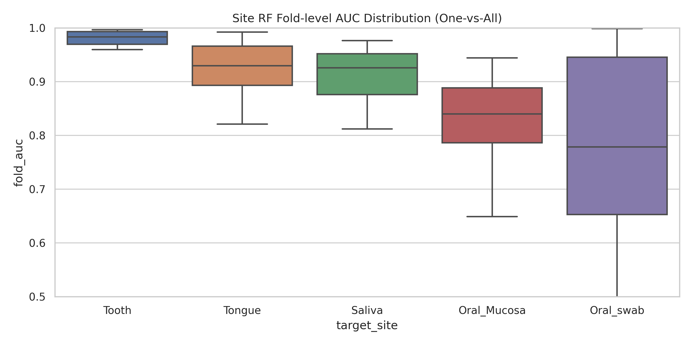

**Figure 43. Oral site One-vs-All prediction — fold AUC distribution.**  
Boxplots showing the distribution of per-fold AUCs across 5-fold × 5-repeat BioProject-stratified CV for each target oral site (OVA). The high AUCs for Tooth, Tongue, and Saliva demonstrate that oral site is strongly encoded in the microbiome profile.

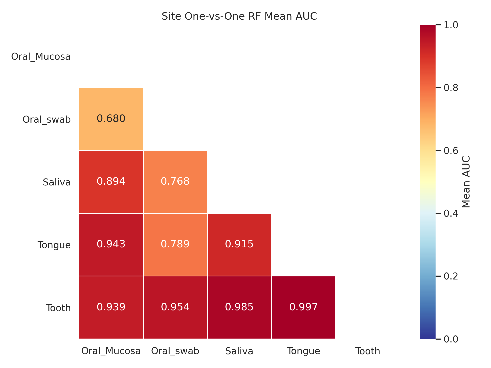

**Figure 44. Oral site One-vs-One prediction — pairwise AUC heatmap.**  
Heatmap showing mean AUC for distinguishing each pair of oral sites. Near-perfect discrimination for certain site pairs (e.g., Tooth vs Tongue, Saliva vs Tooth) reflects the strong site-specificity of the oral microbiome, while lower AUCs for others (e.g., Oral_swab vs Oral_Mucosa) indicate more similar community composition.

### Key Results

Geography prediction performance varied by oral site and target continent. Saliva showed the strongest geography signal (mean AUC 0.59–0.87 across continents), consistent with saliva being the most broadly sampled site. Gut samples achieved particularly high geography prediction accuracy (mean AUC 0.59–0.93), supporting the established biogeographic structure of the gut microbiome. Sex prediction from the oral microbiome was modest (per-site × region mean AUC typically 0.51–0.59), consistent with the relatively subtle sex differences identified by MaAsLin3 differential abundance analysis (Section 6). Oral site prediction showed the strongest signal: site OVA mean AUC ranged from 0.76 (Oral_swab) to 0.98 (Tooth), and pairwise site discrimination was near-perfect for several comparisons (Tooth vs Tongue AUC = 0.997, Saliva vs Tooth AUC = 0.985), confirming that oral site is the dominant driver of microbiome variation.

Supplementary files:

- `new_analysis/randomforest_v2/region_ova_summary.csv`, `region_ovo_summary.csv`
- `new_analysis/randomforest_v2/sex_bp_loo_summary.csv`
- `new_analysis/randomforest_v2/site_ova_summary.csv`, `site_ovo_summary.csv`
- `new_analysis/randomforest_v2/region_ova_fold_auc_boxplot.png`, `region_ovo_fold_auc_boxplot.png`
- `new_analysis/randomforest_v2/sex_bp_loo_fold_auc_boxplot.png`, `sex_bp_loo_barplot.png`
- `new_analysis/randomforest_v2/site_ova_barplot.png`, `site_ovo_fold_auc_boxplot.png`

## 12. Oral-Gut Paired and Cross-body-site Analyses

Status: to be finalized.

This section will cover paired oral–gut microbiome analyses, including cross-body-site comparisons using samples collected from the same subjects or same cohorts. The analysis design (paired-subject vs. cross-cohort), distance metrics, and statistical framework are under review.

Existing preliminary outputs are available under `oral_gut_0127` and `genus_correction/` for reference; final figures and legends will be incorporated once the analysis is locked.

## 13. Co-occurrence Network Analysis

### Method

A global co-occurrence network of healthy oral (salivary) microbiomes was constructed in `global-oral-microbiome/script/network/network.ipynb`, following the network-integration approach of **NetMoss** (Xiao et al., *Nature Computational Science*, 2022). The analysis integrated per-study microbial correlation networks into a single consensus network.

**Data and study selection.** The deduplicated oral QC BIOM table and metadata were used, restricting to healthy-control (HC) samples from saliva. Per-study SparCC correlation networks were precomputed for studies with >50 HC saliva samples (`run_SpiecEasi.R`, submitted via `run_slurm.sh`). Each study's SparCC correlation matrix was stored in `sparcc_hc_saliva/<bioproject_id>.csv`.

**Network integration (NetMoss-style pooling).** Because different studies cover different subsets of taxa, the union of all taxa across studies was taken as the shared feature space. Each study's correlation matrix was aligned to this union. For each taxon pair *(i, j)*, the per-study correlations *r_k* were combined using an inverse-variance-weighted average (fixed-effect meta-analysis):

$$\bar{r}_{ij} = \frac{\sum_k w_k \cdot r_{k}}{\sum_k w_k}, \quad w_k = \frac{n_k - 1}{1 - r_{k}^{2}}$$

where *n_k* is the number of samples in study *k* available for the taxon pair. Only taxon–taxon correlations from studies where both taxa were present contributed to the weighted average. The resulting consensus correlation matrix captures robust, reproducible microbial associations across independent cohorts while down-weighting study-specific signals.

**Sparsity correction.** The pooled correlation distribution showed a sharp peak near zero, driven by feature sparsity: most taxon pairs are co-observed in only a few studies, and missing pairs contribute zero to the numerator while studies still add to the denominator weight. To recover biologically meaningful associations, a sparsity-aware thresholding approach was applied, retaining only edges with sufficient multi-study support.

**Network construction and analysis.** The final consensus network was thresholded to retain high-confidence edges, and network properties (degree distribution, modularity, hub identification) were characterized. The resulting network represents a global map of microbial co-occurrence in the healthy human oral cavity, integrating evidence across diverse geographic and demographic cohorts.

### Main Figures

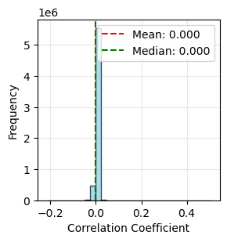

**Figure 46. Distribution of pooled (inverse-variance-weighted) correlations across all taxon pairs.**  
Histogram of the upper-triangle entries of the combined correlation matrix after NetMoss-style integration of per-study SparCC networks. The sharp peak near zero reflects the contribution of taxon pairs co-observed in only a small number of studies.

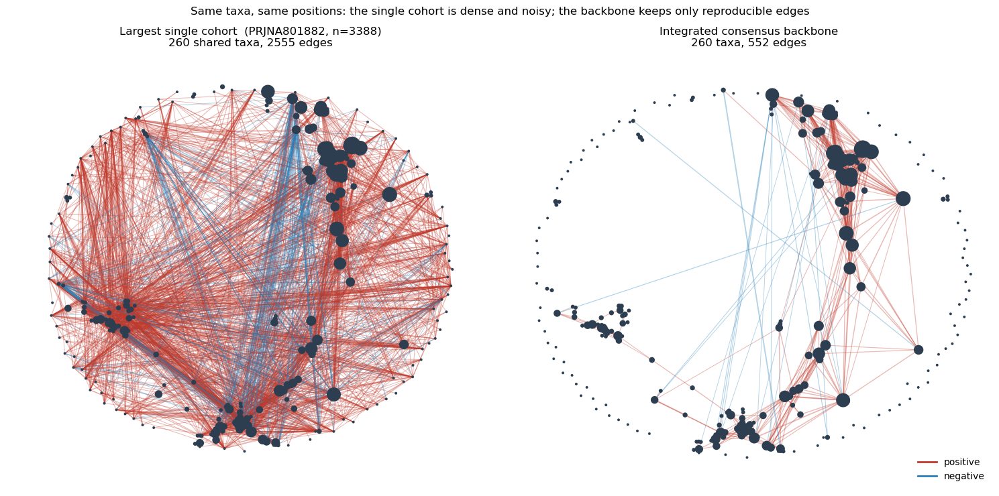

**Figure 47. Comparison of per-study correlation networks versus the integrated consensus network.**  
Per-study SparCC networks (individual panels) are compared with the pooled consensus network. The consensus network highlights edges that are reproducibly detected across multiple independent cohorts.

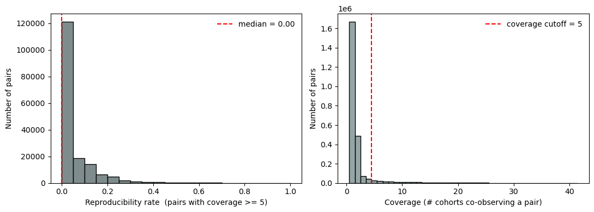

**Figure 48. Edge reproducibility as a function of multi-study support.**  
The reproducibility of network edges increases with the number of studies in which a taxon pair is co-observed, validating the integration approach.

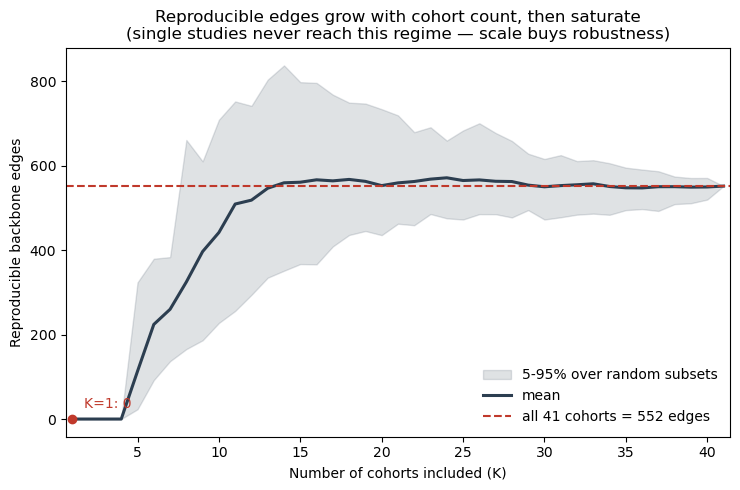

**Figure 49. Saturation analysis of the consensus network.**  
Cumulative unique edges discovered as additional studies are incorporated, showing convergence behavior of the integrated network.

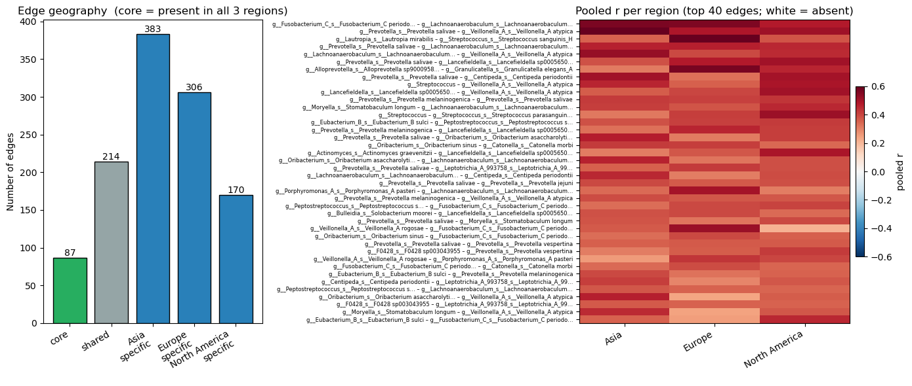

**Figure 50. Universality of top edges across geographic regions.**  
The most strongly co-occurring taxon pairs in the global consensus network are also detected within individual geographic regions, demonstrating the universal structure of the healthy oral microbiome.

### Key Results

The integrated network captures robust microbial associations that are reproducible across independent studies, filtering out spurious correlations driven by individual cohort characteristics. Key network properties, hub taxa, and community structure are characterized inline in the notebook.

Status: The notebook contains complete network construction, integration, and analysis code with inline figures. The final manuscript text should highlight key hub taxa, describe the modular organization of the healthy oral microbiome, and discuss how cross-study network integration overcomes the limitations of single-cohort correlation analyses.

Supplementary files:

- `global-oral-microbiome/script/network/run_SpiecEasi.R` (per-study SparCC computation)
- `global-oral-microbiome/script/network/run_slurm.sh` (Slurm job submission script)

## 14. Additional Analyses for Supplementary Material

### Longitudinal and Repeated Sampling

Existing outputs:

- `new_analysis/longitudinal/longitudinal_bioproject_summary.csv`
- `new_analysis/longitudinal/repeated_subjects.csv`
- `new_analysis/longitudinal/top_repeated_subject_projects.png`

These results can support a supplementary description of repeated sampling, longitudinal studies, and deduplication rationale.

### Red-complex Taxa

Existing outputs:

- `new_analysis/red_complex/red_complex_by_status_boxplot.png`
- `new_analysis/red_complex/red_complex_healthy_site_geography_heatmap.png`
- `new_analysis/red_complex/red_complex_sample_abundance.tsv`

These results may be useful for a focused periodontal-pathogen supplementary analysis, especially if the disease section emphasizes periodontal disease and oral cancer.

## Reproducibility Index

| Module | Main script/report | Main outputs |
|---|---|---|
| Metadata curation | `global-oral-microbiome/data/projects/*/metadata_curation_v2.md` | curated project metadata |
| QC merge | `new_analysis/merge_all_for_qc_raw.py` | `metadata_all_for_qc_raw.tsv` |
| Final QC tables | `new_analysis/generate_metadata_tables.py` | `metadata_all_qc.tsv`, `metadata_oral_qc.tsv`, `metadata_oral_qc_dedup.tsv`, BIOM tables |
| QC report | `new_analysis/generate_qc_report.py` | `new_analysis/data_qc_pipeline.html` |
| Overview | `new_analysis/overview/run_overview_summary.py` | overview PNG/CSV files |
| Alpha diversity (v2) | `new_analysis/alpha_diversity_v2/run_shannon_mixed_model.R` | `shannon_forest_plot.png`, model CSV/RDS |
| Beta diversity | `oral-v2-code-results-YL/01-beta-diversity-pcoa/*.R/*.py` | PCoA matrix PNGs, PERMANOVA tables |
| Phylum composition | `oral-v2-code-results-YL/04-phylum-relative-stacked/*.R/*.sh` | stacked phylum composition PNGs |
| HOMD/GG2 profiling | `ASV_vs_HOMD_analysis/containment_derep/closed_reference_report/GG2_closed_reference_profile_report.html` | closed-reference report and profiling tables |
| Suspicious backbone filtering | `ASV_vs_HOMD_analysis/containment_derep/gg2_backbone_suspicious_filter` | `asv_funnel_plot.png`, summary JSON |
| Saliva MaAsLin3 — age | `new_analysis/maaslin3_v2/run_age_saliva.R` | `saliva_age_heatmap.png` |
| Saliva MaAsLin3 — sex & region by geography | `new_analysis/maaslin3_v2/run_by_geography_saliva.R` | `saliva_sex-cleaned_by_geography.png`, `saliva_sequencing-region-cleaned_consistent_heatmap.png` |
| Saliva MaAsLin3 plots | `new_analysis/maaslin3_v2/plot_saliva_results.R` | heatmap PNGs, summary CSVs |
| Geography MaAsLin3 | `oral-v2-code-results-YL/02-continent-differential-analysis/*.R` | Figure 5A-C PNGs |
| Site pairwise MaAsLin3 | `new_analysis/maaslin3_v2/site_pairwise/run_site_pairwise_maaslin3.R` | `bubble_matrix.png`, `top50_heatmap.png`, `ridgeline_top5.png` |
| Site pairwise plots | `new_analysis/maaslin3_v2/site_pairwise/plot_site_pairwise_results.R` | `mean_abundance_heatmap.png` |
| RF — geography prediction | `new_analysis/randomforest_v2/run_region_ova.py`, `run_region_ovo.py` | `region_ova_heatmap_combined.png`, `region_ovo_heatmap_combined.png` |
| RF — sex prediction | `new_analysis/randomforest_v2/run_sex_bp_loo.py` | `sex_bp_loo_heatmap.png` |
| RF — site prediction | `new_analysis/randomforest_v2/run_site_ova.py`, `run_site_ovo.py` | `site_ova_fold_auc_boxplot.png`, `site_ovo_heatmap.png` |
| RF plots | `new_analysis/randomforest_v2/plot_rf_results.py`, `plot_region_rf_combined.R` | heatmaps, barplots, boxplots |
| Disease MaAsLin3 (v2) | `new_analysis/maaslin3_v2/run_disease_all_sites.R` | `disease_results_all.tsv` |
| Disease shared plots | `new_analysis/maaslin3_v2/plot_disease_shared.R` | `shared_genera_heatmap.png`, `disease_genera_upset.png` |
| Disease prediction | `global-oral-microbiome/script/disease_classification/disease_predict.ipynb` | DeepPhylo vs RF LOSO/CV AUCs, inline figures |
| Age prediction | `global-oral-microbiome/script/age_prediction/age_predict.ipynb` | leave-studies-out CV predictions, R²/MAE |
| Co-occurrence network | `global-oral-microbiome/script/network/network.ipynb` | NetMoss-style consensus network, 5 inline figures |
| Oral-gut | `oral_gut_0127` | ADONIS result tables and figures |

## Items Needing Final Confirmation

1. Confirm whether all figures embedded in this report were generated after the latest `generate_metadata_tables.py` run. If not, either regenerate figures or annotate the exact metadata version used.
2. Finalize the disease prediction section by reporting key disease-specific AUC values for DeepPhylo vs. Random Forest and confirming which diseases show a meaningful advantage from phylogenetic modeling.
3. Finalize the age prediction section by reporting site-specific R² and MAE from the genus-level leave-studies-out model and quantifying the cross-study generalization gap.
4. Finalize the network analysis section by highlighting key hub taxa, modular organization, and the biological interpretation of the consensus network.
5. Finalize whether the oral-gut section is paired-subject analysis or cross-cohort comparison.
6. Decide which figures should be promoted to main manuscript figures versus supplementary figures.
7. Convert hard-coded legacy paths in some YL scripts to project-relative paths before using the report as a reproducibility supplement.

